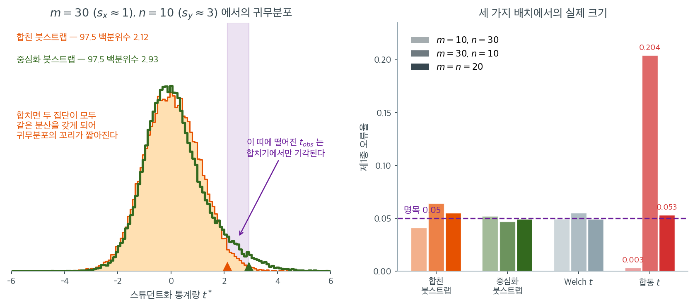

# 두 평균에 대한 붓스트랩 검정

## 1. 동기

이표본 $t$ 검정은 자료가 정규분포를 따르거나(또는 중심극한정리가 통할 만큼 표본이 크다는) 가정 아래 독립인 두 집단의 평균을 비교한다. 이 조건이 깨지면 --- 예를 들어 치우쳤거나 꼬리가 두꺼운 분포에서 작은 표본을 얻으면 --- 붓스트랩이 대안이 된다.

이표본 상황의 핵심 난점은 귀무가설 $H_0: \mu_X = \mu_Y$를 반영하는 붓스트랩 표본을 생성하는 일이다. 주된 전략이 둘 있다. **합치기**(pooling)와 **중심화**(centering)이다.

---

## 2. 가설

독립인 두 표본을 관측한다.

- 집단 X: $x_1, \ldots, x_m$, 표본평균 $\bar{x}$, 표본표준편차 $s_x$
- 집단 Y: $y_1, \ldots, y_n$, 표본평균 $\bar{y}$, 표본표준편차 $s_y$

검정은

$$
H_0: \mu_X = \mu_Y \quad \text{대} \quad H_1: \mu_X \neq \mu_Y
$$

이다. 관측 검정통계량은 스튜던트화하지 않으면

$$
d_{\text{obs}} = \bar{x} - \bar{y}
$$

스튜던트화하면

$$
t_{\text{obs}} = \frac{\bar{x} - \bar{y}}{\sqrt{s_x^2/m + s_y^2/n}}
$$

이다.

---

## 3. 방법 1: 합친 붓스트랩

$H_0$ 아래에서 두 집단이 같은 분포에서 온다. 합친 붓스트랩은 모든 관측값을 합치고 그 합친 표본에서 재표집하여 이를 강제한다.

**알고리즘:**

1. $t_{\text{obs}}$를 계산한다.
2. 모든 관측값을 합친다: $z_1, \ldots, z_{m+n} = x_1, \ldots, x_m, y_1, \ldots, y_n$.
3. $b = 1, \ldots, B$에 대해:
    - 합친 표본에서 복원추출로 $m$개를 뽑아 "집단 X" 붓스트랩 표본을 만든다.
    - 합친 표본에서 복원추출로 $n$개를 뽑아 "집단 Y" 붓스트랩 표본을 만든다.
    - 같은 검정통계량 공식으로 $t^{*(b)}$를 계산한다.
4. 양측 $p$값은

$$
p = \frac{1}{B}\sum_{b=1}^{B}\mathbf{1}\!\left(|t^{*(b)}| \ge |t_{\text{obs}}|\right)
$$

!!! note "합치기가 적절한 경우"
    합친 붓스트랩은 $H_0$ 아래에서 두 집단이 **같은 분포**를 갖는다고 가정한다. 평균만 같고 분산이나 모양이 다르면 합치기가 오도할 수 있다. 그런 경우에는 중심화 접근(방법 2)이 낫다.

### 합친 붓스트랩이 무너지는 자리

두 방법 가운데 합친 붓스트랩을 코드로 옮긴다. 분산이 다르고 표본크기가 불균형하면 무너지는 자리를 수로 본다.

<div class="exbox" markdown>

**보기 1.** <span class="diff easy" title="쉬움"></span> 이표본 붓스트랩 검정. 합쳐서 **복원추출**하는 이 방식은 라벨을 섞는 순열검정과 사촌이지만 똑같지는 않다.

**(1)** 합친 자료의 경험분포 분산을 $\hat\sigma_p^2$이라 할 때 귀무분포 $\bar X^{*} - \bar Y^{*}$의 평균과 분산을 구하시오. 같은 자료의 **순열** 귀무분포와 표준편차의 비는 얼마인가.

**(2)** 두 정규 모집단 $N(52, 10^2)$ 과 $N(48, 10^2)$ 에서 각각 $40$ 개를 뽑은 자료로 확인하고, 붓스트랩 $p$값을 정규근사·Welch $t$ 검정과 견주시오.

</div>

??? success "풀이"

    **(1) 해석적으로.** 합친 $N = m + n$개에서 **복원으로** $N$개를 뽑아 앞의 $m$개를 $X$, 나머지를 $Y$라 부른다. 뽑기가 독립이므로 두 집단의 평균도 독립이고, 각각의 분산이 $\hat\sigma_p^2/m$과 $\hat\sigma_p^2/n$이다. 따라서

    $$
    E_*\!\left[\bar X^{*} - \bar Y^{*}\right] = 0,
    \qquad
    \operatorname{Var}_*\!\left(\bar X^{*} - \bar Y^{*}\right)
    = \hat\sigma_p^2\left(\frac1m + \frac1n\right)
    $$

    이다($\hat\sigma_p^2 = \frac1N\sum_i (z_i - \bar z)^2$, $z$는 합친 자료).

    **순열검정과의 차이는 딱 하나다.** [이표본 순열검정](../permutation/two_sample.md) 보기 $2$에서 라벨을 **비복원으로** 섞을 때의 분산이 $S^2(1/m + 1/n)$임을 보았고, 여기서 $S^2$은 $N-1$로 나눈 표본분산이다. $\hat\sigma_p^2 = \frac{N-1}{N}S^2$이므로

    $$
    \frac{\operatorname{SD}_{\text{붓스트랩}}}{\operatorname{SD}_{\text{순열}}} = \sqrt{\frac{N-1}{N}}
    $$

    다. $N = 80$이면 $0.99373$으로 **$0.6\%$ 좁다.** 복원추출이 유한모집단 보정을 잃는 대신 집단의 크기를 고정하지 않기 때문이며, $N$이 크면 사라지는 차이다.

    **(2) 수치적으로.** 함수는 이렇다.

    ```python
    def bootstrap_two_sample(x, y, n_boot=10_000, rng=None):
        """H0: 두 평균이 같다에 대한 붓스트랩 검정.

        귀무가설이 참이면 두 집단이 같은 모집단에서 나온 것이다. 그래서 둘을
        합쳐 하나의 웅덩이로 만들고 거기서 다시 뽑는다.
        """
        rng = rng or np.random.default_rng(0)
        obs_diff = x.mean() - y.mean()
        pooled = np.concatenate([x, y])
        m, N = len(x), len(pooled)
        P = pooled[rng.integers(0, N, (n_boot, N))]
        boot_diffs = P[:, :m].mean(axis=1) - P[:, m:].mean(axis=1)
        p_value = ((np.abs(boot_diffs) >= abs(obs_diff)).sum() + 1) / (n_boot + 1)
        return obs_diff, p_value, boot_diffs
    ```

    두 정규 표본을 만들어 돌려 본다.

    ```python
    import numpy as np
    from scipy import stats

    # 원래 이 자료는 한 쪽에서 같은 생성기로 차례로 뽑은 것이다. 아래 수를
    # 그대로 쓰려면 앞의 뽑기를 똑같이 소비해야 한다.
    rng_data = np.random.default_rng(1)
    rng = np.random.default_rng(7)
    rng_data.exponential(scale=5, size=50)       # 일표본 보기가 쓴 뽑기

    x = rng_data.normal(52, 10, 40)
    y = rng_data.normal(48, 10, 40)
    diff, p2, boots2 = bootstrap_two_sample(x, y, rng=rng)

    pooled = np.concatenate([x, y]); N = len(pooled); m = len(x)
    sp = pooled.std(ddof=0)
    print(f"합친 sigma-hat = {sp:.4f}")
    print(f"예측 귀무 SD = sigma-hat*sqrt(1/m+1/n) = {sp*np.sqrt(1/m+1/(N-m)):.4f}"
          f"   (모의 {boots2.std(ddof=1):.4f},  몬테카를로 오차 {sp*np.sqrt(2/m)/np.sqrt(2*10000):.4f})")
    print(f"순열(비복원) 판본의 SD = S*sqrt(2/m) = {pooled.std(ddof=1)*np.sqrt(2/m):.4f}"
          f"   비 = {sp/pooled.std(ddof=1):.6f}  (sqrt((N-1)/N) = {np.sqrt((N-1)/N):.6f})")
    z2 = diff / (sp*np.sqrt(2/m))
    print(f"z = {z2:.4f},  정규근사 양측 p = {2*stats.norm.sf(z2):.4f}")
    w = stats.ttest_ind(x, y, equal_var=False)
    print(f"붓스트랩 p = {p2:.4f},   Welch t p = {w.pvalue:.4f}")
    ```

    출력:

    ```
    합친 sigma-hat = 9.4434
    예측 귀무 SD = sigma-hat*sqrt(1/m+1/n) = 2.1116   (모의 2.0941,  몬테카를로 오차 0.0149)
    순열(비복원) 판본의 SD = S*sqrt(2/m) = 2.1249   비 = 0.993730  (sqrt((N-1)/N) = 0.993730)
    z = 1.9657,  정규근사 양측 p = 0.0493
    붓스트랩 p = 0.0471,   Welch t p = 0.0504
    ```

    **유도한 두 식이 맞는다.** 예측 $2.1116$에 대해 모의값 $2.0941$이 몬테카를로 오차 $0.0149$의 $1.2$배 안에 있고, 순열 판본과의 비 $0.993730$이 $\sqrt{79/80}$과 여섯 자리까지 같다.

    **세 $p$값이 $0.05$ 양쪽에 걸쳐 있다.** 붓스트랩 $0.0471$과 정규근사 $0.0493$은 기각하고, Welch $0.0504$는 턱걸이로 기각하지 못한다. **셋의 차이는 $0.0033$에 지나지 않지만 $\alpha = 0.05$라는 선 위에 걸려 결론이 갈린다.** 붓스트랩 $p$값 자체의 몬테카를로 표준오차가 $\sqrt{0.05 \times 0.95/10^4} = 0.0022$이므로, 이 자료에서 "유의한가"를 묻는 것은 의미가 없다. **구간을 보고하거나 자료를 더 모으는 것이 옳은 대응이다.**

!!! warning "합치기는 등분산도 가정한다"
    합쳐진 자료에서 재표집하면 두 집단이 같은 분산을 갖게 된다. 두 집단의 분산이 실제로 다르고 표본크기가 불균형하면 이 검정의 제1종 오류율이 무너진다. 그때는 각 집단을 자기 평균으로 중심화한 뒤 **따로** 재표집해야 한다([두 평균에 대한 붓스트랩 검정](./two_means.md) 참조).

---

---

## 4. 방법 2: 중심화 붓스트랩

중심화 붓스트랩은 분포가 같다고 가정하지 않고 $\mu_X = \mu_Y$만 강제한다. 각 집단을 평균 $0$(또는 임의의 공통값)이 되도록 이동한다.

$$
\tilde{x}_i = x_i - \bar{x}, \quad \tilde{y}_j = y_j - \bar{y}
$$

**알고리즘:**

1. $t_{\text{obs}}$를 계산한다.
2. 각 집단을 중심화한다: $\tilde{x}_i = x_i - \bar{x}$, $\tilde{y}_j = y_j - \bar{y}$.
3. $b = 1, \ldots, B$에 대해:
    - $\{\tilde{x}_1, \ldots, \tilde{x}_m\}$에서 복원추출로 $m$개를 뽑는다.
    - $\{\tilde{y}_1, \ldots, \tilde{y}_n\}$에서 복원추출로 $n$개를 뽑는다.
    - 같은 검정통계량 공식으로 $t^{*(b)}$를 계산한다.
4. 위와 같이 $p$값을 계산한다.

중심화 접근은 두 집단이 서로 다른 분산과 모양을 갖는 것을 허용하고, 평균이 같다는 귀무가설만 부과한다(중심화 후 둘 다 $0$).

!!! tip "합치기와 중심화 중 무엇을 고를까"
    $H_0$ 아래에서 두 집단의 분포가 비슷하다고 믿으면 **합치기**를 쓴다(합동 $t$ 검정에 대응). 분산이나 모양이 다를 수 있으면 **중심화**를 쓴다(Welch $t$ 검정에 대응). 확신이 없으면 더 로버스트한 중심화를 쓴다.

두 방법이 실제로 얼마나 다른지는 분산이 다르고 표본크기가 불균형할 때 드러난다. $m = 30$($s_x \approx 1$)과 $n = 10$($s_y \approx 3$)에서 같은 자료로 두 귀무분포를 만들어 보았다.



왼쪽에서 두 분포의 가운데는 거의 같지만 **꼬리가 다르다**. 합친 붓스트랩의 $97.5$ 백분위수가 $2.12$인 데 반해 중심화 붓스트랩은 $2.93$이다. 이유는 합치는 순간 두 붓스트랩 집단이 모두 합동분산 $\approx (30 \times 1 + 10 \times 9)/40 = 3$에서 값을 받기 때문이다. 즉 작은 집단의 분산이 실제 $9$에서 $3$으로 줄어들고, 작은 집단이 지배하던 $\widehat{\text{se}}$가 작아져 $t^*$의 꼬리가 짧아진다. 반면 관측된 $t_{\text{obs}}$는 실제 분산 $s_x^2 \approx 1$과 $s_y^2 \approx 9$로 계산된 값이다. **귀무분포와 관측 통계량이 서로 다른 분산 구조를 전제하는 셈이며**, 보라색 띠에 떨어진 통계량은 합치기에서만 기각된다.

오른쪽이 그 결과다. $m = 30$, $n = 10$ 배치에서 합친 붓스트랩의 제1종 오류율이 $0.064$로 $28\%$ 부풀고, 중심화 붓스트랩은 $0.047$로 명목값을 지킨다. 세 배치 전체에서 중심화는 $0.047$--$0.052$ 범위를 벗어나지 않으며 Welch $t$ 검정과 사실상 동등하다.

가장 극적인 것은 합동 $t$ 검정이다. 같은 배치에서 $0.204$로 명목값의 **네 배**이고, 표본크기를 뒤집으면 $0.003$으로 지나치게 보수적이 된다. 작은 집단의 분산이 클 때 합동분산이 그것을 과소평가하고, 반대 배치에서는 과대평가하기 때문이다. Behrens-Fisher 문제의 전형적 증상이며, 스튜던트화 통계량을 쓴 중심화 붓스트랩은 **사실상 비모수 Welch 검정**으로서 이 함정을 피한다.

---

## 5. 스튜던트화와 비스튜던트화

일표본과 마찬가지로 스튜던트화 판본이 대체로 낫다.

| 판본 | 검정통계량 | 성질 |
|---|---|---|
| 비스튜던트화 | $d^{*(b)} = \bar{x}^{*(b)} - \bar{y}^{*(b)}$ | 단순하지만 분산 차이에 민감 |
| 스튜던트화 | $t^{*(b)} = \dfrac{\bar{x}^{*(b)} - \bar{y}^{*(b)}}{\sqrt{s_x^{2*(b)}/m + s_y^{2*(b)}/n}}$ | 더 로버스트, 제1종 오류 통제가 좋음 |

스튜던트화 판본은 각 붓스트랩 표본의 변동에 적응하므로, 특히 두 집단의 분산이 다를 때 더 정확한 $p$값을 준다.

---

## 6. 순열검정과의 관계

합친 붓스트랩은 두 평균에 대한 **순열검정**과 밀접하다. 둘 다 $H_0$ 아래에서 자료를 합치지만 귀무표본을 만드는 방식이 다르다.

- **순열검정**: 집단 라벨을 비복원으로 섞는다(원래 관측값을 정확히 보존한다).
- **합친 붓스트랩**: 복원추출로 재표집한다(새로운 조합을 만든다).

순열검정은 관측된 자료에 조건부이며 (순열 개수까지) 정확한 $p$값을 준다. 붓스트랩은 관측값의 중복을 허용하고 표집분포를 더 넓게 근사한다. $H_0: \mu_X = \mu_Y$를 검정하는 데 두 접근 모두 타당하며, $H_0$ 아래에서 분포가 동일하다고 가정할 수 있으면 순열검정이 흔히 선호된다.

<div class="exbox" markdown>

**보기 2.** <span class="diff easy" title="쉬움"></span> 처치군과 대조군의 평균 비교. 한 임상시험이 처치군($m = 18$, $\bar{x} = 5.8$, $s_x = 3.2$)과 대조군($n = 22$, $\bar{y} = 4.1$, $s_y = 2.5$)을 비교한다.

**관측 검정통계량** (Welch형):

</div>

??? success "풀이"
    $$
    t_{\text{obs}} = \frac{5.8 - 4.1}{\sqrt{3.2^2/18 + 2.5^2/22}} = \frac{1.7}{\sqrt{0.5689 + 0.2841}} = \frac{1.7}{0.9236} = 1.841
    $$

    **중심화 붓스트랩** (분산이 다르므로):

    1. 중심화: $\tilde{x}_i = x_i - 5.8$, $\tilde{y}_j = y_j - 4.1$
    2. $t^*$의 붓스트랩 복제값 $B = 10{,}000$개를 생성한다.
    3. $10{,}000$개 중 $712$개가 $|t^{*(b)}| \ge 1.841$을 만족했다고 하자.

    붓스트랩 $p$값은 $712/10{,}000 = 0.071$이다.

    비교를 위해 Welch $t$ 검정은 $p = 0.075$를 준다(Welch 자유도 $31.8$). 두 값이 가까운 것은 이 상황에서 정규근사가 적절함을 시사하며, 붓스트랩은 그 가정에 기대지 않고 같은 결론을 확인해 준다.

    !!! warning "등분산 가정"
        합친 붓스트랩을 썼는데 참 분산이 다르면 제1종 오류율이 부풀려질 수 있다. 스튜던트화 통계량을 쓰는 중심화 붓스트랩이 이분산에 더 로버스트하므로, 분산의 동일성이 불확실하면 이것을 기본으로 삼아야 한다.

---

## 연습문제

<div class="drillbox" markdown>

**연습문제 1.** <span class="diff med" title="중간"></span>
합친 붓스트랩과 중심화 붓스트랩의 제1종 오류율을 분산이 다른 상황에서 비교하라. 표본크기가 불균형할 때 어떤 일이 일어나는가?

</div>

??? success "풀이"
    두 집단의 평균이 모두 $0$이고 표준편차가 $1$과 $3$으로 다른 상황이다.

    ```python
    import numpy as np
    from scipy import stats
    rng = np.random.default_rng(0)

    for (m, n, s1, s2) in [(10, 30, 1, 3), (30, 10, 1, 3), (20, 20, 1, 3)]:
        M, B = 1500, 999
        c_pool = c_cent = c_welch = c_pooled_t = 0
        for _ in range(M):
            x = rng.normal(0, s1, m); y = rng.normal(0, s2, n)
            c_welch    += stats.ttest_ind(x, y, equal_var=False).pvalue < 0.05
            c_pooled_t += stats.ttest_ind(x, y, equal_var=True).pvalue < 0.05

            se = np.sqrt(x.var(ddof=1)/m + y.var(ddof=1)/n)
            tobs = (x.mean() - y.mean()) / se

            # 합친 붓스트랩
            z = np.concatenate([x, y]); N = m + n
            xb = z[rng.integers(0, N, (B, m))]; yb = z[rng.integers(0, N, (B, n))]
            tb = (xb.mean(axis=1) - yb.mean(axis=1)) / np.sqrt(
                 xb.var(axis=1, ddof=1)/m + yb.var(axis=1, ddof=1)/n)
            c_pool += (np.abs(tb) >= abs(tobs)).mean() < 0.05

            # 중심화 붓스트랩
            xc, yc = x - x.mean(), y - y.mean()
            xb2 = xc[rng.integers(0, m, (B, m))]; yb2 = yc[rng.integers(0, n, (B, n))]
            tb2 = (xb2.mean(axis=1) - yb2.mean(axis=1)) / np.sqrt(
                  xb2.var(axis=1, ddof=1)/m + yb2.var(axis=1, ddof=1)/n)
            c_cent += (np.abs(tb2) >= abs(tobs)).mean() < 0.05
        print(m, n, round(c_pool/M,3), round(c_cent/M,3),
              round(c_welch/M,3), round(c_pooled_t/M,3))
    ```

    출력:

    ```
    10 30 0.041 0.052 0.049 0.003
    30 10 0.064 0.047 0.055 0.204
    20 20 0.055 0.049 0.049 0.053
    ```

    | $m$ | $n$ | 합친 붓스트랩 | 중심화 붓스트랩 | Welch $t$ | 합동 $t$ |
    |---:|---:|---:|---:|---:|---:|
    | 10 | 30 | 0.041 | **0.052** | 0.049 | **0.003** |
    | 30 | 10 | **0.064** | **0.047** | 0.055 | **0.204** |
    | 20 | 20 | 0.055 | 0.049 | 0.049 | 0.053 |

    **합동 $t$ 검정이 재앙적으로 실패한다.** 작은 집단의 분산이 클 때($m=30$, $n=10$, $s_2=3$) 제1종 오류율이 $0.204$로 명목값의 네 배이다. 반대 배치($m=10$, $n=30$)에서는 $0.003$으로 지나치게 보수적이다. 이것이 Behrens-Fisher 문제의 전형적 증상이다.

    **중심화 붓스트랩은 세 배치 모두에서 명목값을 지킨다**($0.047$--$0.052$). Welch $t$ 검정과 사실상 동등하다.

    **합친 붓스트랩은 불균형에 취약하다.** $m=30$, $n=10$에서 $0.064$로 28% 부풀려진다. 스튜던트화 통계량을 썼는데도 그렇다.

    **왜 그런가.** 합친 붓스트랩은 두 붓스트랩 집단을 **같은 합친 풀**에서 뽑으므로, 두 집단의 분산이 모두 합친 분산 $\approx (m s_1^2 + n s_2^2)/(m+n)$이 된다. 그러나 관측된 $t_{\text{obs}}$는 실제 분산 $s_1^2 = 1$과 $s_2^2 = 9$로 계산되었다. 귀무분포와 관측 통계량이 서로 다른 분산 구조를 전제하는 것이다.

    **권고:** 등분산을 확신할 수 없으면 **중심화 붓스트랩 + 스튜던트화 통계량**을 쓴다. 이는 사실상 비모수 Welch 검정이다.

<div class="drillbox" markdown>

**연습문제 2.** <span class="diff med" title="중간"></span>
합친 붓스트랩과 순열검정이 어떻게 다른지 수치로 확인하라. 두 방법의 $p$값이 얼마나 가까운가?

</div>

??? success "풀이"
    ```python
    import numpy as np
    from scipy import stats
    rng = np.random.default_rng(4)
    m, n, B = 12, 15, 20000
    x = rng.normal(0.6, 1, m)
    y = rng.normal(0.0, 1, n)

    se = np.sqrt(x.var(ddof=1)/m + y.var(ddof=1)/n)
    tobs = (x.mean() - y.mean()) / se
    z = np.concatenate([x, y]); N = m + n

    # 합친 붓스트랩 (복원)
    xb = z[rng.integers(0, N, (B, m))]; yb = z[rng.integers(0, N, (B, n))]
    tb = (xb.mean(axis=1) - yb.mean(axis=1)) / np.sqrt(
         xb.var(axis=1, ddof=1)/m + yb.var(axis=1, ddof=1)/n)
    p_boot = (np.abs(tb) >= abs(tobs)).mean()

    # 순열검정 (비복원)
    tp = np.empty(B)
    for b in range(B):
        perm = rng.permutation(z)
        a, c = perm[:m], perm[m:]
        tp[b] = (a.mean() - c.mean()) / np.sqrt(a.var(ddof=1)/m + c.var(ddof=1)/n)
    p_perm = (np.abs(tp) >= abs(tobs)).mean()

    print("t_obs = %.4f" % tobs)
    print("합친 붓스트랩 p = %.4f" % p_boot)
    print("순열검정      p = %.4f" % p_perm)
    print("Welch t       p = %.4f" % stats.ttest_ind(x, y, equal_var=False).pvalue)
    ```

    출력:

    ```
    t_obs = 1.6474
    합친 붓스트랩 p = 0.1093
    순열검정      p = 0.1147
    Welch t       p = 0.1121
    ```

    | 방법 | $p$값 |
    |:---|---:|
    | 합친 붓스트랩 | 0.1093 |
    | 순열검정 | 0.1147 |
    | Welch $t$ | 0.1121 |

    세 값이 $0.005$ 이내로 모여 있다. 이 자료($t_{\text{obs}} = 1.647$)에서는 실질적 차이가 없다.

    **구조적 차이는 있다.**

    - **순열검정**의 귀무분포는 관측된 $27$개 값의 재배열만으로 이루어진다. 각 순열에서 두 집단의 값이 정확히 원자료의 다중집합이다.
    - **합친 붓스트랩**은 복원추출이므로 어떤 값이 여러 번 나타나고 어떤 값은 빠진다.

    ```python
    # 귀무분포의 표준편차 비교
    print(round(tp.std(), 4), round(tb.std(), 4))   # 1.0522  1.0394
    ```

    출력:

    ```
    1.0522 1.0394
    ```

    두 귀무분포의 표준편차가 $1.05$와 $1.04$로 거의 같다. 스튜던트화 통계량을 썼기 때문이다. 스튜던트화하지 않은 $\bar{x}^* - \bar{y}^*$를 비교하면 붓스트랩 쪽이 뚜렷이 넓어진다. 복원추출이 추가적인 변동을 들여오기 때문이다.

    **어느 쪽을 쓸 것인가.** $H_0$ 아래에서 두 분포가 **동일**하다고 가정할 수 있으면 순열검정이 낫다. 정확한 $p$값을 주고(교환가능성만 필요하다) 귀무분포가 더 좁아 검정력이 약간 높다.

    평균만 같고 분산이나 모양이 다를 수 있으면 두 방법 모두 부적절하며, 중심화 붓스트랩을 써야 한다.

<div class="drillbox" markdown>

**연습문제 3.** <span class="diff med" title="중간"></span>
스튜던트화하지 않은 붓스트랩 검정이 분산 차이에 취약하다는 주장을 확인하라.

</div>

??? success "풀이"
    중심화 붓스트랩에서 통계량만 바꾸어 비교한다.

    ```python
    import numpy as np
    rng = np.random.default_rng(9)

    for (m, n, s1, s2) in [(20, 20, 1, 1), (20, 20, 1, 4), (10, 40, 1, 4)]:
        M, B = 1200, 999
        c_stud = c_unstud = 0
        for _ in range(M):
            x = rng.normal(0, s1, m); y = rng.normal(0, s2, n)
            xc, yc = x - x.mean(), y - y.mean()
            xb = xc[rng.integers(0, m, (B, m))]
            yb = yc[rng.integers(0, n, (B, n))]

            dobs = x.mean() - y.mean()
            db = xb.mean(axis=1) - yb.mean(axis=1)
            c_unstud += (np.abs(db) >= abs(dobs)).mean() < 0.05

            se = np.sqrt(x.var(ddof=1)/m + y.var(ddof=1)/n)
            tobs = dobs / se
            tb = db / np.sqrt(xb.var(axis=1, ddof=1)/m + yb.var(axis=1, ddof=1)/n)
            c_stud += (np.abs(tb) >= abs(tobs)).mean() < 0.05
        print(m, n, s1, s2, round(c_stud/M, 3), round(c_unstud/M, 3))
    ```

    출력:

    ```
    20 20 1 1 0.052 0.068
    20 20 1 4 0.048 0.068
    10 40 1 4 0.058 0.068
    ```

    | $m$ | $n$ | $\sigma_1$ | $\sigma_2$ | 스튜던트화 | 비스튜던트화 |
    |---:|---:|---:|---:|---:|---:|
    | 20 | 20 | 1 | 1 | 0.052 | 0.068 |
    | 20 | 20 | 1 | 4 | 0.048 | 0.068 |
    | 10 | 40 | 1 | 4 | 0.058 | 0.068 |

    스튜던트화 판본이 세 경우 모두 명목값 근처를 지킨다($0.048$--$0.058$). 비스튜던트화 판본은 세 경우 모두 $0.068$로 일관되게 $36\%$ 부풀려진다.

    **흥미로운 점: 부풀림이 분산비와 무관하다.** 등분산($1,1$)일 때도 $0.068$이고 분산비가 $16$배일 때도 $0.068$이다. 즉 이 부풀림의 원인은 분산 차이가 아니라 **관측 통계량과 귀무분포의 척도가 어긋나는 것** 자체이다.

    중심화 붓스트랩은 각 집단에서 **따로** 재표집하므로 분산 구조를 보존한다. 그래서 분산비가 커져도 더 나빠지지는 않는다. 합친 붓스트랩에서 비스튜던트화를 쓰면 분산비에 따라 훨씬 나빠진다.

    합친 붓스트랩에서 비스튜던트화를 쓰면 훨씬 나빠진다. 그 경우 분산 구조가 완전히 뭉개지기 때문이다.

    **그럼에도 스튜던트화를 쓰는 이유.** $0.068$이 작아 보이지만 명목수준의 $36\%$ 초과이다. 계산 비용이 거의 같으므로 스튜던트화하지 않을 이유가 없다.

<div class="drillbox" markdown>

**연습문제 4.** <span class="diff med" title="중간"></span>
$H_0$ 아래에서 두 집단의 **모양**이 다르면(분산은 같고 왜도가 다르면) 세 방법이 어떻게 반응하는가?

</div>

??? success "풀이"
    평균과 분산이 모두 같지만 한 집단은 오른쪽, 다른 집단은 왼쪽으로 치우친 상황을 만든다.

    ```python
    import numpy as np
    from scipy import stats
    rng = np.random.default_rng(23)
    M, B, m, n = 1200, 999, 25, 25

    c_pool = c_cent = c_welch = 0
    for _ in range(M):
        x = rng.exponential(1, m) - 1.0        # 오른쪽 치우침, 평균 0, 분산 1
        y = -(rng.exponential(1, n) - 1.0)     # 왼쪽 치우침, 평균 0, 분산 1
        c_welch += stats.ttest_ind(x, y, equal_var=False).pvalue < 0.05

        se = np.sqrt(x.var(ddof=1)/m + y.var(ddof=1)/n)
        tobs = (x.mean() - y.mean()) / se

        z = np.concatenate([x, y]); N = m + n
        xb = z[rng.integers(0, N, (B, m))]; yb = z[rng.integers(0, N, (B, n))]
        tb = (xb.mean(axis=1) - yb.mean(axis=1)) / np.sqrt(
             xb.var(axis=1, ddof=1)/m + yb.var(axis=1, ddof=1)/n)
        c_pool += (np.abs(tb) >= abs(tobs)).mean() < 0.05

        xc, yc = x - x.mean(), y - y.mean()
        xb2 = xc[rng.integers(0, m, (B, m))]; yb2 = yc[rng.integers(0, n, (B, n))]
        tb2 = (xb2.mean(axis=1) - yb2.mean(axis=1)) / np.sqrt(
              xb2.var(axis=1, ddof=1)/m + yb2.var(axis=1, ddof=1)/n)
        c_cent += (np.abs(tb2) >= abs(tobs)).mean() < 0.05

    print(round(c_pool/M,3), round(c_cent/M,3), round(c_welch/M,3))
    ```

    출력:

    ```
    0.067 0.058 0.065
    ```

    | 방법 | 제1종 오류율 |
    |:---|---:|
    | 합친 붓스트랩 | 0.067 |
    | 중심화 붓스트랩 | **0.058** |
    | Welch $t$ | 0.065 |

    **세 방법 모두 명목값을 다소 넘지만 재앙적이지는 않다.** 모양이 정반대인데도 $0.058$--$0.067$에 머문다. 중심화 붓스트랩이 가장 낫다.

    남는 부풀림($0.058$--$0.067$)의 원인은 **왜도 자체**이다. $\bar X$는 오른쪽으로, $\bar Y$는 왼쪽으로 치우쳐 있으므로 $\bar X - \bar Y$의 왜도가 두 왜도의 **차이**로 누적되어 $2\gamma_1/\sqrt{n}$ 규모가 된다. 같은 방향으로 치우쳐 있었다면 상쇄되었을 것이다.

    **비교: 분산이 다를 때(연습문제 1)와의 대비.**

    | 위반 유형 | 합친 붓스트랩 | 중심화 붓스트랩 |
    |:---|---:|---:|
    | 분산 불일치 + 불균형 표본 ($m{=}30$, $n{=}10$) | 0.064 | **0.047** |
    | 모양(왜도) 불일치, 균형 표본 | 0.067 | **0.058** |

    **중심화 붓스트랩이 두 위반 유형 모두에서 합친 붓스트랩보다 낫다.** 다만 왜도 불일치에서는 중심화도 완전히 고치지 못한다. 중심화는 각 집단의 분산과 모양을 보존하지만, 그 모양이 만들어 내는 $\bar X - \bar Y$의 왜도까지 귀무분포에 정확히 반영하지는 못하기 때문이다.

    **실무적 판단:** 왜도가 크게 다르다면 평균 비교 자체를 재고해야 한다. 두 분포의 모양이 근본적으로 다르면 "평균 차이"라는 요약이 무엇을 뜻하는지부터 불분명하다. Mann-Whitney 검정처럼 확률적 순서를 검정하거나, 분위수별 비교를 하는 편이 더 정보를 준다.

<div class="drillbox" markdown>

**연습문제 5.** <span class="diff med" title="중간"></span>
두 집단에서 다음을 관측했다.

$$
\text{집단 X}: 4,\, 5,\, 6 \qquad \text{집단 Y}: 1,\, 2,\, 3
$$

$m = n = 3$이고 검정통계량은 비스튜던트화 차이 $d = \bar{x} - \bar{y}$이다. 양측 순열검정을 한다.

**(가)** 라벨을 바꾸는 방법 $\binom{6}{3} = 20$가지를 모두 열거하여 $d^*$의 귀무분포를 적고 정확 $p$값을 구하라. (뽑힌 세 값의 합을 $S_x$라 하면 $d^* = (2S_x - 21)/3$이다.)

**(나)** 자료의 값을 어떻게 바꾸더라도 $m = n = 3$인 양측 순열검정이 유의수준 $0.05$에서 귀무가설을 기각할 수 있는가?

**(다)** 어떤 학생이 무작위 순열 $B = 999$개로 $p = \#\{|d^*| \ge |d_{\text{obs}}|\}/B$를 계산해 $p = 0$을 보고했다. 이 값이 왜 원리적으로 불가능한지 설명하고 올바른 공식을 쓰라.

</div>

??? success "풀이"
    **(가)** 합친 표본은 $\{1,2,3,4,5,6\}$이고 총합이 $21$이므로, 집단 X로 가는 세 값의 합 $S_x$만 알면
    $\bar{x}^* = S_x/3$, $\bar{y}^* = (21 - S_x)/3$에서

    $$
    d^* = \frac{S_x}{3} - \frac{21 - S_x}{3} = \frac{2S_x - 21}{3}
    $$

    이다. 크기 $3$인 부분집합 $20$개의 합을 세면 다음과 같다.

    | $S_x$ | 6 | 7 | 8 | 9 | 10 | 11 | 12 | 13 | 14 | 15 |
    |---:|---:|---:|---:|---:|---:|---:|---:|---:|---:|---:|
    | 배치 수 | 1 | 1 | 2 | 3 | 3 | 3 | 3 | 2 | 1 | 1 |
    | $d^*$ | $-3$ | $-7/3$ | $-5/3$ | $-1$ | $-1/3$ | $1/3$ | $1$ | $5/3$ | $7/3$ | $3$ |

    관측값은 $S_x = 15$, 즉 $d_{\text{obs}} = 5 - 2 = 3$이다. $|d^*| \ge 3$인 배치는 $S_x = 15$(관측된 배치 자신)과 $S_x = 6$(라벨을 통째로 맞바꾼 거울상) 둘뿐이므로

    $$
    p = \frac{2}{20} = 0.1
    $$

    이다. 단측으로 세면 $p = 1/20 = 0.05$이다.

    **(나)** 할 수 없다. $|d^*|$를 최대로 만드는 배치는 큰 값 셋을 한쪽에 모으는 배치와 그 거울상, 둘뿐이다. 따라서 어떤 자료에서도 양측 정확 $p$값의 **최솟값**이 $2/20 = 0.1$이고, 이는 $0.05$보다 크다. $m = n = 3$인 양측 순열검정은 자료가 아무리 극단적이어도 $\alpha = 0.05$에서 검정력이 정확히 $0$이다. 기각하고 싶으면 표본을 늘리거나($\binom{8}{4} = 70$이면 최소 $p = 2/70 = 0.029$) 단측 검정으로 바꾸어야 한다($1/20 = 0.05$가 경계에서 걸린다).

    **(다)** 관측된 라벨 배치 자신이 $20$개 배치 가운데 하나이고, 그 배치에서는 $T^* = T_{\text{obs}}$이므로 등호가 성립한다. 즉 정확 $p$값의 분자는 **언제나 적어도 1**이고

    $$
    p \ge \frac{1}{\binom{N}{m}} > 0
    $$

    이다. 순열검정의 참 $p$값이 $0$일 수는 없다. 무작위 순열로 어림할 때도 관측된 배치를 빼놓지 않도록

    $$
    \hat{p} = \frac{1 + \#\{|d^{*(b)}| \ge |d_{\text{obs}}|\}}{B + 1}
    $$

    로 써야 한다. 이 꼴은 $1/(B+1)$ 이상이어서 $0$이 되지 않고, $H_0$ 아래에서 $P(\hat{p} \le \alpha) \le \alpha$를 만족하는 타당한 $p$값이다(연습문제 7에서 재어 본다).

    덧붙여 이 자료의 참 $p$값이 $0.1$이므로 $B = 999$개의 무작위 순열에서는 $\# \approx 100$이 나와야 정상이다. $\# = 0$은 통계가 아니라 **코드가 틀렸다는 신호**다 --- 관측통계량과 복제값에 서로 다른 공식을 썼거나(한쪽만 스튜던트화), 라벨을 섞지 않고 값을 정렬했을 때 이렇게 된다.

<div class="drillbox" markdown>

**연습문제 6.** <span class="diff med" title="중간"></span>
연습문제 5와 같은 자료(집단 X: $4,5,6$ / 집단 Y: $1,2,3$)에 이번에는 §3의 **합친 붓스트랩**을 비스튜던트화 통계량 $d = \bar{x} - \bar{y}$로 적용한다. 합친 표본이 $\{1,2,3,4,5,6\}$이므로 붓스트랩 표본을 뽑는 일은 주사위 세 개를 굴리는 일과 같고, $(X^*, Y^*)$의 조합은 $6^3 \times 6^3 = 46{,}656$가지로 모두 열거할 수 있다. 몬테카를로 없이 전수 열거하여

**(가)** 합친 붓스트랩의 **정확한** $p$값을 구하고 연습문제 5의 순열 $p$값과 비교하라. 두 값이 유의수준 $0.05$에서 서로 다른 결론을 내는가? 어느 쪽을 믿어야 하는가?

**(나)** 스튜던트화 통계량 $t^*$를 쓰려 하면 몇 가지 조합에서 계산이 아예 불가능한지 세고, 그 비율을 이론값과 맞추어 보라.

</div>

??? success "풀이"
    ```python
    import itertools
    import numpy as np

    x = np.array([4.0, 5.0, 6.0])
    y = np.array([1.0, 2.0, 3.0])
    d_obs = x.mean() - y.mean()
    z = np.concatenate([x, y])                      # 합친 표본 {1,...,6}

    tri = np.array(list(itertools.product(z, repeat=3)))   # 216 가지 복원추출
    mu = tri.mean(axis=1)
    v = tri.var(axis=1, ddof=1)

    D = mu[:, None] - mu[None, :]                   # 216 x 216 = 46656 가지
    cnt = int((np.abs(D) >= d_obs - 1e-12).sum())
    deg = int(((v[:, None] == 0) | (v[None, :] == 0)).sum())

    print(f"d_obs                = {d_obs:.4f}")
    print(f"붓스트랩 조합 수     = {D.size}")
    print(f"|d*| >= d_obs 인 것  = {cnt}")
    print(f"합친 붓스트랩 정확 p = {cnt}/{D.size} = {cnt / D.size:.6f}")
    print(f"순열검정 정확 p      = 2/20 = {2 / 20:.6f}")
    print(f"한 집단이 상수인 것  = {deg}  ({deg / D.size:.6f})")
    ```

    출력:

    ```text
    d_obs                = 3.0000
    붓스트랩 조합 수     = 46656
    |d*| >= d_obs 인 것  = 1836
    합친 붓스트랩 정확 p = 1836/46656 = 0.039352
    순열검정 정확 p      = 2/20 = 0.100000
    한 집단이 상수인 것  = 2556  (0.054784)
    ```

    **(가)** 두 결론이 갈린다.

    | 방법 | 정확 $p$값 | $\alpha = 0.05$ |
    |:---|---:|:---|
    | 합친 붓스트랩 ($d$) | 0.039352 | 기각 |
    | 순열검정 ($d$) | 0.100000 | 기각 못 함 |

    붓스트랩 쪽의 귀무분포는 $d^* = (S_x^* - S_y^*)/3$으로 두 개의 "3주사위 합"의 차이이고, 치역이 $[-5, 5]$로 순열분포의 치역 $[-3, 3]$보다 **넓다**. 그런데도 $p$값은 더 작다. 꼬리의 **질량**이 다르기 때문이다. 순열분포는 원자가 $20$개뿐이고 그 가운데 $2$개가 극단 $\pm 3$에 놓이므로 꼬리에 정확히 $10\%$가 실린다. 붓스트랩 분포는 꼬리가 길지만 $|d^*| \ge 3$에 $3.9\%$만 둔다.

    **순열검정을 믿어야 한다.** 순열 $p$값은 교환가능성만 가정하면 유한표본에서 정확하다. 반면 붓스트랩 $p$값은 어디까지나 근사이고 유한표본 타당성의 보장이 없다. 연습문제 5 (나)가 말해 주듯 $3$ 대 $3$ 자료에는 $5\%$ 수준에서 기각할 만한 정보가 **원리적으로** 없는데, 합친 붓스트랩은 $0.039$라는 가짜 해상도를 내놓는다. $N$이 작을 때 붓스트랩 $p$값의 소수점을 믿으면 안 된다는 뜻이다.

    **(나)** $46{,}656$가지 중 $2{,}556$가지($5.48\%$)에서 한 집단의 세 값이 모두 같아져 $s^{2*} = 0$이 되고, $t^* = d^*/0$은 정의되지 않는다. 이론값은 한 집단이 상수가 될 확률이 $6/216 = 1/36$이므로

    $$
    1 - \left(1 - \frac{1}{36}\right)^2 = 1 - \frac{35^2}{36^2} = \frac{71}{1296} = 0.054784
    $$

    이고, 열거한 비율 $2556/46656$과 정확히 같다.

    이 조합을 `nan`으로 버리면 실효 $B$가 줄고 남은 복제값이 치우치며, $\infty$로 두면 꼬리가 과장되어 $p$값이 커진다. 어느 쪽도 옳지 않다. **표본이 아주 작으면 스튜던트화 합친 붓스트랩 자체가 성립하지 않는다**는 것이 결론이고, 이런 크기에서는 전수 열거가 가능한 순열검정을 쓰는 것이 유일하게 정직한 선택이다.

<div class="drillbox" markdown>

**연습문제 7.** <span class="diff hard" title="어려움"></span>
무작위 순열 $B$개로 순열 $p$값을 어림할 때 분자와 분모에 $1$을 더해야 하는 이유를 수로 재어 본다. $H_0$가 참이고 교환가능성이 성립하는 상황($m = n = 8$, 둘 다 표준정규)에서 통계량 $|d| = |\bar{x} - \bar{y}|$로 검정하되 **$B = 20$**개의 순열만 쓴다.

**(가)** 자료를 고정하면 정확 순열 $p$값 $P$에 대해 $\# \sim \text{Bin}(B, P)$이고, $H_0$ 아래에서 $P$는 (격자의 촘촘함을 무시하면) $\text{Unif}(0,1)$이다. 적분으로 $P(\# = 0)$과 $P(\# \le 1)$을 구하라.

**(나)** $\alpha = 0.05$에서 $\hat{p}_{\text{naive}} = \#/B$와 $\hat{p}_{+1} = (1 + \#)/(B+1)$이 각각 어떤 $\#$에서 기각하는지 쓰고, (가)로 두 검정의 크기를 예측하라.

**(다)** 모의실험으로 확인하라. $p$값의 평균도 함께 보고하라.

</div>

??? success "풀이"
    **(가)** $P \sim \text{Unif}(0,1)$에 대해 $\#$을 적분해 없앤다.

    $$
    P(\# = 0) = \int_0^1 (1-u)^B \, du = \frac{1}{B+1} = \frac{1}{21} = 0.047619
    $$

    $$
    P(\# = 1) = \int_0^1 B u (1-u)^{B-1} \, du = B \cdot \frac{1! \, (B-1)!}{(B+1)!} = \frac{B}{B(B+1)} = \frac{1}{B+1}
    $$

    이므로 $P(\# \le 1) = 2/(B+1) = 2/21 = 0.095238$이다. 일반적으로 $P(\# \le k) = (k+1)/(B+1)$이다. 즉 $1 + \#$은 $\{1, 2, \ldots, B+1\}$ 위에서 **균등**하다.

    **(나)** 기각역을 정수로 바꾸어 적는다.

    - 소박한 공식: $\#/20 \le 0.05 \iff \# \le 1$. 크기 $= P(\# \le 1) = 2/21 = 0.0952$.
    - 보정한 공식: $(1 + \#)/21 \le 0.05 \iff 1 + \# \le 1.05 \iff \# = 0$. 크기 $= P(\# = 0) = 1/21 = 0.0476$.

    소박한 공식의 제1종 오류율이 명목값의 **정확히 두 배**로 예측된다.

    **(다)**

    ```python
    import numpy as np

    rng = np.random.default_rng(17)
    M, B, m, n = 50000, 20, 8, 8
    N = m + n

    z = rng.normal(0.0, 1.0, size=(M, N))           # H0: 두 집단이 같은 분포
    d_obs = np.abs(z[:, :m].mean(axis=1) - z[:, m:].mean(axis=1))

    idx = rng.random((M, B, N)).argsort(axis=2)     # 반복마다 B 개의 순열
    zp = np.take_along_axis(z[:, None, :], idx, axis=2)
    d_star = np.abs(zp[:, :, :m].mean(axis=2) - zp[:, :, m:].mean(axis=2))

    cnt = (d_star >= d_obs[:, None]).sum(axis=1)    # #{|d*| >= |d_obs|}
    p_naive = cnt / B
    p_plus1 = (1 + cnt) / (B + 1)

    print(f"p = 0 이 나온 비율     : {(p_naive == 0).mean():.4f}  ((1+#) 꼴은 {(p_plus1 == 0).mean():.4f})")
    print(f"기각률  #/B            : {(p_naive <= 0.05).mean():.4f}   (이론 2/21 = {2 / 21:.4f})")
    print(f"기각률  (1+#)/(B+1)    : {(p_plus1 <= 0.05).mean():.4f}   (이론 1/21 = {1 / 21:.4f})")
    print(f"p 값 평균  #/B         : {p_naive.mean():.4f}   (이론 0.5)")
    print(f"p 값 평균 (1+#)/(B+1)  : {p_plus1.mean():.4f}   (이론 11/21 = {11 / 21:.4f})")
    ```

    출력:

    ```text
    p = 0 이 나온 비율     : 0.0481  ((1+#) 꼴은 0.0000)
    기각률  #/B            : 0.0940   (이론 2/21 = 0.0952)
    기각률  (1+#)/(B+1)    : 0.0481   (이론 1/21 = 0.0476)
    p 값 평균  #/B         : 0.4997   (이론 0.5)
    p 값 평균 (1+#)/(B+1)  : 0.5235   (이론 11/21 = 0.5238)
    ```

    | 공식 | 기각역 | 이론 크기 | 모의 크기 | $p$값의 평균 |
    |:---|:---|---:|---:|---:|
    | $\#/B$ | $\# \le 1$ | 0.0952 | 0.0940 | 0.4997 |
    | $(1+\#)/(B+1)$ | $\# = 0$ | 0.0476 | 0.0481 | 0.5235 |

    예측과 모의가 맞는다($M = 50{,}000$에서 표준오차 약 $0.001$). **소박한 공식은 $H_0$가 참인데도 $9.4\%$를 기각한다.** 그리고 $4.8\%$의 반복에서 $p = 0$을 찍는데, 연습문제 5 (다)에서 보았듯 그런 $p$값은 존재하지 않는다.

    **왜 보정이 통하는가.** $1 + \#$이 $\{1, \ldots, B+1\}$ 위에서 균등하므로 $\hat{p}_{+1}$은 격자 $\{1/21, 2/21, \ldots, 1\}$ 위의 균등분포이고, 따라서 $P(\hat{p}_{+1} \le \alpha) \le \alpha$가 **모든 $B$에서** 성립한다. $B = 20$처럼 터무니없이 작아도 타당성은 깨지지 않는다 --- 깨지는 것은 검정력이다. $p$값의 평균이 $0.5238$로 $0.5$보다 약간 큰 것이 그 보수성의 값이다.

    **$B$를 키우면 잊어도 되는가.** 두 공식의 차이는 $O(1/B)$로 줄지만, 분모의 $1$은 늘 하한 $\hat{p}_{+1} \ge 1/(B+1)$을 정한다. 작은 $p$값을 보고할 때 이것이 곧 해상도의 한계다. "$p < 0.001$"을 말하려면 적어도 $B = 999$가 필요하고, 그보다 작은 $p$값은 자료가 아니라 $B$가 지어낸 것이다.

<div class="drillbox" markdown>

**연습문제 8.** <span class="diff hard" title="어려움"></span>
§6은 순열검정이 "(순열 개수까지) 정확한 $p$값"을 준다고 말한다. 그 정확성은 $H_0$ 아래에서 두 분포가 **같다**는 것(교환가능성)에 달려 있다. 평균만 같고 분산이 다르면 어떻게 되는지 재어라.

평균이 둘 다 $0$이고 $\sigma_x = 1$, $\sigma_y = 3$인 정규자료에서 $(m, n) = (10, 30), (20, 20), (30, 10)$ 세 배치에 대해, 비스튜던트화 통계량 $|d|$와 스튜던트화 통계량 $|t|$를 쓴 순열검정의 제1종 오류율을 재어라($B = 99$, $p = (1 + \#)/(B+1)$, $\alpha = 0.05$).

**(가)** $|d|$ 쪽 결과를 연습문제 1의 **합동 $t$ 검정** 열($0.003$ / $0.053$ / $0.204$)과 비교하라. 왜 그렇게 닮았는가? 합친 자료의 총제곱합이 순열에 대해 불변이라는 사실을 쓰라.

**(나)** 균형 배치 $(20, 20)$에서 두 통계량의 기각률이 소수점 네 자리까지 같게 나온다. 우연이 아님을 보여라.

</div>

??? success "풀이"
    ```python
    import numpy as np
    from scipy import stats

    rng = np.random.default_rng(31)
    M, B = 20000, 99
    CH = 1000                                        # 한 번에 처리할 반복 수

    for (m, n) in [(10, 30), (20, 20), (30, 10)]:
        N = m + n
        r_d = r_t = r_w = 0
        for _ in range(M // CH):
            x = rng.normal(0.0, 1.0, size=(CH, m))
            y = rng.normal(0.0, 3.0, size=(CH, n))
            z = np.concatenate([x, y], axis=1)
            d_obs = np.abs(x.mean(axis=1) - y.mean(axis=1))
            t_obs = d_obs / np.sqrt(x.var(axis=1, ddof=1) / m + y.var(axis=1, ddof=1) / n)
            r_w += (stats.ttest_ind(x, y, axis=1, equal_var=False).pvalue < 0.05).sum()

            idx = rng.random((CH, B, N)).argsort(axis=2)
            zp = np.take_along_axis(z[:, None, :], idx, axis=2)
            a, c = zp[:, :, :m], zp[:, :, m:]
            d_st = np.abs(a.mean(axis=2) - c.mean(axis=2))
            t_st = d_st / np.sqrt(a.var(axis=2, ddof=1) / m + c.var(axis=2, ddof=1) / n)

            p_d = (1 + (d_st >= d_obs[:, None]).sum(axis=1)) / (B + 1)
            p_t = (1 + (t_st >= t_obs[:, None]).sum(axis=1)) / (B + 1)
            r_d += (p_d <= 0.05).sum()
            r_t += (p_t <= 0.05).sum()
        print(f"m={m:2d} n={n:2d}   순열(d) {r_d / M:.4f}   순열(t) {r_t / M:.4f}   Welch t {r_w / M:.4f}")
    ```

    출력:

    ```text
    m=10 n=30   순열(d) 0.0050   순열(t) 0.0425   Welch t 0.0510
    m=20 n=20   순열(d) 0.0549   순열(t) 0.0549   Welch t 0.0503
    m=30 n=10   순열(d) 0.2077   순열(t) 0.0587   Welch t 0.0520
    ```

    | $m$ | $n$ | 순열 $(d)$ | 순열 $(t)$ | Welch $t$ | 연습문제 1의 합동 $t$ |
    |---:|---:|---:|---:|---:|---:|
    | 10 | 30 | **0.0050** | 0.0425 | 0.0510 | 0.003 |
    | 20 | 20 | 0.0549 | 0.0549 | 0.0503 | 0.053 |
    | 30 | 10 | **0.2077** | 0.0587 | 0.0520 | 0.204 |

    **순열검정도 교환가능성이 깨지면 정확하지 않다.** 작은 집단의 분산이 클 때($m = 30$, $n = 10$) 비스튜던트화 순열검정의 제1종 오류율이 $0.208$로 명목값의 네 배이고, 반대 배치에서는 $0.005$로 극단적으로 보수적이다.

    **(가)** 두 열의 수가 거의 같다($0.0050$ 대 $0.003$, $0.2077$ 대 $0.204$). 우연이 아니다. 합친 자료의 총제곱합

    $$
    C = \sum_{i=1}^{N} (z_i - \bar{z})^2
    $$

    는 라벨을 어떻게 섞어도 변하지 않는다. 한편 집단 안 제곱합과 집단 간 제곱합으로 쪼개면

    $$
    \mathrm{SS}_x^* + \mathrm{SS}_y^* = C - \frac{mn}{N} (d^*)^2
    $$

    이므로 합동분산은

    $$
    s_p^{2*} = \frac{C - (mn/N)(d^*)^2}{N - 2}
    $$

    이고, 합동 $t$ 통계량 $t_p^* = d^*/\big(s_p^* \sqrt{1/m + 1/n}\big)$은 $|d^*|$의 **증가함수**다. 단조변환은 순서를 바꾸지 않으므로 **합동 $t$로 하는 순열검정은 $d$로 하는 순열검정과 글자 그대로 같은 검정**이고, $p$값까지 같다. 두 방법의 유일한 차이는 기준분포를 순열분포로 쓰는지 $t_{N-2}$로 쓰는지인데, 그 둘이 서로 잘 맞으므로 **라벨을 섞는 것으로는 등분산 가정을 고칠 수 없다**. Behrens-Fisher 병이 그대로 물려받아진다.

    **(나)** $m = n$이면 (가)의 분해를 Welch 분모에 넣을 수 있다.

    $$
    \frac{s_x^{2*}}{m} + \frac{s_y^{2*}}{n} = \frac{s_x^{2*} + s_y^{2*}}{m} = \frac{\mathrm{SS}_x^* + \mathrm{SS}_y^*}{m(m-1)} = \frac{C - (m/2)(d^*)^2}{m(m-1)}
    $$

    따라서

    $$
    (t^*)^2 = \frac{m(m-1)(d^*)^2}{C - (m/2)(d^*)^2}
    $$

    역시 $|d^*|$의 증가함수다. **균형 배치에서는 스튜던트화 순열검정과 비스튜던트화 순열검정이 같은 검정**이므로 두 수가 같아야 한다($0.0549$). 스튜던트화는 공짜로 얻어지는 개선이 아니라 **불균형**이 있을 때만 일을 한다. $m = 30$, $n = 10$에서 가중치 $1/m \ne 1/n$ 때문에 위의 상쇄가 깨지고, 그 덕에 $0.2077$이 $0.0587$로 내려간다.

    **남는 어긋남.** 스튜던트화 순열검정도 완벽하지 않다($0.0425$, $0.0549$, $0.0587$). 교환가능성이 깨지면 유한표본 정확성은 사라지고 **점근적** 타당성만 남기 때문이다. 분산이 다를 수 있으면 §4의 중심화 붓스트랩이나 Welch 검정을 쓰는 것이 낫다 --- 연습문제 1에서 중심화 붓스트랩이 같은 배치에서 $0.047$을 지켰다.

<div class="drillbox" markdown>

**연습문제 9.** <span class="diff hard" title="어려움"></span>
§4의 그림에서 같은 자료($m = 30$, $s_x \approx 1$; $n = 10$, $s_y \approx 3$)로 만든 두 귀무분포의 $97.5$ 백분위수가 합친 붓스트랩 $2.12$, 중심화 붓스트랩 $2.93$이었다. 두 귀무분포가 **같은** 스튜던트화 통계량을 쓰는데도 꼬리 길이가 이렇게 다른 까닭을 정규근사로 설명하라.

**(가)** $x$와 $y$의 평균이 같다고 보고 합친 표본의 분산 $\hat{\sigma}_z^2 = \big[\sum (x_i - \bar{x})^2 + \sum (y_j - \bar{y})^2\big]/N$을 $s_x^2 = 1$, $s_y^2 = 9$로 계산하라. 합친 붓스트랩에서 두 붓스트랩 집단의 분산이 모두 이 값임을 확인하라.

**(나)** Welch 자유도 $\nu = (a+b)^2 / \big[a^2/(m-1) + b^2/(n-1)\big]$, $a = s_x^2/m$, $b = s_y^2/n$을 (i) 관측 자료의 분산 구조와 (ii) 합친 붓스트랩의 분산 구조에 각각 적용하라. $\nu$가 분산의 **척도**에는 무관함을 확인하라.

**(다)** 두 자유도에 대응하는 값이 $t_{0.975, 9.67} = 2.238$, $t_{0.975, 15.47} = 2.126$이다. 이것으로 그림의 $2.12$와 $2.93$을 어떻게 설명하는가? 설명되지 않고 남는 차이는 어디서 오는가?

</div>

??? success "풀이"
    **(가)** $\sum(x_i - \bar{x})^2 = (m-1)s_x^2 = 29 \times 1 = 29$, $\sum(y_j - \bar{y})^2 = (n-1)s_y^2 = 9 \times 9 = 81$이므로

    $$
    \hat{\sigma}_z^2 = \frac{29 + 81}{40} = 2.75
    $$

    이다(§4의 어림 $(30 \times 1 + 10 \times 9)/40 = 3$과 거의 같다). 합친 붓스트랩은 두 집단을 **같은 풀**에서 뽑으므로 "집단 $X^*$"와 "집단 $Y^*$"의 모분산이 둘 다 $2.75$다. 크기만 $30$과 $10$으로 다르다.

    **(나)** (i) 관측 자료: $a = 1/30 = 0.03333$, $b = 9/10 = 0.9$.

    $$
    \nu_{\text{obs}} = \frac{(0.93333)^2}{(0.03333)^2/29 + (0.9)^2/9} = \frac{0.871111}{0.0000383 + 0.09} = \frac{0.871111}{0.0900383} = 9.67
    $$

    분모의 $99.96\%$가 $b$ 항에서 온다. 즉 $t_{\text{obs}}$의 분모는 사실상 $n = 10$짜리 집단 하나가 혼자 결정하고, 자유도가 $n - 1 = 9$에 바짝 붙는다.

    (ii) 합친 붓스트랩: $a = 2.75/30 = 0.091667$, $b = 2.75/10 = 0.275$.

    $$
    \nu_{\text{pool}} = \frac{(0.366667)^2}{(0.091667)^2/29 + (0.275)^2/9} = \frac{0.134444}{0.00028975 + 0.00840278} = \frac{0.134444}{0.00869253} = 15.47
    $$

    분자와 분모가 모두 분산에 대해 2차 동차식이므로 $\hat{\sigma}_z^2$를 $2.75$로 쓰든 $3$으로 쓰든 $\nu$는 같다. $\nu$는 두 항의 **비** $b/a = (s_y^2/n)/(s_x^2/m)$에만 달려 있다. 관측 자료에서는 그 비가 $27$이고 합친 붓스트랩에서는 $3$으로 줄어든다.

    **(다)** 합치는 순간 작은 집단의 분산이 $9$에서 $2.75$로 깎이고, 큰 집단이 분모에 기여할 몫이 생기면서 **실효 자유도가 $9.67$에서 $15.47$로 $60\%$ 늘어난다**. 자유도가 커지면 $t$의 꼬리가 짧아지므로 $97.5$ 백분위수가 $2.238$에서 $2.126$으로 내려간다. 그림의 합친 붓스트랩 값 $2.12$와 사실상 일치한다.

    중심화 붓스트랩은 각 집단의 분산 구조($1$과 $9$)를 보존하므로 정규근사값이 $2.238$이어야 하는데, 실제 값은 $2.93$으로 더 길다. 남는 차이 $2.238 \to 2.93$은 **정규근사 자체의 실패**다. 중심화 붓스트랩의 $Y$ 집단은 $10$개의 점으로 이루어진 경험분포에서 복원추출되므로 $s_y^{2*}$가 때때로 크게 작아진다(큰 값을 못 뽑은 재표본). 그리고 (나)에서 보았듯 분모는 거의 전부 그 집단에서 오므로, 작은 분모가 그대로 $t^*$의 긴 꼬리로 나타난다. 붓스트랩 $t$가 소표본에서 꼬리가 두꺼운 것으로 유명한 바로 그 현상이다.

    $$
    2.12 \;(\text{합치기}) \;<\; 2.238 \;(\text{정규근사}) \;<\; 2.93 \;(\text{중심화})
    $$

    **합치기는 없는 자유도를 빌려 와 꼬리를 짧게 만들고, 중심화는 작은 표본의 진짜 불확실성을 꼬리에 싣는다.** 관측 통계량 $t_{\text{obs}}$는 분산 $1$과 $9$로 계산된 값이므로 올바른 기준은 중심화 쪽 꼬리다. 합친 붓스트랩이 연습문제 1에서 $0.064$를 기각한 이유가 이 그림의 $2.12$에 그대로 적혀 있다.

<div class="drillbox" markdown>

**연습문제 10.** <span class="diff hard" title="어려움"></span>
합친 붓스트랩에서 붓스트랩 관측값 하나는 합친 표본의 경험분포에서 뽑히므로 그 분산은 $\hat{\sigma}_z^2 = \frac{1}{N}\sum_{i}(z_i - \bar{z})^2$이다.

**(가)** 다음을 보여라.

$$
\hat{\sigma}_z^2 = \frac{1}{N}\left[(m-1)s_x^2 + (n-1)s_y^2 + \frac{mn}{N}(\bar{x} - \bar{y})^2\right]
$$

**(나)** 보기 $2$의 수($m = 18$, $\bar{x} = 5.8$, $s_x = 3.2$; $n = 22$, $\bar{y} = 4.1$, $s_y = 2.5$)로 비스튜던트화 귀무분포의 표준편차 $\mathrm{se}^* = \hat{\sigma}_z \sqrt{1/m + 1/n}$을 구해 관측 표준오차 $\widehat{\mathrm{se}}_{\text{obs}} = 0.9236$과 비교하라. 평균차만 $\bar{x} - \bar{y} = 5$로 바꾸면 어떻게 되는가? 두 값이 같아지는 $\lvert \bar{x} - \bar{y} \rvert$도 구하라.

**(다)** (나)에서 드러난 현상을 한 문장으로 정리하고, 왜 스튜던트화가 이 병을 거의 없애는지 설명하라.

</div>

??? success "풀이"
    **(가)** $\bar{z} = (m\bar{x} + n\bar{y})/N$이다. 제곱합을 집단별로 쪼개면

    $$
    \sum_i (z_i - \bar{z})^2 = \sum_i (x_i - \bar{x})^2 + m(\bar{x} - \bar{z})^2 + \sum_j (y_j - \bar{y})^2 + n(\bar{y} - \bar{z})^2
    $$

    이고, 교차항은 각 집단 안에서 $\sum(x_i - \bar{x}) = 0$이므로 사라진다. 한편

    $$
    \bar{x} - \bar{z} = \frac{n(\bar{x} - \bar{y})}{N}, \qquad \bar{y} - \bar{z} = -\frac{m(\bar{x} - \bar{y})}{N}
    $$

    이므로

    $$
    m(\bar{x} - \bar{z})^2 + n(\bar{y} - \bar{z})^2 = \frac{mn^2 + nm^2}{N^2}(\bar{x} - \bar{y})^2 = \frac{mn}{N}(\bar{x} - \bar{y})^2
    $$

    이다. $\sum(x_i - \bar{x})^2 = (m-1)s_x^2$, $\sum(y_j - \bar{y})^2 = (n-1)s_y^2$를 넣고 $N$으로 나누면 주장한 꼴을 얻는다. $\square$

    **(나)** 집단 안 제곱합은

    $$
    \mathrm{SS}_w = 17 \times 3.2^2 + 21 \times 2.5^2 = 174.08 + 131.25 = 305.33
    $$

    이고 $mn/N = 18 \times 22/40 = 9.9$, $1/m + 1/n = 0.10101$이다.

    | $\bar{x} - \bar{y}$ | 집단 간 항 $9.9 d^2$ | $\hat{\sigma}_z^2$ | $\mathrm{se}^*$ | $\mathrm{se}^*/\widehat{\mathrm{se}}_{\text{obs}}$ |
    |---:|---:|---:|---:|---:|
    | $0$ | 0.000 | 7.6333 | 0.8781 | 0.9508 |
    | $1.7$ (보기 $2$) | 28.611 | 8.3485 | 0.9183 | 0.9943 |
    | $5.0$ | 247.500 | 13.8208 | 1.1815 | 1.2793 |

    보기 $2$의 실제 값에서는 $\mathrm{se}^* = 0.9183$으로 $\widehat{\mathrm{se}}_{\text{obs}} = 0.9236$의 $0.9943$배, 사실상 같다. 그런데 평균차가 없었다면 $0.8781$로 $5\%$ 작고(귀무분포가 좁아 기각이 쉬워진다), 평균차가 $5$였다면 $1.1815$로 $28\%$ 크다(귀무분포가 넓어 기각이 어려워진다). 두 척도가 같아지는 평균차는

    $$
    \hat{\sigma}_z^2 = \frac{\widehat{\mathrm{se}}_{\text{obs}}^2}{1/m + 1/n} = \frac{0.85304}{0.10101} = 8.4450
    $$

    에서 $9.9 d^2 = 40 \times 8.4450 - 305.33 = 32.47$, 즉 $\lvert d \rvert = \sqrt{3.280} = 1.811$이다. 보기 $2$의 $1.7$은 그 바로 아래이므로, 보기 $2$에서 합치기와 중심화가 비슷한 답을 준 것은 **우연히 경계 근처였기** 때문이다.

    **(다)** 한 문장으로: **합친 붓스트랩의 귀무분포 폭은 관측된 평균차에 따라 커진다.** $H_0: \mu_X = \mu_Y$를 부과한다면서 $H_0$가 틀린 정도를 귀무분포의 분산에 섞어 넣는 셈이고, 효과가 클수록 스스로 꼬리를 늘려 자기 기각을 방해한다. 극단으로 보내면 $\hat{\sigma}_z^2 \approx (mn/N^2) d^2$이므로

    $$
    \frac{d_{\text{obs}}}{\mathrm{se}^*} \longrightarrow \frac{d}{d\sqrt{mn}/N \cdot \sqrt{N/(mn)}} = \sqrt{N} = 6.32
    $$

    로 **포화**한다. 평균차를 무한히 키워도 표준화된 신호가 $\sqrt{N}$에서 멈추는 것이다.

    스튜던트화하면 이 병이 거의 사라진다. $t^* = d^*/\sqrt{s_x^{2*}/m + s_y^{2*}/n}$의 분모 역시 합친 풀에서 계산되므로 $\hat{\sigma}_z$에 비례해 같이 부풀고, 비율에서 척도가 상쇄된다. 남는 것은 연습문제 9에서 본 자유도의 어긋남뿐이다. §5가 스튜던트화를 권하는 또 하나의 이유이며, 연습문제 3에서 비스튜던트화 판본의 부풀림이 **분산비와 무관하게** 일정했던 것도 같은 결의 이야기다 --- 문제는 분산의 차이가 아니라 관측 통계량과 귀무분포의 척도가 어긋나는 일 자체다.

---

<div class="drillbox" markdown>

**연습문제 11.** <span class="diff med" title="중간"></span> 코드의 이표본 붓스트랩 검정은 합쳐진 자료에서 *복원*추출한다. 라벨을 *비복원*으로 섞는 순열검정과 개념적으로 어떻게 다른지 설명하라. 두 접근이 비슷한 $p$값을 주는 조건은 무엇인가?

</div>

??? success "풀이"

    이표본 붓스트랩 검정에서는 합친 집합에서 $m + n$개를 *복원*추출한 뒤 크기 $m$과 $n$으로 나눈다. 따라서 어떤 관측은 여러 번 나타나고 어떤 관측은 그 반복에서 아예 빠진다.

    순열검정에서는 $m + n$개의 라벨을 비복원으로 섞으므로 모든 관측이 각 순열된 자료에 정확히 한 번 나타난다. 합친 표본의 구성이 정확히 보존된다.

    **비슷한 $p$값을 주는 조건은 표본크기 $m$과 $n$이 어느 정도 클 때이다.** $m, n \to \infty$에서 평균차의 붓스트랩 분포가 순열분포로 수렴한다. 작은 표본에서는 순열검정이 (자료에 조건부로) 정확한 반면 붓스트랩 검정은 근사이다.

    **구체적인 차이.** 붓스트랩 분산과 순열 분산의 비는 대략

    $$
    \frac{\text{Var}^*_{\text{boot}}}{\text{Var}^*_{\text{perm}}} \approx \frac{N}{N-1}
    $$

    이다($N = m + n$). 순열은 유한모집단 수정계수를 자동으로 반영하지만 복원추출은 그렇지 않기 때문이다. $N = 10$이면 $11$%, $N = 80$이면 $1.3$% 차이이다.

    이 차이가 실제로 얼마나 큰지는 [붓스트랩과 순열검정의 비교](../comparison/bootstrap_vs_permutation.md) 연습문제 11에서 확인했다. $m = n = 5$일 때 붓스트랩 꼬리 확률 $0.0006$과 정확 순열 $p$값 $0.0397$이 **$66$배** 차이가 났다. 위 비율만으로는 설명되지 않는 차이이며, 작은 표본에서 붓스트랩이 $t$ 보정을 놓치는 것이 더 큰 원인이다.

    순열검정은 무작위화 메커니즘을 직접 모형화하므로 교환가능성이라는 귀무가설 아래에서 더 자연스럽기도 하다. $\square$

---

<div class="drillbox" markdown>

**연습문제 12.** <span class="diff hard" title="어려움"></span> §2의 경고 상자는 "두 집단의 분산이 실제로 다르고 표본크기가 불균형하면 이 검정의 제1종 오류율이 무너진다"고만 말한다. 그 말을 식으로 바꾸어라. $H_0\colon \mu_x = \mu_y$가 참이고 $\operatorname{Var}(X) = \sigma_x^2$, $\operatorname{Var}(Y) = \sigma_y^2$, $m/N \to \lambda$라 한다.

**(1)** 합친 자료의 경험분산이 $\hat\sigma_p^2 \to \lambda\sigma_x^2 + (1-\lambda)\sigma_y^2$임을 보이시오. 그로부터 붓스트랩 귀무분산과 $\bar X - \bar Y$의 **참** 분산의 비가

$$
R = \frac{\lambda\sigma_x^2 + (1-\lambda)\sigma_y^2}{(1-\lambda)\sigma_x^2 + \lambda\sigma_y^2}
$$

임을 보이고, $R = 1$이 되는 경우를 모두 찾으시오.

**(2)** $\sigma_x = 1$, $\sigma_y = 3$에서 $(m, n) = (10, 40)$과 $(40, 10)$의 $R$을 구하시오. 명목수준 $\alpha = 0.05$인 양측검정의 실제 크기를 $2\Phi(-1.96\sqrt R)$로 어림하고, **어느 배치가 위험한가**를 한 문장으로 적으시오.

**(3)** 경고 상자가 권하는 처방(집단마다 자기 평균으로 중심화한 뒤 **따로** 재표집)을 쓰면 $R = 1$이 됨을 보이시오. 같은 진단이 순열검정에도 적용되는가.

</div>

??? success "풀이"

    **(1) 합친 분산의 한계.** 합친 자료 $z = (x_1,\ldots,x_m,y_1,\ldots,y_n)$의 제곱합을 집단별로 쪼개면

    $$
    \sum_i (z_i - \bar z)^2 = \sum_i (x_i - \bar x)^2 + \sum_j (y_j - \bar y)^2 + \frac{mn}{N}(\bar x - \bar y)^2
    $$

    이다. $N$으로 나누면

    $$
    \hat\sigma_p^2 = \frac{m}{N}\hat\sigma_x^2 + \frac{n}{N}\hat\sigma_y^2 + \frac{mn}{N^2}(\bar x - \bar y)^2
    $$

    이고, $H_0$ 아래에서 셋째 항은 $\frac{mn}{N^2}O_p(1/N) = O_p(1/N)$으로 사라진다. 따라서 $\hat\sigma_p^2 \to \lambda\sigma_x^2 + (1-\lambda)\sigma_y^2$이다.

    보기 $1$ (1)에서 붓스트랩 귀무분산이 $\hat\sigma_p^2(1/m + 1/n)$임을 보았다. $1/m + 1/n = N/(mn) = \dfrac{1}{N\lambda(1-\lambda)}$이므로

    $$
    v_0 = \frac{\lambda\sigma_x^2 + (1-\lambda)\sigma_y^2}{N\lambda(1-\lambda)},
    \qquad
    v_1 = \frac{\sigma_x^2}{m} + \frac{\sigma_y^2}{n}
    = \frac{1}{N}\left(\frac{\sigma_x^2}{\lambda} + \frac{\sigma_y^2}{1-\lambda}\right)
    = \frac{(1-\lambda)\sigma_x^2 + \lambda\sigma_y^2}{N\lambda(1-\lambda)}
    $$

    다. $N\lambda(1-\lambda)$가 깨끗이 약분되어

    $$
    R = \frac{v_0}{v_1} = \frac{\lambda\sigma_x^2 + (1-\lambda)\sigma_y^2}{(1-\lambda)\sigma_x^2 + \lambda\sigma_y^2}
    $$

    를 얻는다. 분자와 분모는 $\lambda$와 $1-\lambda$를 맞바꾼 꼴이므로 **$R = 1$이 되는 것은 $\lambda = 1/2$(균형) 또는 $\sigma_x = \sigma_y$(등분산)인 경우뿐이다.** 경고 상자의 "분산이 다르**고** 표본이 불균형하면"이라는 접속사가 왜 '그리고'인지가 이 한 줄로 설명된다. 하나만 깨지면 아무 일도 일어나지 않는다.

    **(2) 두 배치.** $\sigma_x^2 = 1$, $\sigma_y^2 = 9$를 넣는다.

    | 배치 | $\lambda$ | $\hat\sigma_p^2$의 한계 | $v_0$ | $v_1$ | $R$ | $\sqrt R$ | 실제 크기 |
    |:---|---:|---:|---:|---:|---:|---:|---:|
    | $m=10,\ n=40$ | $0.2$ | $7.4$ | $0.9250$ | $0.3250$ | $2.8462$ | $1.6871$ | $0.00094$ |
    | $m=40,\ n=10$ | $0.8$ | $2.6$ | $0.3250$ | $0.9250$ | $0.3514$ | $0.5927$ | $0.2453$ |

    두 줄의 $v_0$와 $v_1$이 서로 맞바뀌어 있다는 데 주목할 것. 크기는 $2\Phi(-1.96 \times 1.6871) = 2\Phi(-3.3066) = 0.00094$와 $2\Phi(-1.96 \times 0.5927) = 2\Phi(-1.1618) = 0.2453$이다.

    **위험한 것은 작은 집단이 큰 분산을 가진 배치다.** $m = 40$ 쪽이 $\sigma = 1$, $n = 10$ 쪽이 $\sigma = 3$일 때 합치기는 큰 분산을 $40$개의 관측에 희석해 버리므로 귀무분포가 참보다 $1/0.5927 = 1.69$배 좁아지고, 명목 $5\%$ 검정이 실제로 $24.5\%$에서 기각한다. **다섯 배 가까이 거짓 발견을 낸다.** 거꾸로 작은 집단이 작은 분산을 가지면 귀무분포가 넓어져 크기가 $0.1\%$로 떨어지고, 검정력을 그만큼 잃는다.

    **(3) 처방.** 집단마다 자기 평균으로 중심화해 $X$에서는 $m$개, $Y$에서는 $n$개를 따로 뽑으면 두 재표본 평균이 독립이고 각각의 붓스트랩 분산이 $\hat\sigma_x^2/m$과 $\hat\sigma_y^2/n$이다. 따라서

    $$
    v_0' = \frac{\hat\sigma_x^2}{m} + \frac{\hat\sigma_y^2}{n} \ \longrightarrow\ \frac{\sigma_x^2}{m} + \frac{\sigma_y^2}{n} = v_1
    $$

    으로 $R = 1$이 된다. 두 분산을 하나로 뭉개지 않았기 때문이다. **고친 곳은 "합친다"를 "각각 중심화한다"로 바꾼 한 줄뿐인데 크기가 $0.245$에서 $0.05$로 돌아온다.**

    **순열검정도 똑같이 무너진다.** 연습문제 3에서 보았듯 라벨 섞기의 귀무분산은 $S^2(1/m+1/n)$으로 붓스트랩의 것과 $\sqrt{(N-1)/N}$ 배밖에 다르지 않다. 곧 위의 $R$이 거의 그대로 적용된다. 순열검정이 **정확한** 것은 교환가능성 아래에서인데, 분산이 다르면 $H_0\colon \mu_x = \mu_y$가 참이어도 라벨을 바꿀 수 없으므로 교환가능성이 깨진다([기초](../permutation/foundations.md) 연습문제 참조). 평균차 대신 스튜던트화한 $t$ 통계량을 섞으면 척도가 자료에서 다시 추정되어 이 어긋남이 상당히 줄어든다.

---

## 정리하며

부트스트랩 검정의 핵심은 **귀무가설을 자료에 부과하는 것**이다.

- **그냥 재표집하면 안 된다.** 원자료를 그대로 재표집하면 대립가설 아래의 분포를 얻게 되며, $p$ 값이 뜻을 잃는다.
- **두 전략이 있다.** **합치기**는 두 표본을 합쳐 하나의 모집단에서 뽑고, **중심화**는 각 표본에서 자기 평균을 빼 평균을 맞춘 뒤 따로 뽑는다.
- **중심화가 더 안전하다.** 합치기는 두 분포의 모양과 분산이 같다고 암묵적으로 가정하지만, 중심화는 각 집단의 형태를 보존한다.
- **치우치거나 꼬리가 두꺼운 소표본에서 가치가 있다.** $t$ 검정의 근사가 무너지는 바로 그 영역이다.
- **순열검정과 비교해 볼 만하다.** 순열은 교환가능성을 가정하고 부트스트랩은 그렇지 않으며, 이 장 마지막에서 정리한다.

다음 절 **붓스트랩 검정 (코드)** 로 넘어간다.
