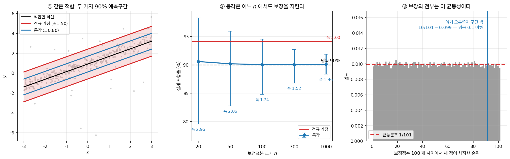
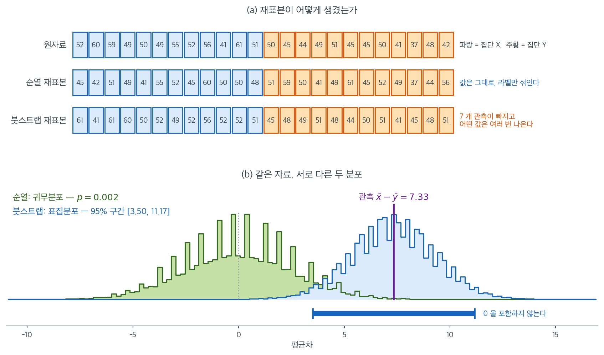
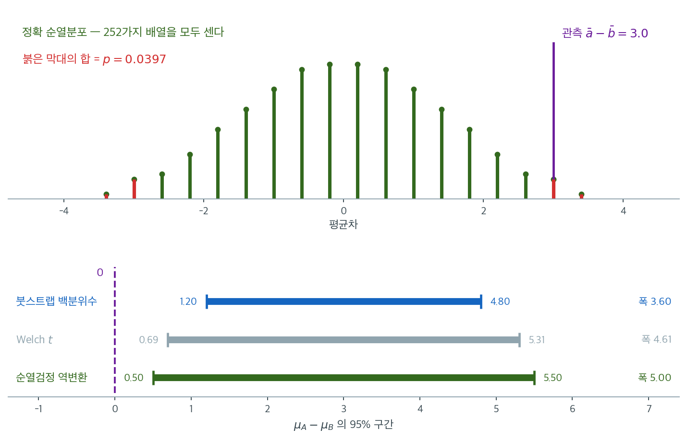

# 붓스트랩과 순열검정의 비교

## 1. 동기

붓스트랩과 순열 방법은 둘 다 재표집을 써서 모수적 분포 가정 없이 추론한다. 그러나 근본적으로 다른 질문에 답하며 다른 메커니즘으로 작동한다. 이 차이를 이해하는 것이 주어진 문제에 맞는 도구를 고르는 데 필수적이다.

이 절에서는 각 방법이 무엇을 추정하는지, 언제 적절한지, 서로 어떻게 관련되는지를 명확히 한다.

---

## 2. 근본적 구별

붓스트랩과 순열검정은 서로 다른 분포를 근사한다.

- **붓스트랩**: 참(알려지지 않은) 자료생성과정 아래에서 통계량의 **표집분포**를 근사한다.
- **순열검정**: 특정 귀무가설(보통 교환가능성 또는 독립성) 아래에서 검정통계량의 **귀무분포**를 근사한다.

이 구별은 두 방법의 사용법과 해석에 광범위한 영향을 미친다.

---

## 3. 나란히 비교

| 측면 | 붓스트랩 | 순열검정 |
|---|---|---|
| **목표** | 표집분포 추정 | 귀무분포 추정 |
| **재표집** | 복원추출 | 비복원(라벨 섞기) |
| **귀무가설** | 필요 없음 | 필요하며 강제된다 |
| **산출물** | 표준오차, 신뢰구간, 편향, 분포 모양 | $p$값 |
| **신뢰구간** | 가능(백분위수, BCa, 붓스트랩-$t$) | 역변환으로만 |
| **정확성** | 근사(몬테카를로) | 정확(자료에 조건부) |
| **표본값** | 관측이 반복될 수 있다 | 각 관측이 정확히 한 번 나타난다 |
| **타당성 조건** | iid(또는 적절한 종속 구조) | $H_0$ 아래 교환가능성 |
| **작은 표본** | 구간이 지나치게 좁다(연습문제 11) | 정확하다 — 교환가능성이 성립하는 한 |

<div class="aibox" markdown>

**AI로 보는 통계학 1.** 교환가능성으로 구간을 만든다

위 표의 「산출물」 줄을 다시 보라. 붓스트랩은 구간을 주고, 순열은 $p$ 값을 준다. 구간이
필요하면 붓스트랩 쪽으로 가야 한다 — 대신 **표본이 모집단을 대표한다**는 조건을 받아들이고
근사를 감수하면서.

그런데 기계학습이 실제로 배치해 쓰는 구간은 셋째 길로 간다. **교환가능성만으로, 유한표본에서
정확하게** 구간을 만드는 길이다. 이름은 **등각예측**이다.

절차는 네 줄이면 끝난다. ① 자료를 학습용과 **보정용**으로 나눈다. ② 학습용으로 아무 모형이나
적합한다 — 신경망이든 무엇이든, 상관없다. ③ 보정용 점 $n$ 개에서 **비적합 점수**
$s_i = \lvert y_i - \hat f(x_i) \rvert$ 를 재고, 그 가운데 $\lceil (n+1)(1-\alpha) \rceil$
번째로 작은 값을 $\hat q$ 로 둔다. ④ 새 점의 구간은 $\hat f(x) \pm \hat q$ 다.

보장은 이렇게 적힌다.

$$
1 - \alpha \ \le\ \Pr\bigl(Y_{\text{test}} \in C(X_{\text{test}})\bigr) \ \le\ 1 - \alpha + \frac{1}{n+1}
$$

**모형에 대해서도 분포에 대해서도 아무 가정이 없다.** 정리의 증명은 이 장의 논리 그대로다 —
보정점수 $n$ 개와 새 점의 점수가 교환가능하므로, 새 점의 **순위**가 $1$ 부터 $n+1$ 까지
균등하다. 순열검정이 쓰는 바로 그 한 줄이다.

직선 하나를 적합해 두고 재어 보았다. 오차는 $90\%$ 가 조용하고($\sigma = 0.3$)
$10\%$ 가 크게 튀는($\sigma = 3$) 혼합이라 정규가 아니다.



- **①** 같은 적합, 같은 명목 $90\%$ 인데 폭이 다르다. 정규 가정은 $\pm 1.50$, 등각은
  $\pm 0.80$ 이다. 잔차 표준편차가 $0.913$ 이니 $1.645 \times 0.913 = 1.50$ — 정규 가정은
  시키는 대로 했을 뿐인데, 그 가정이 틀려서 구간이 **두 배 가까이 넓어졌다.**
- **②** 포함률을 보면 정규 쪽은 $94.08\%$ 다. 명목보다 **넘쳐서** 넓은 것이다. 등각은
  보정표본이 $20$ 개뿐일 때도 $90.58\%$, $1{,}000$ 개면 $90.10\%$ — 어느 $n$ 에서도 위 부등식
  안에 있다($n = 1{,}000$ 의 상한이 $90.10\%$ 이니 정확히 경계다). 폭은 $1.46$ 대 $3.00$ 이다.
- **③** 보장의 전부가 이 그림이다. 보정점수 $100$ 개 사이에서 새 점이 차지한 순위를
  $20$ 만 번 세었더니 $1$ 부터 $101$ 까지 균등하다(카이제곱 $p = 0.147$). 순위가 $92$ 이상이면
  구간 밖인데 그 확률이 $10/101 = 0.099$ 이고, 실측이 $0.098$ 이다.

다만 「$1 - \alpha$」가 무엇에 대한 확률인지를 놓치면 안 된다. 논문이 그것을 **주변 포함률**
이라 부르며 「보정점과 검정점의 무작위성에 대해 **평균 낸** 확률」이라고 못 박아 둔 이유가
있다. 같은 자료에서 성분별로 쪼개 보면 주변 $89.7\%$ 가 조용한 성분에서 $97.6\%$, 크게 튀는
성분에서 $18.1\%$ 로 갈린다. **전체로는 맞고 어느 한 점에 대해서는 틀린다.** 구간의 폭을
$x$ 에 따라 바꾸려면 비적합 점수에 $\hat\sigma(x)$ 로 나누는 등 따로 손을 써야 한다.

위 표에 한 줄을 더하면 이렇게 된다 — **교환가능성으로도 구간을 만들 수 있다. 대신 그
구간은 평균적으로만 맞다.**

_확인한 곳 — 앙겔로풀로스·베이츠, "A Gentle Introduction to Conformal Prediction and
Distribution-Free Uncertainty Quantification", arXiv:$2107.07511$ 에서 분할 등각의 네 단계와
$\lceil (n+1)(1-\alpha) \rceil$ 분위수, 정리 $1$(보프크·감머만·손더스에게 돌린 포함 보장)과
식 $(1)$ 의 위아래 경계, 「주변 포함률 — 보정점과 검정점의 무작위성에 대해 평균 낸 확률」
이라는 정의, 그리고 초록의 「분포에 대한 가정도 모형에 대한 가정도 없이 명시적이고 비점근적인
보장을 갖는다」. 그림의 수는 모두 직접 계산한 값이다_

</div>

---

## 4. 붓스트랩이 근사하는 것

붓스트랩은 관측된 자료(또는 적합된 모형)에서 복원추출로 표본을 뽑는다. 각 붓스트랩 표본은 원래 자료와 같은 크기 $n$이지만 일부 관측은 반복되고 일부는 빠진다. $\hat{\theta}^*$의 붓스트랩 분포는 $\hat{\theta}$의 표집분포, 즉 모집단에서 반복 표집했을 때 $\hat{\theta}$가 갖는 변동을 근사한다.

붓스트랩은 어떤 귀무가설도 강제하지 않으므로 다음에 자연스럽게 적합하다.

- 표준오차 추정
- 신뢰구간 구성
- 편향 추정
- 표집분포의 모양 평가

가설검정에 쓰려면 $H_0$ 아래의 표본을 만들도록 수정해야 한다(중심화나 합치기).

---

## 5. 순열검정이 근사하는 것

순열검정은 집단 라벨을 섞거나 짝을 끊어 $H_0$ 아래에서 검정통계량의 분포를 생성한다. 각 순열된 자료는 정확히 같은 관측들을 쓰며 라벨만 재배정된다. 어떤 관측도 중복되거나 빠지지 않는다.

순열분포는 귀무가설 아래에서 관측된 자료가 주어졌을 때 검정통계량의 **정확 조건부 분포**이다. 따라서 순열 $p$값은 $H_0$ 검정에 대해 (합쳐진 자료의 충분통계량에 조건부로) 정확하다.

순열검정은 다음에 자연스럽게 적합하다.

- 집단 차이에 대한 가설검정(이표본, 다표본)
- 독립성이나 연관성 검정
- 귀무가설이 교환가능성을 함의하는 상황

!!! note "순열검정의 정확성"
    순열검정은 (자료에 조건부로) 제1종 오류율을 정확히 $\alpha$ 수준에서 통제한다는 의미에서 정확한 $p$값을 준다. 근사가 생기는 유일한 지점은 가능한 모든 $\binom{m+n}{m}$가지 배열 대신 무작위 부분집합을 쓸 때이다. $B = 10{,}000$ 이상이면 이 몬테카를로 근사는 무시할 만하다.

    다만 "정확하다"는 것은 **교환가능성이 성립할 때**의 이야기이다. [기초](../permutation/foundations.md) 연습문제 1이 보이듯, 분산이 다르고 표본크기가 불균형하면 제1종 오류율이 명목값의 네 배까지 올라간다.

---

## 6. 한 자료로 두 방법을 동시에

말로만 보면 두 방법이 비슷해 보인다. 같은 자료($m = n = 12$)에 둘 다 적용해 재표본의 생김새와 결과를 나란히 놓으면 차이가 분명해진다.



(a)의 세 줄을 한 칸씩 짚어 보자. 맨 윗줄이 원자료이고 파랑이 집단 X, 주황이 집단 Y이다. 가운데 줄인 순열 재표본에는 **똑같은 24개 숫자가 모두 한 번씩** 들어 있다. 달라진 것은 어느 칸이 파랑이고 어느 칸이 주황인가뿐이며, 이것이 "라벨을 섞는다"는 말의 전부이다. 맨 아랫줄인 붓스트랩 재표본은 다르다. `61`과 `52`처럼 여러 번 나오는 값이 있고, 이 재표본에서는 원래 관측 중 **7개가 아예 빠졌다.** 평균적으로 $36.8\%$가 빠진다는 앞 절의 계산이 여기서 눈에 보인다.

(b)가 그 차이의 귀결이다. 초록 분포는 라벨을 섞어 만든 것이므로 $0$에 중심을 둔다. **자료가 무엇이든 이 분포는 $0$ 근처에 놓인다.** 관측된 차이 $7.33$이 그 꼬리 바깥에 떨어져 $p = 0.002$가 나온다. 파랑 분포는 각 집단을 따로 복원추출한 것이라 관측값 $7.33$ 주위에 놓이고, $95\%$ 구간 $[3.50,\ 11.17]$을 준다.

두 분포는 위치만 다른 것이 아니라 **답하는 질문이 다르다.** 초록은 "차이가 없다면 이런 값이 나올 수 있는가"를, 파랑은 "차이가 얼마쯤인가"를 말한다. 붓스트랩 구간이 $0$을 포함하지 않는다는 사실과 순열 $p$값이 작다는 사실은 대개 같은 방향을 가리키지만, 그것은 결론이 겹치는 것이지 계산이 같은 것이 아니다. 실제로 초록 분포에서 신뢰구간을 읽을 수는 없고, 파랑 분포에서 $p$값을 읽으면 귀무가설과 무관한 숫자가 나온다.

---

## 7. 같은 자료를 두 눈금으로 재기

앞 절은 두 재표본의 **생김새**가 어떻게 다른지를 그림으로 보았다. 이 절은 같은 차이를
**수로** 끝까지 센다. 자료를 $m = n = 5$ 로 줄여 $\binom{10}{5} = 252$ 가지 배열을
하나도 빠짐없이 열거하면, 두 방법이 쓰는 눈금의 비와 그 비가 꼬리확률에서 몇 배로
벌어지는지를 몬테카를로 오차 없이 확인할 수 있다. 결론을 미리 적으면 **눈금의 비는
$1.54$ 인데 꼬리확률의 비는 $64$ 배**다.

### 붓스트랩 접근

1. 두 집단을 각각 **복원**추출로 재표집한다.
2. 각 붓스트랩 표본에서 평균차를 계산한다.
3. 평균차의 **신뢰구간**을 추정한다.

<div class="exbox" markdown>

**보기 1.** <span class="diff easy" title="쉬움"></span> 붓스트랩으로 구간 구하기. 집단 A $= (8,7,9,10,6)$, 집단 B $= (5,6,4,3,7)$로 각 $n = 5$다.

**(1)** 집단마다 따로 복원추출할 때 $\bar A^{*} - \bar B^{*}$의 표준편차를 닫힌 꼴로 구하고, 고전적 $\sqrt{(s_a^2+s_b^2)/n}$과의 비를 구하시오. 복제값이 놓이는 **격자**의 간격도 구하시오.

**(2)** 그것으로 $95\%$ 구간을 예측하고 실행 결과와 견주시오.

</div>

??? success "풀이"

    **(1) 해석적으로.** 두 집단을 독립으로 재표집하므로 두 재표본평균도 독립이고, 각각의 분산이 [붓스트랩 표준오차](../../ch05/applications/bootstrap_standard_error.md) 보기 1의 결과대로 $\hat\sigma^2/n$이다($\hat\sigma^2$은 $n$으로 나눈 경험분산). 따라서

    $$
    \operatorname{SD}_*\!\left(\bar A^{*} - \bar B^{*}\right)
    = \sqrt{\frac{\hat\sigma_a^2 + \hat\sigma_b^2}{n}}
    $$

    이다. 두 집단 모두 중심에서의 편차가 $(0,\pm1,\pm2)$ 꼴이라 $\hat\sigma_a^2 = \hat\sigma_b^2 = \frac{0+1+1+4+4}{5} = 2$이고

    $$
    \operatorname{SD}_* = \sqrt{\frac{2+2}{5}} = \sqrt{0.8} = 0.894427
    $$

    다. 고전적 값은 $s_a^2 = s_b^2 = 2.5$에서 $\sqrt{(2.5+2.5)/5} = 1$이므로 비가

    $$
    \frac{0.894427}{1} = \sqrt{\frac{n-1}{n}} = \sqrt{\frac45} = 0.894427
    $$

    로 **붓스트랩 쪽이 $10.6\%$ 좁다.** $n = 5$에서 $\sqrt{(n-1)/n}$ 보정이 가장 아프게 작용한다.

    **격자.** 자료가 정수이므로 각 재표본의 합도 정수이고 평균은 $1/5$의 배수다. 두 평균의 차도 마찬가지이므로 복제값은 간격 $0.2$인 격자에만 놓인다.

    **예측.** 분포가 거의 정규라면

    $$
    3 \pm 1.959964 \times 0.894427 = [1.246955,\ 4.753045]
    $$

    이고, 격자로 반올림하면 $[1.2,\ 4.8]$이 될 것이다.

    **(2) 수치적으로.**

    ```python
    import numpy as np
    # 같은 자료에 붓스트랩과 순열검정을 각각 적용해 무엇이 다른지 본다.
    # 붓스트랩은 "차이가 얼마인가"에, 순열검정은 "차이가 있는가"에 답한다.
    rng = np.random.default_rng(55)

    group_a = np.array([8, 7, 9, 10, 6])
    group_b = np.array([5, 6, 4, 3, 7])

    # 붓스트랩은 집단마다 따로 복원추출한다. 집단 구분을 그대로 둔 채
    # 차이의 분포를 얻으므로 신뢰구간이 나온다.
    n_resamples = 100_000
    A = group_a[rng.integers(0, 5, (n_resamples, 5))]
    B = group_b[rng.integers(0, 5, (n_resamples, 5))]
    boot_diffs = A.mean(axis=1) - B.mean(axis=1)

    ci = np.percentile(boot_diffs, [2.5, 97.5])
    print(f"Bootstrap 95% CI for mean difference: ({ci[0]:.2f}, {ci[1]:.2f})")
    # (1.20, 4.80)
    ```

    출력:

    ```
    Bootstrap 95% CI for mean difference: (1.20, 4.80)
    ```

    (1)의 수와 맞춘다.

    ```python
    print(f"붓스트랩 SD = {boot_diffs.std(ddof=1):.6f}"
          f"   닫힌 꼴 = {np.sqrt((group_a.var(ddof=0)+group_b.var(ddof=0))/5):.6f}")
    print(f"고전 SE = {np.sqrt((group_a.var(ddof=1)+group_b.var(ddof=1))/5):.6f}"
          f"   비 = {np.sqrt(4/5):.6f}")
    print(f"정규근사 구간 = [{3-1.959964*np.sqrt(0.8):.6f}, {3+1.959964*np.sqrt(0.8):.6f}]")
    u = np.unique(np.round(boot_diffs, 6))
    print(f"복제값의 고유값 수 = {len(u)},  최소 간격 = {np.diff(u).min():.4f}")
    print(f"붓스트랩 꼬리확률 P(|d* - 3| >= 3) = {np.mean(np.abs(boot_diffs-3) >= 3-1e-12):.5f}")
    ```

    출력:

    ```
    붓스트랩 SD = 0.895799   닫힌 꼴 = 0.894427
    고전 SE = 1.000000   비 = 0.894427
    정규근사 구간 = [1.246955, 4.753045]
    복제값의 고유값 수 = 35,  최소 간격 = 0.2000
    붓스트랩 꼬리확률 P(|d* - 3| >= 3) = 0.00062
    ```

    **셋 다 예측대로다.** 모의 표준편차 $0.895799$가 닫힌 꼴 $0.894427$과 맞고($B = 10^5$의 몬테카를로 오차 $0.002$), 격자 간격이 $0.2$이며, 정규근사 구간 $[1.246955,\ 4.753045]$를 격자로 옮기면 실행값 $[1.20,\ 4.80]$ 그대로다.

    **구간이 $0$에서 멀리 떨어져 있다.** 꼬리확률로 바꾸면 $0.00062$다. 그러나 **이 수를 $p$값으로 읽어서는 안 된다.** 보기 2가 보이듯 같은 자료의 정확 순열 $p$값은 $0.0397$로 $64$배 크다. 눈금이 다르기 때문이며, 그 차이의 정체를 보기 2에서 끝까지 따진다.


### 순열 접근

1. 두 집단을 하나의 자료로 합친다.
2. 집단 라벨을 **비복원**으로 무작위로 섞는다.
3. 각 순열에서 평균차를 계산한다.
4. 관측 평균차를 순열된 차이들의 분포와 비교하여 **$p$값**을 구한다.

<div class="exbox" markdown>

**보기 2.** <span class="diff easy" title="쉬움"></span> 순열로 $p$값 구하기. 같은 자료에 라벨 섞기를 적용한다. $\binom{10}{5} = 252$가지뿐이라 **전부 열거할 수 있다.**

**(1)** 순열 귀무분포의 표준편차를 닫힌 꼴로 구하고, 보기 1의 붓스트랩 표준편차와의 **비**를 구하시오. 그 비가 왜 $1$보다 큰지 $t$ 통계량으로 설명하시오.

**(2)** 정확 $p$값을 구하고, 보기 1의 꼬리확률 $0.00062$와 $64$배 차이가 나는 까닭을 (1)로 설명하시오. 이 설계에서 가능한 **최소 $p$값**도 구하시오.

</div>

??? success "풀이"

    **(1) 해석적으로.** [이표본 순열검정](../permutation/two_sample.md) 보기 1에서 라벨을 섞을 때의 평균차가

    $$
    \operatorname{SD}(d^{*}) = S\sqrt{\frac{1}{n_1}+\frac{1}{n_2}}
    $$

    임을 보았다. 여기서 $S^2$은 **합친 $10$개**의 표본분산이다. 합친 자료의 평균이 $6.5$이고 편차제곱합이 $42.5$이므로 $S^2 = 42.5/9 = 4.722222$이고

    $$
    \operatorname{SD}(d^{*}) = \sqrt{4.722222 \times 0.4} = 1.374369
    $$

    다. 보기 1의 붓스트랩 표준편차 $0.894427$에 견주면

    $$
    \frac{1.374369}{0.894427} = 1.536591
    $$

    로 **순열 쪽 눈금이 $1.54$배 넓다.**

    **왜 넓은가.** 두 가지가 겹친다. 하나는 $\sqrt{(n-1)/n}$ 보정으로, 붓스트랩 쪽이 $0.894$배 좁다. 다른 하나가 더 크다. **합친 표본의 분산 $S^2$에는 두 집단 사이의 차이까지 들어 있다.** [이표본 순열검정](../permutation/two_sample.md) 보기 3의 항등식

    $$
    (N-1)S^2 = (N - 2 + t^2)\,s_p^2
    $$

    에 $N = 10$, $s_p^2 = 2.5$, $t = 3/1 = 3$을 넣으면 $9S^2 = 17 \times 2.5 = 42.5$로 맞는다. 곧

    $$
    \frac{\operatorname{SD}(d^{*})}{\operatorname{SE}_t} = \sqrt{\frac{N-2+t^2}{N-1}} = \sqrt{\frac{17}{9}} = 1.374369
    $$

    다. **관측된 효과가 클수록 순열 귀무분포가 스스로 넓어진다.** 붓스트랩은 집단을 나눈 채 재표집하므로 그 효과를 귀무분포에 넣지 않는다.

    **최소 $p$값.** 양측으로는 관측된 배정과 그 보수(두 집단을 통째로 맞바꾼 것) 둘이 늘 걸리므로 $2/252 = 0.0079$ 아래로 내려갈 수 없다.

    **(2) 수치적으로.**

    ```python
    import numpy as np, itertools

    group_a = np.array([8, 7, 9, 10, 6])
    group_b = np.array([5, 6, 4, 3, 7])
    # 순열검정은 반대로 집단 이름표를 섞는다. 귀무가설이 참이라면 이름표가
    # 아무 뜻이 없다는 데서 나온 발상이라, p-값이 나온다.
    combined = np.concatenate([group_a, group_b])
    observed_diff = group_a.mean() - group_b.mean()

    # 각 집단이 5개뿐이므로 C(10,5) = 252 가지를 전부 열거한다
    perm_diffs = np.array([
        combined[list(c)].mean() - np.delete(combined, list(c)).mean()
        for c in itertools.combinations(range(10), 5)
    ])
    p_value = (np.abs(perm_diffs) >= abs(observed_diff) - 1e-12).mean()
    print(f"Exact permutation p-value: {p_value:.4f}")   # 0.0397
    ```

    출력:

    ```
    Exact permutation p-value: 0.0397
    ```

    (1)의 수와 맞춘다.

    ```python
    from scipy import stats

    S = combined.std(ddof=1)
    sd_perm = S * np.sqrt(2 / 5)
    sd_boot = np.sqrt((group_a.var(ddof=0) + group_b.var(ddof=0)) / 5)
    sp2 = (4 * group_a.var(ddof=1) + 4 * group_b.var(ddof=1)) / 8
    t = observed_diff / np.sqrt(sp2 * 0.4)

    print(f"S^2 = {S**2:.6f},  순열 SD 닫힌 꼴 = {sd_perm:.6f}"
          f"   (열거 SD = {perm_diffs.std():.6f})")
    print(f"붓스트랩 SD = {sd_boot:.6f},   두 눈금의 비 = {sd_perm/sd_boot:.6f}")
    print(f"s_p^2 = {sp2:.4f},  t = {t:.4f},"
          f"  sqrt((N-2+t^2)/(N-1)) = {np.sqrt((10-2+t**2)/9):.6f}")
    print(f"정확 p = {(np.abs(perm_diffs) >= abs(observed_diff)-1e-12).sum()}/252"
          f" = {p_value:.6f},   가능한 최소 p = 2/252 = {2/252:.6f}")
    print(f"순열 눈금의 정규근사 p = {2*stats.norm.sf(observed_diff/sd_perm):.6f}")
    print(f"붓스트랩 눈금의 정규근사 p = {2*stats.norm.sf(observed_diff/sd_boot):.6f}")
    ```

    출력:

    ```
    S^2 = 4.722222,  순열 SD 닫힌 꼴 = 1.374369   (열거 SD = 1.374369)
    붓스트랩 SD = 0.894427,   두 눈금의 비 = 1.536591
    s_p^2 = 2.5000,  t = 3.0000,  sqrt((N-2+t^2)/(N-1)) = 1.374369
    정확 p = 10/252 = 0.039683,   가능한 최소 p = 2/252 = 0.007937
    순열 눈금의 정규근사 p = 0.029049
    붓스트랩 눈금의 정규근사 p = 0.000796
    ```

    **항등식이 맞는다.** 닫힌 꼴 $1.374369$가 열거한 표준편차와 여섯 자리까지 같고, $\sqrt{(N-2+t^2)/(N-1)} = \sqrt{17/9}$도 같은 수다.

    **$64$배 차이의 정체가 눈금이다.** 같은 관측값 $3.0$을 두 눈금으로 재면

    - 붓스트랩 눈금($0.894427$)에서는 $3/0.894427 = 3.354$ 표준편차 → 정규근사 $p = 0.000796$
    - 순열 눈금($1.374369$)에서는 $3/1.374369 = 2.183$ 표준편차 → 정규근사 $p = 0.02905$

    로 $36$배가 벌어진다. **눈금의 비는 $1.54$뿐인데 꼬리확률의 비는 $36$배다.** 정규 꼬리가 지수적으로 떨어지기 때문이며, 여기에 이산성이 더해져 정확값 $0.0397$까지 올라가면 $0.00062$의 $64$배가 된다.

    **어느 쪽이 옳은가.** 순열검정이다. $p$값은 **귀무가설이 참일 때** 관측값이 얼마나 드문지를 묻는 양인데, 붓스트랩의 집단별 재표집은 귀무가설을 전혀 강제하지 않는다. 그것이 답하는 물음은 "차이가 얼마인가"이지 "차이가 있는가"가 아니다. 구간은 그대로 쓰되 꼬리확률을 $p$값으로 바꿔 읽는 일만 하지 않으면 된다.

    **그리고 이 설계의 한계도 보인다.** 가능한 최소 $p$값이 $2/252 = 0.0079$다. 자료가 아무리 극단적이어도 그 아래로 못 내려간다. $n = 5$가 담을 수 있는 증거의 총량이 그만큼이다.


!!! danger "이 보기에서 두 방법이 심각하게 어긋난다"
    | 방법 | 결과 |
    |:---|:---|
    | 정확 순열 $p$값 | $0.0397$ |
    | Welch $t$ 검정 $p$값 | $0.0171$ |
    | 붓스트랩 백분위수 구간 | $[1.20,\ 4.80]$ — $0$을 크게 벗어난다 |
    | 붓스트랩 꼬리 확률 | $0.0006$ |

    붓스트랩 꼬리 확률이 순열 $p$값의 **$1/66$**이다. 어느 쪽이 옳은가? 순열검정이다. $n = 5$에서 붓스트랩 신뢰구간은 심각하게 좁다. 연습문제 11에서 그 이유와 크기를 다룬다.

이 불일치를 그림으로 보면 어디서 틈이 벌어지는지가 드러난다.



위 칸은 $252$가지 배열을 **하나도 빠짐없이** 계산한 정확 순열분포다. 몬테카를로가 전혀 없으므로 막대의 높이가 곧 확률이다. 관측값 $\bar{a} - \bar{b} = 3.0$만큼 극단적인 배열은 붉게 칠한 네 개뿐이고, 그 확률의 합이 $10/252 = 0.0397$이다. 이 값은 $n = 5$짜리 자료가 담을 수 있는 증거의 한계를 정직하게 보여 준다. 가능한 가장 작은 $p$값이 $2/252 = 0.0079$이므로, **이 설계로는 아무리 극단적인 결과가 나와도 $p$를 그 아래로 내릴 수 없다.**

아래 칸의 세 막대가 문제의 핵심이다. 순열검정을 역변환해 얻은 구간 $[0.50,\ 5.50]$이 가장 넓고, Welch $t$ 구간 $[0.69,\ 5.31]$이 그다음이며, 붓스트랩 백분위수 구간 $[1.20,\ 4.80]$이 가장 좁다. 붓스트랩 구간의 폭은 순열 구간의 $72\%$에 불과하다. **$28\%$ 짧아진 구간이 $66$배 작은 꼬리 확률로 증폭된 것이다.**

이유는 두 가지가 겹친다. 첫째, 백분위수 붓스트랩은 $t$ 보정을 하지 않아 정규이론 구간보다 체계적으로 좁고, 그 효과가 $n = 5$에서 극대화된다. 둘째, 각 집단에서 복원추출로 다섯 개를 뽑으면 그 표본의 분산이 원자료의 분산보다 평균적으로 작다. **$n = 5$에서는 "관측 표본이 모집단을 대표한다"는 붓스트랩의 전제 자체가 무리이며**, 순열검정은 애초에 그런 전제를 두지 않기 때문에 이 함정을 피한다.

### 두 결론이 얼마나 자주 갈리는가

두 방법이 「대개 같은 방향을 가리킨다」고 적었다. 그 「대개」를 수로 재면 어긋남의
**방향**까지 드러난다.

<div class="exbox" markdown>

**보기 3.** <span class="diff easy" title="쉬움"></span> 붓스트랩과 순열 나란히. 위 표는 "$0$을 제외하는 신뢰구간"과 "기각하는 순열검정"이 **대개** 일치한다고 했다. 그 "대개"를 수로 재어 본다.

**(1)** 두 절차가 쓰는 **눈금**이 어떻게 다른지 적으시오(보기 2 의 식을 쓴다). 어긋난다면 어느 쪽이 더 자주 기각하겠는가.

**(2)** $X \sim N(0.5, 1)$, $Y \sim N(0, 1)$에서 각 $25$개씩 뽑는 일을 $500$번 되풀이해 두 결론이 갈리는 비율과 **방향**을 세시오.

</div>

??? success "풀이"

    **(1) 해석적으로.** 두 절차의 눈금이 다르다.

    - **붓스트랩 구간**은 집단을 나눈 채 따로 재표집하므로 폭이 $\sqrt{\hat\sigma_x^2/m + \hat\sigma_y^2/n}$ 수준이다. 집단 안의 흩어짐만 들어간다.
    - **순열 귀무분포**는 합친 표본의 분산 $S^2$로 재므로 폭이 $S\sqrt{1/m + 1/n}$이다. 보기 2 에서 보았듯 $S^2$에는 **관측된 두 집단의 차이까지 들어 있다.**

    둘째 눈금은 $t$ 통계량으로 다시 쓸 수 있다.

    $$
    \frac{\operatorname{SD}_{\text{순열}}}{\operatorname{SE}_t} = \sqrt{\frac{N-2+t^2}{N-1}}
    $$

    $\lvert t\rvert > 1$이면 이 비가 $1$보다 크다.

    기각 여부를 가르는 자료는 $t$가 $2$ 언저리인 것들이므로, 그 영역에서 순열 눈금이 붓스트랩 눈금보다 넓다. **따라서 어긋난다면 "구간은 $0$을 제외하는데 순열은 기각하지 못하는" 쪽일 것이다.** 반대 방향은 드물어야 한다.

    **(2) 수치적으로.** 함수는 이렇다.

    ```python
    def bootstrap_vs_permutation_comparison(x, y, B=9999, rng=None):
        """붓스트랩 신뢰구간과 순열 p-값을 나란히 놓는다.

        둘은 경쟁 관계가 아니다. 순열검정은 "차이가 있는가"에, 붓스트랩은
        "차이가 얼마나 되는가"에 답한다. 보고할 때는 둘 다 싣는 편이 낫다.
        """
        rng = rng or np.random.default_rng(0)
        diff_obs = x.mean() - y.mean()

        # 각 집단을 따로 재표집한 신뢰구간
        bx = x[rng.integers(0, len(x), (B, len(x)))].mean(axis=1)
        by = y[rng.integers(0, len(y), (B, len(y)))].mean(axis=1)
        ci = np.percentile(bx - by, [2.5, 97.5])

        # 순열 p 값
        # 순열 p 값 — 라벨을 섞어 센다
        z = np.concatenate([x, y]); m = len(x)
        P = np.array([rng.permutation(z) for _ in range(B)])
        dd = P[:, :m].mean(1) - P[:, m:].mean(1)
        p_perm = ((np.abs(dd) >= abs(diff_obs)).sum() + 1) / (B + 1)
        return diff_obs, ci, p_perm
    ```

    참 차이가 $0.5$인 자료를 $500$번 만들어 두 결론을 맞춰 본다.

    ```python
    rng = np.random.default_rng(51)
    M, B = 500, 999
    agree = ci_only = perm_only = 0
    for _ in range(M):
        x = rng.normal(0.5, 1, 25); y = rng.normal(0, 1, 25)
        bx = x[rng.integers(0, 25, (B, 25))].mean(axis=1)
        by = y[rng.integers(0, 25, (B, 25))].mean(axis=1)
        ci = np.percentile(bx - by, [2.5, 97.5])
        excl = not (ci[0] <= 0 <= ci[1])

        z = np.concatenate([x, y]); obs = x.mean() - y.mean()
        P = np.array([rng.permutation(z) for _ in range(B)])
        dd = P[:, :25].mean(1) - P[:, 25:].mean(1)
        rej = ((np.abs(dd) >= abs(obs)).sum() + 1)/(B + 1) < 0.05

        agree += (excl == rej)
        ci_only += (excl and not rej)
        perm_only += (rej and not excl)
    print(f"{M} 번 중 두 결론이 같은 횟수 = {agree} ({agree/M:.3f})")
    print(f"  구간만 기각 = {ci_only} ({ci_only/M:.4f}),"
          f"  순열만 기각 = {perm_only} ({perm_only/M:.4f})")
    ```

    출력:

    ```
    500 번 중 두 결론이 같은 횟수 = 481 (0.962)
      구간만 기각 = 19 (0.0380),  순열만 기각 = 0 (0.0000)
    ```

    **$96.2\%$에서 일치한다.** "대개 일치한다"는 서술이 수로 확인된 셈이다.

    **어긋남은 전부 한 방향이다.** $19$번 모두 **구간은 $0$을 제외하는데 순열은 기각하지 못했고**, 그 반대는 단 한 번도 없었다. (1)에서 예측한 방향 그대로다. 두 눈금의 비 $\sqrt{(N-2+t^2)/(N-1)}$이 경계 근처($t \approx 2$, $N = 50$)에서 $\sqrt{52/49} = 1.030$이라 $3\%$ 차이인데, 그 작은 차이가 기각 경계에 걸친 자료들을 한쪽으로 몰아낸다.

    **실무적 함의는 분명하다.** 구간이 $0$을 아슬아슬하게 제외했다고 "유의하다"고 쓰면 순열검정보다 느슨한 기준을 쓰는 것이다. **둘을 함께 보고하되, 유의성 판정은 순열검정 쪽에 맡기는 것이 안전하다.** 붓스트랩 구간의 몫은 "차이가 얼마나 되는가"에 답하는 데 있다.

---

---

## 8. 붓스트랩을 선택하는 경우

- **신뢰구간**이 주된 목표일 때($p$값만이 아니라)
- 복잡한 통계량의 **표준오차 추정**이 필요할 때
- **귀무가설이 교환가능성을 함의하지 않을 때**(예: $\rho = 0$이 아니라 $\rho = 0.5$의 검정)
- **관심 모수가 단순한 집단 비교가 아닐 때**(예: 회귀계수, 분산비, Sharpe 비율)
- **편향 추정**이나 분포 모양 평가가 필요할 때

---

## 9. 순열검정을 선택하는 경우

- 교환가능성을 함의하는 **날카로운 귀무가설**을 검정할 때(예: $H_0: F_X = F_Y$)
- **정확한 제1종 오류 통제**가 중요할 때(규제·확증적 상황)
- **표본이 작아** 붓스트랩 분포를 신뢰하기 어려울 때
- **검정통계량은 복잡하지만 귀무가설은 단순할 때**(교환가능성)
- **모수모형을 가정하지 않고** 분포무관 검정을 원할 때

---

## 10. 가설검정을 위한 붓스트랩

붓스트랩을 가설검정에 쓰려면 $H_0$을 만족하는 표본을 생성해야 한다. 두 가지 주요 접근이 있다.

**중심화.** $H_0$이 성립하도록 자료를 이동시킨 뒤 복원추출한다. 예를 들어 $H_0: \mu = \mu_0$을 검정하려면 $\tilde{x}_i = x_i - \bar{x} + \mu_0$으로 옮기고 $\{\tilde{x}_1, \ldots, \tilde{x}_n\}$에서 재표집한다.

**합치기.** $H_0$ 아래에서 집단들을 합치고 합쳐진 표본에서 재표집한다. 예를 들어 $H_0: \mu_X = \mu_Y$를 검정하려면 모든 관측을 합쳐 크기 $m$과 $n$의 붓스트랩 표본을 뽑는다.

두 접근 모두 순열검정의 정확한 조건부 추론을 넘어서는 근사를 도입한다. 붓스트랩 가설검정은 일치하지만 정확하지는 않다.

!!! tip "둘 다 타당할 때는 어느 쪽인가"
    두 독립표본으로 $H_0: F_X = F_Y$를 검정할 때는 순열검정과 합치기 붓스트랩이 모두 타당하다. 순열검정이 제1종 오류를 정확히 통제하므로 일반적으로 선호된다. 신뢰구간도 함께 원하거나 귀무가설이 단순한 교환가능성보다 미묘할 때는 붓스트랩이 낫다.

---

## 11. 혼합 접근

실무에서는 두 방법을 함께 쓰는 경우가 많다.

1. **순열검정**으로 $H_0$에 대한 정확한 $p$값을 얻는다.
2. **붓스트랩**으로 효과크기의 신뢰구간을 만든다.
3. 둘 다 보고한다. 순열 $p$값은 $H_0$에 반하는 증거를 정량화하고, 붓스트랩 신뢰구간은 효과의 크기와 불확실성을 정량화한다.

---

## 12. 흔한 오해

**"붓스트랩이 귀무가설을 검정한다."** 수정 없이(중심화나 합치기 없이) 쓰는 표준 붓스트랩은 귀무분포를 생성하지 않는다. 참 모수값 아래의 표집분포를 근사한다.

**"순열검정이 신뢰구간을 준다."** 순열 $p$값을 역변환하여 신뢰구간을 만들 수 있지만 계산이 비싸고 실무에서 거의 하지 않는다. 구간추정에는 붓스트랩이 훨씬 자연스럽다.

**"두 방법이 같은 답을 준다."** $H_0: \mu_X = \mu_Y$의 검정에서 합치기 붓스트랩과 순열검정은 비슷한 $p$값을 내는 경우가 많지만, 집단의 분산이 다르거나 표본이 작으면 어긋날 수 있다.

## 13. 다른 장의 방법들과 견주기

| 방법 | 장 | 재표집? | 주된 차이 |
|---|---|---|---|
| $z$ 검정, $t$ 검정 | 9장 | 아니오 | 이론적 분포에 의존 |
| Wilcoxon, Mann-Whitney | 16장 | 아니오 | 원값이 아니라 순위를 쓴다 |
| 붓스트랩 | 17장 | 예(복원) | 임의의 표집분포를 추정 |
| 순열검정 | 17장 | 예(비복원) | 라벨 섞기로 가설을 검정 |


---

---

## 연습문제

<div class="drillbox" markdown>

**연습문제 1.** <span class="diff med" title="중간"></span>
두 자산의 일별 수익률 $n = 252$일(약 1년)을 생성하여 두 방법을 나란히 적용하라. 자산 1은 일평균 $0.08$%, 일변동성 $1.2$%이고, 자산 2는 일평균 $0.04$%, 일변동성 $1.8$%이며, 두 수익률 모두 $t(5)$ 꼬리를 갖는다.

```python
import numpy as np
rng = np.random.default_rng(2024)
n = 252
r1 = 0.0008 + 0.012 * rng.standard_t(5, n) / np.sqrt(5/3)
r2 = 0.0004 + 0.018 * rng.standard_t(5, n) / np.sqrt(5/3)
```

**(a)** 순열검정으로 두 자산의 일평균 수익률이 다른지 검정하라.

**(b)** 붓스트랩으로 각 자산의 연율 Sharpe 비율에 대한 $95$% 신뢰구간을 구하라.

**(c)** $\text{SR}_1 - \text{SR}_2$를 검정통계량으로 하는 순열검정을 하라.

**(d)** Sharpe 비율에 붓스트랩이 특히 유용한 이유는 무엇인가? (힌트: 비의 표집분포를 생각하라.)

</div>

??? success "풀이"
    연율 Sharpe 비율은 $\text{SR} = \dfrac{\bar{r}}{s_r}\sqrt{252}$이다(무위험이자율은 $0$으로 둔다).

    ```python
    shp = lambda r: r.mean() / r.std(ddof=1)          # 일별
    sh  = lambda r: shp(r) * np.sqrt(252)             # 연율
    print(r1.mean(), r1.std(ddof=1), sh(r1))   # 0.001635  0.01225  2.1186
    print(r2.mean(), r2.std(ddof=1), sh(r2))   # 0.000034  0.01955  0.0279
    ```

    출력:

    ```
    0.0016353864175491166 0.012253559738919955 2.118645936617846
    3.4399630853266775e-05 0.019546757887612322 0.02793697111924046
    ```

    **(a) 평균 수익률의 순열검정**

    ```python
    obs = r1.mean() - r2.mean()
    z = np.concatenate([r1, r2]); B = 9999
    P = np.array([rng.permutation(z) for _ in range(B)])
    d = P[:, :n].mean(1) - P[:, n:].mean(1)
    p = ((np.abs(d) >= abs(obs)).sum() + 1) / (B + 1)
    ```

    | 검정 | $p$값 |
    |:---|---:|
    | 순열검정(평균차) | 0.273 |
    | Welch $t$ 검정 | 0.271 |

    **차이가 유의하지 않다.** 일평균 수익률의 차이 $0.16$%p는 일변동성 $1.2$--$1.8$%에 완전히 묻힌다. 두 방법이 $0.002$ 이내로 일치한다.

    **(b) Sharpe 비율의 붓스트랩 신뢰구간**

    ```python
    def boot_sr(r, Bb=10000):
        s = r[rng.integers(0, len(r), (Bb, len(r)))]
        return s.mean(1) / s.std(axis=1, ddof=1) * np.sqrt(252)
    ```

    | 자산 | $\widehat{\text{SR}}$ | 붓스트랩 SE | 백분위수 $95$% 구간 |
    |:---|---:|---:|:---|
    | 자산 1 | 2.119 | 0.961 | $[0.211,\ 3.992]$ |
    | 자산 2 | 0.028 | 1.009 | $[-1.906,\ 2.057]$ |

    **1년치 일별 자료로는 Sharpe 비율을 거의 알 수 없다.** 자산 1의 추정값 $2.12$는 매우 훌륭한 값이지만 구간은 $[0.21, 3.99]$로 "평범함"부터 "전설적"까지를 모두 포함한다.

    이것이 이 연습문제의 가장 실용적인 교훈이다. 헤지펀드 자료에서 흔히 인용되는 Sharpe 비율은 **1년으로는 통계적으로 무의미하다**. 구간 폭 $3.78$을 절반으로 줄이려면 $n$을 네 배, 즉 4년치 자료가 필요하다.

    비교를 위해 Lo (2002)의 정규근사 $\text{SE}(\widehat{\text{SR}}) = \sqrt{(1+\widehat{\text{SR}}_p^2/2)/n}\cdot\sqrt{252}$를 쓰면

    | 자산 | 정규근사 SE | 정규근사 구간 |
    |:---|---:|:---|
    | 자산 1 | 1.004 | $[0.150,\ 4.087]$ |
    | 자산 2 | 1.000 | $[-1.932,\ 1.988]$ |

    **붓스트랩과 거의 같다.** 붓스트랩 분포의 왜도가 $-0.03$과 $+0.03$으로 사실상 대칭이므로 정규근사가 잘 작동한다.

    **(c) Sharpe 비율 차이의 순열검정**

    ```python
    A, Bm = P[:, :n], P[:, n:]
    ds = (A.mean(1)/A.std(axis=1, ddof=1)
          - Bm.mean(1)/Bm.std(axis=1, ddof=1)) * np.sqrt(252)
    p = ((np.abs(ds) >= abs(sh(r1) - sh(r2))).sum() + 1) / (B + 1)
    ```

    | 방법 | 관측값 | $p$값 또는 구간 |
    |:---|---:|:---|
    | 순열검정($\text{SR}_1 - \text{SR}_2$) | 2.091 | $p = 0.147$ |
    | 붓스트랩 백분위수 구간 | 2.091 | $[-0.579,\ 4.661]$ |
    | 붓스트랩 꼬리 확률 | | $p = 0.122$ |

    **세 방법 모두 유의하지 않다고 답한다.** 붓스트랩 구간이 $0$을 포함하고, 두 $p$값이 $0.12$--$0.15$이다.

    주목할 점은 **Sharpe 차이의 $p$값($0.147$)이 평균 차이의 $p$값($0.273$)보다 작다**는 것이다. Sharpe 비율은 평균뿐 아니라 변동성도 담고 있고, 두 자산의 변동성 차이($1.2$% 대 $2.0$%)가 상당하기 때문이다.

    !!! warning "이 순열검정은 무엇을 검정하는가"
        여기서 순열이 강제하는 귀무가설은 $H_0: \text{SR}_1 = \text{SR}_2$가 아니라 $H_0: F_1 = F_2$, 즉 **두 수익률 분포가 완전히 같다**는 것이다.

        따라서 만약 이 검정이 기각했다면, 그 이유가 Sharpe 비율의 차이인지, 변동성만의 차이인지, 꼬리 모양의 차이인지 구별할 수 없다. 순열검정의 정확성은 이 강한 귀무가설에 대해서만 성립한다.

        $H_0: \text{SR}_1 = \text{SR}_2$ 자체를 검정하고 싶다면 붓스트랩 구간이 $0$을 포함하는지 보는 쪽이 옳다. **이것이 붓스트랩과 순열검정이 다른 질문에 답한다는 말의 구체적 의미이다.**

    **(d) Sharpe 비율에 붓스트랩이 유용한 이유**

    Sharpe 비율은 두 추정량의 **비**이다.

    $$
    \widehat{\text{SR}} = \frac{\bar{r}}{s_r}\sqrt{252}
    $$

    분자와 분모가 모두 확률변수이고 서로 상관되어 있다. 비의 표집분포에는 일반적으로 닫힌 형태가 없다.

    실제로 정규근사식 $\sqrt{(1+\text{SR}^2/2)/n}$을 얻으려면 델타법을 적용하고 $\bar{r}$과 $s_r$의 결합 점근분포를 유도해야 하며, 그 결과는 **정규성과 독립성**을 가정한다. 수익률이 자기상관을 갖거나 꼬리가 두꺼우면 이 식이 틀린다(Lo, 2002가 자기상관 보정을 별도로 유도한 이유이다).

    붓스트랩은 이 유도를 전부 건너뛴다. `s.mean(1)/s.std(1)`을 계산할 뿐이며, 통계량이 얼마나 복잡하든 절차가 같다.

    **더 결정적인 것은 (c)의 차이 통계량이다.** $\text{SR}_1 - \text{SR}_2$의 표준오차에는 초급 공식이 없다. Jobson-Korkie 검정통계량과 Memmel의 보정이 존재하지만 복잡하고 정규성에 의존한다. 붓스트랩은 한 줄로 $\text{SE} = 1.335$를 준다.

    **포함확률 점검.** 그렇다면 붓스트랩이 정규근사보다 실제로 나은가?

    | $n$ | 정규근사 | 붓스트랩 백분위수 |
    |---:|---:|---:|
    | 252 | 0.946 | 0.942 |
    | 60 | 0.945 | 0.931 |
    | 24 | 0.953 | 0.921 |

    (참 $\text{SR} = 1.058$, $t(5)$ 수익률, $M = 1{,}500$)

    **솔직한 답: 이 상황에서 붓스트랩이 더 낫지는 않다.** $n = 252$에서 두 방법이 모두 $0.94$대로 잘 작동하고, $n$이 작아지면 오히려 붓스트랩 쪽이 나빠진다($n = 24$에서 $0.921$ 대 $0.953$).

    붓스트랩 백분위수 구간이 작은 $n$에서 좁아지는 것은 알려진 성질이다([백분위수법](../bootstrap_ci/percentile.md) 참조). BCa나 붓스트랩-$t$를 쓰면 개선된다($n = 252$에서 BCa는 $0.945$).

    **따라서 붓스트랩의 이점은 정확성이 아니라 일반성이다.** Lo의 공식은 이 특정 통계량, 이 특정 가정에 대해 누군가 유도해 준 것이다. 통계량을 조금만 바꾸면 — 차이를 보거나, 하방편차를 쓴 Sortino 비율로 바꾸거나, 최대낙폭을 보면 — 공식은 없고 붓스트랩만 남는다.

<div class="drillbox" markdown>

**연습문제 2.** <span class="diff med" title="중간"></span>
같은 자료에서 순열검정과 **합치기 붓스트랩** 검정을 평균차에 대해 실행하고 $p$값을 비교하라. 두 방법이 어긋나는 상황을 만들 수 있는가?

</div>

??? success "풀이"
    합치기 붓스트랩은 두 표본을 합친 뒤 그로부터 크기 $m$과 $n$의 표본을 **복원추출**한다.

    ```python
    def pooled_boot_p(x, y, B=9999):
        obs = abs(x.mean() - y.mean())
        z = np.concatenate([x, y]); m, k = len(x), len(x) + len(y)
        idx = rng.integers(0, k, (B, k))
        s = z[idx]
        d = np.abs(s[:, :m].mean(1) - s[:, m:].mean(1))
        return ((d >= obs).sum() + 1) / (B + 1)
    ```

    **연습문제 1의 자료**($m = n = 252$)에서는 두 방법이 사실상 같은 답을 준다. 순열 $0.273$, 합치기 붓스트랩도 같은 자릿수이다. 표본이 크고 균형 잡혀 있으면 복원과 비복원의 차이가 $O(1/n)$이다.

    **어긋나게 만들려면 두 조건을 겹친다.**

    | 조건 | 이유 |
    |:---|:---|
    | 작은 표본 | 복원추출로 인한 중복이 상대적으로 크다 |
    | 불균형 표본크기 | 합치기가 분산 구조를 왜곡한다 |
    | 이분산 | 두 방법 모두 무너지지만 방식이 다르다 |

    구체적으로 $m = 5$, $n = 25$, $\sigma_1 = 3$, $\sigma_2 = 1$을 쓰면 [기초](../permutation/foundations.md) 연습문제 1에서 본 대로 순열검정의 제1종 오류율이 크게 부풀고, 합치기 붓스트랩도 비슷하게 부푼다. 둘 다 같은 원인 — 합쳐진 분산을 두 집단에 똑같이 부여하는 것 — 을 공유하기 때문이다.

    **핵심은 어느 쪽이 이기느냐가 아니다.** 두 방법이 어긋난다면 그것은 대개 **공통된 가정(교환가능성)이 깨졌다는 신호**이다. 그때의 올바른 대응은 둘 중 하나를 고르는 것이 아니라

    - 스튜던트화 통계량으로 바꾸거나,
    - 각 집단을 **따로** 재표집하는 중심화 붓스트랩으로 바꾸는 것

    이다. 후자는 합치기를 하지 않으므로 분산 구조를 파괴하지 않는다([두 평균에 대한 붓스트랩 검정](../bootstrap_testing/two_means.md) 참조).

    !!! note "두 방법을 함께 보고하는 실무 습관"
        순열 $p$값과 붓스트랩 신뢰구간을 함께 보고하는 것은 단순한 형식이 아니다. 두 값이 서로 어긋나면 — 예를 들어 순열 $p = 0.01$인데 붓스트랩 $95$% 구간이 $0$을 포함하면 — 무언가 잘못되었다는 진단 신호이다.

        가장 흔한 원인은 이분산과 불균형 표본의 조합이다. 그 경우 순열 $p$값이 과도하게 작아지고, 붓스트랩 구간이 더 정직한 답을 준다.

<div class="drillbox" markdown>

**연습문제 3.** <span class="diff med" title="중간"></span>
작은 자료에서는 순열검정을 끝까지 셀 수 있다. 집단 X 의 세 값이 $4, 5, 6$ 이고 집단 Y 의 세 값이 $1, 2, 3$ 이다(두 집단이 완전히 갈라졌다). 검정통계량은 평균차 $T = \bar{X} - \bar{Y}$ 이고 양쪽꼬리로 본다.

**(가)** 집단 X 로 가는 세 값의 합 $S$ 만 알면 $T$ 가 정해진다는 것을 보이고, $\binom{6}{3} = 20$ 가지 배치를 모두 세어 정확 $p$ 값을 구하라.

**(나)** 이 설계($m = n = 3$)에서는 자료를 아무리 극단으로 바꾸어도 양쪽꼬리 $p$ 값이 어떤 값 아래로 내려가지 못한다. 그 값은 얼마이고 이유는 무엇인가. 단측검정이면 어떻게 되는가.

**(다)** 이제 $m = n = 10$ 이 완전히 갈라진 자료를 생각한다. 정확 $p$ 값을 적어라. $B = 999$ 개의 무작위 순열로 $\hat{p} = \#\{\lvert T^* \rvert \ge \lvert T_{\text{obs}} \rvert\}/B$ 를 쓰면 $\hat{p} = 0$ 이 될 확률은 얼마인가. 같은 자료에서 $\tilde{p} = (1 + \#)/(B+1)$ 은 무슨 값을 주는가.

**(라)** 순열검정의 참 $p$ 값은 결코 $0$ 일 수 없다. 왜인가. 그리고 분자·분모에 $1$ 을 더하는 것이 "$0$ 을 피하려는 손질"이 아니라 **수준 $\alpha$ 의 타당성**에서 나온다는 것을 논증하라($B = 20$, $\alpha = 0.05$ 로 두 추정량을 비교해 보라).

</div>

??? success "풀이"
    **(가)** 여섯 값의 합은 $1 + 2 + \cdots + 6 = 21$ 로 고정되어 있다. 집단 X 로 간 세 값의 합을 $S$ 라 하면 집단 Y 의 합은 $21 - S$ 이므로

    $$
    T = \frac{S}{3} - \frac{21 - S}{3} = \frac{2S - 21}{3}
    $$

    이다. 즉 어느 세 값이 갔는지는 중요하지 않고 합만 중요하다. 20 가지 배치의 $S$ 분포는 다음과 같다.

    | $S$ | 6 | 7 | 8 | 9 | 10 | 11 | 12 | 13 | 14 | 15 |
    |:---|---:|---:|---:|---:|---:|---:|---:|---:|---:|---:|
    | 배치 수 | 1 | 1 | 2 | 3 | 3 | 3 | 3 | 2 | 1 | 1 |
    | $T$ | $-3$ | $-\frac73$ | $-\frac53$ | $-1$ | $-\frac13$ | $\frac13$ | $1$ | $\frac53$ | $\frac73$ | $3$ |

    ($S = 8$ 은 $\{1,2,5\}, \{1,3,4\}$ 둘, $S = 9$ 는 $\{1,2,6\}, \{1,3,5\}, \{2,3,4\}$ 셋 따위로 세면 합이 $20$ 이 된다.)

    관측된 배치는 $S = 15$, $T_{\text{obs}} = 3$ 이다. $\lvert T \rvert \ge 3$ 은 $\lvert 2S - 21 \rvert \ge 9$, 즉 $S \le 6$ 또는 $S \ge 15$ 와 같고 그런 배치는 $1 + 1 = 2$ 개다. 따라서

    $$
    p = \frac{2}{20} = 0.10
    $$

    이다. **두 집단이 완전히 갈라졌는데도 $p = 0.10$ 이다.**

    **(나)** 양쪽꼬리에서 가장 극단적인 배치는 관측된 배치 자신과 그것의 거울상(라벨을 통째로 바꾼 것) 둘이다. 어떤 자료에서도 이 둘은 늘 세어지므로

    $$
    p_{\min} = \frac{2}{\binom{6}{3}} = \frac{2}{20} = 0.10
    $$

    이다. 그러므로 $m = n = 3$ 으로는 $\alpha = 0.05$ 양쪽검정에서 **기각할 수 있는 자료가 아예 없다**. 단측검정이면 거울상이 세어지지 않아 $p_{\min} = 1/20 = 0.05$ 가 되고, 완전히 갈라진 자료가 정확히 경계에 놓인다. 표본크기가 검정의 **해상도**를 먼저 정한다는 뜻이다. 가설도 자료도 아니고 $\binom{m+n}{m}$ 이 정한다.

    **(다)** $\binom{20}{10} = 184{,}756$ 이므로 완전히 갈라진 자료의 정확 $p$ 값은

    $$
    p = \frac{2}{184{,}756} = 1.0825 \times 10^{-5}
    $$

    이다. 자료를 고정하면 $\# \sim \text{Bin}(999,\, p)$ 이므로

    $$
    P(\# = 0) = (1 - 1.0825 \times 10^{-5})^{999} = 0.9892
    $$

    이다. **$98.9$% 의 확률로 $\hat{p} = 0$ 이 나온다.** 참 $p$ 값은 $0$ 이 아닌데도 그렇다. 반면 $\tilde{p}$ 는 거의 언제나 $\# = 0$ 에서

    $$
    \tilde{p} = \frac{1 + 0}{1000} = 0.001
    $$

    을 준다. 참값보다 $92$ 배 크지만 **방향이 보수적이고 거짓된 $0$ 을 주지 않는다.** $1/(B+1)$ 은 $B$ 가 정한 해상도의 바닥이며, 그보다 작은 $p$ 값을 말하고 싶으면 $B$ 를 키우거나(또는 전수 열거를) 해야 한다.

    **(라)** 순열의 집합은 군이므로 **항등순열**을 포함한다. 즉 관측된 배치 자신이 늘 비교 대상에 들어 있고 $T^*_{\text{항등}} = T_{\text{obs}} \ge T_{\text{obs}}$ 이다. 따라서 참 $p$ 값은 적어도 $1/\binom{m+n}{m} > 0$ 이다.

    타당성의 논증은 이렇다. $H_0$(교환가능성) 아래에서 순열이 자료와 무관하게 균등하게 뽑히면

    $$
    (T_{\text{obs}},\, T^*_1,\, \ldots,\, T^*_B)
    $$

    는 **교환가능한** $B+1$ 개의 확률변수다. 그러면 $T_{\text{obs}}$ 의 내림차순 순위 $R$ 은 $\{1, \ldots, B+1\}$ 에 균등분포한다(동점이 없을 때). $\tilde{p} = R/(B+1)$ 이므로

    $$
    P(\tilde{p} \le \alpha) = \frac{\lfloor \alpha(B+1) \rfloor}{B+1} \le \alpha
    $$

    이고 **$\tilde{p}$ 는 어떤 $B$ 에서도 수준을 지킨다.** $\alpha(B+1)$ 이 정수이면 등호가 성립해 정확하다.

    $\hat{p}$ 는 그렇지 않다. $\hat{p} = (R-1)/B$ 이므로 $B = 20$, $\alpha = 0.05$ 에서

    $$
    \hat{p} \le 0.05 \iff R - 1 \le 1 \iff R \le 2, \qquad P(\hat{p} \le 0.05) = \frac{2}{21} = 0.0952
    $$

    가 되어 **제1종 오류율이 명목값의 거의 두 배**다. 같은 자리에서 $\tilde{p} \le 0.05 \iff R \le 1$ 이고 확률은 $1/21 = 0.0476 \le 0.05$ 다. $1$ 을 더하는 것은 미관의 문제가 아니라 **관측된 배치를 $B+1$ 개의 비교 대상 가운데 하나로 정직하게 세는 것**이며, 그것이 수준 보장의 전부다.

<div class="drillbox" markdown>

**연습문제 4.** <span class="diff med" title="중간"></span>
대응자료에서는 **무엇을 다시 배정하는가**가 검정을 바꾼다. 여덟 사람의 전후 측정이다.

| 사람 | 1 | 2 | 3 | 4 | 5 | 6 | 7 | 8 |
|:---|---:|---:|---:|---:|---:|---:|---:|---:|
| 전 $a_i$ | 62 | 71 | 55 | 83 | 68 | 77 | 59 | 74 |
| 후 $b_i$ | 65 | 76 | 54 | 87 | 70 | 83 | 60 | 78 |

**(가)** 쌍을 지키는 순열은 쌍 안에서 부호를 바꾸는 것이다. $2^8 = 256$ 가지를 **모두** 열거해 정확 양쪽꼬리 $p$ 값을 구하고, 세어진 배치가 왜 그 개수인지 손으로 확인하라.

**(나)** 쌍을 흩어 $16$ 개 값을 $8 : 8$ 두 집단으로 보는 이표본 순열검정을 $\binom{16}{8} = 12{,}870$ 가지 전수로 하라. 두 $p$ 값이 왜 그렇게 다른가 — 표준편차 두 개를 비교해 설명하라.

**(다)** 두 검정이 강제하는 귀무가설은 각각 무엇인가. (나)의 검정을 "틀렸다"고 말할 수 있는가. **타당성과 검정력을 구별해** 답하라.

**(라)** 이 설계에서 얻을 수 있는 가장 작은 양쪽꼬리 $p$ 값은 얼마인가. $\alpha = 0.01$ 에서 기각이 가능하려면 몇 쌍이 필요한가.

</div>

??? success "풀이"
    ```python
    import itertools
    import numpy as np

    a = np.array([62, 71, 55, 83, 68, 77, 59, 74])        # 전
    b = np.array([65, 76, 54, 87, 70, 83, 60, 78])        # 후
    d = b - a
    n = len(d)
    print("차이 d =", d, "  평균", f"{d.mean():.4f}")

    # (가) 쌍을 지킨다 — 쌍 안에서 부호를 바꾼다, 2^8 = 256 가지 전수
    S = np.array(list(itertools.product([1, -1], repeat=n))) @ d
    hit = int(np.sum(np.abs(S) >= abs(d.sum())))
    print(f"부호 바꾸기: 배치 {len(S)}개   같거나 더 먼 것 {hit}개   "
          f"p = {hit}/{len(S)} = {hit/len(S):.6f}")

    # (나) 쌍을 흩는다 — 16 개 값을 8:8 로 나눈다, C(16,8) = 12870 가지 전수
    z = np.concatenate([a, b])
    tot, gap = z.sum(), abs(2*b.sum() - z.sum())
    cnt = nsplit = 0
    for c in itertools.combinations(range(16), 8):
        nsplit += 1
        cnt += abs(2*z[list(c)].sum() - tot) >= gap
    print(f"라벨 섞기:   배치 {nsplit}개   같거나 더 먼 것 {cnt}개   "
          f"p = {cnt}/{nsplit} = {cnt/nsplit:.6f}")
    print(f"표준편차: 차이 {d.std(ddof=1):.4f}   합친 16 개 값 {z.std(ddof=1):.4f}")
    print(f"부호 바꾸기로 얻을 수 있는 가장 작은 p = 2/256 = {2/256:.6f}")
    ```

    출력:

    ```text
    차이 d = [ 3  5 -1  4  2  6  1  4]   평균 3.0000
    부호 바꾸기: 배치 256개   같거나 더 먼 것 6개   p = 6/256 = 0.023438
    라벨 섞기:   배치 12870개   같거나 더 먼 것 7548개   p = 7548/12870 = 0.586480
    표준편차: 차이 2.2678   합친 16 개 값 10.2883
    부호 바꾸기로 얻을 수 있는 가장 작은 p = 2/256 = 0.007812
    ```

    **(가)** 차이는 $d = (3, 5, -1, 4, 2, 6, 1, 4)$ 이고 $\sum_i \lvert d_i \rvert = 26$, $\sum_i d_i = 24$ 다. 부호를 바꾸면 합은 $26$ 에서 **뒤집은 성분들의 절댓값 합의 두 배**만큼 줄어든다. 즉 뒤집는 집합 $A$ 에 대해

    $$
    \sum_i s_i d_i = 26 - 2 \sum_{i \in A} \lvert d_i \rvert
    $$

    이다. $\lvert \sum_i s_i d_i \rvert \ge 24$ 가 되려면 $\sum_{i \in A} \lvert d_i \rvert \le 1$ 이거나 $\ge 25$ 여야 한다. 전자는 $A = \emptyset$, $A = \{3\}$, $A = \{7\}$ 셋($\lvert d_3 \rvert = \lvert d_7 \rvert = 1$)이고 후자는 그 셋의 여집합 셋이다. 모두 $6$ 개이므로

    $$
    p = \frac{6}{256} = 0.0234
    $$

    이고 $\alpha = 0.05$ 에서 기각한다. 전수 열거이므로 몬테카를로 오차가 없고 $B$ 를 고를 일도 없다.

    **(나)** 쌍을 흩으면 $p = 7548/12870 = 0.5865$ 로 **완전히 유의하지 않다.** 이유는 출력의 마지막 두 수에 다 들어 있다.

    | 재표집 단위 | 관련된 산포 | 표준편차 |
    |:---|:---|---:|
    | 쌍 안의 부호 | 차이 $d_i$ | 2.2678 |
    | 합친 16 개 값 | 사람 사이의 차이까지 포함 | 10.2883 |

    사람마다 수준이 $55$ 에서 $83$ 까지 다르다. 쌍을 흩으면 그 **사람 효과**가 전부 잡음으로 들어와 귀무분포가 $4.5$ 배 넓어지고, 관측된 평균차 $3.0$ 은 그 안에 묻힌다. 쌍을 지키면 사람 효과가 차이를 취하는 순간 사라지고 남은 산포는 $2.27$ 뿐이다.

    **(다)** 귀무가설이 다르다.

    - 부호 바꾸기: $H_0$ 는 **각 쌍 안에서 $(a_i, b_i)$ 가 교환가능**, 즉 $d_i$ 의 분포가 $0$ 에 대해 대칭이다. 사람마다 수준이 달라도 성립할 수 있다.
    - 라벨 섞기: $H_0$ 는 **$16$ 개 값 전체가 교환가능**이다. 사람 효과가 있으면 이것은 처치효과가 없어도 거짓이다. 쌍 안의 상관이 교환가능성을 깨기 때문이다.

    그래서 (나)는 성립하지 않는 귀무가설을 강제하고 있다. 다만 **타당성과 검정력을 갈라 보아야 한다.** 쌍 안의 상관이 양이면 라벨 섞기의 귀무분포가 참 분포보다 **넓으므로** 검정은 보수적이다 — 제1종 오류율은 $\alpha$ 를 넘지 않고, 대신 검정력을 버린다($0.0234$ 가 $0.5865$ 가 된다). 상관이 음이면 부등호가 뒤집혀 귀무분포가 좁아지고 **수준을 넘긴다**([백분위수법](../bootstrap_ci/percentile.md) 연습문제 8 의 교훈과 같은 부호 구조다). 그러므로 "안전한 쪽으로 틀리는 실수"라고 말할 수 없다. 원칙은 하나다. 자료를 만든 구조와 같은 구조로 다시 배정해야 한다.

    **(라)** 양쪽꼬리에서는 모두 양으로 둔 배치와 모두 음으로 둔 배치가 늘 세어지므로

    $$
    p_{\min} = \frac{2}{2^n}
    $$

    이고 $n = 8$ 에서 $2/256 = 0.0078$ 이다. $\alpha = 0.01$ 에서 기각이 가능하려면 $2/2^n \le 0.01$, 즉 $2^n \ge 200$ 이므로 $n \ge 8$ — 여덟 쌍이면 **가능하기는 하다.** 다만 그러려면 차이가 모두 같은 방향이고 가장 작은 $\lvert d_i \rvert$ 조차 합을 되돌리지 못할 만큼 극단이어야 한다. 이 자료는 $p = 0.0234$ 로 그 문턱을 넘지 못한다. $\alpha = 0.001$ 이면 $2^n \ge 2000$ 이므로 $n \ge 11$ 이다.

<div class="drillbox" markdown>

**연습문제 5.** <span class="diff hard" title="어려움"></span>
$\alpha = 0.05$ 에서 백분위수 구간은 $[\hat\theta^*_{(0.025)},\ \hat\theta^*_{(0.975)}]$ 이고 기본(역백분위) 구간은 $[2\hat\theta - \hat\theta^*_{(0.975)},\ 2\hat\theta - \hat\theta^*_{(0.025)}]$ 이다. 이 둘을 섞는 것이 재표집 코드에서 가장 흔한 부호 실수다.

**(가)** 두 구간의 폭이 언제나 같고 $\hat\theta$ 에 대해 서로 거울상임을 보여라. 두 중심이 얼마나 어긋나는지를 복제값의 분위수로 적어라.

**(나)** 기본 구간을 $[2\hat\theta - \hat\theta^*_{(0.025)},\ 2\hat\theta - \hat\theta^*_{(0.975)}]$ 로 적는 실수를 하면 어떤 일이 벌어지는가. 이 실수가 코드에서 저절로 드러나는 이유는 무엇인가.

**(다)** $n = 20$ 의 로그정규 자료($\log X \sim \mathcal{N}(0, 1)$, 참 평균 $e^{1/2} = 1.6487$)에서 $\theta = E[X]$, $\hat\theta = \bar{x}$ 로 두 구간을 구하고, $20{,}000$ 번 되풀이해 포함확률과 **빗나가는 방향**을 재라. 붓스트랩-$t$ 도 함께 재라.

**(라)** 치우친 붓스트랩 분포에서 어느 구간이 더 오른쪽에 놓이는가. 그것이 이 문제에서 왜 이득이 되는가. 두 구간이 모두 $0.95$ 에 크게 못 미치는 진짜 원인은 무엇인가.

</div>

??? success "풀이"
    **(가)** 복제값의 분위수를 $L = \hat\theta^*_{(0.025)}$, $U = \hat\theta^*_{(0.975)}$ 라 하자. 백분위수 구간은 $[L, U]$, 기본 구간은 $[2\hat\theta - U,\ 2\hat\theta - L]$ 이므로 폭은 둘 다 $U - L$ 이다. 중심은 각각

    $$
    c_{\text{백}} = \frac{L+U}{2}, \qquad c_{\text{기본}} = 2\hat\theta - \frac{L+U}{2} = \hat\theta - (c_{\text{백}} - \hat\theta)
    $$

    이다. 즉 두 중심은 $\hat\theta$ 를 거울로 마주 본다. 어긋남은

    $$
    c_{\text{백}} - c_{\text{기본}} = (L + U) - 2\hat\theta
    $$

    이고 이것은 붓스트랩 분포의 **중위수 편향**(정확히는 두 꼬리 분위수의 평균이 $\hat\theta$ 에서 벗어난 양)의 두 배다. 대칭이면 $0$ 이고 두 구간이 일치한다.

    **(나)** $L < U$ 이므로 $2\hat\theta - L > 2\hat\theta - U$, 즉 잘못 적은 구간은 **하한이 상한보다 크다.** 구간이 뒤집혀 공집합이 되므로 `lo <= theta <= hi` 꼴의 판정은 **언제나 거짓**이고 포함확률 모의가 정확히 $0$ 을 찍는다. 부호를 뒤집는 실수는 조용히 넘어가지 않는다 — 포함확률을 한 번이라도 재 보면 바로 드러난다. 반대로 백분위수 구간을 쓸 자리에 기본 구간을 (뒤집지 않고) 잘못 쓰면 폭이 같아 눈에 안 보이고, 구간만 $(L+U) - 2\hat\theta$ 만큼 엉뚱한 쪽으로 옮겨 간다. 이쪽이 더 위험한 실수다.

    ```python
    import numpy as np
    from scipy import stats

    rng = np.random.default_rng(5)
    n, B = 20, 20000
    x = rng.lognormal(0.0, 1.0, n)                 # 참 평균 exp(0.5) = 1.6487
    th = x.mean()
    bs = x[rng.integers(0, n, (B, n))].mean(axis=1)
    lo, hi = np.percentile(bs, [2.5, 97.5])
    print(f"theta-hat = {th:.4f}   붓스트랩 왜도 {stats.skew(bs):.4f}")
    print(f"백분위수 [{lo:.4f}, {hi:.4f}]   중심 {(lo+hi)/2:.4f}")
    print(f"기본     [{2*th-hi:.4f}, {2*th-lo:.4f}]   중심 {th-((lo+hi)/2-th):.4f}")
    print(f"두 구간의 어긋남 (L+U) - 2*theta-hat = {lo+hi-2*th:.4f}   폭 {hi-lo:.4f}")

    M, Bc, mu = 20000, 1000, np.exp(0.5)
    rng2 = np.random.default_rng(55)
    cp = cb = ct = up_p = up_b = 0
    for _ in range(M // 200):
        xs = rng2.lognormal(0.0, 1.0, (200, n))
        sm = np.take_along_axis(xs[:, None, :], rng2.integers(0, n, (200, Bc, n)), axis=2)
        bm, bsd = sm.mean(axis=2), sm.std(axis=2, ddof=1)
        thh, se = xs.mean(axis=1), xs.std(axis=1, ddof=1)/np.sqrt(n)
        q = np.percentile(bm, [2.5, 97.5], axis=1)
        cp += np.sum((q[0] <= mu) & (mu <= q[1]))
        cb += np.sum((2*thh - q[1] <= mu) & (mu <= 2*thh - q[0]))
        up_p += np.sum(mu > q[1])
        up_b += np.sum(mu > 2*thh - q[0])
        tq = np.percentile((bm - thh[:, None])/(bsd/np.sqrt(n)), [2.5, 97.5], axis=1)
        ct += np.sum((thh - tq[1]*se <= mu) & (mu <= thh - tq[0]*se))
    print(f"포함확률  백분위수 {cp/M:.4f}  기본 {cb/M:.4f}  붓스트랩-t {ct/M:.4f}")
    print(f"구간이 mu 보다 아래로 떨어진 비율  백분위수 {up_p/M:.4f}  기본 {up_b/M:.4f}")
    ```

    출력:

    ```text
    theta-hat = 1.3122   붓스트랩 왜도 0.4048
    백분위수 [0.7473, 1.9909]   중심 1.3691
    기본     [0.6335, 1.8772]   중심 1.2554
    두 구간의 어긋남 (L+U) - 2*theta-hat = 0.1137   폭 1.2436
    포함확률  백분위수 0.8544  기본 0.8249  붓스트랩-t 0.9179
    구간이 mu 보다 아래로 떨어진 비율  백분위수 0.1369  기본 0.1726
    ```

    **(다)** 이 자료에서 두 구간은

    | 구간 | 하한 | 상한 | 중심 | 폭 |
    |:---|---:|---:|---:|---:|
    | 백분위수 | 0.7473 | 1.9909 | 1.3691 | 1.2436 |
    | 기본 | 0.6335 | 1.8772 | 1.2554 | 1.2436 |

    이고 어긋남은 $(L+U) - 2\hat\theta = 0.1137$ — 폭의 $9.1$% 다. 포함확률은 백분위수 $0.8544$, 기본 $0.8249$, 붓스트랩-$t$ $0.9179$ 다($M = 20{,}000$ 이므로 표준오차는 $0.002$ 쯤이다). 빗나가는 방향은 한쪽으로 심하게 몰려 있다.

    | 구간 | 포함 | $\mu$ 가 구간보다 위 | $\mu$ 가 구간보다 아래 |
    |:---|---:|---:|---:|
    | 백분위수 | 0.8544 | 0.1369 | 0.0087 |
    | 기본 | 0.8249 | 0.1726 | 0.0025 |

    (마지막 열은 $1 - 0.8544 - 0.1369 = 0.0087$, $1 - 0.8249 - 0.1726 = 0.0025$ 로 계산한 것이다.) **거의 모든 실패가 구간이 $\mu$ 보다 아래로 떨어지는 쪽이다.**

    **(라)** 붓스트랩 분포가 오른쪽으로 치우쳤으므로($왜도 +0.40$) $L + U > 2\hat\theta$ 이고 백분위수 구간이 기본 구간보다 $0.1137$ 만큼 **오른쪽**에 놓인다. 로그정규 자료에서 $\bar{x}$ 의 표집분포도 같은 방향으로 치우쳐 있어 $\bar{x} < \mu$ 가 절반보다 훨씬 자주 일어난다. 즉 구간은 왼쪽으로 떨어지는 경향이 있으므로, 구간을 오른쪽으로 밀어 주는 쪽이 이득이다. 그래서 여기서는 백분위수가 기본보다 $3$%p 낫다. **치우침의 방향이 반대인 통계량이라면 승패가 뒤집힌다** — 어느 쪽이 좋다고 미리 말할 수 없다는 것이 요점이다.

    둘이 모두 $0.95$ 에 한참 못 미치는 진짜 원인은 구간을 어느 방향으로 미느냐가 아니다. 두 구간은 모두 $\hat\theta^* - \hat\theta$ 의 분포를 **스튜던트화하지 않고** 그대로 쓰며 치우침을 보정하지 않는다. 치우침을 다루는 조각을 넣으면 달라진다 — 붓스트랩-$t$ 는 $0.9179$ 로 올라간다. 치우친 자료에서 백분위수와 기본 사이에서 고민하는 것은 순서가 틀렸고, 먼저 붓스트랩-$t$ 나 BCa 로 가야 한다(다음 문제).

<div class="drillbox" markdown>

**연습문제 6.** <span class="diff hard" title="어려움"></span>
BCa 구간은 백분위수 구간의 분위수를 두 조각으로 조정한다.

$$
\alpha_1 = \Phi\!\left(\hat{z}_0 + \frac{\hat{z}_0 + z_{\alpha/2}}{1 - \hat{a}(\hat{z}_0 + z_{\alpha/2})}\right), \qquad \alpha_2 = \Phi\!\left(\hat{z}_0 + \frac{\hat{z}_0 + z_{1-\alpha/2}}{1 - \hat{a}(\hat{z}_0 + z_{1-\alpha/2})}\right)
$$

여기서 $\hat{z}_0 = \Phi^{-1}\!\big(\#\{\hat\theta^* < \hat\theta\}/B\big)$ 이고 $\hat{a} = \dfrac{\sum_i u_i^3}{6\left(\sum_i u_i^2\right)^{3/2}}$, $u_i = \bar{\theta}_{(\cdot)} - \hat\theta_{(i)}$ 는 잭나이프 값이다.

**(가)** $\hat{z}_0 = \hat{a} = 0$ 이면 BCa 가 백분위수 구간으로 되돌아옴을 식에서 보여라.

**(나)** 연습문제 1 의 자산 1 자료에서 $\widehat{\text{SR}}_1$ 에 대한 $\hat{z}_0$, $\hat{a}$, 조정 분위수, BCa 구간을 구하라. 연습문제 1 이 "붓스트랩과 정규근사가 거의 같다"고 한 것과 어떻게 맞물리는가.

**(다)** 같은 자료에서 통계량을 일별 분산 $s_1^2$ 으로 바꾸어 같은 것을 구하라. 두 조각이 커지면 구간이 어느 쪽으로 어떻게 움직이는가.

**(라)** $B$ 를 키우면 $\hat{z}_0$ 는 정확해지는데 $\hat{a}$ 는 그렇지 않다. 왜인가.

</div>

??? success "풀이"
    **(가)** $\hat{z}_0 = \hat{a} = 0$ 을 넣으면 분모가 $1$, 바깥의 더하기가 $0$ 이므로

    $$
    \alpha_1 = \Phi(z_{\alpha/2}) = \frac{\alpha}{2}, \qquad \alpha_2 = \Phi(z_{1-\alpha/2}) = 1 - \frac{\alpha}{2}
    $$

    가 되어 조정이 사라지고 $[\hat\theta^*_{(\alpha/2)},\ \hat\theta^*_{(1-\alpha/2)}]$, 즉 백분위수 구간이 된다. 그러므로 **BCa 는 백분위수 구간에 두 개의 수정 조각을 더한 것**이고, 복제값의 중위수가 $\hat\theta$ 와 맞고($\hat{z}_0 = 0$) 표준오차가 $\theta$ 에 따라 변하지 않으면($\hat{a} = 0$) 수정할 것이 없다.

    ```python
    import numpy as np
    from scipy import stats

    rng = np.random.default_rng(2024)              # 연습문제 1 과 같은 자료
    n = 252
    r1 = 0.0008 + 0.012 * rng.standard_t(5, n) / np.sqrt(5/3)
    r2 = 0.0004 + 0.018 * rng.standard_t(5, n) / np.sqrt(5/3)

    def bca(x, stat, B=20000, seed=606, alpha=0.05):
        rg = np.random.default_rng(seed)
        nn = len(x)
        th = stat(x)
        bs = np.array([stat(x[i]) for i in rg.integers(0, nn, (B, nn))])
        z0 = stats.norm.ppf(np.mean(bs < th))                      # 편향보정
        jk = np.array([stat(np.delete(x, i)) for i in range(nn)])  # 잭나이프
        u = jk.mean() - jk
        a = np.sum(u**3) / (6.0 * np.sum(u**2)**1.5)               # 가속
        za = stats.norm.ppf(alpha/2)
        q = [stats.norm.cdf(z0 + (z0 + s*za)/(1 - a*(z0 + s*za))) for s in (1, -1)]
        return th, bs, z0, a, q, np.percentile(bs, [100*q[0], 100*q[1]])

    for name, stat in (("SR_1        ", lambda r: r.mean()/r.std(ddof=1)*np.sqrt(252)),
                       ("s_1^2 (%^2) ", lambda r: r.var(ddof=1)*1e4)):
        th, bs, z0, a, q, bc = bca(r1, stat)
        pc = np.percentile(bs, [2.5, 97.5])
        print(f"[{name}] theta-hat {th:.4f}   붓스트랩 왜도 {stats.skew(bs):+.4f}")
        print(f"   z0 = {z0:+.4f}   a = {a:+.4f}   조정 분위수 "
              f"{100*q[0]:.3f}% , {100*q[1]:.3f}%")
        print(f"   백분위수 [{pc[0]:.4f}, {pc[1]:.4f}]   폭 {pc[1]-pc[0]:.4f}")
        print(f"   BCa      [{bc[0]:.4f}, {bc[1]:.4f}]   폭 {bc[1]-bc[0]:.4f}")
    ```

    출력:

    ```text
    [SR_1        ] theta-hat 2.1186   붓스트랩 왜도 -0.0618
       z0 = -0.0163   a = -0.0047   조정 분위수 2.215% , 97.191%
       백분위수 [0.2031, 3.9599]   폭 3.7568
       BCa      [0.1615, 3.9230]   폭 3.7616
    [s_1^2 (%^2) ] theta-hat 1.5015   붓스트랩 왜도 +0.6089
       z0 = +0.1295   a = +0.1054   조정 분위수 8.001% , 99.751%
       백분위수 [1.0292, 2.1213]   폭 1.0921
       BCa      [1.1286, 2.5079]   폭 1.3793
    ```

    **(나)** $\widehat{\text{SR}}_1 = 2.1186$ 에서 $\hat{z}_0 = -0.0163$, $\hat{a} = -0.0047$ 이다. $\hat{z}_0$ 는 복제값 가운데 $\hat\theta$ 보다 작은 것의 비율이 $\Phi(-0.0163) = 0.4935$, 즉 $49.35$% 라는 말이다 — 붓스트랩 분포의 중위수가 $\hat\theta$ 보다 아주 조금 **크다**. 조정 분위수는 $2.500$%, $97.500$% 대신 $2.215$%, $97.191$% 이고 BCa 구간 $[0.1615,\ 3.9230]$ 은 백분위수 구간 $[0.2031,\ 3.9599]$ 를 양쪽 $0.04$ 쯤 왼쪽으로 민 것에 지나지 않는다.

    이 $0.04$ 는 끝점의 몬테카를로 오차($B = 20{,}000$ 에서 $0.02$ 쯤, 연습문제 8 참조)와 같은 크기다. 연습문제 1 이 "붓스트랩 분포의 왜도가 $\pm 0.03$ 으로 사실상 대칭이므로 정규근사가 잘 작동한다"고 한 것이 여기서는 "$\hat{z}_0 \approx \hat{a} \approx 0$ 이므로 BCa 가 백분위수와 사실상 같다"로 나타난다. **세 방법이 같은 답을 주는 것은 우연이 아니라 치우침이 없다는 사실의 세 가지 표현이다.**

    **(다)** 통계량을 일별 분산으로 바꾸면 사정이 달라진다. 왜도가 $+0.61$ 이고

    $$
    \hat{z}_0 = +0.1295, \qquad \hat{a} = +0.1054
    $$

    로 둘 다 $0$ 에서 분명히 떨어진다. 조정 분위수는 $8.001$% 와 $99.751$% — 하한을 $2.5$% 에서 $8$% 로 **크게 올리고** 상한을 $97.5$% 에서 $99.75$% 로 **크게 올린다.** 그 결과 구간이 통째로 오른쪽으로 가고 폭이 $1.0921$ 에서 $1.3793$ 으로 $26$% 넓어진다.

    두 조각이 같은 방향으로 작용한 것이다. $\hat{z}_0 > 0$ 은 복제값의 중위수가 $\hat\theta$ 보다 작다는 뜻이므로(분산 추정량이 아래로 치우쳐 있다) 구간을 위로 밀고, $\hat{a} > 0$ 은 표준오차가 $\theta$ 와 함께 커진다는 뜻이므로(분산의 표준오차는 분산에 비례한다) 위쪽 꼬리를 더 길게 잡아 준다. 백분위수 구간은 이 두 가지를 전혀 모른다.

    **(라)** $\hat{z}_0$ 는 **붓스트랩 분포의 함수**다. $\#\{\hat\theta^* < \hat\theta\}/B$ 는 확률 하나를 추정하는 것이고 그 몬테카를로 표준오차는 $\sqrt{p(1-p)/B}$ 이므로 $B$ 를 키우면 얼마든지 정확해진다($B \to \infty$ 에서 $\hat F_n$ 만의 결정적 값으로 수렴한다).

    $\hat{a}$ 에는 $B$ 가 **아예 들어 있지 않다.** 잭나이프 값 $\hat\theta_{(1)}, \ldots, \hat\theta_{(n)}$ 은 자료만으로 정해지는 $n$ 개의 수이고 재표집이 개입하지 않는다. 따라서 $\hat{a}$ 의 오차는 몬테카를로 오차가 아니라 **통계적 오차**($n^{-1/2}$ 규모)이며 자료를 더 모으는 것 말고는 줄일 방법이 없다. 같은 수식 안에 성질이 다른 두 오차가 섞여 있다 — 이것이 다음 문제의 주제다.

<div class="drillbox" markdown>

**연습문제 7.** <span class="diff hard" title="어려움"></span>
$5$ 절의 주의와 연습문제 2 의 풀이가 말로만 주장한 것을 모의로 재라. 두 집단의 평균은 **같고**($\mu_1 = \mu_2 = 0$, 정규) 표본크기는 $m = 5$, $k = 25$ 로 불균형이며 표준편차는 $(\sigma_1, \sigma_2) = (3, 1)$ 과 $(1, 3)$ 두 배치를 본다. 세 가지 재표집 검정의 제1종 오류율을 $\alpha = 0.05$, $B = 499$, $20{,}000$ 번으로 재라. 셋은 평균차 순열, Welch 통계량을 쓴 **스튜던트화** 순열, 그리고 합치기 붓스트랩(평균차)이다.

**(가)** 여섯 개의 수를 구하라.

**(나)** 평균차 순열검정이 $(3,1)$ 에서 부풀고 $(1,3)$ 에서 쪼그라드는 이유를 **순열분포의 분산을 계산해** 설명하라. 두 배치에서 숫자가 어떻게 자리를 바꾸는지 보여라.

**(다)** 연습문제 2 의 풀이는 합치기 붓스트랩도 "비슷하게 부푼다"고 했다. 수치가 그 주장을 지지하는가.

**(라)** 스튜던트화가 고치는 것과 못 고치는 것은 무엇인가. $0.0781$ 과 $0.0265$ 는 왜 아직 $0.05$ 가 아닌가.

</div>

??? success "풀이"
    ```python
    import numpy as np

    rng = np.random.default_rng(707)
    m, k, B, M = 5, 25, 499, 20000
    N = m + k
    for s1, s2 in ((3.0, 1.0), (1.0, 3.0)):
        r_d = r_t = r_b = 0
        for _ in range(M):
            x = s1 * rng.standard_normal(m)
            y = s2 * rng.standard_normal(k)          # 두 집단의 평균은 똑같이 0
            z = np.concatenate([x, y])
            obs_d = x.mean() - y.mean()
            obs_t = obs_d / np.sqrt(x.var(ddof=1)/m + y.var(ddof=1)/k)
            P = z[np.argsort(rng.random((B, N)), axis=1)]          # 라벨 섞기
            A, C = P[:, :m], P[:, m:]
            d = A.mean(axis=1) - C.mean(axis=1)
            t = d / np.sqrt(A.var(axis=1, ddof=1)/m + C.var(axis=1, ddof=1)/k)
            Q = z[rng.integers(0, N, (B, N))]                      # 합치기 붓스트랩
            db = Q[:, :m].mean(axis=1) - Q[:, m:].mean(axis=1)
            r_d += ((np.abs(d) >= abs(obs_d)).sum() + 1)/(B+1) <= 0.05
            r_t += ((np.abs(t) >= abs(obs_t)).sum() + 1)/(B+1) <= 0.05
            r_b += ((np.abs(db) >= abs(obs_d)).sum() + 1)/(B+1) <= 0.05
        print(f"sigma = ({s1:.0f}, {s2:.0f})   평균차 순열 {r_d/M:.4f}   "
              f"스튜던트화 순열 {r_t/M:.4f}   합치기 붓스트랩 {r_b/M:.4f}")
    ```

    출력:

    ```text
    sigma = (3, 1)   평균차 순열 0.2937   스튜던트화 순열 0.0781   합치기 붓스트랩 0.3009
    sigma = (1, 3)   평균차 순열 0.0011   스튜던트화 순열 0.0265   합치기 붓스트랩 0.0013
    ```

    **(가)** 정리하면 이렇다($M = 20{,}000$ 이므로 표준오차는 $0.05$ 근방에서 $0.0015$ 다).

    | 배치 | 평균차 순열 | 스튜던트화 순열 | 합치기 붓스트랩 |
    |:---|---:|---:|---:|
    | $\sigma = (3, 1)$, 작은 집단의 분산이 크다 | 0.2937 | 0.0781 | 0.3009 |
    | $\sigma = (1, 3)$, 작은 집단의 분산이 작다 | 0.0011 | 0.0265 | 0.0013 |

    **명목 $0.05$ 가 $0.29$ 로도 가고 $0.001$ 로도 간다.** 두 집단의 평균이 정확히 같은데도 그렇다.

    **(나)** 관측통계량 $\bar{X} - \bar{Y}$ 의 참 분산은

    $$
    \frac{\sigma_1^2}{m} + \frac{\sigma_2^2}{k} = \frac{9}{5} + \frac{1}{25} = 1.84 \quad (\sigma = (3,1)), \qquad \frac{1}{5} + \frac{9}{25} = 0.56 \quad (\sigma = (1,3))
    $$

    이다. 한편 라벨을 섞으면 $30$ 개 값이 모두 교환가능하다고 **가정**하게 되므로 순열분포의 분산은 유한모집단 추출 공식에 따라

    $$
    \mathrm{Var}^*(T^*) = S^2\left(\frac1m + \frac1k\right), \qquad S^2 = \frac{1}{N-1}\sum_{i=1}^{N}(z_i - \bar{z})^2
    $$

    이고 $S^2$ 은 두 집단의 분산을 표본크기로 가중평균한 것에 가깝다.

    $$
    S^2 \approx \frac{5 \cdot 9 + 25 \cdot 1}{30} = 2.3333 \ \Rightarrow\ \mathrm{Var}^* \approx 2.3333 \times 0.24 = 0.56
    $$

    $$
    S^2 \approx \frac{5 \cdot 1 + 25 \cdot 9}{30} = 7.6667 \ \Rightarrow\ \mathrm{Var}^* \approx 7.6667 \times 0.24 = 1.84
    $$

    **두 수가 정확히 자리를 바꾼다.** $(3,1)$ 에서는 참 분산이 $1.84$ 인데 순열분포는 $0.56$ 으로 $\sqrt{1.84/0.56} = 1.81$ 배 **좁고**, $(1,3)$ 에서는 거꾸로 $1.81$ 배 **넓다**. 좁은 귀무분포는 과잉기각을, 넓은 귀무분포는 과소기각을 낳는다. 정규근사로 어림하면

    $$
    2\left[1 - \Phi\!\left(1.96 \times \sqrt{0.56/1.84}\right)\right] = 2[1 - \Phi(1.0813)] = 0.2796
    $$

    로 모의값 $0.2937$ 과 맞고(차이는 $t$ 꼬리와 작은 $m$ 에서 온다), 반대 배치는 $2[1 - \Phi(3.553)] = 0.00038$ 로 $0.0011$ 과 같은 자리수다. 가중평균이 큰 집단 쪽으로 끌리기 때문에 **불균형이 없으면($m = k$) 이 왜곡이 거의 사라진다**는 것도 같은 식에서 읽힌다.

    **(다)** 지지한다. $0.3009$ 대 $0.2937$, $0.0013$ 대 $0.0011$ — 두 배치 모두에서 합치기 붓스트랩이 평균차 순열검정과 **사실상 같은 수**를 준다. 둘이 공유하는 죄는 복원이냐 비복원이냐가 아니라 **합친다는 것**이다. 합치는 순간 두 집단에 같은 산포를 부여하게 되고, 그 다음에 복원으로 뽑든 비복원으로 뽑든 차이는 $O(1/N)$ 이다. 연습문제 2 의 풀이가 "둘 다 같은 원인을 공유한다"고 한 것이 이 두 줄이다.

    **(라)** 스튜던트화는 통계량을 **근사적 추축량**으로 바꾼다. $T = (\bar{X}-\bar{Y})/\sqrt{s_X^2/m + s_Y^2/k}$ 는 분산비가 얼마든 귀무가설 아래에서 대략 같은 분포를 가지므로, 라벨을 섞어 만든 분포도 참 귀무분포에 가까워진다. $0.29 \to 0.078$ 과 $0.001 \to 0.027$ 이 그 효과다. 분산을 잘못 합치는 일 자체는 여전히 일어나지만, 분모가 **각 순열마다 그 순열의 분산으로** 다시 계산되므로 수치가 보정된다.

    못 고치는 것은 **작은 표본**이다. $m = 5$ 에서 $s_X^2$ 은 자유도 $4$ 로 추정되어 매우 불안정하고, 스튜던트화 순열검정은 정확(exact)이 아니라 **점근적으로만 타당**하다. 남은 편차가 $(3,1)$ 에서는 위로($0.0781$), $(1,3)$ 에서는 아래로($0.0265$) 나타난다. 따라서 결론은 둘이다. 교환가능성이 깨진 자리에서 순열검정의 "정확성"은 사라지고, 스튜던트화는 그 손실을 크게 줄이지만 되돌려 주지는 못한다. 작은 불균형 표본에서 정확한 수준이 꼭 필요하면 재표집이 아니라 분포 가정을 쓰는 Welch 검정 쪽이 낫다.

<div class="drillbox" markdown>

**연습문제 8.** <span class="diff hard" title="어려움"></span>
재표집에는 성질이 다른 두 오차가 있다. $B$ 가 만드는 **몬테카를로 오차**와 $n$ 이 만드는 **통계적 오차**다. 둘을 숫자로 갈라 적어라.

**(가)** 자료를 고정하면 순열검정의 조건부 분포는 $\# \sim \text{Bin}(B, p)$ 이다. $p = 0.05$, $B = 999$ 에서 $\tilde{p} = (1+\#)/(B+1)$ 의 조건부 표준편차를 구하라. 그 표준편차를 $0.002$ 아래로 내리려면 $B$ 가 얼마나 필요한가.

**(나)** 연습문제 1 의 붓스트랩 구간 $[0.211,\ 3.992]$($B = 10{,}000$, 붓스트랩 SE $0.961$)에서 **각 끝점의 몬테카를로 오차**를 구해 구간의 폭과 비교하라. 표본분위수의 표준오차는 $\sqrt{\alpha(1-\alpha)/B}\big/f(\xi_\alpha)$ 이고 붓스트랩 분포를 $\mathcal{N}(2.119,\ 0.961^2)$ 로 근사해도 좋다.

**(다)** $B \to \infty$ 로 보내면 무엇이 남는가. 구간의 폭을 절반으로 줄이는 것은 $B$ 인가 $n$ 인가. 연습문제 1 이 말한 "$4$ 년치 자료"를 이 틀에서 다시 적어라.

**(라)** 순열검정에서 $B$ 를 키우면 검정력이 올라가는가. $\alpha = 0.05$ 에서 기각이 **가능하기라도** 하려면 $B$ 가 적어도 얼마여야 하는가. $B$ 를 무한히 키워도 끝내 남는 것은 무엇인가.

</div>

??? success "풀이"
    **(가)** 자료를 고정하면 $\#$ 의 분산은 $Bp(1-p)$ 이므로

    $$
    \mathrm{sd}(\tilde{p} \mid \text{자료}) = \frac{\sqrt{Bp(1-p)}}{B+1} = \frac{\sqrt{999 \times 0.05 \times 0.95}}{1000} = 0.00689
    $$

    이다($\hat{p} = \#/B$ 로 써도 $\sqrt{p(1-p)/B} = 0.00690$ 으로 사실상 같다 — $1$ 을 더하는 것은 **중심**을 $O(1/B)$ 만큼 옮기지 조각내는 폭을 바꾸지 않는다). $p = 0.05$ 근방에서 $\pm 0.007$ 이면 $p = 0.04$ 와 $p = 0.06$ 을 가리지 못한다는 뜻이다. 표준편차를 $0.002$ 아래로 내리려면

    $$
    \frac{p(1-p)}{B} \le 0.002^2 \ \Longrightarrow\ B \ge \frac{0.05 \times 0.95}{0.000004} = 11{,}875
    $$

    이다. 그래서 실무에서 $B$ 를 $9{,}999$ 나 $19{,}999$ 로 잡는다. $\alpha$ 바로 근처의 $p$ 값을 보고해야 할 때는 $B$ 를 더 키우는 것이 옳다 — 이 오차는 **계산을 더 해서 없앨 수 있는 오차**이기 때문이다.

    **(나)** $\mathcal{N}(2.119,\ 0.961^2)$ 아래에서 $2.5$% 분위수 자리의 밀도는

    $$
    f(\xi_{0.025}) = \frac{\varphi(1.96)}{0.961} = \frac{0.05844}{0.961} = 0.06082
    $$

    이고 $B = 10{,}000$ 이므로

    $$
    \mathrm{SE}\big(\hat\theta^*_{(0.025)}\big) = \frac{\sqrt{0.025 \times 0.975/10{,}000}}{0.06082} = \frac{0.0015612}{0.06082} = 0.0257
    $$

    이다. 구간의 폭은 $3.992 - 0.211 = 3.781$ 이므로 끝점의 몬테카를로 흔들림은 폭의

    $$
    \frac{0.0257}{3.781} = 0.0068 = 0.68\%
    $$

    에 지나지 않는다. **구간이 $[0.21,\ 3.99]$ 라고 소수 둘째 자리까지 적는 것은 정직하다.** 같은 자료로 다시 돌리면 끝점이 $\pm 0.03$ 쯤 움직일 뿐이고, 그것이 "Sharpe 비율을 $0.21$ 부터 $3.99$ 까지밖에 모른다"는 결론을 조금도 바꾸지 않는다.

    **(다)** $B \to \infty$ 에서 남는 것은 **이상적 붓스트랩 구간**이다. 그것은 경험분포 $\hat F_n$ 만의 결정적 함수이고 난수가 전혀 개입하지 않는다. 거기에 남은 오차는 $\hat F_n \ne F$ 에서 오는 통계적 오차이며 구간의 폭은 $O(n^{-1/2})$ 다. 따라서

    - $B$ 를 $10^4$ 에서 $10^6$ 으로 키우면 끝점의 흔들림 $0.026$ 이 $0.0026$ 으로 줄지만 폭은 $3.781$ 에 수렴할 뿐 **줄지 않는다.**
    - 폭을 절반으로 줄이려면 $n$ 을 네 배로 늘려야 한다. $252$ 일 $\times\, 4 = 1008$ 일, 곧 **$4$ 년치 자료**다.

    연습문제 1 의 "구간 폭 $3.78$ 을 절반으로 줄이려면 $n$ 을 네 배"가 바로 이 계산이며, 거기서 $B$ 는 아무 역할도 하지 않는다. **$B$ 는 계산의 정밀도이고 $n$ 은 추론의 정밀도다.** $B$ 를 키워도 자료가 모르는 것은 알 수 없다.

    **(라)** 올라간다. 다만 두 가지 다른 경로다.

    첫째, **해상도**다. $\tilde{p} \ge 1/(B+1)$ 이므로 $\alpha = 0.05$ 에서 기각이 가능하려면

    $$
    \frac{1}{B+1} \le 0.05 \ \Longrightarrow\ B \ge 19
    $$

    이다. $B = 19$ 이면 검정은 여전히 수준 $0.05$ 를 지키지만($P(\tilde{p} \le 0.05) = 1/20 = 0.05$, 정확하다) 기각하려면 관측통계량이 $20$ 개 가운데 **유일한 최댓값**이어야 한다. 참 $p$ 값이 $0.001$ 인 자료도 $1 - (1-0.001)^{19} = 1.9$% 의 확률로 놓친다.

    둘째, **흔들림**이다. 참 $p$ 값이 $\alpha$ 바로 아래인 자료에서 $\tilde{p}$ 의 몬테카를로 오차 때문에 기각을 놓치는 일이 생기고, 그 손실은 $B$ 가 커지면 $0$ 으로 간다. $B = 999$ 면 (가)에서 본 $\mathrm{sd} = 0.0069$ 이므로 손실은 실무적으로 무시할 만하다.

    끝내 남는 것은 **전수 열거의 $p$ 값 자신**이다. $B \to \infty$ 에서 $\tilde{p}$ 는 $\binom{m+n}{m}$ 가지를 모두 센 정확 $p$ 값으로 수렴하고, 그 값은 연습문제 3 에서 본 대로 $2/\binom{m+n}{m}$ 보다 작아질 수 없다. 표본이 작으면 $B$ 를 $10^9$ 로 키워도 유의할 수 없다. 그것은 몬테카를로 오차가 아니라 자료가 가진 정보의 한계다.

<div class="drillbox" markdown>

**연습문제 9.** <span class="diff hard" title="어려움"></span>
$11$ 절은 "순열 $p$ 값을 역변환하여 신뢰구간을 만들 수 있지만 계산이 비싸고 실무에서 거의 하지 않는다"고 했다. 실제로 해 보고 그 말을 검증하자. 이동모형 $F_Y(t) = F_X(t - \Delta)$ 를 가정하면 $H_0: \Delta = \Delta_0$ 은 $\{x_i\}$ 와 $\{y_j - \Delta_0\}$ 를 합쳐 라벨을 섞어 검정할 수 있고, $95$% 구간은 기각되지 않는 $\Delta_0$ 의 모임 $\{\Delta_0 : p(\Delta_0) > 0.05\}$ 이다. $m = k = 12$ 자료를 쓴다.

**(가)** 평균차를 쓰는 순열통계량이 $\Delta_0$ 의 **일차식**임을 보여라. 앞 절반(집단 X 자리)에 섞여 든 $Y$ 값의 개수를 $c$ 라 할 때 식을 적어라. 이것이 계산을 왜 크게 줄이는가.

**(나)** 구간을 구하고 $p(0)$ 과 비교해 **일관성**을 확인하라($0$ 이 구간에 드는가, 그것이 당연한가). $p(\Delta_0)$ 는 어디서 최대가 되는가.

**(다)** 붓스트랩 백분위수 구간, Welch $t$ 구간과 나란히 놓고 비교하라.

**(라)** 역변환 구간은 무엇을 가정하고 붓스트랩 구간은 무엇을 가정하는가. 두 집단의 분산이 다르면 어느 쪽이 무너지는가. 왜 실무에서는 $10$ 절의 혼합 접근을 쓰는가.

</div>

??? success "풀이"
    **(가)** $z(\Delta) = (x_1, \ldots, x_m,\ y_1 - \Delta, \ldots, y_k - \Delta)$ 를 섞어 앞 $m$ 개를 집단 X 자리, 뒤 $k$ 개를 집단 Y 자리로 둔다($m = k = 12$). 어떤 순열에서 앞 절반에 $Y$ 값이 $c$ 개 들어갔다면 뒤 절반에는 $k - c$ 개가 들어간다. $\Delta$ 는 $Y$ 값에만 붙으므로

    $$
    T^*(\Delta) = T^*(0) - \Delta \cdot \frac{(k - c) - c}{m}
    $$

    이고 관측통계량도

    $$
    T_{\text{obs}}(\Delta) = (\bar{y} - \Delta) - \bar{x} = T_{\text{obs}}(0) - \Delta
    $$

    로 일차식이다. 그러므로 $T^*(0)$ 과 $c$ 를 **한 번만** 계산해 두면 임의의 $\Delta$ 에서 $p(\Delta)$ 를 $O(B)$ 로 얻는다. 격자점마다 자료를 다시 섞을 필요가 없다 — 아래 코드가 $\Delta = 3$ 에서 정의대로 계산한 값과 일차식이 같음을 확인한다.

    ```python
    import numpy as np
    from scipy import stats

    rng = np.random.default_rng(912)
    m = k = 12
    x = 50 + 8*rng.standard_normal(m)
    y = 57 + 8*rng.standard_normal(k)                  # 참 이동 Delta = 7
    obs = y.mean() - x.mean()
    print("x =", np.round(x, 1))
    print("y =", np.round(y, 1))
    print(f"ybar - xbar = {obs:.4f}   s_x = {x.std(ddof=1):.4f}   s_y = {y.std(ddof=1):.4f}")

    B = 9999
    idx = np.argsort(rng.random((B, m+k)), axis=1)      # 순열 한 벌을 모든 Delta 에 돌려쓴다
    Z = np.concatenate([x, y])[idx]
    T0 = Z[:, m:].mean(axis=1) - Z[:, :m].mean(axis=1)
    c1 = (idx[:, :m] >= m).sum(axis=1)                 # 앞 절반에 섞여 든 Y 의 개수

    def p_of(delta):
        T = T0 - delta*((k - c1) - c1)/m
        return ((np.abs(T) >= abs(obs - delta)).sum() + 1)/(B + 1)

    ZZ = np.concatenate([x, y - 3.0])[idx]             # Delta = 3 에서 정의대로 다시 계산
    print("선형식 점검:", np.allclose(ZZ[:, m:].mean(axis=1) - ZZ[:, :m].mean(axis=1),
                                   T0 - 3.0*((k - c1) - c1)/m))

    grid = np.arange(-6.0, 18.0001, 0.01)
    ps = np.array([p_of(g) for g in grid])
    keep = grid[ps > 0.05]
    print(f"p(0) = {p_of(0.0):.4f}   p 의 최댓값 {ps.max():.4f} (Delta = {grid[ps.argmax()]:.2f})")
    print(f"순열 역변환 95% 구간    [{keep.min():.2f}, {keep.max():.2f}]")
    bd = (y[rng.integers(0, k, (20000, k))].mean(axis=1)
          - x[rng.integers(0, m, (20000, m))].mean(axis=1))
    blo, bhi = np.percentile(bd, [2.5, 97.5])
    print(f"붓스트랩 백분위수 구간  [{blo:.2f}, {bhi:.2f}]")
    tt = stats.ttest_ind(y, x, equal_var=False)
    ci = tt.confidence_interval(0.95)
    print(f"Welch t 구간            [{ci.low:.2f}, {ci.high:.2f}]   Welch p = {tt.pvalue:.4f}")
    ```

    출력:

    ```text
    x = [61.2 69.7 54.  51.7 49.2 43.9 44.  37.7 47.4 59.9 41.5 46.7]
    y = [61.  47.7 58.3 51.5 61.4 44.9 55.7 67.6 50.7 52.3 56.4 55.5]
    ybar - xbar = 4.6846   s_x = 9.2616   s_y = 6.3506
    선형식 점검: True
    p(0) = 0.1647   p 의 최댓값 0.9989 (Delta = 4.68)
    순열 역변환 95% 구간    [-2.07, 11.46]
    붓스트랩 백분위수 구간  [-1.48, 10.63]
    Welch t 구간            [-2.09, 11.46]   Welch p = 0.1643
    ```

    **(나)** 역변환 구간은 $[-2.07,\ 11.46]$ 이다. $p(0) = 0.1647 > 0.05$ 이므로 $\Delta_0 = 0$ 은 기각되지 않고, 따라서 **$0$ 이 구간 안에 있어야 한다.** 실제로 그렇다. 이것은 우연이 아니라 구성 자체다 — 역변환 구간은 "기각되지 않는 모수값의 모임"이므로 검정과 구간이 어긋날 수 없다. 반대로 $p$ 값과 구간을 다른 방법으로 만들면(순열 $p$ 값 + 붓스트랩 구간) 그 일관성이 보장되지 않고, 어긋남이 진단 신호가 된다(연습문제 10).

    $p(\Delta)$ 는 $\Delta = 4.68 = \bar{y} - \bar{x}$ 에서 최댓값 $0.9989$ 를 찍는다. 그 자리에서는 $y$ 를 관측된 차이만큼 내려 두 집단의 평균이 정확히 겹치므로 자료가 가장 "귀무가설처럼" 보인다. 최댓값이 $1$ 이 아니라 $0.9989$ 인 것은 $\tilde{p}$ 의 분모·분자에 붙은 $1$ 과 몬테카를로 오차 때문이다.

    **(다)**

    | 방법 | 구간 | 폭 | 가정 |
    |:---|:---|---:|:---|
    | 순열 역변환 | $[-2.07,\ 11.46]$ | 13.53 | 이동모형(모양이 같다) |
    | Welch $t$ | $[-2.09,\ 11.46]$ | 13.55 | 근사정규, 분산 다름 허용 |
    | 붓스트랩 백분위수 | $[-1.48,\ 10.63]$ | 12.11 | iid, 매끄러운 통계량 |

    **순열 역변환과 Welch 가 소수 둘째 자리까지 사실상 같다.** 붓스트랩 백분위수는 $1.4$ 쯤 좁은데, 이것은 $n = 12$ 처럼 작은 표본에서 백분위수 구간이 좁아지는 알려진 성질이다([백분위수법](../bootstrap_ci/percentile.md) 참조). 순열 $p$ 값 $0.1647$ 과 Welch $p$ 값 $0.1643$ 도 맞는다 — 분산이 비슷하고($9.26$ 대 $6.35$) 표본이 균형 잡혀 있어 교환가능성이 크게 깨지지 않은 상황이기 때문이다.

    **(라)** 가정이 다르다.

    - 역변환 구간은 **이동모형**을 요구한다. 두 분포가 모양이 같고 위치만 다르다는 것이다. 이 가정이 없으면 어떤 $\Delta_0$ 를 넣어도 교환가능성이 성립하지 않고, 그러면 "기각되지 않는 $\Delta_0$ 의 모임"이 무엇의 신뢰구간인지 말할 수 없게 된다. 특히 분산이 다르면(연습문제 7) 검정 자체의 수준이 틀어지므로 구간의 포함확률도 함께 무너진다.
    - 붓스트랩 구간은 $\mu_Y - \mu_X$ 라는 **모수를 직접** 겨누고 각 집단을 따로 재표집한다. 모양이 달라도 되고 분산이 달라도 된다. 요구하는 것은 iid 와 통계량의 매끄러움뿐이다.

    비용도 비교가 안 된다. 여기서는 격자점 $2{,}401$ 개 각각에서 $B = 9{,}999$ 개의 통계량을 다시 평가했다. 평균차는 일차식이어서 순열을 한 벌만 뽑으면 됐지만, 중앙값 차나 분위수 차처럼 **$\Delta$ 에 대해 일차식이 아닌** 통계량에서는 격자점마다 $B$ 번 다시 섞어야 하므로 비용이 수백 배가 된다. 그래서 $10$ 절의 혼합 접근을 쓴다. 순열검정으로 $H_0$ 의 정확한 $p$ 값을 얻고, 구간은 붓스트랩으로 만든다. 각 도구를 그것이 잘하는 일에만 쓰는 것이다.

<div class="drillbox" markdown>

**연습문제 10.** <span class="diff hard" title="어려움"></span>
$11$ 절과 연습문제 2 의 마지막 주의는 "순열 $p = 0.01$ 인데 붓스트랩 $95$% 구간이 $0$ 을 포함하면 무언가 잘못되었다는 진단 신호"이고 그 원인은 이분산과 불균형이라고 했다. 그 주장을 **실제 자료로 만들어** 검증하라. 두 집단의 평균은 같고($\mu_1 = \mu_2 = 0$) $m = 5$ ($\sigma = 3$), $k = 25$ ($\sigma = 1$) 이다.

**(가)** "평균차 순열 $p \le 0.01$ 이면서 붓스트랩 백분위수 구간이 $0$ 을 담는" 자료를 찾아 그 자료의 스튜던트화 순열 $p$ 값과 Welch $p$ 값까지 적어라. 네 수 가운데 어느 셋이 서로 맞고 어느 하나가 어긋나는가.

**(나)** 그런 어긋남이 **얼마나 자주** 일어나는지 $20{,}000$ 번으로 재라. 네 비율을 보고하라: 순열이 기각, 구간이 $0$ 을 뺌, 순열만 기각, 구간만 $0$ 을 뺌.

**(다)** 이 수치가 $11$ 절의 주의를 지지하는가, 아니면 수정하게 하는가. "붓스트랩 구간이 더 정직한 답을 준다"를 숫자로 다시 적어라.

**(라)** 반대 방향의 어긋남(구간만 $0$ 을 뺌)이 훨씬 드문 이유는 무엇인가. 어떤 설계에서 그 방향이 흔해지는가.

</div>

??? success "풀이"
    **(가)** 평균이 같은 자료를 계속 만들어 조건에 맞는 것을 찾는다.

    ```python
    import numpy as np
    from scipy import stats

    m, k, B = 5, 25, 2999
    N = m + k
    rng = np.random.default_rng(1010)

    def analyze(x, y):
        z = np.concatenate([x, y])
        obs = x.mean() - y.mean()
        P = z[np.argsort(rng.random((B, N)), axis=1)]
        A, C = P[:, :m], P[:, m:]
        d = A.mean(axis=1) - C.mean(axis=1)
        p_perm = ((np.abs(d) >= abs(obs)).sum() + 1)/(B + 1)
        se = np.sqrt(A.var(axis=1, ddof=1)/m + C.var(axis=1, ddof=1)/k)
        obs_t = obs/np.sqrt(x.var(ddof=1)/m + y.var(ddof=1)/k)
        p_stud = ((np.abs(d/se) >= abs(obs_t)).sum() + 1)/(B + 1)
        bx = x[rng.integers(0, m, (B, m))].mean(axis=1)
        by = y[rng.integers(0, k, (B, k))].mean(axis=1)
        lo, hi = np.percentile(bx - by, [2.5, 97.5])
        return obs, p_perm, p_stud, lo, hi

    for trial in range(4000):                       # 평균이 같은 자료를 계속 만든다
        x = 3.0*rng.standard_normal(m)
        y = 1.0*rng.standard_normal(k)
        obs, p_perm, p_stud, lo, hi = analyze(x, y)
        if p_perm <= 0.01 and lo <= 0.0 <= hi:      # 순열은 1%로 기각, 구간은 0 을 담는다
            break
    print(f"{trial + 1} 번째 자료에서 걸렸다")
    print("x =", np.round(x, 2))
    print("y =", np.round(y, 2))
    print(f"관측 평균차 {obs:+.4f}   s_x {x.std(ddof=1):.4f}   s_y {y.std(ddof=1):.4f}")
    print(f"평균차 순열 p    {p_perm:.4f}")
    print(f"스튜던트화 순열 p {p_stud:.4f}")
    print(f"붓스트랩 95% 구간 [{lo:+.4f}, {hi:+.4f}]")
    print(f"Welch t p        {stats.ttest_ind(x, y, equal_var=False).pvalue:.4f}")
    ```

    출력:

    ```text
    32 번째 자료에서 걸렸다
    x = [-3.04 -1.31 -1.66 -3.57  2.33]
    y = [-0.63  0.04 -0.02 -1.43  0.55  0.01 -1.23  0.81 -0.04  0.67 -1.43  0.87
      1.15  1.26 -0.04 -0.49 -0.48  0.87 -0.11  0.72 -0.51  0.95  0.73  1.77
      0.46]
    관측 평균차 -1.6283   s_x 2.3118   s_y 0.8435
    평균차 순열 p    0.0077
    스튜던트화 순열 p 0.1720
    붓스트랩 95% 구간 [-3.2335, +0.4494]
    Welch t p        0.1914
    ```

    $32$ 번째 자료에서 걸렸다. 네 수는

    | 방법 | 결과 | 판정 |
    |:---|:---|:---|
    | 평균차 순열 | $p = 0.0077$ | $1$% 에서도 기각 |
    | 스튜던트화 순열 | $p = 0.1720$ | 유의하지 않다 |
    | 붓스트랩 백분위수 구간 | $[-3.2335,\ +0.4494]$ | $0$ 을 담는다 |
    | Welch $t$ | $p = 0.1914$ | 유의하지 않다 |

    이고 **셋이 "차이 없음"으로 맞고 평균차 순열검정 하나만 어긋난다.** 참값은 차이가 $0$ 이므로 어긋난 쪽이 틀렸다. 원인은 표본표준편차 두 개에 그대로 보인다. $s_x = 2.31$, $s_y = 0.84$ 인데 라벨을 섞으면 $30$ 개 값의 공통 산포를 양쪽에 똑같이 부여하고, 연습문제 7 의 계산대로 순열분포가 참 분포보다 $1.8$ 배 좁아진다. 좁은 자를 대고 $-1.63$ 을 재니 "매우 극단"으로 보인 것이다.

    **(나)** 빈도를 재면 이렇다.

    ```python
    import numpy as np

    rng = np.random.default_rng(2020)
    m, k, B, M = 5, 25, 499, 20000
    N = m + k
    rej = exc = perm_only = boot_only = 0
    for _ in range(M):
        x = 3.0*rng.standard_normal(m)
        y = 1.0*rng.standard_normal(k)
        z = np.concatenate([x, y])
        obs = x.mean() - y.mean()
        P = z[np.argsort(rng.random((B, N)), axis=1)]
        d = P[:, :m].mean(axis=1) - P[:, m:].mean(axis=1)
        p = ((np.abs(d) >= abs(obs)).sum() + 1)/(B + 1)
        bx = x[rng.integers(0, m, (B, m))].mean(axis=1)
        by = y[rng.integers(0, k, (B, k))].mean(axis=1)
        lo, hi = np.percentile(bx - by, [2.5, 97.5])
        r, e = p <= 0.05, not (lo <= 0.0 <= hi)
        rej += r; exc += e
        perm_only += r and not e
        boot_only += e and not r
    print(f"순열검정이 기각            {rej/M:.4f}")
    print(f"붓스트랩 구간이 0 을 뺌      {exc/M:.4f}")
    print(f"순열만 기각 (구간은 0 포함)   {perm_only/M:.4f}")
    print(f"구간만 0 을 뺌 (순열은 미기각) {boot_only/M:.4f}")
    ```

    출력:

    ```text
    순열검정이 기각            0.2967
    붓스트랩 구간이 0 을 뺌      0.1621
    순열만 기각 (구간은 0 포함)   0.1394
    구간만 0 을 뺌 (순열은 미기각) 0.0049
    ```

    **(다)** 절반은 지지하고 절반은 수정하게 한다.

    지지하는 쪽. 어긋남은 **드문 사고가 아니다.** 평균이 같은 자료의 $13.9$% 에서 "순열은 기각하는데 구간은 $0$ 을 담는" 일이 일어난다. 그러므로 두 결과를 함께 보고하는 습관은 실제로 쓸모 있는 진단이다. 어긋남이 보이면 이분산·불균형을 의심할 근거가 충분하다.

    수정해야 하는 쪽. "붓스트랩 구간이 더 정직한 답을 준다"는 말은 **정도의 문제**로 바꿔 적어야 한다. 명목 $5$% 에 대해

    | 방법 | $H_0$ 가 참인데 "차이 있다"고 말한 비율 |
    |:---|---:|
    | 평균차 순열검정 | 0.2967 |
    | 붓스트랩 백분위수 구간 | 0.1621 |
    | 스튜던트화 순열검정 (연습문제 7) | 0.0781 |
    | 명목값 | 0.05 |

    붓스트랩 구간은 **덜 틀리지만 여전히 세 배 넘게 틀린다**($m = 5$ 에서 백분위수 구간이 너무 좁다). 이 설계에서 $0.05$ 에 가장 가까운 것은 둘 중 아무것도 아니고 스튜던트화 순열검정이다. 따라서 올바른 대응은 "어긋나면 붓스트랩을 믿는다"가 아니라 **"어긋나면 둘 다 버리고 스튜던트화로 간다"** 이다. 연습문제 2 의 풀이가 제시한 두 처방(스튜던트화 통계량, 집단별 중심화 붓스트랩)이 바로 그 길이다.

    **(라)** 이 설계에서는 순열분포가 **너무 좁은** 쪽으로 틀려 있으므로 순열 $p$ 값이 붓스트랩보다 거의 언제나 작다. 그래서 "순열은 기각하지 못했는데 구간은 $0$ 을 뺀다"는 반대 방향은 $0.0049$ 로 드물다(그 대부분은 두 방법이 경계에서 갈린 경우다).

    방향을 뒤집으려면 **작은 집단의 분산이 작아야** 한다. 연습문제 7 의 $(\sigma_1, \sigma_2) = (1, 3)$ 배치에서는 순열검정의 기각률이 $0.0011$ 로 극단적으로 보수적이므로, 그 설계에서는 거의 모든 어긋남이 "구간만 $0$ 을 뺀" 방향으로 나타난다. 즉 어긋남의 **부호**가 어느 집단이 더 흩어져 있는지를 알려 준다. 진단 신호는 "뭔가 잘못됐다"는 경고를 넘어 무엇이 잘못됐는지까지 가리킨다.


<div class="drillbox" markdown>

**연습문제 11.** <span class="diff med" title="중간"></span>
위 보기에서 붓스트랩 신뢰구간 $[1.20, 4.80]$과 순열 $p$값 $0.0397$이 어긋났다.

**(a)** 순열검정을 역변환하여 평균차의 $95$% 신뢰구간을 구하고 붓스트랩 구간·Welch 구간과 비교하라.

**(b)** $n = 5, 10, 20, 40$에서 백분위수 붓스트랩 구간과 붓스트랩-$t$ 구간의 포함확률을 모의실험으로 구하라.

**(c)** 붓스트랩 백분위수 구간이 작은 $n$에서 좁아지는 이유를 설명하라.

</div>

??? success "풀이"
    **(a) 순열검정의 역변환**

    $H_0: \mu_A - \mu_B = \delta$를 검정하려면 집단 A에서 $\delta$를 빼고 순열검정을 한다. 기각되지 않는 $\delta$들의 집합이 신뢰구간이다.

    ```python
    import numpy as np, itertools
    a = np.array([8, 7, 9, 10, 6]); b = np.array([5, 6, 4, 3, 7])

    def perm_p(delta):
        x = a - delta
        z = np.concatenate([x, b]); obs = abs(x.mean() - b.mean())
        d = np.array([z[list(c)].mean() - np.delete(z, list(c)).mean()
                      for c in itertools.combinations(range(10), 5)])
        return (np.abs(d) >= obs - 1e-12).mean()

    grid = np.arange(-2, 8.001, 0.05)
    acc = [g for g in grid if perm_p(g) > 0.05]
    print(min(acc), max(acc))       # 0.50  5.50
    ```

    출력:

    ```
    0.5000000000000022 5.500000000000007
    ```

    | 방법 | $95$% 구간 | 폭 |
    |:---|:---|---:|
    | 붓스트랩 백분위수 | $[1.20,\ 4.80]$ | 3.60 |
    | Welch $t$ | $[0.69,\ 5.31]$ | 4.61 |
    | 순열검정 역변환 | $[0.50,\ 5.50]$ | **5.00** |

    **순열검정 역변환 구간이 가장 넓고 붓스트랩이 가장 좁다.** 순열 구간이 $0$을 제외하므로 $p = 0.0397 < 0.05$와 일관된다.

    붓스트랩 구간은 순열 구간의 $72$% 폭에 불과하다. 이 차이가 앞서 본 $p$값 불일치의 정체이다.

    **(b) 포함확률 모의실험** ($X, Y \sim N(0,1)$, $H_0$ 참, $M = 4{,}000$)

    | $n$ | 백분위수 붓스트랩 | 붓스트랩-$t$ | Welch $t$ |
    |---:|---:|---:|---:|
    | 5 | **0.890** | 0.960 | 0.961 |
    | 10 | 0.916 | 0.946 | 0.948 |
    | 20 | 0.927 | 0.941 | 0.941 |
    | 40 | 0.944 | 0.951 | 0.953 |

    **백분위수 붓스트랩이 $n = 5$에서 $0.890$으로 명목값에 크게 못 미친다.** $n$이 커지면서 $0.944$까지 회복하지만 수렴이 느리다.

    **붓스트랩-$t$는 $n = 5$에서도 $0.960$으로 정상이다.** Welch $t$와 사실상 동일하다.

    **(c) 왜 좁아지는가**

    두 가지가 겹친다.

    **첫째, 붓스트랩은 $t$ 보정을 하지 않는다.** 백분위수 구간은 사실상 $\hat{\theta} \pm 1.96\,\widehat{\text{se}}$에 해당한다. 정규이론은 $n = 5$에서 $t_4$의 임계값 $2.776$을 써야 한다고 말한다. 비가 $1.96/2.776 = 0.706$으로, 관측된 폭의 비 $3.60/5.00 = 0.72$와 거의 일치한다.

    **둘째, 붓스트랩은 편향된 분산 추정량을 쓴다.** 붓스트랩 분산은 $s^2$이 아니라 $\frac{n-1}{n}s^2$에 해당한다. $n = 5$에서 이는 $20$% 과소추정이며, 표준오차로는 $\sqrt{0.8} = 0.894$배이다.

    두 효과를 곱하면 $0.706 \times 0.894 = 0.63$으로, 실제 관측된 $0.72$보다 조금 더 좁다(백분위수법이 꼬리를 약간 넓히므로 상쇄된다).

    !!! tip "작은 표본에서 붓스트랩을 쓸 때의 규칙"
        $n < 20$이면 **백분위수 붓스트랩 구간을 그대로 쓰지 말라.** 대안은 순서대로

        1. **붓스트랩-$t$**: 위 표에서 $n = 5$에도 잘 작동한다. 스튜던트화가 $t$ 보정 역할을 대신한다.
        2. **순열검정**: 가설검정만 필요하다면 정확하다.
        3. **정규이론**: 자료가 정규에 가깝다면 $t$ 구간이 가장 단순하고 정확하다.

        BCa는 편향과 왜도를 보정하지만 $t$ 보정은 하지 않으므로, 작은 $n$에서의 이 문제를 완전히 해결하지 못한다.

<div class="drillbox" markdown>

**연습문제 12.** <span class="diff med" title="중간"></span>
"붓스트랩은 신뢰구간, 순열검정은 $p$값"이라는 요약이 지나친 단순화인 지점을 세 가지 들어라.

</div>

??? success "풀이"
    **(1) 붓스트랩도 $p$값을 준다.** 중심화나 합치기로 $H_0$을 강제하면 붓스트랩 가설검정이 된다([단일 평균](../bootstrap_testing/single_mean.md), [두 평균](../bootstrap_testing/two_means.md) 참조). 순열검정이 적용되지 않는 귀무가설 — 예를 들어 $H_0: \rho = 0.5$나 $H_0: \sigma = 2$ — 에는 붓스트랩이 유일한 재표집 도구이다.

    **(2) 순열검정도 신뢰구간을 준다.** 연습문제 11(a)에서 실제로 만들었다. $H_0: \theta = \delta$를 각 $\delta$에 대해 검정하고 기각되지 않는 집합을 모으면 된다. 계산이 비싸다는 것이 실무에서 잘 쓰지 않는 유일한 이유이며, 원리적 한계가 아니다.

    실제로 이 방법으로 얻은 구간은 **정확한 포함확률**을 갖는다. 붓스트랩 구간은 그렇지 않다. 작은 표본에서는 계산비용을 치를 가치가 있다.

    **(3) "순열검정은 단순한 통계량용"이라는 통념이 틀렸다.** 순열검정은 통계량의 복잡도에 아무 제약을 두지 않는다([순열검정 개요](../permutation/permutation.md) 연습문제 3에서 분산비를, [상관](../permutation/correlation.md) 연습문제 3에서 비선형 종속성 통계량을 다루었다).

    순열검정의 진짜 제약은 **귀무가설**에 있다. 라벨을 섞는 것이 $H_0$ 아래에서 자료 분포를 바꾸지 않아야 한다. 이는 통계량이 아니라 실험 설계와 가설의 성질이다.

    | 흔한 요약 | 더 정확한 진술 |
    |:---|:---|
    | "붓스트랩 = 신뢰구간" | 붓스트랩은 표집분포를 근사한다. 신뢰구간은 그 응용 중 하나이다. |
    | "순열검정 = $p$값" | 순열검정은 교환가능성 아래의 귀무분포를 만든다. |
    | "순열검정은 단순한 통계량용" | 순열검정은 단순한 **귀무가설**용이다. 통계량은 자유롭다. |
    | "붓스트랩은 가정이 없다" | 붓스트랩은 iid와 매끄러움을 가정한다([재표집이 실패할 때](limitations.md) 참조). |

<div class="drillbox" markdown>

**연습문제 13.** <span class="diff med" title="중간"></span>
다음 각 상황에서 붓스트랩, 순열검정, 또는 둘 다 중 무엇을 쓰겠는가? 이유를 밝혀라.

**(a)** 무작위 배정 임상시험에서 신약과 위약의 반응률 차이를 검정한다. 각 군 $40$명이다.

**(b)** 회귀모형의 $R^2$에 대한 $95$% 신뢰구간이 필요하다.

**(c)** 두 기계가 만든 부품의 지름 분산이 다른지 검정한다. 표본은 각각 $12$개와 $30$개이다.

**(d)** 고객 이탈률의 월별 시계열에서 자기상관을 고려한 평균의 신뢰구간이 필요하다.

</div>

??? success "풀이"
    **(a) 순열검정.** 무작위 배정이 교환가능성을 **설계로 보장**한다. 배정이 무작위였으므로 $H_0$(약효 없음) 아래에서 라벨은 문자 그대로 임의적이다. 이는 가정이 아니라 사실이다.

    이진 결과이므로 순열분포가 초기하분포이고 Fisher 정확검정과 같아진다([기초](../permutation/foundations.md) 연습문제 4). 재표집조차 필요 없다.

    효과크기 보고를 위해 붓스트랩 구간을 **함께** 주는 것이 좋다. 반응률 차이의 신뢰구간은 순열검정이 주지 않는다.

    **(b) 붓스트랩.** $R^2$에 대해 검정할 자연스러운 귀무가설이 없고(모든 계수가 $0$이라는 $F$ 검정은 다른 질문이다) 신뢰구간이 필요하다. 순열검정은 애초에 신뢰구간 도구가 아니다.

    구체적으로는 **쌍 붓스트랩**(관측 행 $(y_i, \mathbf{x}_i)$을 통째로 재표집)을 쓴다. $R^2$의 표집분포가 $[0,1]$에 갇혀 있고 강하게 치우쳐 있으므로 BCa가 적절하다.

    **(c) 주의해서 순열검정, 또는 붓스트랩.** 함정이 있는 문제이다.

    분산비의 순열검정은 [순열검정 개요](../permutation/permutation.md) 연습문제 3에서 잘 작동했지만, 그것은 $n_1 = n_2 = 25$인 **균형** 설계였다. 여기서는 $12$ 대 $30$으로 불균형하다.

    더 근본적으로, $H_0: \sigma_1^2 = \sigma_2^2$는 교환가능성을 함의하지 **않는다**. 평균이 다르거나 분포 모양이 다르면 라벨을 섞을 수 없다. 각 표본을 자기 평균으로 중심화한 뒤 순열하는 보정이 필요하며, 그마저 근사이다.

    안전한 선택은 두 집단을 **따로** 재표집하여 $\log(s_1^2/s_2^2)$의 붓스트랩 구간을 만드는 것이다. 정규성이 의심되면 $F$ 검정은 쓰지 않는다(제1종 오류율이 $0.318$까지 오른다).

    **(d) 블록 붓스트랩.** 순열검정은 여기서 완전히 부적절하다. 관측을 섞는 것 자체가 시간 구조를 파괴하는데, 우리가 보존하려는 것이 바로 그 구조이다.

    iid 붓스트랩도 안 된다. [재표집이 실패할 때](limitations.md) 연습문제 1에서 $\phi = 0.7$인 AR(1)의 포함확률이 $0.572$로 떨어지는 것을 보았다.

    이동 블록 붓스트랩을 여러 블록 길이로 실행하고 결과의 민감도를 보고한다. 월별 자료라면 계절성도 확인해야 하며, 계절 주기의 배수를 블록 길이로 쓰는 것을 고려한다.

    !!! note "판단의 순서"
        어느 방법을 쓸지 정하는 질문은 "무엇을 계산하고 싶은가"가 아니라 다음 세 가지이다.

        1. **$p$값인가 구간인가?** 구간이면 붓스트랩이 기본이다.
        2. **귀무가설이 교환가능성을 함의하는가?** 무작위 배정 실험이면 예이다. $H_0: \theta = \theta_0$ 형태의 모수 가설이면 대개 아니다.
        3. **관측이 독립인가?** 아니면 두 방법 모두 표준형으로는 쓸 수 없다.

<div class="drillbox" markdown>

**연습문제 14.** <span class="diff med" title="중간"></span>
보기 2 는 $\binom{10}{5} = 252$ 가지를 전부 열거해 $p = 10/252 = 0.039683$ 을 얻었다. 그런데 [이표본 순열검정](../permutation/two_sample.md) §2 의 알고리즘은

$$
p = \frac{\#\{T_b \ge T_{\text{obs}}\} + 1}{B + 1}
$$

로 분자와 분모에 $1$ 을 더한다. 전수 열거에는 그 $1$ 이 보이지 않는다.

**(a)** 두 식이 사실 같은 말임을 보여라. 이 자료에서 $\lvert d \rvert \ge 3$ 인 배치의 값과 개수를 모두 적고, 관측된 배치 자신을 뺀 $251$ 가지에 $+1$ 공식을 적용해 보라.

**(b)** 라벨을 무작위로 $B = 999$ 번 섞어 극단적인 배치를 $29$ 번 보았다 하자. $+1$ 없는 식과 있는 식이 각각 무엇을 주는가. $\hat p$ 의 기댓값과 표준편차를 $p = 10/252$ 에서 구하고, 두 값이 참값보다 작은 것이 이상한 일인지 판정하라.

**(c)** 다른 자료에서 참 순열 $p$ 값이 이 설계의 최솟값 $2/252$ 라 하자. $B = 99$ 번만 섞었을 때 극단적인 배치를 **한 번도** 보지 못할 확률을 구하라. 그때 $+1$ 없는 식이 적는 $p = 0$ 이 순열검정에서 왜 있을 수 없는 값인지 말하고, $+1$ 공식이 돌려주는 값을 참값과 견주어라.

</div>

??? success "풀이"
    **(a) $+1$ 은 보정이 아니라 장부 정리다.**

    $252$ 가지 배치에는 관측된 배치 $A = \{8,7,9,10,6\}$ **자신**이 들어 있고, 그 배치의 통계량은 바로 $\lvert d_{\text{obs}}\rvert = 3$ 이므로 $\lvert d\rvert \ge 3$ 을 반드시 만족한다. 열거하면 극단적인 배치는 네 값에 걸쳐 있다.

    | $d$ | $-3.4$ | $-3.0$ | $3.0$ | $3.4$ | 합 |
    |:---|---:|---:|---:|---:|---:|
    | 배치 수 | 1 | 4 | 4 | 1 | **10** |

    $d = 3.4$ 는 합친 자료의 큰 쪽 다섯 개 $\{7,7,8,9,10\}$ 을 A 로 놓은 **단 하나뿐인** 배치($\bar a = 8.2$, $\bar b = 4.8$)이고 $d = -3.4$ 는 그 보수다. $d = 3.0$ 인 넷 가운데 하나가 관측된 배치 자신이다.

    관측된 배치를 빼면 $251$ 가지에 $9$ 개가 남으므로

    $$
    \frac{9 + 1}{251 + 1} = \frac{10}{252} = 0.039683
    $$

    으로 전수 열거값과 **글자까지 같다.** 곧 $+1$ 은 보수적으로 만들려고 끼운 사족이 아니라, 몬테카를로가 뽑지 않은 관측 배치 자신을 장부에 다시 적어 넣는 일이다.

    **(b)** $+1$ 없는 식은 $29/999 = 0.029029$, 있는 식은 $30/1000 = 0.030000$ 을 준다. 극단적인 횟수가 $c \sim \text{Binomial}(B, p)$ 이므로

    $$
    E[\hat p] = p + \frac{1-p}{B+1} = 0.039683 + 0.000960 = 0.040643,
    \qquad
    \operatorname{SD}(\hat p) \approx \sqrt{\frac{p(1-p)}{B}} = 0.006176
    $$

    이다. 관측된 $0.030$ 은 기댓값보다 $(0.040643 - 0.030)/0.006176 = 1.72$ 표준편차 아래이므로 **전혀 이상하지 않다.** 치우침 $0.000960$ 은 요동 $0.006176$ 의 $16\%$ 에 지나지 않아, 이 $B$ 에서 $\hat p$ 와 참값의 차이는 거의 전부 몬테카를로 요동이다.

    **(c)** 극단적인 배치를 한 번도 보지 못할 확률은

    $$
    \left(1 - \frac{2}{252}\right)^{99} = 0.454368
    $$

    로 **거의 절반**이다. 이때 $+1$ 없는 식은 $0/99 = 0$ 을 적는다. 그러나 참 순열 $p$ 값은 $0$ 이 될 수 없다. $p$ 값은 "귀무분포에서 관측값만큼 극단적인 배치의 비율"이고, 그 배치 가운데 하나가 **관측된 배치 자신**이기 때문이다. 양측이면 보수까지 걸려 $p \ge 2/252 = 0.007937$ 이다. $+1$ 공식은 $(0+1)/100 = 0.01$ 을 돌려주어 참값보다 약간 큰, 즉 보수적인 쪽으로만 틀린 값을 준다.

    **한 줄 해석.** 몬테카를로 순열 $p$ 값은 아래로 $1/(B+1)$ 에서 잘리고, 그 바닥은 자료가 아니라 $B$ 가 정한다. $p = 0$ 을 보았다면 자료가 극단적이라는 뜻이 아니라 $B$ 가 작다는 뜻이다.

<div class="drillbox" markdown>

**연습문제 15.** <span class="diff med" title="중간"></span>
보기 1 은 $\hat\theta = \bar a - \bar b = 3$ 에서 백분위수 구간 $[1.20,\ 4.80]$ 을 얻었다. 기본(역백분위) 구간의 정의는 $[2\hat\theta - \hat\theta^*_{(1-\alpha/2)},\ 2\hat\theta - \hat\theta^*_{(\alpha/2)}]$ 이다.

**(a)** 보기 1 의 자료에서 기본 구간을 구하라. 왜 그 답이 나오는지 두 집단의 중심편차 $(0, \pm 1, \pm 2)$ 로 설명하라.

**(b)** $m = \frac12\bigl(\hat\theta^*_{(\alpha/2)} + \hat\theta^*_{(1-\alpha/2)}\bigr)$ 라 할 때 **기본 구간은 백분위수 구간을 $2(\hat\theta - m)$ 만큼 평행이동한 것**이고 두 구간의 폭이 같음을 보여라. 두 구간이 일치할 필요충분조건은 무엇인가.

**(c)** 어떤 상관계수에서 $\hat\rho = 0.60$ 이고 복제값의 $2.5\%,\ 97.5\%$ 백분위수가 $0.10,\ 0.95$ 였다. 두 구간을 적고 한쪽이 모수공간을 벗어남을 보여라. 백분위수법의 어떤 성질이 그 사고를 막아 주는가.

**(d)** (b) 로부터, 백분위수 구간을 기본 구간으로 바꾸면 연습문제 11(c) 가 진단한 $n = 5$ 의 좁음이 고쳐지는가.

</div>

??? success "풀이"
    **(a)** $2(3) - 4.80 = 1.20$, $2(3) - 1.20 = 4.80$ 이므로 기본 구간은 $[1.20,\ 4.80]$ 으로 **백분위수 구간과 똑같다.**

    A 의 경험분포는 $8$ 을 중심으로 $(0, \pm 1, \pm 2)$ 로 대칭이고 B 도 $5$ 를 중심으로 같은 꼴로 대칭이다. 따라서 $\bar A^{*} - 8$ 과 $-(\bar B^{*} - 5)$ 가 각각 $0$ 에 대해 대칭이고, 독립인 두 대칭확률변수의 합이므로 $d^{*} - 3$ 도 $0$ 에 대해 대칭이다. 대칭이면 $\hat\theta^*_{(0.025)}$ 와 $\hat\theta^*_{(0.975)}$ 가 $3$ 에서 같은 거리에 있어 뒤집기가 아무 일도 하지 않는다. **이 쪽의 §2 가 두 방법을 구별할 필요가 없었던 까닭이 이것이다.**

    **(b)** 백분위수 구간을 $[L, U] = [\hat\theta^*_{(\alpha/2)},\ \hat\theta^*_{(1-\alpha/2)}]$ 라 하면 기본 구간은 $[2\hat\theta - U,\ 2\hat\theta - L]$ 이다. 폭은

    $$
    (2\hat\theta - L) - (2\hat\theta - U) = U - L
    $$

    로 백분위수 구간의 폭과 **같다.** 중심은 백분위수 구간이 $m = (L+U)/2$, 기본 구간이 $\frac12\bigl((2\hat\theta - U) + (2\hat\theta - L)\bigr) = 2\hat\theta - m$ 이고 차가 $2\hat\theta - m - m = 2(\hat\theta - m)$ 이다. 곧 두 구간은 폭이 같은 평행이동 관계이고, 일치할 필요충분조건은 $m = \hat\theta$ — **두 분위수가 $\hat\theta$ 에 대해 대칭**이라는 것뿐이다(붓스트랩 분포 전체의 대칭은 필요하지 않다). $\square$

    **(c)** 백분위수 구간은 $[0.10,\ 0.95]$ 다. $m = 0.525$ 이므로 이동량이 $2(0.60 - 0.525) = 0.15$ 이고 기본 구간은

    $$
    [2(0.60) - 0.95,\ 2(0.60) - 0.10] = [0.25,\ 1.10]
    $$

    이다. 상한 $1.10$ 이 모수공간 $[-1, 1]$ 을 벗어난다. 백분위수 구간의 두 끝점은 **복제값 그 자체**이므로 통계량이 가질 수 없는 값이 될 수 없다([백분위수법](../bootstrap_ci/percentile.md) §4 의 "모수 경계를 존중한다"). 기본 구간의 끝점은 반사된 값이어서 그 보호가 없다(17.2절 [기본법 (역백분위수법)](../bootstrap_ci/basic.md) 절 $2$ 가 같은 사고를 다룬다).

    덧붙여, 두 분위수를 거꾸로 넣어 $[2\hat\theta - L,\ 2\hat\theta - U] = [1.10,\ 0.25]$ 로 적는 흔한 부호 실수는 상한이 하한보다 작게 나와 **스스로 드러난다.** 두 끝점을 정렬해 버리는 코드를 쓰면 그 신호가 지워진다.

    **(d)** 고쳐지지 않는다. (b) 에서 두 구간의 폭이 **정확히 같으므로** 순열 역변환 구간의 $72\%$ 라는 폭 비가 그대로 남는다. 기본 구간이 고치는 것은 위치(편향)뿐이고 $n = 5$ 의 병은 폭이다 — $t$ 보정이 없는 것과 $\sqrt{(n-1)/n}$ 축소 두 가지. 연습문제 11 의 tip 이 붓스트랩-$t$ 를 첫 대안으로 꼽고 BCa 를 미루어 둔 이유도 같다. BCa 역시 분위수를 **고르는 수준**만 바꾸므로 $t$ 보정을 대신하지 못한다.

<div class="drillbox" markdown>

**연습문제 16.** <span class="diff hard" title="어려움"></span>
보기 2 는 $n_1 = n_2 = 5$, $t = 3$ 에서 순열 귀무분포의 표준편차가 붓스트랩 표준편차의 $1.536591$ 배임을 보였다. 이것을 일반화한다. 두 집단의 크기가 같아 $n_1 = n_2 = n$, $N = 2n$ 이라 하자.

**(a)** 보기 2 의 항등식 $(N-1)S^2 = (N - 2 + t^2)s_p^2$ 와 $\hat\sigma^2 = \frac{n-1}{n}s^2$ 를 써서

$$
\rho(n, t) = \frac{\operatorname{SD}(d^{*})}{\operatorname{SD}_*\!\left(\bar A^{*} - \bar B^{*}\right)}
$$

를 $n$ 과 $t$ 만의 닫힌 꼴로 적어라. $n = 5$, $t = 3$ 에서 값을 확인하라.

**(b)** 모든 $n \ge 2$ 와 모든 $t$ 에서 $\rho(n,t) > 1$ 임을 보여라. 곧 **순열 눈금은 붓스트랩 눈금보다 늘 넓다.** $t = 0$ 에서의 값은 얼마이고 $n \to \infty$ 에서 어디로 가는가.

**(c)** $t = 3$ 으로 두었을 때 $\rho < 1.1$ 이 되는 가장 작은 $n$ 을 구하라.

**(d)** (b) 의 결론이 보기 1 의 꼬리확률 $0.00062$ 를 $p$ 값으로 읽지 말라는 경고에 무엇을 보태는가.

</div>

??? success "풀이"
    **(a)** 분자는 보기 2 의 닫힌 꼴 $\operatorname{SD}(d^{*}) = S\sqrt{1/n + 1/n} = S\sqrt{2/n}$ 이다. 분모는 크기가 같을 때 $s_p^2 = (s_a^2 + s_b^2)/2$ 이므로

    $$
    \hat\sigma_a^2 + \hat\sigma_b^2 = \frac{n-1}{n}\left(s_a^2 + s_b^2\right) = \frac{2(n-1)}{n}s_p^2,
    \qquad
    \operatorname{SD}_* = \sqrt{\frac{2(n-1)s_p^2}{n^2}}
    $$

    다. 비의 제곱을 잡으면

    $$
    \rho^2 = \frac{2S^2/n}{2(n-1)s_p^2/n^2} = \frac{n}{n-1}\cdot\frac{S^2}{s_p^2} = \frac{n}{n-1}\cdot\frac{2n-2+t^2}{2n-1}
    $$

    이고 따라서

    $$
    \rho(n,t) = \sqrt{\frac{n\left(2n - 2 + t^2\right)}{(2n-1)(n-1)}}
    $$

    이다. $n = 5$, $t = 3$ 에서 $\sqrt{5 \times 17/(9 \times 4)} = \sqrt{85/36} = 1.536591$ 로 보기 2 의 수와 맞는다.

    **(b)** 차를 하나의 분수로 모으면

    $$
    \rho^2 - 1 = \frac{n(2n-2+t^2) - (2n-1)(n-1)}{(2n-1)(n-1)}
    = \frac{(2n^2 - 2n + nt^2) - (2n^2 - 3n + 1)}{(2n-1)(n-1)}
    = \frac{n(1 + t^2) - 1}{(2n-1)(n-1)}
    $$

    이다. $n \ge 2$ 이면 분모가 양수이고 분자는 $n(1+t^2) - 1 \ge n - 1 > 0$ 이므로 $\rho > 1$ 이다. **$t = 0$ 이어도, 곧 관측된 효과가 전혀 없어도 어긋남이 남는다.** 그 값은

    $$
    \rho(n, 0) = \sqrt{\frac{2n(n-1)}{(2n-1)(n-1)}} = \sqrt{\frac{2n}{2n-1}}
    $$

    으로 $n = 5$ 에서 $\sqrt{10/9} = 1.054093$, $n = 2$ 에서 $\sqrt{4/3} = 1.154701$ 이다. 또

    $$
    \rho^2 = 1 + \frac{n(1+t^2) - 1}{(2n-1)(n-1)} \approx 1 + \frac{1 + t^2}{2n}
    $$

    이므로 고정된 $t$ 에서 $\rho \to 1$ 이고 어긋남은 $O(1/n)$ 으로 사라진다. $\square$

    **(c)** $t = 3$ 에서 $\rho < 1.1$ 은 $\rho^2 < 1.21$ 과 같고

    $$
    \frac{n(2n + 7)}{(2n-1)(n-1)} < 1.21
    \;\Longleftrightarrow\;
    1.21(2n^2 - 3n + 1) - (2n^2 + 7n) > 0
    \;\Longleftrightarrow\;
    0.42n^2 - 10.63n + 1.21 > 0
    $$

    이다. 근은 $n = \dfrac{10.63 + \sqrt{10.63^2 - 4(0.42)(1.21)}}{2(0.42)} = \dfrac{10.63 + 10.5339}{0.84} = 25.195$ 이므로 **$n = 26$** 이 답이다. 실제로 $\rho(25, 3) = 1.100788$, $\rho(26,3) = 1.096876$ 이다. 어림식 $1 + (1+t^2)/(2n) = 1.21$ 은 $n \approx 23.8$ 을 주어 자리를 대충 맞춘다.

    **(d)** 어긋남의 **방향이 늘 한쪽**이라는 것을 보탠다. 붓스트랩 눈금이 언제나 더 좁으므로, 같은 관측값을 표준편차 단위로 재면 붓스트랩 쪽이 늘 더 극단적으로 보이고 꼬리확률은 늘 더 작게 나온다. 곧 집단별 붓스트랩 꼬리확률을 $p$ 값으로 읽는 실수는 **무작위로 틀리는 것이 아니라 언제나 반보수적으로**(귀무가설을 너무 쉽게 기각하는 쪽으로) 틀린다. 그 크기는 $n(1+t^2)$ 에 실려 있어 자료가 적고 효과가 클 때 가장 커지는데, $n = 5$ 와 $t = 3$ 에서 $64$ 배가 벌어진 것이 바로 그 자리다.

<div class="drillbox" markdown>

**연습문제 17.** <span class="diff hard" title="어려움"></span>
§3 의 요약표는 작은 표본에서 순열검정이 "정확하다"고 적었고, §1 의 가정 표는 그것이 **교환가능성** 아래의 이야기라고 적었다. 그 정확성이 어디서 깨지는지 끝까지 센다. $n_1 = 3$, $n_2 = 6$ 이면 $\binom{9}{3} = 84$ 가지를 전부 열거할 수 있으므로 자료마다 몬테카를로 오차가 **전혀 없는** 정확 $p$ 값을 얻는다.

**(a)** 등분산이 성립할 때 두 순열검정의 기각률이 얼마여야 하는지 **미리** 계산하라($p$ 값이 $k/84$ 꼴임을 쓴다).

**(b)** 평균이 같은($H_0$ 이 참인) 정규자료를 $M = 50{,}000$ 벌 만들어 $\alpha = 0.05$ 에서의 기각률을 재라. 검정은 (i) $\lvert \bar x_1 - \bar x_2 \rvert$ 의 순열검정, (ii) Welch $t$ 를 스튜던트화 통계량으로 쓴 순열검정, (iii) 보통의 Welch $t$ 검정 셋이고, 표준편차 설정은 $(\sigma_1, \sigma_2) = (1,1),\ (4,1),\ (1,4)$ 다.

**(c)** 결과를 읽어라. 교환가능성이 어디서 깨지는가. 작은 쪽 집단의 분산이 클 때와 작을 때 어긋남의 방향이 왜 반대인지 두 눈금을 실제로 계산해 보여라. 스튜던트화가 얼마나 고치는가.

</div>

??? success "풀이"
    **(a)** 전수 열거의 정확 $p$ 값은 $k/84$ 꼴이다($k$ 는 관측 배치 자신을 포함해 극단적인 배치의 수이므로 $k \ge 1$). $4/84 = 0.047619 \le 0.05 < 5/84 = 0.059524$ 이므로 $p \le 0.05$ 는 $k \le 4$ 와 같다. 교환가능성이 성립하면 관측 배치의 순위가 $\{1, \ldots, 84\}$ 에 균등하므로 기각률은 **정확히**

    $$
    \frac{4}{84} = 0.047619
    $$

    다. 명목 $0.05$ 보다 조금 작은 것은 이산성 탓이고, 이것이 "정확하다"의 진짜 뜻이다.

    **(b) 수치적으로.**

    ```python
    import numpy as np, itertools
    from scipy import stats
    rng = np.random.default_rng(0)

    n1, n2 = 3, 6
    N = n1 + n2
    subsets = np.array(list(itertools.combinations(range(N), n1)))   # (84, 3)
    W1 = np.zeros((len(subsets), N))
    W1[np.arange(len(subsets))[:, None], subsets] = 1.0
    W2 = 1.0 - W1
    print("순열 수 =", len(subsets), " 관측 배치의 자리 =", subsets[0])

    M = 50_000
    alpha = 0.05

    def run(sd1, sd2):
        """자료 M 벌을 한꺼번에 만들고 84 가지 배치를 행렬곱으로 센다."""
        Z = np.empty((M, N))
        Z[:, :n1] = rng.normal(0, sd1, (M, n1))
        Z[:, n1:] = rng.normal(0, sd2, (M, n2))
        S1, S2 = Z @ W1.T, Z @ W2.T
        Q1, Q2 = (Z**2) @ W1.T, (Z**2) @ W2.T
        m1, m2 = S1 / n1, S2 / n2
        v1 = (Q1 - S1**2 / n1) / (n1 - 1)
        v2 = (Q2 - S2**2 / n2) / (n2 - 1)
        d = m1 - m2
        t = d / np.sqrt(v1 / n1 + v2 / n2)
        p_d = (np.abs(d) >= np.abs(d[:, [0]]) - 1e-12).mean(axis=1)
        p_t = (np.abs(t) >= np.abs(t[:, [0]]) - 1e-12).mean(axis=1)
        p_w = stats.ttest_ind(Z[:, :n1], Z[:, n1:], axis=1, equal_var=False).pvalue
        return (p_d <= alpha).mean(), (p_t <= alpha).mean(), (p_w <= alpha).mean()

    print(f"달성 가능한 정확 크기 = {int(alpha*len(subsets))}/{len(subsets)}"
          f" = {int(alpha*len(subsets))/len(subsets):.4f}")
    for lab, s1, s2 in [("등분산 (1, 1)", 1.0, 1.0),
                        ("이분산 (4, 1)", 4.0, 1.0),
                        ("이분산 (1, 4)", 1.0, 4.0)]:
        r = run(s1, s2)
        print(f"{lab}:  평균차 순열 {r[0]:.4f}   스튜던트화 순열 {r[1]:.4f}"
              f"   Welch t {r[2]:.4f}")
    ```

    출력:

    ```text
    순열 수 = 84  관측 배치의 자리 = [0 1 2]
    달성 가능한 정확 크기 = 4/84 = 0.0476
    등분산 (1, 1):  평균차 순열 0.0471   스튜던트화 순열 0.0470   Welch t 0.0502
    이분산 (4, 1):  평균차 순열 0.2085   스튜던트화 순열 0.1370   Welch t 0.0667
    이분산 (1, 4):  평균차 순열 0.0164   스튜던트화 순열 0.0322   Welch t 0.0477
    ```

    **(c) 등분산 칸이 (a) 를 확인한다.** $0.0471$ 과 $0.0470$ 은 이론값 $0.047619$ 에서 몬테카를로 표준오차 $\sqrt{0.0476 \times 0.9524/50000} = 0.00095$ 안에 있다. 순열검정은 교환가능성이 성립하는 한 $n_1 = 3$ 에서도 정확하다.

    **분산이 다르면 교환가능성이 깨진다.** 교환가능성은 $H_0$ 아래에서 아홉 개 관측값의 결합분포가 라벨 뒤섞기에 불변일 것을 요구한다. 평균만 같고 분산이 다르면 **어느 라벨이 붙었는지가 그 관측값의 분포를 바꾸므로** 불변이 아니다. 순열분포는 아홉 개를 한 솥에 넣어 흩으므로 모든 배치가 합친 분산

    $$
    \bar\sigma^2 = \frac{n_1\sigma_1^2 + n_2\sigma_2^2}{N}
    $$

    를 쓰게 되고, 흉내 내는 눈금이 $\sqrt{\bar\sigma^2(1/n_1 + 1/n_2)}$ 가 된다. 참 눈금은 $\sqrt{\sigma_1^2/n_1 + \sigma_2^2/n_2}$ 다. 두 설정에서 이 값들이 **정확히 자리를 맞바꾼다.**

    | $(\sigma_1, \sigma_2)$ | 참 눈금 | 순열이 쓰는 눈금 | 비 |
    |:---|---:|---:|---:|
    | $(4, 1)$ | $\sqrt{16/3 + 1/6} = \sqrt{5.5} = 2.345$ | $\bar\sigma^2 = 6$, $\sqrt{3} = 1.732$ | $0.739$ |
    | $(1, 4)$ | $\sqrt{1/3 + 16/6} = \sqrt{3} = 1.732$ | $\bar\sigma^2 = 11$, $\sqrt{5.5} = 2.345$ | $1.354$ |

    **작은 쪽 집단의 분산이 크면 순열 눈금이 참 눈금보다 $26\%$ 좁아** 관측값이 과장되게 극단적으로 보이고 기각률이 $0.0476$ 에서 $0.2085$ 로 **네 배** 뛴다. 반대로 작은 쪽 분산이 작으면 눈금이 $35\%$ 넓어져 $0.0164$ 로 지나치게 보수적이 된다. 방향이 반대인 것은 합친 분산 $\bar\sigma^2$ 이 집단 크기로 가중되는데 참 분산은 $1/n_i$ 로 가중되기 때문이다.

    **스튜던트화가 절반쯤 고친다.** Welch $t$ 는 분산이 제 눈금으로 나누어져 있어 $\sigma$ 들에 거의 의존하지 않는(근사적으로 추축적인) 통계량이므로, 교환가능성이 깨져도 순열분포가 대체로 맞는다. 기각률이 $0.2085 \to 0.1370$, $0.0164 \to 0.0322$ 로 둘 다 $0.0476$ 쪽으로 움직였다. 그러나 $n_1 = 3$ 에서는 그 근사가 거의 시작도 하지 않아 여전히 멀다.

    **결론.** "작은 표본에서 순열검정은 정확하다"는 요약표의 칸은 **교환가능성 아래에서만** 참이다. 평균 차에 관심이 있는데 분산이 다를 수 있다면 평균차 대신 스튜던트화한 통계량을 순열하고, $n$ 이 아주 작으면 그마저 믿지 말아야 한다. 연습문제 13(c) 가 분산 비교에서 같은 함정을 짚은 것과 같은 결이다.

<div class="drillbox" markdown>

**연습문제 18.** <span class="diff hard" title="어려움"></span>
보기 1 은 복제값이 간격 $0.2$ 인 격자에만 놓이고 고유값이 $35$ 개라고 세었다. [BCa](../bootstrap_ci/bca.md) 의 편향보정은

$$
\hat z_0 = \Phi^{-1}\!\left(\frac{\#\{\hat\theta^{*(b)} < \hat\theta\}}{B}\right)
$$

로 정의된다. 정의에 **엄격한** 부등호가 있다는 데 주의하라.

**(a)** 복제값의 분포가 $\hat\theta$ 에 대해 대칭이고 연속이면 $\hat z_0 = 0$ 이고, $\hat a = 0$ 까지 두면 BCa 가 백분위수 구간으로 되돌아옴을 보여라.

**(b)** 보기 1 의 $d^{*} = \bar A^{*} - \bar B^{*}$ 의 분포가 $3$ 에 대해 **정확히** 대칭임을 보여라. 그런데 $d^{*} = 3$ 이라는 격자점에 질량이 뭉쳐 있다. 정규근사 $P(d^{*} = 3) \approx 0.2\,\phi(0)/0.894427$ 로 그 질량을 어림하고(정확값은 $0.087751$ 이다), $B \to \infty$ 에서 $\hat z_0$ 가 가는 값을 구하라.

**(c)** $\hat a = 0$ 으로 두고 BCa 가 쓰는 두 수준 $\alpha_1, \alpha_2$ 를 구하라. 정확한 격자 분포의 누적확률이 $0.8$ 에서 $0.008434$, $1.0$ 에서 $0.015849$, $4.4$ 에서 $0.953394$, $4.6$ 에서 $0.972031$ 임을 쓰면 BCa 구간이 무엇이 되는가. 백분위수 구간 $[1.20,\ 4.80]$ 과 견주어 이 이동이 자료의 치우침 때문인지 판정하라.

**(d)** 고치는 법을 하나 제시하고 이 자료에서 확인하라.

</div>

??? success "풀이"
    **(a)** 연속이면 $P(\hat\theta^{*} = \hat\theta) = 0$ 이고 대칭이면 $P(\hat\theta^{*} < \hat\theta) = 1/2$ 이므로 $\hat z_0 = \Phi^{-1}(1/2) = 0$ 이다. $\hat z_0 = \hat a = 0$ 을 BCa 의 수준 공식에 넣으면

    $$
    \alpha_1 = \Phi\!\left(0 + \frac{0 + z_{\alpha/2}}{1 - 0}\right) = \Phi(z_{\alpha/2}) = \frac{\alpha}{2},
    \qquad
    \alpha_2 = \Phi(z_{1-\alpha/2}) = 1 - \frac{\alpha}{2}
    $$

    로 백분위수 구간의 두 수준이 그대로 나온다. $\square$

    **(b)** A 의 경험분포는 $8$ 에 대해, B 의 경험분포는 $5$ 에 대해 각각 대칭이므로 $\bar A^{*} - 8$ 과 $-(\bar B^{*} - 5)$ 는 $0$ 에 대해 대칭이고, 독립이므로 그 합 $d^{*} - 3$ 도 $0$ 에 대해 대칭이다. 그런데 대칭이라고 해서 $P(d^{*} < 3) = 1/2$ 이 되지는 않는다. 격자점 $3$ 의 질량이 양쪽 어디에도 들어가지 않으므로

    $$
    P(d^{*} < 3) = \frac{1 - P(d^{*} = 3)}{2}
    $$

    다. 중심 격자점의 질량은 간격 곱하기 밀도로 어림하여

    $$
    P(d^{*} = 3) \approx \frac{0.2 \times 0.398942}{0.894427} = 0.089206
    $$

    이고(정확값 $0.087751$ 과 두 자리까지 맞는다) 정확값으로 계산하면

    $$
    P(d^{*} < 3) = \frac{1 - 0.087751}{2} = 0.456124,
    \qquad
    \hat z_0 \to \Phi^{-1}(0.456124) = -0.110202
    $$

    이다. **완벽하게 대칭인 분포인데도 편향보정이 $0$ 이 아니다.**

    **(c)** $\hat a = 0$ 이면 수준이 $\Phi(2\hat z_0 + z_q)$ 로 줄어든다.

    $$
    \alpha_1 = \Phi(-0.220404 - 1.959964) = \Phi(-2.180368) = 0.014615,
    \qquad
    \alpha_2 = \Phi(-0.220404 + 1.959964) = \Phi(1.739560) = 0.959032
    $$

    격자 분포에서 $0.014615$ 는 $0.008434$ 와 $0.015849$ 사이이므로 하한이 $1.0$ 이고, $0.959032$ 는 $0.953394$ 와 $0.972031$ 사이이므로 상한이 $4.6$ 이다. 곧 BCa 구간이

    $$
    [1.0,\ 4.6]
    $$

    으로 백분위수 구간 $[1.20,\ 4.80]$ 에서 **양 끝이 모두 $0.2$ 씩 아래로** 밀린다.

    **자료의 치우침 때문이 아니다.** (b) 에서 보았듯 붓스트랩 분포는 $3$ 에 대해 정확히 대칭이어서 보정할 편향이 애초에 없다. 이동은 전적으로 **격자점에 뭉친 질량을 엄격한 부등호가 한쪽으로만 떨어뜨렸기 때문**이다. $n = 5$ 짜리 정수 자료에서 중심 질량이 $8.8\%$ 나 되므로 그 왜곡이 $\hat z_0 = -0.11$ 까지 커지고, $2\hat z_0 = -0.22$ 로 두 배가 되어 분위수를 밀어낸다.

    **(d)** 동점을 반씩 나누는 중앙 $p$ 꼴을 쓰면 된다.

    $$
    \frac{\#\{\hat\theta^{*} < \hat\theta\} + \frac12 \#\{\hat\theta^{*} = \hat\theta\}}{B}
    $$

    이 자료에서는 $0.456124 + 0.087751/2 = 0.500000$ 이 **정확히** 나오고 $\hat z_0 = 0$ 으로 되돌아온다. 대칭이면 언제나 정확히 $0.5$ 이므로 이 꼴은 (a) 의 성질을 이산분포로 옳게 확장한 것이다.

    **한 줄 해석.** 이산 통계량에 BCa 를 쓸 때 $\hat z_0$ 는 편향이 아니라 격자를 재고 있을 수 있다. 중앙값·분위수·순위통계량처럼 복제값이 몇 개의 값에 뭉치는 통계량에서 특히 조심해야 한다([붓스트랩 중앙값](../bootstrap_ci/bootstrap_median.md) 참조).

<div class="drillbox" markdown>

**연습문제 19.** <span class="diff hard" title="어려움"></span>
보기 2 의 열 개 수가 실은 **같은 다섯 사람을 두 번 잰 것**이었다고 하자. 곧 $(a_i, b_i) = (8,5), (7,6), (9,4), (10,3), (6,7)$ 이다.

**(a)** 대응자료의 순열검정은 라벨 뒤섞기가 아니라 **쌍 안의 부호 뒤집기**다([대응 순열검정](../permutation/paired.md)). 차이 $d_i = a_i - b_i$ 를 적고 $2^5 = 32$ 가지 부호배정을 전부 열거해 양측 정확 $p$ 값을 손으로 구하라.

**(b)** 이 설계에서 가능한 최소 양측 $p$ 값을 구하고 보기 2 의 $2/252$ 와 견주어라. 수준 $0.05$ 의 결론이 가능한가.

**(c)** $p$ 값이 $0.0397$ 에서 (a) 의 값으로 커졌다. 두 열의 표본상관을 구하고 $\operatorname{Var}(\bar d)$ 의 식으로 설명하라. 대응 $t$ 통계량도 구하라.

**(d)** 두 분석 가운데 어느 것을 보고해야 하는가. 판단의 근거가 $p$ 값의 크기가 아닌 까닭을 말하라.

</div>

??? success "풀이"
    **(a)** 차이는 $d = (3, 1, 5, 7, -1)$ 이고 $\bar d = 3$ 이다. 부호를 뒤집는 것은 $\lvert d_i \rvert = (3, 1, 5, 7, 1)$ 에 임의의 부호를 붙이는 것과 같으므로 $S = \sum s_i \lvert d_i \rvert$ 의 분포를 세면 된다. 모두 $+$ 면 $S = 17$ 이고, 하나만 뒤집으면 $17 - 2\lvert d_i\rvert$ 가 되어 각각

    $$
    11,\quad 15,\quad 7,\quad 3,\quad 15
    $$

    다. 둘 이상 뒤집으면 줄어드는 양이 적어도 $2(1+1) = 4$ 이므로 $13$ 이하로 떨어진다. 따라서 $S \ge 15$ 인 배정은 $S = 17$ 하나와 $S = 15$ 둘, 모두 셋이고 대칭으로 $S \le -15$ 도 셋이다. 관측값이 $\lvert S_{\text{obs}}\rvert = 15$ 이므로

    $$
    p = \frac{6}{32} = 0.1875
    $$

    다. 전수 열거이므로 관측된 배정 자신이 이미 세어져 있다 — 연습문제 14 의 $+1$ 이 여기서도 자동으로 들어간다.

    **(b)** 최소는 $S = \pm 17$ 둘만 걸리는 경우로

    $$
    p_{\min} = \frac{2}{32} = 0.0625 > 0.05
    $$

    다. **다섯 쌍으로는 어떤 자료가 나와도 $0.05$ 수준에서 기각할 수 없다.** 이표본 설계의 $2/252 = 0.0079$ 와 견주면 담을 수 있는 증거의 상한이 여덟 배 가까이 낮아졌다. 섞을 수 있는 방법이 $252$ 가지에서 $32$ 가지로 줄었기 때문이다 — 쌍을 지키는 대가다.

    **(c)** A 의 중심편차가 $(0, -1, 1, 2, -2)$, B 가 $(0, 1, -1, -2, 2)$ 로 부호만 정확히 반대이므로 $r = -1$ 이다.

    $$
    \operatorname{Var}(\bar d) = \frac{\sigma_A^2 + \sigma_B^2 - 2\rho\,\sigma_A\sigma_B}{n}
    $$

    에서 $\rho = -1$ 은 **두 집단의 변동이 상쇄되지 않고 더해지는** 최악의 경우다. 실제로 $s_a^2 = s_b^2 = 2.5$ 이고

    $$
    s_d^2 = s_a^2 + s_b^2 + 2 s_a s_b = 2.5 + 2.5 + 5 = 10
    $$

    으로, 독립이라면 $5$ 였을 분산이 두 배가 되었다. 눈금이 $\sqrt2$ 배 넓으므로 대응 $t$ 는

    $$
    t = \frac{3}{\sqrt{10/5}} = \frac{3}{1.414214} = 2.121320
    \qquad (p = 0.1012)
    $$

    로 Welch $t = 3.0$($p = 0.0171$)보다 훨씬 작다. $p$ 값이 커진 것은 검정이 약해졌기 때문이 아니라 **쌍 구조가 알려 주는 참 변동이 더 컸기 때문**이다.

    **(d)** 자료를 모은 방식이 정한다. 같은 다섯 사람을 두 번 쟀다면 $i$ 번째 사람의 라벨 $A/B$ 는 사람 **안에서만** 바꿀 수 있고, 사람 사이로 섞는 $252$ 가지 배치는 $H_0$ 아래에서도 등확률이 아니다. 교환가능성이 깨지므로 $0.0397$ 은 쓸 수 없는 수다. 거꾸로 독립인 두 집단을 쌍으로 묶어 부호 뒤집기를 하면 있지도 않은 쌍 구조를 가정하는 것이어서 역시 틀린다(이 자료라면 분산을 두 배로 과대평가해 보수적인 쪽으로 틀린다).

    **$p$ 가 작은 쪽을 고르는 것이 아니다.** 이 장의 긴장이 "무엇을 고정하고 무엇을 다시 뽑는가"인 이유이며, 시계열에서 관측을 흩지 말고 블록으로 뽑아야 하는 것(연습문제 13(d))과 똑같은 결이다. 구조를 지우면 표준오차가 거짓으로 작아진다.

<div class="drillbox" markdown>

**연습문제 20.** <span class="diff hard" title="어려움"></span>
보기 1 은 $B = 100{,}000$ 으로 $[1.20,\ 4.80]$ 을 얻었다. $B$ 를 더 키우면 무엇이 좋아지는지 끝까지 가려 본다.

**(a)** 이 자료의 붓스트랩 분포는 유한한 격자 위의 분포이므로 $B = \infty$ 의 "이상적" 붓스트랩 분포를 합성곱으로 **정확히** 구할 수 있다. 격자점의 수, $P(d^{*} = 3)$, 이상적 백분위수 구간, 이상적 꼬리확률을 구하고 보기 1 의 몬테카를로 값과 견주어라. 보기 1 이 센 고유값 $35$ 개도 설명하라.

**(b)** $B = 200,\ 2{,}000,\ 20{,}000,\ 200{,}000$ 에 대해 하한을 $100$ 번씩 다시 구해 평균과 표준편차를 재라. 몬테카를로 오차가 어떻게 줄고, 왜 어느 지점부터 **정확히** $0$ 이 되는가. 작은 $B$ 에서 하한의 평균이 $1.2$ 보다 큰 것은 어느 쪽으로 틀리는 것인가.

**(c)** 이제 자료를 새로 뽑는다. 평균이 각각 $8, 5$ 이고(참값 $\theta = 3$) 분산이 $\sigma^2 = 2.5$ 인 두 정규모집단에서 크기 $n$ 의 표본을 $M = 20{,}000$ 벌 만들어, 이상적 구간의 하한을 정규근사 $\hat d - 1.959964\sqrt{(\hat\sigma_a^2 + \hat\sigma_b^2)/n}$ 로 잡고 그것이 자료에 따라 얼마나 흔들리는지 $n = 5, 20, 80$ 에서 재라.

**(d)** (b) 와 (c) 의 두 표준편차를 견주어, $B$ 를 키워 살 수 있는 것과 살 수 없는 것을 한 문장으로 적어라.

</div>

??? success "풀이"
    **(a)~(c) 수치적으로.**

    ```python
    import numpy as np
    rng = np.random.default_rng(1)

    a = np.array([8, 7, 9, 10, 6]); b = np.array([5, 6, 4, 3, 7])

    # === (a) B = 무한의 이상적 붓스트랩 분포를 합성곱으로 정확히 구한다 ===
    def sum_pmf(vals, n):
        """vals 에서 복원추출한 n 개의 합의 pmf 와 그 최솟값."""
        base = np.zeros(int(max(vals) - min(vals)) + 1)
        for v in vals:
            base[int(v - min(vals))] += 1 / len(vals)
        cur = np.array([1.0])
        for _ in range(n):
            cur = np.convolve(cur, base)
        return min(vals) * n, cur

    loA, pA = sum_pmf(a, 5)
    loB, pB = sum_pmf(b, 5)
    pD = np.convolve(pA, pB[::-1])          # S_A - S_B 의 pmf
    sup = (loA - (loB + len(pB) - 1) + np.arange(len(pD))) / 5.0
    cdf = np.cumsum(pD)
    q = lambda p: sup[np.searchsorted(cdf, p)]

    print(f"격자점 수 = {len(sup)},  범위 = [{sup[0]:.1f}, {sup[-1]:.1f}],"
          f"  질량합 = {pD.sum():.10f}")
    print(f"P(d* = 3) = {pD[np.argmin(np.abs(sup - 3))]:.6f}")
    print(f"이상적 백분위수 구간 = [{q(0.025):.1f}, {q(0.975):.1f}]")
    print(f"이상적 꼬리확률 P(|d* - 3| >= 3) = {pD[np.abs(sup - 3) >= 3 - 1e-9].sum():.6f}")
    print(f"질량이 1e-5 를 넘는 격자점 = {(pD > 1e-5).sum()},  B = 1e5 에서 나타날 격자점의 기댓값"
          f" = {(1 - (1 - pD)**100_000).sum():.2f}")
    print(f"하한 격자점 1.2 의 CDF 뜀 = [{cdf[np.argmin(np.abs(sup - 1.0))]:.6f},"
          f" {cdf[np.argmin(np.abs(sup - 1.2))]:.6f}]  (0.025 가 그 안에 있다)")

    # === (b) B 가 주는 몬테카를로 오차 ===
    print("\n      B    하한 평균    하한 SD   하한이 1.2 인 비율")
    for B in [200, 2_000, 20_000, 200_000]:
        lo = np.empty(100)
        for r in range(100):
            A = a[rng.integers(0, 5, (B, 5))]
            C = b[rng.integers(0, 5, (B, 5))]
            lo[r] = np.percentile(A.mean(axis=1) - C.mean(axis=1), 2.5)
        print(f"{B:>7}   {lo.mean():8.4f}   {lo.std(ddof=1):8.4f}"
              f"   {np.mean(np.abs(lo - 1.2) < 1e-9):17.2f}")

    # === (c) n 이 주는 통계적 오차 ===
    print()
    M = 20_000
    for n in [5, 20, 80]:
        X = rng.normal(8, np.sqrt(2.5), (M, n))
        Y = rng.normal(5, np.sqrt(2.5), (M, n))
        sd_star = np.sqrt((X.var(axis=1, ddof=0) + Y.var(axis=1, ddof=0)) / n)
        lo = X.mean(axis=1) - Y.mean(axis=1) - 1.959964 * sd_star
        print(f"n = {n:>2}:  하한의 평균 = {lo.mean():.4f},"
              f"  자료에 따른 하한의 SD = {lo.std(ddof=1):.4f}")
    ```

    출력:

    ```text
    격자점 수 = 41,  범위 = [-1.0, 7.0],  질량합 = 1.0000000000
    P(d* = 3) = 0.087751
    이상적 백분위수 구간 = [1.2, 4.8]
    이상적 꼬리확률 P(|d* - 3| >= 3) = 0.000613
    질량이 1e-5 를 넘는 격자점 = 35,  B = 1e5 에서 나타날 격자점의 기댓값 = 35.86
    하한 격자점 1.2 의 CDF 뜀 = [0.015849, 0.027969]  (0.025 가 그 안에 있다)

          B    하한 평균    하한 SD   하한이 1.2 인 비율
        200     1.2841     0.1555                0.34
       2000     1.2299     0.0715                0.85
      20000     1.2000     0.0000                1.00
     200000     1.2000     0.0000                1.00

    n =  5:  하한의 평균 = 1.3011,  자료에 따른 하한의 SD = 1.0888
    n = 20:  하한의 평균 = 2.0590,  자료에 따른 하한의 SD = 0.5118
    n = 80:  하한의 평균 = 2.5142,  자료에 따른 하한의 SD = 0.2518
    ```

    **(a) 이상적 붓스트랩 분포.** 두 집단의 합이 각각 정수이므로 $d^{*}$ 는 $-1.0$ 부터 $7.0$ 까지 간격 $0.2$ 의 격자점 $41$ 개에만 질량을 둔다. 중심 질량이 $P(d^{*} = 3) = 0.087751$, 이상적 백분위수 구간이 $[1.2,\ 4.8]$, 이상적 꼬리확률이 $0.000613$ 이다. 보기 1 의 몬테카를로 값 $[1.20,\ 4.80]$ 과 $0.00062$ 는 **이상적 값을 거의 정확히 맞혔다** — 보기 1 의 수는 $B$ 때문에 흐려진 수가 아니었다는 뜻이다.

    고유값 $35$ 개도 설명된다. 질량이 $10^{-5}$ 를 넘는 격자점이 정확히 $35$ 개이고, $B = 10^5$ 에서 나타날 격자점 수의 기댓값 $\sum_x \{1 - (1-p_x)^B\} = 35.86$ 이다. 양 끝 세 쌍은 질량이 $10^{-7}$ 수준이어서 십만 번 뽑아도 나타나지 않는다.

    **(b) 몬테카를로 오차.** 하한의 표준편차가 $0.1555 \to 0.0715$ 로 대략 $B^{-1/2}$ 꼴로 줄다가 $B = 20{,}000$ 에서 **정확히 $0$** 이 된다. 격자 때문이다. $0.025$ 가 격자점 $1.2$ 의 누적확률 뜀 $[0.015849,\ 0.027969]$ **안쪽에** 들어 있으므로, $B$ 가 크면 $1.2$ 아래의 복제값 수가 $0.025B$ 를 넘거나 $1.2$ 이하의 수가 $0.025B$ 에 못 미치는 일이 거의 일어나지 않는다. $B = 20{,}000$ 에서 그 확률이 $0.5\%$ 쯤이라 $100$ 번 가운데 한 번도 어긋나지 않았고, $B = 200{,}000$ 에서는 $8$ 표준편차 밖이라 사실상 불가능하다. **몬테카를로 오차에는 바닥이 있고, 그 바닥이 $0$ 이다.**

    작은 $B$ 에서 하한의 평균이 $1.2841$ ($B = 200$), $1.2299$ ($B = 2{,}000$) 로 $1.2$ 보다 **위**에 있다. 적은 복제값에서 읽은 $2.5$ 백분위수가 안쪽으로 당겨지기 때문이며, 구간이 더 좁아지는 쪽이다. 곧 $B$ 를 아끼면 연습문제 11 이 진단한 좁음에 **또 하나의 좁음이 얹힌다.**

    **(c) 통계적 오차.** 자료를 새로 뽑으면 하한이 $n = 5$ 에서 표준편차 $1.0888$ 로 흔들린다. $n$ 을 네 배로 키울 때마다 $1.0888 \to 0.5118 \to 0.2518$ 로 절반이 되므로 정확히 $n^{-1/2}$ 꼴이다. 하한의 평균도 $1.3011 \to 2.0590 \to 2.5142$ 로 참값 $3$ 에 다가간다.

    **(d)** $B = 200{,}000$ 에서 몬테카를로 오차는 $0.0000$ 인데 자료에 따른 흔들림은 $1.0888$ 이다. **$B$ 는 같은 자료를 다시 셀 때의 재현성만 사고, $n$ 이 정하는 "모집단을 모르는 몫"은 한 푼도 사지 못한다.** 보기 1 의 구간이 좁은 것은 $B$ 가 작아서가 아니라 $n = 5$ 이기 때문이며, $B$ 를 백만으로 올려도 $[1.20,\ 4.80]$ 에서 한 치도 움직이지 않는다. 실무 규칙은 "몬테카를로 오차가 통계적 오차보다 충분히 작아질 만큼만 $B$ 를 키우고, 그 뒤로는 $n$ 을 보라"다.


<div class="drillbox" markdown>

**연습문제 21.** <span class="diff med" title="중간"></span> 붓스트랩-순열 비교에서 $0$을 제외하는 붓스트랩 신뢰구간과 $\alpha = 0.05$에서 기각하는 순열검정이 일치해야 한다고 했다. 두 결과가 어긋나는 상황을 구성하라.

</div>

??? success "풀이"

    두 방법이 어긋나는 상황은 세 가지 유형으로 나뉜다.

    **(1) 경계 근처의 자료.** 관측 차이가 문턱 부근이면 두 방법의 유한표본 성질 차이가 결론을 가른다. 이는 진짜 불일치가 아니라 잡음이다.

    **(2) 작은 표본.** 연습문제 11 에서 $m = n = 5$일 때 붓스트랩 백분위수 구간이 $[1.20, 4.80]$으로 $0$을 크게 제외하는데 정확 순열 $p$값은 $0.0397$이었다. 붓스트랩 꼬리 확률은 $0.0006$으로 $66$배 작았다.

    이 경우는 **붓스트랩이 틀렸다**. $n = 5$에서 백분위수 구간의 포함확률이 $0.890$에 불과하다.

    **(3) 이분산 + 불균형 표본.** 이것이 가장 흥미로운 유형이다. [순열검정의 기초](../permutation/foundations.md) 연습문제 1 의 설정을 그대로 쓴다($n_x = 20$, $\sigma_x = 1$; $n_y = 50$, $\sigma_y = 3$).

    ```python
    import numpy as np
    rng = np.random.default_rng(9)
    x = rng.normal(6.2, 1, 20)      # 이동 = 1.2
    y = rng.normal(5.0, 3, 50)
    diff, ci, p_perm = bootstrap_vs_permutation_comparison(x, y, rng=rng)
    ```

    여기서는 **붓스트랩 신뢰구간이 옳고 순열검정이 틀린다**. 각 집단을 따로 재표집하는 붓스트랩은 분산 구조를 보존하므로 구간이 $0$을 제외하지만, 평균차 순열검정은 크기가 $0.003$일 만큼 보수적이라 기각하지 못한다.

    | 유형 | 어느 쪽이 옳은가 | 진단 |
    |:---|:---|:---|
    | 경계 자료 | 둘 다 옳다 | $B$를 늘려 몬테카를로 오차를 줄인다 |
    | 작은 표본 | 순열검정 | $n < 20$이면 붓스트랩 구간을 의심한다 |
    | 이분산 + 불균형 | 붓스트랩 | 두 집단의 $s$와 $n$을 확인한다 |

    !!! note "불일치는 오류가 아니라 정보이다"
        두 방법이 어긋났을 때 "어느 쪽을 보고할까"를 고민하는 것은 잘못된 질문이다. 옳은 질문은 **"왜 어긋났는가"**이다.

        위 표의 세 진단은 모두 자료를 보면 즉시 답할 수 있다. $n_x$, $n_y$, $s_x$, $s_y$ 네 숫자만 있으면 어느 유형인지 판별된다.

        불일치를 발견했다면 스튜던트화 순열검정과 BCa 붓스트랩 구간을 함께 계산하는 것이 가장 안전한 대응이다. 이 둘은 위 세 유형 모두에서 원래 버전보다 낫다.

---


---

## 정리하며

붓스트랩은 표집분포를 근사하며 신뢰구간, 표준오차, 편향 추정에 가장 적합하다. 순열검정은 교환가능성 아래의 귀무분포를 근사하며 정확한 가설검정에 가장 적합하다. 강한 귀무가설($F_X = F_Y$) 아래의 이표본 비교에서는 두 방법 모두 타당하고 순열검정이 정확한 제1종 오류 통제를 제공한다. 신뢰구간, 교환가능하지 않은 귀무가설의 검정, 분포 성질의 추정 등 더 일반적인 추론에는 붓스트랩이 적절한 도구이다.
