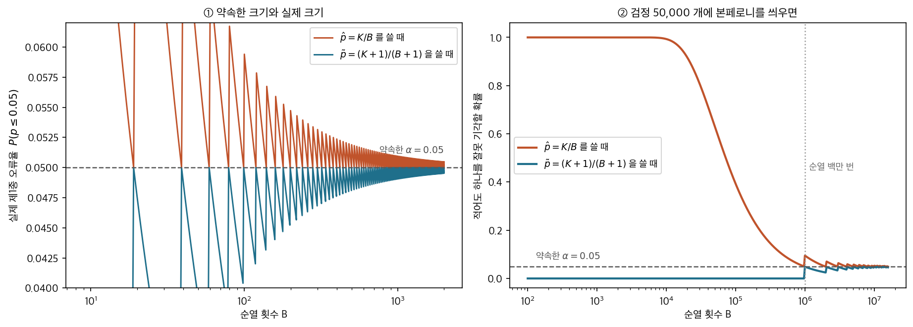
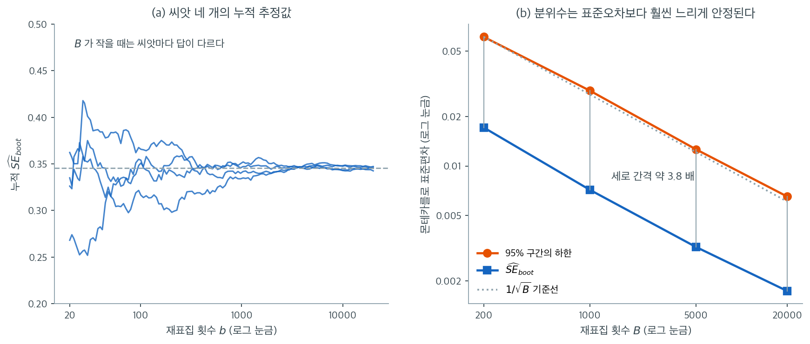

# 재표집 횟수와 수렴

## 1. 재표집을 몇 번 해야 하는가

모든 붓스트랩·순열 절차에는 선택이 하나 따라온다. 재표집을 몇 번 할 것인가? $B$가 너무 작으면 **몬테카를로 오차**가 지나치게 커진다. 이는 재표집 과정 자체의 무작위성에서 오는 변동으로, 우리가 추정하려는 통계적 변동과는 별개이다. $B$가 너무 크면 의미 있는 개선 없이 계산만 낭비한다. **답은 「무엇을 재는가」가 정한다.** 표준오차만 필요하면 $B = 1{,}000$ 으로 족하고, 백분위수 구간은 $5{,}000$–$10{,}000$ 이 든다. $p$ 값은 더 비싼데, $\alpha = 0.05$ 에서 $10{,}000$, $\alpha = 0.01$ 에서는 $50{,}000$ 이 넘어간다. **꼬리로 갈수록 같은 정밀도에 더 많이 든다**는 것이 이 절의 전부이고, $\S 6$ 의 표가 그 수를 모은다.

---

## 2. 몬테카를로 오차

붓스트랩으로 얻은 모든 양(표준오차, 신뢰구간 끝점, $p$값)은 어떤 붓스트랩 표본이 뽑혔는지에 따라 달라지는 확률변수이다. 같은 절차를 다른 난수 씨앗으로 두 번 돌리면 결과가 조금씩 다르다. 이 변동이 **몬테카를로 오차**이다.

몬테카를로 오차는 $O(1/\sqrt{B})$ 속도로 감소한다. $B$를 두 배로 늘리면 몬테카를로 표준편차가 $\sqrt{2} \approx 1.41$배 줄어든다.

---

## 3. 표준오차의 몬테카를로 오차

붓스트랩 표준오차는

$$
\widehat{\text{SE}}_{\text{boot}} = \sqrt{\frac{1}{B-1}\sum_{b=1}^{B}\left(\hat{\theta}^{*(b)} - \bar{\hat{\theta}}^*\right)^2}
$$

이다. 이 추정값의 몬테카를로 표준오차(표준오차의 표준오차)는 근사적으로

$$
\text{SE}_{\text{MC}}(\widehat{\text{SE}}_{\text{boot}}) \approx \frac{\widehat{\text{SE}}_{\text{boot}}}{\sqrt{2B}}
$$

이다. 예를 들어 $B = 1{,}000$이고 $\widehat{\text{SE}}_{\text{boot}} = 2.5$이면

$$
\text{SE}_{\text{MC}} \approx \frac{2.5}{\sqrt{2000}} \approx 0.056
$$

이다. 붓스트랩 표준오차는 약 $\pm 0.11$(몬테카를로 표준오차의 두 배) 안에서 결정된다. 대부분의 목적에 충분한 정밀도이다.

---

## 4. 분위수의 몬테카를로 오차

신뢰구간 끝점은 붓스트랩 분포의 분위수에 의존한다. $q$번째 분위수 $\hat{\theta}^*_{(q)}$의 몬테카를로 오차는 근사적으로

$$
\text{SE}_{\text{MC}}(\hat{\theta}^*_{(q)}) \approx \sqrt{\frac{q(1-q)}{B}} \cdot \frac{1}{f(\hat{\theta}^*_{(q)})}
$$

이다. 여기서 $f$는 붓스트랩 분포의 밀도를 그 분위수에서 평가한 값이다. 극단 분위수($0$이나 $1$ 근처)는 분자 $q(1-q)$가 작지만 꼬리에서 밀도 $f$도 작아 비가 커질 수 있으므로 더 많은 재표집이 필요하다.

!!! note "분위수는 평균보다 많은 재표집을 요구한다"
    $95$% 신뢰구간을 위한 $2.5$번째와 $97.5$번째 백분위수 추정은 표준오차 추정보다 훨씬 많은 붓스트랩 반복을 요구한다. $B = 1{,}000$이면 $2.5$번째 백분위수가 $25$개의 붓스트랩 값으로 결정되어 불안정하다. $B = 10{,}000$이면 $250$개가 되어 훨씬 안정적이다. 연습문제 2에서 이를 정량화한다.

---

## 5. p값의 몬테카를로 오차

붓스트랩 $p$값 $\hat{p} = \frac{1}{B}\sum_{b=1}^{B}\mathbf{1}(|t^{*(b)}| \ge |t_{\text{obs}}|)$는 표본비율이므로 몬테카를로 표준오차가

$$
\text{SE}_{\text{MC}}(\hat{p}) = \sqrt{\frac{\hat{p}(1 - \hat{p})}{B}}
$$

이다.

| 참 $p$ | $B = 1{,}000$ | $B = 5{,}000$ | $B = 10{,}000$ |
|---|---|---|---|
| 0.05 | 0.0069 | 0.0031 | 0.0022 |
| 0.01 | 0.0031 | 0.0014 | 0.0010 |
| 0.001 | 0.0010 | 0.0004 | 0.0003 |

!!! warning "유의수준 근처의 $p$값"
    참 $p$값이 유의수준 $\alpha$에 가까우면 몬테카를로 오차 때문에 잘못된 결정을 내릴 수 있다. $p \approx 0.05$이고 $B = 1{,}000$이면 추정된 $p$값이 대략 $[0.036, 0.064]$ 범위에서 흔들린다. 정확한 $p$값이 필요하면 $B \ge 10{,}000$을 쓴다. 연습문제 3에서 결정이 뒤집히는 빈도를 직접 센다.

<div class="storybox" markdown>

**그림으로 보는 통계학 1.** $p$ 값은 추정할 양이 아니라 계산할 확률이다

위의 $\hat p$ 는 비율이므로 몬테카를로 표준오차가 $\sqrt{\hat p(1-\hat p)/B}$ 다. 여기까지는
맞다. 그런데 $K = 0$ 이면 어떻게 되는가. $\hat p = 0$ 이고 그 표준오차마저 $0$ 이다.
**「$B$ 번 섞어 보았더니 관측값을 넘은 것이 하나도 없었다」가 「확률 $0$」으로 적혀 나간다.**

$2010$ 년 $10$ 월, 멜버른의 월터 앤드 일라이자 홀 연구소에서 벨린다 핍슨과 고든
스마이스가 낸 글은 제목이 곧 지적이다 — **「순열 $p$ 값은 결코 $0$ 이 아니다」.** 초록의
두 문장이 사정을 말한다. **「순열검정은 현대 유전체 연구에서 가장 흔히 쓰이는 통계
도구에 속한다. 그런데 유전체 문헌에 실린 순열 $p$ 값은 흔히 잘못 계산되어 있으며,
대략 $1/m$ 만큼 작게 적혀 있다」**($m$ 은 섞은 횟수, 이 쪽의 $B$ 다).

어디서 어긋났는가. 그들의 진단은 뜻밖에도 **재표집의 시대 자체**를 향한다. 일부만
무작위로 뽑는 순열검정의 정확한 $p$ 값 식은 이미 드와스($1957$)가, 몬테카를로 검정의
것은 바너드($1963$)가 적어 두었다. **「세 원 논문이 각각 무작위화 검정에서 나오는 정확한
$p$ 값의 식을 담고 있었다. 그러나 당시에는 어느 것도 실제로 계산하기에 적합하지 않았고,
무작위로 뽑은 순열에 관한 결과들은 문헌에서 거의 잊힌 듯하다.」** 그 빈자리를 채운 것이
「통계량의 분포는 경험 재표집분포로 **추정**한다」는 강력한 생각이었고, 핍슨과 스마이스는
그것이 **「순열검정의 구현에 불행한 영향을 끼쳤다」**고 적었다. $p$ 값이 어느새 *추정할
대상*이 된 것이다.



- **①** $\alpha = 0.05$ 를 약속하고 $\hat p = K/B$ 로 판정했을 때 실제로 기각되는 비율이다.
  $B = 9$ 부터 $2{,}000$ 까지 가운데 **$95\%$ 의 $B$ 에서 약속을 넘는다.** $B = 20$ 이면
  $0.0952$ 로 약속의 거의 두 배다. $1$ 을 더한 $\tilde p = (K+1)/(B+1)$ 은 **한 번도 넘지
  않는다.** 두 선이 만나 정확히 $0.05$ 가 되는 곳은 $\alpha(B+1)$ 이 정수인 자리뿐이다
  ($B = 19, 99, 999, 9999$) — $999$ 와 $9999$ 가 관례인 까닭의 하나다.
- **②** 한 번 검정할 때 $1/B$ 은 작다. 전사체 $50{,}000$ 개를 한꺼번에 검정하면 이야기가
  달라진다. $B = 1{,}000$ 이면 **$\hat p = 0$ 인 검정이 평균 $49.6$ 개** 나오고, $0$ 은
  본페로니가 아무리 문턱을 낮춰도 통과하므로 **적어도 하나를 잘못 기각할 확률이
  $1.0000$ 이다 — 거짓 발견이 보장된다.** $\hat p$ 를 쓰면서 이 확률을 $0.05$ 아래로
  내리려면 순열을 약 $200$ 만 번 해야 한다. $1$ 을 더하면 같은 자리에서 그 확률이 $0$ 이다.
  대신 정직한 대가가 따른다. $\tilde p$ 의 최솟값은 $1/(B+1)$ 이므로, $B = 1{,}000$ 으로는
  유전체 수준의 유의($10^{-6}$)를 **애초에 주장할 수 없다.** 그것이 사실이다.

핍슨과 스마이스가 적은 교훈은 이 쪽의 $B$ 표와 나란히 두어야 한다. **「참 $p$ 값 자리에
불편추정량을 꽂아 넣는다고 해서 같은 크기의 검정이 되지는 않는다. ⋯ $p$ 값은 통계모형에서
추정되어야 할 미지의 모수처럼 다룰 것이 아니라 확률로서 직접 평가되어야 한다.」** 이 절의
표는 **「얼마나 정밀한가」**를 묻고 $B$ 를 고른다. 그들이 묻는 것은 그 앞의 물음이다 —
**보고하는 그 수가 확률이기는 한가.** 두 물음은 따로다. $B$ 를 아무리 키워도 $\hat p = 0$ 은
확률이 되지 않는다.

정확한 크기 계산은 $17.3$ 절 [상관에 대한 붓스트랩 검정](../bootstrap_testing/correlation.md)
연습문제 6 에 있다. 결론만 옮기면 $P(\tilde p \le \alpha) = \lfloor \alpha(B+1) \rfloor/(B+1) \le \alpha$ 이고,
$\tilde p \ge 1/(B+1) > 0$ 이다.

_확인한 곳 — B. Phipson, G. K. Smyth, "Permutation P-values Should Never Be Zero:
Calculating Exact P-values When Permutations Are Randomly Drawn", 『Statistical Applications
in Genetics and Molecular Biology』 $9$ 권 $1$ 호 $39$ 번 글($2010$ 년 $10$ 월 $31$ 일 게재,
$2011$ 년 $2$ 월 $9$ 일 정정). 제목과 두 저자의 소속(월터 앤드 일라이자 홀 연구소), 초록의
「흔히 잘못 계산되어 있으며 대략 $1/m$ 만큼 작게 적혀 있다」, 서론의 피셔($1935$)·드와스
($1957$)·바너드($1963$) 서술과 「거의 잊힌 듯하다」·「불행한 영향」, $2$ 절의 「$p$ 값은 ⋯
확률로서 직접 평가되어야 한다」, 그리고 전사체 $50{,}000$ 개를 본페로니로 보정하는 예가
$3$ 절에 있다는 것을 이 글에서 확인했다. 그림과 본문의 수는 모두 직접 계산한 값이다_

</div>

---

## 6. B 선택 지침

적절한 재표집 횟수는 추론 목적에 따라 다르다.

| 목적 | 권장 $B$ | 근거 |
|---|---|---|
| 표준오차 추정 | $1{,}000$ | $\text{SE}_{\text{MC}} \approx \widehat{\text{SE}}_{\text{boot}} / 45$ |
| 백분위수 신뢰구간 (95%) | $5{,}000$--$10{,}000$ | 안정적인 꼬리 분위수 추정 |
| BCa 신뢰구간 | $5{,}000$--$10{,}000$ | 백분위수와 동일(추가로 잭나이프) |
| $\alpha = 0.05$의 $p$값 | $10{,}000$ | $\text{SE}_{\text{MC}}(\hat{p}) \approx 0.002$ |
| $\alpha = 0.01$의 $p$값 | $50{,}000$--$100{,}000$ | 작은 $p$의 정밀 추정 |
| 논문 수준의 결과 | $10{,}000$ 이상 | 재현성 확보 |

이는 최소 권장값이다. 필요보다 많이 쓰는 것은 계산시간 외에 통계적 대가가 없다.

---

## 7. 수렴 점검

$B$를 미리 정하는 대신, $B$가 커질 때 추정값이 얼마나 안정되는지를 **관찰**하는 실용적 접근이 있다.

**누적 추정값 그림.** $b$를 $1$부터 $B$까지 늘려가며 붓스트랩 표준오차(또는 신뢰구간 끝점)를 누적 계산하고 $b$에 대해 그린다. 곡선이 안정되면(변동이 무시할 수준이 되면) $B$가 충분한 것이다.

**반복 비교.** 다른 난수 씨앗으로 같은 절차를 두 번 돌린다. 두 추정값이 원하는 정밀도로 일치하면 $B$가 적절하다.

**변동계수.** $\text{SE}_{\text{MC}} / \widehat{\text{SE}}_{\text{boot}}$ 비를 계산한다. 상대적인 몬테카를로 오차이다. 표준오차 추정에는 $1$--$2$%(즉 $B \ge 2{,}500$)면 합리적이고, 더 엄격한 목표는 그에 비례해 더 많은 재표집을 요구한다.

!!! tip "실용적 수렴 점검"
    간단한 경험칙: $B = 1{,}000$으로 한 번, $B = 2{,}000$으로 한 번 돌린다. 두 표준오차 추정값이 $5$% 이내로 일치하면 $B = 1{,}000$으로 충분하다. 크게 다르면 $B$를 늘려 반복한다.

---

## 8. 수확체감

몬테카를로 표준오차는 $1/\sqrt{B}$로 감소한다. 따라서

- $B = 100 \to 1{,}000$: 몬테카를로 오차가 $\sqrt{10} \approx 3.2$배 감소
- $B = 1{,}000 \to 10{,}000$: 또 $3.2$배 감소
- $B = 10{,}000 \to 100{,}000$: 또 $3.2$배 감소

표준오차와 신뢰구간에서는 $B = 10{,}000$을 넘으면 개선이 거의 눈에 띄지 않는다. 흔한 문턱 근처의 $p$값에는 더 큰 $B$가 여전히 값질 수 있다.



왼쪽이 위에서 권한 **누적 추정값 그림**이다. $N(10, 2^2)$에서 뽑은 $n = 40$ 자료 하나를 고정해 두고, 난수 씨앗만 바꾸어 네 번 돌렸다. 자료도 같고 참 붓스트랩 표준오차도 같은데 $b = 20$ 근처에서는 네 곡선이 $0.25$부터 $0.42$까지 흩어져 있다. **이 흩어짐은 통계적 불확실성이 아니라 순전히 계산상의 자의성이다.** $b$가 $1{,}000$을 넘어서면서 네 곡선이 회색 점선으로 모이고, $10{,}000$ 이후로는 눈으로 구별되지 않는다.

오른쪽이 목적에 따라 필요한 $B$가 달라지는 이유다. 두 축 모두 로그 눈금이라 $1/\sqrt{B}$ 법칙이 직선으로 나타나며, 두 선이 회색 기준선과 나란한 것이 그 확인이다. 결정적인 것은 **두 선 사이의 세로 간격**이다. $95\%$ 구간의 하한이 표준오차보다 언제나 약 $3.8$배 더 흔들리고, 이 비는 $B$가 바뀌어도 유지된다.

$3.8$배라는 숫자를 $B$로 환산하면 실무 지침이 된다. 같은 절대 정밀도를 얻으려면 $3.8^2 \approx 14$배의 재표집이 필요하다. 표준오차에 $B = 1{,}000$이면 충분하다고 판단했다면 구간 끝점에는 $B \approx 14{,}000$이 있어야 한다는 뜻이며, 위 표가 백분위수 구간에 $5{,}000$--$10{,}000$을 권하는 근거가 정확히 이것이다. 반대로 $B$를 $200$에서 $20{,}000$으로 $100$배 키워도 변동은 $10$배밖에 줄지 않는다는 것도 같은 그림에서 읽힌다.

---

## 연습문제

이하의 연습문제는 하나의 고정된 자료를 쓴다. $N(10, 2^2)$에서 뽑은 $n = 40$개 관측으로, 표본평균 $9.766$, 표본표준편차 $2.206$, 따라서 $\widehat{\text{SE}} = 2.206/\sqrt{40} = 0.349$이다.

<div class="drillbox" markdown>

**연습문제 1.** <span class="diff med" title="중간"></span>
공식 $\text{SE}_{\text{MC}}(\widehat{\text{SE}}_{\text{boot}}) \approx \widehat{\text{SE}}_{\text{boot}}/\sqrt{2B}$가 실제로 맞는지 확인하라. $B = 200, 1000, 5000$ 각각에 대해 붓스트랩 표준오차를 $400$번 반복 계산하고, 그 표준편차를 공식의 예측과 비교하라.

</div>

??? success "풀이"
    ```python
    import numpy as np
    rng = np.random.default_rng(77)
    n = 40
    x = rng.normal(10, 2, n)           # 고정된 자료
    print(round(x.mean(), 4), round(x.std(ddof=1), 4))   # 9.7658  2.2062

    def boot_se(B):
        idx = rng.integers(0, n, (B, n))
        return x[idx].mean(axis=1).std(ddof=1)

    for B in (200, 1000, 5000):
        ses = np.array([boot_se(B) for _ in range(400)])
        print(B, round(ses.mean(), 5), round(ses.std(ddof=1), 5),
              round(ses.mean()/np.sqrt(2*B), 5))
    ```

    출력:

    ```
    9.7658 2.2062
    200 0.34311 0.01696 0.01716
    1000 0.34447 0.00729 0.0077
    5000 0.34453 0.00331 0.00345
    ```

    | $B$ | $\widehat{\text{SE}}_{\text{boot}}$ 평균 | 관측된 표준편차 | 공식 예측 $\widehat{\text{SE}}/\sqrt{2B}$ | 비 |
    |---:|---:|---:|---:|---:|
    | 200 | 0.34311 | 0.01696 | 0.01716 | 0.99 |
    | $1{,}000$ | 0.34447 | 0.00729 | 0.00770 | 0.95 |
    | $5{,}000$ | 0.34453 | 0.00331 | 0.00345 | 0.96 |

    **공식이 잘 맞는다.** 관측된 표준편차와 예측이 $5$% 이내로 일치한다. 관측값이 일관되게 조금 작은데, 이는 공식이 정규분포를 전제한 근사이고 실제 붓스트랩 평균 분포가 미세하게 다르기 때문이다.

    **세 가지를 읽어야 한다.**

    첫째, **$\widehat{\text{SE}}_{\text{boot}}$의 평균이 $B$에 거의 의존하지 않는다**($0.3431 \to 0.3445 \to 0.3445$). $B$는 편향이 아니라 변동만 통제한다. $B = 200$이라도 평균적으로는 옳은 값을 준다.

    둘째, **$1/\sqrt{2B}$ 속도가 눈에 보인다.** $B$를 $25$배 늘리자($200 \to 5000$) 표준편차가 $0.01696/0.00331 = 5.12$배 줄었다. $\sqrt{25} = 5$와 일치한다.

    셋째, **상대오차가 이미 작다.** $B = 1{,}000$에서 $0.00729/0.34447 = 2.1$%이다. 표준오차를 소수 셋째 자리까지 보고할 생각이 아니라면 이것으로 충분하다.

    참고로 이 자료의 정규이론 표준오차는 $2.2062/\sqrt{40} = 0.3488$이다. 붓스트랩 값 $0.3445$가 이보다 약간 작은데, 붓스트랩이 $s^2$ 대신 $\hat{\sigma}^2 = \frac{n-1}{n}s^2$에 해당하는 양을 쓰기 때문이다. $0.3488 \times \sqrt{39/40} = 0.3444$로 정확히 설명된다.

<div class="drillbox" markdown>

**연습문제 2.** <span class="diff med" title="중간"></span>
신뢰구간 끝점이 표준오차보다 얼마나 더 많은 재표집을 요구하는지 정량화하라. $B = 200, 1000, 5000, 20000$에서 $2.5$번째·$97.5$번째 백분위수와 표준오차의 몬테카를로 변동을 각각 $400$번 반복으로 측정하라.

</div>

??? success "풀이"
    ```python
    for B in (200, 1000, 5000, 20000):
        lo, hi, se = [], [], []
        for _ in range(400):
            idx = rng.integers(0, n, (B, n))
            b = x[idx].mean(axis=1)
            l, h = np.percentile(b, [2.5, 97.5])
            lo.append(l); hi.append(h); se.append(b.std(ddof=1))
        print(B, round(np.std(lo), 5), round(np.std(hi), 5), round(np.std(se), 5))
    ```

    출력:

    ```
    200 0.06537 0.06831 0.01861
    1000 0.02901 0.02843 0.00747
    5000 0.01281 0.01331 0.00347
    20000 0.00627 0.00672 0.00177
    ```

    | $B$ | sd(하한) | sd(상한) | sd($\widehat{\text{SE}}$) | 끝점/SE 비 |
    |---:|---:|---:|---:|---:|
    | 200 | 0.06537 | 0.06831 | 0.01861 | 3.6 |
    | $1{,}000$ | 0.02901 | 0.02843 | 0.00747 | 3.8 |
    | $5{,}000$ | 0.01281 | 0.01331 | 0.00347 | 3.8 |
    | $20{,}000$ | 0.00627 | 0.00672 | 0.00177 | 3.7 |

    **신뢰구간 끝점의 몬테카를로 변동이 표준오차의 약 $3.7$배이다.** 이 비는 $B$에 거의 무관하다. 두 양 모두 $1/\sqrt{B}$로 줄어들기 때문이다.

    **같은 정밀도를 얻으려면 약 $14$배의 재표집이 필요하다.** $3.7^2 = 13.7$이기 때문이다. 표준오차에 $B = 1{,}000$이면 충분하다고 판단했다면, 신뢰구간 끝점에는 $B \approx 14{,}000$을 써야 같은 절대 정밀도가 나온다. 본문 표가 백분위수 신뢰구간에 $5{,}000$--$10{,}000$을 권하는 근거가 이것이다.

    **실무적 기준.** 이 자료의 $95$% 신뢰구간 폭은 대략 $4 \times 0.345 = 1.38$이다. 끝점의 몬테카를로 변동이 구간 폭의 $1$% 이하이기를 원한다면 $0.0138$이 목표이고, 표에서 $B = 5{,}000$($0.0128$)이 이를 만족한다.

    !!! note "왜 하필 $3.7$배인가"
        분위수의 몬테카를로 표준오차는 $\sqrt{q(1-q)/B}/f(\theta_q)$이다. 붓스트랩 분포가 대략 $N(\bar{x}, \text{SE}^2)$이면 $q = 0.025$에서

        $$
        f(\theta_{0.025}) = \frac{\phi(1.96)}{\text{SE}} = \frac{0.0584}{\text{SE}}
        $$

        이므로

        $$
        \text{SE}_{\text{MC}}(\hat{\theta}_{0.025}) = \frac{\sqrt{0.025 \times 0.975}}{0.0584}\cdot\frac{\text{SE}}{\sqrt{B}} = 2.67\,\frac{\text{SE}}{\sqrt{B}}
        $$

        이다. 표준오차 쪽은 $\text{SE}/\sqrt{2B} = 0.707\,\text{SE}/\sqrt{B}$이므로 비는 $2.67/0.707 = 3.78$이다. 관측된 $3.7$--$3.8$과 정확히 일치한다.

<div class="drillbox" markdown>

**연습문제 3.** <span class="diff med" title="중간"></span>
$p$값이 유의수준 근처일 때 $B$가 결정을 얼마나 자주 뒤집는지 세어라. [순열검정의 구현](../permutation/permutation_tests.md) 보기 7 의 자료(집단 A $[8,7,9,10,6]$, 집단 B $[5,6,4,3,7]$, 정확 $p = 10/252 = 0.0397$)에 대해 $B = 200, 1000, 10000$으로 각각 $2{,}000$번 순열검정을 하고, $\alpha = 0.05$에서 기각하는 비율을 구하라.

</div>

??? success "풀이"
    ```python
    a = np.array([8, 7, 9, 10, 6]); b = np.array([5, 6, 4, 3, 7])
    z = np.concatenate([a, b]); obs = a.mean() - b.mean(); m = 5

    for B in (200, 1000, 10000):
        ps = []
        for _ in range(2000):
            P = np.array([rng.permutation(z) for _ in range(B)])
            d = P[:, :m].mean(1) - P[:, m:].mean(1)
            ps.append(((np.abs(d) >= obs - 1e-12).sum() + 1) / (B + 1))
        ps = np.array(ps)
        print(B, round(ps.mean(), 4), round(ps.std(), 4), round((ps < 0.05).mean(), 3))
    ```

    출력:

    ```
    200 0.0444 0.0135 0.729
    1000 0.0405 0.0061 0.942
    10000 0.0397 0.0019 1.0
    ```

    | $B$ | $\hat{p}$ 평균 | $\hat{p}$ 표준편차 | $\alpha = 0.05$에서 기각한 비율 |
    |---:|---:|---:|---:|
    | 200 | 0.0444 | 0.0135 | **0.729** |
    | $1{,}000$ | 0.0405 | 0.0061 | **0.942** |
    | $10{,}000$ | 0.0397 | 0.0019 | **1.000** |
    | 정확값 | 0.0397 | 0 | 1 |

    **$B = 200$이면 같은 자료를 놓고 네 번 중 한 번은 다른 결론을 낸다.** 참 $p$값이 $0.0397$로 명확히 $0.05$ 미만인데도 그렇다.

    이것은 통계적 불확실성이 아니라 **순전히 계산상의 자의성**이다. 자료는 고정되어 있고 참 $p$값도 고정되어 있다. 오직 난수 씨앗만 다르다. 연구자 두 명이 같은 자료, 같은 방법, 같은 코드로 정반대의 결론을 발표할 수 있다.

    **$B = 1{,}000$에서도 $5.8$%가 뒤집힌다.** 참값이 $0.0397$로 문턱에서 꽤 떨어져 있는데도 그렇다. 참값이 $0.048$처럼 더 가까우면 상황은 훨씬 나빠진다.

    **$B = 10{,}000$이면 안정된다**($2{,}000$번 모두 기각). 표준편차 $0.0019$이므로 문턱까지의 거리 $0.0103$이 $5.4$ 표준편차에 해당한다.

    !!! tip "재현성을 위한 실무 규칙"
        1. **난수 씨앗을 고정하고 보고하라.** 이것이 가장 값싼 해결책이다.
        2. **$\hat{p}$가 $\alpha$의 $\pm 3\,\text{SE}_{\text{MC}}$ 안에 들면 $B$를 늘려라.** $B = 1{,}000$에서 $\hat{p} = 0.045$가 나왔다면 $\text{SE}_{\text{MC}} = 0.0066$이므로 문턱까지 $0.8$ 표준편차이다. $B$를 $10$배로 늘려 다시 계산해야 한다.
        3. **가능하면 열거하라.** 이 보기는 순열이 $252$가지뿐이므로 몬테카를로를 쓸 이유가 아예 없다.
        4. **$p$값을 이분법으로만 읽지 말라.** $p = 0.0397$과 $p = 0.052$의 증거 차이는 미미하다. 문턱 근처에서 $B$에 민감한 것은 몬테카를로의 결함이 아니라 이분법적 판단의 결함을 드러내는 것이기도 하다.

<div class="drillbox" markdown>

**연습문제 4.** <span class="diff med" title="중간"></span>
본문 3절의 공식 $\text{SE}_{\text{MC}}(\widehat{\text{SE}}_{\text{boot}}) \approx \widehat{\text{SE}}_{\text{boot}}/\sqrt{2B}$를 유도하라. 붓스트랩 복제값 $\hat{\theta}^{*(1)}, \dots, \hat{\theta}^{*(B)}$가 정규분포에서 독립으로 뽑힌다고 보고 $\chi^2$ 분포와 델타법을 쓰면 된다.

이어서 (나) 상대 몬테카를로 오차 $\text{SE}_{\text{MC}}/\widehat{\text{SE}}_{\text{boot}}$를 정확히 $1$%와 $2$%로 만드는 $B$를 각각 구하고, 본문 7절이 "$1$--$2$%면 합리적이고(즉 $B \ge 2{,}500$)"이라 적은 것과 맞춰 보라. (다) 연습문제 1에서 관측된 비가 $0.99, 0.95, 0.96$으로 셋 다 $1$보다 작았다. 이것이 공식의 체계적 결함인가? $400$번 반복으로 표준편차를 재는 일 자체의 상대오차를 계산해 판정하라.

</div>

??? success "풀이"
    **(가) 유도.** $\hat{\theta}^{*(b)} \stackrel{\text{iid}}{\sim} N(\mu, \sigma^2)$, $b = 1, \dots, B$라 하자. 붓스트랩 표준오차는 이 $B$개 값의 표본표준편차 $s^*$이다. 정규 표본에서

    $$
    \frac{(B-1)(s^*)^2}{\sigma^2} \sim \chi^2_{B-1}
    $$

    이고 $\text{Var}(\chi^2_{B-1}) = 2(B-1)$이므로

    $$
    \text{Var}\!\left((s^*)^2\right) = \frac{\sigma^4}{(B-1)^2}\cdot 2(B-1) = \frac{2\sigma^4}{B-1}
    $$

    이다. 여기에 $g(u) = \sqrt{u}$, $g'(\sigma^2) = 1/(2\sigma)$로 델타법을 쓰면

    $$
    \text{Var}(s^*) \approx \left(\frac{1}{2\sigma}\right)^2 \cdot \frac{2\sigma^4}{B-1} = \frac{\sigma^2}{2(B-1)}
    $$

    이므로 $\text{SE}(s^*) \approx \sigma/\sqrt{2(B-1)} \approx \widehat{\text{SE}}_{\text{boot}}/\sqrt{2B}$이다. $\square$

    유도에서 두 가지가 드러난다. 첫째, 공식에 $\sigma$(즉 $\widehat{\text{SE}}_{\text{boot}}$)가 비례인수로만 들어가므로 **상대** 몬테카를로 오차 $1/\sqrt{2B}$는 자료와 통계량에 전혀 의존하지 않는다. 오직 $B$만의 함수다. 둘째, 정규성이 쓰인 자리는 $\chi^2$ 단계이고, 거기서 쓰인 것은 사실 첨도 $\kappa = 3$이라는 가정뿐이다. 연습문제 10이 그 가정이 깨지는 자리를 다룬다.

    **(나) 목표 상대오차에 필요한 $B$.** $1/\sqrt{2B} = \varepsilon$에서 $B = 1/(2\varepsilon^2)$이다.

    | 목표 상대 몬테카를로 오차 | 필요한 $B$ |
    |---:|---:|
    | $2$% | $1{,}250$ |
    | $1.41$% | $2{,}500$ |
    | $1$% | $5{,}000$ |

    본문의 $B \ge 2{,}500$은 상대오차 $1/\sqrt{5000} = 1.41$%에 해당한다. 즉 $1$--$2$% 띠의 **가운데**이지 어느 쪽 끝도 아니다. 띠의 느슨한 끝($2$%)만 요구한다면 $B = 1{,}250$으로 족하고, 빡빡한 끝($1$%)을 요구한다면 $B = 5{,}000$이 있어야 한다. 본문의 숫자는 "$1$--$2$%"를 기하적 중간으로 읽은 타협값이다.

    **(다) 연습문제 1의 비가 작은 것은 결함이 아니다.** $R = 400$개의 독립 복제값으로 표준편차를 추정할 때, 그 추정값 자체의 상대 몬테카를로 오차는 (가)의 공식을 그대로 적용하면

    $$
    \frac{1}{\sqrt{2(R-1)}} = \frac{1}{\sqrt{798}} = 0.0354
    $$

    즉 $3.5$%이다. 관측된 비 $0.99, 0.95, 0.96$의 $1$로부터의 거리는 각각 $1$%, $5$%, $4$%이고 이는 $0.3, 1.4, 1.1$ 표준오차에 해당한다. **어느 것도 유의하지 않다.** 셋이 모두 같은 쪽으로 쏠린 것이 수상하다면, 독립인 세 값이 한쪽으로 몰릴 확률이 $2 \times (1/2)^3 = 25$%임을 떠올리면 된다.

    혹시 $\sqrt{2B}$ 대신 더 정확한 $\sqrt{2(B-1)}$을 써야 설명되는가 물을 수 있다. 그렇지 않다. $B = 200$에서 $\sqrt{2 \times 199}/\sqrt{2 \times 200} = 0.9975$이므로 그 보정은 공식 값을 $0.25$%만 **작게** 만들어 관측값과의 간격을 오히려 넓힌다. 간격의 설명은 반복 횟수 $R$의 유한성 하나로 충분하다.

<div class="drillbox" markdown>

**연습문제 5.** <span class="diff med" title="중간"></span>
$B$를 늘려 줄일 수 있는 오차와 아무리 늘려도 줄지 않는 오차를 가려 적어라. 이 쪽의 자료는 $n = 40$, $s = 2.206$, $\widehat{\text{SE}} = 0.349$이다.

(가) 정규 가정 아래 $\widehat{\text{SE}} = s/\sqrt{n}$ 자체의 표준오차가 근사적으로 $\widehat{\text{SE}}/\sqrt{2(n-1)}$임을 써서 그 값을 구하라. (나) $B = 1{,}000$의 몬테카를로 표준오차와 비교하라. 비를 $B$와 $n$의 식으로도 적어라. (다) 두 오차가 독립이라 보고 합친 오차를 구하고, $B = 1{,}000$에서 멈추는 것이 전체 오차를 몇 % 부풀리는지 답하라. (라) 몬테카를로 오차를 통계적 오차의 $1/10$로 낮추는 $B$를 $n$의 식으로 적고 값을 구하라.

</div>

??? success "풀이"
    **(가) 통계적 오차.** $\widehat{\text{SE}} = 2.2062/\sqrt{40} = 0.3488$이고

    $$
    \frac{0.3488}{\sqrt{2 \times 39}} = \frac{0.3488}{8.8318} = 0.0395
    $$

    이다. 이것은 $N(10, 2^2)$에서 $n = 40$을 다시 뽑으면 $\widehat{\text{SE}}$가 얼마나 달라지는가를 말한다. **$B$와 아무 상관이 없다.**

    **(나) 몬테카를로 오차.** 연습문제 1의 $\widehat{\text{SE}}_{\text{boot}} = 0.3445$를 쓰면 $B = 1{,}000$에서

    $$
    \frac{0.3445}{\sqrt{2000}} = 0.00770
    $$

    이다. 비는 $0.0395/0.00770 = 5.13$이다. 식으로는 두 오차가 모두 같은 $\widehat{\text{SE}}$에 비례하므로

    $$
    \frac{\text{통계적 오차}}{\text{몬테카를로 오차}} = \frac{\widehat{\text{SE}}/\sqrt{2(n-1)}}{\widehat{\text{SE}}/\sqrt{2B}} = \sqrt{\frac{B}{n-1}} = \sqrt{\frac{1000}{39}} = 5.06
    $$

    이다. 수치 $5.13$과의 미세한 차이는 분자에 $0.3488$, 분모에 $0.3445$를 쓴 데서 온다. **$B$가 $n$보다 $25$배 많으면 비는 $5$배다.** 기억할 꼴은 $B$ 대 $n$이 아니라 $\sqrt{B}$ 대 $\sqrt{n}$이라는 것이다.

    **(다) 합친 오차.**

    $$
    \sqrt{0.0395^2 + 0.00770^2} = \sqrt{0.0015603 + 0.0000593} = 0.04024
    $$

    통계적 오차만 있을 때의 $0.03949$에 비해 $0.04024/0.03949 - 1 = 1.9$% 크다. 즉 **$B$를 $1{,}000$에서 무한으로 늘려 얻는 것은 전체 오차의 $1.9$%뿐이다.**

    **(라) 목표 $B$.**

    $$
    \frac{1}{\sqrt{2B}} = \frac{1}{10}\cdot\frac{1}{\sqrt{2(n-1)}} \quad\Longrightarrow\quad B = 100(n-1) = 100 \times 39 = 3{,}900
    $$

    이다. 일반 규칙으로 적으면 **$B \approx 100n$이면 몬테카를로 오차는 통계적 오차의 $1$할로 떨어지고, 그때 합친 오차의 부풀림은 $\sqrt{1 + 0.01} - 1 = 0.5$%에 지나지 않는다.** $n = 40$ 자료에 $B = 100{,}000$을 쓰는 것은 이미 $0.5$%도 못 되는 것을 더 깎는 일이다.

    **두 오차를 혼동하면 어떻게 되는가.** $B$를 키워 신뢰구간이 안정되는 것을 보고 "추정이 정밀해졌다"고 읽는 것이 흔한 오독이다. 안정된 것은 **같은 자료를 두 번 계산했을 때의 일치도**일 뿐이다. $B \to \infty$로 보내면 몬테카를로 오차는 $0$이 되지만 $0.0395$는 그대로 남는다. 그것을 줄이는 길은 $n$을 늘리는 것 하나뿐이다. 재표집은 자료에 담긴 정보를 꺼내는 도구이지 없는 정보를 만드는 도구가 아니다.

<div class="drillbox" markdown>

**연습문제 6.** <span class="diff hard" title="어려움"></span>
연습문제 3의 표에서 $\hat{p}$의 평균이 $B = 200, 1{,}000, 10{,}000$에 따라 $0.0444, 0.0405, 0.0397$로 정확값 $0.0397$에 **위에서** 내려온다. 이 치우침을 설명하라.

(가) $\hat{p} = \dfrac{1 + \#\{\lvert T^* \rvert \ge \lvert T_{\text{obs}} \rvert\}}{B+1}$의 평균과 표준편차를 $B$와 참 $p$의 식으로 적고, $p = 10/252$를 넣어 세 $B$에 대해 계산해 연습문제 3의 표와 맞춰 보라. (나) 치우침과 변동이 각각 $B$에 대해 어떤 속도로 줄어드는가? 둘이 같아지는 $B$를 구하라. (다) $1$을 더하지 않은 $\#/B$는 비편향이다. 그런데도 쓰지 않는 이유를 $B = 200$에서 수치로 답하라.

</div>

??? success "풀이"
    **(가) 평균과 표준편차.** 몬테카를로 순열검정은 $B$개의 라벨 배치를 복원추출로 뽑으므로, 각 추출이 확률 $p$로 $\lvert T^* \rvert \ge \lvert T_{\text{obs}} \rvert$를 만족한다. 따라서 $\# \sim \text{Bin}(B, p)$이고

    $$
    E[\hat{p}] = \frac{1 + Bp}{B+1} = p + \frac{1-p}{B+1}, \qquad \text{sd}(\hat{p}) = \frac{\sqrt{Bp(1-p)}}{B+1}
    $$

    이다. $p = 10/252 = 0.039683$을 넣는다.

    | $B$ | 식의 평균 $p + \frac{1-p}{B+1}$ | 연습문제 3 관측 | 식의 sd | 연습문제 3 관측 |
    |---:|---:|---:|---:|---:|
    | 200 | $0.039683 + 0.004778 = 0.04446$ | 0.0444 | 0.01373 | 0.0135 |
    | $1{,}000$ | $0.039683 + 0.000959 = 0.04064$ | 0.0405 | 0.00617 | 0.0061 |
    | $10{,}000$ | $0.039683 + 0.000096 = 0.03978$ | 0.0397 | 0.00195 | 0.0019 |

    **여섯 수가 모두 맞는다.** 연습문제 3에서 보았던 "$B$가 커지며 위에서 내려오는" 꼴은 몬테카를로 잡음이 아니라 추정량 자체의 **상향 치우침** $(1-p)/(B+1)$이었다. 치우침은 참 $p$가 작을수록 $(1-p)/(B+1) \approx 1/(B+1)$에 가까워지므로, 작은 $p$를 다룰 때 상대적으로 더 아프다.

    **(나) 두 오차의 속도.** 치우침은

    $$
    \frac{1-p}{B+1} = O(B^{-1}), \qquad \text{sd} \approx \sqrt{\frac{p(1-p)}{B}} = O(B^{-1/2})
    $$

    이다. 치우침이 변동보다 훨씬 빨리 사라진다. 둘이 같아지는 $B$는

    $$
    \frac{1-p}{B+1} = \sqrt{\frac{p(1-p)}{B}} \ \Longrightarrow\ \frac{(1-p)^2}{B^2} \approx \frac{p(1-p)}{B} \ \Longrightarrow\ B \approx \frac{1-p}{p} = 24.2
    $$

    이다. 즉 $B \ge 25$만 되어도 치우침은 이미 변동보다 작다. $B = 200$에서 치우침 $0.00478$은 sd $0.01373$의 $35$%이고, $B = 10{,}000$에서는 $0.000096$이 $0.00195$의 $4.9$%다. **치우침은 $B$를 조금 키우면 사라지지만 변동은 끈질기다** — 그래서 본문의 $B$ 선택 지침이 전부 변동을 기준으로 적혀 있다.

    **(다) 왜 비편향인 $\#/B$를 버리는가.** 두 가지 이유가 있다.

    첫째, $\#/B$는 **일어날 수 없는 값**을 양의 확률로 낸다. $B = 200$에서

    $$
    P(\# = 0) = (1-p)^{200} = 0.960317^{200} = 0.000304
    $$

    이므로 약 $3{,}290$번에 한 번 $\hat{p}_0 = 0$이 보고된다. 그런데 순열검정의 참 $p$값은 **결코 $0$이 될 수 없다.** $252$가지를 열거하면 관측된 라벨 배치 자신이 언제나 $\lvert T^* \rvert = \lvert T_{\text{obs}} \rvert$를 만족해 분자에 세어지기 때문이다(이 보기에서 분자 $10$ 안에 그 배치가 들어 있다). $p \ge 1/252$가 아래 벽이다. $\hat{p}_0 = 0$은 "증거가 무한히 강하다"는 뜻이 아니라 "$B$가 모자라다"는 뜻인데, 소수점으로 적힌 $0$은 그 구별을 지운다.

    둘째, 더 중요하게 검정의 타당성이 걸린다. $\hat{p} = (1 + \#)/(B+1)$은 귀무가설 아래에서 $P(\hat{p} \le \alpha) \le \alpha$를 만족해 유의수준을 넘기지 않는다. $\hat{p}_0 = \#/B$는 그렇지 않다. $B = 200$, $\alpha = 1/200 = 0.005$를 생각하면 $\hat{p}_0 \le 0.005$는 $\# \le 1$과 같고, $p = 0.005$일 때 그 확률은 $P(\text{Bin}(200, 0.005) \le 1) = 0.7358$이다. 수준 $0.005$ 검정이 $0.7358$의 확률로 기각하는 셈이다. $1$을 더해 생기는 $O(1/B)$ 치우침은 **그 보수성의 값**이다.

    !!! note "분모의 1 과 본문 표의 관계"
        본문 5절은 $\hat{p} = \frac{1}{B}\sum_b \mathbf{1}(\lvert t^{*(b)} \rvert \ge \lvert t_{\text{obs}} \rvert)$로 적고 $\text{SE}_{\text{MC}}(\hat{p}) = \sqrt{\hat{p}(1-\hat{p})/B}$를 유도한다. $(B+1)$꼴을 쓰면 표준오차가 $\sqrt{Bp(1-p)}/(B+1)$로 바뀌지만, 비는 $\sqrt{B}/(B+1) \cdot \sqrt{B} = B/(B+1)$이므로 $B = 1{,}000$에서 $0.1$%밖에 다르지 않다. **표의 수치는 그대로 쓸 수 있다.** 분모의 $1$이 바꾸는 것은 변동이 아니라 중심이다.

<div class="drillbox" markdown>

**연습문제 7.** <span class="diff hard" title="어려움"></span>
본문 7절의 경험칙을 검사하라. "$B = 1{,}000$으로 한 번, $B = 2{,}000$으로 한 번 돌린다. 두 표준오차 추정값이 $5$% 이내로 일치하면 $B = 1{,}000$으로 충분하다."

(가) $B_1$과 $B_2 = 2B_1$로 얻은 독립인 두 추정값의 상대 차이 $\lvert \widehat{\text{SE}}_1 - \widehat{\text{SE}}_2 \rvert / \widehat{\text{SE}}_2$의 표준편차를 $B_1$의 식으로 적고, 규칙의 통과율을 정규근사로 계산하라. (나) $B_1 = 50, 200, 1{,}000$에 대해 통과율을 $20{,}000$번 반복으로 재고 (가)와 비교하라. (다) 이 규칙이 쓸 만한지 판정하라. 문턱 $5$%를 조이면 고쳐지는가? 더 나은 방법을 적어라.

</div>

??? success "풀이"
    **(가) 통과율의 식.** 연습문제 4의 결과로 $\widehat{\text{SE}}_i$는 평균 $\text{SE}$, 상대 표준편차 $1/\sqrt{2B_i}$를 갖고 둘은 독립이다. 상대 차이의 표준편차는

    $$
    \sqrt{\frac{1}{2B_1} + \frac{1}{2B_2}} = \sqrt{\frac{1}{2B_1} + \frac{1}{4B_1}} = \sqrt{\frac{3}{4B_1}}
    $$

    이고, 따라서 통과율은

    $$
    P\!\left(\lvert Z \rvert < \frac{0.05}{\sqrt{3/(4B_1)}}\right) = 2\Phi\!\left(0.05\sqrt{\tfrac{4B_1}{3}}\right) - 1
    $$

    이다. $B_1 = 50, 200, 1{,}000$에서 상대 차이의 표준편차는 $0.1225, 0.0612, 0.0274$이고 $z$값은 $0.408, 0.817, 1.826$, 통과율은 $0.3169, 0.5858, 0.9321$이다.

    **(나) 모의로 확인.**

    ```python
    from scipy import stats
    g7 = np.random.default_rng(31)
    R = 20000

    def pass_rate(B1, B2):
        ok = 0
        for _ in range(R):
            s1 = x[g7.integers(0, n, (B1, n))].mean(axis=1).std(ddof=1)
            s2 = x[g7.integers(0, n, (B2, n))].mean(axis=1).std(ddof=1)
            ok += abs(s1 - s2) / s2 < 0.05
        return ok / R

    for B1 in (50, 200, 1000):
        zc = 0.05 / np.sqrt(1/(2*B1) + 1/(4*B1))
        print(f"B={B1:5d} vs {2*B1:5d}   통과율 {pass_rate(B1, 2*B1):.4f}"
              f"   이론 {2*stats.norm.cdf(zc) - 1:.4f}")
    ```

    출력:

    ```text
    B=   50 vs   100   통과율 0.3154   이론 0.3169
    B=  200 vs   400   통과율 0.5876   이론 0.5858
    B= 1000 vs  2000   통과율 0.9313   이론 0.9321
    ```

    세 자리까지 맞는다. $20{,}000$번 반복의 표준오차는 $\sqrt{0.93 \times 0.07/20000} = 0.0018$이므로 $0.9313$과 $0.9321$의 차이는 잡음 안이다.

    **(다) 규칙은 쓸 만하지 않다.** 두 방향으로 모두 틀린다.

    - **거짓 경보.** $B = 1{,}000$이 충분한데도 $6.9$%의 경우 규칙이 "더 늘려라"고 말한다.
    - **놓침.** 훨씬 나쁜 쪽이다. $B = 200$을 $58.8$% 통과시키고, 상대 몬테카를로 오차가 $10$%나 되는 $B = 50$조차 $31.5$% 통과시킨다. **$B$가 턱없이 작아도 세 번 중 한 번은 합격 판정이 난다.**

    문턱을 조여도 고쳐지지 않는다. $B = 200$을 $95$% 확률로 떨어뜨리려면 통과율 $0.05$가 되어야 하므로 문턱 $t$는 $t/0.0612 = \Phi^{-1}(0.525) = 0.0627$에서 $t = 0.0038$, 즉 $0.38$%여야 한다. 그러면 $B = 1{,}000$의 통과율이 $2\Phi(0.0038/0.0274) - 1 = 0.112$로 떨어져 **충분한 $B$를 $89$% 확률로 탈락시킨다.** 어떤 문턱도 두 잘못을 동시에 작게 만들지 못한다.

    까닭은 간단하다. 재는 자(두 추정값의 차이)의 눈금이 재려는 대상(한 추정값의 오차)과 **같은 크기**다. 차이의 표준편차 $\sqrt{3/(4B)}$는 오차 $\sqrt{1/(2B)}$의 $1.22$배이므로, 차이 하나를 보고 오차를 판정하는 것은 표본크기 $1$로 모수를 추정하는 것과 같다.

    **더 나은 방법: 난수를 쓰지 않는다.** 연습문제 4(가)에서 상대 몬테카를로 오차는 자료와 통계량에 무관하게 $1/\sqrt{2B}$이다. $B$가 충분한지 알고 싶으면 목표 상대오차 $\varepsilon$을 정하고 $B = 1/(2\varepsilon^2)$을 그대로 쓰면 된다. **$B$를 평가하는 데 모의실험이 필요한 경우는 없다.** 본문 7절의 세 방법 가운데 "변동계수"가 옳고 "반복 비교"는 같은 일을 훨씬 나쁜 정밀도로 하는 것이다. 두 번 돌리기가 그래도 값진 경우는 오차의 크기를 재는 것이 아니라 **씨앗을 잘못 다루었거나 코드가 상태를 공유하는 실수를 잡는** 데 쓸 때다.

<div class="drillbox" markdown>

**연습문제 8.** <span class="diff hard" title="어려움"></span>
연습문제 3의 자료는 순열이 $\binom{10}{5} = 252$가지뿐이다.

(가) $252$가지를 모두 열거해 정확 $p$값을 구하라. (나) 몬테카를로 순열검정이 참 $p$값을 상대오차 $\pm 20$%, $\pm 10$%, $\pm 5$% 안에 $95$% 확률로 맞히려면 $B$가 얼마여야 하는지 $\text{SE}_{\text{MC}}(\hat{p}) = \sqrt{p(1-p)/B}$에서 구하고 열거 횟수 $252$와 비교하라. (다) 본문 표가 $\alpha = 0.01$의 $p$값에 $B = 50{,}000$--$100{,}000$을 권하는 까닭을 (나)의 식으로 설명하라.

</div>

??? success "풀이"
    **(가)와 (나).** 상대오차 조건은 $1.96\sqrt{p(1-p)/B} \le \varepsilon p$, 즉

    $$
    B \ge \frac{1.96^2 (1-p)}{\varepsilon^2 p}
    $$

    이다. 필요한 $B$가 $(1-p)/p$에 비례한다는 것이 핵심이다.

    ```python
    import itertools
    a = np.array([8, 7, 9, 10, 6]); b = np.array([5, 6, 4, 3, 7])
    pool = np.concatenate([a, b]); obs = a.mean() - b.mean()

    ds = []
    for c in itertools.combinations(range(10), 5):
        m = np.zeros(10, dtype=bool); m[list(c)] = True
        ds.append(pool[m].mean() - pool[~m].mean())
    ds = np.array(ds)
    cnt = int((np.abs(ds) >= abs(obs) - 1e-12).sum())
    p_ex = cnt / len(ds)
    print(f"순열 가짓수 {len(ds)}   |T*|>=|T_obs| 인 것 {cnt}   정확 p = {p_ex:.6f}")

    for eps in (0.20, 0.10, 0.05):
        B = 1.96**2 * (1 - p_ex) / (eps**2 * p_ex)
        print(f"상대정밀도 +-{eps:.2f}   필요한 B = {B:8.0f}   열거 대비 {B/len(ds):6.1f} 배")
    ```

    출력:

    ```text
    순열 가짓수 252   |T*|>=|T_obs| 인 것 10   정확 p = 0.039683
    상대정밀도 +-0.20   필요한 B =     2324   열거 대비    9.2 배
    상대정밀도 +-0.10   필요한 B =     9297   열거 대비   36.9 배
    상대정밀도 +-0.05   필요한 B =    37187   열거 대비  147.6 배
    ```

    정확 $p = 10/252 = 0.039683$이다. 연습문제 3이 쓴 값과 같다.

    **열거가 모든 면에서 이긴다.** $252$번의 계산으로 **오차가 정확히 $0$인** 답을 얻는데, 몬테카를로로 $\pm 10$%의 정밀도를 얻으려면 $9{,}297$번, 즉 $37$배의 계산이 필요하다. 게다가 그 답에는 여전히 $\pm 10$%의 몬테카를로 오차가 남는다. 열거가 가능한 자리에서 몬테카를로를 쓰는 것은 더 많은 계산으로 더 나쁜 답을 사는 일이다.

    열거 가능성의 경계도 세어 둘 만하다. 두 집단 크기가 $n_1 = n_2 = m$인 이표본 문제에서 가짓수는 $\binom{2m}{m}$이다. $m = 5$면 $252$, $m = 10$이면 $184{,}756$, $m = 13$이면 $10{,}400{,}600$이다. **$m$이 $10$을 넘으면 열거가 권장 $B$보다 비싸진다.** 대응자료의 부호 뒤집기 검정이라면 $2^n$이므로 $n = 20$에서 $1{,}048{,}576$이 경계다.

    **(다) 작은 $p$에 큰 $B$가 필요한 까닭.** 식의 $(1-p)/p$가 $p$가 작아질 때 $1/p$로 커진다. $p = 0.01$에서

    $$
    B \ge \frac{3.8416 \times 0.99}{\varepsilon^2 \times 0.01} = \frac{380.3}{\varepsilon^2}
    $$

    이므로 $\varepsilon = 0.2$에 $B \ge 9{,}508$, $\varepsilon = 0.1$에 $38{,}032$, $\varepsilon = 0.05$에 $152{,}127$이다. 거꾸로 읽으면 본문 표의 $B = 50{,}000$은 $\varepsilon = \sqrt{380.3/50000} = 8.7$%, $B = 100{,}000$은 $6.2$%에 해당한다. **$\alpha = 0.01$ 근처의 $p$값을 한 자리 유효숫자로 믿을 만하게 적으려면 그 정도가 필요하다.** $\alpha = 0.05$ 쪽은 $p$가 $5$배 크므로 같은 상대정밀도에 $B$가 $5$분의 $1$이면 되고, 그래서 표가 $10{,}000$을 권한다.

<div class="drillbox" markdown>

**연습문제 9.** <span class="diff hard" title="어려움"></span>
본문 4절의 분위수 공식 $\text{SE}_{\text{MC}}(\hat{\theta}^*_{(q)}) \approx \sqrt{q(1-q)/B}\,/\,f(\hat{\theta}^*_{(q)})$가 꼬리로 갈수록 얼마나 커지는지 재어라. 붓스트랩 분포를 $N(\bar{x}, \text{SE}^2)$로 보면 $f(\hat{\theta}^*_{(q)}) = \phi(z_q)/\text{SE}$이므로 공식은

$$
\text{SE}_{\text{MC}}(\hat{\theta}^*_{(q)}) \approx c(q)\,\frac{\text{SE}}{\sqrt{B}}, \qquad c(q) = \frac{\sqrt{q(1-q)}}{\phi(z_q)}
$$

꼴이 된다.

(가) $c(0.025)$, $c(0.005)$, 그리고 표준오차 쪽의 상수 $1/\sqrt{2}$를 계산하라. (나) $B = 1{,}000$과 $10{,}000$에서 $2.5$번째·$0.5$번째 백분위수와 표준오차의 몬테카를로 표준편차를 $2{,}000$번 반복으로 재어 (가)와 비교하라. (다) $99$% 신뢰구간 끝점을 $95$% 끝점과 같은 절대 정밀도로 얻으려면 $B$를 몇 배로 해야 하는가?

</div>

??? success "풀이"
    **(가) 세 상수.** $z_{0.025} = -1.9600$, $\phi(1.96) = 0.058441$, $\sqrt{0.025 \times 0.975} = 0.156125$이므로

    $$
    c(0.025) = \frac{0.156125}{0.058441} = 2.671
    $$

    이다. $z_{0.005} = -2.5758$, $\phi(2.5758) = 0.014460$, $\sqrt{0.005 \times 0.995} = 0.070534$이므로

    $$
    c(0.005) = \frac{0.070534}{0.014460} = 4.878
    $$

    이다. 표준오차 쪽은 연습문제 4에서 $\text{SE}/\sqrt{2B}$이므로 상수가 $1/\sqrt{2} = 0.707$이다.

    **(나) 모의로 확인.**

    ```python
    g9 = np.random.default_rng(909)
    se_boot = x[g9.integers(0, n, (200000, n))].mean(axis=1).std(ddof=1)
    print(f"SE_boot = {se_boot:.4f}")
    R = 2000
    for B in (1000, 10000):
        rec = {0.025: [], 0.005: [], "se": []}
        for _ in range(R):
            bm = x[g9.integers(0, n, (B, n))].mean(axis=1)
            p1, p2 = np.percentile(bm, [2.5, 0.5])
            rec[0.025].append(p1); rec[0.005].append(p2); rec["se"].append(bm.std(ddof=1))
        for q in (0.025, 0.005):
            c = np.sqrt(q*(1-q)) / stats.norm.pdf(stats.norm.ppf(q))
            print(f"B={B:6d}  q={q:.3f} 백분위수   관측 sd {np.std(rec[q], ddof=1):.5f}"
                  f"   공식 {c*se_boot/np.sqrt(B):.5f}   c(q)={c:.3f}")
        print(f"B={B:6d}  표준오차            관측 sd {np.std(rec['se'], ddof=1):.5f}"
              f"   공식 {se_boot/np.sqrt(2*B):.5f}   c={1/np.sqrt(2):.3f}")
    ```

    출력:

    ```text
    SE_boot = 0.3442
    B=  1000  q=0.025 백분위수   관측 sd 0.02870   공식 0.02907   c(q)=2.671
    B=  1000  q=0.005 백분위수   관측 sd 0.04932   공식 0.05309   c(q)=4.878
    B=  1000  표준오차            관측 sd 0.00775   공식 0.00770   c=0.707
    B= 10000  q=0.025 백분위수   관측 sd 0.00899   공식 0.00919   c(q)=2.671
    B= 10000  q=0.005 백분위수   관측 sd 0.01597   공식 0.01679   c(q)=4.878
    B= 10000  표준오차            관측 sd 0.00246   공식 0.00243   c=0.707
    ```

    | 양 | 상수 $c$ | $B = 1{,}000$ 관측/공식 | $B = 10{,}000$ 관측/공식 |
    |---|---:|---:|---:|
    | 표준오차 | 0.707 | $0.00775/0.00770 = 1.01$ | $0.00246/0.00243 = 1.01$ |
    | $2.5$번째 백분위수 | 2.671 | $0.02870/0.02907 = 0.99$ | $0.00899/0.00919 = 0.98$ |
    | $0.5$번째 백분위수 | 4.878 | $0.04932/0.05309 = 0.93$ | $0.01597/0.01679 = 0.95$ |

    **$2.5$번째 백분위수까지는 공식이 $2$% 안에서 맞고, $0.5$번째에서는 $5$--$7$% 과대평가한다.** 어긋남의 원인은 공식이 아니라 공식에 넣은 밀도다. $f(\hat{\theta}^*_{(q)})$를 정규밀도 $\phi(z_q)/\text{SE}$로 바꾸어 쓴 자리가 꼬리에서 부정확하다. 실제 붓스트랩 평균 분포의 첨도는 $2.993$으로 정규보다 약간 작아 꼬리가 얇고, 그래서 $0.5$번째 분위수 자리의 실제 밀도가 정규근사값보다 크다. 큰 $B$로 추정해 보면 $f(\hat{\theta}^*_{(0.005)}) \approx 0.0444$인데 정규근사는 $0.014460/0.3442 = 0.0420$이다. $6$% 과소평가된 밀도가 분모에 들어가 $\text{SE}_{\text{MC}}$를 $6$% 과대평가한다. 관측된 어긋남의 크기와 방향이 정확히 설명된다.

    **(다) $99$% 구간의 값.** 두 상수의 비가

    $$
    \frac{c(0.005)}{c(0.025)} = \frac{4.878}{2.671} = 1.83
    $$

    이므로 같은 절대 정밀도에는 $1.83^2 = 3.34$배의 $B$가 필요하다. 모의에서 관측된 비는 $0.04932/0.02870 = 1.72$, $0.01597/0.00899 = 1.78$이므로 실제로는 $3.0$--$3.2$배다. **$95$% 구간에 $B = 5{,}000$이 적절했다면 $99$% 구간에는 $B \approx 16{,}000$이 있어야 한다.** 신뢰수준을 올리는 것은 공짜가 아니고, 그 대가가 구간 폭뿐 아니라 계산량으로도 나타난다.

    여기서 본문의 "극단 분위수는 분자 $q(1-q)$가 작지만 꼬리에서 밀도 $f$도 작아 비가 커질 수 있다"는 문장을 수치로 읽을 수 있다. $q$를 $0.025$에서 $0.005$로 내리면 분자 $\sqrt{q(1-q)}$는 $0.156 \to 0.0705$로 $2.2$배 **작아지는데**, 밀도 $\phi(z_q)$는 $0.0584 \to 0.0145$로 $4.0$배 작아진다. 밀도가 더 빨리 무너져 비가 $1.83$배 커진다.

<div class="drillbox" markdown>

**연습문제 10.** <span class="diff hard" title="어려움"></span>
공식 $\text{SE}_{\text{MC}}(\widehat{\text{SE}}_{\text{boot}}) \approx \widehat{\text{SE}}_{\text{boot}}/\sqrt{2B}$는 붓스트랩 분포의 정규성에 기댄다. 중앙값에서 그것이 어긋난다.

(가) 붓스트랩 복제값의 첨도를 $\kappa$라 할 때 $\text{SE}_{\text{MC}}(\widehat{\text{SE}}_{\text{boot}}) \approx \widehat{\text{SE}}_{\text{boot}}\sqrt{(\kappa-1)/(4B)}$임을 보이고, $\kappa = 3$에서 본문 공식이 되돌아오는 것을 확인하라. (나) 같은 자료 $x$로 평균과 중앙값의 붓스트랩 표준오차를 $B = 1{,}000, 10{,}000$에서 각각 $2{,}000$번 반복해 몬테카를로 표준편차를 재고, 공식과의 비를 (가)의 $\sqrt{(\kappa-1)/2}$로 설명하라. (다) 중앙값의 붓스트랩 복제값이 $B = 200{,}000$에서도 서로 다른 값 몇백 개만 갖는 까닭을 세어 설명하라.

</div>

??? success "풀이"
    **(가) 첨도가 들어간 공식.** 복제값의 분산을 $\sigma^2$, 중심 $4$차 적률을 $\mu_4 = \kappa\sigma^4$라 하자. 표본분산 $s^2$의 분산은 정규성 없이도

    $$
    \text{Var}(s^2) \approx \frac{\mu_4 - \sigma^4}{B} = \frac{\sigma^4(\kappa - 1)}{B}
    $$

    이다. $g(u) = \sqrt{u}$, $g'(\sigma^2) = 1/(2\sigma)$로 델타법을 쓰면

    $$
    \text{Var}(s) \approx \frac{1}{4\sigma^2}\cdot\frac{\sigma^4(\kappa-1)}{B} = \frac{\sigma^2(\kappa-1)}{4B}
    $$

    이므로 $\text{SE}(s) \approx \sigma\sqrt{(\kappa-1)/(4B)}$이다. $\kappa = 3$을 넣으면 $\sigma\sqrt{2/(4B)} = \sigma/\sqrt{2B}$로 본문 공식이 된다. $\square$

    따라서 **관측된 몬테카를로 표준편차와 본문 공식의 비는 $\sqrt{(\kappa-1)/2}$로 예측된다.** 연습문제 4에서 "정규성이 쓰인 자리는 사실 $\kappa = 3$뿐"이라 한 것이 이것이다.

    **(나) 평균과 중앙값.**

    ```python
    g10 = np.random.default_rng(1010)
    R = 2000
    for B in (1000, 10000):
        out = {"평균": [], "중앙값": []}
        for _ in range(R):
            bs = x[g10.integers(0, n, (B, n))]
            out["평균"].append(bs.mean(axis=1).std(ddof=1))
            out["중앙값"].append(np.median(bs, axis=1).std(ddof=1))
        for name in ("평균", "중앙값"):
            s = float(np.mean(out[name])); v = float(np.std(out[name], ddof=1))
            print(f"B={B:6d}  {name:3s}  SE_boot {s:.4f}  관측 sd {v:.5f}"
                  f"  공식 {s/np.sqrt(2*B):.5f}  비 {v/(s/np.sqrt(2*B)):.3f}")

    big = np.median(x[g10.integers(0, n, (200000, n))], axis=1)
    k = stats.kurtosis(big, fisher=False)
    print(f"중앙값 붓스트랩 분포: 서로 다른 값 {len(np.unique(big))}개   첨도 {k:.3f}"
          f"   sqrt((k-1)/2) = {np.sqrt((k-1)/2):.3f}")
    bm = x[g10.integers(0, n, (200000, n))].mean(axis=1)
    k2 = stats.kurtosis(bm, fisher=False)
    print(f"평균 붓스트랩 분포:   서로 다른 값 {len(np.unique(bm))}개   첨도 {k2:.3f}"
          f"   sqrt((k-1)/2) = {np.sqrt((k2-1)/2):.3f}")
    ```

    출력:

    ```text
    B=  1000  평균   SE_boot 0.3441  관측 sd 0.00784  공식 0.00769  비 1.019
    B=  1000  중앙값  SE_boot 0.3956  관측 sd 0.01276  공식 0.00885  비 1.442
    B= 10000  평균   SE_boot 0.3444  관측 sd 0.00239  공식 0.00244  비 0.980
    B= 10000  중앙값  SE_boot 0.3960  관측 sd 0.00403  공식 0.00280  비 1.438
    중앙값 붓스트랩 분포: 서로 다른 값 183개   첨도 5.009   sqrt((k-1)/2) = 1.416
    평균 붓스트랩 분포:   서로 다른 값 200000개   첨도 2.995   sqrt((k-1)/2) = 0.999
    ```

    | 통계량 | 첨도 $\kappa$ | 예측 비 $\sqrt{(\kappa-1)/2}$ | 관측 비 ($B = 1{,}000$) | 관측 비 ($B = 10{,}000$) |
    |---|---:|---:|---:|---:|
    | 평균 | 2.995 | 0.999 | 1.019 | 0.980 |
    | 중앙값 | 5.009 | 1.416 | 1.442 | 1.438 |

    **예측이 맞는다.** 평균 쪽은 첨도가 $2.995$로 정규와 사실상 같아 비가 $1$이고($2{,}000$번 반복의 상대오차 $1/\sqrt{3998} = 1.6$%를 생각하면 $1.019$와 $0.980$은 모두 $1$과 구별되지 않는다), 중앙값 쪽은 첨도 $5.009$가 비를 $1.42$로 밀어 올린다.

    **중앙값의 몬테카를로 오차는 평균의 $1.44$배다.** 같은 절대 정밀도를 얻으려면 $1.44^2 \approx 2.1$배의 재표집이 필요하다. 본문 표가 표준오차에 권하는 $B = 1{,}000$은 평균에 대한 지침이고, 중앙값이라면 $B \approx 2{,}000$으로 읽어야 한다. 더 중요한 것은 **공식 자체를 믿지 말아야 한다**는 것이다. 매끄럽지 않은 통계량에서는 $\widehat{\text{SE}}_{\text{boot}}/\sqrt{2B}$가 참 몬테카를로 오차를 $30$% 과소평가한다. 복제값의 첨도를 재는 데는 한 줄이면 되므로, 중앙값·분위수·절단평균을 다룰 때는 $\sqrt{(\kappa-1)/(4B)}$를 쓰는 편이 낫다.

    **(다) 왜 값이 몇백 개뿐인가.** 재표집 크기 $n = 40$은 짝수이므로 재표집의 중앙값은 그 재표집의 $20$번째와 $21$번째 순서통계량의 평균이다. 그 두 값은 각각 원래 자료의 $40$개 값 가운데 하나다. 따라서 중앙값이 취할 수 있는 값은

    $$
    \frac{x_{(i)} + x_{(j)}}{2}, \qquad 1 \le i \le j \le 40
    $$

    꼴로 최대 $\binom{40}{2} + 40 = 780 + 40 = 820$개다. $B$를 아무리 키워도 이 $820$개를 벗어나지 못하고, 실제로는 가운데 몇 값 주위에만 질량이 쏠려 $B = 200{,}000$에서도 $183$개만 나타난다. 평균 쪽은 $200{,}000$개 복제값이 모두 서로 다르다.

    이 **원자 구조**가 두 가지 결과를 낳는다. 하나는 백분위수 신뢰구간의 끝점이 $B$를 키워도 몇 개 값 사이에서만 움직인다는 것 — 끝점의 몬테카를로 오차가 $0$으로 가지 않고 격자 간격 수준에서 멈춘다. 다른 하나는 중앙값이 가끔 멀리 떨어진 순서통계량으로 뛰어 꼬리가 두터워지고($\kappa = 5.009$) 그것이 (나)의 $1.44$배를 만든다는 것이다.

    !!! warning "느림이 두 겹이다"
        여기서 본 $1.44$배는 **$B$에 관한** 느림이고, $B$를 키우면 사라진다. 중앙값 붓스트랩에는 그와 별개로 **$n$에 관한** 느림이 있다. 중앙값의 붓스트랩 분산 추정은 $n^{-1/4}$로만 수렴하며, 이것은 $B = \infty$로 보내도 남는다. 두 가지를 섞지 말 것이다. 앞의 것은 계산을 더 하면 되고, 뒤의 것은 자료를 더 모아도 느리게만 나아진다.


---

## 정리하며

재표집 횟수 $B$는 붓스트랩 근사의 몬테카를로 오차를 통제한다. 표준오차 추정은 빠르게 수렴하지만($B = 1{,}000$이면 대개 충분하다) 신뢰구간 끝점과 $p$값은 더 많은 재표집을 요구한다($B = 5{,}000$--$10{,}000$ 이상). 몬테카를로 오차는 $1/\sqrt{B}$ 속도로 줄어들므로 $B$를 무한정 늘리는 데는 수확체감이 있다. 누적 추정값 그림이나 반복 비교로 수렴을 점검하는 것이 경험칙으로 $B$를 정하는 것보다 실용적이다.

다음 쪽 **[재표집이 실패할 때](limitations.md)**로 넘어간다. $B$ 를 아무리 키워도 고쳐지지 않는 실패가 있다 — 작은 표본, 극단 분위수, 종속 자료, 대표성 없는 표본이다.
