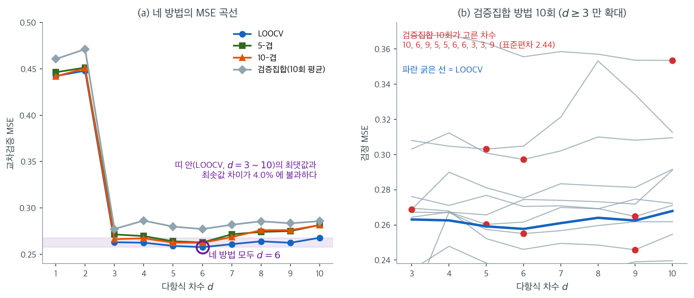
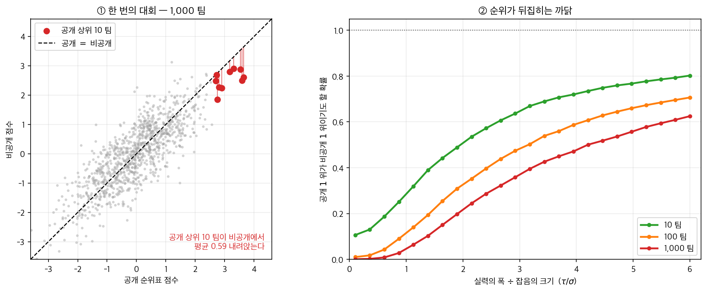
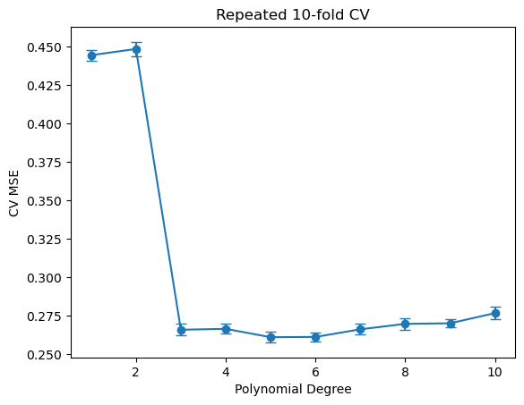

# 교차검증 방법 비교 (코드)

## 개요

이 페이지는 모형선택을 위한 세 가지 교차검증 전략을 비교한다. 검증집합 방법, 하나 남기기 교차검증(LOOCV), 그리고 $k$-겹 교차검증이다. 각 방법을 모의자료에 대한 차수 증가 다항회귀에 적용하여, 교차검증 추정값의 편향-분산 절충, 계산비용의 차이, 방법 간 선택된 모형의 안정성을 확인한다.

---

## 1. 설정과 모의자료

비선형 모형에서 $n = 200$개의 관측을 생성한다.

$$
y_i = \sin(x_i) + 0.3\,x_i + \varepsilon_i, \qquad \varepsilon_i \sim \mathcal{N}(0, 0.5^2), \quad x_i \sim \text{Uniform}(-3, 3)
$$

모형선택을 위해 차수 $d = 1, 2, \ldots, 10$인 다항회귀 모형을 적합하고 각 교차검증 방법이 추정한 검정 MSE를 비교한다.

<div class="exbox" markdown>

**보기 1.** <span class="diff easy" title="쉬움"></span> 모의자료와 다항 파이프라인. 참 관계가 $g(x) = \sin x + 0.3x$이고 잡음이 $\mathcal N(0, 0.5^2)$이므로, **어떤 모형도 넘을 수 없는 바닥**이 있다.

**(1)** 어떤 차수를 쓰든 검정 MSE가 내려갈 수 없는 값을 적으시오. 또 $x \sim \text{Uniform}(-3,3)$에서 **$1$차 다항식**의 모집단 MSE를 적분으로 정확히 구하시오.

**(2)** 그 두 수를 뒤의 LOOCV 표와 견주시오.

</div>

??? success "풀이"

    **(1) 해석적으로.** 관측은 $Y = g(X) + \varepsilon$이고 $\varepsilon$이 $X$와 독립이므로, 예측함수 $\hat g$의 모집단 MSE가

    $$
    E\left[(Y - \hat g(X))^2\right]
    = \underbrace{\sigma^2}_{0.25}
    + \underbrace{E\left[(g(X) - \hat g(X))^2\right]}_{\text{근사오차} \ \ge 0}
    $$

    로 쪼개진다. **바닥은 $\sigma^2 = 0.5^2 = 0.25$다.** 차수를 아무리 올려도 그 아래로 내려갈 수 없고, 교차검증 곡선이 $0.25$ 근처에 닿으면 더 얻을 것이 없다는 뜻이다.

    **$1$차의 근사오차.** 최선의 직선은 모집단 최소제곱 직선이므로, 근사오차가 $g$를 $1, x$에 사영하고 남은 분산이다.

    $$
    E\left[(g(X) - \hat g(X))^2\right] = \operatorname{Var}(g(X)) - \frac{\operatorname{Cov}(g(X), X)^2}{\operatorname{Var}(X)}
    $$

    $X \sim U(-3,3)$에서 $\operatorname{Var}(X) = 3$, $E[\sin X] = 0$(대칭)이고

    $$
    E[X\sin X] = \frac16\int_{-3}^{3} x\sin x\,dx = \frac13\big(\sin 3 - 3\cos 3\big) = 1.037032
    $$

    $$
    E[\sin^2 X] = \frac16\int_{-3}^{3}\sin^2 x\,dx = \frac16\left(3 - \frac{\sin 6}{2}\right) = 0.523285
    $$

    이다. $g = \sin X + 0.3X$이므로

    $$
    \operatorname{Var}(g) = 0.523285 + 0.09 \times 3 + 0.6 \times 1.037032 = 1.415504,
    \qquad
    \operatorname{Cov}(g, X) = 1.037032 + 0.9 = 1.937032
    $$

    이고 근사오차가 $1.415504 - 1.937032^2/3 = 0.164806$이다. 따라서

    $$
    \text{1차의 모집단 MSE} = 0.25 + 0.164806 = 0.414806
    $$

    **(2) 수치적으로.**

    ```python
    import numpy as np
    from sklearn.preprocessing import PolynomialFeatures
    from sklearn.linear_model import LinearRegression
    from sklearn.pipeline import Pipeline

    def generate_data(n=200, seed=42):
        """sin 곡선에 선형 추세와 잡음을 얹은 자료를 만든다.

        참 관계가 다항식이 아니므로 "옳은 차수"가 따로 없다. 세 교차검증
        방법이 어느 차수를 고르는지 견주는 것이 목적이다.
        """
        rng = np.random.default_rng(seed)
        x = rng.uniform(-3, 3, n)
        y = np.sin(x) + 0.3 * x + rng.normal(0, 0.5, n)
        return x.reshape(-1, 1), y

    def poly_pipeline(degree):
        """주어진 차수의 다항회귀 파이프라인."""
        return Pipeline([
            ("poly", PolynomialFeatures(degree=degree, include_bias=False)),
            ("lr", LinearRegression()),
        ])

    X, y = generate_data(n=200)
    degrees = range(1, 11)
    ```

    (1)의 두 수를 계산한다.

    ```python
    from scipy import integrate

    VarX = 3.0
    Exsin = integrate.quad(lambda x: x * np.sin(x) / 6, -3, 3)[0]
    Esin2 = integrate.quad(lambda x: np.sin(x) ** 2 / 6, -3, 3)[0]
    Varg = Esin2 + 0.09 * VarX + 0.6 * Exsin
    Cov = Exsin + 0.3 * VarX
    print(f"E[X sin X] = {Exsin:.6f},  E[sin^2 X] = {Esin2:.6f}")
    print(f"Var(g) = {Varg:.6f},  Cov(g, X) = {Cov:.6f},  최적 기울기 = {Cov/VarX:.6f}")
    print(f"1차의 근사오차 = {Varg - Cov**2/VarX:.6f}")
    print(f"바닥 sigma^2 = {0.25:.6f},  1차의 모집단 MSE = {0.25 + Varg - Cov**2/VarX:.6f}")
    ```

    출력:

    ```
    E[X sin X] = 1.037032,  E[sin^2 X] = 0.523285
    Var(g) = 1.415504,  Cov(g, X) = 1.937032,  최적 기울기 = 0.645677
    1차의 근사오차 = 0.164806
    바닥 sigma^2 = 0.250000,  1차의 모집단 MSE = 0.414806
    ```

    **뒤의 표와 맞춰 보면 두 수가 모든 것을 설명한다.**

    - $1$차의 LOOCV 값이 $0.4422$다. 예측한 모집단 MSE $0.414806$보다 $0.027$ 크고, 이는 모수 두 개를 자료에서 추정한 몫과 이 자료 하나의 요동을 합친 것이다.
    - $6$차의 LOOCV 값이 $0.2577$로 **바닥 $0.25$에서 $0.0077$밖에 떨어져 있지 않다.** 모수 일곱 개를 추정하는 데 드는 몫만 해도 $\sigma^2 p/n = 0.25 \times 7/200 = 0.0088$이니, $6$차 다항식의 **근사오차는 사실상 $0$이다.**

    그러므로 "어느 차수가 최적인가"라는 물음은 애초에 날이 서지 않는다. $3$차부터 이미 바닥에 거의 닿았고, 그 위에서 차수를 올려 얻는 것은 근사오차 $0.003$ 안팎이며 추정에 드는 비용이 그만큼씩 늘어난다. **교차검증 곡선이 평평한 것은 방법의 결함이 아니라 문제의 성질이다.**


---

## 2. 방법 1: 검증집합 방법

가장 단순한 전략은 자료를 절반씩 나누어 하나는 훈련에, 하나는 검정에 쓰는 것이다. 추정된 검정 MSE는

$$
\widehat{\text{MSE}} = \frac{1}{n_{\text{test}}} \sum_{i \in \text{test}} (y_i - \hat{y}_i)^2
$$

이다.

**단점**: 어떤 관측이 훈련집합과 검정집합에 들어가는지에 따라 결과가 달라지므로 추정값의 분산이 크다. 다른 무작위 분할로 반복하면 다른 답이 나온다.

<div class="exbox" markdown>

**보기 2.** <span class="diff easy" title="쉬움"></span> 검증집합 방법. 자료를 절반으로 갈라 $100$개로 훈련하고 $100$개로 잰다. 분할을 열 번 다르게 해 본다.

**(1)** 이 방법의 추정값이 **위로 치우치는** 까닭을 적고, 차수 $d$에서 치우침의 크기를 $\sigma^2$과 표본크기로 어림하시오. LOOCV와 견주면 얼마나 차이 나는가.

**(2)** 실행해 열 번의 분할이 고른 차수가 얼마나 흩어지는지 재고, 치우침의 어림과 견주시오.

</div>

??? success "풀이"

    **(1) 해석적으로.** 모수 $p = d+1$개인 선형모형을 $n_{\text{tr}}$개로 적합해 **새 자료**에서 재면 기대 MSE가 대략

    $$
    E[\widehat{\text{MSE}}] \approx \sigma^2\left(1 + \frac{p}{n_{\text{tr}}}\right) + \text{근사오차}
    $$

    다. 추정한 계수들이 훈련자료의 잡음을 따라가므로 모수 하나당 $\sigma^2/n_{\text{tr}}$씩 벌점이 붙는다. **훈련자료가 적을수록 벌점이 커진다.**

    검증집합 방법은 $n_{\text{tr}} = 100$만 쓰고 LOOCV는 $n_{\text{tr}} = 199$를 쓰므로, $d = 6$($p = 7$)에서 두 추정값의 차이가

    $$
    \sigma^2 p\left(\frac{1}{100} - \frac{1}{199}\right)
    = 0.25 \times 7 \times 0.004975 = 0.0087
    $$

    쯤 된다. **검증집합 쪽이 그만큼 나쁘게 본다.** 모형이 실제보다 못하다고 말하는 셈이다.

    **(2) 수치적으로.** 함수는 이렇다.

    ```python
    def validation_set_mse(X, y, degrees, n_splits=10, rng=None):
        """검증집합 방법. 자료를 절반으로 갈라 한쪽으로 훈련하고 한쪽으로 잰다.

        가장 간단하지만 두 가지 약점이 있다. 어떻게 가르느냐에 따라 결과가
        들쭉날쭉하고(그래서 여기서는 10번 다르게 갈라 본다), 훈련에 절반밖에
        쓰지 못해 성능을 실제보다 나쁘게 잡는다.
        """
        rng = rng or np.random.default_rng(7)
        n = len(y); n_train = n // 2
        all_mses = {d: [] for d in degrees}
        for _ in range(n_splits):
            perm = rng.permutation(n)
            tr, te = perm[:n_train], perm[n_train:]
            for d in degrees:
                model = poly_pipeline(d).fit(X[tr], y[tr])
                all_mses[d].append(np.mean((y[te] - model.predict(X[te])) ** 2))
        return all_mses

    am = validation_set_mse(X, y, degrees)
    M = np.array([am[d] for d in degrees])
    best = M.argmin(axis=0) + 1
    print(f"각 분할이 고른 차수 = {list(best)},  표준편차 = {best.std():.4f}")
    print(f"차수 6: 열 번의 평균 {M[5].mean():.6f},  분할에 따른 SD {M[5].std(ddof=1):.6f}")
    ```

    출력:

    ```
    각 분할이 고른 차수 = [10, 6, 9, 5, 5, 6, 6, 3, 3, 9],  표준편차 = 2.3152
    차수 6: 열 번의 평균 0.277278,  분할에 따른 SD 0.035057
    ```

    **고른 차수가 $3$에서 $10$까지 흩어진다.** 표준편차가 $2.32$다. **같은 자료, 같은 방법인데 분할의 난수만 바꾸어 얻은 결과이다.** 이것이 검증집합 방법의 근본적 문제이다.

    **치우침의 어림도 맞는다.** $d = 6$에서 열 번의 평균이 $0.277278$인데 보기 3이 내놓을 LOOCV 값은 $0.257722$다. 차이 $0.0196$으로, (1)이 어림한 $0.0087$의 두 배쯤이다. 어림은 모수 벌점만 센 것이고 실제로는 훈련자료가 절반이라 **근사오차도 덩달아 커지기 때문**에 그만큼 더 벌어진다. 방향과 자릿수는 맞다.

    **분할 하나로 얻은 값의 불확실성이 그 치우침보다 크다**는 점도 함께 보아야 한다. 차수 $6$의 분할별 표준편차가 $0.0351$로 치우침 $0.0196$의 거의 두 배다. 곧 **한 번 갈라 얻은 수치는 치우쳐 있을 뿐 아니라 흔들린다.** 이 두 결함을 각각 줄이려는 것이 보기 3(훈련자료를 거의 다 쓴다)과 보기 4(여러 겹을 평균한다)다.

---

## 3. 방법 2: 하나 남기기 교차검증 (LOOCV)

LOOCV는 $n - 1$개로 훈련하고 남은 하나로 검정하며, 이를 모든 관측에 대해 반복한다.

$$
\text{CV}_{(n)} = \frac{1}{n}\sum_{i=1}^{n}(y_i - \hat{y}_i^{(-i)})^2
$$

여기서 $\hat{y}_i^{(-i)}$는 관측 $i$를 빼고 훈련한 모형이 관측 $i$에 대해 내놓는 예측이다.

**장점**: 거의 불편이다(훈련집합이 전체 자료와 거의 같다). 결정적이다(분할에 무작위성이 없다).

**단점**: 계산이 비싸다($n$번의 모형 적합). 다만 선형모형에는 지름길 공식이 있다(연습문제 4).

<div class="exbox" markdown>

**보기 3.** <span class="diff easy" title="쉬움"></span> 하나빼기 교차검증. 선형모형에서는 $n$번 적합하지 않고도 **정확히** 같은 값을 얻을 수 있다.

**(1)** 모자행렬 $H = Z(Z^{\top}Z)^{-1}Z^{\top}$과 잔차 $e_i = y_i - \hat y_i$에 대해

$$
\text{CV}_{(n)} = \frac1n \sum_{i=1}^{n}\left(\frac{e_i}{1 - h_{ii}}\right)^2
$$

임을 보이시오.

**(2)** 열 가지 차수 모두에서 이 식과 `LeaveOneOut()`이 **같은 수**를 주는지 확인하고, 적합 횟수를 견주시오.

</div>

??? success "풀이"

    **(1) 해석적으로.** $i$번째를 뺀 적합값을 $\hat y_i^{(-i)}$라 하자. 핵심은 **$i$번째 관측의 $y$값을 $\hat y_i^{(-i)}$로 바꿔 끼워도 적합이 달라지지 않는다**는 사실이다. 그 점에서 잔차가 $0$이 되어 최소제곱 목적함수에 아무 기여도 하지 않으므로, 나머지 $n-1$개만으로 적합한 것과 같아진다.

    그러면 $\hat y_i^{(-i)}$는 자료 $\tilde y = (y_1, \ldots, \hat y_i^{(-i)}, \ldots, y_n)$에 $H$를 적용한 $i$번째 성분이다. $\tilde y = y - (y_i - \hat y_i^{(-i)})\mathbf e_i$이므로

    $$
    \hat y_i^{(-i)} = (H\tilde y)_i = \hat y_i - h_{ii}\left(y_i - \hat y_i^{(-i)}\right)
    $$

    다. $y_i$를 양변에서 빼고 $e_i^{(-i)} = y_i - \hat y_i^{(-i)}$라 두면

    $$
    e_i^{(-i)} = e_i + h_{ii}\,e_i^{(-i)}
    \quad\Longrightarrow\quad
    e_i^{(-i)} = \frac{e_i}{1 - h_{ii}}
    $$

    이고, 제곱해 평균하면 구하려던 식이 된다. $\square$

    **$n$번의 적합이 **한 번**으로 줄어든다.** 지렛대가 큰 점($h_{ii}$가 $1$에 가까운 점)에서 분모가 작아져 그 점의 잔차가 크게 증폭되는 것도 이 식이 보여 주는 바다.

    **(2) 수치적으로.**

    ```python
    from sklearn.model_selection import cross_val_score, LeaveOneOut
    import time

    # 하나빼기 교차검증(LOOCV). 관측값 하나씩만 남기므로 훈련자료를 거의
    # 다 쓰고, 어떻게 가르느냐에 따른 흔들림도 없다. 대신 n 번 적합해야 한다.
    t0 = time.time()
    loocv_mses = [-cross_val_score(poly_pipeline(d), X, y, cv=LeaveOneOut(),
                                   scoring="neg_mean_squared_error").mean()
                  for d in degrees]
    elapsed = time.time() - t0        # 아래 주의 참조: 출력에는 싣지 않는다

    print(f"Best degree (LOOCV): {int(np.argmin(loocv_mses)) + 1}")
    ```

    출력:

    ```
    Best degree (LOOCV): 6
    ```

    모자행렬 식과 맞춰 본다.

    ```python
    from sklearn.preprocessing import PolynomialFeatures

    def loocv_hat(X, y, d):
        """모자행렬로 한 번에 구하는 LOOCV."""
        Z = PolynomialFeatures(degree=d, include_bias=True).fit_transform(X)
        H = Z @ np.linalg.pinv(Z.T @ Z) @ Z.T
        e = y - H @ y
        return np.mean((e / (1 - np.diag(H))) ** 2)

    hat = [loocv_hat(X, y, d) for d in degrees]
    print(f"{'d':>3}{'sklearn':>12}{'모자행렬':>12}{'차이':>12}")
    for d, a, b in zip(degrees, loocv_mses, hat):
        print(f"{d:>3}{a:>12.6f}{b:>12.6f}{a-b:>12.2e}")
    print(f"적합 횟수: sklearn {200*10} 번,  모자행렬 {10} 번")
    ```

    출력:

    ```
      d     sklearn        모자행렬          차이
      1    0.442177    0.442177    1.11e-16
      2    0.447928    0.447928    0.00e+00
      3    0.263086    0.263086   -5.55e-17
      4    0.262563    0.262563    3.33e-16
      5    0.259166    0.259166   -5.83e-15
      6    0.257722    0.257722   -2.22e-16
      7    0.261009    0.261009    1.14e-12
      8    0.264039    0.264039    4.01e-14
      9    0.262481    0.262481    1.95e-11
     10    0.267918    0.267918    5.43e-11
    적합 횟수: sklearn 2000 번,  모자행렬 10 번
    ```

    **열 가지 차수 모두에서 같은 수가 나온다.** 차이가 $10^{-16}$에서 $10^{-11}$ 사이로, 전부 부동소수 오차다. 높은 차수에서 차이가 조금 커지는 것은 $Z^{\top}Z$의 조건수가 나빠지기 때문이며($d = 10$이면 $x^{10}$까지 들어간다) 값 자체에는 영향이 없다.

    **적합 횟수는 $2{,}000$ 대 $10$이다.** 자료가 $200$개이고 차수 후보가 $10$개이므로 `LeaveOneOut()`은 $200 \times 10$번 회귀를 돌리고, 모자행렬 식은 차수마다 한 번씩만 돌린다. **$n$에 비례해 벌어지므로 $n$이 커질수록 이 지름길의 값이 커진다.**

    그러나 이 지름길은 **선형모형에만** 통한다. $\hat y = Hy$로 적을 수 있어야 유도가 성립하기 때문이며, 능형회귀나 평활 스플라인처럼 $H$가 있는 다른 선형 평활기에도 같은 꼴이 쓰인다. 임의의 기계학습 모형에서는 $n$번 다시 적합하는 수밖에 없고, 그래서 실무에서는 $k$겹을 쓴다.


!!! note "소요 시간을 출력에 싣지 않은 이유"
    LOOCV의 요점 가운데 하나는 **비싸다**는 것이므로 시간을 재는 것 자체는
    의미가 있다. 다만 `time.time()`이 재는 값은 기계와 그때의 부하에 따라
    달라져 재현되지 않는다(같은 기계에서도 $0.8$초에서 $2$초까지 관측되었다).

    그래서 시간은 `elapsed`에 담아 두기만 하고 출력에서는 뺐다. 이렇게 하면
    이 블록의 출력이 **언제 실행해도 같아진다**. 자료와 분할이 고정되어 있으므로
    고른 차수 $6$은 실행과 무관하게 재현된다.

    비용의 크기는 직접 재어 보라. 이 자료($n = 100$, 차수 후보 $8$개)에서
    LOOCV는 아래 $K$겹보다 대략 $10$배 이상 오래 걸린다. $n$이 커지면
    LOOCV의 적합 횟수가 $n$에 비례해 늘어나므로 격차는 더 벌어진다.

---

## 4. 방법 3: k-겹 교차검증

자료를 크기가 같은 $k$개의 겹으로 나눈다. 각 겹이 한 번씩 검정집합이 된다.

$$
\text{CV}_{(k)} = \frac{1}{k}\sum_{j=1}^{k}\text{MSE}_j
$$

이는 검증집합 방법($k = 2$)과 LOOCV($k = n$) 사이의 절충이다. 흔한 선택은 $k = 5$와 $k = 10$이다.

**편향-분산 절충**: $k$가 작으면 편향이 크지만(겹당 훈련자료가 적다) 분산이 작다. $k$가 크면 편향이 작지만 훈련집합끼리 많이 겹쳐 분산이 커진다.

<div class="exbox" markdown>

**보기 4.** <span class="diff easy" title="쉬움"></span> $k$겹 교차검증. $k$가 커지면 편향은 줄고 분산은 는다고들 한다. **두 주장을 따로 재어 본다.**

**(1)** $k$겹의 추정값이 위로 치우치는 크기를 보기 2의 식으로 어림하시오($d = 6$, $k = 5, 10$, LOOCV). 세 값의 **순서**는 어떻게 되어야 하는가.

**(2)** 두 종류의 분산을 구별해 재시오. 하나는 **자료를 고정한 채 겹 배정만 바꿀 때**의 흔들림이고, 다른 하나는 **자료를 새로 뽑을 때**의 흔들림이다. 둘이 $k$에 대해 같은 방향으로 움직이는가.

</div>

??? success "풀이"

    **(1) 해석적으로.** $k$겹은 매번 $n_{\text{tr}} = n(1 - 1/k)$개로 훈련하므로 보기 2의 어림에서

    $$
    E[\text{CV}_{(k)}] \approx \sigma^2\left(1 + \frac{p}{n(1-1/k)}\right) + \text{근사오차}
    $$

    다. $d = 6$($p = 7$), $n = 200$, $\sigma^2 = 0.25$를 넣으면 바닥 $0.25$ 위의 벌점이

    | 방법 | $n_{\text{tr}}$ | 벌점 $\sigma^2 p/n_{\text{tr}}$ |
    |:---|---:|---:|
    | $5$겹 | $160$ | $0.01094$ |
    | $10$겹 | $180$ | $0.00972$ |
    | LOOCV | $199$ | $0.00879$ |

    이다. **$k$가 커질수록 치우침이 줄어든다.** 따라서 세 추정값의 순서가 $\text{CV}_{(5)} > \text{CV}_{(10)} > \text{CV}_{(n)}$이어야 한다.

    **(2) 수치적으로.**

    ```python
    from sklearn.model_selection import KFold

    # k겹 교차검증. 앞 두 방법의 절충이다. k 번만 적합하면 되고, 겹마다의
    # 훈련자료가 조금씩 겹쳐 LOOCV 보다 추정의 분산이 오히려 작다.
    # 실무에서 5 나 10 을 쓰는 까닭이 이것이다.
    for k in (5, 10):
        kf = KFold(n_splits=k, shuffle=True, random_state=42)
        mses = [-cross_val_score(poly_pipeline(d), X, y, cv=kf,
                                 scoring="neg_mean_squared_error").mean()
                for d in degrees]
        print(f"Best degree ({k}-fold): {int(np.argmin(mses)) + 1}")
    ```

    출력:

    ```
    Best degree (5-fold): 6
    Best degree (10-fold): 6
    ```

    두 종류의 분산을 따로 잰다.

    ```python
    # (가) 자료는 그대로 두고 겹 배정만 바꾼다.
    for k in (5, 10):
        vals = np.array([
            -cross_val_score(poly_pipeline(6), X, y,
                             cv=KFold(n_splits=k, shuffle=True, random_state=s),
                             scoring="neg_mean_squared_error").mean()
            for s in range(20)])
        print(f"k={k:2d}: 겹 배정 20 번의 평균 {vals.mean():.6f},  SD {vals.std(ddof=1):.6f}")
    print(f"LOOCV: {loocv_hat(X, y, 6):.6f},  SD 0 (결정적)")

    # (나) 자료를 새로 뽑는다.
    res = {5: [], 10: [], 'loo': []}
    for s in range(100):
        rng = np.random.default_rng(1000 + s)
        xx = rng.uniform(-3, 3, 200)
        yy = np.sin(xx) + 0.3 * xx + rng.normal(0, 0.5, 200)
        XX = xx.reshape(-1, 1)
        for k in (5, 10):
            res[k].append(-cross_val_score(
                poly_pipeline(6), XX, yy,
                cv=KFold(n_splits=k, shuffle=True, random_state=s),
                scoring="neg_mean_squared_error").mean())
        res['loo'].append(loocv_hat(XX, yy, 6))
    print(f"\n자료 100 개에서 (d=6)")
    for k, lab in ((5, ' 5겹'), (10, '10겹'), ('loo', 'LOOCV')):
        v = np.array(res[k])
        print(f"  {lab}: 평균 {v.mean():.6f},  자료에 따른 SD {v.std(ddof=1):.6f}"
              f"  (SD 추정의 오차 {v.std(ddof=1)/np.sqrt(2*100):.6f})")
    ```

    출력:

    ```
    k= 5: 겹 배정 20 번의 평균 0.260405,  SD 0.007121
    k=10: 겹 배정 20 번의 평균 0.258382,  SD 0.003266
    LOOCV: 0.257722,  SD 0 (결정적)

    자료 100 개에서 (d=6)
       5겹: 평균 0.265180,  자료에 따른 SD 0.026311  (SD 추정의 오차 0.001860)
      10겹: 평균 0.262959,  자료에 따른 SD 0.026537  (SD 추정의 오차 0.001876)
      LOOCV: 평균 0.261968,  자료에 따른 SD 0.025890  (SD 추정의 오차 0.001831)
    ```

    **편향의 순서는 예측대로다.** 자료 $100$개의 평균이 $0.265180 > 0.262959 > 0.261968$로 $k$가 커질수록 내려간다. 바닥 $0.25$ 위의 초과분이 $0.01518$, $0.01296$, $0.01197$인데, (1)이 어림한 벌점 $0.01094$, $0.00972$, $0.00879$보다 일정하게 $0.003$쯤 크다. **그 $0.003$이 $6$차 다항식의 근사오차**이고, 모든 방법에 공통으로 더해지므로 차이를 보면 사라진다. 실제로 $5$겹$-$LOOCV 차이가 $0.00321$, 어림은 $0.00215$로 같은 자릿수다.

    **분산은 두 종류를 갈라 보아야 한다.**

    | | $5$겹 | $10$겹 | LOOCV |
    |:---|---:|---:|---:|
    | 겹 배정에 따른 SD | $0.00712$ | $0.00327$ | $0$ |
    | 자료에 따른 SD | $0.02631$ | $0.02654$ | $0.02589$ |

    **겹 배정에 따른 흔들림은 $k$가 커질수록 줄어든다.** $k$개의 겹을 평균하므로 평균의 개수가 늘고, LOOCV는 아예 결정적이라 $0$이다. 이것이 "$k$를 키우면 안정된다"는 말의 내용이다.

    **자료에 따른 흔들림은 셋이 거의 같다.** $0.0263$, $0.0265$, $0.0259$인데 SD 추정 자체의 오차가 $0.0019$이므로 **이 설정에서는 셋을 구별할 수 없다.** "LOOCV는 훈련집합끼리 많이 겹쳐 분산이 커진다"는 흔한 서술이 여기서는 눈에 띄지 않는다는 뜻이다. 그 효과는 모형이 불안정할 때(차수가 아주 높거나 $n$이 작을 때) 드러나며, $n = 200$에 $6$차 다항식인 이 설정은 그런 상황이 아니다.

    **그리고 두 흔들림의 크기가 자릿수로 다르다는 점이 더 중요하다.** 자료에 따른 $0.026$이 겹 배정에 따른 $0.003$--$0.007$보다 네 배 이상 크다. **교차검증 값의 불확실성은 대부분 "어떤 자료를 뽑았는가"에서 오고, $k$를 고르는 일로 줄일 수 있는 몫은 그 일부뿐이다.**


---

## 5. 결과

한 자료($n = 200$, 씨앗 $42$)에 대한 교차검증 MSE 곡선:

| 차수 $d$ | 검증집합(평균) | 5-겹 | 10-겹 | LOOCV |
|---:|---:|---:|---:|---:|
| 1 | 0.4606 | 0.4463 | 0.4418 | 0.4422 |
| 2 | 0.4711 | 0.4513 | 0.4506 | 0.4479 |
| 3 | 0.2774 | 0.2715 | 0.2664 | 0.2631 |
| 4 | 0.2863 | 0.2697 | 0.2673 | 0.2626 |
| 5 | 0.2799 | 0.2641 | 0.2627 | 0.2592 |
| **6** | **0.2773** | **0.2628** | **0.2625** | **0.2577** |
| 7 | 0.2819 | 0.2716 | 0.2686 | 0.2610 |
| 8 | 0.2856 | 0.2742 | 0.2761 | 0.2640 |
| 9 | 0.2835 | 0.2751 | 0.2761 | 0.2625 |
| 10 | 0.2858 | 0.2817 | 0.2816 | 0.2679 |

**네 방법 모두 $d = 6$을 고른다.** 그러나 이 결론을 그대로 받아들이면 안 된다.

!!! warning "MSE 곡선이 거의 평평하다"
    $d = 3$부터 $d = 10$까지 LOOCV MSE가 $0.2577$에서 $0.2679$ 사이이다. **최적값과 최악값의 차이가 $4$%에 불과하다.**

    $d = 6$이 "선택"된 것은 $d = 3$보다 $0.0054$ 작기 때문인데, 이 차이는 교차검증 추정값 자체의 변동보다 작다. 다른 자료를 뽑으면 다른 차수가 선택된다.

    실제로 $100$개의 서로 다른 자료에서 반복하면 가장 흔한 선택은 $d = 6$이 아니라 **$d = 3$**이다(연습문제 1).

    **참 함수를 생각하면 납득이 된다.** $\sin(x)$의 Taylor 전개는 $x - x^3/6 + x^5/120 - \cdots$이므로 $[-3, 3]$에서 $3$차만으로도 이미 상당히 좋고, $5$--$7$차에서 조금 더 개선된다. 잡음 표준편차 $0.5$가 이 미세한 개선을 대부분 가린다.

**계산시간**: LOOCV $0.9$초, 5-겹 $0.03$초, 10-겹 $0.05$초. LOOCV가 $20$--$30$배 느리다.

표를 그림으로 옮기면 "$d = 6$을 골랐다"는 문장이 얼마나 약한 근거 위에 서 있는지가 보인다.



(a)에서 눈에 띄는 것은 $d = 2$에서 $d = 3$으로 가는 절벽이다. $\sin(x)$를 직선이나 포물선으로 근사할 수 없으니 MSE가 $0.44$에서 $0.26$으로 떨어진다. **그 뒤로는 아무 일도 일어나지 않는다.** 보라색 띠가 LOOCV의 $d = 3$부터 $10$까지 범위($0.2577$--$0.2679$)인데 최댓값과 최솟값의 차이가 $4.0\%$이다. 네 방법이 모두 $d = 6$에서 최소를 찍지만, 그 최소는 $d = 3$보다 겨우 $0.0054$ 낮을 뿐이며 이는 교차검증 추정값 자체의 변동보다 작다.

네 곡선의 서열도 읽을 만하다. 검증집합(회색)이 가장 위에 있는데, 절반의 자료로만 훈련하므로 성능을 **체계적으로 비관적으로** 추정하기 때문이다. LOOCV(파랑)가 가장 아래인 것도 같은 이유의 반대쪽이다. $n-1$개로 훈련하므로 편향이 가장 작다. $5$겹과 $10$겹은 그 사이에 놓이며, 이것이 교차검증의 편향-분산 절충에서 편향 쪽 이야기이다.

(b)가 분산 쪽 이야기다. 같은 자료를 $10$번 다르게 절반씩 갈라 얻은 회색 곡선들이며, 붉은 점이 각자가 고른 차수다. **선택된 차수가 $10, 6, 9, 5, 5, 6, 6, 3, 3, 9$로 표준편차 $2.44$만큼 흩어진다.** 자료도 같고 모형 후보도 같은데 분할의 난수만 바꾼 결과이다. 굵은 파란 선(LOOCV)이 그 한가운데를 지나며 훨씬 매끄럽다. 평평한 곡선 위에서 최솟값을 고르는 일은 이렇게 잡음에 지배되며, **"최적 차수"를 하나 보고하기보다 곡선 전체를 보여 주고 "$d = 3$ 이상이면 실질적 차이가 없다"고 말하는 편이 정직하다.**

---

## 6. 해석

- 이 자료에서 세 방법이 대체로 같은 차수를 고르지만, MSE 곡선이 평평하므로 그 "일치"에 큰 의미를 두면 안 된다.
- 검증집합 방법은 분할에 따른 변동이 가장 크다. 선택된 차수가 무작위 분할마다 바뀐다.
- LOOCV는 결정적이고 거의 불편이지만 계산이 비싸다. $n \times 10 = 2000$번의 모형 적합이 필요하다.
- 10-겹 교차검증은 실용적인 절충이다. $10 \times 10 = 100$번의 적합만으로 LOOCV에 가까운 추정값을 낸다.
- 최적 차수를 훨씬 넘는 차수($d = 8, 9, 10$)에서는 과적합으로 검정 MSE가 오르지만, 이 자료에서는 그 상승이 미미하다. $n = 200$이 $10$차 다항식($11$개 모수)을 지탱하기에 충분히 크기 때문이다.

<div class="aibox" markdown>

**AI로 보는 통계학 1.** $20$ 분 차이로 백만 달러

위 세 방법이 답하려는 물음은 하나다 — **떼어 둔 자료로 성능을 잰다.** 그 자료를 한 번만
쓰면 깨끗한 추정값이 나온다. 문제는 아무도 한 번만 쓰지 않는다는 데 있다.

$2006$ 년 $10$ 월, 넷플릭스가 상금 $100$ 만 달러를 걸었다. 자사 추천 시스템
**시네매치**의 예측 오차(RMSE)를 $10\%$ 줄이면 준다는 것. 평점 $1$ 억 개를 공개했고,
전 세계에서 $4$ 만 개 넘는 팀이 달려들었다. 기계학습 대회라는 형식이 이때 만들어졌다.

넷플릭스는 자료를 똑똑하게 나누어 두었다. 채점용 $281$ 만 개를 반으로 갈라, 절반
($140$ 만 $8$ 천여 개)은 **공개 순위표**를 매기는 데 쓰고 나머지 절반은 **아무에게도
보여 주지 않았다.** 우승은 뒤쪽으로 정한다고 미리 못박았다.

$3$ 년 뒤의 결말이 그 설계가 옳았음을 보여 준다.

| | 공개 순위표 (퀴즈) | 비공개 (테스트) |
|---|---:|---:|
| **The Ensemble** | $10.10\%$ 개선 — $1$ 위 | RMSE $0.8567$ |
| **BellKor's Pragmatic Chaos** | $10.09\%$ 개선 — $2$ 위 | RMSE $0.8567$ |

**공개 순위표의 $1$ 위가 우승하지 못했다.** 비공개 점수가 소수 넷째 자리까지 같았고,
규정에 따라 **$20$ 분 먼저 제출한** 쪽이 $100$ 만 달러를 가져갔다.

<figure markdown>
{ width="900" }
  <figcaption markdown>실력이 똑같아서가 아니다. **실력의 차이보다 잰 값의 흔들림이 크면** 이렇게 된다.</figcaption>
</figure>

왼쪽 칸이 그 구조다. $1{,}000$ 팀의 참 실력을 뿌려 놓고, 공개용 자료와 비공개용 자료에서
각각 점수를 재었다. 실력의 폭이 잡음의 **두 배**인 — 꽤 너그러운 — 설정인데도

- 공개 $1$ 위 팀이 비공개에서 **$9$ 위**로 내려갔고,
- 비공개 $1$ 위 팀은 공개 순위표에서 **$136$ 위**였으며,
- 공개 상위 $10$ 과 비공개 상위 $10$ 이 **$5$ 팀만 겹쳤다.**

공개 상위 $10$ 팀의 점수는 비공개에서 평균 $0.59$ 내려앉는다. 그 $0.59$ 가 **실력이
아니라 공개 자료에 맞춘 부분**이다. 이 쪽 $2$ 절이 검증집합 방법을 두고 「분할에 따른
변동이 가장 크다」고 적은 것과 같은 말인데, 다만 여기서는 분할을 고르는 주체가 한 사람이
아니라 $4$ 만 팀이다.

오른쪽 칸이 언제 뒤집히는지를 말해 준다. 실력의 폭을 $\tau$, 한 자료집합에서 재었을 때의
잡음을 $\sigma$ 라 할 때, 공개 $1$ 위가 비공개 $1$ 위이기도 할 확률은

| $\tau/\sigma$ | $10$ 팀 | $100$ 팀 | $1{,}000$ 팀 |
|---:|---:|---:|---:|
| $0.5$ | $0.16$ | $0.03$ | $0.005$ |
| $1$ | $0.29$ | $0.11$ | $0.05$ |
| $2$ | $0.51$ | $0.33$ | $0.21$ |
| $5$ | $0.77$ | $0.66$ | $0.56$ |

대회 막바지에는 상위권의 실력 차가 소수 넷째 자리까지 좁혀지므로 $\tau/\sigma$ 가 $0$ 에
가까워진다. 표의 맨 윗줄이다. **그 지점에서 순위표는 실력이 아니라 잡음을 줄 세운다.**
넷플릭스가 절반을 끝까지 감춘 것이 그래서 옳았다.

마지막 두 가지. 첫째, 넷플릭스는 그 우승 알고리듬을 **끝내 쓰지 않았다.** 뒤에 회사가
밝힌 이유는 「측정된 정확도 향상이 그것을 실제 환경에 올리는 공학적 노력을 정당화할
만큼은 아니었다」는 것이다. $100$ 개 넘는 모형을 쌓아 올린 앙상블이었다. 둘째, 속편 대회는
열리지 못했다. 공개된 평점 자료를 다른 공개 자료와 맞춰 **개인을 식별할 수 있다**는 것이
나라야난과 슈마티코프에 의해 밝혀졌고, 소송과 연방거래위원회의 우려 속에 취소되었다.

$10\%$ 를 좇던 $3$ 년의 끝에 남은 것은 쓰이지 않은 알고리듬 하나와, **떼어 둔 자료는
한 번만 쓸 수 있다**는 교훈이다.

_확인한 곳 — 상금과 대회 기간, 퀴즈/테스트 분할의 크기, 두 팀의 개선율과 테스트 RMSE, $20$ 분 규정, 넷플릭스가 우승 알고리듬을 쓰지 않은 이유, 속편 취소의 경위. 그림의 수는 모두 직접 모의실험한 값이다_

</div>

---

## 연습문제

<div class="drillbox" markdown>

**연습문제 1.** <span class="diff med" title="중간"></span> 모의실험 연구를 수행하라. 같은 모형에서 $100$개의 자료를 생성한다. 각 자료에서 검증집합, 5-겹, 10-겹, LOOCV로 최적 다항 차수를 선택하고, 각 방법별로 선택된 차수의 분포를 보고하라. 어느 방법이 가장 안정적인가?

</div>

??? success "풀이"

    ```python
    import numpy as np
    from collections import Counter
    from sklearn.model_selection import cross_val_score, LeaveOneOut, KFold

    degrees = list(range(1, 11))
    res = {"validation": [], "5-fold": [], "10-fold": [], "LOOCV": []}

    for trial in range(100):
        rng = np.random.default_rng(1000 + trial)
        x = rng.uniform(-3, 3, 200).reshape(-1, 1)
        y = np.sin(x.ravel()) + 0.3 * x.ravel() + rng.normal(0, 0.5, 200)

        perm = rng.permutation(200); tr, te = perm[:100], perm[100:]
        vm = [np.mean((y[te] - poly_pipeline(d).fit(x[tr], y[tr]).predict(x[te]))**2)
              for d in degrees]
        res["validation"].append(degrees[int(np.argmin(vm))])

        for name, cv in [("5-fold",  KFold(5,  shuffle=True, random_state=0)),
                         ("10-fold", KFold(10, shuffle=True, random_state=0)),
                         ("LOOCV",   LeaveOneOut())]:
            m = [-cross_val_score(poly_pipeline(d), x, y, cv=cv,
                                  scoring="neg_mean_squared_error").mean()
                 for d in degrees]
            res[name].append(degrees[int(np.argmin(m))])
    ```

    **선택된 차수의 분포 ($100$개 자료)**

    | 방법 | 최빈값 | 평균 | 표준편차 | $d = 3$ 선택 횟수 | $d \ge 5$ 선택 비율 |
    |:---|---:|---:|---:|---:|---:|
    | 검증집합 | 3 | 4.99 | **2.15** | 35 | 0.45 |
    | 5-겹 | 3 | 4.39 | 1.70 | 47 | 0.42 |
    | 10-겹 | 3 | 4.32 | 1.75 | 49 | 0.38 |
    | **LOOCV** | 3 | **4.20** | **1.72** | **55** | 0.34 |

    **네 방법 모두 최빈값이 $d = 3$이다.** 앞서 하나의 자료에서 $d = 6$이 선택된 것은 그 자료의 우연이었다.

    **검증집합 방법이 명백히 가장 나쁘다.** 표준편차 $2.15$로 다른 방법들보다 $25$% 크고, 평균 차수 $4.99$로 과적합 쪽으로 치우쳐 있다. 훈련자료가 절반뿐이라 저차 모형이 불리하게 평가되기 때문이다.

    **LOOCV가 가장 안정적이다.** 표준편차 $1.72$, $d = 3$을 $55$번 선택한다. $k$-겹과 큰 차이는 없지만($1.70$--$1.75$) 결코 나쁘지 않다.

    !!! note "'LOOCV는 분산이 크다'는 통념의 정확한 의미"
        교재에서 흔히 "LOOCV는 $n$개의 훈련집합이 거의 완전히 겹치므로 겹별 오차가 강하게 상관되어 분산이 크다"고 서술한다. 위 결과는 이와 어긋나 보인다.

        모순이 아니다. 두 가지 다른 "분산"을 이야기하고 있다.

        | 대상 | LOOCV의 성질 |
        |:---|:---|
        | **CV 오차 추정값**의 분산 | 이론적으로 클 수 있다(겹 간 상관 때문) |
        | **분할 난수에 의한** 변동 | **정확히 $0$**(LOOCV는 결정적이다) |
        | **선택된 모형**의 안정성 | 위 표에서 가장 좋다 |

        모형선택이 목적이면 두 번째와 세 번째가 중요하다. $k$-겹은 분할 난수라는 추가 변동원을 갖는데 LOOCV에는 그것이 없다.

        게다가 겹 간 상관으로 인한 분산 증가는 **편향 감소와 상쇄**된다. LOOCV는 $n-1$개로 훈련하므로 편향이 가장 작다. 실무에서 두 효과의 순합은 문제에 따라 다르며, "LOOCV가 항상 나쁘다"고 말할 근거는 약하다.

        **LOOCV를 피하는 진짜 이유는 계산비용이다.** 지름길 공식이 없는 모형(랜덤포레스트, 신경망)에서 $n$번 적합은 현실적이지 않다.

---

<div class="drillbox" markdown>

**연습문제 2.** <span class="diff med" title="중간"></span> 반복 $k$-겹 교차검증을 구현하라. 서로 다른 무작위 섞기로 10-겹 교차검증을 다섯 번 실행하고 MSE 곡선을 평균낸다. 단일 10-겹 실행과 선택된 차수의 안정성을 비교하고, 오차막대와 함께 평균 MSE 곡선을 그려라.

</div>

??? success "풀이"

    ```python
    import numpy as np
    import matplotlib.pyplot as plt
    from sklearn.model_selection import cross_val_score, KFold

    X, y = generate_data(n=200, seed=42)
    degrees = list(range(1, 11))
    all_mses = {d: [] for d in degrees}

    for rep in range(5):
        kf = KFold(10, shuffle=True, random_state=rep)
        for d in degrees:
            all_mses[d].append(
                -cross_val_score(poly_pipeline(d), X, y, cv=kf,
                                 scoring="neg_mean_squared_error").mean())

    means = [np.mean(all_mses[d]) for d in degrees]
    stds  = [np.std(all_mses[d]) for d in degrees]
    print("Best degree (repeated 10-fold):", degrees[int(np.argmin(means))])

    plt.errorbar(degrees, means, yerr=stds, fmt='o-', capsize=4)
    plt.xlabel("Polynomial Degree"); plt.ylabel("CV MSE")
    plt.title("Repeated 10-fold CV")
    plt.show()
    ```

    출력:

    ```
    Best degree (repeated 10-fold): 5
    ```

    

    반복 $k$-겹 교차검증은 여러 무작위 분할에 대해 평균내어 MSE 추정값의 분산을 줄인다. 오차막대는 반복 간 변동을 보여준다. 단일 10-겹 실행에 비해 평균 곡선이 매끄럽고 선택된 차수가 더 신뢰할 만하다.

    **$R$번 반복하면 분할 난수에 의한 분산이 $1/R$로 줄어든다.** 다섯 번이면 $\sqrt{5} = 2.24$배 안정된다. 계산비용도 정확히 $5$배이다.

    **그러나 반복이 줄이지 못하는 것이 있다.** 자료 자체에서 오는 변동이다. 같은 자료를 몇 번 다시 나누어도 그 자료가 우연히 어떤 차수를 선호한다면 결과는 바뀌지 않는다.

    | 변동원 | 반복 $k$-겹이 줄이는가 |
    |:---|:---|
    | 분할 난수 | 예 ($1/R$) |
    | 자료 표집 | 아니오 |
    | 모형 적합의 난수(있다면) | 예 |

    연습문제 1의 표준편차 $1.75$는 대부분 두 번째 항목에서 온다. 그래서 LOOCV(분할 난수가 아예 없다)도 $1.72$로 크게 낫지 않은 것이다.

    !!! tip "오차막대를 어떻게 읽을 것인가"
        평균 MSE 곡선에서 최솟값을 그냥 고르는 대신, **1-표준오차 규칙**을 쓰는 것이 널리 권장된다.

        최소 MSE에서 $1$ 표준오차 이내에 있는 모형 중 **가장 단순한 것**을 고른다. 이 자료에서는 $d = 3$이 선택될 것이다. $d = 6$과의 차이 $0.005$가 오차막대보다 훨씬 작기 때문이다.

        이 규칙은 "동등하게 좋다면 단순한 쪽"이라는 원칙을 정량화한 것이며, 연습문제 1에서 $100$개 자료의 최빈 선택이 $d = 3$이었던 것과도 부합한다.

---

<div class="drillbox" markdown>

**연습문제 3.** <span class="diff med" title="중간"></span> 각 교차검증 방법의 계산비용을 모형 적합 횟수로 논하라. $n$개 관측에 대한 차수 $d$ 다항회귀를 $k$-겹 교차검증으로 평가할 때, 후보 차수의 개수 $D$의 함수로 총 적합 횟수를 표현하고 세 방법을 비교하라.

</div>

??? success "풀이"

    평가할 후보 차수의 개수를 $D$라 하자.

    - **검증집합**(단일 분할): $D$번의 모형 적합. $m$번 반복 분할이면 $mD$번. 보기에서 $m = 10$, $D = 10$이므로 $100$번.
    - **$k$-겹 교차검증**: $kD$번. 10-겹에 $D = 10$이면 $100$번, 5-겹이면 $50$번.
    - **LOOCV**: $nD$번. $n = 200$, $D = 10$이면 $2000$번.

    다항회귀의 적합 하나에 드는 비용은 $O(nd^2)$이다(다항 특징을 만들고 최소제곱 체계를 푼다). 따라서 총비용은

    | 방법 | 총 적합 횟수 | 총비용 |
    |---|---|---|
    | 검증집합 ($m$ 분할) | $mD$ | $O(mDnd^2)$ |
    | $k$-겹 교차검증 | $kD$ | $O(kDnd^2)$ |
    | LOOCV | $nD$ | $O(nDnd^2) = O(n^2Dd^2)$ |

    LOOCV는 $k$-겹보다 $n/k$배 비싸다. $n = 200$, $k = 10$이면 $20$배이다.

    **실측값이 이론과 맞는다.** 이 페이지의 실행 결과는 LOOCV $0.90$초, 10-겹 $0.05$초, 5-겹 $0.03$초로 비가 $18$배와 $30$배이다.

    선형모형에서는 연습문제 4의 지름길 공식이 LOOCV를 단 한 번의 적합으로 줄인다. 그러나 비선형 모형이나 최소제곱이 아닌 모형에서는 $n$번의 재적합이 필요하다.

    !!! tip "실무적 선택 지침"
        | 상황 | 권장 |
        |:---|:---|
        | 선형모형, $n$이 작거나 중간 | LOOCV(지름길 공식으로 비용이 없다) |
        | 일반적인 경우 | 10-겹, 가능하면 $3$--$5$회 반복 |
        | 적합이 매우 비쌈(딥러닝) | 단일 검증집합 또는 5-겹 |
        | $n$이 아주 큼($> 10^5$) | 단일 검증집합으로 충분하다 |
        | 자료가 불균형하거나 집단 구조가 있음 | 층화 $k$-겹 또는 집단 $k$-겹 |

        마지막 행이 중요하다. 관측이 독립이 아니면(같은 환자의 여러 측정, 시계열 등) **표준 $k$-겹이 검정오차를 심각하게 과소평가한다.** 같은 개체의 자료가 훈련과 검정에 나뉘어 들어가면 모형이 그 개체를 "기억"할 수 있기 때문이다. `GroupKFold`나 `TimeSeriesSplit`을 써야 한다.

---

<div class="drillbox" markdown>

**연습문제 4.** <span class="diff hard" title="어려움"></span> 단순선형회귀에서 LOOCV에는 지름길 공식이 있다. LOOCV 평균제곱오차가 다음과 같음을 보여라.

$$
\text{CV}_{(n)} = \frac{1}{n}\sum_{i=1}^{n}\left(\frac{y_i - \hat{y}_i}{1 - h_{ii}}\right)^2
$$

여기서 $h_{ii}$는 사영행렬 $H = X(X^\top X)^{-1}X^\top$의 $i$번째 대각원소이다. 왜 이 공식이 모형을 $n$번 재적합하는 것을 피하게 해 주는가?

</div>

??? success "풀이"

    관측 $i$를 제거하면 OLS 적합이 바뀐다. Sherman-Morrison-Woodbury 공식에 의해 하나 남기기 잔차는

    $$
    y_i - \hat{y}_i^{(-i)} = \frac{y_i - \hat{y}_i}{1 - h_{ii}} = \frac{e_i}{1 - h_{ii}}
    $$

    이다. $e_i = y_i - \hat{y}_i$는 통상적인 잔차이고 $h_{ii}$는 관측 $i$의 지렛값이다. 회귀에서 관측 하나를 제거하면 예측이 정확히 $1/(1 - h_{ii})$배로 조정되기 때문에 이 항등식이 성립한다.

    제곱하여 평균내면 LOOCV 공식을 얻는다. 핵심 이점은 전체 $n$개 관측에 대해 모형을 **한 번만** 적합하고 사영행렬을 계산하면 된다는 것이다. $n$번 재적합할 필요가 없다. 선형모형에서 복잡도가 $O(n \cdot p^2 n)$에서 $O(p^2 n)$으로 줄어든다. $\square$

    **왜 $1/(1-h_{ii})$인가.** 직관적으로, $h_{ii}$는 관측 $i$가 자기 자신의 예측에 기여하는 정도이다. $h_{ii}$가 $1$에 가까우면 그 관측이 자기 예측을 거의 완전히 결정하므로, 제거하면 예측이 크게 달라진다.

    $\sum_i h_{ii} = p$(모수 개수)이므로 평균 지렛값은 $p/n$이다. 다항회귀에서 $d$가 커지면 $p = d+1$이 커지고, 따라서 LOOCV 잔차의 증폭도 커진다. **이것이 LOOCV가 자동으로 복잡한 모형에 벌점을 주는 메커니즘이다.**

    $h_{ii} \to 1$인 관측이 있으면 LOOCV가 폭발한다. 다항 차수가 $n$에 가까워지면 실제로 이런 일이 일어난다.

---

<div class="drillbox" markdown>

**연습문제 5.** <span class="diff hard" title="어려움"></span> LOOCV 추정량의 기댓값이 참 기대 검정 MSE에 대해 근사적으로 불편임을 증명하라. 구체적으로 $E[\text{CV}_{(n)}] \approx E[\text{MSE}_{\text{test}}]$임을 보여라. 여기서 검정 MSE는 같은 분포에서 나온 독립 관측에서 평가된다.

</div>

??? success "풀이"

    LOOCV 합의 각 항은 $n - 1$개로 훈련하고 $1$개로 검정한다.

    $$
    \text{CV}_{(n)} = \frac{1}{n}\sum_{i=1}^{n}(y_i - \hat{y}_i^{(-i)})^2
    $$

    기댓값을 취하면

    $$
    E[\text{CV}_{(n)}] = \frac{1}{n}\sum_{i=1}^{n} E\!\left[(y_i - \hat{y}_i^{(-i)})^2\right]
    $$

    이다. 각 항 $E[(y_i - \hat{y}_i^{(-i)})^2]$은 $n - 1$개로 훈련한 모형을 (제외되었으므로) 독립인 관측 $i$에서 평가한 기대 검정오차이다. 대칭성에 의해(모든 관측이 동일한 분포를 따르므로) 각 항이 $\text{Err}_{n-1}$, 즉 $n-1$개로 훈련한 모형의 기대 검정오차와 같다. 따라서

    $$
    E[\text{CV}_{(n)}] = \text{Err}_{n-1}
    $$

    이다. 큰 $n$에서 $\text{Err}_{n-1} \approx \text{Err}_n$이므로 LOOCV는 $n$개로 훈련한 모형의 검정오차에 대해 근사적으로 불편이다. $n-1 < n$에서 오는 작은 위쪽 편향은 중간 이상의 $n$에서 무시할 만하다. $\square$

    **$k$-겹의 편향은 더 크다.** $k$-겹은 $n(k-1)/k$개로 훈련하므로 $E[\text{CV}_{(k)}] = \text{Err}_{n(k-1)/k}$이다.

    | 방법 | 훈련 크기 ($n = 200$) | 편향의 방향 |
    |:---|---:|:---|
    | 검증집합 | 100 | 가장 큰 위쪽 편향 |
    | 5-겹 | 160 | 중간 |
    | 10-겹 | 180 | 작다 |
    | LOOCV | 199 | 거의 없다 |

    **위쪽 편향이 왜 문제인가.** 학습곡선 $\text{Err}_m$이 $m$에 대해 감소하므로 $\text{Err}_{100} > \text{Err}_{200}$이다. 즉 검증집합 방법은 모든 모형의 오차를 과대평가한다.

    모든 모형을 똑같이 과대평가하면 **모형선택에는 영향이 없다**. 문제는 편향이 모형마다 다르다는 것이다. 복잡한 모형일수록 훈련자료 부족에 더 민감하므로 더 크게 과대평가된다. 그런데 연습문제 1에서 검증집합 방법의 평균 선택 차수가 $4.99$로 오히려 **높았다**. 이는 편향이 아니라 분산이 지배하기 때문이다. 추정값이 불안정하면 최솟값이 우연히 낮게 나온 차수가 선택되는데, 후보가 많은 고차 쪽에서 그런 일이 더 자주 생긴다.

---

<div class="drillbox" markdown>

**연습문제 6.** <span class="diff hard" title="어려움"></span> 연습문제 5의 풀이는 "편향이 모형마다 다르다"고 말하면서도 검증집합 방법이 **더 높은** 차수를 고른다고 보고한다. 보기 2의 어림

$$
E[\widehat{\text{MSE}}] \approx \sigma^2\left(1 + \frac{p}{n_{\text{tr}}}\right) + \text{근사오차}
$$

를 써서 이 얽힘을 끝까지 풀어라. 아래에서 $\sigma^2 = 0.25$, $n = 200$, 차수 $d$의 모수 개수는 $p = d+1$이다.

**(1)** 같은 자료를 두 차수 $d < d'$에서 견준 추정값의 **차이**의 기댓값을 적어라. 치우침이 차수에 공통이면 이 차이에서 사라져야 한다. 사라지는가? 모수 하나당 붙는 벌점을 $n_{\text{tr}} = 100, 160, 180, 199$에서 적고, $d = 3$과 $d = 10$ 사이의 벌점 차이도 네 경우에 대해 적어라.

**(2)** (1)만 보면 검증집합 방법은 LOOCV보다 **단순한** 차수를 골라야 한다. 5절의 표에서 $d = 3$에서 $d = 10$으로 가는 동안 검증집합 곡선과 LOOCV 곡선이 각각 얼마나 오르는지 읽어, (1)의 예측과 방향·비를 견주어라.

**(3)** 그런데도 연습문제 1에서 검증집합 방법의 평균 선택 차수가 가장 높다. (1)이 준 체계적 차이를 보기 2의 분할별 표준편차와 견주어, 왜 편향 쪽 이야기가 선택에서 묻히는지 수로 설명하라.

</div>

??? success "풀이"

    **(1) 치우침은 차수에 공통이 아니다.** 어림에서 차수 $d$의 기대 추정값이 $\sigma^2 + \sigma^2 p/n_{\text{tr}} + A_d$($A_d$는 차수 $d$의 근사오차)이므로

    $$
    E[\widehat{\text{MSE}}(d')] - E[\widehat{\text{MSE}}(d)]
    = \frac{\sigma^2 (p' - p)}{n_{\text{tr}}} + (A_{d'} - A_d)
    $$

    다. 바닥 $\sigma^2$만 공통으로 빠지고 **벌점항은 남는다.** 모수 하나당 벌점이 $\sigma^2/n_{\text{tr}}$이므로

    | 방법 | $n_{\text{tr}}$ | 모수 하나당 $\sigma^2/n_{\text{tr}}$ | $d=3 \to 10$ ($\Delta p = 7$) |
    |:---|---:|---:|---:|
    | 검증집합 | $100$ | $0.002500$ | $0.017500$ |
    | $5$겹 | $160$ | $0.001563$ | $0.010938$ |
    | $10$겹 | $180$ | $0.001389$ | $0.009722$ |
    | LOOCV | $199$ | $0.001256$ | $0.008794$ |

    이다. **훈련자료가 적은 방법일수록 복잡한 모형에 더 무거운 벌점을 매긴다.** 검증집합의 벌점 기울기가 LOOCV의 $199/100 = 1.99$배다.

    **(2) 표에서 읽은 상승폭.** 5절의 표에서 $d = 3 \to 10$ 사이에

    | | $d = 3$ | $d = 10$ | 상승폭 | (1)의 예측 |
    |:---|---:|---:|---:|---:|
    | 검증집합(평균) | $0.2774$ | $0.2858$ | $0.0084$ | $0.0175$ |
    | LOOCV | $0.2631$ | $0.2679$ | $0.0048$ | $0.0088$ |

    이다. **방향이 맞고 비도 맞는다.** 관측된 비가 $0.0084/0.0048 = 1.75$로 예측한 $1.99$에 가깝다. 두 상승폭이 모두 예측의 절반쯤인 까닭은 두 가지다. 첫째, 근사오차가 $d$에 대해 **줄어들므로**($A_3 - A_{10} \approx 0.003$, 보기 1과 보기 4) 벌점의 상승을 그만큼 지운다. 둘째, 자료 하나의 실현값이라 흔들린다 — 검증집합 열은 열 번 분할의 평균이므로 그 자체의 표준오차가 $0.0351/\sqrt{10} = 0.0111$이고, 이는 읽어 낸 상승폭 $0.0084$보다 크다. 그러므로 이 표에서 건질 수 있는 것은 부호와 자릿수뿐이다.

    **(3) 체계적 차이는 작고 잡음은 크다.** 검증집합과 LOOCV의 벌점 차이가 $d = 3$과 $d = 10$ 사이에서

    $$
    0.0175 - 0.0088 = 0.0087
    $$

    인데, 보기 2가 잰 **한 번 분할한 값의 표준편차는 $0.0351$**이다. 비가 $0.0087/0.0351 = 0.25$다. 즉 검증집합 방법 한 번이 내놓는 곡선에서 벌점의 기울기 차이는 잡음의 사분의 일밖에 되지 않아 **곡선 모양으로 드러나지 않는다.**

    그러면 $\arg\min$은 거의 잡음이 정한다. 평평한 구간 $d = 3, \ldots, 10$의 여덟 후보 가운데 **우연히 가장 낮게 나온 하나**가 뽑히고, 여덟 가운데 일곱이 $d = 3$보다 높은 차수이므로 평균 선택 차수가 위로 끌린다. 연습문제 1의 $4.99$가 그렇게 나온다.

    **정리하면 두 효과의 방향이 반대다.** 편향은 단순한 쪽을 가리키고(크기 $0.009$), 분산은 복잡한 쪽을 가리킨다(크기 $0.035$). 검증집합 방법의 결함을 "비관적으로 치우친다"로 요약하면 반쪽만 말한 것이고, 모형선택에서 실제로 해를 끼치는 쪽은 **흔들린다**는 것이다.

---

<div class="drillbox" markdown>

**연습문제 7.** <span class="diff hard" title="어려움"></span> 연습문제 4의 마지막 문장은 "$h_{ii} \to 1$인 관측이 있으면 LOOCV가 폭발한다"고 끝난다. 이것을 손으로 끝까지 세어 보자. 자료가

$$
x = (-2, -1, 0, 1, 2), \qquad y = (0, 0, 1, 0, 0)
$$

이고 여기에 **$3$차 다항식**($p = 4$, $n = 5$)을 최소제곱으로 적합한다.

**(1)** 다섯 점에 대한 $4$차 직교대비 $u = (1, -4, 6, -4, 1)$이 $1, x, x^2, x^3$ 모두와 직교함을 확인하고, 이로부터 $h_{ii}$를 **분수로 정확히** 구하라. $\sum_i h_{ii} = p$로 검산하라.

**(2)** 잔차 $e$, 훈련 MSE, 그리고 $\text{CV}_{(n)}$을 정확한 분수로 구하고 둘의 비를 적어라.

**(3)** $x = -2$를 빼고 남은 네 점에 $3$차 다항식을 직접 맞춰 그 점에서의 하나빼기 예측을 구해, (2)에서 얻은 하나빼기 잔차와 맞는지 확인하라. 그 예측이 왜 이렇게 커지는가. 차수를 $4$로 올리면 $\text{CV}_{(n)}$은 어떻게 되는가.

</div>

??? success "풀이"

    **(1) 잔차공간이 $1$차원이다.** $n = 5$이고 $Z$의 열공간이 $4$차원이므로 $I - H$는 계수 $1$이다. 그 공간을 생성하는 벡터는 $1, x, x^2, x^3$ 모두와 직교하는 벡터인데, $u = (1,-4,6,-4,1)$이 그것이다.

    $$
    \sum u_i = 0, \quad \sum u_i x_i = -2+4+0-4+2 = 0, \quad \sum u_i x_i^2 = 4-4+0-4+4 = 0, \quad \sum u_i x_i^3 = -8+4+0-4+8 = 0
    $$

    따라서 $I - H = uu^{\top}/\lVert u \rVert^2$이고 $\lVert u \rVert^2 = 1+16+36+16+1 = 70$이므로

    $$
    1 - h_{ii} = \frac{u_i^2}{70}
    \quad\Longrightarrow\quad
    h = \left(\frac{69}{70}, \frac{54}{70}, \frac{34}{70}, \frac{54}{70}, \frac{69}{70}\right)
    $$

    다. 검산: $(69+54+34+54+69)/70 = 280/70 = 4 = p$. $\square$

    **끝점의 지렛값이 $69/70 = 0.9857$이다.** 증폭 배수가 $1/(1-h_{11}) = 70$이다.

    **(2) 잔차와 두 MSE.** $e = (I-H)y = \dfrac{u^{\top}y}{70}\,u$이고 $u^{\top}y = 6$이므로

    $$
    e = \frac{6}{70}(1,-4,6,-4,1) = \frac{1}{35}(3, -12, 18, -12, 3)
    $$

    $$
    \text{훈련 MSE} = \frac15 \cdot \frac{36}{70^2} \cdot 70 = \frac{36}{350} = \frac{18}{175} = 0.102857
    $$

    하나빼기 잔차는 지름길 공식으로

    $$
    \frac{e_i}{1 - h_{ii}} = \frac{(6/70)u_i}{u_i^2/70} = \frac{6}{u_i}
    \quad\Longrightarrow\quad
    \left(6, -\tfrac32, 1, -\tfrac32, 6\right)
    $$

    이다. 따라서

    $$
    \text{CV}_{(n)} = \frac15\left(36 + \frac94 + 1 + \frac94 + 36\right) = \frac15 \cdot \frac{155}{2} = \frac{31}{2} = 15.5
    $$

    $$
    \frac{\text{CV}_{(n)}}{\text{훈련 MSE}} = \frac{31/2}{18/175} = \frac{5425}{36} = 150.694
    $$

    **훈련오차와 LOOCV가 $150$배 벌어진다.**

    **(3) 직접 맞춰 보기.** $x = -2$를 빼면 네 점 $(-1,0), (0,1), (1,0), (2,0)$이 남고, 이들을 지나는 $3$차 다항식은 유일하다. Lagrange 보간에서 $y$가 $0$이 아닌 절점은 $x=0$ 하나뿐이므로

    $$
    f(x) = \frac{(x+1)(x-1)(x-2)}{(0+1)(0-1)(0-2)} = \frac{(x+1)(x-1)(x-2)}{2}
    $$

    이고 $x = -2$에서

    $$
    f(-2) = \frac{(-1)(-3)(-4)}{2} = -6
    $$

    이다. 하나빼기 잔차가 $y_1 - f(-2) = 0 - (-6) = 6$으로 (2)의 첫 성분과 **정확히 같다.**

    **왜 커지는가.** 끝점을 빼면 남은 네 점이 $x \in [-1, 2]$에 몰려 있고 $x = -2$는 그 **바깥**이다. 곧 하나빼기 예측은 $3$차 다항식의 외삽이고, 외삽은 자료 범위 밖에서 급격히 벗어난다. 지렛값 쪽에서 보면 같은 말이다. $p/n = 4/5 = 0.8$이라 평균 지렛값이 이미 $0.8$이고 끝점은 $0.9857$이므로 그 점의 잔차가 $70$배로 증폭된다.

    **차수를 $4$로 올리면 $\text{CV}_{(n)}$이 정의되지 않는다.** $p = n = 5$에서 $H = I$이므로 모든 $e_i = 0$이고 모든 $1 - h_{ii} = 0$이어서 식이 $0/0$이 된다. 실제로 점 하나를 빼면 네 점을 지나는 $4$차 다항식이 유일하지 않아 하나빼기 예측 자체가 정해지지 않는다. 훈련 MSE는 $0$인데 LOOCV는 존재하지 않는다 — **훈련오차가 모형의 좋음을 재는 척도가 될 수 없음을 가장 날카롭게 보여 주는 자리다.**

---

<div class="drillbox" markdown>

**연습문제 8.** <span class="diff hard" title="어려움"></span> 연습문제 2의 팁은 $1$-표준오차 규칙을 쓰면 "이 자료에서는 $d = 3$이 선택될 것"이라고 말하지만 확인하지 않았다. 확인하라.

`KFold(n_splits=10, shuffle=True, random_state=42)`로 차수 $d = 1, \ldots, 10$의 **겹별** MSE를 받아, 차수마다 평균과 표준오차 $\text{SE} = s/\sqrt{10}$($s$는 겹별 MSE 열 개의 표본표준편차)을 구하라.

**(1)** 최소 평균을 주는 차수와 그 SE를 적고, 최솟값 $+$ $1\,$SE 안에 드는 차수를 모두 찾아 규칙이 고르는 차수를 적어라.

**(2)** $d = 6$의 SE를 보기 4가 잰 두 표준편차 — 겹 배정에 따른 $0.00327$과 자료에 따른 $0.02654$ — 와 견주어라. 겹별 SE는 둘 가운데 어느 것을 재는 양인가. 왜 그런가.

**(3)** 그 답으로 (1)의 결과를 설명하라. $1$-표준오차 규칙의 막대가 $d = 3$부터 $10$까지를 모두 덮는 것이 5절의 경고와 어떻게 같은 말인가.

</div>

??? success "풀이"

    **(1), (2) 수치적으로.**

    ```python
    import numpy as np
    from sklearn.model_selection import cross_val_score, KFold

    X, y = generate_data(n=200, seed=42)
    degrees = list(range(1, 11))
    kf = KFold(n_splits=10, shuffle=True, random_state=42)

    means, ses = [], []
    for d in degrees:
        fold = -cross_val_score(poly_pipeline(d), X, y, cv=kf,
                                scoring="neg_mean_squared_error")
        means.append(fold.mean())
        ses.append(fold.std(ddof=1) / np.sqrt(10))

    j = int(np.argmin(means))
    thr = means[j] + ses[j]
    print(f"{'d':>3}{'CV MSE':>12}{'SE':>11}{'1SE':>6}")
    for d, m, s in zip(degrees, means, ses):
        print(f"{d:>3}{m:>12.6f}{s:>11.6f}{'O' if m <= thr else 'X':>6}")
    inside = [d for d, m in zip(degrees, means) if m <= thr]
    print(f"최소 차수 = {degrees[j]},  최소값 = {means[j]:.6f},  그 SE = {ses[j]:.6f}")
    print(f"문턱 = {thr:.6f},  1SE 안의 차수 = {inside}")
    print(f"1SE 규칙이 고르는 차수 = {min(inside)}")
    print(f"d=3 과 d=6 의 차이 = {means[2] - means[5]:.6f}")
    ```

    출력:

    ```text
      d      CV MSE         SE   1SE
      1    0.441761   0.037755     X
      2    0.450574   0.037859     X
      3    0.266402   0.025240     O
      4    0.267261   0.025989     O
      5    0.262698   0.025590     O
      6    0.262493   0.029115     O
      7    0.268589   0.031108     O
      8    0.276077   0.031684     O
      9    0.276057   0.030556     O
     10    0.281637   0.032550     O
    최소 차수 = 6,  최소값 = 0.262493,  그 SE = 0.029115
    문턱 = 0.291608,  1SE 안의 차수 = [3, 4, 5, 6, 7, 8, 9, 10]
    1SE 규칙이 고르는 차수 = 3
    d=3 과 d=6 의 차이 = 0.003909
    ```

    **(1)** 최소는 $d = 6$에서 $0.262493$이고 그 SE가 $0.029115$다(평균값들은 5절의 $10$겹 열 $0.2664$, $0.2625$, $0.2816$과 같은 수다). 문턱이 $0.291608$인데 $d = 3$부터 $10$까지 **여덟 차수가 모두** 그 아래에 있다. 가장 단순한 것을 고르므로 규칙이 고르는 차수는 $d = 3$이다. **팁의 주장은 옳다.** 다만 그 까닭은 "$d=3$이 $d=6$에 겨우 못 미친다"가 아니라 **"여덟 차수를 하나도 구별하지 못한다"**는 것이다.

    **(2) 겹별 SE는 자료 쪽 요동을 잰다.** $d = 6$의 SE $0.0291$은 겹 배정에 따른 SD $0.00327$의 거의 $9$배이고, 자료에 따른 SD $0.02654$와는 거의 같다.

    까닭은 이 SE가 **무엇을 다시 뽑은 셈인지** 보면 드러난다. 겹별 MSE 열 개는 서로 겹치지 않는 $20$개의 검정점에서 각각 잰 값이므로, 그 흩어짐은 "검정점을 다시 뽑을 때"의 요동을 담는다. 열 개를 평균하고 $\sqrt{10}$으로 나누면 결국 $200$개 전부에서 잰 평균의 요동, 곧 **자료를 다시 뽑을 때 CV 값이 얼마나 달라지는가**를 어림한 양이 된다. 보기 4가 자료 $100$개를 실제로 새로 뽑아 직접 잰 $0.0265$에 $0.0291$이 맞아떨어지는 것이 그 증거다.

    반면 겹 배정에 따른 $0.00327$은 **같은 자료를 가르는 법만 바꾼** 요동이라 비교가 안 될 만큼 작다. (엄밀히 말하면 겹별 SE는 깨끗한 추정량이 아니다. 겹끼리 훈련자료를 공유해 독립이 아니고 여기서는 조금 비관적으로 나왔다. 그래도 재는 **대상**은 분명히 자료 쪽이다.)

    **(3) 그래서 막대가 그렇게 넓다.** 막대가 재는 것이 자료의 운이고 그 크기가 $0.03$인데, 차수를 바꾸어 얻는 것은 $d=3$과 $d=6$ 사이의 $0.0039$뿐이다. **잴 수 있는 것보다 얻는 것이 한 자릿수 작다.** $1$-표준오차 규칙은 이 사실을 "여덟 후보가 동등하다"로 번역해 주고, 그중 가장 단순한 $d=3$을 내놓는다.

    5절의 경고 — "$d=3$부터 $10$까지 차이가 $4$%뿐이며 다른 자료를 뽑으면 다른 차수가 선택된다" — 와 정확히 같은 말이다. 다만 5절은 자료 $100$개를 새로 뽑아 그것을 보였고, $1$-표준오차 규칙은 **자료 하나만 가지고** 같은 결론에 이른다. 겹별 흩어짐이 이미 자료의 운을 재고 있기 때문이다.

---

<div class="drillbox" markdown>

**연습문제 9.** <span class="diff hard" title="어려움"></span> 보기 2의 어림 $\sigma^2(1 + p/n_{\text{tr}})$을 LOOCV에서는 **정확한 식으로** 바꿀 수 있다. 자료가 참으로 차수 $d$ 다항모형에서 나왔고(근사오차 $0$), 오차가 평균 $0$·분산 $\sigma^2$으로 서로 무상관이며, 설계행렬 $Z$는 고정이라 하자.

**(1)** 연습문제 4의 지름길 공식에서 출발해

$$
E\left[\text{CV}_{(n)}\right] = \frac{\sigma^2}{n}\sum_{i=1}^{n}\frac{1}{1 - h_{ii}}
$$

가 **정확히** 성립함을 보여라.

**(2)** 여기서 $E[\text{CV}_{(n)}] \ge \sigma^2\,\dfrac{n}{n-p}$이고 등호가 성립하는 것은 모든 $h_{ii}$가 같을 때뿐임을 보여라.

**(3)** $d = 6$($p=7$), $n = 200$, $\sigma^2 = 0.25$에서 보기 2의 어림과 (2)의 하한을 수로 견주어라. 어느 쪽이 큰가. 그리고 이 쪽이 보고한 두 수 — 5절 표의 $d=6$ LOOCV 값 $0.2577$과 보기 4의 자료 $100$개 평균 $0.261968$ — 가운데 (2)와 견주어야 하는 것은 어느 것인가. 남는 차이는 무엇인가.

</div>

??? success "풀이"

    **(1) 잔차의 분산이 $\sigma^2(1-h_{ii})$다.** 참모형 $y = Z\beta + \varepsilon$에서 $(I-H)Z\beta = 0$이므로

    $$
    e = (I - H)y = (I - H)\varepsilon
    $$

    다. 따라서 $E[e_i] = 0$이고

    $$
    E[e_i^2] = \operatorname{Var}\left((I-H)\varepsilon\right)_{ii} = \sigma^2\left[(I-H)(I-H)^{\top}\right]_{ii} = \sigma^2 (I-H)_{ii} = \sigma^2 (1 - h_{ii})
    $$

    이다($I-H$가 대칭이고 멱등이라 $(I-H)(I-H)^{\top} = I-H$). 지름길 공식에 기댓값을 씌우면

    $$
    E\left[\text{CV}_{(n)}\right]
    = \frac1n\sum_{i=1}^{n}\frac{E[e_i^2]}{(1-h_{ii})^2}
    = \frac1n\sum_{i=1}^{n}\frac{\sigma^2(1-h_{ii})}{(1-h_{ii})^2}
    = \frac{\sigma^2}{n}\sum_{i=1}^{n}\frac{1}{1-h_{ii}}
    $$

    다. **근사가 하나도 들어가지 않았다.** $\square$

    **(2) Jensen.** $t_i = 1 - h_{ii} > 0$이라 두면 $\sum_i t_i = n - \operatorname{tr}(H) = n - p$다. $t \mapsto 1/t$가 $t>0$에서 볼록이므로

    $$
    \frac1n\sum_{i=1}^{n}\frac{1}{t_i} \ \ge\ \frac{1}{\frac1n\sum_i t_i} = \frac{1}{\frac{n-p}{n}} = \frac{n}{n-p}
    $$

    이고(산술평균 $\ge$ 조화평균), $1/t$가 **엄격히** 볼록이므로 등호는 모든 $t_i$가 같을 때, 곧 $h_{ii} \equiv p/n$인 균형 설계에서만 성립한다. 따라서

    $$
    E\left[\text{CV}_{(n)}\right] \ \ge\ \sigma^2\,\frac{n}{n-p} = \sigma^2\left(1 + \frac{p}{n-p}\right)
    $$

    $\square$

    **(3) 어림은 하한보다도 작다.**

    | | 식 | $d=6$ ($p=7$) | $d=10$ ($p=11$) |
    |:---|:---|---:|---:|
    | 보기 2의 어림 | $\sigma^2(1 + p/(n-1))$ | $0.258794$ | $0.263819$ |
    | (2)의 하한 | $\sigma^2(1 + p/(n-p))$ | $0.259067$ | $0.264550$ |

    **하한이 어림보다 크다.** 보기 2는 $n_{\text{tr}} = n - 1 = 199$로 나누지만 정확한 식은 사실상 $n - p = 193$으로 나누기 때문이다. 즉 보기 2의 어림은 벌점을 **조금 낮게** 잡는다. 차이가 $p=7$에서 $0.00027$, $p=11$에서 $0.00073$으로 $p$가 커질수록 벌어진다.

    이 쪽의 설계행렬에서 (1)의 합을 직접 계산하면 $d=6$에서 $\frac1n\sum 1/(1-h_{ii}) = 1.037656$이라 $E[\text{CV}_{(n)}] = 0.259414$이고, 하한 $0.259067$을 $0.00035$ 넘는다. $d=10$에서는 $1.075568$로 $0.268892$가 되어 하한 $0.264550$보다 $0.0043$ 크다. **지렛값이 고르지 않을수록 Jensen 간격이 벌어지는 것**이며, $d=10$에서 최대 지렛값이 $0.75$까지 올라가므로 그렇다.

    **견주어야 할 것은 $0.2577$이 아니라 $0.261968$이다.** (1)과 (2)는 **기댓값**에 대한 식인데 $0.2577$은 자료 하나의 실현값이고, 보기 4가 잰 자료에 따른 SD가 $0.0259$다. 그러므로 $0.2577$이 하한 $0.2591$보다 작게 나오는 것은 모순이 아니다 — $0.05$ 표준편차어치의 요동일 뿐이다. 기댓값을 재려면 자료를 여러 개 뽑아 평균해야 하고, 보기 4의 $0.261968$이 바로 그것이다.

    **남는 차이가 근사오차다.** $0.261968 - 0.259414 = 0.00255$(하한과 견주면 $0.00290$)이고, 이는 보기 4가 "그 $0.003$이 $6$차 다항식의 근사오차"라고 한 바로 그 양이다. (1)과 (2)는 근사오차 $0$을 가정했으므로, 실제 평균에서 그 식을 빼면 근사오차만 남는 것이 당연하다.

    다만 자릿수까지만 믿어야 한다. 자료 $100$개 평균의 표준오차가 $0.0259/\sqrt{100} = 0.00259$로 추정하려는 양 $0.0026$과 같은 크기다. **근사오차가 $0.003$ 규모라는 것은 말할 수 있지만 $0.00255$라는 소수점은 말할 수 없다.**

---

<div class="drillbox" markdown>

**연습문제 10.** <span class="diff hard" title="어려움"></span> 5절은 네 방법 모두 $d = 6$을 골랐고 그 LOOCV 값 $0.2577$이 $d=3$보다 $0.0054$ 작다고 보고한다. 이 $0.0054$가 **승자의 저주**로 설명되는 크기임을 보이고, 보고할 오차를 바로잡는 방법을 적어라.

**(1)** 평평한 구간 $d = 3, \ldots, 10$의 여덟 후보의 참 오차가 모두 같은 $\theta$이고 교차검증 추정값이 $\theta + \varepsilon_d$($\varepsilon_d$는 서로 독립인 $\mathcal N(0, s^2)$)라 하자. **보고되는 최솟값**의 기댓값을 $s$와 $a_D = E[\max_{1\le i \le D} Z_i]$로 적어라. $Z_i$는 표준정규이고 $a_8 = 1.4236$이다.

**(2)** 보기 4의 $10$겹의 겹 배정 SD $s = 0.00327$을 넣어 치우침의 크기를 구하고 $0.0054$와 견주어라. 연습문제 8이 얻은 겹별 SE $0.0291$을 $s$로 쓰면 어떻게 되는가. 두 수 가운데 이 물음에 맞는 잡음은 어느 것인가.

**(3)** **선택** 자체는 치우치지 않는데 **보고된 오차**만 치우치는 까닭을 말하고, 중첩 교차검증이 그것을 어떻게 고치는지 적어라. 외부 $10$겹·내부 $10$겹·후보 $D=10$일 때 적합 횟수를 연습문제 3의 셈법으로 세어 평범한 $10$겹과 견주어라.

</div>

??? success "풀이"

    **(1) 최솟값의 기댓값.** $\min_d (\theta + \varepsilon_d) = \theta - \max_d(-\varepsilon_d)$이고 $-\varepsilon_d$도 $\mathcal N(0,s^2)$이므로

    $$
    E\left[\min_{d}\left(\theta + \varepsilon_d\right)\right] = \theta - s\,a_D
    $$

    다. **보고되는 최솟값은 뽑힌 모형의 참 오차를 평균 $s\,a_D$만큼 낮게 본다.** 후보가 많을수록($a_D$가 $D$에 대해 증가) 추정값이 흔들릴수록($s$) 저주가 깊다.

    **(2) 크기가 $0.0054$와 맞먹는다.** $D = 8$이므로 $a_8 = 1.4236$이고

    $$
    s\,a_8 = 0.00327 \times 1.4236 = 0.004655
    $$

    이다. 보고된 "$d=6$이 $d=3$보다 $0.0054$ 좋다"와 **거의 같은 크기다.** 즉 그 $0.0054$는 참 오차가 모두 똑같은 여덟 후보에서 가장 운 좋은 하나를 골랐을 때 기대되는 낙폭과 구별되지 않는다.

    겹별 SE $0.0291$을 쓰면 $0.0291 \times 1.4236 = 0.041427$로 $0.0054$의 여덟 배가 된다.

    **맞는 잡음은 $0.00327$ 쪽이다.** $\arg\min$을 흔드는 것은 후보 **사이에서 달라지는** 몫뿐이다. 여덟 추정값은 같은 자료에서 같은 겹으로 계산되므로 자료의 운($0.0265$)은 여덟 후보에 거의 공통으로 실려 수준만 위아래로 옮기고 순위를 바꾸지 않는다. 그러므로 자료 쪽 요동을 재는 $0.0291$은 이 물음에 과하다. 반대로 $0.00327$은 **아래쪽 어림**이다. 차수마다 모형이 달라 생기는 몫이 더 있으므로 참 $s$는 그보다 크다. 어느 쪽이든 결론은 같다 — **$0.0054$는 저주의 크기 안에 있다.**

    (여덟 추정값이 강하게 양으로 상관된 것이 독립 가정과 어긋나 보이지만, 상관된 몫은 모두 공통 수준으로 빠지므로 $s$를 "후보끼리 달라지는 몫의 SD"로 읽으면 독립 근사가 맞는 자리다.)

    **(3) 고르는 데 쓴 수를 그대로 성능으로 보고하는 것이 잘못이다.** 참 오차가 모두 같다면 여덟 후보가 같은 확률로 뽑히므로 **선택이 어느 쪽으로 치우친다고 말할 수 없다.** 치우치는 것은 보고하는 수다. 같은 자료가 고르고 또 재면, 고를 때 써 버린 운이 잴 때 다시 세어진다. 5절이 $0.2577$을 "$d=6$ 모형의 검정 MSE"로 읽으면 안 되는 까닭이 이것이다.

    **중첩 교차검증이 고르는 방식은 이 장의 물음 그대로다 — 무엇을 고정하고 무엇을 다시 뽑는가를 한 겹 더 바깥에서 정한다.** 외부 겹으로 자료를 나누고, **각 외부 훈련부분 안에서만** 내부 교차검증으로 차수를 고른 뒤, 고른 차수로 그 훈련부분을 적합해 한 번도 보지 않은 외부 검정부분에서 잰다. 고르는 자료와 재는 자료가 갈리므로 저주가 사라진다. 외부 겹마다 다른 차수가 뽑힐 수 있는데, 그것은 결함이 아니라 선택이 불안정하다는 정보다(연습문제 1과 같은 이야기).

    **값은 적합 횟수로 치른다.** 외부 겹 하나에서 내부 $10$겹으로 후보 $10$개를 재면 $k_{\text{in}} D = 100$번이고, 뽑힌 차수로 외부 훈련부분을 다시 적합하는 데 $1$번이 더 든다. 외부 겹이 $10$개이므로

    $$
    k_{\text{out}}\left(k_{\text{in}} D + 1\right) = 10 \times 101 = 1010
    $$

    번이다. 연습문제 3의 평범한 $10$겹이 $kD = 100$번이었으니 **약 $10$배**다. 안팎을 모두 LOOCV로 하면 $n\left((n-1)D + 1\right) = 200 \times 1991 = 398{,}200$번이 되어 연습문제 4의 지름길 공식 없이는 현실적이지 않다.

    **요약하면 교차검증 값은 두 가지로 쓰이는데 그 둘을 한 수로 겸할 수 없다.** 모형을 고르는 데 쓰면 그 최솟값은 성능 보고에 쓸 수 없고, 성능을 보고하려면 고르는 일을 한 겹 바깥에서 다시 해야 한다.

---

## 정리하며

교차검증도 **재표집의 한 갈래**다.

- **세 방법의 성격이 다르다.** 검증집합은 변동이 크고, LOOCV 는 편향이 작지만 분산이 크며, $k$-겹이 균형을 잡는다.
- **13장에서 본 내용이 재표집의 맥락에서 다시 정리된다.** 부트스트랩·순열과 함께 "자료를 다시 써서 불확실성을 재는" 같은 계열이다.
- **다항 차수 선택으로 편향–분산 절충이 눈에 보인다.** 훈련오차는 단조 감소하고 검증오차는 U 자를 그린다.
- **선택의 안정성도 함께 본다.** 겹 나누기를 바꿨을 때 고르는 모형이 달라지면 그 선택이 불안정하다는 뜻이며, **하나의 "최적 모형"을 고집하기 어렵다는 신호**다.
- **누출을 피한다.** 전처리를 각 겹 안에서 해야 한다는 원칙이 여기서도 유효하다.

**이것으로 17장이 끝난다.** 부트스트랩으로 추정하고 순열로 검정하며 교차검증으로 모형을 고르는, **자료를 다시 써서 불확실성을 재는** 세 갈래를 보았다.

다음 장 **정칙화 기법**으로 넘어간다. 설명변수가 많을 때 과적합을 다스리는 방법이며, 여기서 익힌 교차검증이 조율 모수를 고르는 도구가 된다.
