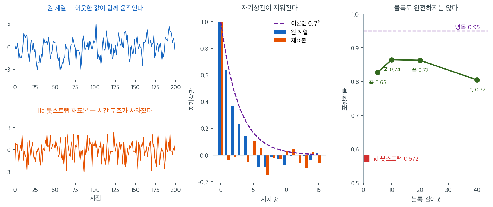
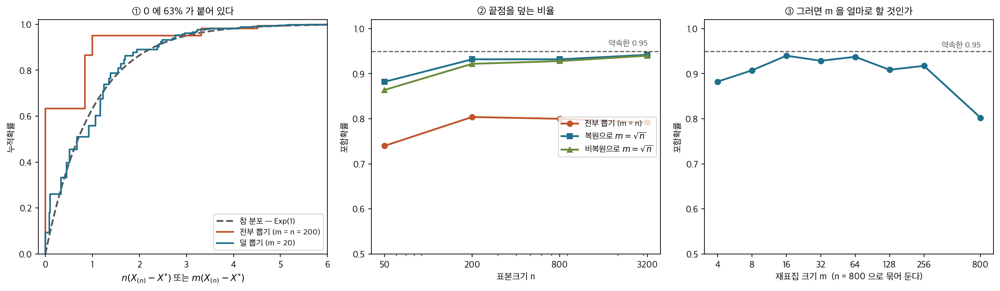

# 재표집이 실패할 때

## 1. 재표집도 보편적으로 타당하지는 않다

$X_t = 0.7X_{t-1} + \varepsilon_t$ 를 $n = 200$ 으로 생성해 iid 붓스트랩으로 평균의 구간을 만들면 포함확률이 $0.572$ 가 된다. $95\%$ 를 약속한 구간이 절반을 겨우 넘긴다. 재표집이 시점을 무작위로 뽑아 **굽이침을 통째로 버리기** 때문이고, 그래서 참 표준오차 $0.2357$ 을 $0.0990$ 으로 — $42\%$ 로 — 줄여 잡는다. 재표집이 이렇게 무너지는 자리가 몇 군데 더 있고, 어디서 무너지는지 아는 것이 재표집을 책임 있게 쓰는 조건이다.

붓스트랩과 순열 방법은 놀랄 만큼 다재다능하지만 보편적으로 타당하지는 않다. 어떤 조건에서는 재표집이 잘못된 결과를 만든다. 포함확률이 어긋난 신뢰구간, 편향된 표준오차, 타당하지 않은 $p$값이 그것이다. 이런 실패 양상을 알아보는 것은 재표집 방법을 책임 있게 쓰기 위한 필수 조건이다.

이 절에서는 재표집이 무너지는 주요 상황을 정리하고, 각각의 이유를 설명하며, 대안을 제시한다.

---

## 2. 종속자료

표준적인(iid) 붓스트랩은 관측값 $x_1, \ldots, x_n$이 독립이고 동일한 분포를 따른다고 가정한다. 자료에 시간적·공간적·군집 종속성이 있으면 개별 관측을 재표집하는 것이 종속 구조를 파괴한다.

**왜 실패하는가.** $x_1, \ldots, x_n$이 양의 자기상관을 갖는 시계열이면 $\bar{x}$의 참 표준오차가 $\sigma/\sqrt{n}$보다 크다. 연속한 관측이 담고 있는 독립적 정보가 더 적기 때문이다. iid 붓스트랩은 모든 관측을 독립으로 취급하므로 이 표준오차를 과소추정한다.

**대책:**

- **블록 붓스트랩** (Kunsch, 1989): 연속된 관측 블록을 재표집하여 국소적 종속성을 보존한다. 블록 길이 $\ell \approx n^{1/3}$이 흔한 선택이다.
- **이동 블록 붓스트랩**: $n - \ell + 1$개의 겹치는 블록을 모두 쓴다.
- **원형 블록 붓스트랩**: 계열을 원형으로 감아 모든 관측이 같은 개수의 블록에 나타나게 한다.
- **정상 붓스트랩** (Politis and Romano, 1994): 기하분포에서 뽑은 무작위 블록 길이를 써서 정상인 붓스트랩 표본을 만든다.

!!! warning "종속성을 무시하면"
    종속자료에 표준 붓스트랩을 적용하면 대개 신뢰구간이 너무 좁고 $p$값이 너무 작아진다. 실제보다 정밀해 보이는 결과가 나와 과신을 부른다. 연습문제 1에서 그 크기를 확인한다.



왼쪽 두 칸이 실패의 원인이다. $X_t = 0.7X_{t-1} + \varepsilon_t$를 $n = 200$으로 생성한 원 계열(위)은 위아래로 느릿하게 굽이치며, 한 번 올라가면 한동안 위에 머문다. 아래는 같은 관측값을 iid 붓스트랩으로 재표집한 것이다. 값의 집합은 거의 같은데 **굽이침이 사라지고 뾰족한 잡음만 남았다.** 재표집이 시점을 무작위로 뽑으므로 순서가 담고 있던 정보가 통째로 버려진 것이다.

가운데 칸이 그 손실을 수치로 보여 준다. 원 계열의 자기상관은 이론값 $0.7^k$를 따라 시차 $4$까지도 $0.14$를 유지하는데, 재표본의 자기상관은 시차 $1$부터 $0$ 주위에서 진동한다. 자기상관이 사라지면 $\bar{X}$의 변동도 함께 사라진다. 이 과정의 참 표준오차는 장기분산에 의해 $0.2357$인데 독립을 가정한 값은 $0.0990$으로 **$42\%$에 불과하다.**

오른쪽 칸이 결과이자 처방이다. iid 붓스트랩의 포함확률은 $0.572$로, $95\%$를 약속한 구간이 절반을 겨우 넘긴다. 이동 블록 붓스트랩은 연속된 덩어리를 통째로 뽑아 굽이침을 일부 살려 내며 $\ell = 10$에서 $0.865$까지 올라간다. 그러나 곡선이 **위로 볼록하다**는 점이 중요하다. $\ell$이 작으면 블록 경계에서 종속성이 끊기고, 너무 크면 서로 다른 블록이 부족해져 다시 나빠진다($\ell = 40$에서 $0.805$). 경험칙 $\ell \approx n^{1/3} = 5.9$가 여기서는 최선이 아니며, 어떤 $\ell$을 골라도 명목값 $0.95$에는 닿지 못한다. **블록 붓스트랩은 iid 붓스트랩의 재앙을 완화할 뿐 종속성을 공짜로 없애 주지 않는다.**

---

## 3. 극단 순서통계량

표본최댓값 $X_{(n)}$이나 최솟값 $X_{(1)}$처럼 표본의 극단값에 의존하는 통계량에서는 붓스트랩이 실패한다.

**고전적 예.** $X_1, \ldots, X_n \overset{\text{iid}}{\sim} \text{Uniform}(0, \theta)$에서 $\theta$를 $\hat{\theta} = X_{(n)}$으로 추정한다고 하자. $n(\theta - X_{(n)})$의 참 분포는 $\text{Exp}(1)$에 수렴하지만, $n(\hat{\theta} - X^*_{(n)})$의 붓스트랩 분포는 $\text{Exp}(1)$로 수렴하지 않는다.

**왜 실패하는가.** 붓스트랩 표본의 최댓값 $X^*_{(n)}$은 $X_{(n)}$을 결코 넘을 수 없다(붓스트랩 값이 원래 자료에서 뽑히기 때문이다). 참 $X_{(n)}$은 $1/n$ 속도로 아래에서 $\theta$에 접근할 수 있지만, 붓스트랩 최댓값은 양의 확률로 관측된 최댓값에 "붙어" 있다. 실제로 $P(X^*_{(n)} = X_{(n)}) = 1 - (1-1/n)^n \to 1 - e^{-1} = 0.632$이다.

**대책:**

- **모수적 붓스트랩**: 모수모형을 적합하고 그로부터 모의생성한다.
- **부분표집**(subsampling): 더 작은 크기 $m < n$으로 비복원 재표집한다(Politis, Romano, and Wolf, 1999).
- **$m$-out-of-$n$ 붓스트랩**: $m < n$개를 복원추출하되 $m/n \to 0$이 되게 한다.

<div class="storybox" markdown>

**그림으로 보는 통계학 1.** 터질 때가 있다

위의 $0.632$ 가 이 절에서 가장 불편한 수다. $n$ 을 아무리 키워도 붓스트랩 최댓값은
관측된 최댓값에 그 확률로 **붙어** 있다. 그런데 처방 셋이 모두 「$n$ 개를 다 뽑지 말라」는
한 가지를 달리 말한 것이라는 점은 위의 목록만 보아서는 드러나지 않는다.

$1997$ 년, 버클리와 빌레펠트와 레이던에 있던 세 사람 — 비켈·괴체·판즈벗 — 이 그 한
가지를 제목으로 삼은 글을 냈다. **「$n$ 보다 적게 재표집하기: 얻는 것, 잃는 것, 그리고
잃은 것을 메우는 법」.** 서론의 한 문장이 당시의 분위기를 정확히 적는다.

> **「현장의 경험담은 이론을 뒷받침하는 듯하다 — 붓스트랩은 대체로 그럴듯한 답을 주지만
> 터질 때가 있다는 뜻에서 그렇다.」**

그들은 성공하는 예와 실패하는 예를 나란히 늘어놓고 실패의 원인을 갈라냈다. 위의 끝점
이야기가 그 글의 보기 $3$ 이다 — 거기서는 왼쪽 끝점을 두고 하며, **비켈–프리드먼
($1981$)의 변형**이라고 밝혀 두었다.
그리고 이미 나와 있던 처방을 정리했다. 우($1990$)를 따른 폴리티스–로마노($1994$)와
따로 괴체($1993$)가 보인 것은, 비복원으로 $m = o(n)$ 개만 뽑으면 **붓스트랩이 통하는
자리에서도 통하지 않는 자리에서도** 일차로 맞는다는 것이었다. 그들이 보탠 것은 **복원으로
$m$ 개만 뽑는 쪽**도 그 성질을 거의 그대로 가지며 이점이 있다는 것이다. 복원 쪽에 대해
그들은 이렇게 적었다 — **「알려진 현실적인 붓스트랩 실패 사례 모두에서 통하는 것으로
알려져 있다.」**



- **①** $\text{Uniform}(0, 1)$ 에서 $n = 200$ 을 뽑은 자료 하나다. 참 분포 $n(\theta -
  X_{(n)})$ 은 $\text{Exp}(1)$ 에 가깝고 $95\%$ 분위수가 $2.997$ 이다. 전부 뽑는 붓스트랩
  분포는 **$0$ 에서 $63\%$ 를 쌓고 시작해서** $95\%$ 분위수가 $0.998$ 밖에 안 된다 —
  필요한 것의 **$1/3$**. $m = 20$ 만 뽑으면 그 분위수가 $2.760$ 으로 제자리를 찾는다.
- **②** 그래서 신뢰구간이 어떻게 되는가. $\theta$ 를 덮기로 약속한 $95\%$ 구간이 전부
  뽑는 붓스트랩에서는 $n = 50$ 에 $0.740$, $n = 3{,}200$ 에 $0.792$ 다. **$n$ 을 $64$ 배
  키워도 $0.8$ 에 머문다** — 자료가 모자란 것이 아니라 방법이 틀린 것이다. $m = \sqrt n$
  만 뽑으면 복원 $0.942$, 비복원 $0.940$ 으로 약속에 다가간다.
- **③** 그러면 $m$ 을 얼마로 할 것인가. $n = 800$ 으로 묶어 두고 $m$ 만 바꾸면 양쪽 끝이
  다 나쁘다. $m = 4$ 에서 $0.882$, $m = 16$ 에서 $0.940$, $m = 800$ 에서 $0.802$ 다.
  **너무 적게 뽑으면 재표집 안에서 극값 꼴이 자리를 못 잡고, 너무 많이 뽑으면 원래의
  실패로 돌아간다.**

③ 이 어려운 문제라는 것은 그들도 알고 있었다. 서론의 마지막 문장이 이렇다 — **「$m$ 의
선택이라는 결정적인 문제와 검정에의 응용은 다른 곳에서 다루겠다.」** 공짜가 아니라는
말도 같은 글에 있다. 붓스트랩이 **원래 통하던** 자리에서 $m$ 개만 뽑으면 효율을 잃으며,
그들은 외삽으로 그 손실을 이차까지 메울 수 있음을 보였다.

$0.632$ 가 나쁜 소식이라면, 그 수가 $m/n$ 과 함께 사라진다는 것은 좋은 소식이다.
덜 뽑는 쪽이 더 멀리 간다.

_확인한 곳 — P. J. Bickel, F. Götze, W. R. van Zwet, "Resampling Fewer Than $n$
Observations: Gains, Losses, and Remedies for Losses", 『Statistica Sinica』 $7$ 권
$1$–$31$ 쪽($1997$). 세 저자의 소속(버클리·빌레펠트·레이던), 초록과 서론에서 인용한 세
대목(「대체로 그럴듯한 답을 주지만 터질 때가 있다」·「알려진 현실적인 실패 사례 모두에서
통하는 것으로 알려져 있다」·「$m$ 의 선택이라는 결정적인 문제와 검정에의 응용은 다른
곳에서 다루겠다」), 우($1990$)·폴리티스–로마노($1994$)·괴체($1993$)의 비복원 $m$ 결과와
그 서술, 균등분포 끝점의 보기가 비켈–프리드먼($1981$)의 변형이라는 것, 그리고 원래
통하는 자리에서 효율을 잃고 외삽으로 메운다는 $4$–$5$ 절의 요지를 이 글에서 확인했다.
그림의 수는 모두 직접 계산한 값이다_

</div>

---

## 4. 두꺼운 꼬리 분포

모집단의 분산이 무한이면(지수 $\alpha < 2$인 안정분포, 모양모수가 $\le 2$인 파레토분포 등) 표본평균이 통상적인 형태의 중심극한정리를 만족하지 않는다.

**왜 실패하는가.** $\sqrt{n}(\bar{X} - \mu)$의 분포에 대한 붓스트랩 근사는 경험분포에 기반하는데, 경험분포는 두꺼운 꼬리를 그대로 물려받는다. 그러나 붓스트랩 분산 $\text{Var}^*(\bar{X}^*) = s^2/n$은 확률적으로 무한대로 발산하는 반면, $\bar{X}$의 참 극한분포는 정규분포가 아니라 안정분포이다. 붓스트랩 표준오차가 실행마다 크게 요동칠 수 있다.

**대책:**

- **부분표집**: 더 약한 적률 조건에서도 타당하다.
- **로버스트 통계량**: 평균 대신 중앙값이나 절사평균을 쓴다.
- **꼬리 특화 방법**: 꼬리지수를 추정하고 극단값 이론을 쓴다.

!!! note "유한분산과 무한분산"
    모집단의 분산이 유한하지만 꼬리가 매우 두꺼우면(예: $t_3$ 분포) 붓스트랩은 여전히 타당하되 수렴이 느리다. 더 큰 $B$와 더 큰 $n$이 필요하다. 붓스트랩이 일치성을 잃는 것은 분산이 진짜로 무한할 때뿐이다.

---

## 5. 작은 표본

$n$이 매우 작으면(예: $n < 10$) 경험분포 $\hat{F}_n$이 $F$의 거친 근사에 불과하다. 붓스트랩 분포가 이 거칢을 물려받아 표준오차와 신뢰구간이 신뢰하기 어려워진다.

**작은 $n$의 구체적 문제:**

- 붓스트랩 분포가 이산적이며 서로 다른 재표집이 최대 $\binom{2n-1}{n}$가지뿐이다.
- 신뢰구간의 포함확률이 명목값에서 크게 벗어날 수 있다.
- $n$개의 잭나이프 값에 기반한 BCa 가속 추정값 $\hat{a}$가 불안정하다.
- $\hat{\text{se}}^*$가 $0$에 가까울 때 붓스트랩-$t$에 극단적인 이상값이 생긴다.

**대책:**

- **모수적 붓스트랩**: 모수모형이 정당화되면 $F$에 대한 더 매끄러운 근사를 준다.
- **정확법**: 단순한 통계량(평균, 비율)에는 정확한 분포 결과를 쓴다.
- **베이즈 접근**: 사전정보를 넣어 추론을 정칙화한다.

---

## 6. 매끄럽지 않은 통계량

붓스트랩은 통계량 $\hat{\theta} = T(\hat{F}_n)$이 경험분포의 매끄러운 범함수이기를 요구한다. $T$가 매끄럽지 않으면(불연속이거나 미분 불가능하면) 붓스트랩이 일치성을 잃거나 수렴이 느려진다.

**매끄럽지 않은 통계량의 예:**

- 동점이 있거나 이산인 자료의 **표본중앙값**
- 분포의 **최빈값**
- 밀도가 $0$인 지점의 **분위수**
- $\mathbf{1}(\hat{\theta} > c)$ 같은 **지시함수**

연속자료의 표본중앙값에 대해서는 붓스트랩이 일치하지만 수렴이 느리다. 최빈값에 대해서는 일치하지 않을 수 있다.

**대책:**

- **평활 붓스트랩**: 재표집된 각 관측에 작은 잡음을 더해 경험분포를 매끄럽게 한다.
- **부분표집**: 더 넓은 통계량 부류에 대해 타당한 추론을 준다.
- **$m$-out-of-$n$ 붓스트랩**: 적절한 $m$에서 일부 비정칙 통계량에 타당하다.

---

## 7. 극단 분위수 추정

극단 분위수(예: $99$번째나 $99.9$번째 백분위수)의 붓스트랩은 신뢰할 수 없다. 붓스트랩이 분포의 꼬리에 대해 가진 정보가 제한적이기 때문이다. 관측이 $n$개이면 경험분포는 표본최댓값 너머와 최솟값 아래에 아무 자료도 갖지 않는다.

**왜 실패하는가.** 붓스트랩은 원래 표본에 나타난 값만 생성할 수 있다. 극단 분위수는 $F$의 꼬리 거동에 의존하는데, $n$이 중간 정도일 때 $\hat{F}_n$은 이를 제대로 담지 못한다.

**대책:**

- **극단값 이론**: 꼬리에 일반화 파레토분포를 적합하고 외삽한다.
- **모수적 붓스트랩**: 꼬리 거동을 담는 모수모형을 쓴다.
- **문턱 초과**(peaks-over-threshold) 방법

!!! tip "분위수 추정의 경험칙"
    붓스트랩은 $1/\sqrt{n}$ 수준과 $1 - 1/\sqrt{n}$ 수준 사이의 분위수 추정에 신뢰할 만하다. $n = 100$이면 $10$%에서 $90$% 사이의 분위수가 합리적으로 추정된다는 뜻이다. 더 극단적인 분위수에는 꼬리 특화 방법을 쓴다.

---

## 8. 무한차원 모수

붓스트랩은 관심 모수가 자료 분포의 매끄러운 범함수로 표현될 수 있다고 가정한다. 무한차원 대상(전체 CDF, 비모수 밀도추정값, 함수형 자료 곡선 등)에 대해서는 성립하지 않을 수 있는 추가적인 정칙성 조건이 필요하다.

---

## 9. 실패 양상 요약

| 실패 양상 | 증상 | 대안 |
|---|---|---|
| 종속자료 | 신뢰구간이 좁고 $p$값이 작다 | 블록 붓스트랩, 정상 붓스트랩 |
| 극단 순서통계량 | 붓스트랩이 관측 극단값에 붙는다 | 모수적 붓스트랩, 부분표집 |
| 무한분산 | 표준오차 추정값이 크게 요동친다 | 부분표집, 로버스트 통계량 |
| 작은 $n$ ($< 10$) | 포함확률이 나쁘고 추정이 불안정하다 | 모수적 붓스트랩, 정확법 |
| 매끄럽지 않은 통계량 | 수렴이 느리거나 일치하지 않는다 | 평활 붓스트랩, 부분표집 |
| 극단 분위수 | 꼬리에 자료가 없다 | 극단값 이론 |

---

## 연습문제

<div class="drillbox" markdown>

**연습문제 1.** <span class="diff med" title="중간"></span>
$X_t = 0.7 X_{t-1} + \varepsilon_t$, $\varepsilon_t \sim N(0, 1)$인 AR(1) 과정을 $n = 200$으로 모의생성하라.

**(a)** 표준(iid) 붓스트랩으로 $E[X]$의 $95$% 신뢰구간을 구하라. 모의실험에서 포함확률이 얼마인가?

**(b)** 블록 길이 $\ell = 5, 10, 20, 40$인 **이동 블록 붓스트랩**을 적용하라.

**(c)** 두 접근의 폭과 포함확률을 비교하고, iid 붓스트랩이 종속자료에서 실패하는 이유를 설명하라.

</div>

??? success "풀이"
    ```python
    import numpy as np
    rng = np.random.default_rng(101)
    phi, n = 0.7, 200

    def ar1(n, phi=0.7):
        e = rng.normal(0, 1, n + 200); x = np.zeros(n + 200)
        for t in range(1, n + 200):
            x[t] = phi * x[t-1] + e[t]
        return x[200:]                       # burn-in 제거

    def mbb(x, ell, B=1000):
        n = len(x); k = int(np.ceil(n / ell)); starts = n - ell + 1
        out = np.empty(B)
        for b in range(B):
            s = rng.integers(0, starts, k)
            out[b] = np.concatenate([x[i:i+ell] for i in s])[:n].mean()
        return out
    ```

    **먼저 참값을 알아야 한다.** AR(1)의 주변 분산은 $\sigma^2/(1-\phi^2) = 1/0.51 = 1.961$이므로 주변 표준편차는 $1.400$이다. 그러나 $\bar{X}$의 참 표준오차는 **장기분산**으로 결정된다.

    $$
    \text{SE}(\bar{X}) \approx \sqrt{\frac{1+\phi}{1-\phi}}\cdot\frac{\sigma_X}{\sqrt{n}} = \sqrt{\frac{1.7}{0.3}}\cdot\frac{1.400}{\sqrt{200}} = 0.2357
    $$

    반면 독립을 가정한 순진한 값은 $1.400/\sqrt{200} = 0.0990$이다. **참값의 $42$%에 불과하다.**

    **(a)–(b) 결과 ($M = 600$회 반복)**

    | 방법 | 포함확률 | 평균 구간폭 |
    |:---|---:|---:|
    | iid 붓스트랩 | **0.572** | 0.379 |
    | 이동 블록 $\ell = 5$ | 0.827 | 0.650 |
    | 이동 블록 $\ell = 10$ | **0.865** | 0.742 |
    | 이동 블록 $\ell = 20$ | 0.863 | 0.770 |
    | 이동 블록 $\ell = 40$ | 0.805 | 0.720 |
    | 이상적인 구간 | 0.95 | 0.924 |

    **(c) iid 붓스트랩이 완전히 무너진다.** 포함확률이 $0.572$로, $95$%를 목표한 구간이 참 평균을 절반 조금 넘게만 담는다. 구간폭 $0.379$는 이상적인 $0.924$의 $41$%이다. 이 비는 $0.0990/0.2357 = 0.42$와 정확히 일치한다.

    **왜 그런가.** 붓스트랩 표본은 원래 계열에서 관측을 **무작위로** 뽑으므로 시간 순서가 완전히 파괴된다. 붓스트랩 계열은 백색잡음이고, 그 평균의 변동은 $\hat\sigma_X/\sqrt{n}$이다. 원래 계열이 갖는 자기상관 — 인접한 값들이 같은 방향으로 움직여 평균을 더 크게 흔드는 성질 — 이 재표집 과정에서 사라진다.

    **블록 붓스트랩이 크게 개선하지만 완전하지는 않다.** 최선인 $\ell = 10$에서도 포함확률이 $0.865$이다. 두 가지가 겹친다.

    첫째, 블록 붓스트랩은 **블록 경계에서 종속성을 끊는다**. $k = n/\ell$개의 블록을 이어 붙이면 $k-1$개의 인위적인 단절이 생긴다. $\ell$이 작을수록 단절이 많아 장기분산이 과소추정된다.

    둘째, $\ell$이 너무 크면 서로 다른 블록의 개수 $n - \ell + 1$이 줄어 붓스트랩 분포의 변동이 커진다. $\ell = 40$에서 포함확률이 $0.805$로 다시 나빠지는 이유이다.

    **$\ell$ 선택.** $n^{1/3} = 200^{1/3} = 5.85$라는 경험칙은 여기서 최선이 아니다. $\ell = 5$의 포함확률 $0.827$보다 $\ell = 10$이나 $\ell = 20$이 낫다. 경험칙은 출발점일 뿐이며, $\phi$가 클수록(종속성이 강할수록) 더 긴 블록이 필요하다.

    !!! warning "종속성 진단이 먼저다"
        이 보기의 교훈은 "블록 붓스트랩을 쓰라"가 아니라 **"블록 붓스트랩도 완벽하지 않다"**이다. $n = 200$, $\phi = 0.7$에서 최선의 블록 붓스트랩도 $0.865$에 그친다.

        실무에서는 순서가 반대여야 한다.

        1. 자기상관함수(ACF)를 그려 종속성을 확인한다.
        2. 종속성이 있으면 iid 붓스트랩을 **쓰지 않는다**.
        3. 시계열 모형(ARMA 등)을 적합하고 **잔차를 붓스트랩**하거나, 블록 붓스트랩을 여러 $\ell$로 실행해 결과의 민감도를 본다.
        4. 어떤 방법을 쓰든 $n = 200$ 정도로는 강한 종속성 아래에서 정확한 추론이 어렵다는 것을 인정한다.

<div class="drillbox" markdown>

**연습문제 2.** <span class="diff med" title="중간"></span>
$X_1, \ldots, X_n \sim \text{Uniform}(0, 1)$에서 $\theta = 1$의 신뢰구간을 추축량 $n(\theta - X_{(n)})$으로 만들 때, 완전 붓스트랩·$m$-out-of-$n$ 붓스트랩·모수적 붓스트랩의 포함확률을 비교하라. $n = 50$과 $n = 200$에서 $m = \lfloor\sqrt{n}\rfloor$과 $m = \lfloor n^{2/3}\rceil$을 시도하라.

</div>

??? success "풀이"
    ```python
    import numpy as np
    rng = np.random.default_rng(303)

    def cov_max(n, M=3000, B=2000, theta=1.0):
        res = dict(full=0, m_sqrt=0, m_n23=0, param=0)
        m1, m2 = int(np.sqrt(n)), int(round(n**(2/3)))
        for _ in range(M):
            x = rng.uniform(0, theta, n); mx = x.max()
            # 완전 붓스트랩
            b = x[rng.integers(0, n, (B, n))].max(1)
            lo, hi = np.percentile(n*(mx - b), [2.5, 97.5])
            res['full'] += (mx + lo/n) <= theta <= (mx + hi/n)
            # m-out-of-n
            for key, m in (('m_sqrt', m1), ('m_n23', m2)):
                bm = x[rng.integers(0, n, (B, m))].max(1)
                lo, hi = np.percentile(m*(mx - bm), [2.5, 97.5])
                res[key] += (mx + lo/n) <= theta <= (mx + hi/n)
            # 모수적 붓스트랩: Uniform(0, mx) 에서 생성
            bp = rng.uniform(0, mx, (B, n)).max(1)
            lo, hi = np.percentile(n*(mx - bp), [2.5, 97.5])
            res['param'] += (mx + lo/n) <= theta <= (mx + hi/n)
        return {k: round(v/M, 3) for k, v in res.items()}
    ```

    | 방법 | $n = 50$ | $n = 200$ |
    |:---|---:|---:|
    | 완전 붓스트랩 | **0.870** | **0.883** |
    | $m$-out-of-$n$, $m = \lfloor\sqrt{n}\rfloor$ | 0.923 ($m=7$) | 0.963 ($m=14$) |
    | $m$-out-of-$n$, $m = \lfloor n^{2/3}\rceil$ | 0.937 ($m=14$) | 0.964 ($m=34$) |
    | 모수적 붓스트랩 | 0.938 | 0.956 |

    **완전 붓스트랩이 $n$을 늘려도 개선되지 않는다.** $0.870 \to 0.883$으로, $n$을 네 배 늘렸는데도 여전히 $0.95$에서 멀다. **이것이 비일치성의 증거이다.** 다른 실패 양상(작은 표본, 느린 수렴)이라면 $n$을 늘릴 때 $0.95$로 수렴해야 한다.

    **왜 $0.87$ 근처에 머무는가.** 붓스트랩 표본이 원래 최댓값 $X_{(n)}$을 포함할 확률은 $1 - (1-1/n)^n \approx 0.632$이다. 즉 붓스트랩 최댓값 분포는 $X_{(n)}$에 **$63.2$%의 점질량**을 갖는 이산분포이다. 참 분포 $\text{Exp}(1)$은 연속인데, 이 두 분포는 아무리 $n$을 키워도 가까워지지 않는다.

    **$m$-out-of-$n$이 문제를 고친다.** $m$개만 뽑으면 붓스트랩 최댓값이 $X_{(n)}$일 확률이 $1-(1-1/n)^m \approx m/n$으로 줄어든다. $n = 200$, $m = 14$이면 $7$%이다. 점질량이 사라지면서 근사가 회복된다.

    $m$이 클수록($m = n^{2/3}$) 정보를 더 쓰지만 점질량 문제가 커진다. $m$이 작을수록 안전하지만 추정이 불안정해진다. $n = 50$에서 $m = n^{2/3} = 14$가 $m = \sqrt{n} = 7$보다 나은 것($0.937$ 대 $0.923$)은 이 절충의 결과이다.

    **모수적 붓스트랩이 가장 자연스러운 해결책이다.** $\text{Uniform}(0, X_{(n)})$에서 새 표본을 생성하면 최댓값이 연속분포를 가지므로 점질량 문제가 아예 없다. $n = 50$에서 $0.938$, $n = 200$에서 $0.956$으로 정상적으로 수렴한다.

    다만 이는 **분포를 안다는 대가**를 치른 것이다. 균등분포가 아니라 다른 분포였다면 이 방법은 틀린 답을 준다.

<div class="drillbox" markdown>

**연습문제 3.** <span class="diff med" title="중간"></span>
무한분산에서 붓스트랩 표준오차가 "크게 요동친다"는 것이 정확히 무엇을 뜻하는가? 코시 자료($n = 100$)에서 평균과 중앙값의 붓스트랩 표준오차를, 서로 다른 세 자료에 대해 각각 $200$번씩 계산하여 확인하라.

</div>

??? success "풀이"
    ```python
    import numpy as np
    rng = np.random.default_rng(303)

    def instab(gen, n=100, R=200, B=2000):
        x = gen(n)                       # 하나의 고정된 자료
        sem, sed = [], []
        for _ in range(R):               # 같은 자료에 붓스트랩을 R 번
            s = x[rng.integers(0, n, (B, n))]
            sem.append(s.mean(1).std())
            sed.append(np.median(s, 1).std())
        return (round(np.mean(sem), 4), round(np.std(sem)/np.mean(sem), 4),
                round(np.mean(sed), 4), round(np.std(sed)/np.mean(sed), 4))
    ```

    | 자료 | 분포 | 평균의 $\widehat{\text{SE}}$ | 실행 간 변동계수 | 중앙값의 $\widehat{\text{SE}}$ | 실행 간 변동계수 |
    |---:|:---|---:|---:|---:|---:|
    | 1 | 정규 | 0.0887 | 1.5% | 0.1206 | 1.6% |
    | 2 | 정규 | 0.0896 | 1.6% | 0.1415 | 1.4% |
    | 3 | 정규 | 0.0921 | 1.5% | 0.1180 | 1.8% |
    | 1 | Cauchy | **2.6885** | 1.9% | 0.2004 | 1.6% |
    | 2 | Cauchy | **0.5777** | 1.6% | 0.1700 | 1.3% |
    | 3 | Cauchy | **1.0456** | 1.7% | 0.1433 | 1.8% |

    **"요동친다"는 말이 가리키는 것이 무엇인지 분명히 해야 한다.**

    **같은 자료 안에서는 요동치지 않는다.** 실행 간 변동계수가 모든 경우에 $1.3$--$1.9$%로 일정하다. 이는 순전히 $B = 2{,}000$에서 오는 몬테카를로 오차이며, [수렴](convergence.md) 연습문제 1의 $1/\sqrt{2B}$ 공식이 예측하는 $1.6$%와 일치한다. 코시라고 해서 몬테카를로 오차가 커지지 않는다.

    **요동치는 것은 자료가 바뀔 때이다.** 정규 자료에서는 세 자료의 $\widehat{\text{SE}}$가 $0.0887$, $0.0896$, $0.0921$로 $4$% 안에 모여 있다. 코시 자료에서는 $2.6885$, $0.5777$, $1.0456$으로 **$4.7$배 차이가 난다**.

    이는 붓스트랩의 결함이 아니라 **추정하려는 대상이 존재하지 않는다는 사실의 반영**이다. 코시분포에서 $\bar{X}$의 분산은 무한대이다. $\widehat{\text{SE}}$가 무엇에 수렴할 수 있겠는가? 아무것에도 수렴하지 않는다. 붓스트랩은 각 자료에서 그 자료의 표본분산 $s^2$을 반영하는 값을 내놓는데, 코시에서 $s^2$ 자체가 발산한다.

    **중앙값은 완전히 안정적이다.** $0.2004$, $0.1700$, $0.1433$으로 $40$% 범위 안이다(정규 자료의 중앙값 $\widehat{\text{SE}}$가 보이는 변동과 비슷하다). 코시분포의 중앙값은 잘 정의된 유한분산 추정량이며, 붓스트랩이 정상적으로 작동한다.

    !!! tip "진단 방법"
        붓스트랩이 무한분산 때문에 실패하고 있는지 어떻게 알 수 있는가?

        1. **$B$를 두 배로 늘려도 $\widehat{\text{SE}}$가 안정되면** 몬테카를로 오차는 문제가 아니다. 위 표의 변동계수가 이 점검에 해당한다.
        2. **붓스트랩 분포의 히스토그램을 그린다.** 몇 개의 극단값이 전체 폭을 결정하고 있으면 위험 신호이다.
        3. **자료에서 가장 큰 관측 몇 개를 빼고 다시 계산한다.** $\widehat{\text{SE}}$가 크게 바뀌면 그 통계량은 소수의 관측에 지배되고 있다.
        4. **로버스트 통계량으로 바꿔 본다.** 중앙값이나 절사평균의 $\widehat{\text{SE}}$가 안정적인데 평균의 것만 불안정하면 진단이 확정된다.

        가장 중요한 것은 **문제가 붓스트랩이 아니라 통계량의 선택**이라는 점이다. 두꺼운 꼬리 자료에서 평균은 애초에 요약값으로 부적절하다.

<div class="drillbox" markdown>

**연습문제 4.** <span class="diff med" title="중간"></span>
5 절은 "붓스트랩 분포가 이산적이며 서로 다른 재표집이 최대 $\binom{2n-1}{n}$가지뿐이다"라고 적었다. $n = 6$에서 그 집합을 끝까지 센다.

**(a)** 자료값이 모두 다를 때, 서로 다른 재표본(뽑힌 순서를 무시한 값들의 모둠)의 개수가 $\binom{2n-1}{n}$임을 보이고 $n = 6$에서 값을 구하라.

**(b)** 그 재표본들이 **같은 확률로 뽑히지 않는다**는 것을 보여라. 재표본의 확률을 횟수벡터 $(c_1, \ldots, c_n)$으로 적고, $n = 6$에서 가장 확률이 큰 재표본과 가장 작은 재표본의 확률 및 그 비를 구하라.

**(c)** $462$가지를 **모두 같은 확률로** 열거해서 "정확한 붓스트랩"을 계산하는 코드를 쓴 사람이 있다. $E^*[\bar{x}^*]$와 $\text{Var}^*(\bar{x}^*)$ 가운데 어느 쪽이 틀어지고 어느 방향으로 틀어지는가? 이유를 들어 말하라.

</div>

??? success "풀이"
    **(a)** 자료값이 모두 다르면 재표본은 "$x_i$가 몇 번 뽑혔는가"를 적은 횟수벡터로 완전히 정해진다. 곧 서로 다른 재표본은

    $$
    c_1 + c_2 + \cdots + c_n = n, \qquad c_i \ge 0 \text{ 인 정수}
    $$

    의 해와 일대일로 대응한다. 별 $n$개를 막대 $n-1$개로 가르는 배열의 수이므로 해의 개수는 $\binom{n + n - 1}{n - 1} = \binom{2n-1}{n-1} = \binom{2n-1}{n}$이다. $n = 6$이면 $\binom{11}{6} = 462$이다. $\square$

    $B = 1{,}000$번 재표집하면 평균 $1{,}000/462 = 2.2$번씩 같은 재표본을 다시 보게 된다. 이것이 5 절이 말하는 "이산성"의 크기다.

    **(b)** 한 번의 추출이 $x_i$에 떨어질 확률이 $1/n$이고 추출이 독립이므로 횟수벡터는 다항분포를 따른다.

    $$
    P^*\bigl((c_1, \ldots, c_n)\bigr) = \frac{n!}{c_1!\,c_2!\cdots c_n!}\cdot\frac{1}{n^n}
    $$

    이 값은 $c$에 따라 달라지므로 $462$가지는 **등확률이 아니다.** $6^6 = 46656$이고,

    - 가장 큰 것: 여섯 값이 모두 한 번씩 나오는 재표본 하나. $6!/46656 = 720/46656 = 0.015432$.
    - 가장 작은 것: 한 값만 여섯 번 나오는 재표본 여섯 개. $1/46656 = 0.0000214$.

    비는 $6! = 720$배다. $n = 10$이면 $10! = 3{,}628{,}800$배로 벌어진다.

    **(c)** $E^*$는 맞고 $\text{Var}^*$가 **위로** 틀어진다.

    두 방식 모두 $(c_1, \ldots, c_n)$의 분포가 좌표의 교환에 대해 대칭이고 $\sum_i c_i = n$이므로 $E[c_i] = 1$이 되어 $E^*[\bar{x}^*] = \frac{1}{n}\sum_i E[c_i]x_i = \bar{x}$이다. 등확률로 세어도 평균은 맞는다.

    분산은 다르다. 등확률 계산은 **뭉친 재표본을 터무니없이 과대평가한다.** $462$가지 안에는 한 값만 여섯 번 뽑힌 재표본이 여섯 개 있고, 그 평균은 $x_1, \ldots, x_6$ 자신 — 곧 자료의 양 끝을 포함한다. 참 확률은 각 $0.0000214$인데 등확률은 $1/462 = 0.002165$를 주어 **$101$배**로 띄운다. 반대로 가장 그럴듯한 "모두 한 번씩" 재표본은 참 확률 $0.015432$가 $0.002165$로 **$7.1$배** 깎인다. 질량이 가운데에서 꼬리로 옮겨 가므로 $\text{Var}^*$가 커진다. 연습문제 7 에서 그 배수가 정확히 $2n/(n+1)$임을 센다.

<div class="drillbox" markdown>

**연습문제 5.** <span class="diff med" title="중간"></span>
2 절은 iid 붓스트랩이 종속자료에서 $\bar{X}$의 표준오차를 과소추정한다고 했다. 그 과소추정이 **몬테카를로 오차가 아니라는 것**을 보인다. $\phi = 0.7$, $n = 200$인 AR(1) 계열 **하나**를 고정하고 작업하라.

**(a)** [붓스트랩 표준오차](../../ch05/applications/bootstrap_standard_error.md)의 정리 $\text{Var}^*(\bar{X}^*) = \hat\sigma^2/n$을 써서, iid 붓스트랩이 $B \to \infty$에서 내놓을 표준오차를 미리 적어라. 그 값에 계열의 **시간 순서**가 들어 있는가?

**(b)** $B = 10^3, 10^4, 10^5, 10^6$에서 붓스트랩 표준오차를 재고, 그 옆에 (ㄱ) 몬테카를로 오차 $\widehat{\text{SE}}/\sqrt{2B}$와 (ㄴ) 참값 $0.2357$까지의 거리를 나란히 적어라.

**(c)** $B$를 $1{,}000$배 늘리면 둘 중 어느 것이 줄고 어느 것이 그대로인가? "$B$를 더 키우면 나아지지 않을까"라는 물음에 답하라.

</div>

??? success "풀이"
    **(a)** 붓스트랩은 경험분포 $\hat{F}_n$에서 독립으로 뽑는다. $\hat{F}_n$은 **관측값의 모둠만** 담고 있어 자료를 어떻게 뒤섞어도 똑같으므로, 시간 순서는 재표집 계획에 들어올 길이 없다. 따라서

    $$
    \widehat{\text{SE}}^*(\bar{X}) \xrightarrow[B \to \infty]{} \frac{\hat\sigma}{\sqrt{n}}, \qquad \hat\sigma^2 = \frac{1}{n}\sum_{t=1}^{n}(x_t - \bar{x})^2
    $$

    이고, 이 계열에서는 $\hat\sigma = 1.2377$이므로 $0.0875$이다. 참값 $0.2357$의 $37$%다(2 절은 주변표준편차의 **이론값** $1.400$을 써서 $0.0990$을 적었다. 여기서는 표본에서 잰 $\hat\sigma$를 쓰므로 조금 다르다).

    **(b)**

    ```python
    import numpy as np

    rng = np.random.default_rng(1707)
    phi, n = 0.7, 200

    e = rng.normal(0, 1, n + 500)                    # AR(1) 계열 하나 (burn-in 제거)
    x = np.zeros(n + 500)
    for t in range(1, n + 500):
        x[t] = phi * x[t - 1] + e[t]
    x = x[500:]

    sig_hat = x.std(ddof=0)                          # 1/n 로 나눈 표본표준편차
    truth = np.sqrt((1 + phi) / (1 - phi)) / np.sqrt(1 - phi**2) / np.sqrt(n)


    def boot_se_mean(x, B, chunk=20_000):            # 토막으로 뽑아 메모리를 아낀다
        n = len(x)
        s1 = s2 = 0.0
        for lo in range(0, B, chunk):
            m = min(chunk, B - lo)
            bs = x[rng.integers(0, n, size=(m, n))].mean(axis=1)
            s1 += bs.sum()
            s2 += (bs**2).sum()
        return np.sqrt(s2 / B - (s1 / B) ** 2)


    print(f"sigma_hat/sqrt(n) = {sig_hat / np.sqrt(n):.4f}")
    print(f"참 SE(Xbar)       = {truth:.4f}")
    print()
    print("      B   붓스트랩 SE   MC 오차   참값 - 붓스트랩 SE")
    for B in (1_000, 10_000, 100_000, 1_000_000):
        se = boot_se_mean(x, B)
        print(f"{B:>7}   {se:11.4f}   {se / np.sqrt(2 * B):7.4f}   {truth - se:18.4f}")
    ```

    출력:

    ```text
    sigma_hat/sqrt(n) = 0.0875
    참 SE(Xbar)       = 0.2357

          B   붓스트랩 SE   MC 오차   참값 - 붓스트랩 SE
       1000        0.0867    0.0019               0.1490
      10000        0.0877    0.0006               0.1480
     100000        0.0876    0.0002               0.1481
    1000000        0.0875    0.0001               0.1482
    ```

    **(c)** $B$를 $10^3$에서 $10^6$으로 $1{,}000$배 늘리는 동안

    - 몬테카를로 오차는 $0.00194 \to 0.0000619$로 $31$배, 곧 $\sqrt{1000} = 31.6$배 줄었다(표에는 넷째 자리까지만 찍혀 $0.0001$로 보인다).
    - 참값까지의 거리는 $0.1490 \to 0.1482$로 **꼼짝도 하지 않았다.**

    붓스트랩 표준오차는 $0.0875 = \hat\sigma/\sqrt{n}$에 수렴하고 있으며, $B$가 하는 일은 그 극한값에 얼마나 가까이 가는가뿐이다. **$B$는 극한값을 바꾸지 못한다.** 두 오차는 출처가 다르다.

    | 오차 | 무엇이 줄이는가 | 이 보기에서 |
    |:---|:---|---:|
    | 몬테카를로 오차 | $B$ | $0.0001$ |
    | 재표집 계획의 치우침 | 계획을 바꾸는 것 | $0.1482$ |

    여기서 두 번째 줄이 **$n$을 늘려서 줄어드는 것도 아니라는 점**이 중요하다. 자료는 자기상관을 분명히 담고 있다(연습문제 1 의 블록 붓스트랩이 그것을 일부 되찾았다). 버린 쪽은 자료가 아니라 **계획**이다. 관측값을 하나씩 독립으로 뽑는 순간 순서 정보가 $\hat{F}_n$ 밖으로 밀려난다. 고칠 자리는 $B$가 아니라 재표집 단위다.

<div class="drillbox" markdown>

**연습문제 6.** <span class="diff hard" title="어려움"></span>
7 절은 붓스트랩이 "$1/\sqrt{n}$ 수준과 $1 - 1/\sqrt{n}$ 수준 사이의 분위수"에만 믿을 만하다고 했다. $n = 100$에서 그 경계를 **몬테카를로 없이** 센다.

자료값이 모두 다르고 $\hat{q}_p = x_{(k)}$, $k = \lceil np \rceil$라 하자.

**(a)** 붓스트랩 복제값 $\hat{q}_p^* = x_{(J^*)}$의 분포가

$$
F_j \equiv P^*\bigl(\hat{q}_p^* \le x_{(j)}\bigr) = P\bigl(\text{Bin}(n,\ j/n) \ge k\bigr), \qquad j = 1, \ldots, n
$$

임을 보여라([중앙값의 붓스트랩](../bootstrap_ci/bootstrap_median.md) 연습문제 6 을 $k = (n+1)/2$에서 일반 $k$로 넓힌 것이다). 백분위수 구간의 두 끝점이 순위 $L = \min\{j : F_j \ge 0.025\}$와 $U = \min\{j : F_j \ge 0.975\}$의 순서통계량임을 말하라.

**(b)** $p = 0.5, 0.9, 0.95, 0.99$에서 가장 큰 원자, $P^*(\hat{q}^*_p = x_{(100)})$, 질량의 $95$%를 담는 데 필요한 순위의 개수(질량이 큰 순위부터 모아 $0.95$에 닿을 때까지의 개수), $\text{SD}[J^*]$, 그리고 $[L, U]$를 구하라. 연속인 $F$ 아래에서 그 구간의 **정확한** 포함확률은 $N \sim \text{Bin}(n, p)$에 대해 $P(L \le N \le U - 1)$이다. 네 $p$에서 값을 구하라.

**(c)** $p = 0.99$의 포함확률이 $0.6334$에 그친다. 이 수가 $1 - 0.99^{100}$과 거의 같은 까닭을 말하라. $B$를 키우면 나아지는가?

</div>

??? success "풀이"
    **(a)** 재표본의 $k$번째 순서통계량이 $x_{(j)}$ 이하라는 것은, $n$번의 추출 가운데 **적어도 $k$개가 $\{x_{(1)}, \ldots, x_{(j)}\}$에서 나왔다**는 것과 같다. 한 번의 추출이 그 집합에 떨어질 확률이 $j/n$이고 추출이 독립이므로 그 개수는 $\text{Bin}(n,\ j/n)$을 따른다. 따라서 $F_j = P(\text{Bin}(n, j/n) \ge k)$이다. **오른쪽에 자료값이 하나도 없다.** $\square$

    붓스트랩 분포가 $x_{(1)}, \ldots, x_{(n)}$ 위의 이산분포이므로, 그 $\alpha$분위수는 누적질량이 처음으로 $\alpha$에 닿는 원자다. 곧 백분위수 구간은 $[x_{(L)},\ x_{(U)}]$이고 **두 순위는 $n$과 $p$만으로 정해진다.** 자료는 순위를 값으로 옮기는 눈금 노릇만 한다. 그래서 그 포함확률을 순서통계량 구간의 이항식으로 정확히 계산할 수 있다.

    **(b)**

    ```python
    import numpy as np
    from scipy import stats

    n = 100
    j = np.arange(1, n + 1)

    print("   p    k   최대원자  P*(J*=n)  95%를 담는 순위 수  SD[J*]   [L, U]   정확 포함확률")
    for p in (0.50, 0.90, 0.95, 0.99):
        k = int(np.ceil(n * p))
        F = stats.binom.sf(k - 1, n, j / n)            # F_j = P*(q* <= x_(j))
        w = np.diff(np.concatenate(([0.0], F)))        # 원자 질량 w_j
        cum = np.cumsum(np.sort(w)[::-1])
        need = int(np.searchsorted(cum, 0.95) + 1)
        mu = (j * w).sum()
        sd = np.sqrt((j**2 * w).sum() - mu**2)
        L = int(j[F >= 0.025][0])                      # 백분위수 구간의 끝점 순위
        U = int(j[F >= 0.975][0])
        cov = stats.binom.cdf(U - 1, n, p) - stats.binom.cdf(L - 1, n, p)
        print(f"{p:5.2f}  {k:>3}   {w.max():7.4f}  {w[-1]:8.4f}  {need:>17}  {sd:6.2f}  "
              f"[{L:>3},{U:>4}]   {cov:11.4f}")

    rng = np.random.default_rng(99)                    # 몬테카를로 확인: p = 0.99
    k, B = 99, 400_000
    cnt = np.zeros(n + 1)
    for lo in range(0, B, 20_000):
        idx = rng.integers(1, n + 1, size=(20_000, n))
        cnt += np.bincount(np.sort(idx, axis=1)[:, k - 1], minlength=n + 1)
    mc = cnt[1:] / B
    F = stats.binom.sf(k - 1, n, j / n)
    w = np.diff(np.concatenate(([0.0], F)))
    print("\np = 0.99 의 순위별 질량: 정확 / 몬테카를로(B = 400,000)")
    for jj in (96, 97, 98, 99, 100):
        print(f"  j = {jj:>3}   {w[jj-1]:.4f}   {mc[jj-1]:.4f}")
    print(f"  j <= 95 합계   {w[:95].sum():.4f}   {mc[:95].sum():.4f}")
    ```

    출력:

    ```text
       p    k   최대원자  P*(J*=n)  95%를 담는 순위 수  SD[J*]   [L, U]   정확 포함확률
     0.50   50    0.0799    0.0000                 20    4.96  [ 40,  60]        0.9540
     0.90   90    0.1303    0.0000                 12    3.10  [ 83,  95]        0.9324
     0.95   95    0.1753    0.0005                  9    2.36  [ 89,  98]        0.8775
     0.99   99    0.3325    0.2642                  5    1.40  [ 95, 100]        0.6334

    p = 0.99 의 순위별 질량: 정확 / 몬테카를로(B = 400,000)
      j =  96   0.0501   0.0505
      j =  97   0.1075   0.1078
      j =  98   0.2086   0.2087
      j =  99   0.3325   0.3325
      j = 100   0.2642   0.2636
      j <= 95 합계   0.0371   0.0369
    ```

    몬테카를로가 정확값과 소수 셋째 자리까지 맞으므로 열거가 옳다.

    **읽을 것이 네 줄에 다 있다.**

    - **중앙값($p = 0.5$)은 건강하다.** 가장 큰 원자가 $0.08$에 그치고 질량의 $95$%가 $20$개 순위에 퍼져 있다. 포함확률 $0.9540$은 명목값과 맞는다.
    - **$p = 0.99$에서 붓스트랩 분포의 $26.4$%가 표본최댓값 한 점에 쌓인다.** 3 절의 $X^*_{(n)}$ 원자와 같은 병이 분위수에서 되살아난 것이다. 질량의 $95$%가 순위 다섯 개에 몰려 있어서 구간의 끝점이 고를 수 있는 값이 사실상 다섯 개뿐이다.
    - **$U = 100$이다.** 상한이 **언제나 표본최댓값**이다. 자료 위쪽으로는 한 걸음도 못 나간다.
    - **포함확률이 $p$를 따라 무너진다.** $0.9540 \to 0.9324 \to 0.8775 \to 0.6334$. 경험칙의 경계 $1 - 1/\sqrt{100} = 0.90$까지는 $0.93$을 지키지만 그 밖으로 나가면 급격히 나빠진다.

    **(c)** $U = 100$이므로 구간은 $[x_{(95)},\ x_{(100)}]$이고, 이 구간이 참 분위수 $q_{0.99}$를 담으려면 적어도 **관측값 하나가 $q_{0.99}$를 넘어야** 한다. 그 확률은

    $$
    1 - P(\text{모든 관측이 } q_{0.99} \text{ 이하}) = 1 - 0.99^{100} = 0.6340
    $$

    이다. 정확 포함확률 $0.6334$와 $0.0006$밖에 차이가 없고, 그 차이는 하한 쪽 실패 $P(N \le 94) = 0.00053$이다. 곧 **포함확률의 천장이 "자료가 꼬리에 닿을 확률"로 정해진다.**

    $B$를 키워도 달라지지 않는다. 위 표의 모든 수는 $B$가 들어오기 전의 **이상적인** 붓스트랩 분포에서 나온 것이다. $100$개 관측 가운데 평균 한 개만이 $q_{0.99}$ 위에 있다는 사실이 문제이고, 그것을 고치는 것은 $n$ 뿐이다(또는 꼬리를 모형으로 외삽하는 극단값 이론이다).

<div class="drillbox" markdown>

**연습문제 7.** <span class="diff hard" title="어려움"></span>
$n = 6$, 자료 $2, 3, 5, 8, 13, 21$에서 $\bar{x}^*$의 붓스트랩 분포를 **끝까지** 센다. 연습문제 4 의 $462$가지 재표본에 다항확률을 붙이면 몬테카를로가 필요 없다.

**(a)** $E^*[\bar{x}^*]$와 $\text{Var}^*(\bar{x}^*)$를 구해 5 장의 정리 $\hat\sigma^2/n$과 맞춰 보라. 서로 다른 $\bar{x}^*$ 값은 몇 개인가? $462$보다 적은 까닭은?

**(b)** 연습문제 4 (c) 의 잘못 — $462$가지를 등확률로 보는 것 — 이 $\text{Var}^*(\bar{x}^*)$를 몇 배로 부풀리는지 재고, 그 배수가 정확히 $2n/(n+1)$임을 확인하라.

**(c)** 정확한 $95$% 백분위수 구간과 그 구간이 **실제로** 담는 질량을 구하라. $B = 100{,}000$의 몬테카를로가 하한을 $3.8333$으로 주는데 정확값은 $4.0000$인 까닭을 $2.5$% 문턱 주변의 누적질량으로 설명하라.

</div>

??? success "풀이"
    ```python
    import numpy as np
    from itertools import combinations_with_replacement
    from math import comb, factorial

    x = np.array([2.0, 3.0, 5.0, 8.0, 13.0, 21.0])
    n = len(x)

    ms_all = list(combinations_with_replacement(range(n), n))   # 서로 다른 재표본 전부
    means = np.empty(len(ms_all))
    probs = np.empty(len(ms_all))
    for i, ms in enumerate(ms_all):
        cnt = np.bincount(ms, minlength=n)
        probs[i] = factorial(n) / np.prod([factorial(c) for c in cnt]) / n**n
        means[i] = x[list(ms)].mean()

    print(f"서로 다른 재표본 수 = {len(ms_all)}  (C(2n-1, n) = {comb(2*n-1, n)})")
    print(f"확률 합 = {probs.sum():.10f}   서로 다른 평균값 수 = {len(np.unique(means))}")
    print(f"가장 큰 원자 = {probs.max():.6f}   가장 작은 원자 = {probs.min():.8f}")

    E = (means * probs).sum()                          # 몬테카를로 없는 정확한 적률
    V = (means**2 * probs).sum() - E**2
    print(f"E*[xbar*]   = {E:.6f}   xbar          = {x.mean():.6f}")
    print(f"Var*[xbar*] = {V:.6f}   sigma_hat^2/n = {x.var(ddof=0)/n:.6f}")
    print(f"462 개를 같은 확률로 보면 Var = {means.var(ddof=0):.6f}  "
          f"(비 {means.var(ddof=0)/(x.var(ddof=0)/n):.4f}, 2n/(n+1) = {2*n/(n+1):.4f})")

    v, w = np.unique(means, return_inverse=True)       # 정확한 백분위수 구간
    pv = np.bincount(w, weights=probs)
    cdf = np.cumsum(pv)
    iL, iU = int(np.searchsorted(cdf, 0.025)), int(np.searchsorted(cdf, 0.975))
    print(f"정확 95% 백분위수 구간 = [{v[iL]:.4f}, {v[iU]:.4f}]   "
          f"실제 담은 질량 = {cdf[iU] - cdf[iL-1]:.4f}")
    print("2.5% 문턱 주변의 누적질량:")
    for i in range(iL - 2, iL + 2):
        print(f"   평균 {v[i]:7.4f}   누적 {cdf[i]:.4f}")

    rng = np.random.default_rng(606)                   # 몬테카를로와 비교
    for B in (1_000, 100_000):
        bs = x[rng.integers(0, n, size=(B, n))].mean(axis=1)
        lo, hi = np.percentile(bs, [2.5, 97.5])
        print(f"B = {B:>6}   SE = {bs.std(ddof=0):.4f}   구간 = [{lo:.4f}, {hi:.4f}]")
    ```

    출력:

    ```text
    서로 다른 재표본 수 = 462  (C(2n-1, n) = 462)
    확률 합 = 1.0000000000   서로 다른 평균값 수 = 93
    가장 큰 원자 = 0.015432   가장 작은 원자 = 0.00002143
    E*[xbar*]   = 8.666667   xbar          = 8.666667
    Var*[xbar*] = 7.259259   sigma_hat^2/n = 7.259259
    462 개를 같은 확률로 보면 Var = 12.444444  (비 1.7143, 2n/(n+1) = 1.7143)
    정확 95% 백분위수 구간 = [4.0000, 14.3333]   실제 담은 질량 = 0.9523
    2.5% 문턱 주변의 누적질량:
       평균  3.6667   누적 0.0195
       평균  3.8333   누적 0.0249
       평균  4.0000   누적 0.0305
       평균  4.1667   누적 0.0382
    B =   1000   SE = 2.7072   구간 = [4.0000, 14.3333]
    B = 100000   SE = 2.6941   구간 = [3.8333, 14.3333]
    ```

    **(a)** $E^*[\bar{x}^*] = 8.666667 = \bar{x}$이고 $\text{Var}^*(\bar{x}^*) = 7.259259 = \hat\sigma^2/n$이 소수 여섯째 자리까지 같다. 근사가 아니라 **등식**이다($\hat\sigma^2 = 43.5556$).

    서로 다른 평균값은 $93$개뿐이다. $462$가지 재표본이 $\sum_i c_i x_i$의 값을 겹쳐 내기 때문이다. 예컨대 $\{2, 21\}$을 각각 세 번 뽑은 재표본과 $\{3, 5, 13\}$을 섞은 어떤 재표본이 같은 합을 줄 수 있다. 붓스트랩 분포의 받침은 $462$가 아니라 $93$개 점이고, 백분위수 구간의 끝점이 고를 수 있는 값도 $93$개뿐이다.

    **(b)** 등확률로 세면 $12.444444$로 $1.7143 = 12/7$배다. 정확한 값을 유도해 보자. $\bar{x}^* = \frac{1}{n}\sum_i c_i x_i$이고 두 방식 모두 $(c_1, \ldots, c_n)$이 교환가능하며 $\sum_i c_i = n$이다. $v = \text{Var}(c_1)$이라 하면 $0 = \text{Var}(\sum_i c_i) = nv + n(n-1)\text{Cov}(c_1, c_2)$에서 $\text{Cov}(c_1, c_2) = -v/(n-1)$이므로

    $$
    \text{Var}\Bigl(\sum_i c_i x_i\Bigr) = v\sum_i x_i^2 - \frac{v}{n-1}\Bigl[\Bigl(\sum_i x_i\Bigr)^2 - \sum_i x_i^2\Bigr] = \frac{nv}{n-1}\sum_i (x_i - \bar{x})^2
    $$

    이고 $n^2$으로 나누면

    $$
    \text{Var}(\bar{x}^*) = \frac{v}{n-1}\,\hat\sigma^2
    $$

    이다. 다항분포에서는 $v = n\cdot\frac{1}{n}\bigl(1 - \frac1n\bigr) = \frac{n-1}{n}$이므로 $\hat\sigma^2/n$이 나온다 — 5 장의 정리가 이렇게 다시 떨어진다.

    등확률(모든 횟수벡터가 같은 확률)에서는 $c_1 \ge k$인 벡터의 개수가 $\binom{2n-k-1}{n-1}$이므로

    $$
    P(c_1 \ge k) = \frac{\binom{2n-k-1}{n-1}}{\binom{2n-1}{n-1}}, \qquad k = 1, \ldots, n
    $$

    이고 차를 잡으면 $P(c_1 = k) = \binom{2n-k-2}{n-2}\big/\binom{2n-1}{n-1}$이다. $n = 6$이면 분모가 $\binom{11}{5} = 462$이고 분자 $\binom{10-k}{4}$는 $k = 0, \ldots, 6$에서 $210, 126, 70, 35, 15, 5, 1$이다(합이 $462$다). 따라서

    $$
    E[c_1] = \frac{462}{462} = 1, \qquad E[c_1^2] = \frac{126 + 280 + 315 + 240 + 125 + 36}{462} = \frac{1122}{462} = \frac{17}{7}
    $$

    이고 $v = \frac{17}{7} - 1 = \frac{10}{7}$이다. 일반 $n$에서는 하키스틱 항등식 $\sum_{k=1}^{n}\binom{2n-1-k}{n-1} = \binom{2n-1}{n}$에서 $E[c_1] = 1$, 그리고 $\sum_{k \ge 1}kP(c_1 \ge k) = E\bigl[\tfrac{c_1(c_1+1)}{2}\bigr]$와 $\sum_{k=1}^{n}k\binom{2n-1-k}{n-1} = \binom{2n}{n+1}$에서

    $$
    E\Bigl[\frac{c_1(c_1+1)}{2}\Bigr] = \frac{\binom{2n}{n+1}}{\binom{2n-1}{n-1}} = \frac{2n}{n+1}
    \;\Longrightarrow\;
    E[c_1^2] = \frac{4n}{n+1} - 1, \quad v = \frac{4n}{n+1} - 2 = \frac{2(n-1)}{n+1}
    $$

    이 나온다. 그러므로 부풀림의 배수는

    $$
    \frac{v_{\text{등확률}}}{v_{\text{다항}}} = \frac{2(n-1)/(n+1)}{(n-1)/n} = \frac{2n}{n+1}
    $$

    이고 $n = 6$에서 $12/7 = 1.7143$이다. $n \to \infty$에서 **$2$로** 가므로, 등확률로 세는 잘못은 표준오차를 $\sqrt{2} = 1.41$배 — $41$% — 넓힌다. $n$을 키워도 사라지지 않는 치우침이다.

    **(c)** 정확한 구간은 $[4.0000,\ 14.3333]$이고 담은 질량은 $0.9523$이다. **$0.95$를 정확히 맞출 수 없다.** 누적질량이 $0.0249$에서 $0.0305$로 **뛰어넘기** 때문에 $2.5$%에 꼭 맞는 끝점이 아예 없다. 5 절의 "포함확률이 명목값에서 크게 벗어날 수 있다"가 이 톱니에서 나온다.

    몬테카를로의 흔들림도 같은 톱니의 결과다. $3.8333$ 이하의 참 질량이 $0.0249$로 $0.025$보다 겨우 $0.0001$ 작다. $B = 100{,}000$에서 그 아래에 떨어지는 복제값의 개수는 평균 $2490$, 표준편차 $\sqrt{100000 \cdot 0.0249 \cdot 0.9751} = 49$인 이항변수이므로, $2{,}500$번째 복제값이 $3.8333$일 확률이 약 $0.42$이다. 곧 $B$를 키우는 것으로는 이 흔들림을 없앨 수 없고 — 문턱이 원자 사이에 끼어 있기 때문이다 — $B$가 커도 하한은 두 값 사이에서 동전을 던진다. $n = 6$에서 꼬리 확률을 $\pm 0.003$보다 잘게 자를 방법은 없다.

<div class="drillbox" markdown>

**연습문제 8.** <span class="diff hard" title="어려움"></span>
3 절(극단 순서통계량)과 6 절(매끄럽지 않은 통계량)이 같은 뿌리에서 나온다는 것을 **경계에 있는 모수**에서 본다. $X_1, \ldots, X_n \overset{\text{iid}}{\sim} N(\mu, 1)$, $\theta = \max(\mu, 0)$, $\hat\theta = \max(\bar{X}, 0)$라 하고 $\mu = 0$을 고정하라.

**(a)** $\sqrt{n}(\hat\theta - \theta)$의 분포를 **정확히** 적어라. $n$에 의존하는가?

**(b)** 자료가 주어졌을 때 $c = \sqrt{n}\,\bar{x}$라 쓰자. 붓스트랩 분포 $\sqrt{n}(\hat\theta^* - \hat\theta)$의 극한을 $c$와 $W \sim N(0,1)$로 적어라.

**(c)** (a)의 분포는 $0$에 질량 $1/2$인 원자를 갖는다. (b)의 붓스트랩 분포가 주는 원자의 **자리와 질량**을 $c$로 적고, 자료를 새로 뽑을 때 그 질량이 어떤 분포를 따르는지 밝혀라. 붓스트랩이 일치하는가?

**(d)** $m$개만 뽑는 $m$-out-of-$n$ 붓스트랩($m \to \infty$, $m/n \to 0$)에서는 (c)의 질량이 무엇으로 가는가? 3 절·6 절이 대책에서 $m/n \to 0$을 요구하는 까닭을 한 줄로 적어라.

</div>

??? success "풀이"
    **(a)** $\mu = 0$이므로 $\theta = 0$이고, $Z \equiv \sqrt{n}\,\bar{X} \sim N(0, 1)$이 **모든 $n$에서 정확히** 성립한다. $\max$가 양수배와 교환되므로

    $$
    \sqrt{n}(\hat\theta - \theta) = \sqrt{n}\max(\bar{X},\ 0) = \max\bigl(\sqrt{n}\,\bar{X},\ 0\bigr) = \max(Z, 0) = Z^{+}
    $$

    이다. 곧 목표 분포는 $n$과 무관하게 **$0$에 질량 $1/2$의 원자 + $t > 0$에서 밀도 $\phi(t)$** 이다.

    **(b)** 붓스트랩 세계에서 $\sqrt{n}(\bar{X}^* - \bar{x}) \Rightarrow N(0, 1)$이다($\text{Var}^*(\bar{X}^*) = \hat\sigma^2/n$이고 $\hat\sigma^2 \to 1$이다). 이것을 $W_n$이라 하면 $\sqrt{n}\,\bar{X}^* = c + W_n$이므로

    $$
    \sqrt{n}(\hat\theta^* - \hat\theta) = \max(c + W_n,\ 0) - \max(c,\ 0) \Rightarrow g_c(W) \equiv \max(c + W,\ 0) - \max(c,\ 0)
    $$

    이다. 여기서 결정적인 것은 **$c = \sqrt{n}\,\bar{x}$가 $n \to \infty$에서 아무 데로도 가지 않는다**는 사실이다. $\mu = 0$에서 $c$는 정확히 $N(0,1)$ 난수 한 개다.

    **(c)** $g_c$를 두 경우로 나눈다.

    - $c \le 0$: $g_c(W) = \max(c + W, 0)$이므로 원자가 **$0$**에 있고 질량은 $P(W \le -c) = \Phi(-c) \ge 1/2$이다.
    - $c > 0$: $g_c(W) = \max(c + W, 0) - c$이므로 원자가 **$-c \ne 0$**에 있고 질량은 $\Phi(-c) < 1/2$이다.

    자리와 질량이 모두 $c$에 걸려 있다. 그리고 $-c \sim N(0,1)$이므로

    $$
    \Phi(-c) \sim \text{Uniform}(0, 1)
    $$

    이다. **붓스트랩이 내놓는 원자 질량은 참값 $1/2$ 주위로 모이는 것이 아니라 $(0,1)$ 위에 균등하게 흩어진다.** $0.05$라고 말할 확률과 $0.95$라고 말할 확률이 같다. $n$을 키워도 그대로다. 붓스트랩 분포가 고정된 목표가 아니라 **무작위 극한**으로 가므로 붓스트랩은 일치하지 않는다.

    고장의 자리는 $\mu \mapsto \max(\mu, 0)$이 **미분 불가능한 단 한 점** $\mu = 0$이다. $\mu \ne 0$이면 $c = \sqrt{n}\,\bar{x} \to \pm\infty$여서 $\Phi(-c) \to 0$ 또는 $1$로 참값과 맞는다(그 근방에서는 매끄러운 함수이므로 델타법이 듣는다). 그러나 $\mu = 0$ 주위 폭 $n^{-1/2}$의 띠에서 포함확률이 무너지므로, "$\mu$가 $0$이 아니기만 하면 된다"는 위안은 실무에서 쓸모가 없다 — $\mu$가 $0$인지 알 수 없기 때문이다. 3 절의 $\text{Uniform}(0, \theta)$ 최댓값도 같은 병이다. 거기서는 모수가 받침의 경계에 있었고, 여기서는 모수가 함수의 꺾인 점에 있다.

    **(d)** $m$개를 뽑으면 재중심화의 척도가 $\sqrt{m}$으로 바뀐다.

    $$
    \sqrt{m}(\hat\theta^*_m - \hat\theta_n) = \max\bigl(\sqrt{m}\,\bar{x} + W_m,\ 0\bigr) - \max\bigl(\sqrt{m}\,\bar{x},\ 0\bigr) = g_{c_m}(W_m), \qquad c_m = \sqrt{\frac{m}{n}}\;c
    $$

    이고 $m/n \to 0$이므로 $c_m \to 0$이다. 따라서 극한은 $g_0(W) = \max(W, 0) = W^{+}$ — (a)의 목표 분포와 정확히 같고 원자 질량도 $\Phi(0) = 1/2$로 **맞는다.**

    한 줄로: **$m/n \to 0$이어야 재표집 세계의 $\hat\theta_n$이 참 세계의 $\theta$처럼 경계(또는 꺾인 점) 위에 앉은 것처럼 보인다.** $m = n$이면 $\hat\theta_n$이 경계에서 $O(n^{-1/2})$만큼 떨어져 있고 그 거리가 $\sqrt{n}$ 척도에서 $O(1)$이라 지워지지 않는다. $\square$

<div class="drillbox" markdown>

**연습문제 9.** <span class="diff hard" title="어려움"></span>
연습문제 3 은 코시 자료에서 $\widehat{\text{SE}}$가 자료마다 $4.7$배 널뛰는 것을 보였다. 그 풀이의 진단 셋째 — "가장 큰 관측 몇 개를 빼고 다시 계산한다" — 를 수치로 세운다.

5 장의 정리로 평균의 붓스트랩 표준오차는 $\hat\sigma/\sqrt{n}$이고 $n\hat\sigma^2 = \sum_i (x_i - \bar{x})^2$이므로, 그 값은 제곱합 하나로 정해진다. 거기서 **가장 큰 항 하나가 차지하는 몫**

$$
S_n = \frac{\max_i (x_i - \bar{x})^2}{\sum_i (x_i - \bar{x})^2}
$$

을 정규·$t_3$·코시에서 $n = 100, 1000$으로 $20{,}000$벌씩 재라.

**(a)** $S_n$의 중앙값과 평균, 그리고 "가장 큰 관측 하나를 버리면 $\widehat{\text{SE}}$가 몇 % 줄어드는가"($1 - \sqrt{1 - S_n}$)를 표로 적어라.

**(b)** 꼬리지수가 $\alpha$인 분포에서 $\max_i(x_i - \bar{x})^2 \asymp n^{2/\alpha}$이다. 이것으로 $S_n$이 정규에서 $2\log n / n$, $t_3$에서 $n^{-1/3}$, 코시에서 $O(1)$ 꼴임을 설명하고, $n$을 $10$배 키울 때의 예측 배수와 실측을 비교하라.

**(c)** 4 절의 "유한분산과 무한분산" 상자는 $t_3$에서 붓스트랩이 "타당하되 수렴이 느리다"고 했다. (b)의 세 배수가 그 구별을 어떻게 보여 주는가? 연습문제 3 의 $4.7$배도 설명하라.

</div>

??? success "풀이"
    ```python
    import numpy as np

    rng = np.random.default_rng(404)
    M = 20_000


    def share(gen, n, chunk=2_000):
        out = np.empty(M)
        for lo in range(0, M, chunk):
            x = gen((chunk, n))
            dev2 = (x - x.mean(axis=1, keepdims=True)) ** 2
            out[lo:lo + chunk] = dev2.max(axis=1) / dev2.sum(axis=1)
        return out


    gens = (("정규", lambda s: rng.normal(size=s)),
            ("t_3", lambda s: rng.standard_t(3, size=s)),
            ("Cauchy", lambda s: rng.standard_cauchy(size=s)))

    print("  분포     n   S_n 중앙값   S_n 평균   SE 가 줄어드는 비율")
    med = {}
    for name, g in gens:
        for n in (100, 1000):
            s = share(g, n)
            med[(name, n)] = np.median(s)
            print(f"{name:>6}  {n:>4}   {np.median(s):10.4f}   {s.mean():8.4f}   "
                  f"{1 - np.sqrt(1 - np.median(s)):18.4f}")

    print("\nn 을 10 배로 할 때 S_n 중앙값의 배수:  예측 / 실측")
    print(f"   정규   2 log n / n -> {np.log(1000)/np.log(100)/10:.3f}   "
          f"{med[('정규',1000)]/med[('정규',100)]:.3f}")
    print(f"   t_3    n^(-1/3)    -> {10**(-1/3):.3f}   "
          f"{med[('t_3',1000)]/med[('t_3',100)]:.3f}")
    print(f"   Cauchy O(1)        -> 1.000   "
          f"{med[('Cauchy',1000)]/med[('Cauchy',100)]:.3f}")
    ```

    출력:

    ```text
      분포     n   S_n 중앙값   S_n 평균   SE 가 줄어드는 비율
        정규   100       0.0731     0.0769               0.0372
        정규  1000       0.0115     0.0119               0.0058
       t_3   100       0.1799     0.2250               0.0944
       t_3  1000       0.0770     0.1099               0.0393
    Cauchy   100       0.6199     0.6284               0.3835
    Cauchy  1000       0.6176     0.6258               0.3816

    n 을 10 배로 할 때 S_n 중앙값의 배수:  예측 / 실측
       정규   2 log n / n -> 0.150   0.157
       t_3    n^(-1/3)    -> 0.464   0.428
       Cauchy O(1)        -> 1.000   0.996
    ```

    **(a) 코시에서는 관측 하나가 제곱합의 $62$%를 가진다.** $n = 1000$에서도 그대로다. 그 하나를 버리면 $\widehat{\text{SE}}$가 $38$% 줄어든다. 정규에서는 $n = 1000$에서 $0.6$%만 줄어든다 — 어느 관측도 특별하지 않다.

    **(b)** 꼬리지수가 $\alpha$면 $\max_i \lvert x_i \rvert \asymp n^{1/\alpha}$이므로 분자가 $n^{2/\alpha}$이다. 분모는 꼬리에 따라 다르다.

    | 분포 | $\alpha$ | 분자 $\asymp$ | 분모 $\asymp$ | $S_n \asymp$ |
    |:---|---:|---:|---:|---:|
    | 정규 | $\infty$ | $2\log n$ | $n$ | $2\log n / n$ |
    | $t_3$ | $3$ | $n^{2/3}$ | $n$ | $n^{-1/3}$ |
    | 코시 | $1$ | $n^2$ | $n^2$ | $O(1)$ |

    정규는 꼬리가 지수보다 빨라 $\max^2 \approx 2\log n$이고 분산이 유한하므로 분모가 $n\sigma^2$이다. $t_3$는 분산이 유한하므로 분모가 여전히 $n\sigma^2$인데 분자가 $n^{2/3}$으로 커져 비가 $n^{-1/3}$이다. 코시는 제곱이 꼬리지수 $1/2$의 변수라 **제곱합 자체가 $n^2$ 규모**로 커지고, 분자와 분모가 같은 규모여서 비가 줄지 않는다.

    예측 배수 $0.150$, $0.464$, $1.000$에 대해 실측은 $0.157$, $0.428$, $0.996$이다. $t_3$의 어긋남은 $n = 100$에서 $\log$ 항과 느린 수렴이 남아 있기 때문이고, 방향과 크기는 맞는다.

    **(c)** 세 배수가 **일치성과 수렴속도를 가른다.**

    - 정규·$t_3$: $S_n \to 0$이다. 어떤 관측 하나도 결국 지배력을 잃으므로 $\hat\sigma^2 \to \sigma^2$이고 붓스트랩이 **타당하다.** 다만 $t_3$는 $n^{-1/3}$로 느리게 간다($n$을 $10$배 키워야 $S_n$이 절반 조금 넘게 줄어든다). 이것이 "타당하되 느리다"의 정체다.
    - 코시: $S_n$이 $0.62$에 **머문다.** $\hat\sigma$가 사실상 $\max_i\lvert x_i\rvert/\sqrt{n}$의 함수이고, 그것은 $n$이 아무리 커도 자기 나름의 두꺼운 꼬리 분포를 갖는다. 수렴할 대상이 없으므로 붓스트랩 표준오차는 무엇의 추정값도 아니다.

    연습문제 3 의 $2.6885$ 대 $0.5777$ 대 $1.0456$($4.65$배)이 바로 이것이다. 그 셋은 서로 다른 세 자료의 **가장 큰 관측값 하나**를 거의 그대로 읽은 값이다. 자료가 바뀌면 그 하나가 바뀌고, 코시의 최댓값은 $n$ 규모로 널뛴다. 반면 중앙값의 $\widehat{\text{SE}}$는 중앙 근처 순서통계량으로 정해져 극단값과 무관하므로 $0.2004$, $0.1700$, $0.1433$으로 조용하다.

    **진단으로 쓸 때의 기준.** $S_n$을 계산해서 정규 자료의 눈금($n = 100$에서 $0.07$, $n = 1000$에서 $0.01$)과 견주면 된다. $S_n$이 $0.3$을 넘으면 그 표준오차는 자료의 요약이 아니라 **관측 한 개의 함수**이고, 평균을 버리고 중앙값이나 절사평균으로 갈 자리다.

<div class="drillbox" markdown>

**연습문제 10.** <span class="diff hard" title="어려움"></span>
7 절의 경험칙 "$1/\sqrt{n}$ 수준과 $1 - 1/\sqrt{n}$ 수준 사이"가 어디서 오는지 연습문제 6 의 $F_j$로 유도한다.

**(a)** $F_j = P(\text{Bin}(n, j/n) \ge k)$에 정규근사를 넣어, $\hat{q}^*_p = x_{(J^*)}$의 순위 $J^*$가 근사적으로 평균 $k$, 표준편차 $\sqrt{np(1-p)}$를 가짐을 보여라.

**(b)** 연습문제 6 의 $\text{SD}[J^*]$ 네 값($4.96$, $3.10$, $2.36$, $1.40$)을 (a)의 근사와 비교하라. 어긋나는 자리는 어디이며 왜 그런가? $k = n - 1$에서 $F_{n-r}$을 포아송으로 근사해 연습문제 6 의 원자 $0.2642$와 $0.3325$를 손으로 재현해 보라.

**(c)** 붓스트랩 분포가 쓸 만하려면 받침에 들어오는 순서통계량의 개수가 커야 한다. $p = 1 - 1/\sqrt{n}$에서 $\sqrt{np(1-p)}$를 $n$의 거듭제곱으로 적어라. 일치성에 필요한 참 조건은 $n(1-p) \to \infty$인데 경험칙은 왜 그보다 보수적인가?

**(d)** $n = 10^6$에서 $99.9$번째 백분위수를 붓스트랩해도 되는가? $n = 100$에서 $95$번째는 왜 안 되는가? 두 경계를 모두 들어 답하라.

</div>

??? success "풀이"
    **(a)** $q = j/n$이라 하면 $\text{Bin}(n, q)$의 평균이 $j$, 분산이 $nq(1-q)$이므로 정규근사로

    $$
    F_j = P\bigl(\text{Bin}(n, q) \ge k\bigr) \approx \Phi\!\left(\frac{j - k}{\sqrt{nq(1-q)}}\right) \approx \Phi\!\left(\frac{j - k}{\sqrt{np(1-p)}}\right)
    $$

    이다(마지막 단계는 $j$가 $k \approx np$ 근방일 때 $q \approx p$이기 때문이다). $F_j$는 $J^*$의 누적분포이므로

    $$
    J^* \;\approx\; N\bigl(k,\ np(1-p)\bigr)
    $$

    이다. 곧 **붓스트랩은 순위 척도에서 폭 $\sqrt{np(1-p)}$의 창을 훑는다.** 이 수가 $\hat{q}_p$의 참 표집변동을 지배하는 $\text{SD}[\text{Bin}(n,p)] = \sqrt{np(1-p)}$와 같다는 것이 백분위수 구간이 (잘 될 때) 잘 되는 이유다.

    **(b)** $\sqrt{np(1-p)}$는 차례로 $5.00$, $3.00$, $2.18$, $0.99$다.

    | $p$ | $np(1-p)$ | 근사 $\sqrt{np(1-p)}$ | 정확 $\text{SD}[J^*]$ |
    |---:|---:|---:|---:|
    | $0.50$ | $25.0$ | $5.00$ | $4.96$ |
    | $0.90$ | $9.0$ | $3.00$ | $3.10$ |
    | $0.95$ | $4.75$ | $2.18$ | $2.36$ |
    | $0.99$ | $0.99$ | $0.99$ | $1.40$ |

    $p = 0.5$에서 소수 둘째 자리까지 맞고 $p = 0.99$에서 $40$% 틀린다. 이항분포의 정규근사가 요구하는 $np(1-p) \gg 1$이 깨지기 때문이다. $p$가 $1$에 가까우면 옳은 틀은 정규가 아니라 **포아송**이다. $j = n - r$이라 하면 "첫 $j$개에 떨어지지 않은 추출"의 개수가 $\text{Bin}(n, r/n) \approx \text{Poisson}(r)$이므로, $k = n - 1$일 때

    $$
    F_{n-r} = P\bigl(\text{Bin}(n, 1 - r/n) \ge n-1\bigr) = P(\text{밖에 떨어진 개수} \le 1) \approx e^{-r}(1 + r)
    $$

    이다. 여기서

    $$
    w_{100} = 1 - F_{99} \approx 1 - 2e^{-1} = 0.2642, \qquad w_{99} = F_{99} - F_{98} \approx 2e^{-1} - 3e^{-2} = 0.3298
    $$

    로 연습문제 6 의 $0.2642$를 자릿수까지, $0.3325$를 $0.3298$로 손으로 되찾는다. 포아송 눈금에서는 $n$이 아무리 커도 $J^*$가 받침 끝에서 $O(1)$개의 순위만 훑는다. **이것이 극단 분위수의 실패를 한 줄로 말해 준다.**

    **(c)** $p = 1 - 1/\sqrt{n}$이면 $1 - p = n^{-1/2}$이므로

    $$
    \sqrt{np(1-p)} = \sqrt{n\bigl(1 - n^{-1/2}\bigr)n^{-1/2}} = \sqrt{\sqrt{n} - 1} \;\approx\; n^{1/4}
    $$

    이다. 곧 경험칙은 **붓스트랩이 훑는 순서통계량의 개수가 $n^{1/4}$ 규모로 커지기를** 요구한다. $n = 100$이면 $3.2$개, $n = 10^4$이면 $10$개다.

    일치성만 따지면 이보다 약한 조건으로 충분하다. 분위수 추정이 무너지지 않으려면 $q_p$ 위에 놓인 관측의 기대개수 $n(1-p)$가 발산하기만 하면 되고, 그것은 $1 - p \gg 1/n$이다. 경험칙이 더 보수적인 까닭은 두 가지다.

    첫째, 극한에서 타당한 것으로는 부족하다. 연습문제 6 에서 $p = 0.9$는 $n(1-p) = 10$으로 발산 조건을 넉넉히 만족하는데도 질량의 $95$%가 순위 $12$개에 몰려 있고 포함확률이 $0.9324$다. 둘째, 원자와 이산성이 남기는 오차가 $1/\sqrt{np(1-p)}$ 규모인데, 경험칙의 경계에서 그 값이 $n^{-1/4}$가 되어 작아진다. **$1/\sqrt{n}$은 "$n^{1/4}$개의 순서통계량"을 보장하는 눈금이다.**

    **(d)** $n = 10^6$, $p = 0.999$이면

    $$
    n(1-p) = 1000, \qquad \sqrt{np(1-p)} = \sqrt{999} = 31.6
    $$

    이다. 분위수 위에 관측이 천 개 있고 붓스트랩이 순위 $30$여 개를 훑는다. 경험칙의 경계도 $1 - 1/\sqrt{10^6} = 1 - 0.001 = 0.999$로 **정확히 그 자리**이므로 허용된다. $99.9$번째 백분위수를 붓스트랩해도 된다.

    $n = 100$, $p = 0.95$는 $n(1-p) = 5$, $\sqrt{np(1-p)} = 2.18$이고 경계 $0.90$을 넘는다. 연습문제 6 이 그 값을 쟀다. 정확 포함확률 $0.8775$다.

    **교훈은 분위수의 수준이 아니라 꼬리에 놓인 관측의 개수다.** "$99$번째 백분위수에는 붓스트랩을 쓰지 말라"가 아니다. $n = 100$의 $99$번째 백분위수는 관측 **한 개**로 떠받친 추정값이어서 안 되고, $n = 10^6$의 $99.9$번째 백분위수는 관측 **천 개**로 떠받친 추정값이어서 된다. $1/\sqrt{n}$ 경험칙은 그 개수를 $n$으로 읽어 주는 어림셈일 뿐이며, 의심스러우면 $n(1-p)$를 직접 세는 것이 낫다.

---

<div class="drillbox" markdown>

**연습문제 11.** <span class="diff hard" title="어려움"></span>
2 절은 종속자료에 "블록 순열검정"을 쓴다고만 적었다. 왜 보통 순열로는 안 되는지 재어 보자. 서로 **독립인** 두 AR(1) 계열

$$
x_t = \phi x_{t-1} + \varepsilon_t,
\qquad
y_t = \phi y_{t-1} + \eta_t,
\qquad t = 1, \ldots, n
$$

을 정상분포에서 출발시켜 만든다($n = 40$, $\varepsilon, \eta$는 독립 표준정규). $H_0$ "두 계열은 상관이 없다"가 **참**인 자료다. 여기에 두 가지 재배열을 적용해 $\alpha = 0.05$ 검정의 실제 크기를 $\phi = 0, 0.7, 0.9$에서 재어라.

- **(가) 보통 순열**: $y$를 통째로 뒤섞는다($B = 99$, $\hat p = (1+\#)/100$).
- **(나) 순환이동**: $y$를 $k$칸 돌린다($k = 0, 1, \ldots, n-1$을 **모두 열거**, $\hat p = \#/n$).

보기 2에서 순열 귀무분포의 표준편차가 자료와 무관하게 $1/\sqrt{n-1}$임을 보았다. 한편 독립인 두 AR(1)에서 $\operatorname{SD}(r) \approx \sqrt{\frac{1+\phi^2}{(1-\phi^2)n}}$이다. 연습문제 7과 같은 논법으로 (가)의 크기를 예측하고 모의값과 견주어라. (나)가 왜 (가)보다 나은지, 그러면서도 왜 $\phi = 0.9$에서 완전하지 않은지 밝혀라.

</div>

??? success "풀이"

    **먼저 예측.** 보기 2에서 $y$를 뒤섞는 순열분포는 $E[r^{*}] = 0$, $\operatorname{SD}(r^{*}) = 1/\sqrt{n-1}$이고 **이것은 자료가 무엇이든 같다.** 그러니 (가)는 임계값을 $\pm z_{1-\alpha/2}/\sqrt{n-1}$로 고정해 놓은 검정과 거의 같다. 반면 종속자료에서 관측 $r$의 실제 표준편차는

    $$
    \operatorname{Var}(r) \approx \frac1n\sum_{k=-\infty}^{\infty}\rho_x(k)\rho_y(k)
    = \frac1n\left(1 + 2\sum_{k\ge1}\phi^{2k}\right)
    = \frac{1}{n}\cdot\frac{1+\phi^2}{1-\phi^2}
    $$

    로 커진다($\rho_x(k) = \rho_y(k) = \phi^{\lvert k\rvert}$, 바틀렛 공식). 연습문제 7의 논법을 그대로 쓰면 실제 크기는

    $$
    2\Phi\!\left(-z_{1-\alpha/2}\,\frac{\operatorname{SD}(r^{*})}{\operatorname{SD}(r)}\right)
    $$

    다. $\phi = 0.7$이면 $\operatorname{SD}(r) = \sqrt{1.49/(0.51\times40)} = 0.2703$인데 순열분포는 $1/\sqrt{39} = 0.1601$뿐이니, 눈금이 $0.59$배로 **좁다**.

    **수치적으로.**

    ```python
    import numpy as np
    from scipy import stats

    rng = np.random.default_rng(7)
    n, M, B, alpha = 40, 20_000, 99, 0.05

    def ar1(phi, C):
        """정상분포에서 출발하는 AR(1) 표본 C 개 — 재현을 축으로 한꺼번에."""
        x = np.empty((C, n))
        x[:, 0] = rng.normal(0, 1 / np.sqrt(1 - phi ** 2), C)
        e = rng.normal(size=(C, n - 1))
        for t in range(1, n):
            x[:, t] = phi * x[:, t - 1] + e[:, t - 1]
        return x

    def size(phi, chunk=500):
        """서로 독립인 두 AR(1) 계열에서 "상관 없음" 검정의 실제 크기."""
        rej_perm = rej_shift = 0
        for start in range(0, M, chunk):
            C = min(chunk, M - start)
            a, b = ar1(phi, C), ar1(phi, C)
            a = a - a.mean(1, keepdims=True)
            b = b - b.mean(1, keepdims=True)
            na, nb = np.sqrt((a ** 2).sum(1)), np.sqrt((b ** 2).sum(1))
            obs = np.abs((a * b).sum(1) / (na * nb))
            # (가) 관측값을 흩는 순열: y 를 통째로 섞는다
            idx = rng.random((C, B, n)).argsort(axis=2)
            bp = np.take_along_axis(b[:, None, :], idx, axis=2)
            r_perm = np.abs((a[:, None, :] * bp).sum(2) / (na * nb)[:, None])
            p_perm = ((r_perm >= obs[:, None] - 1e-12).sum(1) + 1) / (B + 1)
            # (나) 구조를 지키는 순환이동: n 가지를 모두 열거한다 (FFT 로 한꺼번에)
            cc = np.fft.irfft(np.fft.rfft(a, axis=1) * np.conj(np.fft.rfft(b, axis=1)),
                              n=n, axis=1)
            r_shift = np.abs(cc / (na * nb)[:, None])
            p_shift = (r_shift >= obs[:, None] - 1e-9).sum(1) / n
            rej_perm += int((p_perm <= alpha).sum())
            rej_shift += int((p_shift <= alpha).sum())
        return rej_perm / M, rej_shift / M

    z_half = stats.norm.isf(alpha / 2)
    sd_perm = 1 / np.sqrt(n - 1)
    print(f"{'phi':>5}{'SD(r)':>9}{'SD_perm':>9}{'pred':>8}"
          f"{'shuffle':>10}{'cyc-shift':>11}")
    for phi in (0.0, 0.7, 0.9):
        sd_r = np.sqrt((1 + phi ** 2) / ((1 - phi ** 2) * n))
        pred = 2 * stats.norm.sf(z_half * sd_perm / sd_r)
        rp, rs = size(phi)
        print(f"{phi:5.1f}{sd_r:9.4f}{sd_perm:9.4f}{pred:8.4f}{rp:10.4f}{rs:11.4f}")
    ```

    출력:

    ```text
      phi    SD(r)  SD_perm    pred   shuffle  cyc-shift
      0.0   0.1581   0.1601  0.0472    0.0501     0.0503
      0.7   0.2703   0.1601  0.2455    0.2198     0.0565
      0.9   0.4880   0.1601  0.5202    0.4401     0.0843
    ```

    **독립이면 둘 다 맞는다.** $\phi = 0$에서 $0.0501$과 $0.0503$이다. 순환이동 쪽은 $n = 40$가지를 다 세므로 $\hat p \ge 1/40 = 0.025$이고 $\hat p \le 0.05$가 $\#\le 2$를 뜻하니 크기가 정확히 $2/40 = 0.05$다.

    **종속이면 보통 순열이 무너진다.** $\phi = 0.7$에서 $0.2198$, $\phi = 0.9$에서 $0.4401$이다. 명목 $5$%가 $22$%, $44$%가 된다. 예측값 $0.2455$, $0.5202$와 방향과 크기가 맞고(정규근사를 $n = 40$의 강한 종속에 쓴 탓에 조금 어긋난다), **어긋남의 정체가 눈금임을 확인해 준다.** $y$를 뒤섞는 순간 $y$의 자기상관이 지워져 순열분포는 "독립자료였다면"의 너비를 갖게 되는데, 관측된 $r$은 그보다 $1.7$배 넓게 흔들린다. 흩어 놓은 자료가 실제 자료보다 **덜 흔들리므로** 표준오차를 과소평가하고 $p$값을 과소평가한다. 이것이 붓스트랩에서 시계열을 블록으로 뽑아야 하는 까닭과 같다.

    **순환이동은 구조를 지킨다.** $y$를 $k$칸 돌리면 $y$의 **순서가 그대로 남아** 자기상관이 보존된다(끝이 앞으로 돌아오는 자리만 빠진다). 두 계열이 결합해서 순환정상이면 $n$개 이동은 $H_0$ 아래에서 교환가능하므로 검정이 정확하다. 실제로 $\phi = 0.7$에서 $0.0565$로 명목수준 근처에 머문다.

    **그래도 $\phi = 0.9$에서 $0.0843$이다.** 두 가지가 겹친다. 첫째, AR(1)은 **순환정상이 아니다**. $t = n$과 $t = 1$을 이어 붙이는 자리에서 상관이 $\phi$가 아니라 $\phi^{n-1} \approx 0$으로 끊기므로, 돌린 계열은 원래 계열과 꼭 같은 분포가 아니다. 둘째, $\phi = 0.9$에서 상관시간이 $1/(1-\phi) = 10$이라 $n = 40$에 **사실상 독립인 덩어리가 네 개**뿐이다. 유효표본이 $4$인 셈이니 어떤 재배열로도 정확해질 수 없다. 처방은 두 가지다 — $n$을 상관시간의 수십 배로 키우거나, 블록 길이를 상관시간보다 길게 잡는 블록 순열로 바꾸는 것이다.

    **정리하면 이 쪽의 긴장이 그대로 드러난다.** 순열검정은 "무엇을 섞어도 분포가 같은가"에 기대고, 그 질문의 답은 자료의 구조가 정한다. **독립자료에서는 관측값을 흩어도 되지만, 종속자료에서는 지켜야 할 구조를 남기고 섞어야 한다.**

---

## 정리하며

재표집 방법은 표준 가정(독립성, 유한분산, 매끄러움, 충분한 표본크기)이 깨질 때 실패한다. 가장 흔한 실패 양상은 종속자료(iid 붓스트랩이 불확실성을 과소평가한다), 극단 순서통계량(붓스트랩 분포가 관측 범위를 넘어설 수 없다), 두꺼운 꼬리(분산 추정이 불안정하다), 작은 표본(경험분포가 너무 거칠다)이다. 이런 한계를 알아보고 적절한 대책 — 블록 붓스트랩, 부분표집, 모수적 붓스트랩, 꼬리 특화 방법 — 을 아는 것이 재표집 기법을 책임 있게 쓰기 위한 조건이다.

여기서 17장이 끝난다. 다음 장 **[18 정칙화 회귀 ★](../../ch18/index.md)**로 넘어간다. 재표집이 **추론**의 가정을 덜어 내는 길이었다면, 정칙화는 **추정** 자체를 바꾼다 — 편향을 일부러 들여와 분산을 그보다 더 줄이는 거래다.
