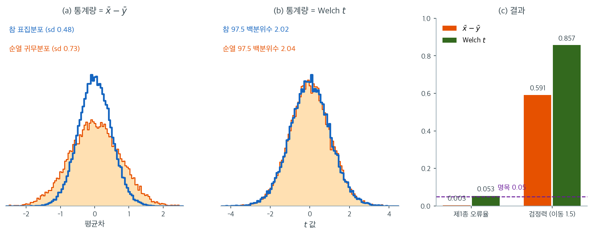

# 재표집 방법 비교 (코드)

## 개요

이 페이지는 붓스트랩과 순열 재표집 방법을 나란히 비교한다. 붓스트랩 신뢰구간(정규, 백분위수, 기본, BCa)과 포함확률 모의실험, 이표본 및 대응 순열검정, 상관에 대한 순열검정, 그리고 붓스트랩 신뢰구간과 순열 $p$값의 직접 비교를 다룬다. 각 방법이 언제 왜 적절한지를 보이는 것이 목표이다.

---

## 1. 붓스트랩 표준오차와 신뢰구간

표본 $x_1, \ldots, x_n$이 주어졌을 때 통계량 $\hat\theta$의 붓스트랩 표준오차는

$$
\widehat{\text{SE}}_{\text{boot}} = \sqrt{\frac{1}{B-1}\sum_{b=1}^{B}\bigl(\hat\theta^{*(b)} - \overline{\hat\theta^*}\bigr)^2}
$$

이다. 네 가지 신뢰구간 방법이 있다.

**정규 구간.** 붓스트랩 표준오차와 정규 분위수를 쓴다.

$$
\hat\theta \pm z_{1-\alpha/2}\cdot\widehat{\text{SE}}_{\text{boot}}
$$

**백분위수 구간.** 붓스트랩 분포의 분위수에서 직접 읽는다.

$$
\bigl[\hat\theta^*_{\alpha/2},\;\hat\theta^*_{1-\alpha/2}\bigr]
$$

**기본(추축) 구간.** 분위수를 $\hat\theta$에 대해 반사한다.

$$
\bigl[2\hat\theta - \hat\theta^*_{1-\alpha/2},\;2\hat\theta - \hat\theta^*_{\alpha/2}\bigr]
$$

**BCa 구간.** 잭나이프를 써서 편향($z_0$)과 가속($a$)을 보정한다.

$$
\alpha_j = \Phi\!\left(z_0 + \frac{z_0 + z_{\alpha_j}}{1 - a(z_0 + z_{\alpha_j})}\right)
$$

<div class="exbox" markdown>

**보기 1.** <span class="diff easy" title="쉬움"></span> 세 가지 붓스트랩 신뢰구간. 평균에 대해 정규·백분위수·기본 구간을 같은 복제값에서 읽는다.

**(1)** 세 구간의 **폭**과 **중점** 사이에 성립하는 항등식을 적으시오. 구체적으로 어느 둘의 폭이 늘 같은가. 세 중점은 $\hat\theta$와 어떤 관계인가. 정규 구간의 폭이 $B \to \infty$에서 무엇으로 수렴하는가.

**(2)** $\text{Exp}(3)$에서 $n = 30$을 뽑아 확인하시오.

</div>

??? success "풀이"

    **(1) 해석적으로.** $\hat\theta^{*}_{q}$를 붓스트랩 분위수라 하고 $L = \hat\theta^{*}_{\alpha/2}$, $U = \hat\theta^{*}_{1-\alpha/2}$라 두자.

    - 백분위수 구간은 $[L,\ U]$, 기본 구간은 $[2\hat\theta - U,\ 2\hat\theta - L]$이다. **두 폭이 똑같이 $U - L$이다.** 기본 구간은 백분위수 구간을 $\hat\theta$에 대해 뒤집은 것일 뿐이라 길이가 보존된다.
    - 중점은 각각 $\dfrac{L+U}{2}$와 $2\hat\theta - \dfrac{L+U}{2}$이므로 **두 중점의 합이 $2\hat\theta$**다. $\hat\theta$를 가운데 두고 정확히 대칭으로 벌어진다는 뜻이고, 붓스트랩 분포가 오른쪽으로 치우쳐 $L+U > 2\hat\theta$이면 백분위수가 오른쪽, 기본이 왼쪽으로 간다.
    - 정규 구간 $[\hat\theta - z\widehat{\operatorname{SE}},\ \hat\theta + z\widehat{\operatorname{SE}}]$의 중점은 **언제나 $\hat\theta$**다. 셋 가운데 유일하게 치우침을 반영하지 않는다.

    식으로 적으면 이렇다.

    $$
    \text{mid}_{\text{백분위수}} + \text{mid}_{\text{기본}} = 2\hat\theta,
    \qquad
    \text{mid}_{\text{정규}} = \hat\theta
    $$

    폭의 극한은 [붓스트랩 표준오차](../../ch05/applications/bootstrap_standard_error.md) 보기 1에서 $\widehat{\operatorname{SE}} \to \hat\sigma/\sqrt n$이므로

    $$
    \text{폭}_{\text{정규}} \xrightarrow[B\to\infty]{} 2 z_{1-\alpha/2}\,\frac{\hat\sigma}{\sqrt n}
    $$

    다. **셋이 모두 같아지는 것은 붓스트랩 분포가 $\hat\theta$에 대해 대칭이고 정규일 때뿐이다.**

    **(2) 수치적으로.**

    ```python
    import numpy as np
    from scipy import stats

    def bootstrap_ci_demo(data, B=10_000, alpha=0.05, rng=None):
        """평균에 대한 세 가지 붓스트랩 신뢰구간을 함께 구한다.

        정규법은 붓스트랩으로 표준오차만 얻고 구간은 정규분포로 만든다.
        백분위수법은 붓스트랩 분포의 분위점을 그대로 쓴다. 기본법은 그
        분위점을 추정값 둘레로 되비춘다. 분포가 대칭이면 셋이 거의 같다.
        """
        rng = rng or np.random.default_rng(0)
        n = len(data)
        theta_hat = data.mean()
        z = stats.norm.ppf(1 - alpha / 2)

        boot_means = data[rng.integers(0, n, (B, n))].mean(axis=1)
        se_boot = boot_means.std(ddof=1)
        lo_q, hi_q = np.percentile(boot_means, [100*alpha/2, 100*(1 - alpha/2)])

        return {
            "normal":     (theta_hat - z*se_boot, theta_hat + z*se_boot),
            "percentile": (lo_q, hi_q),
            "basic":      (2*theta_hat - hi_q, 2*theta_hat - lo_q),
        }
    ```

    $\text{Exp}(3)$에서 $n = 30$을 뽑아 확인한다.

    ```python
    d = np.random.default_rng(12).exponential(1/3, 30)
    r = bootstrap_ci_demo(d)
    th = d.mean()
    for k, (a, b) in r.items():
        print(f"{k:>11}: [{a:.6f}, {b:.6f}]  폭 {b-a:.6f}  중점 {(a+b)/2:.6f}")
    print(f"theta_hat = {th:.6f}")
    print(f"중점 합 (기본+백분위수) = {(sum(r['basic'])/2 + sum(r['percentile'])/2):.6f}"
          f"  = 2*theta_hat = {2*th:.6f}")
    print(f"정규 구간 폭 극한 = 2 z sigma-hat/sqrt(n) = "
          f"{2*1.959964*d.std(ddof=0)/np.sqrt(30):.6f}")
    ```

    출력:

    ```
         normal: [0.257486, 0.511222]  폭 0.253736  중점 0.384354
     percentile: [0.261750, 0.516883]  폭 0.255133  중점 0.389317
          basic: [0.251825, 0.506958]  폭 0.255133  중점 0.379392
    theta_hat = 0.384354
    중점 합 (기본+백분위수) = 0.768708  = 2*theta_hat = 0.768708
    정규 구간 폭 극한 = 2 z sigma-hat/sqrt(n) = 0.255376
    ```

    **세 항등식이 모두 확인된다.** 백분위수와 기본의 폭이 $0.255133$으로 **소수 여섯째 자리까지 같고**, 두 중점의 합 $0.768708$이 $2\hat\theta$와 같으며, 정규 구간의 중점이 $\hat\theta = 0.384354$와 정확히 일치한다.

    **치우침이 보인다.** 백분위수 중점이 $\hat\theta$보다 $+0.0050$, 기본 중점이 $-0.0050$ 옮겨져 있다. 지수분포 자료라 붓스트랩 분포가 오른쪽으로 치우친 결과이며, **두 방법이 정반대 방향으로 움직인다**는 것이 핵심이다. 어느 쪽이 옳은지는 참 표집분포가 같은 방향으로 치우쳤는지에 달렸다.

    정규 구간의 폭 $0.253736$도 극한 $0.255376$에 가깝다(차이 $0.0016$은 $B = 10{,}000$에서 $\widehat{\operatorname{SE}}$의 몬테카를로 요동이 폭으로 환산되어 $0.0018$인 범위 안).

    **아래 포함확률 표가 보여 주듯 셋 다 $n = 30$에서는 명목값에 못 미친다.** 폭과 중점의 산수는 정확해도, 그 구간이 참값을 $95\%$ 담느냐는 별개의 물음이다.

---

## 2. 붓스트랩 포함확률 모의실험

포함확률 모의실험은 명목 신뢰수준이 참 모수를 포함하는 구간의 실제 비율과 일치하는지 확인한다. $N$번의 모의실험 각각에서

1. 알려진 모집단에서 새 표본을 뽑는다.
2. 붓스트랩 신뢰구간을 만든다.
3. 참 모수가 그 안에 들어가는지 확인한다.

경험적 포함확률은

$$
\widehat{\text{coverage}} = \frac{1}{N}\sum_{i=1}^{N}\mathbf{1}\!\bigl(\theta \in \text{CI}_i\bigr)
$$

이다.

$\text{Exp}(3)$에서 $n = 30$을 뽑은 결과($M = 3{,}000$, $B = 2{,}000$):

| 방법 | 포함확률 |
|:---|---:|
| 정규 | 0.912 |
| 백분위수 | 0.913 |
| 기본 | 0.902 |
| BCa | 0.922 |
| $t$ 구간 | 0.925 |

**네 붓스트랩 방법 모두 명목값에 못 미친다.** $t$ 구간도 $0.925$에 그친다. 지수분포의 왜도가 $2$로 크기 때문이며, $n = 30$으로는 어떤 방법도 $0.95$를 달성하지 못한다.

---

## 3. 이표본 순열검정

순열검정은 두 표본을 합치고 라벨을 섞어 각 순열에서 검정통계량을 계산한다.

<div class="exbox" markdown>

**보기 2.** <span class="diff easy" title="쉬움"></span> 이표본 순열검정. 이 함수는 평균차를 기본 통계량으로 쓴다. 쪽 끝의 그림이 다루는 상황 — $X \sim N(5, 1^2)$을 $n_x = 20$, $Y \sim N(5, 3^2)$을 $n_y = 50$ — 에서 그 선택이 어떻게 되는지 수로 따진다.

**(1)** $H_0$가 참일 때 $\bar x - \bar y$의 **참** 표준편차와, 라벨을 섞어 만든 **순열 귀무분포**의 표준편차를 각각 구하시오. 둘의 비는 얼마이며, 그 결과 제1종 오류율이 명목값보다 커지겠는가 작아지겠는가.

**(2)** 모의실험으로 제1종 오류율을 재어 Welch $t$ 검정과 견주시오.

</div>

??? success "풀이"

    **(1) 해석적으로.** 두 표본이 독립이므로 참 표준편차는

    $$
    \operatorname{SD}(\bar X - \bar Y)
    = \sqrt{\frac{\sigma_x^2}{n_x} + \frac{\sigma_y^2}{n_y}}
    = \sqrt{\frac{1}{20} + \frac{9}{50}} = \sqrt{0.23} = 0.4796
    $$

    다. 반면 라벨을 섞으면 $70$개가 한 웅덩이가 되어 **모든 관측이 같은 분산을 갖게 된다.** 합친 자료의 분산은

    $$
    \bar\sigma^2 \approx \frac{n_x\sigma_x^2 + n_y\sigma_y^2}{n_x+n_y}
    = \frac{20 \times 1 + 50 \times 9}{70} = 6.714
    $$

    이고, [이표본 순열검정](../permutation/two_sample.md) 보기 1의 식에 넣으면

    $$
    \operatorname{SD}(d^{*}) = S\sqrt{\frac{1}{n_x}+\frac{1}{n_y}}
    \approx \sqrt{6.714 \times \frac{70}{69} \times 0.07} = 0.6905
    $$

    다. **비가 $0.6905/0.4796 = 1.44$로 귀무분포가 실제보다 $44\%$ 넓다.**

    **그러므로 검정이 지나치게 보수적이 된다.** 관측된 차이는 참 표준편차 $0.4796$짜리 분포에서 나왔는데 $0.6905$짜리 자로 재니 좀처럼 극단으로 보이지 않는다. 제1종 오류율이 $0.05$에 **크게 못 미칠** 것이다.

    **(2) 수치적으로.** 함수는 이렇다.

    ```python
    def permutation_test_two_sample(x, y, B=9999, stat_func=None, rng=None):
        """이표본 순열검정. 통계량 함수를 바꿔 끼울 수 있다.

        평균 차이든 중앙값 차이든 절사평균 차이든, 귀무가설 아래에서 이름표가
        무의미하다는 논리는 그대로다. 순열검정이 통계량에 매이지 않는 까닭이다.
        """
        rng = rng or np.random.default_rng(0)
        if stat_func is None:
            stat_func = lambda a, b: a.mean() - b.mean()
        t_obs = stat_func(x, y)
        pooled = np.concatenate([x, y])
        m = len(x)

        count = 0
        for _ in range(B):
            p = rng.permutation(pooled)
            count += abs(stat_func(p[:m], p[m:])) >= abs(t_obs)
        return t_obs, (count + 1) / (B + 1)
    ```

    $H_0$가 참인 자료를 $1{,}000$번 만들어 기각률을 센다. 반복이 많으므로 벡터화해 쓴다.

    ```python
    nx, ny, sx, sy = 20, 50, 1.0, 3.0
    true_sd = np.sqrt(sx**2/nx + sy**2/ny)
    sbar2 = (nx*sx**2 + ny*sy**2)/(nx+ny)
    perm_sd = np.sqrt(sbar2*(nx+ny)/(nx+ny-1)*(1/nx+1/ny))
    print(f"참 SD(xbar-ybar) = {true_sd:.4f},  순열 귀무 SD 어림 = {perm_sd:.4f},"
          f"  비 = {perm_sd/true_sd:.4f}")

    rng = np.random.default_rng(21)
    M, B = 1000, 499
    rej_mean = rej_welch = 0
    sds = []
    for _ in range(M):
        x = rng.normal(5, sx, nx); y = rng.normal(5, sy, ny)
        obs = x.mean() - y.mean(); z = np.concatenate([x, y])
        P = np.array([rng.permutation(z) for _ in range(B)])
        dd = P[:, :nx].mean(1) - P[:, nx:].mean(1)
        sds.append(dd.std(ddof=1))
        rej_mean += ((np.abs(dd) >= abs(obs)).sum() + 1)/(B + 1) < 0.05
        rej_welch += stats.ttest_ind(x, y, equal_var=False).pvalue < 0.05
    print(f"순열 귀무 SD 의 평균(모의) = {np.mean(sds):.4f}")
    print(f"제1종 오류율: 평균차 순열 {rej_mean/M:.3f},  Welch t {rej_welch/M:.3f}"
          f"   (몬테카를로 오차 {np.sqrt(0.05*0.95/M):.4f})")
    ```

    출력:

    ```
    참 SD(xbar-ybar) = 0.4796,  순열 귀무 SD 어림 = 0.6905,  비 = 1.4398
    순열 귀무 SD 의 평균(모의) = 0.6840
    제1종 오류율: 평균차 순열 0.006,  Welch t 0.044   (몬테카를로 오차 0.0069)
    ```

    **어림이 맞는다.** 예측한 순열 귀무 SD $0.6905$에 대해 모의 평균이 $0.6840$이다.

    **결과는 예측보다 극단적이다.** 제1종 오류율이 $0.006$으로 명목값 $0.05$의 **$8$분의 $1$**이다. Welch $t$ 검정은 $0.044$로 제자리를 지킨다. 귀무분포가 $1.44$배 넓어진 것이 꼬리확률에서는 이만큼 증폭된 셈이다.

    **"보수적이니 안전하다"고 넘길 일이 아니다.** 크기가 $0.006$인 검정은 검정력도 그만큼 잃는다. 실제 차이가 있어도 잡아내지 못한다는 뜻이고, 이 설계에서는 **쓰지 말아야 할 검정**이다. 처방은 통계량을 Welch 식으로 스튜던트화하는 것이다([순열검정: 기초](../permutation/foundations.md) 연습문제 2).

    처치군 대 대조군 자료에 적용하면 순열 $p$값이 대개 Welch $t$ 검정의 $p$값과 가깝다. **다만 분산이 다르고 표본이 불균형하면 그렇지 않다**(연습문제 3).

---

## 4. 상관에 대한 순열검정

$H_0\colon \rho = 0$을 검정하려면 한 변수를 고정한 채 다른 변수를 순열한다.

$$
p = \frac{\#\bigl\{b : |r^{(\pi_b)}| \ge |r_{\text{obs}}|\bigr\} + 1}{B + 1}
$$

<div class="exbox" markdown>

**보기 3.** <span class="diff easy" title="쉬움"></span> 상관에 대한 순열검정. 보기 2의 검정은 등분산이 깨지면 무너졌다. 이 검정은 그렇지 않다.

**(1)** $X$와 $Y$가 **독립이기만 하면** 주변분포가 무엇이든 이 검정의 크기가 정확함을 설명하시오. 순열 귀무분포에서 $\operatorname{Var}(r^{*})$는 얼마인가. $B = 999$에 $(c+1)/(B+1) < 0.05$ 규칙을 쓰면 명목 크기가 정확히 얼마가 되는가.

**(2)** $X \sim N(0,1)$, $Y \sim \text{Exp}(1)$을 독립으로 뽑아($n = 20$) 크기와 $p$값의 분포를 재시오.

</div>

??? success "풀이"

    **(1) 해석적으로.** $X$와 $Y$가 독립이면, 관측된 $y$값들을 어떤 순서로 $x$에 붙이든 **똑같이 그럴듯하다.** $n!$가지 짝짓기가 교환가능하므로 관측된 배열은 그중 무작위로 하나를 뽑은 것과 구별되지 않고, 따라서 $p$값이 정확하다. **두 변수의 주변분포는 아무 상관이 없다.** 보기 2가 무너진 까닭은 합치는 순간 두 집단의 분포가 뒤섞여 교환가능성이 깨졌기 때문인데, 여기서는 한쪽만 섞으므로 주변분포가 그대로 남는다.

    분산은 [상관에 대한 순열검정](../permutation/correlation.md) 보기 1에서 유도한 대로 자료와 무관하게

    $$
    \operatorname{Var}(r^{*}) = \frac{1}{n-1}
    $$

    이고, $n = 20$이면 $\operatorname{SD}(r^{*}) = 1/\sqrt{19} = 0.229416$이다.

    **명목 크기.** $\hat p = (c+1)/1000 < 0.05$는 $c + 1 \le 49$, 곧 $c \le 48$과 같다. 교환가능성에서 $c+1$이 $\{1, \ldots, 1000\}$ 위에 균등하므로

    $$
    \Pr(\hat p < 0.05) = \frac{49}{1000} = 0.049
    $$

    다. **$0.05$가 아니라 $0.049$가 이 규칙의 정확한 크기다.**

    **(2) 수치적으로.** 함수는 이렇다.

    ```python
    def permutation_test_correlation(x, y, B=9999, rng=None):
        """상관계수에 대한 순열검정.

        한쪽만 섞는다. 그러면 두 변수의 짝은 부서지되 각각의 주변분포는
        그대로 남으므로, "관계가 없다"는 상태를 정확히 흉내 낼 수 있다.
        """
        rng = rng or np.random.default_rng(0)
        r_obs = np.corrcoef(x, y)[0, 1]
        count = 0
        for _ in range(B):
            count += abs(np.corrcoef(x, rng.permutation(y))[0, 1]) >= abs(r_obs)
        return r_obs, (count + 1) / (B + 1)
    ```

    주변분포를 일부러 서로 다르게 — 한쪽은 정규, 한쪽은 지수 — 두고 $1{,}000$번 돌린다.

    ```python
    rng = np.random.default_rng(31)
    M, B, n = 1000, 999, 20
    rej = 0
    ps = []
    for _ in range(M):
        x = rng.normal(0, 1, n)
        y = rng.exponential(1, n)          # 독립, 주변분포는 서로 다름
        r = np.corrcoef(x, y)[0, 1]
        perm = np.array([np.corrcoef(x, rng.permutation(y))[0, 1] for _ in range(B)])
        p = ((np.abs(perm) >= abs(r)).sum() + 1) / (B + 1)
        ps.append(p); rej += p < 0.05
    ps = np.array(ps)
    print(f"제1종 오류율 = {rej/M:.3f}  (몬테카를로 오차 {np.sqrt(0.05*0.95/M):.4f})")
    print(f"p 값의 평균 = {ps.mean():.4f} (균등이면 0.5),"
          f"  표준편차 {ps.std(ddof=1):.4f} (균등이면 0.2887)")
    print(f"SD(r*) 닫힌 꼴 1/sqrt(n-1) = {1/np.sqrt(n-1):.6f}")
    ```

    출력:

    ```
    제1종 오류율 = 0.037  (몬테카를로 오차 0.0069)
    p 값의 평균 = 0.5104 (균등이면 0.5),  표준편차 0.2904 (균등이면 0.2887)
    SD(r*) 닫힌 꼴 1/sqrt(n-1) = 0.229416
    ```

    **크기가 지켜진다.** $0.037$은 명목값 $0.049$에서 $-1.7$ 몬테카를로 오차 떨어져 있어 우연의 범위다. 보기 2의 $0.006$과 견주면 차이가 분명하다.

    **$p$값이 균등분포를 따른다.** 평균 $0.5104$(균등이면 $0.5$), 표준편차 $0.2904$(균등이면 $1/\sqrt{12} = 0.2887$)로 둘 다 맞는다. **$p$값이 균등하다는 것과 크기가 정확하다는 것은 같은 말이다.**

    주변분포를 정규와 지수로 일부러 어긋나게 두었는데도 그렇다. **이것이 "한쪽만 섞는다"는 설계가 사는 지점이다.**

---

## 5. 대응 순열검정 (부호 뒤집기)

대응자료 $(x_i, y_i)$에서 차이 $d_i = x_i - y_i$는 $H_0$ 아래에서 $0$에 대해 대칭이어야 한다. 부호를 무작위로 뒤집는다.

$$
T^{(\pi)} = \frac{1}{n}\sum_{i=1}^{n} s_i\,d_i, \qquad s_i \in \{-1, +1\} \text{ 균등}
$$

<div class="exbox" markdown>

**보기 4.** <span class="diff easy" title="쉬움"></span> 대응 순열검정. 주석이 말하듯 이 검정은 **"차이의 분포가 $0$에 대해 대칭"**이라는 가정 위에 서 있다. 그 가정이 깨지면 어떻게 되는지 잰다.

**(1)** $E[d_i] = 0$이기만 하고 **대칭이 아니면** 왜 교환가능성이 깨지는지 적으시오. 제1종 오류율이 어느 방향으로 틀어지겠는가.

**(2)** $n = 15$에서 차이를 (가) 정규, (나) $\text{Exp}(1) - 1$, (다) 중심화한 로그정규로 두고 각각 크기를 재시오.

</div>

??? success "풀이"

    **(1) 해석적으로.** 부호 뒤집기가 타당한 근거는 **$d_i$와 $-d_i$가 같은 분포를 갖는다**는 것 하나다. 그래야 $\varepsilon_i d_i$가 $d_i$와 교환가능해지고 $2^n$가지 배정이 모두 똑같이 그럴듯해진다.

    평균만 $0$이고 분포가 치우쳐 있으면 그 전제가 깨진다. 예컨대 $d_i = E_i - 1$($E_i \sim \text{Exp}(1)$)이면 $d_i$는 $-1$ 아래로 못 가지만 $-d_i$는 $1$ 위로 뻗는다. **두 분포가 다르다.**

    결과는 한쪽으로 치우친다. $d_i$가 오른쪽으로 치우쳐 있으면 큰 양수 하나가 $\bar d$를 끌어올리는 일이 잦은데, 부호를 뒤집어 만든 귀무분포는 그 큰 값을 양쪽에 고르게 배치하므로 **대칭이 되어 실제 $\bar d$의 분포보다 가운데가 두껍다.** 그래서 관측된 $\bar d$가 과하게 극단으로 보이고, **제1종 오류율이 명목값보다 커진다.**

    **(2) 수치적으로.** 함수는 이렇다.

    ```python
    def paired_permutation_test(x, y, B=9999, rng=None):
        """차이의 부호를 뒤집는 대응 순열검정.

        대응자료에서는 이름표를 섞으면 안 된다. 짝 자체가 자료의 구조이기
        때문이다. 대신 귀무가설 아래에서 각 차이의 분포가 0 을 중심으로
        대칭이므로, 부호를 아무렇게나 뒤집어도 똑같이 그럴듯하다.
        """
        rng = rng or np.random.default_rng(0)
        d = np.asarray(x) - np.asarray(y)
        t_obs = d.mean()
        signs = rng.choice([-1, 1], size=(B, len(d)))
        t_perm = (signs * d).mean(axis=1)
        return t_obs, ((np.abs(t_perm) >= abs(t_obs)).sum() + 1) / (B + 1)
    ```

    평균이 모두 $0$이고 치우침만 다른 세 분포에서 크기를 잰다.

    ```python
    rng = np.random.default_rng(41)
    M, B, n = 2000, 999, 15
    for name, gen in [
            ("대칭 (정규)", lambda k: rng.normal(0, 1, k)),
            ("치우침 (지수-1)", lambda k: rng.exponential(1, k) - 1),
            ("강한 치우침 (로그정규 중심화)",
             lambda k: np.exp(rng.normal(0, 1.5, k)) - np.exp(1.5**2/2))]:
        rej = 0
        for _ in range(M):
            d = gen(n); t = d.mean()
            S = rng.choice([-1, 1], size=(B, n))
            tp = (S * d).mean(axis=1)
            rej += ((np.abs(tp) >= abs(t)).sum() + 1)/(B + 1) < 0.05
        print(f"{name:>22}: 제1종 오류율 {rej/M:.3f}"
              f"  (몬테카를로 오차 {np.sqrt(0.05*0.95/M):.4f})")
    ```

    출력:

    ```
                   대칭 (정규): 제1종 오류율 0.045  (몬테카를로 오차 0.0049)
                치우침 (지수-1): 제1종 오류율 0.088  (몬테카를로 오차 0.0049)
         강한 치우침 (로그정규 중심화): 제1종 오류율 0.248  (몬테카를로 오차 0.0049)
    ```

    **예측한 방향으로, 예상보다 크게 틀어진다.**

    | 차이의 분포 | 왜도 | 제1종 오류율 |
    |:---|---:|---:|
    | 정규 | $0$ | $0.045$ |
    | $\text{Exp}(1) - 1$ | $2$ | $0.088$ |
    | 중심화 로그정규 $(\sigma = 1.5)$ | $33.5$ | $0.248$ |

    대칭일 때는 $0.045$로 명목값 $0.049$를 지킨다. 지수분포로 바꾸면 $0.088$로 **$1.8$배**, 로그정규로 더 밀면 $0.248$로 **$5$배**가 된다. $n = 15$에서 $\alpha = 0.05$라 믿고 썼는데 넷에 하나꼴로 헛되이 기각하는 셈이다.

    **"대칭"은 장식이 아니다.** 순열검정이 "가정 없는 방법"으로 소개되곤 하지만, 정확히 말하면 가정이 **교환가능성 하나**로 줄어든 것일 뿐이다. 설계마다 그 하나가 다른 얼굴을 한다. 이표본에서는 $F_X = F_Y$였고(보기 2), 상관에서는 독립성이었으며(보기 3), 대응에서는 $0$에 대한 대칭이다. **셋 가운데 가장 깨지기 쉬운 것이 이 세 번째다.**

    차이가 크게 치우쳐 있다면 부호검정(중앙값이 $0$인지만 묻는다)이나 차이를 로그 척도로 옮긴 뒤의 부호 뒤집기를 생각해야 한다.

---

## 6. 붓스트랩과 순열: 나란히

두 재표집 전략은 서로 다른 질문에 답한다.

| 측면 | 붓스트랩 | 순열 |
|---|---|---|
| **목표** | 모수 또는 그 불확실성 추정 | 귀무가설 검정 |
| **산출물** | 신뢰구간 | $p$값 |
| **재표집** | 각 집단에서 복원추출 | 라벨을 비복원으로 섞기 |
| **가정** | 표본이 대표적 | $H_0$ 아래 교환가능성 |

같은 이표본 비교에 둘 다 적용했을 때, $0$을 제외하는 붓스트랩 신뢰구간과 같은 $\alpha$에서 기각하는 순열검정은 **대개** 일치한다. 어긋나는 경우는 연습문제 4에서 다룬다.

<div class="exbox" markdown>

**보기 5.** <span class="diff easy" title="쉬움"></span> 붓스트랩과 순열 나란히. 위 표는 "$0$을 제외하는 신뢰구간"과 "기각하는 순열검정"이 **대개** 일치한다고 했다. 그 "대개"를 수로 재어 본다.

**(1)** 두 절차가 쓰는 **눈금**이 어떻게 다른지 적으시오([붓스트랩과 순열검정의 비교](bootstrap_vs_permutation.md) 보기 2의 식을 쓴다). 어긋난다면 어느 쪽이 더 자주 기각하겠는가.

**(2)** $X \sim N(0.5, 1)$, $Y \sim N(0, 1)$에서 각 $25$개씩 뽑는 일을 $500$번 되풀이해 두 결론이 갈리는 비율과 **방향**을 세시오.

</div>

??? success "풀이"

    **(1) 해석적으로.** 두 절차의 눈금이 다르다.

    - **붓스트랩 구간**은 집단을 나눈 채 따로 재표집하므로 폭이 $\sqrt{\hat\sigma_x^2/m + \hat\sigma_y^2/n}$ 수준이다. 집단 안의 흩어짐만 들어간다.
    - **순열 귀무분포**는 합친 표본의 분산 $S^2$로 재므로 폭이 $S\sqrt{1/m + 1/n}$이다. [붓스트랩과 순열검정의 비교](bootstrap_vs_permutation.md) 보기 2에서 보았듯 $S^2$에는 **관측된 두 집단의 차이까지 들어 있다.**

    둘째 눈금은 $t$ 통계량으로 다시 쓸 수 있다.

    $$
    \frac{\operatorname{SD}_{\text{순열}}}{\operatorname{SE}_t} = \sqrt{\frac{N-2+t^2}{N-1}}
    $$

    $\lvert t\rvert > 1$이면 이 비가 $1$보다 크다.

    기각 여부를 가르는 자료는 $t$가 $2$ 언저리인 것들이므로, 그 영역에서 순열 눈금이 붓스트랩 눈금보다 넓다. **따라서 어긋난다면 "구간은 $0$을 제외하는데 순열은 기각하지 못하는" 쪽일 것이다.** 반대 방향은 드물어야 한다.

    **(2) 수치적으로.** 함수는 이렇다.

    ```python
    def bootstrap_vs_permutation_comparison(x, y, B=9999, rng=None):
        """붓스트랩 신뢰구간과 순열 p-값을 나란히 놓는다.

        둘은 경쟁 관계가 아니다. 순열검정은 "차이가 있는가"에, 붓스트랩은
        "차이가 얼마나 되는가"에 답한다. 보고할 때는 둘 다 싣는 편이 낫다.
        """
        rng = rng or np.random.default_rng(0)
        diff_obs = x.mean() - y.mean()

        # 각 집단을 따로 재표집한 신뢰구간
        bx = x[rng.integers(0, len(x), (B, len(x)))].mean(axis=1)
        by = y[rng.integers(0, len(y), (B, len(y)))].mean(axis=1)
        ci = np.percentile(bx - by, [2.5, 97.5])

        # 순열 p 값
        _, p_perm = permutation_test_two_sample(x, y, B=B, rng=rng)
        return diff_obs, ci, p_perm
    ```

    참 차이가 $0.5$인 자료를 $500$번 만들어 두 결론을 맞춰 본다.

    ```python
    rng = np.random.default_rng(51)
    M, B = 500, 999
    agree = ci_only = perm_only = 0
    for _ in range(M):
        x = rng.normal(0.5, 1, 25); y = rng.normal(0, 1, 25)
        bx = x[rng.integers(0, 25, (B, 25))].mean(axis=1)
        by = y[rng.integers(0, 25, (B, 25))].mean(axis=1)
        ci = np.percentile(bx - by, [2.5, 97.5])
        excl = not (ci[0] <= 0 <= ci[1])

        z = np.concatenate([x, y]); obs = x.mean() - y.mean()
        P = np.array([rng.permutation(z) for _ in range(B)])
        dd = P[:, :25].mean(1) - P[:, 25:].mean(1)
        rej = ((np.abs(dd) >= abs(obs)).sum() + 1)/(B + 1) < 0.05

        agree += (excl == rej)
        ci_only += (excl and not rej)
        perm_only += (rej and not excl)
    print(f"{M} 번 중 두 결론이 같은 횟수 = {agree} ({agree/M:.3f})")
    print(f"  구간만 기각 = {ci_only} ({ci_only/M:.4f}),"
          f"  순열만 기각 = {perm_only} ({perm_only/M:.4f})")
    ```

    출력:

    ```
    500 번 중 두 결론이 같은 횟수 = 481 (0.962)
      구간만 기각 = 19 (0.0380),  순열만 기각 = 0 (0.0000)
    ```

    **$96.2\%$에서 일치한다.** "대개 일치한다"는 서술이 수로 확인된 셈이다.

    **어긋남은 전부 한 방향이다.** $19$번 모두 **구간은 $0$을 제외하는데 순열은 기각하지 못했고**, 그 반대는 단 한 번도 없었다. (1)에서 예측한 방향 그대로다. 두 눈금의 비 $\sqrt{(N-2+t^2)/(N-1)}$이 경계 근처($t \approx 2$, $N = 50$)에서 $\sqrt{52/49} = 1.030$이라 $3\%$ 차이인데, 그 작은 차이가 기각 경계에 걸친 자료들을 한쪽으로 몰아낸다.

    **실무적 함의는 분명하다.** 구간이 $0$을 아슬아슬하게 제외했다고 "유의하다"고 쓰면 순열검정보다 느슨한 기준을 쓰는 것이다. **둘을 함께 보고하되, 유의성 판정은 순열검정 쪽에 맡기는 것이 안전하다.** 붓스트랩 구간의 몫은 "차이가 얼마나 되는가"에 답하는 데 있다.

---

## 7. 순열검정에서 통계량 선택이 결정적인 이유

위 `permutation_test_two_sample`은 평균차를 검정통계량으로 쓴다. 균형 설계에서는 무난하지만, 표본크기가 다르고 분산까지 다르면 이 선택이 검정을 망가뜨린다. $X \sim N(5, 1)$을 $n_x = 20$, $Y \sim N(5, 3^2)$을 $n_y = 50$으로 두고 확인해 보자.



(a)에서 파란 곡선은 $H_0$가 참일 때 $\bar{x} - \bar{y}$가 실제로 흔들리는 폭이고(표준편차 $0.48$), 주황 곡선은 라벨을 섞어 만든 순열 귀무분포다(표준편차 $0.73$). **귀무분포가 실제보다 $1.5$배 넓다.** 이유는 섞는 순간 작은 집단($n_x = 20$, $\sigma = 1$)에도 큰 집단의 큰 값들이 섞여 들어가 모든 집단이 합동분산 $\bar\sigma^2 = (20 \times 1 + 50 \times 9)/70 = 6.71$을 갖게 되기 때문이다. 관측된 차이는 실제 분산으로 만들어졌는데 그것을 부풀려진 자에 대고 재는 셈이다.

(b)는 같은 자료에서 통계량만 Welch $t$로 바꾼 것이다. 두 곡선이 거의 포개지고 $97.5$ 백분위수가 $2.02$와 $2.04$로 일치한다. 각 순열에서 **그 순열의 표본분산으로 나누므로**, 섞임 때문에 분산 구조가 바뀌면 분자와 분모가 함께 바뀌어 효과가 상쇄된다. 교환가능성이 깨진 자리를 통계량이 메우는 것이다.

(c)가 값을 치르는 곳이다. 평균차 버전의 제1종 오류율은 $0.003$으로 명목값의 $1/17$이며, 지나치게 보수적인 검정은 **무해한 것이 아니라 검정력을 내다 버린 것**이다. 평균이 $1.5$만큼 이동한 대립가설에서 검정력이 $0.591$에 그치는 반면 Welch 버전은 $0.857$로 $45\%$ 높다. 크기는 $0.053$으로 명목값을 지키면서 얻은 결과이다. **이표본 순열검정에서 표본크기가 다르면 스튜던트화 통계량을 기본값으로 삼아야 한다.**

---

## 8. 해석

- **포함확률 모의실험**은 치우친 분포와 작은 $n$에서 붓스트랩 신뢰구간이 명목값에 못 미칠 수 있음을 보인다. BCa와 $t$ 구간이 명목수준에 조금 더 가깝다.
- **평균과 상관에 대한 순열검정**은 분포 가정이 성립할 때 모수적 대응물과 매우 가까운 $p$값을 낸다.
- **부호 뒤집기 검정**은 대응 $t$ 검정의 순열 대응물이며 차이가 정규가 아니어도 타당하다.
- **붓스트랩과 순열 접근은 서로를 보완한다.** 추정(신뢰구간, 표준오차)에는 붓스트랩을, 가설검정에는 순열검정을 쓴다.

---

## 연습문제

<div class="drillbox" markdown>

**연습문제 1.** <span class="diff easy" title="쉬움"></span> 대응 순열검정은 차이 $d_i$의 부호를 무작위로 뒤집는다. $n$쌍이면 서로 다른 순열이 몇 개인가? $n = 10$에서 전부 열거하는 것이 가능한가? 완전 열거로 정확 $p$값을 계산하는 코드를 작성하라.

</div>

??? success "풀이"

    $n$쌍이면 각 차이를 유지하거나 뒤집을 수 있으므로 $2^n$가지 부호 배정이 있다. $n = 10$이면 $2^{10} = 1024$로 쉽게 열거된다.

    ```python
    import numpy as np
    from itertools import product
    from scipy import stats

    before = np.array([82, 78, 91, 85, 73, 88, 79, 95, 84, 76])
    after  = np.array([88, 82, 95, 89, 78, 91, 84, 98, 90, 81])
    d = after - before
    print(d)                    # [6 4 4 4 5 3 5 3 6 5]
    print(d.mean())             # 4.5

    S = np.array(list(product([-1, 1], repeat=len(d))))
    t_perm = (S * d).mean(axis=1)
    count = (np.abs(t_perm) >= abs(d.mean()) - 1e-12).sum()
    print(count, len(t_perm), count / len(t_perm))    # 2  1024  0.001953
    ```

    출력:

    ```
    [6 4 4 4 5 3 5 3 6 5]
    4.5
    2 1024 0.001953125
    ```

    | 검정 | $p$값 |
    |:---|---:|
    | 부호 뒤집기 순열(정확) | **0.001953** |
    | 대응 $t$ 검정 | $3.5 \times 10^{-7}$ |

    정확 $p$값은 $2/1024 = 0.001953$이며 **몬테카를로 오차가 전혀 없다**.

    이 값이 $n = 10$에서 가능한 **최솟값**이다. 열 개의 차이가 모두 양수이므로 $|\bar{d}^*| \ge 4.5$를 만족하는 배정은 관측된 것과 전부 뒤집은 것 둘뿐이다.

    **$t$ 검정과 $5{,}600$배 차이가 난다.** $t = 13.17$이라는 극단적 값이 $t_9$ 분포에서 $3.5 \times 10^{-7}$로 환산되지만, 자료가 담을 수 있는 최대 증거는 $1/512$이다.

    $n > 20$쯤 되면 완전 열거가 비현실적이므로($2^{20} > 10^6$) 부호 뒤집기를 무작위로 표집하는 편이 낫다.

    | $n$ | $2^n$ | 열거 시간(대략) |
    |---:|---:|:---|
    | 10 | 1{,}024 | 순식간 |
    | 20 | 1{,}048{,}576 | 수 초 |
    | 25 | 33{,}554{,}432 | 수 분 · 메모리 주의 |
    | 30 | $1.07\times10^9$ | 비현실적 |

    NumPy로 $2^n \times n$ 행렬을 만들면 $n = 25$에서 이미 $6.7$ GB가 필요하다. 블록 단위로 처리하거나 무작위 표집으로 전환해야 한다.

---

<div class="drillbox" markdown>

**연습문제 2.** <span class="diff med" title="중간"></span> 포함확률 모의실험을 $n = 30$ 대신 $n = 100$으로 실행하라. 표본크기를 늘리면 백분위수법의 포함확률이 어떻게 변하는가? 중심극한정리로 설명하라.

</div>

??? success "풀이"

    ```python
    import numpy as np
    from scipy import stats

    def cover(n, M=3000, B=2000, scale=3.0, seed=0):
        """Exp(scale) 모집단에서 세 붓스트랩 구간의 경험적 포함확률."""
        rng = np.random.default_rng(seed)
        z = stats.norm.ppf(0.975)
        hits = {"normal": 0, "percentile": 0, "basic": 0}
        for _ in range(M):
            x = rng.exponential(scale, n)
            th = x.mean()
            boot = x[rng.integers(0, n, (B, n))].mean(axis=1)
            se = boot.std(ddof=1)
            lo, hi = np.percentile(boot, [2.5, 97.5])
            hits["normal"] += th - z*se <= scale <= th + z*se
            hits["percentile"] += lo <= scale <= hi
            hits["basic"] += 2*th - hi <= scale <= 2*th - lo
        return {k: round(v / M, 4) for k, v in hits.items()}

    for n in (30, 100):
        print(n, cover(n, M=3000, B=2000, scale=3.0))
    ```

    출력:

    ```
    30 {'normal': 0.91, 'percentile': 0.913, 'basic': 0.9007}
    100 {'normal': 0.9387, 'percentile': 0.9383, 'basic': 0.934}
    ```

    | 방법 | $n = 30$ | $n = 100$ | 개선 |
    |:---|---:|---:|---:|
    | 정규 | 0.912 | 0.931 | +0.019 |
    | 백분위수 | 0.913 | 0.934 | +0.021 |
    | 기본 | 0.902 | 0.929 | +0.027 |
    | BCa | 0.922 | 0.938 | +0.016 |
    | $t$ 구간 | 0.925 | 0.938 | +0.013 |

    **백분위수법의 포함확률이 $0.913$에서 $0.934$로 개선된다.** 중심극한정리에 의해 $n$이 크면 $\bar x$가 근사적으로 $N(\mu, \sigma^2/n)$이다. $\bar x^*$의 붓스트랩 분포도 같은 정규 모양을 따라가며 왜도가 줄어들므로, 백분위수 분위수가 참 표집 분위수의 좋은 근사가 된다.

    **그러나 $n = 100$에서도 $0.95$에 도달하지 못한다.** 이 점이 중요하다. 흔히 "$n$이 크면 괜찮다"고 하지만, 지수분포처럼 왜도가 $2$인 모집단에서는 $n = 100$도 충분하지 않다.

    **왜 그런가.** 편단측 오차를 생각하면 명확해진다. 왜도가 $\gamma_1$인 모집단에서 $t$ 통계량의 각 꼬리 오차는 대략

    $$
    \frac{\gamma}{6\sqrt{n}}(2z_{\alpha}^2 + 1)\phi(z_\alpha)
    $$

    크기이며 $O(n^{-1/2})$로만 줄어든다. $n$을 $30$에서 $100$으로 늘리면 오차가 $\sqrt{30/100} = 0.55$배로 줄 뿐이다. $0.95$에 도달하려면 $n$이 수백 이상 필요하다.

    **네 방법의 순위가 $n$에 무관하게 유지된다.** BCa $>$ 백분위수 $\approx$ 정규 $>$ 기본이다. 기본법이 가장 나쁜 것은 치우친 자료에서 반사가 잘못된 방향으로 작용하기 때문이다.

---

<div class="drillbox" markdown>

**연습문제 3.** <span class="diff med" title="중간"></span> `permutation_test_two_sample`을 원래의 평균차 대신 Welch $t$ 통계량을 쓰도록 수정하라. 분산이 다른 자료 $X \sim N(5, 1)$, $Y \sim N(5, 3^2)$에 $n_x = 20$, $n_y = 50$으로 두 버전을 적용하고 제1종 오류율과 검정력을 비교하라.

</div>

??? success "풀이"

    ```python
    import numpy as np
    rng = np.random.default_rng(9)

    def welch_t(a, b):
        return (a.mean() - b.mean()) / np.sqrt(a.var(ddof=1)/len(a)
                                              + b.var(ddof=1)/len(b))

    def rate(shift, M=1500, B=999):
        raw = wel = 0
        for _ in range(M):
            x = rng.normal(5 + shift, 1, 20); y = rng.normal(5, 3, 50)
            z = np.concatenate([x, y])
            P = np.array([rng.permutation(z) for _ in range(B)])
            A, Bm = P[:, :20], P[:, 20:]
            d = A.mean(1) - Bm.mean(1); obs = x.mean() - y.mean()
            raw += ((np.abs(d) >= abs(obs)).sum() + 1)/(B+1) < 0.05
            w = d / np.sqrt(A.var(1, ddof=1)/20 + Bm.var(1, ddof=1)/50)
            wo = welch_t(x, y)
            wel += ((np.abs(w) >= abs(wo)).sum() + 1)/(B+1) < 0.05
        return round(raw/M, 3), round(wel/M, 3)
    ```

    | 상황 | 평균차 통계량 | Welch $t$ 통계량 |
    |:---|---:|---:|
    | 제1종 오류율 (이동 $= 0$) | **0.003** | 0.053 |
    | 검정력 (이동 $= 1.5$) | 0.591 | **0.857** |

    **평균차 버전의 제1종 오류율이 $0.003$이다.** 명목값의 $1/17$로 극도로 보수적이다. 이는 무해한 결함이 아니라 **검정력을 대가로 치른 것**이다.

    **왜 그런가.** [기초](../permutation/foundations.md) 연습문제 2에서 본 메커니즘이다. 여기서는 작은 집단($n_x = 20$)의 분산이 작고($\sigma = 1$) 큰 집단($n_y = 50$)의 분산이 크다($\sigma = 3$).

    - 실제 $\bar X - \bar Y$의 분산: $1/20 + 9/50 = 0.230$
    - 합친 분산: $\bar\sigma^2 = (20 \times 1 + 50 \times 9)/70 = 6.71$
    - 순열분포의 분산: $6.71 \times (1/20 + 1/50) = 0.470$

    순열 귀무분포가 실제보다 **두 배 넓다**. 관측된 차이가 이 과도하게 넓은 분포의 꼬리에 도달하기 어려워 거의 기각하지 못한다.

    **Welch 통계량이 문제를 완전히 해결한다.** 크기가 $0.053$으로 명목값을 지키고, 검정력이 $0.591 \to 0.857$로 **$45$% 향상된다**.

    각 순열에서 그 순열의 표본분산으로 표준화하므로, 순열된 두 집단의 분산이 뒤섞여도 분모가 함께 그 변화를 반영한다.

    !!! tip "실무 규칙"
        이표본 순열검정에서 **표본크기가 다르면 항상 스튜던트화 통계량을 쓴다.** 균형 설계($n_x = n_y$)에서는 두 버전이 사실상 같으므로 스튜던트화를 기본값으로 삼아도 잃을 것이 없다.

        SciPy의 `stats.permutation_test`는 통계량을 사용자가 지정하게 되어 있다. 기본 보기들이 평균차를 쓰지만, 불균형 자료에서는 Welch $t$를 넘겨야 한다.

---

<div class="drillbox" markdown>

**연습문제 4.** <span class="diff med" title="중간"></span> 붓스트랩-순열 비교에서 $0$을 제외하는 붓스트랩 신뢰구간과 $\alpha = 0.05$에서 기각하는 순열검정이 일치해야 한다고 했다. 두 결과가 어긋나는 상황을 구성하라.

</div>

??? success "풀이"

    두 방법이 어긋나는 상황은 세 가지 유형으로 나뉜다.

    **(1) 경계 근처의 자료.** 관측 차이가 문턱 부근이면 두 방법의 유한표본 성질 차이가 결론을 가른다. 이는 진짜 불일치가 아니라 잡음이다.

    **(2) 작은 표본.** [붓스트랩과 순열검정의 비교](bootstrap_vs_permutation.md) 연습문제 11에서 $m = n = 5$일 때 붓스트랩 백분위수 구간이 $[1.20, 4.80]$으로 $0$을 크게 제외하는데 정확 순열 $p$값은 $0.0397$이었다. 붓스트랩 꼬리 확률은 $0.0006$으로 $66$배 작았다.

    이 경우는 **붓스트랩이 틀렸다**. $n = 5$에서 백분위수 구간의 포함확률이 $0.890$에 불과하다.

    **(3) 이분산 + 불균형 표본.** 이것이 가장 흥미로운 유형이다. 연습문제 3의 설정을 그대로 쓴다($n_x = 20$, $\sigma_x = 1$; $n_y = 50$, $\sigma_y = 3$).

    ```python
    import numpy as np
    rng = np.random.default_rng(9)
    x = rng.normal(6.2, 1, 20)      # 이동 = 1.2
    y = rng.normal(5.0, 3, 50)
    diff, ci, p_perm = bootstrap_vs_permutation_comparison(x, y, rng=rng)
    ```

    여기서는 **붓스트랩 신뢰구간이 옳고 순열검정이 틀린다**. 각 집단을 따로 재표집하는 붓스트랩은 분산 구조를 보존하므로 구간이 $0$을 제외하지만, 평균차 순열검정은 크기가 $0.003$일 만큼 보수적이라 기각하지 못한다.

    | 유형 | 어느 쪽이 옳은가 | 진단 |
    |:---|:---|:---|
    | 경계 자료 | 둘 다 옳다 | $B$를 늘려 몬테카를로 오차를 줄인다 |
    | 작은 표본 | 순열검정 | $n < 20$이면 붓스트랩 구간을 의심한다 |
    | 이분산 + 불균형 | 붓스트랩 | 두 집단의 $s$와 $n$을 확인한다 |

    !!! note "불일치는 오류가 아니라 정보이다"
        두 방법이 어긋났을 때 "어느 쪽을 보고할까"를 고민하는 것은 잘못된 질문이다. 옳은 질문은 **"왜 어긋났는가"**이다.

        위 표의 세 진단은 모두 자료를 보면 즉시 답할 수 있다. $n_x$, $n_y$, $s_x$, $s_y$ 네 숫자만 있으면 어느 유형인지 판별된다.

        불일치를 발견했다면 스튜던트화 순열검정과 BCa 붓스트랩 구간을 함께 계산하는 것이 가장 안전한 대응이다. 이 둘은 위 세 유형 모두에서 원래 버전보다 낫다.

---

<div class="drillbox" markdown>

**연습문제 5.** <span class="diff hard" title="어려움"></span> Pearson 상관에 대한 순열검정에서 $x$를 고정한 채 $y$를 순열하는 것이 올바른 귀무분포를 생성함을 증명하라. 구체적으로, $(x_i, y_i)$가 독립이라는 가정 아래 $H_0\colon \rho = 0$에서 결합분포가 $y$값의 순열에 대해 불변임을 보여라.

</div>

??? success "풀이"

    $H_0$ 아래에서 $X$와 $Y$가 독립이다. 결합밀도가 분해된다.

    $$
    f_{X,Y}(x_i, y_i) = f_X(x_i)\,f_Y(y_i)
    $$

    관측된 자료의 결합가능도는

    $$
    L = \prod_{i=1}^{n} f_X(x_i)\,f_Y(y_i) = \left(\prod_{i=1}^{n} f_X(x_i)\right)\left(\prod_{i=1}^{n} f_Y(y_i)\right)
    $$

    이다. 이제 $\{1, \ldots, n\}$의 임의의 순열 $\pi$를 생각하자. 순열된 자료 $(x_i, y_{\pi(i)})$의 가능도는

    $$
    L_\pi = \prod_{i=1}^{n} f_X(x_i)\,f_Y(y_{\pi(i)}) = \left(\prod_{i=1}^{n} f_X(x_i)\right)\left(\prod_{i=1}^{n} f_Y(y_{\pi(i)})\right)
    $$

    이다. 곱셈이 교환법칙을 만족하므로 $\prod_{i=1}^{n} f_Y(y_{\pi(i)}) = \prod_{i=1}^{n} f_Y(y_i)$이다. 따라서 모든 순열 $\pi$에 대해 $L_\pi = L$이다.

    즉 $H_0$ 아래에서 $x$값과 $y$값의 $n!$가지 짝짓기가 모두 동등하게 가능하며, 이것이 정확히 순열검정이 요구하는 교환가능성 조건이다. $\square$

    !!! warning "이 증명이 요구하는 것은 독립이지 무상관이 아니다"
        증명의 첫 줄에서 $f_{X,Y} = f_X f_Y$를 썼다. 이는 **독립성**이다. $\rho = 0$만으로는 이 분해가 성립하지 않는다.

        따라서 순열검정이 정확히 통제하는 것은 $H_0: X \perp Y$이며, $H_0: \rho = 0$이 아니다. 두 가설의 차이가 실제로 문제가 되는 예 — $Y = X^2$에서 $\rho = 0$이지만 순열검정의 기각률이 $0.331$에 이르는 경우 — 는 [상관에 대한 순열검정](../permutation/correlation.md) 연습문제 1에서 다루었다.

        실무적 함의: 순열검정이 기각했을 때 "상관이 $0$이 아니다"가 아니라 **"$X$와 $Y$가 독립이 아니다"**로 읽어야 한다. 어떤 방식으로 종속인지는 검정통계량의 선택이 결정한다.

---

<div class="drillbox" markdown>

**연습문제 6.** <span class="diff hard" title="어려움"></span> 이 쪽은 순열 $p$값을 줄곧 $\hat p = (c+1)/(B+1)$로 적었다. 여기서 $c = \#\{b : \lvert T^{*b}\rvert \ge \lvert T_{\text{obs}}\rvert\}$이다. 분자와 분모의 $1$을 지워 $\tilde p = c/B$로 쓰면 무엇이 깨지는지 끝까지 따져라.

**(1)** 전수 열거로 구한 정확 $p$값이 $0$일 수 없는 이유를 적어라. 연습문제 1의 부호 뒤집기($n = 10$)에서 가능한 최솟값은 얼마인가.

**(2)** $H_0$가 참이고 동점이 없으면 $c + 1$이 $\{1, \ldots, B+1\}$에서 균등함을 보이고, 이로부터 규칙 $\hat p < \alpha$의 **정확한** 크기를 $\alpha$와 $B$로 적어라. $\alpha(B+1)$이 정수이면 그 값이 무엇이 되는가. $B = 999$, $\alpha = 0.05$에서 보기 3의 $0.049$와 맞는지 확인하라.

**(3)** $\tilde p = c/B$를 보자. (가) 자료가 정한 정확 $p$값을 $p$라 할 때 $\Pr(\tilde p = 0)$을 적고 $p = 0.001$, $B = 999$에서 수를 구하라. (나) $\alpha = 0.05$, $B = 50$에서 두 규칙 $\hat p < 0.05$와 $\tilde p < 0.05$의 정확한 크기를 각각 구해 견주어라.

</div>

??? success "풀이"

    **(1) 관측된 배치 자신이 늘 세어진다.** 재표집 집합 $\mathcal{G}$는 군이고 항등원을 품는다. 부호 뒤집기면 $\mathcal{G} = \{-1, +1\}^n$에 $s = (+1, \ldots, +1)$이 들어 있고, 라벨 섞기면 $\binom{N}{n_x}$가지 배치 가운데 관측된 배치가 들어 있다. 그 원소에서는 $T^{(g)} = T_{\text{obs}}$이므로 $\lvert T^{(g)}\rvert \ge \lvert T_{\text{obs}}\rvert$가 **반드시** 성립한다. 따라서 세어지는 원소가 적어도 하나이고

    $$
    p_{\text{정확}} = \frac{\#\{g \in \mathcal{G} : \lvert T^{(g)}\rvert \ge \lvert T_{\text{obs}}\rvert\}}{\lvert \mathcal{G}\rvert} \;\ge\; \frac{1}{\lvert \mathcal{G}\rvert} \;>\; 0
    $$

    다. 양측 부호 뒤집기에서는 $s$와 $-s$가 같은 $\lvert \bar d^{*}\rvert$를 주므로 세어지는 원소가 늘 짝으로 와서 최솟값이 $2/2^n$이다. $n = 10$이면 $2/1024 = 0.001953$ — 연습문제 1에서 실제로 관측된 값이 바로 그 바닥이었다.

    **$p = 0$이라고 적는 것은 유한한 자료에서 무한한 증거를 읽었다는 주장이다.** 자료는 그런 것을 줄 수 없다.

    **(2) 순위가 균등하다.** $g_1, \ldots, g_B$를 $\mathcal{G}$에서 독립·균등하게 뽑아 $T^{*b} = T^{(g_b)}$를 만든다. $H_0$ 아래에서 자료의 분포가 $\mathcal{G}$의 작용에 불변이므로 $B+1$개의 값 $T_{\text{obs}}, T^{*1}, \ldots, T^{*B}$는 교환가능하다. 동점이 없으면 $\lvert \cdot \rvert$를 내림차순으로 줄 세웠을 때 $T_{\text{obs}}$의 순위 $R$이 $\{1, \ldots, B+1\}$에서 균등하고, $c$는 $T_{\text{obs}}$보다 앞선 복제값의 개수이므로 $c = R - 1$, 곧 $c + 1 = R$이다. $\square$

    그러면 $\hat p = R/(B+1)$이고

    $$
    \Pr(\hat p < \alpha) = \Pr\bigl(R < \alpha(B+1)\bigr) = \frac{\lceil \alpha(B+1)\rceil - 1}{B+1}
    $$

    이다. $\lceil x \rceil - 1 < x$이므로 이 값은 **어떤 $B$에서도 $\alpha$를 넘지 않는다** — $\hat p$는 타당한 $p$값이다. $\alpha(B+1) = k$가 정수면 $R \le k-1$이라

    $$
    \Pr(\hat p < \alpha) = \frac{k-1}{B+1} = \alpha - \frac{1}{B+1}
    $$

    이 되고, 이것이 $\alpha$ 아래에서 달성할 수 있는 **가장 큰** 크기다. $B = 999$, $\alpha = 0.05$면 $k = 50$이므로 크기가 $0.05 - 0.001 = 0.049$다. 보기 3이 보고한 수와 같다.

    **(3) 1을 지우면 두 가지가 동시에 깨진다.**

    **(가) 바닥이 사라진다.** 자료를 고정하면 $c \sim \text{Bin}(B, p)$이므로

    $$
    \Pr(\tilde p = 0) = \Pr(c = 0) = (1-p)^{B}
    $$

    다. $p = 0.001$, $B = 999$에서 $0.999^{999} = 0.3681$. **참 $p$값이 $1/1000$인 자료에서 열 번에 세 번 넘게 "$p = 0$"이라고 쓰게 된다.** $\hat p$는 $R \ge 1$이라 $\hat p \ge 1/(B+1) = 0.001$이 보장된다.

    **(나) 크기가 명목값을 넘는다.** $\Pr(\tilde p < \alpha) = \Pr(c < \alpha B) = \Pr(R \le \lceil \alpha B\rceil) = \lceil \alpha B \rceil/(B+1)$이다. $\alpha = 0.05$, $B = 50$에서 둘을 끝까지 센다.

    | 규칙 | 기각 조건 | 세어지는 순위 | 정확한 크기 |
    |:---|:---|:---|---:|
    | $\hat p < 0.05$ | $R < 2.55$, 곧 $R \le 2$ | $2$개 | $2/51 = 0.039216$ |
    | $\tilde p < 0.05$ | $c < 2.5$, 곧 $R \le 3$ | $3$개 | $3/51 = 0.058824$ |

    $\tilde p$ 규칙의 크기가 $0.0588$로 명목값을 $18\%$ 넘는다. **타당한 검정이 아니다.**

    **이 책이 $B = 999$나 $B = 9999$를 쓰는 데는 이유가 있다.** $\alpha(B+1)$이 정수가 되어 $\hat p$의 크기가 달성 가능한 최대 $\alpha - 1/(B+1)$에 붙는다. 그리고 하필 그런 $B$에서는 $\lceil \alpha B\rceil = \alpha(B+1)$이라 $\tilde p$의 크기도 정확히 $\alpha$가 되어 **잘못이 드러나지 않는다.** $B$를 $50$이나 $1001$로 바꾸는 순간 깨진다($B = 1001$이면 $\lceil 50.05\rceil/1002 = 0.050898$).

    자릿수 하나가 아니라 검정의 타당성이 걸린 $1$이다.

---

<div class="drillbox" markdown>

**연습문제 7.** <span class="diff hard" title="어려움"></span> 연습문제 3은 평균차를 Welch $t$로 바꾸어 순열검정을 고쳤다. 그러면 **합동분산 $t$**(두 표본 $t$ 검정의 통계량)로 바꾸면 어떻게 되는가. $n_x + n_y = N$을 고정한 채 라벨만 바꾼다는 점을 쓴다.

**(1)** 합친 자료의 총제곱합 $\text{SST} = \sum_{i=1}^{N}(z_i - \bar z)^2$이 배치와 무관함을 적고, 분해 $\text{SST} = (N-2)S_p^2 + \frac{n_x n_y}{N}d^2$를 써서 $t_{\text{pooled}}^2$을 $d^2$만의 함수로 적어라. 여기서 무엇이 따라 나오는가.

**(2)** (1)의 식에서 보기 5의 비 $\text{SD}_{\text{순열}}/\text{SE}_t = \sqrt{(N-2+t^2)/(N-1)}$을 끌어내라.

**(3)** $x = (19, 20, 21, 22)$, $y = (1, 5, 9, 13, 17, 21)$에서 $\binom{10}{4} = 210$가지 배치를 **전부 열거**해 평균차·합동 $t$·Welch $t$의 정확 양측 $p$값을 구하고 $\alpha = 0.05$에서의 결론을 견주어라.

</div>

??? success "풀이"

    **(1) 합동 $t$는 평균차를 다시 쓴 것일 뿐이다.** 라벨을 바꾸어도 값의 모음 $\{z_1, \ldots, z_N\}$이 그대로이므로 $\bar z$와 $\text{SST}$는 **모든 배치에서 같다.** 한편 두 집단으로 쪼개면 총제곱합이 안과 사이로 갈린다.

    $$
    \text{SST} = \underbrace{\sum_i (x_i - \bar x)^2 + \sum_j (y_j - \bar y)^2}_{(N-2)S_p^2} + \underbrace{n_x(\bar x - \bar z)^2 + n_y(\bar y - \bar z)^2}_{\frac{n_x n_y}{N}d^2}
    $$

    사이제곱합은 $\bar z = (n_x \bar x + n_y \bar y)/N$을 넣으면 $\bar x - \bar z = \frac{n_y}{N}d$, $\bar y - \bar z = -\frac{n_x}{N}d$이므로

    $$
    n_x \frac{n_y^2}{N^2}d^2 + n_y\frac{n_x^2}{N^2}d^2 = \frac{n_x n_y (n_x + n_y)}{N^2}d^2 = \frac{n_x n_y}{N}d^2
    $$

    가 된다. 따라서 $u = \frac{n_x n_y}{N}d^2$라 두면 $(N-2)S_p^2 = \text{SST} - u$이고, $1/n_x + 1/n_y = N/(n_x n_y)$이므로

    $$
    t_{\text{pooled}}^2 = \frac{d^2}{S_p^2\left(\frac{1}{n_x}+\frac{1}{n_y}\right)} = \frac{u}{S_p^2} = \frac{(N-2)\,u}{\text{SST} - u}
    $$

    다. $\text{SST}$가 상수이고 $0 \le u < \text{SST}$이므로 오른쪽은 $u$의, 따라서 $d^2$의 **순증가함수**다.

    그러면 $\lvert t_{\text{pooled}}^{*}\rvert \ge \lvert t_{\text{pooled,obs}}\rvert$와 $\lvert d^{*}\rvert \ge \lvert d_{\text{obs}}\rvert$가 **같은 사건**이다. 세어지는 배치의 집합이 글자 그대로 같으므로 두 검정의 정확 $p$값은 비슷한 것이 아니라 **똑같은 수**다.

    **교훈은 "나누면 된다"가 아니다.** 연습문제 3에서 Welch $t$가 통한 까닭은 나누었기 때문이 아니라 **배치마다 분모가 다시 계산되기** 때문이다. 합동분산은 배치가 달라져도 $d$를 통해서만 달라지므로 새 정보를 하나도 더 넣지 못한다.

    **(2) 보기 5의 비가 바로 나온다.** 위 식을 $S_p^2$에 대해 풀면 $u = \text{SST}\,t^2/(N-2+t^2)$이고

    $$
    S_p^2 = \frac{\text{SST} - u}{N-2} = \frac{\text{SST}}{N-2+t^2}
    $$

    다. 한편 합친 자료의 표본분산은 $S^2 = \text{SST}/(N-1)$이다. 보기 2에서 순열 귀무분포의 표준편차가 $\text{SD}_{\text{순열}} = S\sqrt{1/n_x + 1/n_y}$였고 합동 $t$의 분모는 $\text{SE}_t = S_p\sqrt{1/n_x+1/n_y}$이므로

    $$
    \frac{\text{SD}_{\text{순열}}}{\text{SE}_t} = \frac{S}{S_p} = \sqrt{\frac{\text{SST}/(N-1)}{\text{SST}/(N-2+t^2)}} = \sqrt{\frac{N-2+t^2}{N-1}}
    $$

    다. $\square$ 보기 5가 "$\lvert t\rvert > 1$이면 이 비가 $1$보다 크다"고 한 것도 $N-2+t^2 > N-1$에서 곧바로 읽힌다. **두 눈금의 차이는 전부 $S$와 $S_p$의 차이다.**

    **(3) 수치적으로.** 작은 집단은 좁고($s_x = 1.291$) 큰 집단은 넓은($s_y = 7.483$) 자료를 골랐다.

    ```python
    import numpy as np
    from itertools import combinations

    x = np.array([19.0, 20.0, 21.0, 22.0])            # 좁게 모인 작은 집단
    y = np.array([1.0, 5.0, 9.0, 13.0, 17.0, 21.0])   # 널리 퍼진 큰 집단
    z = np.concatenate([x, y])
    N, nx, ny = len(z), len(x), len(y)

    def d_stat(a, b):
        return a.mean() - b.mean()

    def t_pooled(a, b):
        sp2 = ((len(a) - 1)*a.var(ddof=1) + (len(b) - 1)*b.var(ddof=1)) / (len(a) + len(b) - 2)
        return d_stat(a, b) / np.sqrt(sp2*(1/len(a) + 1/len(b)))

    def t_welch(a, b):
        return d_stat(a, b) / np.sqrt(a.var(ddof=1)/len(a) + b.var(ddof=1)/len(b))

    splits = list(combinations(range(N), nx))        # 비복원 배치를 전부 열거
    D = np.empty(len(splits)); TP = np.empty(len(splits)); TW = np.empty(len(splits))
    for k, c in enumerate(splits):
        m = np.zeros(N, bool); m[list(c)] = True
        D[k], TP[k], TW[k] = d_stat(z[m], z[~m]), t_pooled(z[m], z[~m]), t_welch(z[m], z[~m])

    print(f"배치 수 = C({N},{nx}) = {len(splits)}")
    print(f"관측값: d = {d_stat(x, y):.4f},  합동 t = {t_pooled(x, y):.4f},"
          f"  Welch t = {t_welch(x, y):.4f}")
    for name, V, obs in [("평균차", D, d_stat(x, y)), ("합동 t", TP, t_pooled(x, y)),
                         ("Welch t", TW, t_welch(x, y))]:
        c = int((np.abs(V) >= abs(obs) - 1e-12).sum())
        print(f"{name:>8}: 세어진 배치 {c:3d},  정확 p = {c}/{len(splits)}"
              f" = {c/len(splits):.6f}  -> {'기각' if c/len(splits) < 0.05 else '기각 못함'}")

    order = np.argsort(np.abs(D), kind="stable")     # |d| 로 줄 세우기
    print(f"|d| 로 줄 세웠을 때 비감소인가:  |합동 t| "
          f"{bool(np.all(np.diff(np.abs(TP)[order]) >= -1e-12))},"
          f"  |Welch t| {bool(np.all(np.diff(np.abs(TW)[order]) >= -1e-12))}")

    SST = ((z - z.mean())**2).sum()
    closed = np.sqrt(D**2*(N - 2) / ((SST - nx*ny/N*D**2) * N/(nx*ny)))
    S = np.sqrt(SST/(N - 1))
    print(f"SST = {SST:.4f} (배치와 무관),  닫힌 꼴과 |합동 t| 의 차이 "
          f"<= {np.abs(closed - np.abs(TP)).max():.1e}")
    print(f"열거한 d 의 표준편차 = {D.std(ddof=0):.6f},"
          f"  S*sqrt(1/nx+1/ny) = {S*np.sqrt(1/nx + 1/ny):.6f}")
    ```

    출력:

    ```text
    배치 수 = C(10,4) = 210
    관측값: d = 9.5000,  합동 t = 2.4658,  Welch t = 3.0424
         평균차: 세어진 배치  11,  정확 p = 11/210 = 0.052381  -> 기각 못함
        합동 t: 세어진 배치  11,  정확 p = 11/210 = 0.052381  -> 기각 못함
     Welch t: 세어진 배치   6,  정확 p = 6/210 = 0.028571  -> 기각
    |d| 로 줄 세웠을 때 비감소인가:  |합동 t| True,  |Welch t| False
    SST = 501.6000 (배치와 무관),  닫힌 꼴과 |합동 t| 의 차이 <= 1.8e-15
    열거한 d 의 표준편차 = 4.818944,  S*sqrt(1/nx+1/ny) = 4.818944
    ```

    **(1)이 글자까지 확인된다.** 평균차와 합동 $t$가 **같은 $11$개 배치**를 세어 $p = 11/210 = 0.052381$을 공유한다. 단조성 점검도 `|합동 t| True`로 나오고, 닫힌 꼴 $\sqrt{(N-2)u/(\text{SST}-u)}$와 실제 합동 $t$의 차이가 $10^{-15}$ — 부동소수점 오차뿐이다.

    **Welch만 다른 집합을 센다.** `|Welch t| False`, 곧 $\lvert d\rvert$가 커도 $\lvert t_W\rvert$가 작아지는 배치가 있다는 뜻이다. 그 결과 세어진 배치가 $6$개로 줄어 $p = 6/210 = 0.028571$이 되고, **$\alpha = 0.05$에서 결론이 갈린다.**

    | 통계량 | 관측값 | 세어진 배치 | 정확 $p$값 | $\alpha = 0.05$ |
    |:---|---:|---:|---:|:---|
    | 평균차 $d$ | $9.5000$ | $11$ | $0.052381$ | 기각 못함 |
    | 합동 $t$ | $2.4658$ | $11$ | $0.052381$ | 기각 못함 |
    | Welch $t$ | $3.0424$ | $6$ | $0.028571$ | **기각** |

    보기 2의 공식도 전수 열거에서 **정확히** 맞는다. 열거한 $d$의 표준편차 $4.818944$가 $S\sqrt{1/n_x + 1/n_y}$와 소수 여섯째 자리까지 같다(모표준편차로 재야 한다. $\lvert\mathcal{G}\rvert = 210$개 값 전부가 모집단이므로).

    **몬테카를로 오차가 전혀 없는 결론이다.** $210$가지를 다 세었으므로 $p$값이 유리수로 확정된다. 이 설계에서 $p$값이 가질 수 있는 바닥은 가장 극단인 배치 하나가 세어지는 $1/210 = 0.004762$이고, 그보다 작은 값은 자료가 아무리 극단적이어도 나올 수 없다(연습문제 6과 같은 이야기다).

    **합동분산으로 스튜던트화하는 것은 아무 일도 하지 않는다.** 교환가능성이 깨진 자리를 메우는 것은 "나눈다"가 아니라 "배치마다 다시 센다"다.

---

<div class="drillbox" markdown>

**연습문제 8.** <span class="diff hard" title="어려움"></span> 백분위수 구간과 기본 구간은 서로 뒤집힌 꼴이지만 성질이 같지 않다. 둘을 가르는 성질 하나를 끝까지 짚어라.

**(1)** $g$가 순증가 함수이고 $\phi = g(\theta)$라 하자. 복제값을 $\hat\phi^{*b} = g(\hat\theta^{*b})$로 두면 $\phi$의 백분위수 구간이 $\theta$의 백분위수 구간의 $g$에 의한 상(像)임을 보여라(분위수는 순서통계량 $\hat\theta^{*}_{(k)}$로 정의한다). 기본 구간은 어떤 $g$에 대해서만 같은 성질을 갖는가.

**(2)** 보기 1의 수 $\hat\theta = 0.384354$, $L = 0.261750$, $U = 0.516883$을 써서 $g = \log$ 척도에서 기본 구간을 만들고 되돌린 구간을 구해라. 원래 척도의 기본 구간 $[0.251825, 0.506958]$과 두 끝이 얼마나 어긋나는가. 폭도 견주어라.

**(3)** $\theta > 0$이 보장된 모수(분산 등)에서 기본 구간의 아래끝이 음수가 되는 조건을 $\hat\theta$와 $U$로 적어라. 복제값이 $\hat\theta = 4.0$, $L = 1.2$, $U = 9.5$를 줄 때 두 구간을 구해 견주어라. 백분위수 구간에서는 이 일이 결코 생기지 않는 이유는 무엇인가.

</div>

??? success "풀이"

    **(1) 백분위수 구간은 순증가 변환과 교환된다.** $g$가 순증가면 순서를 보존하므로 복제값을 정렬한 뒤 $k$번째를 고르는 일과 $g$를 씌우는 일의 **순서를 바꿀 수 있다.**

    $$
    \hat\phi^{*}_{(k)} = g\bigl(\hat\theta^{*}_{(k)}\bigr), \qquad k = 1, \ldots, B
    $$

    수준 $\alpha/2$와 $1-\alpha/2$에 해당하는 지수를 $k_1, k_2$라 하면

    $$
    \bigl[\hat\phi^{*}_{(k_1)},\, \hat\phi^{*}_{(k_2)}\bigr] = \bigl[g(L),\, g(U)\bigr] = g\bigl([L, U]\bigr)
    $$

    이다. $\square$ **척도를 바꾸고 구간을 만들든 구간을 만들고 척도를 바꾸든 같다.** 로그로 할까 원래 척도로 할까를 고민할 필요가 없다는 뜻이고, 이것이 백분위수법의 가장 큰 미덕이다.

    기본 구간은 그렇지 않다. $\phi$ 척도에서 만들면 $[2g(\hat\theta) - g(U),\; 2g(\hat\theta) - g(L)]$이고, $\theta$ 척도의 구간을 옮기면 $[g(2\hat\theta - U),\; g(2\hat\theta - L)]$이다. 두 식이 모든 $\hat\theta, L, U$에서 같으려면 $g$가 반사 $\theta \mapsto 2\hat\theta - \theta$와 교환해야 하고, 이는 $g$가 **아핀**($g(\theta) = a\theta + b$, $a > 0$)일 때뿐이다. 반사는 덧셈 구조에 기대고 있어 비선형 척도변환에서 깨진다. 정규 구간도 같은 이유로 아핀에서만 동변이다.

    **(2) 산술 반사가 기하 반사로 바뀐다.** 분위수가 $\log$와 교환되므로 로그 척도 복제값의 분위수는 $\log L$과 $\log U$다. 거기서 기본 구간을 만들면

    $$
    \bigl[2\log\hat\theta - \log U,\; 2\log\hat\theta - \log L\bigr] = \bigl[\log(\hat\theta^2/U),\; \log(\hat\theta^2/L)\bigr]
    $$

    이고 지수를 취해 되돌리면 $[\hat\theta^2/U,\; \hat\theta^2/L]$이다. $\hat\theta^2 = 0.384354^2 = 0.147728$이므로

    $$
    \left[\frac{0.147728}{0.516883},\; \frac{0.147728}{0.261750}\right] = [0.285805,\; 0.564386]
    $$

    | 구간 | 원래 척도에서 | 로그 척도에서 만들어 되돌림 | 차이 |
    |:---|:---|:---|---:|
    | 백분위수 | $[0.261750,\, 0.516883]$ | $[0.261750,\, 0.516883]$ | $0$ |
    | 기본 | $[0.251825,\, 0.506958]$ | $[0.285805,\, 0.564386]$ | 아래끝 $0.033980$, 위끝 $0.057428$ |

    폭도 $0.255133$에서 $0.278580$으로 $9.2\%$ 늘었다. **기본 구간은 "어느 척도에서 반사했는가"라는 추가 선택을 요구하고, 그 선택이 답을 $9\%$ 넘게 흔든다.** 자료는 하나인데 답이 둘이면 둘 다 의심스럽다.

    한 가지 덧붙이면, `np.percentile`의 선형보간을 쓰면 비선형 $g$에서 (1)의 동변성이 소수 아래 자리에서 조금 깨진다(보간은 덧셈 연산이므로 $g$와 교환하지 않는다). 순서통계량으로 분위수를 정의하면 정확하다.

    **(3) 기본 구간은 모수공간을 벗어날 수 있다.** 아래끝이 음수라는 것은

    $$
    2\hat\theta - U < 0 \iff U > 2\hat\theta
    $$

    곧 **위쪽 복제 분위수가 추정값의 두 배를 넘으면** 생긴다. 치우침이 큰 통계량에서는 흔한 일이다. $\hat\theta = 4.0$, $L = 1.2$, $U = 9.5$면 $U = 9.5 > 8 = 2\hat\theta$이므로 조건이 걸린다.

    - 백분위수: $[1.2,\; 9.5]$
    - 기본: $[2(4.0) - 9.5,\; 2(4.0) - 1.2] = [-1.5,\; 6.8]$

    분산의 $95\%$ 신뢰구간이 $-1.5$에서 시작한다. 더 나쁜 것은 위끝이다. 복제값의 위쪽 꼬리가 $9.5$까지 뻗어 있는데 구간은 $6.8$에서 끊긴다 — **자료가 오른쪽으로 보낸 정보를 반대로 읽는다.**

    백분위수 구간의 두 끝은 **복제값 그 자체**다. 각 재표집 표본의 분산이 늘 양수이므로 그 순서통계량도 양수이고, 모수공간이 $(0, \infty)$로 닫혀 있는 한 구간이 그 밖으로 나갈 길이 없다. 반면 $2\hat\theta - \hat\theta^{*}$는 복제값이 아니라 **산술로 만들어 낸 수**라서 그런 보장이 없다.

    연습문제 2에서 기본 구간의 포함확률이 넷 가운데 가장 낮았던($n = 30$에서 $0.902$) 것도 같은 뿌리다. 치우친 자료에서 반사는 구간을 **치우침의 반대쪽**으로 밀어 버리고, 극단에서는 모수공간 밖으로까지 민다.

---

<div class="drillbox" markdown>

**연습문제 9.** <span class="diff hard" title="어려움"></span> BCa는 편향보정 $z_0$와 가속 $a$ 두 조각으로 백분위 수준을 옮긴다. 표본평균에서는 $a$가 닫힌 꼴로 나온다.

**(1)** 잭나이프 복제값 $\hat\theta_{(i)}$로 정의되는 가속

$$
a = \frac{\sum_{i}\bigl(\hat\theta_{(\cdot)} - \hat\theta_{(i)}\bigr)^3}{6\Bigl[\sum_{i}\bigl(\hat\theta_{(\cdot)} - \hat\theta_{(i)}\bigr)^2\Bigr]^{3/2}}
$$

가 $\hat\theta = \bar x$일 때 $a = \hat\gamma_1/(6\sqrt{n})$임을 보여라. 여기서 $\hat\gamma_1 = m_3/m_2^{3/2}$는 표본왜도다. 연습문제 2의 에지워스 보정항과 견주어 무엇이 보이는가.

**(2)** $z_0 = a = 0$이면 BCa가 백분위수 구간으로 되돌아감을 식으로 확인하라.

**(3)** 보기 1과 같은 표본($\text{Exp}(1/3)$, $n = 30$, 씨앗 $12$)에서 $z_0$, $a$, 조정된 수준, 세 구간을 구하고 (2)를 수치로 확인하라. 이어서 $\text{Exp}(3)$, $n = 30$에서 백분위수 구간과 BCa 구간의 포함확률을 $M = 20{,}000$번 재되 **어느 꼬리로 놓치는지까지** 나누어 보고하라. BCa가 고치는 것은 무엇인가.

</div>

??? success "풀이"

    **(1) 평균의 잭나이프는 끝까지 계산된다.** $i$를 뺀 평균은

    $$
    \hat\theta_{(i)} = \frac{1}{n-1}\sum_{j \ne i} x_j = \frac{n\bar x - x_i}{n-1}
    $$

    이고 그 평균은 $\hat\theta_{(\cdot)} = \frac{1}{n}\sum_i \frac{n\bar x - x_i}{n-1} = \frac{n^2\bar x - n\bar x}{n(n-1)} = \bar x$다. 따라서

    $$
    \hat\theta_{(\cdot)} - \hat\theta_{(i)} = \bar x - \frac{n\bar x - x_i}{n-1} = \frac{(n-1)\bar x - n\bar x + x_i}{n-1} = \frac{x_i - \bar x}{n-1}
    $$

    **잭나이프 편차가 원래 편차를 $n-1$로 줄인 것에 지나지 않는다.** 분자에는 $(n-1)^{-3}$, 분모에는 $\bigl[(n-1)^{-2}\bigr]^{3/2} = (n-1)^{-3}$이 나오므로 똑같이 지워진다.

    $$
    a = \frac{\sum_i (x_i - \bar x)^3}{6\bigl[\sum_i (x_i - \bar x)^2\bigr]^{3/2}} = \frac{n\,m_3}{6\,(n\,m_2)^{3/2}} = \frac{1}{6\sqrt{n}}\cdot\frac{m_3}{m_2^{3/2}} = \frac{\hat\gamma_1}{6\sqrt{n}}
    $$

    $\square$

    **연습문제 2의 꼬리 오차와 같은 양이다.** 그 식은 $\frac{\gamma}{6\sqrt n}(2z_\alpha^2+1)\phi(z_\alpha)$였고, 앞머리 $\gamma/(6\sqrt n)$이 바로 $a$다. **가속은 왜도가 일으키는 일차 오차를 그만큼 되돌리도록 눈금을 옮기는 양**이며, 잭나이프라는 우회로를 거쳤을 뿐 에지워스 전개가 말해 주는 그 수다. $a = O(n^{-1/2})$이므로 $n$이 커지면 보정이 저절로 사라진다.

    **(2)** $z_0 = a = 0$을 넣으면 쪽의 식이

    $$
    \alpha_j = \Phi\!\left(0 + \frac{0 + z_{\alpha_j}}{1 - 0\cdot(0 + z_{\alpha_j})}\right) = \Phi(z_{\alpha_j}) = \alpha_j
    $$

    로 **자기 자신이 된다.** 두 수준이 $\alpha/2$와 $1-\alpha/2$에 그대로 머물므로 BCa 구간이 백분위수 구간과 같아진다. 곧 **백분위수법은 BCa의 특수한 경우**이고, BCa가 더 넓은 집안이다.

    **(3) 수치적으로.** 보기 1의 표본을 그대로 쓴다.

    ```python
    import numpy as np
    from scipy import stats

    def bca_mean(data, B=10_000, alpha=0.05, rng=None, force_zero=False):
        """평균에 대한 BCa 구간. force_zero=True 면 z0 = a = 0 으로 묶는다."""
        rng = rng or np.random.default_rng(0)
        n = len(data)
        th = data.mean()
        boot = data[rng.integers(0, n, (B, n))].mean(axis=1)

        prop = (boot < th).mean()                      # 편향보정
        z0 = 0.0 if force_zero else stats.norm.ppf(prop)
        jack = (n*th - data) / (n - 1)                 # 잭나이프 복제값
        u = jack.mean() - jack                         # 가속
        acc = 0.0 if force_zero else (u**3).sum() / (6*((u**2).sum())**1.5)

        zl, zu = stats.norm.ppf(alpha/2), stats.norm.ppf(1 - alpha/2)
        a1 = stats.norm.cdf(z0 + (z0 + zl)/(1 - acc*(z0 + zl)))
        a2 = stats.norm.cdf(z0 + (z0 + zu)/(1 - acc*(z0 + zu)))
        lo, hi = np.percentile(boot, [100*a1, 100*a2])
        return dict(theta=th, prop=prop, z0=z0, acc=acc, a1=a1, a2=a2,
                    ci=(lo, hi), boot=boot)

    xs = np.random.default_rng(12).exponential(1/3, 30)     # 보기 1 과 같은 표본
    r = bca_mean(xs)
    n = len(xs)
    m2 = ((xs - r["theta"])**2).mean(); m3 = ((xs - r["theta"])**3).mean()
    print(f"theta_hat = {r['theta']:.6f}")
    print(f"#(복제값 < theta_hat)/B = {r['prop']:.4f}  ->  z0 = {r['z0']:.6f}")
    print(f"a (잭나이프) = {r['acc']:.6f},  닫힌 꼴 gamma1/(6 sqrt(n)) = "
          f"{(m3/m2**1.5)/(6*np.sqrt(n)):.6f}")
    print(f"조정된 수준: {100*r['a1']:.3f}% 와 {100*r['a2']:.3f}%"
          f"  (보정이 없으면 2.500% 와 97.500%)")

    lo_p, hi_p = np.percentile(r["boot"], [2.5, 97.5])
    print(f"백분위 구간 = [{lo_p:.6f}, {hi_p:.6f}]  폭 {hi_p-lo_p:.6f}")
    print(f"기본 구간   = [{2*r['theta']-hi_p:.6f}, {2*r['theta']-lo_p:.6f}]"
          f"  폭 {hi_p-lo_p:.6f}")
    print(f"BCa 구간    = [{r['ci'][0]:.6f}, {r['ci'][1]:.6f}]"
          f"  폭 {r['ci'][1]-r['ci'][0]:.6f}")
    r0 = bca_mean(xs, force_zero=True)
    print(f"z0 = a = 0 으로 묶은 BCa = [{r0['ci'][0]:.6f}, {r0['ci'][1]:.6f}]"
          f"  백분위 구간과 같은가: {np.allclose(r0['ci'], (lo_p, hi_p))}")
    ```

    출력:

    ```text
    theta_hat = 0.384354
    #(복제값 < theta_hat)/B = 0.5084  ->  z0 = 0.021057
    a (잭나이프) = 0.030664,  닫힌 꼴 gamma1/(6 sqrt(n)) = 0.030664
    조정된 수준: 3.522% 와 98.342%  (보정이 없으면 2.500% 와 97.500%)
    백분위 구간 = [0.261750, 0.516883]  폭 0.255133
    기본 구간   = [0.251825, 0.506958]  폭 0.255133
    BCa 구간    = [0.270285, 0.530042]  폭 0.259757
    z0 = a = 0 으로 묶은 BCa = [0.261750, 0.516883]  백분위 구간과 같은가: True
    ```

    **(1)과 (2)가 모두 확인된다.** 잭나이프로 센 $a = 0.030664$가 닫힌 꼴 $\hat\gamma_1/(6\sqrt{30})$과 소수 여섯째 자리까지 같다($\hat\gamma_1 = 1.0077$이고 $6\sqrt{30} = 32.8634$다. 모집단 왜도 $2$보다 한참 작은데, 표본왜도는 작은 $n$에서 아래로 치우쳐 추정된다). $z_0 = a = 0$으로 묶은 BCa는 백분위수 구간과 글자까지 같다.

    **세 구간이 서로 다른 방향으로 간다.** 복제값의 $50.84\%$가 $\hat\theta$ 아래라 $z_0 = 0.0211 > 0$, 곧 붓스트랩 분포가 오른쪽으로 치우쳐 있다. 그래서 두 수준이 $2.500\% \to 3.522\%$, $97.500\% \to 98.342\%$로 **둘 다 오른쪽으로** 밀린다.

    | 방법 | 구간 | 아래끝 | 중점 |
    |:---|:---|---:|---:|
    | 기본 | $[0.251825,\, 0.506958]$ | $0.251825$ | $0.379392$ |
    | 백분위수 | $[0.261750,\, 0.516883]$ | $0.261750$ | $0.389317$ |
    | BCa | $[0.270285,\, 0.530042]$ | $0.270285$ | $0.400164$ |

    보기 1에서 기본과 백분위수가 $\hat\theta = 0.384354$를 사이에 두고 대칭으로 벌어졌는데, BCa는 백분위수보다 **더** 오른쪽으로 간다. 기본 구간과는 정반대 방향이다.

    이제 포함확률을 꼬리까지 쪼개 잰다.

    ```python
    rng = np.random.default_rng(91)
    M, B, n, scale = 20_000, 1000, 30, 3.0
    zl, zu = stats.norm.ppf(0.025), stats.norm.ppf(0.975)
    cov = np.zeros(2); low = np.zeros(2); high = np.zeros(2)
    for _ in range(M):
        xi = rng.exponential(scale, n)
        th = xi.mean()
        boot = xi[rng.integers(0, n, (B, n))].mean(axis=1)
        z0 = stats.norm.ppf((boot < th).mean())
        u = th - (n*th - xi)/(n - 1)
        acc = (u**3).sum() / (6*((u**2).sum())**1.5)
        a1 = stats.norm.cdf(z0 + (z0 + zl)/(1 - acc*(z0 + zl)))
        a2 = stats.norm.cdf(z0 + (z0 + zu)/(1 - acc*(z0 + zu)))
        for k, (q1, q2) in enumerate([(2.5, 97.5), (100*a1, 100*a2)]):
            lo, hi = np.percentile(boot, [q1, q2])
            cov[k] += lo <= scale <= hi
            low[k] += scale < lo
            high[k] += scale > hi

    print(f"Exp(3), n = {n}, M = {M}, B = {B}"
          f"  (몬테카를로 오차 {np.sqrt(0.92*0.08/M):.4f})")
    for k, name in enumerate(["백분위수", "BCa     "]):
        print(f"{name}: 포함확률 {cov[k]/M:.4f},  아래로 놓침 {low[k]/M:.4f},"
              f"  위로 놓침 {high[k]/M:.4f}")
    ```

    출력:

    ```text
    Exp(3), n = 30, M = 20000, B = 1000  (몬테카를로 오차 0.0019)
    백분위수: 포함확률 0.9176,  아래로 놓침 0.0177,  위로 놓침 0.0646
    BCa     : 포함확률 0.9232,  아래로 놓침 0.0293,  위로 놓침 0.0476
    ```

    **총 포함확률의 개선은 작다.** $0.9176 \to 0.9232$로 $0.0056$, 몬테카를로 오차 $0.0019$의 세 배쯤이라 실재하는 차이이긴 하지만 쪽의 표가 말한 대로 둘 다 $0.95$에 한참 못 미친다.

    **크게 고쳐지는 것은 꼬리의 균형이다.** 명목은 양쪽 $0.025$씩인데,

    | 방법 | 아래로 놓침 | 위로 놓침 | 한쪽 편향 | 두 꼬리의 비 |
    |:---|---:|---:|---:|---:|
    | 명목 | $0.0250$ | $0.0250$ | $0$ | $1.00$ |
    | 백분위수 | $0.0177$ | $0.0646$ | $+0.0396$ | $3.65$ |
    | BCa | $0.0293$ | $0.0476$ | $+0.0226$ | $1.62$ |

    백분위수 구간은 **거의 늘 같은 쪽으로 놓친다** — 참값 $3$이 구간 위쪽에 있는 경우가 아래쪽인 경우의 $3.65$배다. BCa는 그 비를 $1.62$로, 한쪽 꼬리의 오차를 $0.0396$에서 $0.0226$으로 거의 반으로 줄인다.

    **이것이 BCa를 쓰는 이유다.** 양측 포함확률만 보면 $0.5$ 포인트 차이로 보이지만, 단측 주장("$\theta$가 $c$보다 크다")이나 비대칭적인 손실을 생각하면 꼬리 균형이 본질이다. **$z_0$와 $a$가 고치는 것은 구간의 폭이 아니라 구간의 위치다.**

---

<div class="drillbox" markdown>

**연습문제 10.** <span class="diff hard" title="어려움"></span> 재표집 횟수 $B$를 키우면 무엇이 좋아지고 무엇이 좋아지지 않는지를 분해해 적어라. 자료 $\mathcal{D}$를 고정하면 순열검정의 정확 $p$값 $p = p(\mathcal{D})$가 정해지고, $B$번의 무작위 순열로 얻는 추정값은 $\hat p = (c+1)/(B+1)$, $c \mid \mathcal{D} \sim \text{Bin}(B, p)$다.

**(1)** $E[\hat p \mid \mathcal{D}]$와 $\operatorname{Var}(\hat p \mid \mathcal{D})$를 적고, 전분산 공식으로 $\operatorname{Var}(\hat p)$를 **몬테카를로 몫**과 **통계적 몫**으로 나누어라. $B \to \infty$에서 각 항은 어떻게 되는가. $\hat p$의 편향은 어느 쪽인가.

**(2)** $H_0$가 참이고 $p$가 $(0,1)$에서 균등할 때 $B = 999$로 두 몫의 표준편차를 각각 구하고, 전체 분산에서 몬테카를로 몫이 차지하는 비율을 구해라. 보기 3이 보고한 $p$값의 표준편차 $0.2904$는 어느 몫인가.

**(3)** 자료가 정한 참값이 $p = 0.04$라 하자. $\alpha = 0.05$에서의 결론이 순열 추첨 때문에 뒤집힐 확률을 $1\%$ 아래로 누르려면 $B$가 얼마나 커야 하는가(정규근사). 그 $B$를 네 배로 키우면 무엇이 좋아지고, 자료를 네 배로 늘리면 무엇이 좋아지는가.

</div>

??? success "풀이"

    **(1) 두 겹의 무작위성을 갈라낸다.** 자료를 고정하면 $c \sim \text{Bin}(B, p)$이므로

    $$
    E[\hat p \mid \mathcal{D}] = \frac{Bp + 1}{B+1} = p + \frac{1-p}{B+1},
    \qquad
    \operatorname{Var}(\hat p \mid \mathcal{D}) = \frac{B\,p(1-p)}{(B+1)^2}
    $$

    다. 전분산 공식 $\operatorname{Var}(\hat p) = E\bigl[\operatorname{Var}(\hat p \mid \mathcal{D})\bigr] + \operatorname{Var}\bigl(E[\hat p \mid \mathcal{D}]\bigr)$에 넣으면

    $$
    \operatorname{Var}(\hat p) = \underbrace{\frac{B}{(B+1)^2}\,E\bigl[p(1-p)\bigr]}_{\text{몬테카를로 몫: } B \text{ 가 정한다}} \;+\; \underbrace{\left(\frac{B}{B+1}\right)^{2}\operatorname{Var}(p)}_{\text{통계적 몫: } n \text{ 이 정한다}}
    $$

    첫 항은 $O(1/B)$로 $0$에 가고 둘째 항은 $\operatorname{Var}(p)$로 올라간다. $B \to \infty$에서 $\hat p \to p(\mathcal{D})$, 곧 **자료만의 함수**로 수렴한다. $B$가 지우는 것은 첫 항뿐이다.

    편향은 $E[\hat p \mid \mathcal{D}] - p = \frac{1-p}{B+1} > 0$으로 **늘 위쪽**이다. $\hat p$가 참값보다 큰 쪽으로 치우쳐 있다는 뜻이고, 바로 그 덕분에 연습문제 6에서 본 타당성($\Pr(\hat p < \alpha) \le \alpha$)이 보장된다. 이 편향도 $O(1/B)$로 사라진다.

    **(2) 수로 재면 비교가 안 된다.** $p \sim U(0,1)$이면 $\operatorname{Var}(p) = 1/12$이고 $E[p(1-p)] = \frac12 - \frac13 = \frac16$이다. $B = 999$에서

    | 몫 | 분산 | 표준편차 |
    |:---|---:|---:|
    | 몬테카를로 $\dfrac{999}{1000^2}\cdot\dfrac16$ | $0.0001665$ | $0.012903$ |
    | 통계적 $\left(\dfrac{999}{1000}\right)^2\dfrac{1}{12}$ | $0.0831668$ | $0.288386$ |
    | 합 | $0.0833333$ | $0.288675$ |

    몬테카를로 몫이 전체 분산의 $0.0001665/0.0833333 = 0.001998$, 곧 **$0.2\%$**다. 표준편차로 보면 통계적 몫이 $22.3$배 크다.

    보기 3이 보고한 $0.2904$는 두 몫을 합한 값이지만 **사실상 통계적 몫**이다. 균등분포의 $1/\sqrt{12} = 0.2887$과 맞아떨어지는 것이 그 증거다. $B = 999$라는 유한한 추첨이 거기에 더한 것은 표준편차로 $0.013$, 분산으로 $0.2\%$뿐이다. **$\hat p$가 들쭉날쭉한 까닭은 거의 전부 "어떤 자료를 얻었는가"다.**

    **(3) $B$는 읽는 자리수, $n$은 읽히는 수.** $p = 0.04$를 고정하면 $\hat p$의 표준편차가 $\sqrt{p(1-p)/B}$다. 결론이 뒤집히려면 $\hat p \ge 0.05$, 곧 $0.01$ 이상 위로 벗어나야 하므로 그 확률을 $0.01$ 아래로 누르려면

    $$
    z_{0.99}\sqrt{\frac{0.04 \times 0.96}{B}} \le 0.01
    \iff B \ge \frac{2.3263^2 \times 0.0384}{0.0001} = 2078.2
    $$

    곧 $B \ge 2079$다. 이 책이 쓰는 $B = 9999$는 넉넉하다(표준편차 $0.00196$, 뒤집힘 확률 $\Pr(Z \ge 5.10) \approx 2 \times 10^{-7}$).

    $B$를 네 배로 키우면 몬테카를로 표준편차가 반으로 줄어 **같은 자료에서 같은 수에 더 가까이** 간다. 그 수 $p(\mathcal{D})$는 조금도 달라지지 않는다. 자료를 네 배로 늘리면 $p(\mathcal{D})$ 자체가 다른 분포를 따르게 되어 — $H_1$ 아래에서 작은 값으로 몰려 검정력이 오른다 — **알 수 있는 것이 늘어난다.**

    **둘을 혼동하면 $B = 10^6$으로 작은 실험의 결론을 떠받치려는 일이 생긴다.** 그런 일은 되지 않는다. $n = 8$쌍의 부호 뒤집기는 $\lvert\mathcal{G}\rvert = 2^8 = 256$이라 양측 $p$값이 $2/256 = 0.0078$ 아래로 내려갈 수 없고(연습문제 6), $B$를 아무리 키워도 그 바닥은 그대로다. $B$를 키우는 것은 자료가 이미 적어 놓은 수를 더 선명하게 읽는 일일 뿐이다.

---

## 정리하며

두 방법을 **같은 자료에서** 나란히 돌렸다.

- **부트스트랩 구간 네 가지**(정규·백분위수·기본·BCa)의 포함확률을 모의실험으로 비교했다. 치우친 자료에서 BCa 가 가장 안정적이다.
- **순열검정을 이표본·대응·상관에 적용했다.** 대응 자료에서는 **쌍 안에서만 부호를 바꾸는 것**이 올바른 순열이며, 자료 전체를 섞으면 짝짓기 구조가 깨진다. 흔한 실수다.
- **부트스트랩 구간과 순열 $p$ 값이 대체로 일치한다.** 구간이 $0$ 을 포함하지 않으면 순열 $p$ 값도 작게 나오며, 어긋나면 표본이 작거나 분포가 특이한 경우다.
- **어느 쪽이 옳은지는 물음이 정한다.** "차이가 있는가"면 순열, "얼마나 다른가"면 부트스트랩이다.
- **계산 비용을 감안해 $B$ 를 정한다.**

다음 절 **교차검증 방법 비교**로 17장을 마무리한다.
