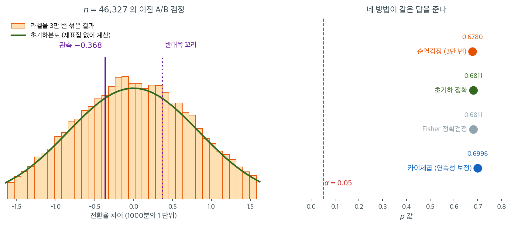
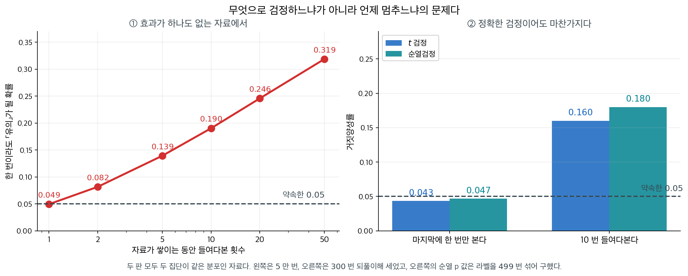

# A/B 검정 순열검정 (코드)

## 개요

순열검정은 실험 설계에 내재된 무작위화를 직접 모형화하므로 A/B 검정에 자연스러운 틀을 제공한다. 이 페이지에서는 세 가지 완전한 A/B 검정 시나리오를 다룬다. 웹페이지 세션 시간(체류도), 이진 결과를 갖는 전환율 검정, 그리고 여러 헤드라인의 클릭률 비교이다. 각 보기에는 순열검정과 비교를 위한 모수적 대안이 함께 제시된다.

---

## 1. 웹페이지 체류도 검정

두 웹페이지 디자인의 세션 시간(초)을 $n_A = 10$, $n_B = 10$명의 사용자로 비교한다. 검정통계량은 표본평균의 차이이다.

$$
T_{\text{obs}} = \bar x_B - \bar x_A
$$

$H_0$(두 페이지가 같은 세션 시간 분포를 만든다) 아래에서 "페이지 A"와 "페이지 B" 라벨은 임의적이다. 라벨을 $B$번 섞어 계산한다.

$$
p = \frac{\#\bigl\{b : |T^{(\pi_b)}| \ge |T_{\text{obs}}|\bigr\} + 1}{B + 1}
$$

<div class="exbox" markdown>

**보기 1.** <span class="diff easy" title="쉬움"></span> 체류시간 순열검정. 각 $10$명의 체류시간에서 $\bar x_A - \bar x_B = -5.4$초를 얻었다. 이 설계는 $\binom{20}{10} = 184{,}756$가지를 모두 열거할 수 있으므로, $p$값뿐 아니라 **기각역 자체를 정확히 그릴 수 있다.**

**(1)** 양측 $\alpha = 0.05$에서 기각하려면 평균차가 얼마나 커야 하는가. 열거한 귀무분포 위에서 그 문턱을 구하고, 관측된 $5.4$초가 그 몇 배인지 구하시오. 문턱 바로 아래 칸의 $p$값도 함께 적어 **이산성**이 무엇을 뜻하는지 보이시오.

**(2)** 함수를 돌려 $p$값을 구하고 정확 열거값·Welch $t$ 검정과 견주시오.

</div>

??? success "풀이"

    **(1) 해석적으로.** [이표본 순열검정](two_sample.md) 보기 1에서 이 자료의 귀무분포가 평균 $0$, 표준편차

    $$
    \operatorname{SD}(d^{*}) = S\sqrt{\frac{1}{10}+\frac{1}{10}} = 5.227257
    $$

    이고 값들이 간격 $0.2$인 격자에 놓임을 보았다. 정규근사로 어림하면 문턱이

    $$
    1.96 \times 5.227257 = 10.245
    $$

    쯤이고, 격자가 $0.2$ 간격이므로 $10.2$나 $10.4$가 후보다. 어느 쪽인지는 열거한 분포에서 직접 세어 정해야 한다. 아래 코드가 $10.2$를 고른다.

    **$10.2$초는 관측된 $5.4$초의 거의 두 배다.** 이 자료의 흩어짐($S = 11.69$초)에 견주어 각 집단 $10$명은 그만큼 적은 수다.

    **(2) 수치적으로.** 함수는 이렇다.

    ```python
    import numpy as np

    # 앞 10개가 A 페이지, 뒤 10개가 B 페이지의 체류시간이다.
    times = np.array([185, 188, 142, 160, 161, 157, 182, 181, 159, 167,   # A 페이지
                      173, 181, 182, 170, 169, 177, 168, 183, 169, 164])  # B 페이지

    def perm_test_two_sample_means(data, nA, n_perms=9999, rng=None):
        """두 집단의 평균 차이에 대한 순열검정.

        귀무가설이 참이라면 어느 값이 A 에서 나왔고 어느 값이 B 에서 나왔는지가
        아무 뜻이 없다. 그래서 이름표를 마구 섞어 가며 차이를 다시 계산하면,
        "차이가 없을 때 이 정도 차이가 얼마나 흔한가"를 직접 셀 수 있다.
        """
        rng = rng or np.random.default_rng(0)
        obs_diff = data[:nA].mean() - data[nA:].mean()
        perm_diffs = np.empty(n_perms)
        for i in range(n_perms):
            p = rng.permutation(data)
            perm_diffs[i] = p[:nA].mean() - p[nA:].mean()
        p_value = ((np.abs(perm_diffs) >= abs(obs_diff)).sum() + 1) / (n_perms + 1)
        return p_value, perm_diffs, obs_diff
    ```

    돌려서 열거값과 견준다.

    ```python
    import itertools
    from scipy import stats

    p_value, perm_diffs, obs_diff = perm_test_two_sample_means(times, 10)
    print(f"관측 차이 = {obs_diff:.2f},  순열 p (B=9999) = {p_value:.4f}")
    print(f"Welch t 검정 p = "
          f"{stats.ttest_ind(times[:10], times[10:], equal_var=False).pvalue:.4f}")

    # C(20,10) = 184,756 가지를 모두 열거한다.
    z = times.astype(float)
    T = z.sum()
    d = np.array([(2 * z[list(c)].sum() - T) / 10
                  for c in itertools.combinations(range(20), 10)])
    ad = np.abs(d)
    print(f"\n정확 p = {(ad >= abs(obs_diff) - 1e-9).mean():.6f}"
          f"   (SD(d*) = {d.std():.6f},  1.96 x SD = {1.96 * d.std():.4f})")

    # alpha = 0.05 기각 문턱을 격자 위에서 찾는다.
    for v in np.unique(np.round(ad, 6)):
        if (ad >= v - 1e-9).mean() <= 0.05:
            break
    print(f"문턱 |d| = {v:.1f} 의 정확 p   = {(ad >= v - 1e-9).mean():.6f}")
    print(f"한 칸 아래 {v - 0.2:.1f} 의 정확 p = {(ad >= v - 0.2 - 1e-9).mean():.6f}")
    print(f"관측 |d| / 문턱 = {abs(obs_diff) / v:.4f}")
    ```

    출력:

    ```
    관측 차이 = -5.40,  순열 p (B=9999) = 0.3306
    Welch t 검정 p = 0.3204

    정확 p = 0.325586   (SD(d*) = 5.227257,  1.96 x SD = 10.2454)
    문턱 |d| = 10.2 의 정확 p   = 0.049352
    한 칸 아래 10.0 의 정확 p = 0.054580
    관측 |d| / 문턱 = 0.5294
    ```

    **문턱은 $10.2$초다.** 정규근사가 가리킨 $10.245$ 바로 아래 칸이다. 그 자리의 정확 $p$값은 $0.049352$이고, **한 칸 아래인 $10.0$초로 내려가면 $0.054580$으로 올라가 더는 기각하지 못한다.**

    이 두 수가 이산성의 뜻을 그대로 보여 준다. $\alpha = 0.05$로 검정한다고 말하지만 **실제 크기는 $0.049352$다.** 명목값에 꼭 맞출 수 없고 늘 그보다 조금 작은 쪽으로 떨어진다. 가능한 $p$값이 $1/184756$의 배수뿐이기 때문이며, 표본이 작을수록 이 틈이 커진다.

    **관측값은 문턱의 $0.5294$배에 지나지 않는다.** 그러니 $p$값이 얼마로 나오든 결론은 미리 정해져 있었다. 세 수 — 순열 $0.3306$, 정확 $0.325586$, Welch $0.3204$ — 가 모두 $0.32$ 언저리다.

    순열 $p$값이 난수에 따라 흔들린다는 점도 적어 둘 것. $B = 9{,}999$에서 $\hat p$의 표준편차가 $\sqrt{0.3256 \times 0.6744/9999} = 0.0047$이므로 **씨앗을 바꾸면 $0.32$에서 $0.34$ 사이를 오간다.** 본문이 적은 $0.327$과 위의 $0.3306$은 같은 분포에서 뽑은 두 값이며, 둘 다 정확값 $0.325586$에서 한 표준편차 안에 있다. 자릿수를 더 믿고 싶으면 $B$를 키우는 것이 아니라 **열거하는 것**이 답이다.

결과를 Welch $t$ 검정과 비교한다.

$$
t = \frac{\bar x_A - \bar x_B}{\sqrt{s_A^2/n_A + s_B^2/n_B}}
$$

Welch $t$ 검정은 $p = 0.320$으로 사실상 같은 답을 준다. 두 검정 모두 기각하지 못한다. 표본이 작고($n = 10$) 자료가 정규가 아닐 수 있으므로 순열검정 쪽이 더 믿을 만하다.

---

## 2. 전환율 A/B 검정

이진 결과에서는 처치가 전환율을 바꾸는지 검정한다.

- 대조군: $n_0 = 23{,}739$명 중 $c_0 = 200$명 전환
- 처치군: $n_1 = 22{,}588$명 중 $c_1 = 182$명 전환

관측된 전환율 차이는

$$
T_{\text{obs}} = \frac{c_1}{n_1} - \frac{c_0}{n_0} = 0.008058 - 0.008425 = -0.000368
$$

즉 $-0.0368$%p이다.

순열 접근은 길이 $n_0 + n_1$의 이진 벡터에 $c_0 + c_1$개의 $1$을 넣고 섞는다.

<div class="exbox" markdown>

**보기 2.** <span class="diff easy" title="쉬움"></span> 전환율 순열검정. 대조군 $23{,}739$명 중 $200$명, 처치군 $22{,}588$명 중 $182$명이 전환했다. 처치군의 전환 수를 $X$라 하면 순열 귀무분포가 $X \sim \text{HG}(22588,\ 46327,\ 382)$이므로 **기각역을 전환 건수로 정확히 적을 수 있다.**

**(1)** 전환 한 건이 비율차를 얼마나 움직이는지 구하시오. 그다음 $\alpha = 0.05$ 양측에서 기각되는 $X$의 값을 정확히 구하고, 관측된 $182$건이 그 경계에서 **몇 건** 떨어져 있는지 말하시오.

**(2)** 함수를 돌려 $p$값을 구하고 Fisher 정확검정과 견주시오. 정규근사가 고르는 경계와 정확한 경계가 어긋나는지도 보시오.

</div>

??? success "풀이"

    **(1) 해석적으로.** 전체 전환 수 $K = 382$가 고정되므로 $\hat p_T - \hat p_C$는 $X$의 일차식이다.

    $$
    T^{(\pi)} = \frac{X}{n_T} - \frac{K - X}{n_C}
    = X\left(\frac{1}{n_T} + \frac{1}{n_C}\right) - \frac{K}{n_C}
    $$

    따라서 **전환 한 건이 움직이는 비율차**가

    $$
    \frac{1}{22588} + \frac{1}{23739} = 8.640\times10^{-5} = 0.00864\%\text{p}
    $$

    다. 관측된 $-0.0368\%$p는 이 눈금의 $4.26$칸, 곧 **전환 네 건 남짓**에 해당한다.

    $X$가 초기하분포를 따르므로 기각역은 $\lvert T\rvert$가 큰 쪽, 곧 $X$가 $E[X] = 186.25$에서 멀리 떨어진 쪽이다. 꼬리확률을 더해 $p \le 0.05$가 되는 경계를 찾으면 되고, 아래 코드가 $X \le 166$ 또는 $X \ge 206$을 준다.

    어림은 정규근사로도 된다. 귀무분포의 표준편차가 $0.00084056$이므로 문턱이 $1.96 \times 0.00084056 = 0.0016475$이고, 이것을 눈금 $8.640\times10^{-5}$로 나누면 $19.07$건이다. 곧 $X$가 $186.25$에서 $19$건 넘게 벗어나야 한다.

    **(2) 수치적으로.** 함수는 이렇다.

    ```python
    def perm_test_proportion(n_control, conv_control, n_treatment, conv_treatment,
                             n_perms=9999, rng=None):
        """전환율 차이에 대한 순열검정.

        이진 자료도 다를 것이 없다. 전체 전환 수만큼 1 을 채운 배열을 만들고
        그것을 섞으면, "전환이 두 집단에 무작위로 흩어진" 상태가 된다.
        """
        rng = rng or np.random.default_rng(0)
        binary = np.zeros(n_control + n_treatment)
        binary[:conv_control + conv_treatment] = 1
        obs_diff = conv_treatment / n_treatment - conv_control / n_control

        perm_diffs = np.empty(n_perms)
        for i in range(n_perms):
            p = rng.permutation(binary)
            perm_diffs[i] = p[n_control:].mean() - p[:n_control].mean()

        p_value = ((np.abs(perm_diffs) >= abs(obs_diff)).sum() + 1) / (n_perms + 1)
        return p_value, perm_diffs, obs_diff
    ```

    $B$는 $2{,}000$이면 충분하다. 어차피 정확값을 따로 계산할 참이고, 길이 $46{,}327$짜리 배열을 섞는 일은 비싸다.

    ```python
    from scipy import stats

    p_value, perm_diffs, obs_diff = perm_test_proportion(23739, 200, 22588, 182,
                                                         n_perms=2000)
    print(f"관측 차이 = {obs_diff:.6f},  순열 p (B=2000) = {p_value:.4f}")
    print(f"Fisher 정확검정 = "
          f"{stats.fisher_exact([[200, 23739 - 200], [182, 22588 - 182]])[1]:.6f}")

    n_c, c_c, n_t, c_t = 23739, 200, 22588, 182
    N, K = n_c + n_t, c_c + c_t
    step = 1 / n_t + 1 / n_c
    x = np.arange(K + 1)
    d = x * step - K / n_c
    pmf = stats.hypergeom.pmf(x, N, K, n_t)

    def p_exact(x_obs):
        d_obs = x_obs * step - K / n_c
        return pmf[np.abs(d) >= abs(d_obs) - 1e-18].sum()

    EX = K * n_t / N
    sd_null = np.sqrt(N / (N - 1) * (K / N) * (1 - K / N) * step)
    print(f"\n전환 한 건이 움직이는 비율차 = {step:.3e},  E[X] = {EX:.2f}")
    lo = max(v for v in range(0, 187) if p_exact(v) <= 0.05)
    hi = min(v for v in range(187, K + 1) if p_exact(v) <= 0.05)
    print(f"기각역: X <= {lo} (p = {p_exact(lo):.4f})  또는  X >= {hi} (p = {p_exact(hi):.4f})")
    print(f"  경계 바로 안쪽: X = {lo + 1} 이면 p = {p_exact(lo + 1):.4f},"
          f"  X = {hi - 1} 이면 p = {p_exact(hi - 1):.4f}")
    print(f"정규근사 문턱 = {1.96 * sd_null / step:.2f} 건"
          f"  ->  X <= {EX - 1.96 * sd_null / step:.2f} 또는 X >= {EX + 1.96 * sd_null / step:.2f}")
    print(f"관측 X = {c_t}: 아래 경계까지 {c_t - lo} 건,  위 경계까지 {hi - c_t} 건")
    print(f"정확 p (X = {c_t}) = {p_exact(c_t):.6f}")
    ```

    출력:

    ```
    관측 차이 = -0.000368,  순열 p (B=2000) = 0.6667
    Fisher 정확검정 = 0.681128

    전환 한 건이 움직이는 비율차 = 8.640e-05,  E[X] = 186.25
    기각역: X <= 166 (p = 0.0397)  또는  X >= 206 (p = 0.0450)
      경계 바로 안쪽: X = 167 이면 p = 0.0508,  X = 205 이면 p = 0.0572
    정규근사 문턱 = 19.07 건  ->  X <= 167.19 또는 X >= 205.32
    관측 X = 182: 아래 경계까지 16 건,  위 경계까지 24 건
    정확 p (X = 182) = 0.681128
    ```

    **기각역이 전환 건수로 또렷하게 적힌다.** 이 실험은 처치군의 전환이 **$166$건 이하이거나 $206$건 이상**이어야 유의하다. 관측된 $182$건은 아래 경계에서 $16$건, 위 경계에서 $24$건 떨어져 있다. 사만 육천 명을 모았지만 **전환 스무 건 수준의 차이는 잡아내지 못하는 설계**였다는 뜻이다.

    **정규근사와 정확한 경계가 한 칸씩 어긋난다.** 정규근사는 $X \le 167.19$ 또는 $X \ge 205.32$라 하여 정수로는 $X \le 167$, $X \ge 205$를 고르는데, 정확한 경계는 $X \le 166$, $X \ge 206$이다. 실제로 $X = 167$의 정확 $p$는 $0.0508$, $X = 205$는 $0.0572$로 **둘 다 $0.05$를 넘는다.** 근사를 그대로 썼다면 두 경우에 잘못 기각했을 것이다. 분포가 $E[X] = 186.25$에 대해 꼭 대칭이 아니라서 아래쪽과 위쪽의 틈도 다르다.

    **$p$값 쪽은 느슨해도 된다.** $B = 2{,}000$이 준 $0.6667$은 정확값 $0.681128$에서 $-0.0145$ 떨어져 있는데 몬테카를로 표준편차 $\sqrt{0.6811 \times 0.3189/2000} = 0.0104$의 $1.4$배다. 어차피 Fisher 정확검정이 $0.681128$을 바로 주므로 **여기서 재표집을 돌릴 이유는 없다.** 기각역을 건수로 옮겨 읽는 위 계산도 재표집 없이 끝났다.

비교 대상은 $2 \times 2$ 분할표에 대한 독립성 카이제곱 검정이다.

$$
\chi^2 = \sum_{i,j}\frac{(O_{ij} - E_{ij})^2}{E_{ij}}
$$

카이제곱 검정은 $p = 0.6996$, Fisher 정확검정은 $p = 0.6811$을 준다. 순열검정도 같은 범위의 값을 준다.

!!! tip "이 경우 재표집은 낭비이다"
    이진 자료의 이표본 순열분포는 초기하분포로 정확히 알려져 있으므로, 순열검정은 Fisher 정확검정과 **같은 것**이다. `stats.fisher_exact`가 근사 없이 답을 준다. 자세한 계산은 [기초](./foundations.md) 연습문제 4에 있다.

이 주장은 그림으로 확인하는 편이 빠르다.



왼쪽에서 주황 막대는 $46{,}327$개의 $0$/$1$을 실제로 $3$만 번 섞어 얻은 전환율 차이의 분포이고, 초록 곡선은 **재표집을 한 번도 하지 않고** 초기하분포 공식으로 계산한 확률이다. 두 곡선이 구별되지 않는다. 이유는 단순하다. 라벨을 섞는다는 것은 전체 $382$건의 전환을 두 집단에 무작위로 나눠 주는 것이고, 그때 처치군이 받는 전환 수는 정의상 $\text{Hypergeometric}(46327,\ 382,\ 22588)$을 따른다. **순열검정이 모의실험으로 재발견하고 있는 것이 바로 이 분포이다.**

막대가 연속처럼 보이지만 실제로는 이산이다. 전환 수가 하나 바뀔 때마다 차이가 $1/22588 + 1/23739 = 0.0000864$씩 움직이므로, 가로축의 눈금 하나가 전환 한 건에 해당한다. 관측된 $-0.000368$은 전환 약 네 건어치의 차이이며, 분포의 한가운데에 놓인다.

오른쪽이 결론이다. 순열검정 $0.6780$, 초기하 정확 $0.6811$, Fisher 정확검정 $0.6811$, 연속성 보정 카이제곱 $0.6996$으로 네 값이 모두 같은 답을 가리킨다. Fisher와 초기하가 **소수점 넷째 자리까지 같은 것은 우연이 아니라 정의가 같기 때문**이며, 순열검정과의 $0.003$ 차이는 순전히 $3$만 번이라는 유한한 반복에서 온다. 그러니 이진 자료에서는 재표집을 돌릴 이유가 없다.

---

## 3. 다중 헤드라인 클릭률 검정

각 $1{,}000$회 노출로 세 헤드라인을 시험했다.

| 헤드라인 | 클릭 | 비클릭 |
|---|---|---|
| A | 14 | 986 |
| B | 8 | 992 |
| C | 12 | 988 |

집단이 셋 이상이면 독립성에 대한 카이제곱 검정이 표준적인 모수적 접근이다. 이 자료에서 $\chi^2 = 1.666$, $df = 2$, $p = 0.435$로 유의한 차이가 없다. 기대 셀 도수는 모두 $11.33$과 $988.67$이므로 카이제곱 근사가 타당하다.

순열 대응물은 집단 비율들의 분산을 검정통계량으로 쓴다(다집단 순열검정과 같다).

---

## 4. 검정력 분석

A/B 검정의 검정력은 효과크기 $d$, 표본크기 $n$, 유의수준 $\alpha$에 의존한다. 집단 크기가 같은 이표본 검정에서

$$
\text{Power} \approx 1 - \Phi\!\left(z_{1-\alpha/2} - d\sqrt{\frac{n}{2}}\right)
$$

이다. 여기서 $d = (\mu_1 - \mu_2)/\sigma$는 Cohen의 $d$이다. 주요 기준점은 다음과 같다.

- $d = 0.2$(작은 효과): $80$% 검정력에 집단당 $n \approx 400$ 필요
- $d = 0.5$(중간 효과): 집단당 $n \approx 65$ 필요
- $d = 0.8$(큰 효과): 집단당 $n \approx 25$ 필요

이 값들은 $n = 2(z_{1-\alpha/2} + z_{0.8})^2/d^2 = 15.7/d^2$에서 나온다.

---

<div class="storybox" markdown>

**그림으로 보는 통계학 1.** 정확한 검정도 멈추는 자리를 정해 주지는 않는다

이 쪽은 A/B 검정을 순열로 판정한다. 순열검정은 **정확한** 검정이다 — 귀무가설 아래에서 라벨을 섞어 만든 분포가 곧 참이므로 근사가 들어갈 자리가 없다. 그런데 현장에서 A/B 검정이 무너지는 자리는 검정의 정확성이 아니라 **언제 멈추는가**에 있다.

$2015$ 년 $12$ 월, **라메시 조하리**와 **레오 페켈리스**, **데이비드 월시**가 arXiv 에 「Always Valid Inference: Bringing Sequential Analysis to A/B Testing」을 올렸다. 첫 문장이 문제를 그대로 적는다.

> A/B 검정은 보통 빈도주의 p 값과 신뢰구간으로 분석된다. 그러나 사용자가 자기 검정을 **계속 들여다보면서** 표본크기를 내생적으로 고르면 그 추론은 **전적으로 믿을 수 없게 된다.**

왜 그런가. 검정은 「자료를 $n$ 개 모은 뒤 한 번 판정한다」는 약속 위에서 $5\%$ 를 보장한다. 쌓이는 동안 여러 번 보고 그중 한 번이라도 유의하면 멈추는 규칙은 다른 검정이고, 그 검정의 거짓양성률은 $5\%$ 가 아니다.



두 집단이 **같은 분포**인 자료를 $5$ 만 번 만들어 세어 보았다. 끝까지 모은 뒤 한 번만 판정하면 $0.049$ 로 약속대로다. 중간에 한 번 더 보는 것만으로 $0.082$ 가 되고, 열 번 보면 $0.190$, 쉰 번 보면 $0.319$ 다. **아무 효과도 없는데 셋에 하나꼴로 「유의」가 나온다.**

열 번 들여다보면서도 전체 $5\%$ 를 지키려면 한 번당 기준을 $0.05$ 가 아니라 **$0.0106$** 으로 조여야 한다(임계값 $2.555$). 자료를 보기 전에 몇 번 볼지 정해 두어야 계산할 수 있는 수다.

**여기서 이 쪽의 방법이 면제되지 않는다는 것이 요점이다.** 오른쪽 판은 같은 실험을 $t$ 검정과 순열검정으로 각각 판정한 것이다. 마지막에 한 번만 보면 $0.043$ 과 $0.047$ 로 둘 다 약속을 지키는데, 열 번 들여다보면 $0.160$ 과 $0.180$ 으로 **둘 다 세 배 넘게 부푼다.** 순열검정이 고쳐 주는 것은 「이 통계량의 귀무분포가 무엇인가」이고, 부푸는 원인은 「어느 시점의 판정을 쓸 것인가」이기 때문이다. 정확한 검정을 **여러 번** 하면 여러 번 한 값을 치른다.

고치는 길은 둘이다. 자료를 보기 전에 $n$ 을 정하고 그때 한 번만 판정하거나, 아니면 멈추는 규칙까지 포함해 유효한 방법을 쓰는 것이다. 위 논문이 내놓은 **언제나 유효한**(always valid) p 값이 뒤쪽이고, 저자들은 그 방법이 「대규모 상용 A/B 검정 플랫폼에 구현되어 지금까지 수십만 건의 실험을 분석했다」고 적는다. 상용 도구가 통계 엔진을 통째로 갈아 끼운 까닭이 이 한 장의 그림이다.

!!! note "이 책 안의 이웃"
    같은 일이 중간분석·조기중단이라는 이름으로 [9.4절 p 해킹](../../ch09/multiple_testing/p_hacking_demo.md)에도 나온다. 거기서는 다중비교의 한 꼴로 다루고, 여기서는 **검정의 정확성과 멈추는 규칙이 서로 다른 문제**라는 쪽에 무게를 둔다.

_확인한 곳 — 조하리·페켈리스·월시 「Always Valid Inference: Bringing Sequential Analysis to A/B Testing」([arXiv:1512.04922](https://arxiv.org/abs/1512.04922), $2015$ 년 $12$ 월 $15$ 일 올림, $2019$ 년 $7$ 월 개정)의 초록에서 「A/B 검정은 보통 빈도주의 p 값과 신뢰구간으로 분석되지만, 사용자가 계속 들여다보며 표본크기를 내생적으로 고르면 그 추론은 전적으로 믿을 수 없게 된다」와 「대규모 상용 A/B 검정 플랫폼에 구현되어 지금까지 수십만 건의 실험을 분석했다」를 읽었다. **초록은 회사 이름을 적지 않는다** — 뒤에 나온 학회판(조하리·코먼·페켈리스·월시, 「Peeking at A/B Tests: Why it matters, and what to do about it」, KDD $2017$, [doi:10.1145/3097983.3097992](https://doi.org/10.1145/3097983.3097992))의 학회 쪽 소개가 그 방법론이 옵티마이즐리에 배치된 것이라고 적는 것을 검색으로 보았고, 논문 본문은 읽지 못했다 · 거짓양성률·임계값·한 번당 기준은 모두 직접 모의실험해 얻은 값이다_

</div>

---

## 5. 해석

세 보기는 순열 기반 A/B 검정의 서로 다른 측면을 보여준다.

1. **세션 시간**: 연속자료와 작은 표본에서 순열검정이 $t$ 검정과 거의 일치하지만 정규성을 가정하지 않는다($p = 0.327$ 대 $0.320$).
2. **전환율**: 이진자료와 큰 표본에서 순열 $p$값이 카이제곱 검정과 일치한다. 관측된 비율 차이가 극히 작으므로 둘 다 $H_0$을 기각하지 못한다.
3. **다중 헤드라인**: 셋 이상을 비교할 때는 카이제곱이 표준이지만, 집단 클릭률의 분산에 대한 순열검정이 분포무관 대안을 제공한다.

실무에서 순열 틀이 A/B 검정에 특히 매력적인 이유는 다음과 같다.

- 사용자를 집단에 배정하는 데 쓴 무작위화를 직접 모형화한다.
- 분포 가정이 필요 없다.
- $p$값의 해석이 투명하다. 관측된 것만큼 극단적인 결과를 만드는 무작위 재라벨링의 비율이다.

---

## 연습문제

<div class="drillbox" markdown>

**연습문제 1.** <span class="diff med" title="중간"></span> 세션 시간 보기는 집단당 $n = 10$을 쓴다. 페이지 B의 평균 세션 시간이 실제로 $15$초 더 길다고 하자. $n = 10$과 $n = 50$에서 순열검정을 $1000$번 실행하여 $\alpha = 0.05$에서의 검정력을 추정하라.

</div>

??? success "풀이"

    ```python
    import numpy as np
    rng = np.random.default_rng(42)

    def power_estimate(n, true_diff=15, sigma=20, M=1000, B=999):
        reject = 0
        for _ in range(M):
            a = rng.normal(170, sigma, n)
            b = rng.normal(170 + true_diff, sigma, n)
            obs = a.mean() - b.mean()
            z = np.concatenate([a, b])
            P = np.array([rng.permutation(z) for _ in range(B)])
            d = P[:, :n].mean(1) - P[:, n:].mean(1)
            reject += ((np.abs(d) >= abs(obs)).sum() + 1)/(B+1) < 0.05
        return reject / M
    ```

    | $n$ (집단당) | 순열검정 검정력 | 이론값 |
    |---:|---:|---:|
    | 10 | **0.374** | 0.389 |
    | 50 | **0.955** | 0.963 |

    이론값은 $1 - \Phi(1.96 - d\sqrt{n/2})$이며 $d = 15/20 = 0.75$이다.

    **$n = 10$은 심각하게 검정력이 부족하다.** $0.374$는 참 효과가 존재해도 세 번 중 두 번은 놓친다는 뜻이다. $d = 0.75$가 "큰 효과"에 가까운데도 그렇다.

    **$n = 50$에서 $0.955$로 충분해진다.** 표본을 다섯 배 늘리자 검정력이 $2.6$배가 되었다.

    **순열검정의 검정력이 이론값보다 $1$--$2$%p 낮다.** 두 가지가 겹친다. 첫째, $+1$ 보정이 검정을 약간 보수적으로 만든다. 둘째, $B = 999$의 몬테카를로 오차가 문턱 근처의 결정을 일부 뒤집는다([수렴](../comparison/convergence.md) 연습문제 3 참조).

    !!! warning "실무 A/B 검정에서 흔한 실수"
        $n = 10$으로 실험하고 $p = 0.30$을 얻은 뒤 "차이가 없다"고 결론짓는 것은 잘못이다. 검정력이 $0.374$인 검정에서 기각하지 못한 것은 **증거가 없다**는 뜻이지 **효과가 없다**는 뜻이 아니다.

        올바른 대응은 실험 **전에** 검정력 분석을 하는 것이다. 탐지하고 싶은 최소 효과크기를 정하고, $80$% 검정력에 필요한 $n$을 계산한 뒤 실험을 시작한다.

<div class="drillbox" markdown>

**연습문제 2.** <span class="diff med" title="중간"></span> 전환율 보기에서 관측된 비율 차이는 약 $-0.0368$%p이다. 주어진 표본크기($n_0 = 23{,}739$, $n_1 = 22{,}588$)에서 $80$% 검정력, $\alpha = 0.05$의 최소 탐지 효과(MDE)를 계산하라.

</div>

??? success "풀이"

    $H_0$ 아래의 합쳐진 비율은

    $$
    \hat p = \frac{200 + 182}{23739 + 22588} = \frac{382}{46327} = 0.008246
    $$

    이다. $H_0$ 아래 차이의 표준오차는

    $$
    \text{SE} = \sqrt{\hat p(1 - \hat p)\left(\frac{1}{n_0} + \frac{1}{n_1}\right)}
    = \sqrt{0.008246 \times 0.991754 \times 8.6397\times10^{-5}}
    $$

    $$
    \text{SE} = \sqrt{7.0657\times10^{-7}} = 8.406\times10^{-4}
    $$

    이다. $80$% 검정력, 양측 $\alpha = 0.05$의 MDE는

    $$
    \text{MDE} = (z_{0.975} + z_{0.80})\times\text{SE} = (1.960 + 0.842)\times 8.406\times10^{-4} = 2.355\times10^{-3}
    $$

    이다. 즉 최소 탐지 가능한 절대 차이가 약 **$0.236$%p**이다.

    관측된 차이 $-0.0368$%p는 이 문턱의 $16$%에 불과하다. $H_0$을 기각하지 못한 이유가 이것이다. $\square$

    **상대적으로 보면 더 극적이다.** 기저 전환율이 $0.825$%이므로 MDE $0.236$%p는 **상대적 $28.6$% 변화**에 해당한다. $46{,}000$명을 모아 놓고도 $28$% 미만의 개선은 탐지할 수 없다는 뜻이다.

    **필요한 표본크기.** 상대적 $10$% 개선($0.0825$%p)을 $80$% 검정력으로 탐지하려면

    $$
    n \approx \frac{2\hat p(1-\hat p)(z_{0.975}+z_{0.80})^2}{\delta^2}
    = \frac{2 \times 0.008178 \times 7.849}{(8.25\times10^{-4})^2} = 189{,}000
    $$

    으로 집단당 $19$만 명이 필요하다.

    !!! tip "희귀사건 A/B 검정의 어려움"
        전환율이 낮으면 필요한 표본이 급격히 커진다. $\text{SE} \propto \sqrt{\hat p}$이지만 상대적 효과를 탐지하려면 $\delta \propto \hat p$이므로, 필요한 $n$이 $1/\hat p$에 비례한다.

        | 기저 전환율 | 상대 $10$% 개선 탐지에 필요한 집단당 $n$ |
        |---:|---:|
        | 20% | 6{,}300 |
        | 5% | 29{,}800 |
        | 1% | 155{,}400 |
        | 0.8% | 189{,}000 |

        실무적 대응은 대리지표(proxy metric)를 쓰는 것이다. 최종 전환 대신 장바구니 담기, 페이지 체류 시간처럼 더 흔한 사건을 측정하면 훨씬 작은 표본으로 신호를 잡을 수 있다. 대신 대리지표가 최종 지표와 연결된다는 근거가 필요하다.

<div class="drillbox" markdown>

**연습문제 3.** <span class="diff med" title="중간"></span> 헤드라인 자료의 카이제곱 검정은 자유도가 $2$이다. 이유를 설명하고, 카이제곱 검정이 다항모형에 대한 가능도비 검정과 동등함을 보여라. 순열 접근이 유리한 조건은 무엇인가?

</div>

??? success "풀이"

    분할표는 행이 $2$개(클릭/비클릭), 열이 $3$개(헤드라인 A, B, C)이다. 독립성 카이제곱 검정의 자유도는

    $$
    df = (r - 1)(c - 1) = (2 - 1)(3 - 1) = 2
    $$

    이다.

    $H_0$ 아래에서 셀 $(i, j)$의 기대 도수는 $E_{ij} = R_i C_j / N$이다. $R_i$와 $C_j$는 행합과 열합, $N$은 총합이다. 이 자료에서는 모든 헤드라인의 노출이 $1{,}000$으로 같으므로 기대 클릭 수가 세 헤드라인 모두 $34/3 = 11.33$이다.

    가능도비 검정통계량은

    $$
    G^2 = 2\sum_{i,j} O_{ij}\ln\frac{O_{ij}}{E_{ij}}
    $$

    이다. Taylor 전개에 의해 큰 표본에서 $G^2 \approx \chi^2$이므로 두 검정은 점근적으로 동등하다.

    **이 자료의 결과:** $\chi^2 = 1.666$, $df = 2$, $p = 0.435$. 세 헤드라인의 클릭률 $1.4$%, $0.8$%, $1.2$%의 차이는 우연으로 충분히 설명된다.

    순열 접근이 유리한 조건은 다음과 같다.

    - 기대 셀 도수가 작을 때(카이제곱 근사는 $E_{ij} \approx 5$ 아래에서 무너진다)
    - 범주 수가 표본크기에 비해 많을 때
    - 점근 근사에 기대지 않은 정확 $p$값이 필요할 때

    **이 자료는 순열검정이 필요 없다.** 기대 도수가 최소 $11.33$으로 충분히 크다. 노출이 각 $100$회였다면 기대 클릭 수가 $1.13$이 되어 카이제곱 근사를 쓸 수 없고, 순열검정이나 Fisher-Freeman-Halton 정확검정이 필요했을 것이다.

    !!! note "다중비교 문제가 숨어 있다"
        전체 검정이 유의하지 않으므로 여기서는 문제가 되지 않지만, 만약 유의했다면 "어느 헤드라인이 다른가"를 묻게 된다. 세 쌍의 비교를 각각 $\alpha = 0.05$로 하면 전체 제1종 오류율이 $0.14$로 오른다.

        순열 틀에서는 최댓값 통계량 $\max_{j<k}|\hat p_j - \hat p_k|$를 쓰면 다중성이 자동으로 보정된다. 이는 Bonferroni보다 덜 보수적이다.

<div class="drillbox" markdown>

**연습문제 4.** <span class="diff med" title="중간"></span> 세션 시간의 **중앙값** 차이(평균 대신)에 대한 순열 A/B 검정을 구현하라. 평균 기반 검정의 $p$값과 비교하라. 중앙값 기반 검정은 언제 선호되는가?

</div>

??? success "풀이"

    ```python
    import numpy as np
    from scipy import stats
    rng = np.random.default_rng(42)

    times = np.array([185, 188, 142, 160, 161, 157, 182, 181, 159, 167,
                      173, 181, 182, 170, 169, 177, 168, 183, 169, 164])

    obs_mean = times[:10].mean() - times[10:].mean()
    obs_med = np.median(times[:10]) - np.median(times[10:])
    print(obs_mean, obs_med)          # -5.4  -7.5

    B = 99999
    P = np.array([rng.permutation(times) for _ in range(B)])
    pm  = P[:, :10].mean(1) - P[:, 10:].mean(1)
    pmd = np.median(P[:, :10], axis=1) - np.median(P[:, 10:], axis=1)

    p_mean = ((np.abs(pm)  >= abs(obs_mean) - 1e-12).sum() + 1) / (B + 1)
    p_med  = ((np.abs(pmd) >= abs(obs_med)  - 1e-12).sum() + 1) / (B + 1)
    ```

    출력:

    ```
    -5.400000000000006 -7.5
    ```

    | 검정 | 관측 차이 | $p$값 |
    |:---|---:|---:|
    | 순열검정(평균) | $-5.4$ | 0.327 |
    | 순열검정(중앙값) | $-7.5$ | 0.313 |
    | Welch $t$ 검정 | $-5.4$ | 0.320 |
    | Mann-Whitney $U$ | — | 0.344 |

    **네 검정이 모두 $0.31$--$0.35$로 일치하며 어느 것도 기각하지 않는다.** 이 자료에는 극단적인 이상값이 없고 두 집단의 분포가 비슷한 모양이므로 통계량 선택이 결론에 영향을 주지 않는다.

    **중앙값 차이가 평균 차이보다 크지만($-7.5$ 대 $-5.4$) $p$값은 거의 같다.** 관측 통계량의 크기를 검정들 사이에서 비교하는 것이 무의미하다는 점을 다시 보여준다. 각 통계량은 자기 귀무분포에 대해서만 해석된다.

    중앙값 기반 검정은 다음 상황에서 선호된다.

    - 평균을 부풀릴 수 있는 이상값이 자료에 있다.
    - 분포가 심하게 치우쳐 있다(예: 아주 긴 세션이 몇 개 있는 세션 시간).
    - 연구 질문이 "평균"이 아니라 "전형적인" 사용자 경험에 관한 것이다.

    일반적으로 대칭분포에서는 중앙값 기반 검정의 검정력이 평균 기반보다 낮다(정규자료에서 중앙값의 평균 대비 점근상대효율은 $2/\pi \approx 63.7$%이다). 대신 오염에 로버스트하다.

    **세션 시간 자료는 사실 중앙값이 적절한 대표적 사례이다.** 실제 웹 로그의 세션 시간은 극단적으로 오른쪽으로 치우쳐 있다(사용자 몇 명이 탭을 열어둔 채 몇 시간을 보낸다). 여기 쓴 자료는 그 특성을 담지 않은 인공 자료이므로 두 검정의 차이가 드러나지 않았다. [이표본 순열검정](./two_sample.md) 연습문제 3에서 오염된 자료의 검정력 차이를 정량화했다.

<div class="drillbox" markdown>

**연습문제 5.** <span class="diff hard" title="어려움"></span> 두 집단의 분포가 같으면($H_0$이 참이면) 순열 $p$값이 임의의 타당한 순열검정에서 $P(p \le \alpha) \le \alpha$를 만족함을 보여라.

</div>

??? success "풀이"

    $T_0 = |T_{\text{obs}}|$라 하고 $T_1, \ldots, T_B$를 순열된 검정통계량의 절댓값이라 하자. $H_0$ 아래에서 $B+1$개 값 $T_0, T_1, \ldots, T_B$는 교환 가능하며, 동점이 없다고 가정하면 거의 확실히 서로 다르다.

    **$p$값을 $+1$ 보정을 포함해 정의해야 한다.**

    $$
    p = \frac{\#\{b : T_b \ge T_0\} + 1}{B + 1} = \frac{R}{B+1}
    $$

    여기서 $R$은 $\{T_0, T_1, \ldots, T_B\}$ 중 $T_0$의 내림차순 순위이다($T_0$가 가장 크면 $R = 1$). 교환가능성에 의해 $R$은 $\{1, \ldots, B+1\}$ 위에서 균등분포이다.

    따라서

    $$
    P(p \le \alpha) = P\!\left(R \le \alpha(B+1)\right)
    = \frac{\lfloor \alpha(B+1) \rfloor}{B + 1} \le \alpha
    $$

    이다. $\square$

    **$(B+1)\alpha$가 정수이면 등호가 성립한다.** $\alpha = 0.05$에 $B = 199, 999, 9999$ 등을 고르면 검정이 $\alpha$ 수준을 **정확히** 달성한다. 그렇지 않으면 약간 보수적이다.

    !!! danger "$+1$을 빼면 부등호가 뒤집힌다"
        $p = \#\{b : T_b \ge T_0\}/B$로 정의하면 $R = 1$일 때 $p = 0$이 된다. 그러면

        $$
        P(p \le \alpha) \ge P(R = 1) = \frac{1}{B+1}
        $$

        이므로 $\alpha < 1/(B+1)$인 모든 $\alpha$에서 통제가 깨진다. 검정이 **보수적이 아니라 반보수적**이 된다.

        [대응 순열검정](./paired.md) 연습문제 3에서 $B = 199$, $\alpha = 0.05$일 때 보정 없는 정의의 제1종 오류율이 $0.0512$, 보정한 정의가 $0.0458$임을 수치로 확인했다.

        비용이 $0$이므로 항상 $+1$을 넣는다.

<div class="drillbox" markdown>

**연습문제 6.** <span class="diff hard" title="어려움"></span> 보기 1 은 집단당 $n = 10$ 으로 $\binom{20}{10} = 184{,}756$ 가지를 모두 열거했다. 그 설계에서 양측 정확 $p$ 값이 가질 수 있는 가장 작은 값은 $1/184756$ 이 아니라 그 **두 배**인 $2/184756 = 1.08\times10^{-5}$ 이다. 왜 두 배인지, 그리고 그 바닥이 작은 설계에서 무엇을 뜻하는지 따진다. 검정통계량은 평균차 $d = \bar x_A - \bar x_B$, 기각역은 $\lvert d\rvert$ 가 큰 쪽이고, 자료에 동점은 없다고 하자.

**(1)** 라벨을 통째로 맞바꾼 배치에서 $d$ 가 어떻게 되는지 보이고, 전수 열거한 $\binom{2n}{n}$ 개의 $\lvert d\rvert$ 값이 반드시 짝을 이룸을 보이시오. 이로부터 양측 정확 $p$ 값의 최솟값이 $2/\binom{2n}{n}$ 임을 보이시오.

**(2)** $n = 1, 2, 3, 4$ 에서 그 최솟값을 구하고, 양측 $\alpha = 0.05$ 에서 **자료가 무엇이든 결코 기각할 수 없는** $n$ 을 모두 찾으시오. 단측검정이면 답이 어떻게 달라지는가.

**(3)** 전체 $N = 8$ 명을 두 집단에 나눈다. 양측 $\alpha = 0.05$ 에서 기각이 가능한 분할 $(n_A, n_B)$ 를 모두 찾으시오.

**(4)** 어떤 사람이 "$n = 3$ 이어도 $B = 9{,}999$ 로 섞으면 $p = (1 + \#)/(B+1)$ 의 바닥이 $1/10{,}000$ 이니 유의한 결과를 얻을 수 있다"고 말한다. 반박하시오.

</div>

??? success "풀이"

    **(1)** 배치 하나는 $2n$ 개 값 가운데 $A$ 로 갈 $n$ 개를 고르는 일, 곧 부분집합 $\pi$ 하나다. 라벨을 통째로 맞바꾸는 것은 $\pi$ 를 여집합 $\pi^{c}$ 로 보내는 것이고, 그러면 두 집단평균이 자리를 바꾸므로

    $$
    d^{(\pi^{c})} = \bar z_{\pi^{c}} - \bar z_{\pi} = -\,d^{(\pi)}
    $$

    이다. $\lvert \pi\rvert = n$ 이므로 $\pi \ne \pi^{c}$ 이고, $\pi \mapsto \pi^{c}$ 는 **고정점이 없는 대합**(두 번 하면 제자리)이다. 따라서 $\binom{2n}{n}$ 개의 배치가 $\binom{2n}{n}/2$ 개의 짝으로 완전히 나뉘고, 각 짝에서 $\lvert d\rvert$ 가 같다.

    정확 $p$ 값은 관측된 배치 자신을 포함해 전수 열거로 세므로

    $$
    p = \frac{\#\{\pi : \lvert d^{(\pi)}\rvert \ge \lvert d_{\text{obs}}\rvert\}}{\binom{2n}{n}}
    $$

    이다. 분자의 집합은 짝들의 합집합이므로 **크기가 짝수**이고, 관측된 배치와 그 거울상을 늘 담으므로 적어도 $2$ 다. 그러므로 $p \ge 2/\binom{2n}{n}$ 이고, $\lvert d_{\text{obs}}\rvert$ 가 유일한 최댓값일 때 등호가 성립한다. 보기 1 자료에서 $\lvert d\rvert$ 의 최댓값 $18.6$ 은 정확히 두 배치에서만 나오므로 그 바닥이 실제로 $2/184756$ 이다.

    **(2)** 바닥은 다음과 같다.

    | $n$ | $\binom{2n}{n}$ | 양측 최소 $p$ | 단측 최소 $p$ |
    |---:|---:|---:|---:|
    | 1 | 2 | 1.0000 | 0.5000 |
    | 2 | 6 | 0.3333 | 0.1667 |
    | 3 | 20 | 0.1000 | 0.0500 |
    | 4 | 70 | 0.0286 | 0.0143 |

    양측 $\alpha = 0.05$ 에서 $n = 1, 2, 3$ 은 **어떤 자료가 나와도 기각할 수 없다.** 두 집단이 완전히 갈라져 있어도($A$ 의 모든 값이 $B$ 의 모든 값보다 작아도) $p = 0.1 > 0.05$ 다. 기각이 가능해지는 가장 작은 집단크기는 $n = 4$ 이고, 조건은 $\binom{2n}{n} \ge 2/\alpha = 40$ 이다.

    단측이면 최댓값을 주는 배치가 하나뿐이므로 바닥이 $1/\binom{2n}{n}$ 로 반이 된다. $n = 3$ 에서 $1/20 = 0.05$ 로 **딱 경계에서 기각**하므로 $n \ge 3$ 이면 가능하다. 단측검정이 반 칸을 벌어 주는 셈이지만, 방향을 자료를 보기 전에 정해 두어야 한다.

    **(3)** 먼저 (1) 의 짝짓기가 **균형 분할에서만** 통한다는 것을 짚어야 한다. $\pi$ 의 여집합은 크기가 $n_B$ 이므로, $n_A \ne n_B$ 이면 여집합은 애초에 가능한 배치가 아니다. 곧 라벨 맞바꾸기가 $\binom{N}{n_A}$ 개의 배치 위의 대합이 아니고, $\lvert d\rvert$ 가 짝을 이루지 않는다. 실제로 $n_A \ne n_B$ 이면 $\lvert d\rvert$ 의 최댓값을 주는 배치가 **하나뿐이게** 자료를 잡을 수 있어서 바닥이 $1/\binom{N}{n_A}$ 다. 예를 들어 $(n_A, n_B) = (2,6)$ 에 값 $1,2,\ldots,7,100$ 을 주면 $\lvert d\rvert$ 가 최대인 배치는 $A = \{7, 100\}$ 하나이고 $p = 1/28$ 이다. 그러므로 조건은

    $$
    \binom{8}{n_A} \ge \frac{1}{\alpha} = 20 \ (n_A \ne n_B), \qquad
    \binom{8}{n_A} \ge \frac{2}{\alpha} = 40 \ (n_A = n_B)
    $$

    이다.

    | $(n_A, n_B)$ | $\binom{8}{n_A}$ | 양측 최소 $p$ | 기각 가능 |
    |---|---:|---:|:---:|
    | $(1,7)$ | 8 | $1/8 = 0.1250$ | 아니오 |
    | $(2,6)$ | 28 | $1/28 = 0.0357$ | 예 |
    | $(3,5)$ | 56 | $1/56 = 0.0179$ | 예 |
    | $(4,4)$ | 70 | $2/70 = 0.0286$ | 예 |

    대칭인 것까지 적으면 $(2,6)$, $(3,5)$, $(4,4)$, $(5,3)$, $(6,2)$ 에서 기각이 가능하고 $(1,7)$, $(7,1)$ 에서는 불가능하다. **분할이 극단으로 치우치면 검정 자체가 불가능해진다.** 사용자 $8$ 명 가운데 $1$ 명에게만 새 디자인을 보여 주는 설계는 결과를 보기 전에 이미 유의할 수 없다. 흥미로운 것은 바닥만 보면 치우친 $(2,6)$ 이나 $(3,5)$ 가 균형 $(4,4)$ 보다 오히려 낮다는 점이다. 짝짓기가 없어서 생기는 일이고, **바닥이 낮은 것은 검정력이 좋다는 뜻이 전혀 아니다**. 그 바닥에 닿으려면 작은 집단이 자료의 한쪽 끝을 독차지해야 한다. 작은 표본에서 $90/10$ 램프업을 하면 처치군이 몇 명뿐이어서 이 벽에 바로 부딪힌다. 큰 표본에서는 벽이 아니라 다른 방식으로 손해를 보는데, 그것이 연습문제 8 의 주제다.

    **(4)** 몬테카를로 $p$ 값은 **정확 $p$ 값의 추정값**이다. 순열을 복원으로 균등하게 뽑으면 $\#\{b : \lvert d^{(\pi_b)}\rvert \ge \lvert d_{\text{obs}}\rvert\} \sim \text{Bin}(B,\ p_{\text{ex}})$ 이므로

    $$
    E[\hat p] = \frac{1 + B\,p_{\text{ex}}}{B + 1}
    $$

    이다. $n = 3$ 이면 (1) 에 의해 $p_{\text{ex}} \ge 0.1$ 이므로 $B = 9{,}999$ 에서 $E[\hat p] \ge (1 + 999.9)/10000 = 0.10009$ 다. 바닥 $1/10{,}000$ 에 닿으려면 $9{,}999$ 번 중 한 번도 관측값만큼 극단적인 배치를 만나지 않아야 하는데, 그 확률은 $0.9^{9999} \approx 3\times10^{-458}$ 이다. $\hat p \le 0.05$ 가 될 확률조차

    $$
    P\bigl(\text{Bin}(9999,\ 0.1) \le 499\bigr) = 4.8\times10^{-75}
    $$

    이다.

    **$B$ 를 키우는 일과 $n$ 을 키우는 일은 다른 일이다.** $B$ 는 몬테카를로 오차($\hat p$ 가 $p_{\text{ex}}$ 를 얼마나 잘 맞히는가)만 줄이고, $p_{\text{ex}}$ 자체의 바닥은 자료가 가진 배치의 개수, 곧 $n$ 이 정한다. $B$ 를 키우면 $\hat p$ 는 $0.1$ 에 더 단단히 붙을 뿐이다. 자료가 모르는 것을 재표집이 알려 줄 수는 없다.

<div class="drillbox" markdown>

**연습문제 7.** <span class="diff hard" title="어려움"></span> 보기 1 의 풀이는 귀무분포의 표준편차를 $\operatorname{SD}(d^{*}) = S\sqrt{1/10 + 1/10} = 5.227257$ 이라 적었고, 전수 열거한 $184{,}756$ 개 값의 표준편차가 실제로 그 값이었다. 이 공식이 어디서 오는지, 그리고 $t$ 검정의 표준오차와 정확히 얼마나 다른지 따진다.

**(1)** 합친 값을 $z_1, \ldots, z_N$($N = n_A + n_B$), $S^2 = \frac{1}{N-1}\sum_i (z_i - \bar z)^2$ 라 하자. 라벨을 무작위로 섞을 때 $d^{*} = \bar z_A - \bar z_B$ 의 평균이 정확히 $0$ 이고 분산이 정확히 $S^2\left(\frac{1}{n_A} + \frac{1}{n_B}\right)$ 임을 보이시오. 비복원추출 표본평균의 분산 $\operatorname{Var}(\bar z_A) = \frac{S^2}{n_A}\cdot\frac{N - n_A}{N}$ 을 써도 된다.

**(2)** $n_A = n_B = n$ 이라 하자. 합동분산 $s_p^2$ 와 합동 $t$ 검정의 표준오차 $\operatorname{SE}_t = s_p\sqrt{2/n}$, 그리고 $t = d_{\text{obs}}/\operatorname{SE}_t$ 에 대해

$$
\operatorname{SD}(d^{*})^2 = \operatorname{SE}_t^2\left(1 + \frac{t^2 - 1}{2n - 1}\right)
$$

임을 보이시오. 순열 귀무분포가 $t$ 검정의 기준보다 넓어지는 것은 언제인가.

**(3)** 보기 1 자료($d_{\text{obs}} = -5.4$, $s_A = 15.076103$, $s_B = 6.703233$)로 (2) 의 양변을 수로 확인하시오. 그다음, 순열 정확 $p = 0.325586$ 이 합동 $t$ 검정의 $p = 0.314384$ 보다 큰 것을 (2) 만으로 설명할 수 있는지 판정하시오. 어림값 $2\bigl(1 - \Phi(5.4/5.227257)\bigr) = 0.301582$ 와 $t_{18}$ 꼬리로 바꾼 $0.315263$ 을 함께 보시오.

</div>

??? success "풀이"

    **(1)** 합계 $\sum_i z_i = N\bar z$ 는 섞어도 변하지 않으므로 $n_B \bar z_B = N\bar z - n_A \bar z_A$ 이고

    $$
    d^{*} = \bar z_A - \frac{N\bar z - n_A \bar z_A}{n_B}
    = \bar z_A\left(1 + \frac{n_A}{n_B}\right) - \frac{N \bar z}{n_B}
    = \frac{N}{n_B}\left(\bar z_A - \bar z\right)
    $$

    이다. 라벨을 섞는 것은 $N$ 개에서 $n_A$ 개를 비복원으로 고르는 것이므로 $E[\bar z_A] = \bar z$ 이고, 따라서 $E[d^{*}] = 0$ 이 **정확히** 성립한다. 분산은

    $$
    \operatorname{Var}(d^{*}) = \frac{N^2}{n_B^2}\cdot\frac{S^2}{n_A}\cdot\frac{N - n_A}{N}
    = \frac{N^2}{n_B^2}\cdot\frac{S^2}{n_A}\cdot\frac{n_B}{N}
    = \frac{N S^2}{n_A n_B}
    = S^2\left(\frac{1}{n_A} + \frac{1}{n_B}\right)
    $$

    이다. 마지막 등호는 $N = n_A + n_B$ 를 쪼갠 것이다. 보기 1 에서 $S^2 = 136.621053$, $S = 11.688501$ 이므로 $\operatorname{SD}(d^{*}) = 11.688501\sqrt{0.2} = 5.227257$ 이다.

    두 가지를 눈여겨볼 것. 첫째, 이것은 근사가 아니라 **등식**이다. 표본평균의 붓스트랩 분산이 정확히 $\hat\sigma^2/n$ 인 것([붓스트랩 표준오차](../../ch05/applications/bootstrap_standard_error.md) 정리 1)과 짝을 이루는 사실이며, 다만 복원이 아니라 비복원이어서 나누는 수가 $n$ 이 아니라 $N - 1$ 이다. 둘째, $S^2$ 는 **자료 전체**로 계산한 값이라 두 집단의 분산을 가리지 않는다. 이것이 연습문제 8 의 출발점이 된다.

    **(2)** 제곱합을 집단 안과 집단 사이로 쪼갠다. $n_A = n_B = n$ 이면 $\bar z$ 가 두 집단평균의 중점이므로 각 집단평균이 $\bar z$ 에서 $\lvert d_{\text{obs}}\rvert/2$ 만큼 떨어져 있고

    $$
    (2n-1)S^2 = \underbrace{(2n-2)s_p^2}_{\text{집단 안}} + \underbrace{2n\left(\frac{d_{\text{obs}}}{2}\right)^2}_{\text{집단 사이}}
    = (2n-2)s_p^2 + \frac{n}{2}d_{\text{obs}}^2
    $$

    이다. (1) 에 넣으면

    $$
    \operatorname{SD}(d^{*})^2 = \frac{2S^2}{n}
    = \frac{2}{n(2n-1)}\left[(2n-2)s_p^2 + \frac{n}{2}d_{\text{obs}}^2\right]
    = \frac{2n-2}{2n-1}\cdot\frac{2s_p^2}{n} + \frac{d_{\text{obs}}^2}{2n-1}
    $$

    이고, $\operatorname{SE}_t^2 = 2s_p^2/n$ 과 $d_{\text{obs}}^2 = t^2\operatorname{SE}_t^2$ 를 쓰면

    $$
    \operatorname{SD}(d^{*})^2 = \operatorname{SE}_t^2\left(\frac{2n-2}{2n-1} + \frac{t^2}{2n-1}\right)
    = \operatorname{SE}_t^2\left(1 + \frac{t^2 - 1}{2n-1}\right)
    $$

    이다. $\square$

    그러므로 순열 귀무분포가 $t$ 검정의 기준보다 **넓어지는 것은 정확히 $\lvert t\rvert > 1$ 일 때**다. 순열검정은 관측된 차이를 귀무분포의 산포 안에 집어넣어 쓰므로, 차이가 클수록 자기가 견주어야 할 기준도 함께 커진다. 반대로 $t = 0$ 이면 $\operatorname{SD}(d^{*})^2 = \operatorname{SE}_t^2\left(1 - \frac{1}{2n-1}\right)$ 로 조금 좁아진다. 어느 쪽이든 틈은 $O(1/n)$ 이어서 두 기준은 표본이 커지면 겹친다.

    **(3)** $s_p^2 = (s_A^2 + s_B^2)/2 = (227.288889 + 44.933333)/2 = 136.111111$ 이므로

    $$
    \operatorname{SE}_t = \sqrt{136.111111 \times 0.2} = 5.217492, \qquad
    t = \frac{-5.4}{5.217492} = -1.034980
    $$

    이고 $t^2 = 1.071184$ 다. 오른쪽은

    $$
    27.222222 \times \left(1 + \frac{0.071184}{19}\right) = 27.222222 \times 1.0037465 = 27.324211
    $$

    이고 왼쪽은 $5.227257^2 = 27.324211$ 로 같다. 집단 사이 제곱합으로 확인해도 된다. $19 S^2 = 18 \times 136.111111 + 5 \times 29.16 = 2450 + 145.8 = 2595.8$ 에서 $S^2 = 136.621053$ 이다. $\lvert t\rvert = 1.035 > 1$ 이므로 순열 귀무분포가 $t$ 기준보다 넓고, 그 정도는 $\sqrt{1.0037465} = 1.00187$, 곧 **$0.19$% 다.**

    **그러나 (2) 만으로는 $p$ 값의 차이를 설명할 수 없다.** 넓이의 차이가 $0.19$% 뿐이라는 것은 척도만 바꾸었을 때 $p$ 값이 거의 움직이지 않는다는 뜻이다. 실제로 $t_{18}$ 꼬리를 쓰면서 분모만 $\operatorname{SE}_t$ 에서 $\operatorname{SD}(d^{*})$ 로 바꾼 값이 $0.315263$ 으로, 합동 $t$ 의 $0.314384$ 에서 $0.0009$ 밖에 늘지 않는다. 남은 $0.010$ 은 척도가 아니라 **모양**에서 온다. 정규꼬리로 어림한 $0.301582$ 와 $t_{18}$ 꼬리의 $0.315263$ 이 벌어진 만큼이 기준분포의 꼬리 두께 차이이고, 열거한 순열분포의 $0.325586$ 은 그보다도 꼬리가 두껍다. 게다가 가능한 $p$ 값이 $1/184756$ 의 배수뿐인 이산분포다.

    **정리하면 (1) 과 (2) 는 둘째 적률에 관한 정확한 사실이고, $p$ 값은 분포 전체에 관한 물음이다.** 공식으로 척도를 맞춰 보는 것은 열거 결과를 읽을 때 자릿수가 터무니없지 않은지 가늠하는 데 쓰고, 자릿수를 믿으려면 보기 1 처럼 끝까지 세어야 한다.

<div class="drillbox" markdown>

**연습문제 8.** <span class="diff hard" title="어려움"></span> A/B 검정에서는 위험을 줄이려고 처치군을 작게 떼는 일이 흔하다($90/10$ 램프업). 두 집단의 평균은 같지만($\mu_A = \mu_B$, 곧 $H_0$ 이 참) **분산이 다른** 상황에서, 평균차에 대한 순열검정이 불균형 분할에서 어떻게 무너지는지 계산한다. 집단 크기를 $n_A = \lambda N$, $n_B = (1-\lambda)N$ 라 하고 $N$ 이 크다고 하자.

**(1)** 합친 자료의 $S^2$ 이 $\bar\sigma^2 = \lambda\sigma_A^2 + (1-\lambda)\sigma_B^2$ 로 수렴함을 보이고, 연습문제 7(1) 로부터 순열 귀무분포의 분산이 $\dfrac{\bar\sigma^2}{N\lambda(1-\lambda)}$ 로 감을 보이시오. 한편 $d = \bar X_A - \bar X_B$ 의 **참** 분산은 $\dfrac{\sigma_A^2}{\lambda N} + \dfrac{\sigma_B^2}{(1-\lambda)N}$ 이다. 두 분산의 비가

$$
r(\lambda) = \frac{\lambda\sigma_A^2 + (1-\lambda)\sigma_B^2}{(1-\lambda)\sigma_A^2 + \lambda\sigma_B^2}
$$

임을 보이시오.

**(2)** $r = 1$ 이 되는 경우를 모두 찾으시오.

**(3)** 양측 $\alpha = 0.05$ 순열검정의 실제 크기가 $2\bigl(1 - \Phi(1.96\sqrt{r})\bigr)$ 로 감을 설명하고, $\sigma_A = 3\sigma_B$ 일 때 $\lambda = 0.2$ 와 $\lambda = 0.8$ 에서 그 값을 구하시오.

**(4)** 보기 2 의 전환율 검정은 $\lambda = 22588/46327 = 0.4876$ 이다. 그런데 **이진 자료에서는 이 걱정이 아예 생기지 않는다.** 왜인가.

</div>

??? success "풀이"

    **(1)** 합친 자료의 제곱합을 집단 안과 집단 사이로 쪼개면

    $$
    \frac{1}{N}\sum_i (z_i - \bar z)^2
    = \lambda\,\widehat{\sigma_A^2} + (1-\lambda)\,\widehat{\sigma_B^2}
    + \lambda(1-\lambda)\,d^2
    $$

    이다. $H_0$ 아래에서 $d \to 0$ 이고 각 집단의 표본분산이 자기 $\sigma^2$ 로 가므로 $S^2 \to \lambda\sigma_A^2 + (1-\lambda)\sigma_B^2 = \bar\sigma^2$ 다. **평균이 같다는 것만으로 집단 사이 항이 사라진다는 점이 핵심이고, 분산이 다른 것은 전혀 지워지지 않는다.** 연습문제 7(1) 에 넣으면

    $$
    \operatorname{Var}(d^{*}) = S^2\left(\frac{1}{\lambda N} + \frac{1}{(1-\lambda)N}\right)
    \to \frac{\bar\sigma^2}{N\lambda(1-\lambda)}
    $$

    이다. 참 분산은 서로 다른 두 $\sigma^2$ 를 각자 자기 크기로 나눈

    $$
    \operatorname{Var}(d) = \frac{\sigma_A^2}{\lambda N} + \frac{\sigma_B^2}{(1-\lambda)N}
    = \frac{(1-\lambda)\sigma_A^2 + \lambda\sigma_B^2}{N\lambda(1-\lambda)}
    $$

    이므로 비를 잡으면 $N\lambda(1-\lambda)$ 가 약분되어

    $$
    r(\lambda) = \frac{\operatorname{Var}(d^{*})}{\operatorname{Var}(d)}
    = \frac{\lambda\sigma_A^2 + (1-\lambda)\sigma_B^2}{(1-\lambda)\sigma_A^2 + \lambda\sigma_B^2}
    $$

    가 된다. $\square$

    분자와 분모가 **가중치만 맞바꾼 꼴**이라는 점이 이 식의 전부다. 순열분포는 두 분산을 집단 크기의 비율로 섞고($\lambda : 1-\lambda$), 참 분포는 집단 크기의 역수로 섞는다($1-\lambda : \lambda$).

    **(2)** $r = 1$ 은 $\lambda\sigma_A^2 + (1-\lambda)\sigma_B^2 = (1-\lambda)\sigma_A^2 + \lambda\sigma_B^2$, 곧

    $$
    (2\lambda - 1)(\sigma_A^2 - \sigma_B^2) = 0
    $$

    과 같다. 그러므로 $\lambda = 1/2$(크기가 같은 설계) **또는** $\sigma_A = \sigma_B$(교환가능성이 참으로 성립) 뿐이다. **크기가 같으면 분산이 아무리 달라도 점근적으로 괜찮다**는 것이 이 문제의 좋은 소식이다.

    **(3)** 순열 귀무분포는 점근적으로 정규이고 표준편차가 $\sqrt{\operatorname{Var}(d^{*})}$ 이므로, 양측 $\alpha = 0.05$ 순열검정의 기각규칙은 사실상

    $$
    \lvert d\rvert \ge 1.96\sqrt{\operatorname{Var}(d^{*})} = 1.96\sqrt{r}\cdot\sqrt{\operatorname{Var}(d)}
    $$

    다. 그런데 $d/\sqrt{\operatorname{Var}(d)} \to Z \sim N(0,1)$ 이므로 실제 크기는 $P(\lvert Z\rvert \ge 1.96\sqrt{r}) = 2\bigl(1 - \Phi(1.96\sqrt{r})\bigr)$ 이다. $\sigma_A^2 = 9$, $\sigma_B^2 = 1$ 로 두면

    | $\lambda$ (큰 분산 쪽 비율) | $r$ | $\sqrt{r}$ | 실제 크기 |
    |---:|---:|---:|---:|
    | 0.2 | 0.351351 | 0.592749 | **0.2453** |
    | 0.5 | 1.000000 | 1.000000 | 0.0500 |
    | 0.8 | 2.846154 | 1.687055 | **0.0009** |

    **분산이 큰 쪽을 작게 떼면 크기가 $0.05$ 가 아니라 $0.245$ 다.** 명목값의 다섯 배이고, 두 디자인이 똑같이 좋은데도 **네 번에 한 번꼴로 "유의한 개선"을 보고하게 된다**는 뜻이다. 거꾸로 분산이 큰 쪽을 크게 잡으면 $0.0009$ 로 지나치게 보수적이 되어 있는 효과를 놓친다. 원인은 한 문장이다. **순열분포는 작은 집단의 큰 분산을 전체에 섞어 묽게 만드는데, 관측된 $d$ 의 흩어짐은 작은 집단의 분산이 지배한다.** 합동 $t$ 검정의 Behrens-Fisher 고장과 같은 증상이며([두 평균의 붓스트랩 검정](../bootstrap_testing/two_means.md)에서 합동 $t$ 의 크기가 $0.204$ 였다), 우연이 아니라 같은 검정이기 때문이다(연습문제 9(2)).

    고칠 길은 통계량을 바꾸는 것이다. Welch 식으로 **스튜던트화한** 통계량

    $$
    t^{(\pi)} = \frac{\bar z_A - \bar z_B}{\sqrt{s_A^{2(\pi)}/n_A + s_B^{2(\pi)}/n_B}}
    $$

    을 쓰면 순열마다 분모가 함께 움직여 척도가 빠져나가고, 분산이 달라도 점근적으로 타당해진다. 연습문제 9 에서 수치로 확인한다.

    **(4)** 이진 자료에서 "두 집단의 전환확률이 같다"는 $H_0$ 은 곧 두 집단이 **같은 $\text{Bernoulli}(p)$ 를 따른다**는 뜻이다. 베르누이는 분산이 평균에 매달려 있어서($\sigma^2 = p(1-p)$) 평균이 같으면 분산도 자동으로 같다. 분포가 아예 같으므로 $46{,}327$ 개 관측값이 **정확히** 교환가능하고, 순열검정은 근사가 아니라 정확하다. 보기 2 에서 순열분포가 초기하분포와 구별되지 않았던 것, 그리고 Fisher 정확검정과 같은 답을 준 것이 모두 이 때문이다.

    **그러므로 "분산이 달라서 생기는 이 문제"는 연속 결과지표의 전유물이다.** 체류시간·주문금액·매출 같은 지표에서는 처치가 평균은 그대로 두고 흩어짐만 키우는 일이 흔하므로($\lambda$ 도 보통 치우쳐 있다) 스튜던트화가 선택이 아니라 기본이어야 한다.

<div class="drillbox" markdown>

**연습문제 9.** <span class="diff hard" title="어려움"></span> 연습문제 8 의 예측을 모의로 확인한다.

**(1)** $H_0$ 이 참인 정규자료($\mu_A = \mu_B = 0$)를 만들어 세 배치

$$
(n_A, n_B, \sigma_A, \sigma_B) = (20, 80, 3, 1),\quad (50, 50, 3, 1),\quad (20, 80, 1, 3)
$$

에서 양측 $\alpha = 0.05$ 순열검정($B = 499$)의 실제 기각률을 $M = 8{,}000$ 번 재어라. 평균차 $d$ 와 스튜던트화한 Welch 통계량 $t$ 를 **같은 순열 묶음**에서 함께 재고 연습문제 8(3) 의 예측과 견주어라. 순열 $B$ 개는 파이썬 루프로 돌지 말고 한꺼번에 섞어라.

**(2)** $(50, 50)$ 배치에서 두 통계량의 기각률이 소수 넷째 자리까지 같게 나온다. 우연이 아님을 보이시오. 나아가 **평균차 순열검정은 언제나 합동 $t$ 순열검정과 같은 검정**임을 보이고, 그것이 연습문제 8 의 결과와 어떻게 이어지는지 말하시오.

</div>

??? success "풀이"

    **(1)** 순열 $B$ 개를 한 배열로 한꺼번에 섞고 축을 따라 평균과 분산을 계산한다. 파이썬 루프로 $B$ 번 도는 것보다 수십 배 빠르다.

    ```python
    import numpy as np
    from scipy import stats

    rng = np.random.default_rng(0)

    def perm_size(nA, nB, sdA, sdB, M=8000, B=499, alpha=0.05):
        """H0(두 평균이 같다)가 참일 때 양측 순열검정이 실제로 기각하는 비율.

        평균차 통계량과 스튜던트화한 통계량을 같은 순열 묶음에서 함께 잰다.
        """
        rej = np.zeros(2)
        for _ in range(M):
            z = np.concatenate([rng.normal(0.0, sdA, nA), rng.normal(0.0, sdB, nB)])
            d_obs = z[:nA].mean() - z[nA:].mean()
            t_obs = d_obs / np.sqrt(z[:nA].var(ddof=1) / nA + z[nA:].var(ddof=1) / nB)
            Z = rng.permuted(np.tile(z, (B, 1)), axis=1)      # B 개를 한꺼번에 섞는다
            d = Z[:, :nA].mean(1) - Z[:, nA:].mean(1)
            t = d / np.sqrt(Z[:, :nA].var(1, ddof=1) / nA + Z[:, nA:].var(1, ddof=1) / nB)
            p_d = (1 + (np.abs(d) >= abs(d_obs) - 1e-12).sum()) / (B + 1)
            p_t = (1 + (np.abs(t) >= abs(t_obs) - 1e-12).sum()) / (B + 1)
            rej += [p_d <= alpha, p_t <= alpha]
        return rej / M

    def predicted(nA, nB, sdA, sdB):
        lam = nA / (nA + nB)
        r = (lam * sdA**2 + (1 - lam) * sdB**2) / ((1 - lam) * sdA**2 + lam * sdB**2)
        return 2 * stats.norm.sf(1.96 * np.sqrt(r))

    for nA, nB, sdA, sdB in [(20, 80, 3.0, 1.0), (50, 50, 3.0, 1.0), (20, 80, 1.0, 3.0)]:
        r = perm_size(nA, nB, sdA, sdB)
        print(f"nA={nA:3d} nB={nB:3d}  (sA,sB)=({sdA:.0f},{sdB:.0f})  "
              f"평균차 {r[0]:.4f}   스튜던트화 {r[1]:.4f}   "
              f"예측(평균차) {predicted(nA, nB, sdA, sdB):.4f}")
    ```

    출력:

    ```text
    nA= 20 nB= 80  (sA,sB)=(3,1)  평균차 0.2499   스튜던트화 0.0519   예측(평균차) 0.2453
    nA= 50 nB= 50  (sA,sB)=(3,1)  평균차 0.0532   스튜던트화 0.0532   예측(평균차) 0.0500
    nA= 20 nB= 80  (sA,sB)=(1,3)  평균차 0.0021   스튜던트화 0.0445   예측(평균차) 0.0009
    ```

    $M = 8{,}000$ 에서 몬테카를로 표준오차는 기각률 $0.25$ 근처에서 $\sqrt{0.25 \times 0.75/8000} = 0.0048$, $0.05$ 근처에서 $0.0024$ 다.

    **예측이 맞는다.** 작은 집단의 분산이 큰 $(20, 80, 3, 1)$ 에서 평균차 순열검정의 크기가 $0.2499$ 로, 연습문제 8(3) 의 $0.2453$ 에서 $1$ 표준오차 안이다. 배치를 뒤집은 $(20, 80, 1, 3)$ 에서는 $0.0021$ 로 예측 $0.0009$ 와 같은 자리에 있고(여기서는 $8{,}000$ 번으로도 기각이 $17$ 번뿐이어서 값 자체가 거칠다), 크기가 같은 $(50, 50)$ 에서는 $0.0532$ 로 명목값을 지킨다. $0.05$ 보다 조금 큰 것은 $M$ 의 오차 범위이면서 $N = 100$ 의 유한표본 효과다.

    **스튜던트화가 고친다.** 같은 배치에서 $0.0519$ 와 $0.0445$ 로 둘 다 명목값 근처다. $\lambda$ 를 제 손으로 고를 수 없는 실험에서는 — 램프업 중이거나 트래픽이 한쪽으로 쏠렸을 때 — 평균차 대신 스튜던트화한 통계량을 쓰는 것이 유일하게 안전한 선택이다.

    **(2)** 제곱합 쪼개기를 다시 쓴다. 섞어도 변하지 않는 것은 전체 제곱합 $(N-1)S^2$ 이고, 집단 사이 제곱합은 $d$ 만으로 정해진다. 임의의 $n_A, n_B$ 에서 $\bar z_A - \bar z = \frac{n_B}{N}d$, $\bar z_B - \bar z = -\frac{n_A}{N}d$ 이므로

    $$
    \text{집단 사이} = n_A\frac{n_B^2}{N^2}d^2 + n_B\frac{n_A^2}{N^2}d^2 = \frac{n_A n_B}{N}d^2
    $$

    이고, 따라서 집단 안 제곱합은

    $$
    (n_A - 1)s_A^{2} + (n_B - 1)s_B^{2} = (N-1)S^2 - \frac{n_A n_B}{N}d^2
    $$

    로 $d^2$ 의 **감소함수**다. 합동 $t$ 통계량의 제곱은

    $$
    t_p^2 = \frac{d^2}{s_p^2\left(\frac{1}{n_A} + \frac{1}{n_B}\right)}
    = \frac{(N-2)\,d^2}{\left[(N-1)S^2 - \frac{n_A n_B}{N}d^2\right]\left(\frac{1}{n_A}+\frac{1}{n_B}\right)}
    $$

    인데, 분자는 $d^2$ 의 증가함수이고 분모는 감소함수이므로 $t_p^2$ 는 $d^2$ 의 **순증가함수**다. 그러므로 모든 순열에서

    $$
    \lvert t_p^{(\pi)}\rvert \ge \lvert t_{p,\text{obs}}\rvert
    \iff \lvert d^{(\pi)}\rvert \ge \lvert d_{\text{obs}}\rvert
    $$

    이고 두 검정의 $p$ 값이 **같은 난수에서 글자까지 같다.** 순열검정에서는 $S^2$ 이 상수라서 "분모로 나눈다"는 일이 아무것도 바꾸지 못하는 것이다.

    $n_A = n_B = n$ 이면 Welch 분모가 $\frac{s_A^2 + s_B^2}{n} = \frac{\text{집단 안 제곱합}}{n(n-1)}$ 로 집단 안 제곱합의 상수배가 되므로, Welch 통계량도 같은 이유로 $\lvert d\rvert$ 의 순증가함수가 된다. **그래서 $(50, 50)$ 의 두 기각률 $0.0532$ 가 소수 넷째 자리까지 같은 것이 아니라 아예 같은 수다.** 반면 $n_A \ne n_B$ 이면 Welch 분모가 $s_A^2/n_A + s_B^2/n_B$ 로 두 분산을 다른 무게로 섞어 집단 안 제곱합만으로 정해지지 않고, 그래서 비로소 다른 검정이 된다.

    **이것이 연습문제 8 의 결과를 설명한다.** 평균차 순열검정은 합동 $t$ 검정의 비모수 판본이므로 합동 $t$ 의 약점을 그대로 물려받는다. 순열검정이 "분포 가정을 하지 않는다"는 말은 **귀무분포의 모양**에 대한 것이고, 작은 집단의 큰 분산을 전체에 묽게 섞는다는 **통계량의 약점**까지 고쳐 주지는 않는다. 가정을 지우는 것은 재표집이 아니라 통계량을 고르는 일이다.

<div class="drillbox" markdown>

**연습문제 10.** <span class="diff hard" title="어려움"></span> 보기 2 는 $\lvert T^{(\pi)}\rvert \ge \lvert T_{\text{obs}}\rvert$ 를 세어 정확 $p = 0.681128$ 을 얻었고, `stats.fisher_exact` 도 $0.681128$ 을 주었다. 그런데 두 함수가 세는 규칙은 서로 다르다. 어긋나는 자리를 찾는다. 처치군 전환 수를 $X$, 전체 전환 수를 $K$, 전체를 $N$ 이라 하면 $E[X] = Kn_T/N$ 이다.

**(1)** 두 양측 정의를 적으시오. (가) **순열 정의**는 $\lvert T\rvert \ge \lvert T_{\text{obs}}\rvert$ 인 표의 확률을 더하고, (나) **Fisher 정의**는 $P(X = x) \le P(X = x_{\text{obs}})$ 인 표의 확률을 더한다. (가) 가 $\lvert X - E[X]\rvert$ 의 순서로 세는 것과 같음을 보이시오.

**(2)** 아주 작은 실험을 보자. 대조군 $2$ 명 중 $0$ 명, 처치군 $8$ 명 중 $3$ 명이 전환했다. 라벨 배치가 $\binom{10}{2} = 45$ 가지뿐이므로 끝까지 셀 수 있다. $X$ 의 귀무분포를 **분수로** 모두 적고, 두 정의의 양측 $p$ 값을 각각 구하시오.

**(3)** 두 값이 어긋난 까닭을 말하고, 보기 2 에서는 왜 ($X$ 가 $0$ 부터 $382$ 까지 어떤 값이어도) 두 정의가 일치하는지 설명하시오.

**(4)** 둘 중 어느 것이 순열검정의 $p$ 값인가. 그리고 "이진 자료의 순열검정은 Fisher 정확검정과 같은 것이다"라는 문장을 어떻게 고쳐 적어야 하는가.

</div>

??? success "풀이"

    **(1)** 보기 2 의 풀이에서 보았듯 $K$ 가 고정되므로

    $$
    T^{(\pi)} = \frac{X}{n_T} - \frac{K - X}{n_C}
    = X\left(\frac{1}{n_T} + \frac{1}{n_C}\right) - \frac{K}{n_C}
    $$

    는 $X$ 의 **증가하는 일차식**이다. 그리고 $X = E[X] = Kn_T/N$ 을 넣으면

    $$
    \frac{Kn_T}{N}\cdot\frac{n_C + n_T}{n_T n_C} - \frac{K}{n_C} = \frac{K}{n_C} - \frac{K}{n_C} = 0
    $$

    이므로 $T$ 가 $0$ 이 되는 자리가 정확히 $E[X]$ 다. 따라서 $T = c\,(X - E[X])$($c = 1/n_T + 1/n_C > 0$)이고

    $$
    \lvert T\rvert \ge \lvert T_{\text{obs}}\rvert
    \iff \lvert X - E[X]\rvert \ge \lvert x_{\text{obs}} - E[X]\rvert
    $$

    다. 곧 (가) 는 **평균에서 떨어진 거리**로 극단성을 재고, (나) 는 **확률이 작은 것**으로 극단성을 잰다. $P(X = x)$ 가 $\lvert x - E[X]\rvert$ 의 감소함수이면 두 순서가 같아지지만, 그렇지 않으면 갈릴 수 있다.

    **(2)** 전환자가 $3$ 명, 비전환자가 $7$ 명이다. 라벨을 섞는다는 것은 $10$ 명 가운데 대조군이 될 $2$ 명을 고르는 것이고, 모든 $\binom{10}{2} = 45$ 가지가 같은 확률을 갖는다. 대조군에 들어가는 전환자 수로 갈라 세면

    - 전환자 $0$ 명($X = 3$): $\binom{7}{2} = 21$ 가지
    - 전환자 $1$ 명($X = 2$): $3 \times 7 = 21$ 가지
    - 전환자 $2$ 명($X = 1$): $\binom{3}{2} = 3$ 가지

    로 합이 $21 + 21 + 3 = 45$ 다. 곧 $X \sim \text{HG}(8,\ 10,\ 3)$ 이고

    $$
    P(X = 3) = \frac{21}{45}, \qquad P(X = 2) = \frac{21}{45}, \qquad P(X = 1) = \frac{3}{45}
    $$

    이다($X = 0$ 은 대조군이 $2$ 명뿐이라 전환자 $3$ 명을 다 담을 수 없어 불가능하다). $E[X] = Kn_T/N = 3 \times 8/10 = 2.4$ 이므로 거리와 통계량은 이렇다.

    | $x$ | $T = x/8 - (3-x)/2$ | $\lvert x - 2.4\rvert$ | $P(X = x)$ |
    |---:|---:|---:|---:|
    | 1 | $-0.875$ | 1.4 | $3/45$ |
    | 2 | $-0.250$ | 0.4 | $21/45$ |
    | 3 | $+0.375$ | 0.6 | $21/45$ |

    관측값은 $x_{\text{obs}} = 3$, $\lvert T_{\text{obs}}\rvert = 0.375$ 다.

    **(가) 순열 정의.** $\lvert x - 2.4\rvert \ge 0.6$ 인 것은 $x = 3$(거리 $0.6$)과 $x = 1$(거리 $1.4$)이다. $x = 2$ 는 거리 $0.4$ 로 더 가까워서 빠진다.

    $$
    p_{\text{(가)}} = \frac{21}{45} + \frac{3}{45} = \frac{24}{45} = \frac{8}{15} = 0.533333
    $$

    **(나) Fisher 정의.** $P(X = x) \le P(X = 3) = 21/45$ 인 것은 $x = 3$, $x = 2$(같은 $21/45$), $x = 1$($3/45$)로 **전부**다.

    $$
    p_{\text{(나)}} = \frac{21 + 21 + 3}{45} = \frac{45}{45} = 1.000000
    $$

    `stats.fisher_exact([[0, 2], [3, 5]])` 가 주는 값이 정확히 $1.0$ 이다. **같은 자료, 같은 귀무분포인데 양측 $p$ 값이 $0.533$ 과 $1.000$ 으로 갈린다.**

    **(3)** 원인은 분포가 심하게 비대칭이라는 것이다. $E[X] = 2.4$ 가 $2$ 와 $3$ 사이에 치우쳐 놓여 있어서 $x = 2$ 는 평균에서 $0.4$, $x = 3$ 은 $0.6$ 만큼 떨어져 있다. 거리로 재면 $x = 2$ 가 관측값보다 덜 극단적이지만, 확률로 재면 $x = 2$ 와 $x = 3$ 이 똑같이 $21/45$ 여서 **같은 정도로 극단적**이다. 꼬리를 고르는 두 규칙이 이 한 칸에서 갈린 것이다.

    보기 2 에서는 $N = 46{,}327$, $K = 382$, $n_T/N = 0.4876$ 이어서 초기하분포가 $E[X] = 186.25$ 에 대해 거의 완벽하게 대칭이고 최빈값 하나를 가진 종 모양이다. 그러면 $P(X = x)$ 가 $\lvert x - E[X]\rvert$ 의 감소함수이므로 (1) 의 조건이 만족되어 두 순서가 같아진다. 실제로 $x = 0, \ldots, 382$ 어느 값을 관측값으로 놓아도 두 정의의 차이가 $10^{-15}$ 아래다. **보기 2 에서 두 수가 소수 여섯째 자리까지 같았던 것은 정의가 같아서가 아니라 분포가 대칭이어서다.**

    **(4)** 순열검정의 $p$ 값은 **(가)** 다. 순열검정은 검정통계량을 먼저 고르고($T = \hat p_T - \hat p_C$) 그 통계량이 얼마나 극단적인지를 세는 절차이므로, 라벨을 섞어 얻는 것은 $\lvert T\rvert$ 의 순서다. (나) 는 통계량 대신 **가능도**로 극단성을 정한 다른 규칙이고, `scipy` 가 양측에서 쓰는 관례다.

    고쳐 적으면 이렇다. **단측에서는 둘이 언제나 같다.** $T$ 가 $X$ 의 증가함수이므로 $P(T \ge T_{\text{obs}}) = P(X \ge x_{\text{obs}})$ 가 그대로 Fisher 단측 $p$ 값이다. **양측에서는 꼬리를 고르는 규칙이 달라 일반적으로 다르며**, 보기 2 처럼 크고 균형 잡혀 분포가 거의 대칭인 설계에서만 실질적으로 같다. 그러므로 작은 표나 아주 치우친 분할($n_C$ 가 $n_T$ 에 비해 매우 작은 경우)에서 양측 $p$ 값을 보고할 때는 **어느 규칙으로 세었는지 적어야** 하고, 순열검정과 맞추고 싶으면 (가) 를 손으로 계산하는 편이 안전하다. 열거가 끝나는 크기라면 보기 2 의 풀이처럼 초기하 확률질량함수를 직접 더하는 것이 가장 투명하다.

---

## 정리하며

순열검정은 **A/B 검정의 논리와 정확히 맞는다.**

- **실험의 무작위 배정을 그대로 재현한다.** 실제로 한 번 일어난 배정 대신 가능한 다른 배정들을 만들어 비교하는 것이며, **모형 가정이 아니라 설계에서 타당성이 나온다.**
- **세 가지 결과 유형을 다뤘다.** 연속(체류 시간), 이진(전환), 다집단(여러 헤드라인의 클릭률).
- **체류 시간은 심하게 치우친다.** $t$ 검정의 근사가 나쁜 영역이며, 순열검정이 안전하다.
- **모수적 대안과 나란히 보는 것이 유익하다.** 결론이 일치하면 안심하고, 갈리면 분포를 들여다볼 신호다.
- **다중검정을 잊지 말 것.** 여러 헤드라인을 비교하면 9장의 보정이 필요하다.

다음 절 **재표집 (신발 판매)** 로 넘어간다.
