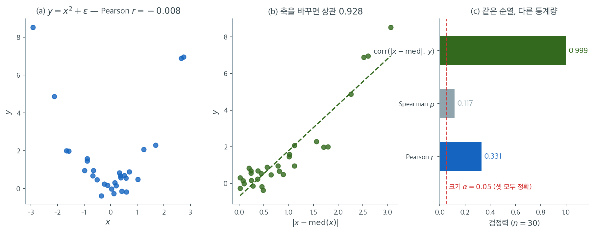
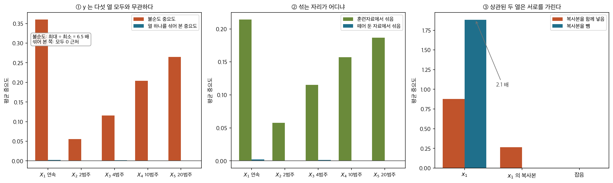

# 상관에 대한 순열검정

## 1. 짝을 섞으면 상관이 사라진다

Pearson 상관에 대한 고전적 검정은 통계량 $t = r\sqrt{(n-2)/(1-r^2)}$를 쓰며, 자료가 이변량 정규이면 $H_0: \rho = 0$ 아래에서 이 값이 $t_{n-2}$를 따른다. 정규성 가정이 깨지면 이 $p$값이 부정확할 수 있다.

상관에 대한 순열검정은 두 변수의 독립성에 대한 정확하고 분포무관한 검정을 제공한다. 한 변수를 고정한 채 다른 변수를 무작위로 섞으면 모든 연관이 파괴되고, 검정통계량의 귀무분포가 자료로부터 직접 생성된다.

---

## 2. 가설

검정하는 가설은 다음과 같다.

$$
H_0: X \text{와 } Y \text{가 독립이다} \quad \text{대} \quad H_1: X \text{와 } Y \text{가 연관되어 있다}
$$

$H_0$ 아래에서 $x$값과 $y$값을 짝짓는 모든 방식이 동등하게 가능하다. 검정통계량은 Pearson 상관계수이다(같은 틀에서 Spearman $\rho$나 Kendall $\tau$도 쓸 수 있다).

$$
r = \frac{\sum_{i=1}^n (x_i - \bar{x})(y_i - \bar{y})}{\sqrt{\sum_{i=1}^n (x_i - \bar{x})^2 \sum_{i=1}^n (y_i - \bar{y})^2}}
$$

!!! note "독립성과 무상관은 다르다"
    순열검정이 실제로 검정하는 것은 **독립성**이며, 이는 $\rho = 0$보다 강한 조건이다. 두 변수가 $\rho = 0$이면서도 종속일 수 있다(예: $X$가 $0$에 대해 대칭일 때 $Y = X^2$). 그럼에도 Pearson $r$을 쓰는 실무에서는 순열검정을 $H_0: \rho = 0$의 검정으로 쓰고 해석하는 것이 보통이다. 이 구별이 실제로 문제가 되는 경우를 연습문제 3에서 다룬다.

---

## 3. y 만 섞어 귀무분포를 만든다

대응 관측 $(x_1, y_1), (x_2, y_2), \ldots, (x_n, y_n)$이 주어졌을 때

1. 원래의 짝지어진 자료에서 관측 상관 $r_{\text{obs}}$를 계산한다.
2. $b = 1, 2, \ldots, B$에 대해:
    - $\{1, 2, \ldots, n\}$의 무작위 순열 $\pi$를 생성한다.
    - 순열된 쌍 $(x_1, y_{\pi(1)}), (x_2, y_{\pi(2)}), \ldots, (x_n, y_{\pi(n)})$을 만든다.
    - 순열된 쌍에서 $r^{*(b)}$를 계산한다.
3. 양측 $p$값은 다음과 같다.

$$
p = \frac{\#\{b : |r^{*(b)}| \ge |r_{\text{obs}}|\} + 1}{B + 1}
$$

분자와 분모의 "$+1$"은 관측된 자료를 순열의 하나로 포함시키는 것으로, $p$값이 정확히 $0$이 되지 않게 하고 검정을 정확하게 만든다.

단측 대립가설에 대해서는

- $H_1: \rho > 0$: $\displaystyle p = \frac{\#\{b : r^{*(b)} \ge r_{\text{obs}}\} + 1}{B + 1}$
- $H_1: \rho < 0$: $\displaystyle p = \frac{\#\{b : r^{*(b)} \le r_{\text{obs}}\} + 1}{B + 1}$

---

## 4. 정확 순열분포

$n$개 관측의 순열은 $n!$가지이다. $n$이 작으면 모든 순열을 열거하여 정확 $p$값을 계산할 수 있다.

| $n$ | 순열 수 ($n!$) | 가능성 |
|---|---|---|
| 5 | 120 | 정확 열거가 자명 |
| 8 | 40,320 | 정확 열거가 쉬움 |
| 10 | 3,628,800 | 정확 열거가 가능 |
| 12 | 479,001,600 | 경계 |
| 15 | $> 10^{12}$ | 무작위 표집 필요 |

$n \ge 12$이면 $B$개의 순열을 무작위로 뽑는 것이 표준이다. $B = 10{,}000$이면 $p$값의 몬테카를로 오차가 대략 $\sqrt{p(1-p)/B}$이다.

---

## 5. 주변분포와 무관하게 오류율이 정확하다

**정확성.** $H_0$ 아래에서 순열검정의 제1종 오류율은 정확히 $\alpha$이다(관측된 자료값에 조건부로). 이는 $X$와 $Y$의 주변분포와 무관하게 성립한다.

**분포무관.** 결합분포나 주변분포의 모양에 대한 가정이 필요 없다. 연속형, 이산형, 혼합형 자료 모두에 타당하다.

**일치성.** 순열검정은 일치추정에 대응하는 성질을 갖는다. $n \to \infty$일 때 $\rho \neq 0$인 임의의 고정된 대립가설에 대한 검정력이 $1$로 간다.

**유한표본 타당성.** 점근검정과 달리 어떤 표본크기 $n$에서도 제1종 오류를 정확히 통제한다.

!!! tip "검정통계량의 선택"
    순열 틀은 검정통계량의 선택에 무관하다. Pearson $r$을 쓰면 선형 연관을, Spearman $\rho$나 Kendall $\tau$를 쓰면 단조 연관을, 거리상관을 쓰면 임의의 형태의 종속성을 검정한다. 순열 방식($y$값을 섞는 것)은 어느 경우에도 동일하다.

이 중립성은 축복이자 부담이다. $y = x^2 + \varepsilon$처럼 $\rho = 0$이면서 완전히 종속인 자료에서 그 크기를 재어 보자.



(a)가 $n = 30$인 한 표본이다. $y$가 $x$로 완전히 결정되는데도 Pearson 상관은 $-0.008$이다. $E[X^3] = 0$이므로 모집단 상관이 정확히 $0$이고, U자 모양에서는 왼쪽의 음의 기울기와 오른쪽의 양의 기울기가 상쇄되기 때문이다. **눈으로는 명백한 관계를 선형 측도가 통째로 놓치고 있다.**

(b)는 가로축을 $|x - \text{med}(x)|$로 바꾼 것이다. 같은 $30$쌍인데 상관이 $0.928$로 뛴다. $y \approx x^2$이므로 "$x$가 가운데에서 얼마나 멀리 있는가"와 $y$ 사이에는 곧은 직선 관계가 있다. **이차 종속성을 선형 문제로 번역한 셈이다.**

(c)가 세 통계량의 검정력이다. Spearman이 $0.122$로 가장 낮은데, 단조 연관을 재는 측도에 단조가 아닌 관계를 물었으니 당연하다. Pearson은 $0.343$으로 뜻밖에 낮지 않다. 점추정값이 $0$ 근처여도 **관측된 $r$의 변동이 순열분포의 변동보다 크기 때문**에 이따금 꼬리로 밀려난다. 그리고 문제에 맞춘 $\text{corr}(|x - \text{med}(x)|,\ y)$는 $0.998$에 이른다.

결정적인 것은 **세 검정의 제1종 오류율이 모두 정확히 $0.05$라는 점**이다. 순열 방식이 같으므로 크기는 언제나 보장되고, 통계량의 선택은 오직 검정력만 바꾼다. 그래서 순열검정에서 통계적 판단의 무게는 전부 "무엇을 재는 통계량을 고를 것인가"로 옮겨간다. 찾는 형태를 모르겠다면 임의의 종속성에 대해 검정력이 $1$로 가는 거리상관이 안전한 기본값이다.

<div class="aibox" markdown>

**AI로 보는 통계학 1.** 섞어 보기 전에는 중요해 보였다

$3$ 절의 알고리즘이 한 일은 하나다 — **$y$ 를 섞어 짝을 끊고, 그래도 같은 값이 나오는지
본다.** 학습이 끝난 모형이 어떤 열을 실제로 쓰고 있는지 묻는 오늘의 표준적인 방법이 그
섞기다. 열 **하나만** 섞어 모형에 다시 먹이고 성능이 떨어진 양을 그 열의 「중요도」로
삼는다. 떨어지지 않으면 모형은 그 열을 보고 있지 않았다는 뜻이다. 이 쪽의 귀무가설을
열마다 한 번씩 묻는 것과 같다.

섞지 않고도 중요도를 얻는 더 싼 길이 있다. 나무를 쪼갤 때마다 줄어든 불순도를 그 열의
공으로 쌓아 두면 추가 계산이 아예 없다. $2007$ 년 카롤린 스트로블과 동료들이 그 공짜
중요도에 **아무 관계도 없는 자료**를 먹여 보았다. 관측 $120$ 개, $y$ 는 동전던지기,
설명변수는 연속 하나와 범주가 $2 \cdot 4 \cdot 10 \cdot 20$ 개인 넷 — 어느 것도 $y$ 와
관계가 없으니 다섯 중요도는 모두 같아야 한다. 그들의 결론은 초록의 한 줄이다.
**「변수중요도 측도는 설명변수 후보들이 측정 척도나 범주의 수에서 서로 다른 상황에서는
믿을 수 없다.」** 불순도 중요도가 **가장 강하게 치우쳐** 있었고, 범주가 많은 변수와 연속
변수를 뚜렷이 선호했다.

같은 설계를 그대로 돌려 보았다.



- **①** $y$ 는 다섯 열 어느 것과도 무관하다. 그런데 불순도 중요도는 연속변수에 $0.360$,
  $20$ 범주에 $0.265$, $2$ 범주에 $0.055$ 를 준다 — **최대가 최소의 $6.5$ 배다.** 쪼갤 자리가
  많은 열일수록 잡음 속에서 우연히 잘 갈라지는 자리를 찾을 기회가 많고, 그 운이 고스란히
  공로로 쌓인다. 떼어 둔 자료에서 열을 섞어 재면 다섯 모두 절댓값이 $0.002$ 를 넘지
  않는다.
- **②** 섞기만 하면 되는 것은 아니다. **어디서 섞느냐**가 그만큼 중요하다. 모형이 외워
  버린 훈련자료에서 그대로 섞으면 다섯 열 모두 $+0.06$ 에서 $+0.21$ 까지 솟는다. 모형이
  잡음을 외웠으니 그 잡음을 흐트러뜨리면 당연히 점수가 떨어진다. **모형이 본 적 없는
  자료에서 섞어야 한다.**
- **③** 그 대신 섞기가 못 하는 일이 있다. $y = 2x_1 + \varepsilon$ 인 자료에 $x_1$ 과 상관
  $0.999$ 인 복사본을 한 열 더 넣으면, $x_1$ 의 중요도가 $1.881$ 에서 $0.877$ 로 **반 토막**
  난다. 한쪽을 섞어도 다른 쪽이 같은 정보를 그대로 들고 있어서 모형이 거의 다치지 않기
  때문이다. 둘 다 「별로 안 중요한 열」로 보이게 된다.

이 장과 더 곧게 닿는 지적이 그 글에 하나 더 있다. 치우침의 원인 가운데 하나가
**복원추출 자체**라는 것이다. 나무마다 자료를 복원으로 뽑으면 같은 관측이 겹치거나
빠지면서 분할표의 칸이 뒤틀리고, 없던 연관이 인위적으로 생긴다. 그들이 쓴 나무를 **복원
없이 $0.632n$ 만큼 부분표집하는 방식과 함께 썼을 때에만**, 쓸모없는 설명변수들이 뽑히는
빈도가 바라는 만큼 똑같이 낮아졌다. 이 장의 주인공이 붓스트랩인데, 여기서는 붓스트랩이
문제의 **일부**다.

그래서 섞어 본 중요도가 $0$ 이라는 말은 「이 열은 쓸모없다」가 아니다. **「다른 열들이
그대로 있는 한, 이 모형은 이 열 없이도 같은 일을 한다」**는 말이다. 둘은 다르고, ③ 이
그 차이다.

_확인한 곳 — C. Strobl, A.-L. Boulesteix, A. Zeileis, T. Hothorn, "Bias in random forest
variable importance measures: illustrations, sources and a solution", 『BMC Bioinformatics』
$8$ 권 $25$ 번 글($2007$). 귀무 설계($n = 120$, $y$ 는 베르누이 $0.5$, 설명변수는 정규 하나와
범주 $2 \cdot 4 \cdot 10 \cdot 20$ 개인 넷), 「측정 척도나 범주의 수가 서로 다른 상황에서는
믿을 수 없다」는 초록의 문장, 불순도 중요도가 가장 강하게 치우쳐 있고 범주가 많은 변수와
연속변수를 선호한다는 결과, 복원추출이 연관을 인위적으로 만든다는 설명과 복원 없는
$0.632n$ 부분표집을 함께 써야 선택 빈도가 고르게 낮아진다는 결론을 이 글에서 확인했다. 그림의 수는 모두 직접 계산한 값이며
논문의 수가 아니다 — 여기서는 범주를 정수로 넣어 쪼갤 자리가 $k - 1$ 개인 구현으로
재현했고, 논문이 쓴 조건부 추론나무와는 구현이 다르다_

</div>

$n = 20$개 도시의 평균기온($x$, ℃)과 아이스크림 판매량($y$, 만원)을 기록했다.

<div class="exbox" markdown>

**보기 1.** <span class="diff easy" title="쉬움"></span> 상관에 대한 순열검정. $n = 20$개 도시의 기온과 판매량에서 $r_{\text{obs}} = 0.8268$을 얻었다. $y$를 $B = 9{,}999$번 섞어 검정한다.

**(1)** 순열 귀무분포에서 $E[r^{*}]$와 $\operatorname{Var}(r^{*})$를 구하시오. **자료가 무엇이든 답이 $n$만으로 정해진다.**

**(2)** 실행하면 초과가 **$0$회**로 나온다. 이때 보고할 수 있는 두 수 — 점추정 $(c+1)/(B+1)$과 $95\%$ 신뢰상한 — 를 구하고, $t$ 검정이 주는 $7 \times 10^{-6}$과 견주시오. 두 값이 자릿수로 다른데도 둘 다 맞는 까닭은 무엇인가.

</div>

??? success "풀이"

    **(1) 해석적으로.** $a_i = x_i - \bar x$, $b_i = y_i - \bar y$, $V_x = \sum_i a_i^2$, $V_y = \sum_i b_i^2$라 두면, $y$를 순열 $\pi$로 섞은 뒤의 상관은

    $$
    r^{*} = \frac{1}{\sqrt{V_x V_y}}\sum_{i=1}^n a_i\, b_{\pi(i)}
    $$

    이다($x$를 고정하므로 분모의 두 제곱합이 모두 상수다). $\sum_i b_i = 0$이므로 $E[b_{\pi(i)}] = 0$이고 따라서

    $$
    E[r^{*}] = \frac{1}{\sqrt{V_xV_y}}\sum_i a_i\, E[b_{\pi(i)}] = 0
    $$

    이다. 분산은 $E[b_{\pi(i)}^2] = V_y/n$과, $i \ne j$에서

    $$
    E[b_{\pi(i)}b_{\pi(j)}] = \frac{\left(\sum_k b_k\right)^2 - \sum_k b_k^2}{n(n-1)} = \frac{-V_y}{n(n-1)}
    $$

    를 쓰면

    $$
    E\!\left[\Big(\textstyle\sum_i a_i b_{\pi(i)}\Big)^2\right]
    = V_x\cdot\frac{V_y}{n} + (0 - V_x)\cdot\frac{-V_y}{n(n-1)}
    = \frac{V_xV_y}{n-1}
    $$

    이므로

    $$
    \operatorname{Var}(r^{*}) = \frac{1}{n-1} = \frac{1}{19},
    \qquad
    \operatorname{SD}(r^{*}) = \frac{1}{\sqrt{19}} = 0.2294157
    $$

    다. **$V_x$와 $V_y$가 통째로 약분되므로 자료의 모양이 들어올 자리가 없다.** 관측값은 이 폭의 $0.8268 \times \sqrt{19} = 3.604$배다. 정규근사로는 양측 $p \approx 3.1\times10^{-4}$이지만, $r^{*}$가 $[-1, 1]$에 갇혀 있으므로 이 근사를 꼬리에서 믿을 수는 없다.

    **(2) 해석적으로.** 초과가 $0$회이면 보고할 수 있는 수가 둘이고, 뜻이 다르다. [잔차 진단과 위반의 처방](../../ch12/diagnostics/handling_violations.md) 보기 8이 같은 상황을 다루었다.

    - **점추정**은 $\hat p = \dfrac{0+1}{B+1} = 1.000\times10^{-4}$이다. 교환가능성에서 이 값이 수준을 지킨다.
    - **$95\%$ 신뢰상한**은 참 순열 $p$값이 $p$일 때 $B$번 모두 실패할 확률이 $(1-p)^B$이므로, $(1-p)^B \ge 0.05$인 $p$들을 받아들여

      $$
      p \le 1 - 0.05^{1/B} = 2.996\times10^{-4}
      $$

      이 된다.

    둘 다 $t$ 검정의 $6.976\times10^{-6}$보다 한두 자릿수 크다. **그럼에도 모순이 아니다.** 순열검정은 참 $p$값이 $3\times10^{-4}$보다 작다고만 말하고 있을 뿐, 그것이 $7\times10^{-6}$이라는 $t$ 검정의 주장과 어긋나지 않는다. $B = 9{,}999$로는 $10^{-4}$보다 작은 영역을 **해상할 수가 없다.** 참 $p$가 $7\times10^{-6}$이라면 $B$번 중 기대 초과 횟수가 $Bp = 0.07$회이니 $0$회가 나오는 것이 당연하다. 두 자리 유효숫자로 재려면 $\operatorname{SD}(\hat p)/p = 1/\sqrt{pB} \approx 0.05$, 곧 $B \approx 400/p = 5.7\times10^7$이 필요하다.

    **수치적으로.**

    ```python
    import numpy as np
    from scipy import stats

    temp = np.array([14.5, 15.6, 16.7, 17.1, 17.5, 17.5, 18.7, 18.7, 20.0, 21.3,
                     24.8, 25.9, 26.2, 27.5, 30.1, 30.1, 30.3, 31.4, 32.2, 32.5])
    sales = np.array([276, 233, 288, 309, 328, 246, 322, 310, 309, 323,
                      332, 344, 415, 390, 389, 319, 377, 401, 381, 382])

    r = np.corrcoef(temp, sales)[0, 1]
    print(f"r = {r:.4f}")                      # 0.8268

    rng = np.random.default_rng(0)
    B = 9999
    perm = np.array([np.corrcoef(temp, rng.permutation(sales))[0, 1]
                     for _ in range(B)])
    p = ((np.abs(perm) >= abs(r)).sum() + 1) / (B + 1)
    print(f"permutation p = {p:.5f}")          # 0.0001
    print(stats.pearsonr(temp, sales))         # p = 7.4e-06
    ```

    출력:

    ```
    r = 0.8268
    permutation p = 0.00010
    PearsonRResult(statistic=0.8267919627184452, pvalue=6.976166744153747e-06)
    ```

    (1)의 두 적률과 (2)의 두 수를 잰다. 덤으로 순열 귀무분포를 $t$ 눈금으로 바꾸어 $t_{18}$과 분위를 견준다. 위 블록의 변수를 그대로 이어 쓴다.

    ```python
    n = len(temp)
    print(f"초과 횟수 c = {int((np.abs(perm) >= abs(r)).sum())},  "
          f"최대 |r*| = {np.abs(perm).max():.4f}")
    print(f"SD(r*) 닫힌 꼴 = {1 / np.sqrt(n - 1):.7f},  모의 = {perm.std(ddof=1):.7f}"
          f"   (몬테카를로 오차 {1 / np.sqrt(n - 1) / np.sqrt(2 * B):.7f})")
    print(f"평균 r*  = {perm.mean():+.7f}   (평균의 오차 {perm.std(ddof=1) / np.sqrt(B):.7f})")

    print(f"\n점추정  (0+1)/(B+1)       = {1 / (B + 1):.3e}")
    print(f"95% 신뢰상한 1-0.05^(1/B) = {1 - 0.05 ** (1 / B):.3e}")
    print(f"t 검정의 p                = {stats.pearsonr(temp, sales).pvalue:.3e}")

    tstar = perm * np.sqrt((n - 2) / (1 - perm ** 2))
    print(f"\nt_obs = {r * np.sqrt((n - 2) / (1 - r ** 2)):.4f},  "
          f"순열 |t*| 의 최대 = {np.abs(tstar).max():.4f}")
    for q in (0.95, 0.99, 0.999):
        print(f"  분위 {q}: 순열 |t*| = {np.quantile(np.abs(tstar), q):.4f},"
              f"   t_18 = {stats.t(n - 2).ppf((1 + q) / 2):.4f}")
    ```

    출력:

    ```
    초과 횟수 c = 0,  최대 |r*| = 0.8118
    SD(r*) 닫힌 꼴 = 0.2294157,  모의 = 0.2286138   (몬테카를로 오차 0.0016223)
    평균 r*  = +0.0012602   (평균의 오차 0.0022863)

    점추정  (0+1)/(B+1)       = 1.000e-04
    95% 신뢰상한 1-0.05^(1/B) = 2.996e-04
    t 검정의 p                = 6.976e-06

    t_obs = 6.2360,  순열 |t*| 의 최대 = 5.8990
      분위 0.95: 순열 |t*| = 2.0931,   t_18 = 2.1009
      분위 0.99: 순열 |t*| = 2.9373,   t_18 = 2.8784
      분위 0.999: 순열 |t*| = 4.0474,   t_18 = 3.9216
    ```

    **(1)이 맞는다.** 닫힌 꼴 $\operatorname{SD}(r^{*}) = 1/\sqrt{19} = 0.2294157$에 대해 모의값이 $0.2286138$로, 차이 $-0.0008$이 몬테카를로 오차 $0.0016$의 절반이다. 평균도 $+0.00126$으로 그 오차 $0.00229$ 안이다.

    **(2)도 맞는다.** $9{,}999$번 중 초과가 $0$회이고 순열 상관의 최대값이 $0.8118$로 관측값 $0.8268$에 닿지 못했다. 점추정 $1.000\times10^{-4}$과 신뢰상한 $2.996\times10^{-4}$을 섞어 읽으면 안 된다. **앞의 것은 "이 값으로 적으면 수준이 지켜진다"는 뜻이고, 뒤의 것은 "참값이 이보다 클 리 없다"는 뜻이다.**

    **$t$ 검정의 $7\times10^{-6}$을 뒷받침하는 증거도 자료 안에 있다.** 순열분포를 $t$ 눈금으로 바꾸어 보면 $95\%$, $99\%$, $99.9\%$ 분위가 $2.0931$, $2.9373$, $4.0474$로 $t_{18}$의 $2.1009$, $2.8784$, $3.9216$과 잘 맞는다. 재어 볼 수 있는 데까지는 두 참조분포가 거의 같으니, $t_{18}$을 그 너머로 끌고 간 $7\times10^{-6}$도 그럴듯하다. 다만 **그것은 외삽이고 순열검정이 보증해 주는 수는 아니다.** 관측된 $t_{\text{obs}} = 6.2360$은 순열이 만들어 낸 최대값 $5.8990$보다도 크다.

    두 접근이 같은 결론에 이른다. 순열검정은 정규성을 가정하지 않는 대신 $B$가 허락하는 만큼만 말하고, $t$ 검정은 정규성을 빌려 그보다 멀리 말한다.

!!! warning "$p$값의 하한을 보고할 때"
    순열 중 하나도 관측값보다 극단적이지 않으면 $p = 1/(B+1)$을 그대로 보고하기보다 $p < 1/(B+1)$로 쓰는 것이 정직하다. $B = 99{,}999$로 늘려도 이 자료에서는 여전히 하나도 나오지 않으므로 실제 $p$값은 $10^{-5}$보다 작다.

    $10^{-6}$ 수준의 $p$값이 정말 필요하다면 순열검정은 비효율적인 도구이다. $B \approx 10^8$이 필요하다. 그런 경우에는 점근 근사가 낫다.

---

## 6. 시각화: 귀무분포

$\{r^{*(1)}, \ldots, r^{*(B)}\}$의 히스토그램은 독립성 아래에서 기대되는 상관값의 분포를 보여준다. 이 분포는 $0$에 대해 대칭이고(무작위 순열이 양의 상관과 음의 상관을 같은 확률로 만들기 때문이다) 중간 정도의 $n$에서 근사적으로 정규이다(순열분포에 적용된 중심극한정리에 의해).

관측된 $r_{\text{obs}}$를 히스토그램 위에 표시한다. 꼬리 깊숙이 떨어지면 $H_0$에 반하는 증거가 강하다.

---

## 7. 붓스트랩 검정과의 비교

| 측면 | 순열검정 | 붓스트랩 검정 |
|---|---|---|
| 재표집 | 비복원(섞기) | 복원(쌍을 재표집) |
| 검정 대상 | 독립성 ($H_0: X \perp Y$) | 임의의 $H_0: \rho = \rho_0$ (신뢰구간을 통해) |
| 정확성 | 정확한 조건부 $p$값 | 근사 |
| 신뢰구간 | 역변환으로만 | 직접 얻을 수 있다 |
| 적합한 상황 | 무상관 검정 | $\rho$의 신뢰구간, $\rho_0 \neq 0$ 검정 |

$H_0: \rho = 0$이라는 특정 가설에 대해서는 제1종 오류를 정확히 통제하는 순열검정이 선호된다. 신뢰구간이나 $\rho_0 \neq 0$인 $H_0: \rho = \rho_0$의 검정에는 붓스트랩이 자연스럽다.

---

## 연습문제

<div class="drillbox" markdown>

**연습문제 1.** <span class="diff easy" title="쉬움"></span>
$n = 6$인 다음 자료에서 $6! = 720$가지 순열을 모두 열거하여 정확 $p$값을 구하라.

$$
x = (1.2,\ 2.5,\ 3.1,\ 4.8,\ 5.3,\ 6.9), \qquad y = (2.1,\ 2.9,\ 4.4,\ 4.0,\ 6.8,\ 7.5)
$$

**(a)** Pearson $r$을 통계량으로 하는 정확 순열 $p$값을 구하고 $t$ 검정과 비교하라.

**(b)** Spearman $\rho$를 통계량으로 하는 정확 순열 $p$값을 구하고 SciPy의 점근 $p$값과 비교하라.

</div>

??? success "풀이"
    ```python
    import numpy as np, itertools
    from scipy import stats

    x = np.array([1.2, 2.5, 3.1, 4.8, 5.3, 6.9])
    y = np.array([2.1, 2.9, 4.4, 4.0, 6.8, 7.5])

    r = stats.pearsonr(x, y)
    print(round(r.statistic, 4), round(r.pvalue, 4))      # 0.9243  0.0084

    rs = np.array([np.corrcoef(x, y[list(p)])[0, 1]
                   for p in itertools.permutations(range(6))])
    print(len(rs), (np.abs(rs) >= abs(r.statistic) - 1e-12).mean())   # 720  0.00694

    sp = stats.spearmanr(x, y)
    print(round(sp.statistic, 4), round(sp.pvalue, 4))    # 0.9429  0.0048
    rss = np.array([stats.spearmanr(x, y[list(p)]).statistic
                    for p in itertools.permutations(range(6))])
    print((np.abs(rss) >= abs(sp.statistic) - 1e-12).mean())          # 0.01667
    ```

    출력:

    ```
    0.9243 0.0084
    720 0.006944444444444444
    0.9429 0.0048
    0.016666666666666666
    ```

    | 통계량 | 관측값 | 정확 순열 $p$ | 점근 $p$ | 비 |
    |:---|---:|---:|---:|---:|
    | Pearson $r$ | 0.9243 | **0.00694** | 0.0084 | 0.83 |
    | Spearman $\rho$ | 0.9429 | **0.01667** | 0.0048 | 3.47 |

    **(a) Pearson에서는 순열 $p$값이 점근값보다 작다**($0.0069 < 0.0084$). 앞선 보기들과 방향이 반대인데, 이는 $n = 6$에서 순열분포가 $t_4$보다 꼬리가 얇기 때문이다. 관측된 $r = 0.9243$은 $720$가지 중 $5$번째로 극단적인 값이다($5/720 = 0.00694$).

    **(b) Spearman에서는 순열 $p$값이 점근값의 $3.5$배이다**($0.0167$ 대 $0.0048$). 차이가 크다.

    이유는 **Spearman $\rho$의 순열분포가 극도로 이산적**이기 때문이다. 순위만 쓰므로 $720$가지 순열이 만들어내는 $\rho$ 값은 소수의 서로 다른 값에 몰린다. $\rho = 0.9429$ 이상인 순열이 $12$개 있어 $12/720 = 0.01667$이 된다. 가능한 다음 값은 $\rho = 1$(순열 $1$개)로 건너뛴다.

    SciPy의 `spearmanr`은 $t$ 근사를 쓰는데, $n = 6$에서 이 근사는 신뢰할 수 없다. **정확 순열 $p$값이 옳다.**

    **실무적 함의:** $n \le 10$에서 `spearmanr`이나 `kendalltau`의 기본 $p$값을 그대로 쓰면 안 된다. SciPy는 `method='exact'` 옵션을 제공하며(`stats.spearmanr`은 `alternative`와 함께 정확 순열을, `stats.kendalltau`는 `method='exact'`를 지원한다), 없다면 직접 열거해야 한다.

    !!! note "Pearson과 Spearman 중 무엇을 볼 것인가"
        이 자료에서 Spearman의 관측값($0.9429$)이 Pearson($0.9243$)보다 큰데도 정확 $p$값은 Spearman 쪽이 $2.4$배 크다.

        관측 통계량의 크기를 검정들 사이에서 비교하는 것은 의미가 없다. 각 통계량은 자기 귀무분포에 대해서만 해석된다. $\rho = 0.9429$는 순위 여섯 개로 만들 수 있는 값 중 두 번째로 큰 값일 뿐이다.

<div class="drillbox" markdown>

**연습문제 2.** <span class="diff med" title="중간"></span>
정규성이 깨질 때 순열검정과 고전적 $t$ 검정의 제1종 오류율을 비교하라. $n = 15$에서 $X$와 $Y$를 독립으로 생성하되 주변분포를 정규, $\text{LogNormal}(0, 2^2)$, 코시로 바꾸어 가며 확인하라.

</div>

??? success "풀이"
    ```python
    import numpy as np
    from scipy import stats
    rng = np.random.default_rng(5)

    def size(gen, n=15, M=20_000, B=999, chunk=200):
        """한 덩어리(chunk)의 표본을 한꺼번에 처리한다."""
        ct = cp = 0
        for _ in range(M // chunk):
            x = gen(chunk, n); y = gen(chunk, n)
            a = x - x.mean(1, keepdims=True)
            b = y - y.mean(1, keepdims=True)
            den = np.sqrt((a ** 2).sum(1) * (b ** 2).sum(1))
            r = (a * b).sum(1) / den
            t = r * np.sqrt((n - 2) / (1 - r ** 2))
            ct += int((2 * stats.t(n - 2).sf(np.abs(t)) < 0.05).sum())
            Bm = rng.permuted(np.repeat(b[:, None, :], B, axis=1), axis=2)
            rp = np.abs(np.einsum("ij,ikj->ik", a, Bm) / den[:, None])
            p = ((rp >= np.abs(r)[:, None] - 1e-12).sum(1) + 1) / (B + 1)
            cp += int((p <= 0.05).sum())
        return ct / M, cp / M

    gens = (("정규", lambda m, n: rng.standard_normal((m, n))),
            ("로그정규(0, 2^2)", lambda m, n: np.exp(rng.normal(0, 2, (m, n)))),
            ("코시", lambda m, n: rng.standard_cauchy((m, n))))
    print("주변분포             t 검정   순열검정   (n = 15, M = 20000, B = 999)")
    for tag, g in gens:
        st, sp = size(g)
        print(f"{tag:<18s}  {st:.4f}   {sp:.4f}")
    print(f"모의 오차 <= {np.sqrt(0.25 / 20_000):.4f}")
    ```

    출력:

    ```text
    주변분포             t 검정   순열검정   (n = 15, M = 20000, B = 999)
    정규                  0.0505   0.0497
    로그정규(0, 2^2)        0.0716   0.0512
    코시                  0.0730   0.0501
    모의 오차 <= 0.0035
    ```

    | 주변분포 | 고전적 $t$ 검정 | 순열검정 |
    |:---|---:|---:|
    | 정규 | 0.0505 | 0.0497 |
    | $\text{LogNormal}(0, 2^2)$ | **0.0716** | 0.0512 |
    | Cauchy | **0.0730** | 0.0501 |

    **고전적 $t$ 검정이 무너진다.** 코시 주변분포에서 제1종 오류율이 $0.0730$으로 명목값의 $1.5$배이다. 로그정규에서도 $0.0716$이다. 모의 오차가 $0.0035$이므로 둘 다 $0.05$와 뚜렷이 다르다.

    이유는 $t = r\sqrt{(n-2)/(1-r^2)}$가 $t_{n-2}$를 따른다는 결과가 **이변량 정규성에 의존**하기 때문이다. 두꺼운 꼬리에서는 한두 개의 극단값이 $r$을 좌우해 $r$의 귀무분포가 훨씬 넓어진다.

    **순열검정은 세 경우 모두 $0.05$를 지킨다.** 이는 근사가 잘 맞는다는 뜻이 아니라 **정확하다**는 뜻이다. $X$와 $Y$가 독립이면 $y$의 어떤 재배열도 동등하게 가능하므로, 주변분포가 무엇이든 순열 $p$값의 분포는 균등하다.

    !!! warning "부동소수점 비교에 주의"
        위 코드에서 `rp >= np.abs(r) - 1e-12`처럼 작은 허용오차를 둔 것에는 이유가 있다.

        코시 자료에서는 한 관측값이 나머지를 압도해, 서로 다른 순열이 반올림오차 수준까지 같은 $\lvert r^*\rvert$를 만들 수 있다. 허용오차 없이 엄격히 비교하면 관측값과 사실상 같은 순열들이 계수에서 빠져 $p$값이 실제보다 작아지고, 그만큼 제1종 오류율이 명목값 위로 올라간다.

        차이가 작지만 이는 방법론의 문제가 아니라 **구현의 문제**이다. 관측 통계량과 순열 통계량을 반드시 같은 함수로 계산하고, 비교에 허용오차를 두는 것이 안전하다.

<div class="drillbox" markdown>

**연습문제 3.** <span class="diff med" title="중간"></span>
본문에서 순열검정이 검정하는 것은 $\rho = 0$이 아니라 독립성이라고 했다. $Y = X^2 + \varepsilon$처럼 $\rho = 0$이면서 강하게 종속인 경우에 이것이 무엇을 의미하는지 확인하라. $X \sim N(0,1)$, $\varepsilon \sim N(0, 0.5^2)$, $n = 30$에서 세 통계량 — Pearson $r$, Spearman $\rho$, 그리고 $|x_i - \text{med}(x)|$와 $y$의 상관 — 을 쓰는 순열검정의 검정력을 비교하라.

</div>

??? success "풀이"
    ```python
    import numpy as np
    from scipy import stats
    rng = np.random.default_rng(3)

    def rank(v):                       # 행마다 1, 2, ..., n 의 순위 (동점 없음)
        return np.argsort(np.argsort(v, 1), 1) + 1.0

    def power(n=30, M=20_000, B=999, chunk=200):
        hit = np.zeros(3, dtype=int)
        for _ in range(M // chunk):
            x = rng.normal(0, 1, (chunk, n))
            y = x ** 2 + rng.normal(0, 0.5, (chunk, n))
            feats = (x, rank(x), np.abs(x - np.median(x, 1, keepdims=True)))
            tgts = (y, rank(y), y)     # 스피어만은 순위에 대한 피어슨이다
            for k, (u, v) in enumerate(zip(feats, tgts)):
                a = u - u.mean(1, keepdims=True)
                b = v - v.mean(1, keepdims=True)
                den = np.sqrt((a ** 2).sum(1) * (b ** 2).sum(1))
                r = np.abs((a * b).sum(1) / den)
                Bm = rng.permuted(np.repeat(b[:, None, :], B, axis=1), axis=2)
                rp = np.abs(np.einsum("ij,ikj->ik", a, Bm) / den[:, None])
                p = ((rp >= r[:, None] - 1e-12).sum(1) + 1) / (B + 1)
                hit[k] += int((p <= 0.05).sum())
        return hit / M

    print("n = 30, M = 20000, B = 999, alpha = 0.05")
    for tag, v in zip(("Pearson r", "Spearman rho", "corr(|x-med(x)|, y)"), power()):
        print(f"  {tag:<22s} 검정력 = {v:.3f}")
    print(f"  모의 오차 <= {np.sqrt(0.25 / 20_000):.4f}")
    ```

    출력:

    ```text
    n = 30, M = 20000, B = 999, alpha = 0.05
      Pearson r              검정력 = 0.343
      Spearman rho           검정력 = 0.122
      corr(|x-med(x)|, y)    검정력 = 0.998
      모의 오차 <= 0.0035
    ```

    | 검정통계량 | 검정력 ($n = 30$) |
    |:---|---:|
    | Pearson $r$ | 0.343 |
    | Spearman $\rho$ | 0.122 |
    | $\text{corr}(\lvert x - \text{med}(x)\rvert,\ y)$ | **0.998** |

    **세 검정 모두 같은 순열 방식을 쓰지만 결과가 완전히 다르다.**

    **Spearman이 가장 나쁘다**($0.122$). 이는 놀랍지 않다. Spearman은 **단조** 연관을 재는데 $Y = X^2$은 단조가 아니다. $X$가 음수 구간에서는 감소, 양수 구간에서는 증가하므로 순위 상관이 상쇄된다.

    **Pearson이 $0.343$으로 나쁘지 않은 것이 오히려 흥미롭다.** 모집단에서 $\text{Cov}(X, X^2) = E[X^3] = 0$이므로 $\rho = 0$이다. 그런데도 검정력이 $0.05$를 크게 넘는다.

    이유는 순열검정이 $r$의 **점추정값이 아니라 그 분포 전체**를 비교하기 때문이다. 종속인 자료에서 관측된 $r$의 변동은 순열분포의 변동보다 크다. $y$가 $x$의 함수이므로 $y$의 분산이 $x$의 극단값에 몰려 있고, 이것이 관측 $r$을 더 자주 꼬리로 밀어낸다.

    **문제에 맞는 통계량을 고르면 검정력이 $0.998$이 된다.** $|x_i - \text{med}(x)|$는 $x$가 $0$에서 얼마나 떨어져 있는지를 재고, $Y = X^2$이면 이것과 $y$가 강한 **양의 선형 관계**를 갖는다. 이차 종속성을 선형 문제로 바꾼 것이다.

    !!! tip "이것이 순열검정의 핵심 교훈이다"
        순열 틀은 통계량의 선택에 대해 완전히 중립적이다. 세 통계량 모두 제1종 오류율이 정확히 $0.05$이다. 검정력만 $0.122$에서 $0.998$까지 갈린다.

        따라서 **모든 통계적 판단은 통계량의 선택으로 옮겨간다.** 무엇을 찾고 있는지 모른다면 다음 중 하나를 고려한다.

        | 통계량 | 탐지 대상 |
        |:---|:---|
        | Pearson $r$ | 선형 연관 |
        | Spearman $\rho$, Kendall $\tau$ | 단조 연관 |
        | 거리상관 (distance correlation) | 임의의 종속성 |
        | 상호정보량 | 임의의 종속성 |
        | $\text{corr}(g(x), h(y))$ | $g$, $h$로 지정한 특정 형태 |

        거리상관은 특히 값지다. $H_0$: 독립에 대해 검정력이 임의의 종속성에 대해 $1$로 수렴하는 것이 보장되며, 순열검정과 자연스럽게 결합된다.

        여러 통계량을 다 시도하고 가장 작은 $p$값을 고르는 것은 **다중검정 문제를 일으킨다**. 그렇게 하려면 최댓값 통계량 $\max_k |T_k|$를 하나의 통계량으로 삼아 순열검정을 하면 다중성이 자동으로 보정된다.

<div class="drillbox" markdown>

**연습문제 4.** <span class="diff med" title="중간"></span>
어떤 사람이 $B = 20$개의 무작위 순열로 상관의 순열검정을 하고 $p_{\text{naive}} = \#\{b : \lvert r^{*(b)}\rvert \ge \lvert r_{\text{obs}}\rvert\}/B$로 계산해 $p = 0$을 보고했다. 3절의 "$+1$"이 왜 거기 있어야 하는지를 다음 순서로 밝혀라. $T = \lvert r \rvert$로 쓰고 동점은 없다고 본다.

**(a)** $H_0$ 아래에서 관측된 자료값에 조건부로 $T_{\text{obs}},\ T^{*(1)},\ \ldots,\ T^{*(B)}$가 교환가능함을 설명하고, $R = 1 + \#\{b : T^{*(b)} > T_{\text{obs}}\}$가 $\{1, 2, \ldots, B+1\}$에서 균등함을 보여라. 이로부터 3절의 $p$값이 $p = R/(B+1)$임과

$$
P(p \le \alpha) = \frac{\lfloor \alpha(B+1)\rfloor}{B+1} \le \alpha
$$

임을 얻어라.

**(b)** 같은 방식으로 $p_{\text{naive}} = (R-1)/B$의 크기 $P(p_{\text{naive}} \le \alpha)$를 $B$와 $\alpha$로 적어라. $B = 20$, $\alpha = 0.05$에서 두 크기를 수로 구하고, 초과분의 상한이 $(1-\alpha)/(B+1)$임을 보여라.

**(c)** $H_0$ 아래에서 $p_{\text{naive}} = 0$이 보고될 확률은 얼마인가. 전수 열거로 얻는 참 순열 $p$값이 결코 $0$이 될 수 없는 까닭과 함께 설명하라.

**(d)** 보기 1은 $B = 9{,}999$, 연습문제 2는 $B = 999$를 썼다. $B = 10{,}000$이나 $B = 1{,}000$이 아니라 $B+1$이 $10{,}000$과 $1{,}000$이 되게 고른 이유를 (a)의 식으로 설명하라.

</div>

??? success "풀이"
    **(a) 교환가능성.** 관측된 두 값집합 $\{x_i\}$와 $\{y_i\}$에 조건을 걸자. $H_0$ 아래에서 $x$값과 $y$값을 짝짓는 $n!$가지 방식이 모두 동등하게 가능하므로(2절), 관측된 배치는 $S_n$ 위의 균등분포에서 뽑힌 것으로 볼 수 있다. 그것을 $\pi_0$이라 하면 $T_{\text{obs}} = T(\pi_0)$이고, 알고리즘이 만드는 $b$번째 복제는 $T^{*(b)} = T(\pi_b \circ \pi_0)$인데 $\pi_b$가 $\pi_0$과 독립인 균등분포이므로 $\pi_b\circ\pi_0$ 역시 균등분포다. 따라서 $B+1$개의 값은 모두 **같은 순열분포에서 독립으로 뽑힌 것**이고, 특히 교환가능하다.

    교환가능한 $B+1$개의 값에 동점이 없으면 어느 것이 몇 번째로 큰지가 모두 같은 확률이다. 첫 번째 값의 등수 $R$은 $\{1, \ldots, B+1\}$에서 균등하다. 동점이 없으므로 $\#\{b : T^{*(b)} \ge T_{\text{obs}}\} = R - 1$이고

    $$
    p = \frac{\#\{b : T^{*(b)} \ge T_{\text{obs}}\} + 1}{B+1} = \frac{(R-1)+1}{B+1} = \frac{R}{B+1}
    $$

    이다. **$p$값은 등수를 $B+1$로 나눈 것일 뿐이다.** 그러므로

    $$
    P(p \le \alpha) = P\!\left(R \le \alpha(B+1)\right) = \frac{\lfloor \alpha(B+1)\rfloor}{B+1} \le \frac{\alpha(B+1)}{B+1} = \alpha
    $$

    이고, 이것이 5절이 말한 "정확성"의 내용이다. 버림 때문에 크기가 $\alpha$에 **미달**할 수는 있어도 넘지는 못한다.

    **(b) "$+1$"을 빼면.** $p_{\text{naive}} = (R-1)/B \le \alpha$는 $R \le 1 + \alpha B$와 같고, $R$이 $1$ 이상의 정수이므로 그런 $R$의 개수는 $\lfloor 1 + \alpha B\rfloor = 1 + \lfloor \alpha B\rfloor$이다. 따라서

    $$
    P(p_{\text{naive}} \le \alpha) = \frac{1 + \lfloor \alpha B\rfloor}{B+1}
    \le \frac{1 + \alpha B}{B+1} = \alpha + \frac{1-\alpha}{B+1}
    $$

    이다. $B = 20$, $\alpha = 0.05$를 넣으면

    | $p$값의 정의 | 크기 $P(p \le 0.05)$ | 값 |
    |:---|:---|---:|
    | $(1 + \#)/(B+1)$ | $\lfloor 0.05 \times 21\rfloor/21 = 1/21$ | **0.047619** |
    | $\#/B$ | $(1 + \lfloor 0.05 \times 20\rfloor)/21 = 2/21$ | **0.095238** |

    로 **크기가 정확히 두 배**가 된다. $\alpha$를 넘은 양은 $0.095238 - 0.05 = 0.045238$이고, 이는 상한 $(1-\alpha)/(B+1) = 0.95/21 = 0.045238$과 정확히 같다($\lfloor \alpha B\rfloor = \alpha B$일 때 상한이 달성된다). $B$가 커지면 이 초과분이 $O(1/B)$로 사라지므로 **"$+1$"을 빼먹는 실수는 $B$가 작을 때 치명적이다.** $B = 9{,}999$에서는 두 정의의 크기가 모두 $500/10{,}000 = 0.05$로 같아진다.

    **(c) $p_{\text{naive}} = 0$은 $R = 1$일 때**이므로 그 확률은 $1/(B+1) = 1/21 = 0.047619$다. $H_0$가 참인데도 **스물한 번에 한 번은 "$p = 0$"이 찍힌다.** 쓸 수 있는 $\alpha = 0.05$ 예산을 그 사건 하나가 거의 다 써 버리는 셈이다.

    참 순열 $p$값이 $0$이 될 수 없는 까닭은 더 간단하다. 전수 열거에서 쓰는 집합 $S_n$에는 **관측된 배치 자신**(항등순열)이 들어 있고 그 값은 $T_{\text{obs}} \ge T_{\text{obs}}$를 만족한다. 그러므로

    $$
    p_{\text{exact}} = \frac{\#\{\pi \in S_n : T(\pi) \ge T_{\text{obs}}\}}{n!} \ge \frac{1}{n!} > 0
    $$

    이다. 무작위 표집은 $S_n$ 전체를 보지 못하므로 그 "자기 자신 한 개"를 잃는데, 분자와 분모의 $+1$이 바로 그것을 되돌려 놓는 장치다. **$p = 0$은 순열검정이 낼 수 있는 답이 아니다.**

    **(d) $B+1$을 $1/\alpha$의 배수로 고른다.** (a)의 크기는 $\lfloor \alpha(B+1)\rfloor/(B+1)$이고, 이것이 $\alpha$와 **정확히** 같아지는 것은 $\alpha(B+1)$이 정수일 때다. $\alpha = 0.05$라면

    - $B = 9{,}999$: $0.05 \times 10{,}000 = 500$ (정수) $\Rightarrow$ 크기 $= 500/10{,}000 = 0.05$, 손실 없음.
    - $B = 10{,}000$: $0.05 \times 10{,}001 = 500.05 \Rightarrow$ 크기 $= 500/10{,}001 = 0.049995$, 미세하게 버린다.
    - $B = 999$: $0.05 \times 1{,}000 = 50 \Rightarrow$ 크기 $= 0.05$, 손실 없음.

    손실 자체는 $10^{-5}$ 수준이라 실무에서 대수롭지 않다. 그러나 $B$를 $19$나 $99$처럼 작게 쓸 때는 이야기가 달라진다($B = 19$면 $0.05 \times 20 = 1$로 역시 정확하지만, $B = 20$이면 $\lfloor 1.05\rfloor/21 = 0.047619$로 $5\%$를 다 쓰지 못한다). **$B$를 $10^k - 1$로 적는 관습은 멋이 아니라 버림 손실을 $0$으로 만드는 선택이다.** 덤으로 가능한 $p$값이 $k/(B+1)$ 꼴의 깔끔한 격자에 놓인다.

<div class="drillbox" markdown>

**연습문제 5.** <span class="diff med" title="중간"></span>
다섯 도시에서 기온 $x = (16.0,\ 19.0,\ 22.0,\ 25.0,\ 31.0)$과 판매량 $y = (251,\ 268,\ 301,\ 322,\ 418)$을 얻었다. $5! = 120$가지를 모두 열거하여 답하라.

**(a)** 정확 양측 순열 $p$값을 구하고 $t$ 검정의 $p$값과 견주시오.

**(b)** 이 자료에서 **어떤 배치를 관측했더라도** 나올 수 있는 양측 $p$값의 최솟값은 얼마인가. 값에 동점이 없으면 그 최솟값이 일반적으로 $1/n!$인 까닭을 재배열부등식으로 설명하라.

**(c)** (b)로부터, 양측 순열검정이 수준 $\alpha$에서 기각할 **가능성 자체가 있으려면** $n$이 얼마나 커야 하는가. $\alpha = 0.05,\ 0.01,\ 0.001$에 대해 가장 작은 $n$을 각각 구하라.

</div>

??? success "풀이"
    **수치적으로.**

    ```python
    import itertools, math
    import numpy as np
    from scipy import stats

    x5 = np.array([16.0, 19.0, 22.0, 25.0, 31.0])         # 기온 (℃)
    y5 = np.array([251.0, 268.0, 301.0, 322.0, 418.0])    # 판매량 (만원)

    r5 = np.corrcoef(x5, y5)[0, 1]
    rs5 = np.array([np.corrcoef(x5, y5[list(p)])[0, 1]
                    for p in itertools.permutations(range(5))])
    c = int((np.abs(rs5) >= abs(r5) - 1e-12).sum())
    print(f"r_obs = {r5:.6f}")
    print(f"|r*| >= |r_obs| 인 순열 = {c} / {len(rs5)}   ->  정확 양측 p = {c / 120:.6f}")
    print(f"t 검정의 p             = {stats.pearsonr(x5, y5).pvalue:.6f}")
    print(f"순열 r* 의 최대 = {rs5.max():.6f},  최소 = {rs5.min():.6f}")

    cnt = np.array([(np.abs(rs5) >= abs(v) - 1e-12).sum() for v in rs5])
    print(f"\n이 자료에서 나올 수 있는 양측 p 의 최소 = {cnt.min()}/120 = {cnt.min() / 120:.6f}")
    print("n! 의 역수:")
    for m in range(3, 9):
        print(f"  n = {m}: 1/n! = {1 / math.factorial(m):.6f}")
    ```

    출력:

    ```text
    r_obs = 0.981568
    |r*| >= |r_obs| 인 순열 = 1 / 120   ->  정확 양측 p = 0.008333
    t 검정의 p             = 0.002996
    순열 r* 의 최대 = 0.981568,  최소 = -0.892154

    이 자료에서 나올 수 있는 양측 p 의 최소 = 1/120 = 0.008333
    n! 의 역수:
      n = 3: 1/n! = 0.166667
      n = 4: 1/n! = 0.041667
      n = 5: 1/n! = 0.008333
      n = 6: 1/n! = 0.001389
      n = 7: 1/n! = 0.000198
      n = 8: 1/n! = 0.000025
    ```

    **(a)** $r_{\text{obs}} = 0.981568$이고 $\lvert r^*\rvert \ge \lvert r_{\text{obs}}\rvert$인 순열이 **단 하나**(관측된 배치 자신)다. 따라서

    $$
    p_{\text{exact}} = \frac{1}{120} = 0.008333,
    \qquad p_{t} = 0.002996
    $$

    이다. 순열 $p$값이 $t$ 검정의 $2.8$배다. 연습문제 1(a)와 방향이 반대인데, 그쪽은 $n = 6$에서 $5/720$이라 분해능이 더 좋았다. 여기서는 **$1/120$이 바닥이라 더 작게 적을 길이 없다.**

    **(b) 바닥은 $1/120 = 0.008333$이다.** 열거한 $120$개 값 가운데 $\lvert r^*\rvert$가 가장 큰 것을 관측했을 때가 그 바닥이고, 이 자료에서는 그 최댓값이 바로 $r_{\text{obs}} = 0.981568$이다(음의 끝은 $-0.892154$로 크기가 작다).

    일반적으로, $x$를 고정하면 보기 1의 풀이대로

    $$
    r^*(\pi) = \frac{1}{\sqrt{V_xV_y}}\sum_{i=1}^n a_i\,b_{\pi(i)}
    $$

    이고 분모가 상수다. 재배열부등식은 $\sum_i a_i b_{\pi(i)}$가 $a$와 $b$를 **같은 순서로 정렬해 짝지을 때 최대**, **거꾸로 짝지을 때 최소**가 되며, $a$값들과 $b$값들에 동점이 없으면 그 최대·최소를 주는 순열이 **각각 하나뿐**임을 말한다. 두 끝값의 크기가 우연히 같지 않다면 $\lvert r^*\rvert$의 최댓값을 주는 순열도 하나뿐이고, 그때 분자가 $1$이 되어

    $$
    \min_{\pi} p_{\text{exact}}(\pi) = \frac{1}{n!}
    $$

    이다. 동점이 있으면 분자가 커져 바닥이 올라간다(연습문제 6(d)에서 그 극단을 본다).

    **(c) $1/n! \le \alpha$, 곧 $n! \ge 1/\alpha$가 필요하다.** 위 출력의 표에서 읽으면

    | $\alpha$ | 필요한 $n!$ | 가장 작은 $n$ | 그때의 $1/n!$ |
    |---:|---:|---:|---:|
    | $0.05$ | $\ge 20$ | $4$ ($4! = 24$) | $0.041667$ |
    | $0.01$ | $\ge 100$ | $5$ ($5! = 120$) | $0.008333$ |
    | $0.001$ | $\ge 1{,}000$ | $7$ ($7! = 5{,}040$) | $0.000198$ |

    이다. $n = 3$이면 바닥이 $1/6 = 0.166667$이므로 **$x$와 $y$가 완벽하게 일치해도 $\alpha = 0.10$에서조차 기각할 수 없다.** $\alpha = 0.001$에는 $n = 6$($1/720 = 0.001389$)도 모자라 $n = 7$이 필요하다.

    이것은 방법의 결함이 아니라 **정보의 한계**다. 관측 세 쌍이 담을 수 있는 "우연이 아님"의 증거에는 상한이 있다. 작은 분할표에서 Fisher 정확검정이 유의해질 수 없는 것과 같은 사정이며, $t$ 검정이 $n = 3$에서도 $p = 0.0003$ 같은 수를 내놓는 것은 자료가 아니라 **정규성 가정이 빌려 준 수**다.

<div class="drillbox" markdown>

**연습문제 6.** <span class="diff hard" title="어려움"></span>
6절은 순열 귀무분포가 "$0$에 대해 대칭"이라고 적었다. 이 주장이 얼마나 참인지 적률로 재어 보자. 보기 1의 풀이처럼 $a_i = x_i - \bar x$, $b_i = y_i - \bar y$, $V_x = \sum_i a_i^2$, $V_y = \sum_i b_i^2$로 두고 여기에 $A_3 = \sum_i a_i^3$, $B_3 = \sum_i b_i^3$을 더한다. $S = \sum_i a_i b_{\pi(i)}$, $r^* = S/\sqrt{V_xV_y}$이다.

**(a)** 지표 $(i, j, k)$를 "셋 다 같음 / 둘만 같음 / 셋 다 다름"으로 나누어

$$
E[S^3] = A_3B_3 \cdot \frac{n}{(n-1)(n-2)}
$$

을 보여라. ($\sum_i a_i = 0$과, 서로 다른 세 지표에 대한 합 $\sum_{u \ne v \ne w} b_ub_vb_w = 2B_3$을 쓴다.)

**(b)** 표본 비대칭도를 $g_x = \dfrac{n^{-1}\sum_i a_i^3}{(n^{-1}\sum_i a_i^2)^{3/2}}$로 정의하면

$$
E[(r^*)^3] = \frac{g_xg_y}{(n-1)(n-2)},
\qquad
\operatorname{Skew}(r^*) = g_xg_y\,\frac{\sqrt{n-1}}{\,n-2\,}
$$

임을 보여라. $V_x$, $V_y$가 약분되어 사라지는 보기 1의 (1)과 달리 **이번에는 자료의 모양이 남는다**는 점을 지적하라.

**(c)** 6절의 대칭 주장이 **정확히** 참이 되는 자료의 조건을 하나 제시하라(힌트: 중심화한 $x$값의 다중집합이 부호를 바꿔도 그대로이면 된다). 그리고 Spearman $\rho$를 쓸 때에는 동점이 없으면 그 주장이 **언제나** 정확한 까닭을 설명하고, 연습문제 1(b)에서 나온 수 $12/720$이 그것과 어떻게 들어맞는지 적어라.

**(d)** 크기 $n$의 표본의 비대칭도는 $\lvert g\rvert \le (n-2)/\sqrt{n-1}$을 넘지 못한다. 이로부터 $\operatorname{Skew}(r^*)$가 가질 수 있는 최댓값을 구하고, $n \to \infty$에서도 정규근사가 좋아지지 않는 자료가 있음을 말하라. 그 상한을 달성하는 보기 $x = y = (0, 0, \ldots, 0, 1)$($0$이 $n-1$개)에서 $r^*$의 정확 분포를 구하고, $r_{\text{obs}} = 1$의 양측 $p$값이 $1/n$임을 보여라. $\alpha = 0.05$에서 기각하려면 $n$이 얼마나 커야 하는가.

</div>

??? success "풀이"
    **(a) 세제곱을 펼친다.** 순열 $\pi$가 $S_n$에서 균등할 때

    $$
    S^3 = \sum_{i}\sum_{j}\sum_{k} a_ia_ja_k\, b_{\pi(i)}b_{\pi(j)}b_{\pi(k)}
    $$

    이고, 기댓값은 지표의 일치 양식에 따라 세 덩어리로 갈린다.

    **(i) $i = j = k$.** $E[b_{\pi(i)}^3] = B_3/n$이므로 기여는 $A_3 \cdot B_3/n$이다.

    **(ii) 둘만 같음.** $(i=j\ne k)$, $(i=k\ne j)$, $(j=k\ne i)$의 세 경우가 대칭이고 각각 $\sum_{i \ne k} a_i^2a_k \, E[b_{\pi(i)}^2 b_{\pi(k)}]$를 준다. $i \ne k$에서

    $$
    E[b_{\pi(i)}^2b_{\pi(k)}] = \frac{1}{n(n-1)}\sum_{u \ne v} b_u^2 b_v
    = \frac{1}{n(n-1)}\sum_u b_u^2(0 - b_u) = \frac{-B_3}{n(n-1)}
    $$

    이고, 마찬가지로 $\sum_{i \ne k} a_i^2 a_k = \sum_i a_i^2(0 - a_i) = -A_3$이다. 세 경우를 합치면

    $$
    3 \cdot (-A_3)\cdot\frac{-B_3}{n(n-1)} = \frac{3A_3B_3}{n(n-1)}
    $$

    **(iii) 셋 다 다름.** 거듭제곱합 항등식 $\sum_{u\ne v\ne w} c_uc_vc_w = p_1^3 - 3p_1p_2 + 2p_3$에서 $p_1 = \sum_u c_u = 0$이므로 그 값은 $2p_3$이다. 곧 $a$ 쪽은 $2A_3$, $b$ 쪽은 $2B_3$이고

    $$
    2A_3 \cdot \frac{2B_3}{n(n-1)(n-2)} = \frac{4A_3B_3}{n(n-1)(n-2)}
    $$

    **셋을 더한다.** 공통분모 $n(n-1)(n-2)$로 모으면 분자가

    $$
    (n-1)(n-2) + 3(n-2) + 4 = n^2 - 3n + 2 + 3n - 6 + 4 = n^2
    $$

    이므로

    $$
    E[S^3] = A_3B_3\cdot\frac{n^2}{n(n-1)(n-2)} = A_3B_3\cdot\frac{n}{(n-1)(n-2)}
    $$

    이다. $\square$

    **(b) 표준화한다.** $g_x$의 정의에서 $A_3 = n\,m_3 = n \cdot g_x (V_x/n)^{3/2} = g_x V_x^{3/2}/\sqrt{n}$이고 $b$ 쪽도 같다. 이를 (a)에 넣으면

    $$
    E[(r^*)^3] = \frac{E[S^3]}{(V_xV_y)^{3/2}}
    = \frac{n}{(n-1)(n-2)}\cdot\frac{g_xV_x^{3/2}}{\sqrt n}\cdot\frac{g_yV_y^{3/2}}{\sqrt n}\cdot\frac{1}{(V_xV_y)^{3/2}}
    = \frac{g_xg_y}{(n-1)(n-2)}
    $$

    이다. 보기 1의 (1)에서 $\operatorname{Var}(r^*) = 1/(n-1)$이었으므로

    $$
    \operatorname{Skew}(r^*) = \frac{E[(r^*)^3]}{\operatorname{Var}(r^*)^{3/2}}
    = \frac{g_xg_y}{(n-1)(n-2)}\cdot(n-1)^{3/2}
    = g_xg_y\,\frac{\sqrt{n-1}}{n-2}
    $$

    를 얻는다.

    **대조가 뚜렷하다.** 둘째 적률에서는 $V_x$, $V_y$가 통째로 약분되어 "자료가 무엇이든 $1/(n-1)$"이었다. 셋째 적률에서는 $A_3/V_x^{3/2}$라는 **모양 없는 비(척도불변량)** 가 살아남는다. 적률의 차수가 올라갈수록 자료가 더 많이 들어오고, 그래서 **6절의 "대칭"은 적률 둘까지만 참인 이야기**다. 다만 $g_x$, $g_y$가 모집단 비대칭도로 수렴하는 보통의 자료에서는 $\operatorname{Skew}(r^*) = O(n^{-1/2}) \to 0$이므로, 6절이 함께 든 중심극한정리의 근거는 유효하다.

    **(c) 정확한 대칭은 "부호 뒤집기 재배열"이 있을 때.** 중심화한 $x$값의 다중집합이 $\{a_i\} = \{-a_i\}$를 만족하면, 곧 어떤 순열 $\sigma$가 모든 $i$에 대해 $a_{\sigma(i)} = -a_i$를 주면

    $$
    S_\pi = \sum_i a_i b_{\pi(i)} = \sum_i a_{\sigma(i)}b_{\pi(\sigma(i))} = -\sum_i a_i b_{(\pi\circ\sigma)(i)} = -S_{\pi\circ\sigma}
    $$

    이고 $\pi \mapsto \pi\circ\sigma$는 $S_n$의 일대일 대응이므로 값의 다중집합이 $\{S_\pi\} = \{-S_\pi\}$가 된다. **분포가 정확히 $0$에 대해 대칭이다.** 등간격 $x$(예: $x = 1, 2, \ldots, n$)가 바로 그런 경우다. $y$ 쪽이 그런 꼴이어도 똑같다. 참고로 $g_x = 0$만으로는 셋째 적률만 사라지고 완전한 대칭은 보장되지 않는다.

    **Spearman $\rho$는 언제나 대칭이다.** 순위 상관은 $x$, $y$를 순위로 바꾼 뒤의 Pearson 상관이고, 동점이 없으면 두 순위벡터가 모두 $1, 2, \ldots, n$이다. 중심화하면 $a = (1 - \frac{n+1}{2}, \ldots, n - \frac{n+1}{2})$로 **등간격이자 $0$에 대해 대칭**이어서 위 조건이 공짜로 성립한다. 자료가 무엇이든 그렇다.

    연습문제 1(b)에서 Spearman의 정확 양측 $p$값이 $12/720$이었다. 대칭이므로 $\rho^* \ge 0.9429$인 순열과 $\rho^* \le -0.9429$인 순열의 **개수가 같아야** 하고, 실제로 $12 = 6 + 6$으로 쪼개진다. 양측 개수가 **반드시 짝수**라는 것이 대칭의 눈에 보이는 흔적이다. 반면 연습문제 1(a)의 Pearson 양측 개수는 $5$로 홀수였다 — 그 자료의 $x$가 등간격이 아니기 때문이다.

    **(d) 상한.** $\lvert g\rvert \le (n-2)/\sqrt{n-1}$을 두 번 쓰면

    $$
    \lvert\operatorname{Skew}(r^*)\rvert \le \left(\frac{n-2}{\sqrt{n-1}}\right)^2\cdot\frac{\sqrt{n-1}}{n-2} = \frac{n-2}{\sqrt{n-1}} \approx \sqrt{n}
    $$

    이다. **$n$이 커질수록 상한이 커진다.** 그러므로 "$n$이 중간 정도면 근사적으로 정규"라는 6절의 말은 $g_x$, $g_y$가 유계인 자료에서만 참이고, 한 관측이 두 변수 모두를 지배하면 아무리 큰 $n$에서도 거짓이다. $n = 20$이면 상한이 $18/\sqrt{19} = 4.1295$다.

    **그 극단을 끝까지 센다.** $x = y = (0, \ldots, 0, 1)$이면 $\bar x = 1/n$이고

    $$
    a = \Big(\underbrace{-\tfrac1n, \ldots, -\tfrac1n}_{n-1},\ \tfrac{n-1}{n}\Big),
    \qquad V_x = \frac{n-1}{n^2} + \frac{(n-1)^2}{n^2} = \frac{n-1}{n}
    $$

    이다. $b = a$다. 순열은 두 갈래뿐이다.

    - **$1$과 $1$이 짝지어질 때**($(n-1)!$가지, 비율 $1/n$): $S = \frac{(n-1)^2}{n^2} + (n-1)\frac{1}{n^2} = \frac{n-1}{n} = V_x$이므로 $r^* = 1$.
    - **그렇지 않을 때**(비율 $(n-1)/n$): $S = 2\cdot\frac{n-1}{n}\cdot\left(-\frac1n\right) + (n-2)\frac{1}{n^2} = \frac{-2n+2+n-2}{n^2} = -\frac{1}{n}$이므로 $r^* = -\frac{1}{n-1}$.

    확인하면 $E[r^*] = \frac1n - \frac{n-1}{n}\cdot\frac{1}{n-1} = 0$, $\operatorname{Var}(r^*) = \frac1n + \frac{n-1}{n(n-1)^2} = \frac{1}{n-1}$로 보기 1의 (1)과 맞고,

    $$
    E[(r^*)^3] = \frac1n - \frac{n-1}{n}\cdot\frac{1}{(n-1)^3} = \frac{(n-1)^2 - 1}{n(n-1)^2} = \frac{n-2}{(n-1)^2}
    $$

    이므로 $\operatorname{Skew}(r^*) = \frac{n-2}{(n-1)^2}(n-1)^{3/2} = \frac{n-2}{\sqrt{n-1}}$로 **상한을 정확히 달성한다.**

    $r_{\text{obs}} = 1$일 때 $\lvert r^*\rvert \ge 1$인 순열은 "$1$과 $1$이 짝지어진" $(n-1)!$가지뿐이므로

    $$
    p_{\text{exact}} = \frac{(n-1)!}{n!} = \frac{1}{n}
    $$

    이다. $\alpha = 0.05$에서 기각하려면 $1/n \le 0.05$, 곧 $n \ge 20$이 필요하다. $\alpha = 0.01$이면 $n \ge 100$이다.

    **이것이 뜻하는 바.** 한 변수가 "단 하나의 단위에서만 $1$인 지시변수"라면, 그 단위가 상대 변수의 극단과 겹치는 일은 우연으로도 $1/n$의 확률로 일어난다. 자료에 든 증거가 그만큼뿐이니 $p$값도 그 아래로 내려갈 수 없다. 희귀 사건 하나로 연관을 주장할 수 없다는 말이고, $2 \times 2$ 표에서 Fisher 정확검정이 겪는 사정과 같다. 연습문제 5(b)의 바닥 $1/n!$이 동점 때문에 $1/n$까지 올라간 경우이기도 하다.

<div class="drillbox" markdown>

**연습문제 7.** <span class="diff hard" title="어려움"></span>
연습문제 6의 공식을 전수 열거로 확인하라.

**(a)** 연습문제 5의 $n = 5$ 자료와, 한쪽 끝에 큰 값이 있는 $n = 6$ 자료

$$
x = (2,\ 3,\ 5,\ 8,\ 13,\ 34), \qquad y = (5,\ 4,\ 9,\ 8,\ 15,\ 60)
$$

에서 $E[r^*]$, $\operatorname{Var}(r^*)$, $E[(r^*)^3]$, $\operatorname{Skew}(r^*)$를 열거값과 예측값으로 견주시오.

**(b)** $n = 6$ 자료의 순열분포에서 양쪽 꼬리의 순열 개수를 세어 분포가 한쪽으로 몰린 모양을 보이고, **단측 $p$값을 두 배 한 것이 양측 $p$값과 다름**을 확인하라. 어느 쪽을 보고해야 하는가.

**(c)** 본문 보기 1의 기온–판매량 자료($n = 20$)에서 공식이 예측하는 비대칭도를 모의로 확인하고, 6절의 대칭 주장이 그 자료에서는 왜 안심해도 되는지 적어라.

**(d)** 연습문제 6(d)의 $x = y = (0, 0, 0, 0, 1)$을 열거해 확인하라.

</div>

??? success "풀이"
    **수치적으로.**

    ```python
    import itertools
    import numpy as np
    from scipy import stats

    def g1(v):                                  # 표본 비대칭도 m3/s^3 (편향 꼴)
        d = v - v.mean()
        return (d ** 3).mean() / (d ** 2).mean() ** 1.5

    def enumerate_r(x, y):
        return np.array([np.corrcoef(x, y[list(p)])[0, 1]
                         for p in itertools.permutations(range(len(x)))])

    x5 = np.array([16.0, 19.0, 22.0, 25.0, 31.0])
    y5 = np.array([251.0, 268.0, 301.0, 322.0, 418.0])
    x6 = np.array([2.0, 3.0, 5.0, 8.0, 13.0, 34.0])
    y6 = np.array([5.0, 4.0, 9.0, 8.0, 15.0, 60.0])

    for x, y, tag in ((x5, y5, "n=5"), (x6, y6, "n=6")):
        n = len(x)
        rs = enumerate_r(x, y)
        pred3 = g1(x) * g1(y) / ((n - 1) * (n - 2))
        preds = g1(x) * g1(y) * np.sqrt(n - 1) / (n - 2)
        print(f"[{tag}]  g_x = {g1(x):+.6f},  g_y = {g1(y):+.6f},  순열 수 = {len(rs)}")
        print(f"  E[r*]    |열거| < 1e-14 : {abs(rs.mean()) < 1e-14}   (예측 = 0)")
        print(f"  Var(r*)  열거 = {rs.var():.8f}   예측 = {1 / (n - 1):.8f}")
        print(f"  E[r*^3]  열거 = {(rs ** 3).mean():+.8f}   예측 = {pred3:+.8f}")
        print(f"  비대칭도 열거 = {stats.skew(rs):+.8f}   예측 = {preds:+.8f}")

    rs6 = enumerate_r(x6, y6)
    print(f"\n[n=6] r* 의 범위 = [{rs6.min():+.6f}, {rs6.max():+.6f}]  — 두 꼬리가 다르다")
    print("     c    #(r* >= +c)   #(r* <= -c)")
    for c in (0.4, 0.5, 0.6, 0.7):
        print(f"  {c:.1f}   {int((rs6 >= c).sum()):8d}   {int((rs6 <= -c).sum()):12d}")
    r6 = np.corrcoef(x6, y6)[0, 1]
    one = int((rs6 >= r6 - 1e-12).sum()) / 720
    two = int((np.abs(rs6) >= abs(r6) - 1e-12).sum()) / 720
    print(f"\nr_obs = {r6:.6f}:  단측 p = {one:.6f},  양측 p = {two:.6f},  "
          f"2 x 단측 = {2 * one:.6f}")

    temp = np.array([14.5, 15.6, 16.7, 17.1, 17.5, 17.5, 18.7, 18.7, 20.0, 21.3,
                     24.8, 25.9, 26.2, 27.5, 30.1, 30.1, 30.3, 31.4, 32.2, 32.5])
    sales = np.array([276, 233, 288, 309, 328, 246, 322, 310, 309, 323,
                      332, 344, 415, 390, 389, 319, 377, 401, 381, 382], dtype=float)
    n20 = len(temp)
    a = temp - temp.mean()
    b = sales - sales.mean()
    den = np.sqrt((a ** 2).sum() * (b ** 2).sum())
    rng = np.random.default_rng(11)
    Bt, step = 400_000, 50_000
    out = np.empty(Bt)
    for s in range(0, Bt, step):
        Bm = rng.permuted(np.tile(b, (step, 1)), axis=1)
        out[s:s + step] = Bm @ a / den
    print(f"\n[기온-판매량 자료 n=20]  g_x = {g1(temp):+.6f},  g_y = {g1(sales):+.6f}")
    print(f"  Var(r*)  모의 = {out.var():.6f}   예측 = {1 / (n20 - 1):.6f}")
    print(f"  비대칭도 모의 = {stats.skew(out):+.6f}   예측 = "
          f"{g1(temp) * g1(sales) * np.sqrt(n20 - 1) / (n20 - 2):+.6f}"
          f"   (모의 오차 {np.sqrt(6 / Bt):.6f})")

    xb = np.array([0.0, 0.0, 0.0, 0.0, 1.0])
    rsb = enumerate_r(xb, xb)
    vals, cts = np.unique(np.round(rsb, 10), return_counts=True)
    print(f"\n[x = y = (0,0,0,0,1)]  r* 의 값과 개수 = "
          f"{list(zip(vals.tolist(), cts.tolist()))}")
    print(f"  비대칭도 = {stats.skew(rsb):.6f}  (n=5 의 상한 (n-2)/sqrt(n-1) = "
          f"{3 / np.sqrt(4):.6f}),   r_obs = 1 의 양측 p = "
          f"{int((np.abs(rsb) >= 1 - 1e-12).sum())}/120 = "
          f"{int((np.abs(rsb) >= 1 - 1e-12).sum()) / 120:.6f}")
    ```

    출력:

    ```text
    [n=5]  g_x = +0.395870,  g_y = +0.877424,  순열 수 = 120
      E[r*]    |열거| < 1e-14 : True   (예측 = 0)
      Var(r*)  열거 = 0.25000000   예측 = 0.25000000
      E[r*^3]  열거 = +0.02894550   예측 = +0.02894550
      비대칭도 열거 = +0.23156401   예측 = +0.23156401
    [n=6]  g_x = +1.393082,  g_y = +1.664574,  순열 수 = 720
      E[r*]    |열거| < 1e-14 : True   (예측 = 0)
      Var(r*)  열거 = 0.20000000   예측 = 0.20000000
      E[r*^3]  열거 = +0.11594443   예측 = +0.11594443
      비대칭도 열거 = +1.29629810   예측 = +1.29629810

    [n=6] r* 의 범위 = [-0.479076, +0.987167]  — 두 꼬리가 다르다
         c    #(r* >= +c)   #(r* <= -c)
      0.4        120             61
      0.5        120              0
      0.6        120              0
      0.7        120              0

    r_obs = 0.984072:  단측 p = 0.005556,  양측 p = 0.005556,  2 x 단측 = 0.011111

    [기온-판매량 자료 n=20]  g_x = +0.113828,  g_y = -0.220546
      Var(r*)  모의 = 0.052482   예측 = 0.052632
      비대칭도 모의 = -0.006444   예측 = -0.006079   (모의 오차 0.003873)

    [x = y = (0,0,0,0,1)]  r* 의 값과 개수 = [(-0.25, 96), (1.0, 24)]
      비대칭도 = 1.500000  (n=5 의 상한 (n-2)/sqrt(n-1) = 1.500000),   r_obs = 1 의 양측 p = 24/120 = 0.200000
    ```

    **(a) 공식이 소수점 여덟 자리까지 맞는다.** 전수 열거이므로 몬테카를로 오차가 아예 없고, 남은 차이는 부동소수점 수준이다.

    | 자료 | $g_x$ | $g_y$ | $\operatorname{Var}(r^*)$ | $E[(r^*)^3]$ | $\operatorname{Skew}(r^*)$ |
    |:---|---:|---:|---:|---:|---:|
    | $n = 5$ (연습문제 5) | $0.3959$ | $0.8774$ | $0.25 = 1/4$ | $0.0289455$ | $0.2315640$ |
    | $n = 6$ (위) | $1.3931$ | $1.6646$ | $0.20 = 1/5$ | $0.1159444$ | $1.2962981$ |

    $n = 6$ 자료는 $g_x$, $g_y$가 모두 상한 $(n-2)/\sqrt{n-1} = 4/\sqrt5 = 1.7889$에 가까워 비대칭도가 $1.2963$에 이른다. **$0$에 대해 대칭이라고 부를 수 없는 분포다.**

    **(b) 꼬리가 아예 짝이 맞지 않는다.** $r^*$의 범위가 $[-0.4791,\ +0.9872]$다. 오른쪽으로는 $0.9872$까지 가는데 **왼쪽은 $-0.4791$에서 멈춘다.** $c = 0.5$ 이상에서는 오른쪽에 $120$개가 있고 왼쪽에는 하나도 없다. 오른쪽의 그 $120 = 5!$개는 $x$의 $34$와 $y$의 $60$이 짝지어진 순열들이고(그 안에서 $r^*$의 최솟값이 $0.8781$이라 $c = 0.7$까지 개수가 변하지 않는다), 나머지 $600$개의 최댓값은 $0.2560$에 그친다. 두 거대값이 만나면 $S$가 통째로 커지지만, 거대값끼리 **어긋나게** 만들어 아주 음수를 만드는 방법은 없다. 큰 것에 곱할 큰 음수가 자료에 없기 때문이다.

    그래서 $r_{\text{obs}} = 0.9841$에서

    $$
    p_{\text{단측}} = \frac{4}{720} = 0.005556,
    \qquad p_{\text{양측}} = \frac{4}{720} = 0.005556,
    \qquad 2\,p_{\text{단측}} = 0.011111
    $$

    이 되어 **단측을 두 배 한 값이 양측 $p$값의 두 배로 틀린다.** 왼쪽 꼬리에 $-0.9841$ 이하인 순열이 하나도 없으므로 $\lvert r^*\rvert$를 쓰는 올바른 양측 $p$값은 단측과 같은 $4/720$이다. 보고해야 하는 것은 **3절의 정의대로 $\lvert r^*\rvert$로 센 $4/720$**이다. "단측을 두 배" 하는 관습은 귀무분포가 대칭일 때만 쓸 수 있는 지름길이고, 여기서는 그 전제가 깨져 있다.

    **(c) 본문 자료에서는 안심해도 된다.** $g_x = 0.1138$, $g_y = -0.2205$로 둘 다 작아서 예측 비대칭도가 $-0.006079$에 그친다. $400{,}000$개의 순열로 재면 $-0.006444$이고 모의 오차 $\sqrt{6/B} = 0.003873$ 안이다. 분산도 $0.052482$로 닫힌 꼴 $1/19 = 0.052632$에 맞는다. **기온과 판매량은 둘 다 모양이 완만하므로 6절의 대칭·정규 근사가 실제로 잘 듣는다.** 보기 1의 풀이에서 순열 $\lvert t^*\rvert$의 분위가 $t_{18}$과 잘 맞았던 것도 같은 사정이다. 결론: 6절의 주장은 **틀린 것이 아니라 조건부로 참**이고, 그 조건은 $g_xg_y$가 작다는 것이다.

    **(d) 상한이 달성된다.** $r^*$가 $1$(순열 $24$개)과 $-0.25$(순열 $96$개) 두 값만 갖고, 비율이 정확히 $1/5$와 $4/5$다. 비대칭도는 $1.5 = (n-2)/\sqrt{n-1}$로 연습문제 6(d)의 상한과 같다. $r_{\text{obs}} = 1$의 양측 $p$값은 $24/120 = 0.2$로, **완벽한 일치인데도 $0.2$ 아래로 내려갈 수 없다.**

<div class="drillbox" markdown>

**연습문제 8.** <span class="diff hard" title="어려움"></span>
$B$를 적게 쓰면 무엇을 잃는가. 이변량 정규에서 $n = 20$, $\alpha = 0.05$로 $B = 19,\ 99,\ 999$인 양측 순열검정과 고전적 $t$ 검정을 $M = 20{,}000$번 견주어라. $\rho = 0$에서는 크기를, $\rho = 0.5$에서는 검정력을 잰다.

**(a)** 네 검정의 크기가 모두 $0.05$를 지키는지 확인하고, $B$를 줄여도 크기가 망가지지 않는 까닭을 연습문제 4(a)로 설명하라.

**(b)** 검정력이 $B$에 따라 어떻게 변하는지 적어라. $B = 19$에서 잃는 검정력은 몇 할인가.

**(c)** 참 순열 $p$값을 $P$라 할 때 $B = 19$, $\alpha = 0.05$에서의 검정력이 $E[(1-P)^{19}]$로, $B = 99$에서는 $E[P(\text{Bin}(99, P) \le 4)]$로 적힘을 설명하고 수로 확인하라.

**(d)** $B$를 $999$에서 $\infty$로 키워 얻는 것과 $n$을 키워 얻는 것을 견주시오. 두 오차는 어떻게 다른가.

</div>

??? success "풀이"
    **수치적으로.**

    ```python
    import numpy as np
    from scipy import stats

    n, M, Bmax = 20, 20_000, 999
    Bs = (19, 99, 999)
    rng = np.random.default_rng(17)

    def trial(rho, chunk=500):
        hit = {B: 0 for B in Bs}
        hit_t = 0
        phat = []
        for _ in range(M // chunk):
            z1 = rng.standard_normal((chunk, n))
            z2 = rng.standard_normal((chunk, n))
            x = z1
            y = rho * z1 + np.sqrt(1 - rho ** 2) * z2
            a = x - x.mean(1, keepdims=True)
            b = y - y.mean(1, keepdims=True)
            den = np.sqrt((a ** 2).sum(1) * (b ** 2).sum(1))
            r = (a * b).sum(1) / den
            t = r * np.sqrt((n - 2) / (1 - r ** 2))
            hit_t += int((2 * stats.t(n - 2).sf(np.abs(t)) < 0.05).sum())
            Bm = rng.permuted(np.repeat(b[:, None, :], Bmax, axis=1), axis=2)
            rp = np.abs(np.einsum("ij,ikj->ik", a, Bm) / den[:, None])
            ge = rp >= np.abs(r)[:, None] - 1e-12
            cum = np.cumsum(ge, axis=1)
            for B in Bs:
                hit[B] += int((((cum[:, B - 1] + 1) / (B + 1)) <= 0.05).sum())
            phat.append(cum[:, -1] / Bmax)
        return {B: hit[B] / M for B in Bs}, hit_t / M, np.concatenate(phat)

    print(f"n = {n},  M = {M},  alpha = 0.05,  모의 오차 <= {np.sqrt(0.25 / M):.4f}")
    print("rho      B=19     B=99    B=999    t 검정")
    for rho in (0.0, 0.5):
        pw, pt, ph = trial(rho)
        print(f"{rho:.1f}    {pw[19]:.4f}   {pw[99]:.4f}   {pw[999]:.4f}   {pt:.4f}")
        if rho == 0.5:
            pred19 = np.mean((1 - ph) ** 19)
            pred99 = np.mean(stats.binom(99, ph).cdf(4))
            print(f"       예측 {pred19:.4f}   예측 {pred99:.4f}"
                  "   <- E[(1-P)^19] 와 E[P(Bin(99,P)<=4)]")
    ```

    출력:

    ```text
    n = 20,  M = 20000,  alpha = 0.05,  모의 오차 <= 0.0035
    rho      B=19     B=99    B=999    t 검정
    0.0    0.0500   0.0515   0.0517   0.0515
    0.5    0.5584   0.6238   0.6429   0.6433
           예측 0.5616   예측 0.6255   <- E[(1-P)^19] 와 E[P(Bin(99,P)<=4)]
    ```

    **(a) 크기는 $B$에 거의 무관하다.** $0.0500$, $0.0515$, $0.0517$이고 $t$ 검정도 $0.0515$다. 모의 오차가 $0.0035$이니 넷 다 $0.05$와 구별되지 않는다(자료가 진짜 이변량 정규이므로 $t$ 검정도 여기서는 타당하다).

    까닭은 연습문제 4(a)에 다 있다. $P(p \le \alpha) = \lfloor \alpha(B+1)\rfloor/(B+1)$이고 세 $B$ 모두 $\alpha(B+1)$이 정수다.

    $$
    B = 19:\ \frac{\lfloor 1\rfloor}{20} = 0.05,
    \qquad B = 99:\ \frac{5}{100} = 0.05,
    \qquad B = 999:\ \frac{50}{1000} = 0.05
    $$

    **$B$는 $p$값을 재는 자의 눈금일 뿐이어서, 눈금이 거칠어도 수준은 어긋나지 않는다.** $B = 19$에서는 "열아홉 개 중 하나도 관측값을 넘지 못함"이라는 사건 하나가 기각영역 전체이고, 그 확률이 정확히 $1/20$이다.

    **(b) 잃는 것은 검정력이다.**

    | $B$ | 검정력 ($\rho = 0.5$) | $B = \infty$ 대비 |
    |---:|---:|---:|
    | $19$ | $0.5584$ | $-0.0849$ (상대 $-13.2\%$) |
    | $99$ | $0.6238$ | $-0.0195$ (상대 $-3.0\%$) |
    | $999$ | $0.6429$ | $-0.0004$ (상대 $-0.1\%$) |
    | $t$ 검정 ($\approx B = \infty$) | $0.6433$ | — |

    $B = 19$면 검정력의 **$13\%$를 버린다.** $B = 99$에서 $3\%$, $B = 999$에서는 실질적으로 공짜다. 자료가 정규라 $t$ 검정이 $B \to \infty$의 순열검정과 사실상 같은 검정이므로 마지막 줄을 기준으로 쓸 수 있다.

    **(c) 두 공식.** 자료를 고정하면 참 순열 $p$값 $P$도 고정된다. 알고리즘이 뽑는 $B$개의 순열은 복원추출이므로 초과 횟수는 $C \sim \text{Bin}(B, P)$이다.

    - $B = 19$: $p = (1+C)/20 \le 0.05 \iff 1 + C \le 1 \iff C = 0$. 따라서 조건부 기각확률이 $(1-P)^{19}$이고, 자료에 대해 평균하면 검정력 $= E[(1-P)^{19}]$.
    - $B = 99$: $p = (1+C)/100 \le 0.05 \iff C \le 4$. 따라서 검정력 $= E[P(\text{Bin}(99, P) \le 4)]$.

    $B = 999$의 복제로 $\hat P = C_{999}/999$를 추정해 대입하면 $0.5616$과 $0.6255$가 나오고, 직접 모의한 $0.5584$와 $0.6238$과 각각 $0.0032$, $0.0017$ 차이다. 모의 오차 $0.0035$ 안이다. **$B$가 검정력을 깎는 방식이 이항분포 한 줄로 설명된다.**

    **(d) 두 오차는 종류가 다르다.** $B$를 $999$에서 $\infty$로 보내면 $0.0004$를 얻는다 — 사실상 없다. $B$가 다루는 것은 $n!$개의 순열 가운데 몇 개를 보았느냐는 **몬테카를로 오차**이고, 이것은 계산을 더 하면 얼마든지 줄어든다. 반면 $0.6433$이라는 천장은 $n = 20$개의 쌍이 담고 있는 정보가 정한 것으로, **통계적 오차**다. $\rho = 0.5$를 $0.05$ 수준에서 $90\%$의 힘으로 잡으려면 $B$를 아무리 키워도 안 되고 $n$을 $38$까지 늘려야 한다(Fisher 변환으로 $n \approx 3 + \{(z_{0.975}+z_{0.90})/\operatorname{artanh}0.5\}^2 = 37.8$).

    실무 지침도 이에서 나온다. $p$값을 "유의/비유의"로만 쓸 것이면 $B = 999$가 넉넉하고, $p$값 자체를 두 자리 유효숫자로 적어야 하면 보기 1의 풀이가 계산한 대로 $B \approx 400/p$가 필요하다. **$B$는 돈으로 사는 정밀도이고, $n$은 자료로만 사는 정밀도다.**

<div class="drillbox" markdown>

**연습문제 9.** <span class="diff hard" title="어려움"></span>
섞기는 무엇을 지우는가. $\phi = 0.8$인 AR(1) 계열 두 개를 **서로 독립으로** 만든다($n = 100$). $H_0: X \perp Y$가 참인데도 고전적 $t$ 검정과, $y$를 섞는 순열검정($B = 199$)의 크기를 $M = 20{,}000$번 재어라.

**(a)** 두 검정의 크기를 보고하고, 왜 섞기가 $t$ 검정을 구제하지 못하는지 $\operatorname{SD}(r_{\text{obs}})$와 보기 1의 (1)이 준 $1/\sqrt{n-1}$을 견주어 설명하라.

**(b)** 5절은 순열검정이 "어떤 표본크기에서도 제1종 오류를 정확히 통제한다"고 했다. 이 자료에서 그 주장이 깨지는 지점을 정확히 지적하라. 2절의 어떤 전제가 성립하지 않는가.

**(c)** $y$를 섞는 대신 **순환이동**만 시키는 검정($n$가지 이동을 전수 열거)의 크기를 재어라. 왜 이것이 크기를 되찾는지, 그리고 이 검정에서는 연습문제 4의 "$+1$"을 따로 붙일 필요가 없는 까닭을 설명하라.

</div>

??? success "풀이"
    **수치적으로.**

    ```python
    import numpy as np
    from scipy import stats

    n, M, B, phi = 100, 20_000, 199, 0.8
    rng = np.random.default_rng(23)

    def ar1(m, n, phi, burn=200):
        e = rng.standard_normal((m, n + burn))
        z = np.empty_like(e)
        z[:, 0] = e[:, 0] / np.sqrt(1 - phi ** 2)
        for t in range(1, n + burn):
            z[:, t] = phi * z[:, t - 1] + e[:, t]
        return z[:, burn:]

    def shift_r(a, b):
        """n 개 순환이동 전부의 상관을 FFT 로 한꺼번에. 0 번째가 관측된 배치다."""
        cc = np.fft.irfft(np.conj(np.fft.rfft(a, axis=1)) * np.fft.rfft(b, axis=1),
                          n=a.shape[1], axis=1)
        return cc / np.sqrt((a ** 2).sum(1) * (b ** 2).sum(1))[:, None]

    hit_t = hit_p = hit_c = 0
    sd_r = []
    chunk = 500
    for _ in range(M // chunk):
        x = ar1(chunk, n, phi)
        y = ar1(chunk, n, phi)
        a = x - x.mean(1, keepdims=True)
        b = y - y.mean(1, keepdims=True)
        den = np.sqrt((a ** 2).sum(1) * (b ** 2).sum(1))
        r = (a * b).sum(1) / den
        sd_r.append(r)
        t = r * np.sqrt((n - 2) / (1 - r ** 2))
        hit_t += int((2 * stats.t(n - 2).sf(np.abs(t)) < 0.05).sum())
        Bm = rng.permuted(np.repeat(b[:, None, :], B, axis=1), axis=2)
        rp = np.abs(np.einsum("ij,ikj->ik", a, Bm) / den[:, None])
        p = ((rp >= np.abs(r)[:, None] - 1e-12).sum(1) + 1) / (B + 1)
        hit_p += int((p <= 0.05).sum())
        rc = np.abs(shift_r(a, b))
        pc = (rc >= rc[:, [0]] - 1e-12).sum(1) / n
        hit_c += int((pc <= 0.05).sum())

    sd_r = np.concatenate(sd_r)
    print(f"독립인 두 AR(1) 계열, phi = {phi}, n = {n}, M = {M}, alpha = 0.05")
    print(f"  SD(r_obs)  모의 = {sd_r.std():.4f}   "
          f"Bartlett 예측 sqrt((1+phi^2)/(1-phi^2)/n) = "
          f"{np.sqrt((1 + phi ** 2) / (1 - phi ** 2) / n):.4f}")
    print(f"  순열 귀무분포의 SD = 1/sqrt(n-1) = {1 / np.sqrt(n - 1):.4f}")
    print(f"\n  고전적 t 검정의 크기      = {hit_t / M:.4f}")
    print(f"  섞기 순열검정의 크기      = {hit_p / M:.4f}   (B = {B})")
    print(f"  순환이동 검정의 크기      = {hit_c / M:.4f}   (이동 {n} 가지 전수)")
    print(f"  모의 오차 <= {np.sqrt(0.25 / M):.4f}")
    ```

    출력:

    ```text
    독립인 두 AR(1) 계열, phi = 0.8, n = 100, M = 20000, alpha = 0.05
      SD(r_obs)  모의 = 0.2030   Bartlett 예측 sqrt((1+phi^2)/(1-phi^2)/n) = 0.2134
      순열 귀무분포의 SD = 1/sqrt(n-1) = 0.1005

      고전적 t 검정의 크기      = 0.3474
      섞기 순열검정의 크기      = 0.3433   (B = 199)
      순환이동 검정의 크기      = 0.0544   (이동 100 가지 전수)
      모의 오차 <= 0.0035
    ```

    **(a) 섞기가 전혀 구제하지 못한다.** $t$ 검정의 크기가 $0.3474$, 순열검정이 $0.3433$으로 둘이 거의 같다. 명목 $0.05$의 **일곱 배**다.

    까닭은 두 표준편차의 어긋남이다.

    | 양 | 값 |
    |:---|---:|
    | 실제 $\operatorname{SD}(r_{\text{obs}})$ (모의) | $0.2030$ |
    | Bartlett 근사 $\sqrt{\frac{1+\phi^2}{1-\phi^2}\big/n}$ | $0.2134$ |
    | 순열 귀무분포의 $\operatorname{SD} = 1/\sqrt{n-1}$ | $0.1005$ |

    보기 1의 (1)에서 본 대로 순열 귀무분포의 분산은 **자료가 무엇이든 정확히 $1/(n-1)$**이다. 그 무조건성이 여기서 독이 된다. 두 계열이 각각 자기상관을 가지면 $r_{\text{obs}}$의 실제 변동이 $\sqrt{(1+\phi^2)/(1-\phi^2)} = \sqrt{4.556} = 2.13$배로 부풀지만, $y$를 섞는 순간 그 자기상관이 지워져 참조분포는 여전히 폭 $0.1005$를 쓴다. **자가 눈금은 그대로인데 재려는 물건이 두 배로 커진 것이다.** $t_{98}$ 분포도 같은 폭을 쓰므로 두 검정이 비슷하게 망가진다. $n = 100$이지만 유효표본크기는 $n(1-\phi^2)/(1+\phi^2) = 22$에 지나지 않는다.

    **(b) 깨지는 지점은 2절의 전제다.** 5절의 정확성은 "$H_0$ 아래에서 $x$값과 $y$값을 짝짓는 모든 방식이 동등하게 가능하다"는 2절의 교환가능성 위에 서 있다. 그런데 교환가능성은 **독립성만으로 오지 않는다.** 쌍 $(x_i, y_i)$들이 서로 독립이고 같은 분포를 따라야 한다. 시계열에서는 $(x_1, y_1), \ldots, (x_n, y_n)$이 **서로 독립이 아니다** — 이웃한 시점끼리 닮아 있다.

    즉 이 자료의 결합분포는 라벨 순열에 대해 **불변이 아니다.** $y$를 섞으면 자기상관이 없는 계열이 만들어지므로, 섞어 만든 복제는 원래 자료와 같은 분포에서 온 것이 아니다. 순열검정의 정확성은 "순열이 분포를 바꾸지 않는다"는 데서 나오는 것이고 그 전제가 깨지면 정확성도 함께 깨진다. **"$X$와 $Y$가 독립"은 귀무가설의 절반일 뿐이고, 나머지 절반은 자료가 교환가능하다는 구조 가정이다.**

    **(c) 군을 바꾸면 된다.** 순환이동 $y_t \mapsto y_{t+k \bmod n}$만 허용하면 크기가 $0.0544$로 돌아온다. 이동은 $y$ 계열의 **순서를 흐트러뜨리지 않으므로** 자기상관을 그대로 보존하고, 다만 $y$를 $x$에 대해 미끄러뜨려 둘 사이의 연관만 끊는다. $y$가 (원형) 정상계열이면 그 결합분포가 이동군에 대해 불변이므로 정확성의 전제가 회복된다.

    남은 $0.0544 - 0.05 = 0.0044$(모의 오차 $0.0035$의 $1.3$배)는 **이음매 때문**이다. 정상 AR(1)은 정상이지만 *원형*으로 정상이지는 않다. $y_n$과 $y_1$을 이어 붙이면 그 자리만 상관이 끊기므로 불변성이 근사에 그친다. $\phi$를 키우거나 $n$을 줄이면 이 어긋남이 커진다. 실무에서는 블록 순열이나 블록 붓스트랩으로 같은 일을 한다.

    **"$+1$"이 필요 없는 까닭.** 이동 $n$가지를 **전수 열거**하면 그 안에 이동량 $0$, 곧 관측된 배치 자신이 들어 있다. 그래서

    $$
    p = \frac{\#\{k = 0, 1, \ldots, n-1 : \lvert r_k\rvert \ge \lvert r_0\rvert\}}{n} \ge \frac{1}{n}
    $$

    이고 분자가 결코 $0$이 될 수 없다. 연습문제 4가 무작위 표집에서 손으로 붙여 넣던 "자기 자신 한 개"를 전수 열거는 공짜로 가지고 있다. 대신 대가가 있다. $p$값의 바닥이 $1/n = 0.01$이므로 $\alpha = 0.001$에서는 **아예 기각할 수 없다** — 연습문제 5(c)와 똑같은 사정이고, 이동군의 크기가 $n!$이 아니라 $n$뿐이기 때문이다.

<div class="drillbox" markdown>

**연습문제 10.** <span class="diff hard" title="어려움"></span>
연습문제 3은 세 통계량의 **검정력**을 $0.343$(Pearson $r$), $0.122$(Spearman $\rho$), $0.998$($\text{corr}(\lvert x - \text{med}(x)\rvert,\ y)$)로 적었다. 그런데 그 자료는 $X \sim N(0,1)$, $Y = X^2 + \varepsilon$이므로 $\rho = \text{Corr}(X, Y) = 0$이 **정확히** 성립한다.

**(a)** 같은 세 수가 어떤 귀무가설에 대해서는 검정력이고 어떤 귀무가설에 대해서는 제1종 오류율인지 가려라. $H_0: \rho = 0$의 검정으로 읽으면 세 통계량 가운데 가장 나쁜 것은 무엇이며 그 크기는 얼마인가.

**(b)** 5절은 순열검정의 크기가 "정확히 $\alpha$"라고 했다. 이 주장이 $H_0: X \perp Y$에는 성립하고 $H_0: \rho = 0$에는 성립하지 않는 이유를, 순열검정이 정확하기 위해 필요한 **불변성**으로 설명하라. 통계량을 스튜던트화하면 고쳐지는 문제인가.

**(c)** 정말로 $H_0: \rho = 0$을 검정하고 싶다면 무엇을 해야 하는가. 7절의 표에서 붓스트랩의 정확성이 "근사"로 적힌 것과 이어 붙여 답하라.

**(d)** 5절 끝은 "찾는 형태를 모르겠다면 거리상관이 안전한 기본값"이라고 했다. 이 조언이 맞는 읽기와 틀리는 읽기를 가려라.

</div>

??? success "풀이"
    **(a) 귀무가설이 무엇이냐에 따라 같은 수의 이름이 바뀐다.**

    $Y = X^2 + \varepsilon$에서 $Y$는 $X$의 함수에 잡음을 더한 것이므로 $X$와 $Y$는 **종속**이다. 따라서 $H_0: X \perp Y$는 거짓이고, 세 수는 **검정력**이다 — 연습문제 3이 그렇게 적은 것이 맞다.

    그런데 $\text{Cov}(X, Y) = \text{Cov}(X, X^2) + \text{Cov}(X, \varepsilon) = E[X^3] - E[X]E[X^2] + 0 = 0$이므로 $\rho = 0$이 정확히 참이다. 그러므로 $H_0: \rho = 0$의 검정으로 읽으면 **같은 세 수가 제1종 오류율**이 된다.

    | 통계량 | $H_0: X \perp Y$에 대해 | $H_0: \rho = 0$에 대해 |
    |:---|---:|---:|
    | Pearson $r$ | 검정력 $0.343$ | 크기 $0.343$ |
    | Spearman $\rho$ | 검정력 $0.122$ | 크기 $0.122$ |
    | $\text{corr}(\lvert x - \text{med}(x)\rvert,\ y)$ | 검정력 $\mathbf{0.998}$ | 크기 $\mathbf{0.998}$ |

    가장 나쁜 것은 $\text{corr}(\lvert x - \text{med}(x)\rvert,\ y)$이고 크기가 $0.998$이다. $\rho$가 정확히 $0$인데도 **천 번에 구백아흔여덟 번 "$\rho \ne 0$"이라고 외친다.** 연습문제 3에서 가장 좋은 통계량이던 것이 여기서는 가장 나쁘다. Spearman의 $0.122$가 그중 낫지만 그래도 $2.4\alpha$이고, 이는 안전해서가 아니라 U자 모양에서 순위 상관이 상쇄되는 우연이다. **$0.05$를 지키는 것은 하나도 없다.**

    **(b) 순열검정의 정확성은 불변성에서 온다.** 군 $G$를 쓰는 순열검정이 $H_0$에서 정확하려면, $H_0$에 속한 **모든** 분포에서 자료의 결합분포가 $G$의 작용에 대해 불변이어야 한다. 여기서 $G = S_n$은 $y$의 라벨에 작용한다.

    - $H_0: X \perp Y$라면, 쌍들이 독립이고 같은 분포를 따를 때 $y$ 라벨을 어떻게 섞어도 결합분포가 같다. 불변성이 성립하므로 크기가 정확히 $\alpha$다.
    - $H_0: \rho = 0$은 **복합가설**이고 $\{X \perp Y\}$보다 훨씬 크다. $Y = X^2 + \varepsilon$처럼 종속이면서 $\rho = 0$인 분포가 그 안에 잔뜩 있다. 그런 분포에서 $y$를 섞으면 **종속 구조가 지워져** 결합분포가 달라진다. 불변성이 깨지므로 정확성도 없다.

    **통계량을 바꾸어도 정확성은 돌아오지 않는다.** 참조분포는 어떤 통계량을 꽂아도 "독립일 때의 분포"이고, 통계량의 선택은 어떤 대립가설을 잡을지만 바꾼다(5절의 tip이 말한 중립성이 바로 이것이다). 다만 **점근적 타당성**은 다른 이야기다. $r$을 정규성을 쓰지 않는 일치추정 표준오차로 스튜던트화해 그 통계량의 순열분포와 견주면, $n \to \infty$에서 양쪽이 모두 $N(0,1)$로 가므로 $H_0: \rho = 0$에 대해 **근사적으로** 타당해진다. 두 집단의 분산이 다를 때 평균차의 순열검정이 스튜던트화로 구제되는 것과 같은 처방이다. 그러나 그것은 **정확성이 아니라 근사**이고, $n = 30$의 U자 자료처럼 종속이 강하면 그 근사도 믿기 어렵다.

    **(c) $H_0: \rho = 0$에는 쌍 붓스트랩을 쓴다.** $n$개의 **쌍** $(x_i, y_i)$를 복원추출로 다시 뽑으면 쌍 안의 종속 구조가 보존된다. 그러면

    - $\rho$의 붓스트랩 신뢰구간(백분위·기본·$t$·BCa)을 만들어 $0$을 품는지 보거나,
    - $r/\widehat{\operatorname{se}}_{\text{boot}}$를 스튜던트화 통계량으로 써서 검정한다.

    7절의 표가 적은 그대로다. 붓스트랩은 "임의의 $H_0: \rho = \rho_0$"를 다룰 수 있고 신뢰구간을 직접 준다. 대가는 정확성이 "근사"라는 것이다. 근사에 머무는 까닭은 붓스트랩이 **표본의 경험분포를 모집단 대신 쓰기 때문**이다. 재표집 분포가 $r$의 표집분포에 일치하는 것은 $n \to \infty$에서의 일차 근사이며, 어떤 유한 $n$에서도 수준이 정확히 $\alpha$라는 보장은 없다.

    **정리하면 교환이다.** 순열검정은 좁은 귀무가설($X \perp Y$)에 대해 정확성을 주고, 붓스트랩은 넓은 귀무가설($\rho = \rho_0$)에 대해 근사를 준다. **공짜로 둘 다 가질 수는 없다.**

    **(d) 맞는 읽기와 틀리는 읽기.**

    - **맞는 읽기:** 묻고 싶은 것이 "$X$와 $Y$가 독립인가"라면 거리상관이 안전한 기본값이다. $H_0: X \perp Y$ 아래에서 크기가 정확히 $\alpha$이고, 임의의 종속성에 대해 검정력이 $1$로 가므로 어떤 형태를 찾는지 미리 정하지 않아도 된다.
    - **틀리는 읽기:** 묻고 싶은 것이 "$\rho = 0$인가"라면 거리상관은 **가장 위험한 선택**이다. 모든 종속 대립가설에 대해 검정력이 $1$로 가는 검정은, $\rho = 0$인 귀무가설 안에 들어 있는 종속 분포들도 기각해 버린다. 그러므로 그 귀무가설에 대한 크기가 $1$로 간다. (a)의 $0.998$이 바로 그 수다.

    **일반 원리로 적으면 이렇다.** 모든 종속에 대해 일치하는 검정은 $H_0: \rho = 0$에서 수준 $\alpha$를 지킬 수 없다. 두 귀무가설이 다르니 "좋은 통계량"의 뜻도 다르다. **검정력을 말하기 전에 귀무가설을 적어야 한다.** 연습문제 3의 표를 "0.998이 가장 좋다"로 읽고 $\rho$에 대한 결론을 내리는 것이 이 장에서 가장 흔한 사고다.

---

## 정리하며

상관에 대한 순열검정은 한 변수를 무작위로 섞고 각 순열된 자료에서 상관을 다시 계산함으로써 "$X$와 $Y$가 독립"이라는 $H_0$을 검정한다. 순열된 상관 중 관측값만큼 극단적인 것의 비율이 $p$값이다. 이 검정은 정확하고 분포무관하며 어떤 표본크기에서도 타당하다. Pearson $r$, Spearman $\rho$, Kendall $\tau$ 등 어떤 연관 측도와도 결합된다. $n$이 작으면 모든 순열을 열거할 수 있고, 크면 무작위 표집이 충분히 좋은 근사를 준다.

다음 쪽 **[대응자료에 대한 순열검정](paired.md)**으로 넘어간다. 대응 자료에서는 섞을 것이 순서가 아니라 **부호**다 — 짝 안에서 어느 쪽이 먼저인지를 동전으로 정하는 것이 교환가능성의 꼴이다.
