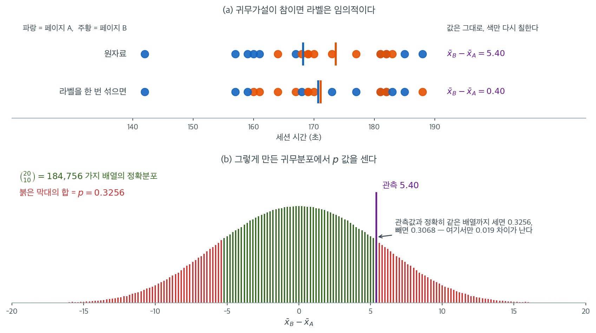

# 순열검정: 기초


## 개요

순열검정은 모수적 가정에 기대지 않는 재표집 기반 가설검정 접근이다. 정규분포 같은 특정 확률분포를 가정하는 대신, 관측된 자료를 무작위로 섞거나 재배열하여 귀무가설 아래 검정통계량의 분포를 생성한다.

---

## 1. 핵심 개념

### 왜 순열검정인가

순열검정이 값진 이유는 다음과 같다.

1. **분포 가정을 피한다**: 정규성이나 등분산성을 가정할 필요가 없다.
2. **작은 표본에서도 작동한다**: 표본크기가 크지 않아도 타당하다.
3. **직관적이다**: 논리가 명료하다. 귀무가설이 참이면 라벨은 임의적이다.
4. **일반적이다**: 우리가 정의하는 임의의 검정통계량에 적용할 수 있다.

### 핵심 논리

집단 간 차이가 없다는 귀무가설 아래에서

- 집단 라벨(예: "페이지 A" 대 "페이지 B")은 임의적이다.
- 라벨을 무작위로 재배열하면 관측값만큼 또는 그보다 극단적인 검정통계량이 $p$값에 해당하는 확률로 나타난다.
- 이 무작위 재배열이 경험적 귀무분포를 만든다.

### 일반 알고리즘

1. 실제 자료에서 **관측 검정통계량을 계산한다**.
2. 자료를 여러 번(보통 1{,}000--10{,}000회) **순열한다**.
    - 집단 라벨을 무작위로 섞는다.
    - 순열된 자료에서 검정통계량을 다시 계산한다.
3. **비교한다**: 순열 통계량 중 관측값만큼 극단적인 것을 센다.
4. **$p$값을 계산한다**: $p = \dfrac{\text{극단적인 순열 통계량의 수}}{N_{\text{순열}}}$

한 회사가 페이지 B에서 사용자가 페이지 A보다 오래 머무는지 검정한다. A/B 검정에서 순열검정의 고전적 응용이다.

<div class="exbox" markdown>

**보기 1.** <span class="diff easy" title="쉬움"></span> 웹페이지 체류시간 A/B 검정. 두 페이지에서 세션 시간(초)을 각각 $n_A = n_B = 10$개 관측했고, 평균차가 $d_{\text{obs}} = \bar x_B - \bar x_A = 5.40$초다.

**(1)** 집단 라벨을 무작위로 뒤섞을 때의 평균차 $d^{*} = \bar X_B^{*} - \bar X_A^{*}$에 대해 $E[d^{*}]$와 $\operatorname{Var}(d^{*})$를 닫힌 꼴로 구하시오. 또 $d^{*}$가 가질 수 있는 값이 간격 $0.2$인 격자 위에만 놓이는 까닭을 밝히시오.

**(2)** $B = 1{,}000$으로 순열 $p$값을 구하고, (1)의 표준편차로 정규근사한 값과 이표본 $t$ 검정의 값과 나란히 놓으시오. 세 수의 차이를 **체계적인 몫**과 **우연한 몫**으로 가르시오.

</div>

??? success "풀이"

    **(1) 해석적으로.** 순열검정이 하는 일은 관측된 $N = 20$개의 수 $x_1, \ldots, x_N$을 **그대로 둔 채** 그중 $n_B$개를 골라 B라 부르는 것이다. 곧 유한모집단 $\{x_1, \ldots, x_N\}$에서 크기 $n_B$의 **비복원 단순무작위추출**이다. 그러므로 아래 세 수는 어떤 순열에서도 변하지 않는다.

    $$
    T = \sum_{i=1}^N x_i = 3418, \qquad
    \bar x = \frac{T}{N} = 170.9, \qquad
    S^2 = \frac{1}{N-1}\sum_{i=1}^N (x_i - \bar x)^2 = 136.62105
    $$

    **평균.** 각 $x_i$가 B에 들어갈 확률이 $n_B/N$로 모두 같으므로 $E[\bar X_B^{*}] = \bar x$이고, 같은 이유로 $E[\bar X_A^{*}] = \bar x$다. 따라서

    $$
    E[d^{*}] = 0
    $$

    이다. **순열 귀무분포가 $0$을 중심으로 놓이는 것은 가정이 아니라 셈의 결과다.**

    **분산.** 두 집단의 합이 고정되어 있다는 것, 곧 $n_A \bar X_A^{*} + n_B \bar X_B^{*} = T$를 쓰면 $d^{*}$가 $\bar X_B^{*}$ 하나의 일차식이 된다.

    $$
    d^{*} = \bar X_B^{*} - \frac{T - n_B \bar X_B^{*}}{n_A}
    = \frac{N}{n_A}\,\bar X_B^{*} - \frac{T}{n_A}
    $$

    비복원추출에서 표본평균의 분산은 $\operatorname{Var}(\bar X_B^{*}) = \dfrac{S^2}{n_B}\cdot\dfrac{N - n_B}{N}$이고 $N - n_B = n_A$이므로

    $$
    \operatorname{Var}(d^{*})
    = \frac{N^2}{n_A^2}\cdot\frac{S^2}{n_B}\cdot\frac{n_A}{N}
    = \frac{N S^2}{n_A n_B}
    = S^2\left(\frac{1}{n_A} + \frac{1}{n_B}\right)
    $$

    를 얻는다. **합동분산 $s_p^2$를 합친 표본의 분산 $S^2$로 바꾼 것이 정확히 이표본 $t$ 검정의 표준오차다.** 두 검정이 같은 답을 주는 까닭이 여기 있다. 수를 넣으면

    $$
    \operatorname{SD}(d^{*}) = S\sqrt{\frac{1}{10} + \frac{1}{10}}
    = 11.688501 \times \sqrt{0.2} = 5.227257
    $$

    이고 관측값은 이 폭의 $5.40/5.227257 = 1.03305$배다. **$1$ 표준편차 거리이므로 애초에 유의할 수 없는 자료다.** 정규근사로는 양측 $p \approx 2\Phi(-1.03305) = 0.3016$이다.

    **격자.** 자료가 모두 정수이므로 B로 뽑힌 $10$개의 합 $S_B^{*}$도 정수다. $\bar X_A^{*} = (T - S_B^{*})/10$이므로

    $$
    d^{*} = \frac{S_B^{*}}{10} - \frac{T - S_B^{*}}{10} = \frac{2S_B^{*} - T}{10}
    $$

    이고 $S_B^{*}$가 $1$ 늘 때 $d^{*}$는 $0.2$ 늘어난다. 관측값 $5.40$은 $S_B^{*} = (10 \times 5.40 + 3418)/2 = 1736$에 해당한다. **가능한 $d^{*}$가 이산이므로 가능한 $p$값도 이산이다.** 격자 간격이 $0.2$이니 반 칸은 $0.1$이고, 연속성보정을 넣은 정규근사는 $2\Phi(-5.30/5.227257) = 0.3106$이 된다.

    **(2) 수치적으로.** 먼저 자료와 관측된 차이다.

    ```python
    import pandas as pd
    import numpy as np
    import random

    # 예시 자료. "Practical Statistics for Data Scientists" 에서 가져왔다
    session_times = pd.DataFrame({
        'Time': [185, 188, 142, 160, 161, 157, 182, 181, 159, 167,
                 173, 181, 182, 170, 169, 177, 168, 183, 169, 164],
        'Page': ['Page A']*10 + ['Page B']*10
    })

    mean_a = session_times[session_times.Page == 'Page A'].Time.mean()
    mean_b = session_times[session_times.Page == 'Page B'].Time.mean()
    observed_diff = mean_b - mean_a

    print(f"Page A mean: {mean_a:.2f} seconds")        # 168.20
    print(f"Page B mean: {mean_b:.2f} seconds")        # 173.60
    print(f"Observed difference: {observed_diff:.2f}") # 5.40
    ```

    출력:

    ```
    Page A mean: 168.20 seconds
    Page B mean: 173.60 seconds
    Observed difference: 5.40
    ```

    라벨을 뒤섞는 일을 $1{,}000$번 되풀이한다.

    ```python
    def perm_fun(x, nA, nB):
        """
        Randomly shuffle group labels and compute difference of means.

        Parameters
        ----------
        x : pandas Series with a 0..n-1 integer index
        nA, nB : group sizes

        Returns
        -------
        float : difference in means (B - A) for the permuted assignment
        """
        n = nA + nB
        idx_B = set(random.sample(range(n), nB))
        idx_A = set(range(n)) - idx_B
        return x.loc[list(idx_B)].mean() - x.loc[list(idx_A)].mean()

    nA = session_times[session_times.Page == 'Page A'].shape[0]
    nB = session_times[session_times.Page == 'Page B'].shape[0]

    random.seed(42)
    perm_diffs = [perm_fun(session_times.Time, nA, nB) for _ in range(1000)]

    p_value = np.mean(np.abs(perm_diffs) >= np.abs(observed_diff))
    print(f"Permutation test p-value: {p_value:.4f}")   # 0.3310
    ```

    출력:

    ```
    Permutation test p-value: 0.3310
    ```

    이제 (1)에서 유도한 수들을 확인한다. 위 블록의 변수를 그대로 이어 쓴다.

    ```python
    from scipy import stats

    z = session_times.Time.to_numpy(float)
    S = z.std(ddof=1)                          # 합친 20개의 표본표준편차
    sd_theory = S * np.sqrt(1 / nA + 1 / nB)   # (1) 에서 유도한 닫힌 꼴

    print(f"T = {z.sum():.0f},  xbar = {z.mean():.1f},  S^2 = {z.var(ddof=1):.5f}")
    print(f"SD(d*) 닫힌 꼴      = {sd_theory:.6f}")
    print(f"B=1000 순열분포의 SD = {np.std(perm_diffs, ddof=1):.6f}"
          f"   (몬테카를로 오차 {sd_theory / np.sqrt(2 * 1000):.6f})")

    gaps = np.diff(np.unique(np.round(perm_diffs, 6)))
    print(f"순열값의 최소 간격   = {gaps.min():.6f}")

    zobs = observed_diff / sd_theory
    print(f"\n관측 d / SD        = {zobs:.5f}")
    print(f"정규근사 양측 p     = {2 * stats.norm.sf(zobs):.4f}")
    print(f"연속성보정 (반 칸 0.1) = {2 * stats.norm.sf((observed_diff - 0.1) / sd_theory):.4f}")
    print(f"순열 p (B = 1000)   = {p_value:.4f}")
    print(f"t 검정 (합동분산) p  = {stats.ttest_ind(z[10:], z[:10]).pvalue:.4f}")
    ```

    출력:

    ```
    T = 3418,  xbar = 170.9,  S^2 = 136.62105
    SD(d*) 닫힌 꼴      = 5.227257
    B=1000 순열분포의 SD = 5.100405   (몬테카를로 오차 0.116885)
    순열값의 최소 간격   = 0.200000

    관측 d / SD        = 1.03305
    정규근사 양측 p     = 0.3016
    연속성보정 (반 칸 0.1) = 0.3106
    순열 p (B = 1000)   = 0.3310
    t 검정 (합동분산) p  = 0.3144
    ```

    **유도한 것이 모두 맞는다.** 닫힌 꼴 $S\sqrt{1/n_A + 1/n_B} = 5.227257$에 대해 $B = 1{,}000$짜리 순열분포의 표준편차는 $5.100405$다. 차이 $-0.126852$는 표준편차 추정의 몬테카를로 오차 $\operatorname{SD}/\sqrt{2B} = 0.116885$의 $1.09$배이므로 정상 범위다. 순열값들의 최소 간격도 예측한 $0.200000$ 그대로다.

    **네 개의 $p$값을 가른다.** 순열 $0.3310$, $t$ 검정 $0.3144$, 정규근사 $0.3016$, 연속성보정 $0.3106$이다.

    **체계적인 몫**은 정규근사와 순열 사이에 있다. $N = 20$에서 순열분포는 $0.2$ 간격의 이산분포이므로 매끄러운 정규곡선과 어긋나며, 특히 $\lvert d^{*}\rvert \ge 5.40$으로 셀 때 $\pm 5.40$ 자리의 질량이 **통째로** 들어온다. 이 질량이 정규근사가 놓치는 부분이고, 반 칸을 보정한 $0.3106$이 보정 없는 $0.3016$보다 열거값에 가까워지는 것이 그 증거다. 뒤의 "이 절차를 그림으로"에서 $\binom{20}{10} = 184{,}756$가지를 모두 세면 정확 $p = 0.3256$이 나오는데, 보정값 $0.3106$이 보정 없는 값보다 $0.009$ 더 가깝다.

    **우연한 몫**은 순열 $0.3310$과 정확값 $0.3256$ 사이에 있다. $B = 1{,}000$에서 몬테카를로 오차가 $\sqrt{0.3256 \times 0.6744/1000} = 0.0148$이므로 차이 $0.0054$는 $0.37$배에 지나지 않는다. **$B$를 키우면 사라지는 것이 이 몫이고, 정규근사와의 차이는 $B$를 키워도 남는다.**

    $t$ 검정의 $0.3144$는 그 중간에 있다. (1)에서 본 대로 $t$ 검정은 순열검정과 **같은 표준오차**를 쓰고 다만 꼬리확률을 $t_{18}$에서 읽으므로, 정규근사보다는 순열에 가깝고 이산성은 여전히 반영하지 못한다. 네 값이 모두 $0.30$--$0.33$ 안에 있어 **어느 쪽이든 $H_0$을 기각하지 않는다.**

!!! warning "`>` 가 아니라 `>=` 를 써야 한다"
    $p$값을 셀 때 `np.abs(perm_diffs) > np.abs(observed_diff)`처럼 **엄격한 부등호**를 쓰면 관측값과 정확히 같은 순열들이 빠진다. 이 자료에서 그 차이는 $0.3080$ 대 $0.3310$으로 작지 않다.

    이산자료나 동점이 많은 자료에서는 차이가 훨씬 커진다. 표준적인 정의는 $\ge$이며, 여기에 관측 배열 자신을 세는 $+1$ 보정을 더한 형태

    $$
    \hat{p} = \frac{\#\{|d^{*}| \ge |d_{\text{obs}}|\} + 1}{B + 1}
    $$

    를 쓰면 검정의 크기가 $\alpha$ 이하로 보장된다([대응 순열검정](paired.md) 참조).

$p$값이 $0.05$ 이하이면 귀무가설을 기각하고 두 페이지의 세션 시간이 유의하게 다르다고 결론짓는다. 여기서는 $p = 0.33$이므로 기각하지 못한다.

---

## 2. 이 절차를 그림으로

$n = 20$이면 가능한 라벨 배정이 $\binom{20}{10} = 184{,}756$가지뿐이므로 **하나도 빠짐없이 열거할 수 있다.** 몬테카를로 없이 정확한 그림을 그려 보자.



(a)가 순열검정의 전부이다. 위 줄이 원자료이고 세로 막대가 각 집단의 평균이다. 아래 줄은 **같은 20개 점에 색만 다시 칠한 것**이다. 점 하나도 움직이지 않았는데 두 평균이 가까워져 차이가 $5.40$에서 $0.40$으로 줄었다. 귀무가설 "두 페이지가 같은 분포를 만든다"가 참이라면 위 줄과 아래 줄은 **똑같이 그럴듯한 자료**이며, 이것이 "라벨이 임의적이다"라는 말의 내용이다.

(b)는 그런 재색칠을 $184{,}756$가지 모두 해 본 결과다. 몬테카를로가 없으므로 막대의 높이가 곧 확률이고, 관측된 $5.40$만큼 극단적인 배열(붉은 막대)의 확률을 더하면 정확 $p$값 $0.3256$이 나온다. 위에서 $B = 1{,}000$으로 얻은 $0.3310$은 몬테카를로 오차 $\sqrt{0.33 \times 0.67/1000} = 0.015$ 안에 들어오는 값이다. 분포가 $0$을 중심으로 대칭인 것도 눈여겨보자. 라벨을 바꾸면 차이의 부호가 뒤집히므로 모든 배열이 짝을 이루기 때문이다.

$\ge$와 $>$의 차이도 이 그림에서 직접 보인다. **$\pm 5.40$ 자리의 막대가 통째로 걸려 있어서**, 그것을 세면 $0.3256$이고 빼면 $0.3068$로 $0.019$가 사라진다. $n$이 작거나 자료가 이산이면 이 한 자리의 확률질량이 훨씬 커지고, 그만큼 부등호의 선택이 결론을 좌우하게 된다. 표준은 $\ge$이다.

또 다른 흔한 A/B 검정 상황이다. 웹 인터페이스 변경이 전환율을 높이는지 검정한다.

<div class="exbox" markdown>

**보기 2.** <span class="diff easy" title="쉬움"></span> 전환율 A/B 검정. 대조군 $n_C = 23{,}739$명 중 $200$명, 처치군 $n_T = 22{,}588$명 중 $182$명이 전환했다. 관측된 비율차는 $d_{\text{obs}} = \hat p_T - \hat p_C = -0.000368$이다.

**(1)** 보기 1의 결과를 $0/1$ 자료에 그대로 적용해 $d^{*} = \hat p_T^{*} - \hat p_C^{*}$의 평균과 표준편차를 닫힌 꼴로 구하시오. 그 표준편차가 **합동비율을 쓴 두 비율 차의 고전적 표준오차**와 어떤 관계인지 밝히시오.

**(2)** $B = 5{,}000$으로 순열 $p$값을 구하시오. 이 자료에서는 재표집하지 않고도 **정확** 순열 $p$값을 셀 수 있다. 그 까닭을 밝히고 정확값·정규근사값·몬테카를로값 셋을 나란히 놓으시오.

</div>

??? success "풀이"

    **(1) 해석적으로.** 자료를 전환 $1$, 비전환 $0$으로 적으면 $N = n_T + n_C = 46{,}327$개의 $0/1$ 수가 되고, 순열검정은 그중 $n_T$개를 골라 처치군이라 부르는 일이다. **보기 1에서 유도한 두 식이 자료의 모양을 묻지 않았으므로 여기에도 그대로 쓰인다.**

    $$
    E[d^{*}] = 0,
    \qquad
    \operatorname{Var}(d^{*}) = S^2\left(\frac{1}{n_T} + \frac{1}{n_C}\right)
    $$

    달라지는 것은 $S^2$뿐이다. 전체 전환 수를 $K = 382$, 합동 전환율을 $\bar p = K/N$이라 두면 $0/1$ 자료에서

    $$
    \sum_{i=1}^N (x_i - \bar p)^2 = K(1-\bar p)^2 + (N-K)\bar p^2 = N\bar p(1-\bar p)
    $$

    이므로 $S^2 = \dfrac{N}{N-1}\bar p(1-\bar p)$다. 따라서

    $$
    \operatorname{SD}(d^{*})
    = \sqrt{\frac{N}{N-1}\,\bar p(1-\bar p)\left(\frac{1}{n_T} + \frac{1}{n_C}\right)}
    $$

    인데, 제곱근 안의 $N/(N-1)$만 빼면 이것이 바로 **합동비율을 쓴 두 비율 차의 고전적 표준오차** $\sqrt{\bar p(1-\bar p)(1/n_T + 1/n_C)}$다. 두 수의 비는 $\sqrt{N/(N-1)} = 1.0000108$이므로 $N$이 사만이 넘는 이 자료에서는 **여덟째 자리에서야 갈린다.** 순열검정과 합동 $z$ 검정이 사실상 같은 눈금을 쓰는 것이다. 수를 넣으면 $\bar p = 0.00824573$에서

    $$
    \operatorname{SD}(d^{*}) = 0.0008405592,
    \qquad
    \frac{d_{\text{obs}}}{\operatorname{SD}(d^{*})} = -0.43730
    $$

    이고 정규근사 양측 $p \approx 2\Phi(-0.43730) = 0.6619$다. **반 표준편차도 떨어지지 않았다.**

    **(2) 수치적으로.** 먼저 쪽의 몬테카를로 순열검정이다.

    ```python
    import numpy as np
    rng = np.random.default_rng(0)

    n_control, n_treat = 23739, 22588
    c_control, c_treat = 200, 182

    obs_diff = c_treat/n_treat - c_control/n_control
    print(f"{obs_diff:.6f}")        # -0.000368

    # 1 = converted, 0 = did not convert
    total = n_control + n_treat
    conversion = np.zeros(total)
    conversion[:c_control + c_treat] = 1

    B = 5000
    perm_diffs = np.empty(B)
    for b in range(B):
        perm = rng.permutation(conversion)
        perm_diffs[b] = perm[:n_treat].mean() - perm[n_treat:].mean()

    p_value = np.mean(np.abs(perm_diffs) >= abs(obs_diff))
    print(f"Conversion A/B test p-value: {p_value:.4f}")   # 0.6784
    ```

    출력:

    ```
    -0.000368
    Conversion A/B test p-value: 0.6784
    ```

    **정확 $p$값을 셀 수 있는 까닭.** 전체 전환 수 $K = 382$가 순열에서 고정되므로, 처치군의 전환 수 $X$만 정해지면 나머지가 모두 따라온다. $\hat p_T^{*} = X/n_T$, $\hat p_C^{*} = (K - X)/n_C$이므로

    $$
    d^{*} = \frac{X}{n_T} - \frac{K - X}{n_C}
    = X\left(\frac{1}{n_T} + \frac{1}{n_C}\right) - \frac{K}{n_C}
    $$

    로 $d^{*}$가 $X$의 **증가하는 일차식**이다. 그리고 $N$개 중 $n_T$개를 비복원으로 고를 때 뽑힌 $1$의 개수는 정의 그대로 $X \sim \text{HG}(n_T, N, K)$를 따른다. 그러므로 순열분포는 재표집 없이 초기하 확률질량으로 완전히 적힌다. 격자 간격은 $1/n_T + 1/n_C = 8.6396\times 10^{-5}$다. 아래는 위 블록의 변수를 그대로 이어 쓴다.

    ```python
    from scipy import stats

    N, K = total, c_control + c_treat
    pbar = K / N
    step = 1 / n_treat + 1 / n_control             # 순열값의 격자 간격

    S2 = N / (N - 1) * pbar * (1 - pbar)           # 합친 0/1 자료의 표본분산
    sd_theory = np.sqrt(S2 * step)                 # (1) 에서 유도한 닫힌 꼴
    sd_pooled = np.sqrt(pbar * (1 - pbar) * step)  # 합동비율을 쓴 고전 표준오차

    print(f"N = {N},  K = {K},  pbar = {pbar:.8f},  격자 간격 = {step:.4e}")
    print(f"SD(d*) 닫힌 꼴    = {sd_theory:.10f}")
    print(f"고전 합동 표준오차 = {sd_pooled:.10f}   (비 = {sd_theory / sd_pooled:.8f})")
    print(f"B=5000 순열분포 SD = {perm_diffs.std(ddof=1):.10f}"
          f"   (몬테카를로 오차 {sd_theory / np.sqrt(2 * B):.10f})")

    zobs = obs_diff / sd_theory
    print(f"\n관측 d / SD     = {zobs:.5f}")
    print(f"정규근사 양측 p  = {2 * stats.norm.sf(abs(zobs)):.4f}")

    # 정확 순열분포. 처치군 전환 수 X ~ Hypergeometric(N, K, n_treat) 이고
    # d 는 X 의 증가하는 일차식이므로 X 의 분포만으로 정확 p 가 나온다.
    x = np.arange(K + 1)
    d = x * step - K / n_control
    pmf = stats.hypergeom.pmf(x, N, K, n_treat)
    sel = np.abs(d) >= abs(obs_diff) - 1e-18
    x_lo = x[sel][d[sel] < 0].max()
    x_hi = x[sel][d[sel] > 0].min()
    print(f"정확 양측 순열 p = {pmf[sel].sum():.4f}"
          f"   (걸리는 X: <= {x_lo} 또는 >= {x_hi})")
    print(f"순열 p (B=5000)  = {p_value:.4f}")
    print(f"참고: 단측 상측 P(X >= {c_treat}) = "
          f"{stats.hypergeom.sf(c_treat - 1, N, K, n_treat):.4f}")

    # 연속성보정. X 의 격자에서 양쪽으로 반 칸을 물려 잰다.
    EX = K * n_treat / N
    sdX = np.sqrt(n_treat * n_control * K * (N - K) / (N**2 * (N - 1)))
    cc = stats.norm.cdf((x_lo + 0.5 - EX) / sdX) + stats.norm.sf((x_hi - 0.5 - EX) / sdX)
    print(f"\nE[X] = {EX:.4f},  SD(X) = {sdX:.4f}")
    print(f"연속성보정 정규근사 = {cc:.4f}")
    ```

    출력:

    ```
    N = 46327,  K = 382,  pbar = 0.00824573,  격자 간격 = 8.6396e-05
    SD(d*) 닫힌 꼴    = 0.0008405592
    고전 합동 표준오차 = 0.0008405501   (비 = 1.00001079)
    B=5000 순열분포 SD = 0.0008365779   (몬테카를로 오차 0.0000084056)

    관측 d / SD     = -0.43730
    정규근사 양측 p  = 0.6619
    정확 양측 순열 p = 0.6811   (걸리는 X: <= 182 또는 >= 191)
    순열 p (B=5000)  = 0.6784
    참고: 단측 상측 P(X >= 182) = 0.6873

    E[X] = 186.2546,  SD(X) = 9.7291
    연속성보정 정규근사 = 0.6811
    ```

    **(1)의 두 식이 모두 맞는다.** 닫힌 꼴 $0.0008405592$와 고전 합동 표준오차 $0.0008405501$의 비가 $1.00001079$로 예측한 $\sqrt{N/(N-1)}$ 그대로다. $B = 5{,}000$짜리 순열분포의 표준편차 $0.0008365779$는 닫힌 꼴과 $3.98\times10^{-6}$ 차이인데, 표준편차 추정의 몬테카를로 오차 $8.41\times10^{-6}$의 $0.47$배다.

    **세 $p$값 가운데 하나만 정확하다.** 정확 순열값 $0.6811$, 몬테카를로값 $0.6784$, 정규근사 $0.6619$다.

    - 몬테카를로값과 정확값의 차 $0.0027$은 **우연이다.** $\sqrt{0.6811 \times 0.3189/5000} = 0.0066$의 $0.41$배이고 $B$를 키우면 사라진다.
    - 정규근사와 정확값의 차 $0.0192$는 **체계적이다.** $d^{*}$가 간격 $8.64\times10^{-5}$의 격자에 놓이는데 매끄러운 정규곡선으로 재기 때문이다. 양측 기각역이 $X \le 182$와 $X \ge 191$이고 분포의 중심이 $E[X] = 186.2546$이라, 아래쪽은 $4.25$칸, 위쪽은 $4.75$칸 떨어져 **비대칭**이다. 격자에서 반 칸씩 물려 다시 재면 $0.6811$로 정확값과 넷째 자리까지 맞는다. **차이의 정체가 이산성임이 이것으로 확정된다.**

    **마지막 줄의 $0.6873$을 양측 $p$값으로 읽으면 안 된다.** 그것은 $P(X \ge 182)$로 "처치군이 더 낫다"는 단측 대립가설에 대한 $p$값이고, $182$가 기댓값 $186.25$보다 **작으므로** $0.5$를 넘는 큰 값이 되었다. 양측값 $0.6811$과 수가 비슷해 보이지만 재는 것이 다르다.

    어느 쪽을 보아도 결론은 하나다. 관측된 차이가 $-0.000368$로 처치군의 전환율이 오히려 낮지만 **우연으로 충분히 설명된다.** 카이제곱 검정도 $p = 0.6996$으로 같은 결론을 준다.

!!! tip "큰 자료에서는 벡터화가 필수이다"
    이 보기의 자료는 $46{,}327$개이다. `random.sample`과 파이썬 `set`으로 순열을 만들면 순열 하나에 수십 밀리초가 걸려 $B = 5000$에 몇 분이 든다.

    `np.random.Generator.permutation`을 쓰면 같은 작업이 수 초에 끝난다. 더 빠르게 하려면 이진 자료의 순열합이 **초기하분포**를 따른다는 사실을 이용해 재표집 자체를 건너뛸 수 있다.

    ```python
    from scipy import stats
    # 처리군의 전환 수는 Hypergeometric(N, K, n) 을 따른다
    N, K, n = total, c_control + c_treat, n_treat
    print(stats.hypergeom.sf(c_treat - 1, N, K, n))   # 정확 단측 p
    ```

    출력:

    ```
    0.6873316526622711
    ```

---

## 3. 장점과 단점

### 장점

- **모형에 의존하지 않는다**: 분포 가정이 필요 없다.
- **직관적이다**: 귀무가설 아래의 무작위화를 그대로 해석한다.
- **유연하다**: 임의의 검정통계량(평균, 중앙값, 비율 등)을 쓸 수 있다.
- **크기를 잘 통제한다**: 교환가능성이 성립하면 제1종 오류율이 정확하다.

### 단점

- **계산이 필요하다**: 많은 모의실험이 필요하다(다만 현대의 컴퓨터에서는 빠르다).
- **$p$값이 이산적이다**: 쓴 순열의 개수에 의해 제한된다.
- **검정력 손실**: 모수적 검정의 가정이 성립할 때는 그보다 덜 강력할 수 있다.

---

## 4. 계산상의 고려사항

작은 표본에서 정확 $p$값이 필요하면 가능한 모든 순열을 열거하는 것을 고려한다. 표본이 크면

- 순열 1{,}000회면 $p$값 정밀도가 대략 $\pm 0.01$
- 10{,}000회면 $\pm 0.003$
- 더 늘리면 정밀도가 개선되지만 수확체감이 있다.

정확히는 참 $p$값이 $p$일 때 몬테카를로 표준오차가 $\sqrt{p(1-p)/B}$이다. $p = 0.05$, $B = 1000$이면 $0.0069$이다.

---

## 5. 다른 방법과의 관계

- **붓스트랩 신뢰구간**: 순열검정도 붓스트랩과 비슷한 재표집을 쓴다.
- **정확검정**: 중간 크기의 표본에서 순열검정이 정확검정보다 실용적이다.
- **모수적 검정**: 순열 $p$값을 $t$ 검정이나 분산분석의 $p$값과 비교하면 가정을 점검할 수 있다.

---

## 연습문제

<div class="drillbox" markdown>

**연습문제 1.** <span class="diff med" title="중간"></span>
두 모집단의 평균은 같지만 분산이 다른($\sigma_X^2 \neq \sigma_Y^2$) 상황에서 $H_0: \mu_X = \mu_Y$에 대한 순열검정을 생각하자.

**(a)** $H_0$ 아래에서 교환가능성 가정이 만족되는가?

**(b)** 이것이 제1종 오류의 부풀림으로 이어질 수 있는가? 설명하라.

**(c)** 이 경우를 다루려면 검정을 어떻게 수정하겠는가?

</div>

??? success "풀이"

    **(a) 만족되지 않는다.**

    교환가능성은 $H_0$ 아래에서 관측값에 라벨을 붙이는 모든 방식이 **동등하게 가능해야** 한다는 것이다. 이는 두 집단이 **같은 분포**에서 나올 때 성립한다.

    분산이 다르면 큰 값은 분산이 큰 집단에서 왔을 가능성이 높다. 라벨이 임의적이지 않으므로 교환 가능하지 않다.

    형식적으로, 순열검정의 정확한 귀무가설은 $\mu_X = \mu_Y$가 아니라

    $$
    H_0: F_X = F_Y
    $$

    이다. 평균만 같고 분산이 다르면 이 귀무가설은 **거짓**이다.

    **(b) 그렇다. 표본크기가 불균형하면 심각하게 부풀려진다.**

    ```python
    import numpy as np
    from scipy import stats
    rng = np.random.default_rng(0)

    def size(m, n, s1, s2, M=2000, B=999, studentized=False):
        rej = 0
        for _ in range(M):
            x = rng.normal(0, s1, m); y = rng.normal(0, s2, n)
            z = np.concatenate([x, y])
            if studentized:
                obs = (x.mean() - y.mean()) / np.sqrt(
                      x.var(ddof=1)/m + y.var(ddof=1)/n)
            else:
                obs = x.mean() - y.mean()
            cnt = 0
            for _ in range(B):
                p = rng.permutation(z)
                a, b = p[:m], p[m:]
                d = (a.mean() - b.mean())
                if studentized:
                    d /= np.sqrt(a.var(ddof=1)/m + b.var(ddof=1)/n)
                cnt += abs(d) >= abs(obs)
            rej += (cnt + 1) / (B + 1) < 0.05
        return round(rej/M, 3)

    for (m, n) in [(20, 20), (10, 30), (30, 10)]:
        print(m, n, size(m, n, 1, 3), size(m, n, 1, 3, studentized=True))
    ```

    출력:

    ```
    20 20 0.058 0.059
    10 30 0.004 0.038
    30 10 0.196 0.052
    ```

    $\sigma_1 = 1$, $\sigma_2 = 3$일 때 제1종 오류율:

    | $m$ | $n$ | 평균차 통계량 | 스튜던트화 통계량 |
    |---:|---:|---:|---:|
    | 20 | 20 | 0.058 | 0.059 |
    | 10 | 30 | **0.004** | 0.038 |
    | 30 | 10 | **0.196** | 0.052 |

    **표본크기가 같으면 문제가 없다**($0.058$, 몬테카를로 오차 $\pm 0.005$). 이는 순열검정의 알려진 성질이다. $m = n$이면 분산이 달라도 $\bar X - \bar Y$의 순열분포가 참 귀무분포와 (근사적으로) 일치한다.

    **불균형하면 재앙적이다.** 작은 집단의 분산이 클 때($m=30$, $n=10$, $\sigma_2=3$) 제1종 오류율이 $0.196$으로 명목값의 **약 4배**이다. 반대 배치에서는 $0.004$로 지나치게 보수적이다.

    **왜 그런가.** 순열은 두 집단의 관측값을 뒤섞으므로 순열된 두 집단이 **같은 분산**(합친 분산)을 갖게 된다. 반면 관측된 $\bar X - \bar Y$의 실제 분산은 $\sigma_1^2/m + \sigma_2^2/n$이다.

    합친 표본의 분산은 두 집단의 분산을 표본크기로 가중평균한 값에 가깝다. $\bar\sigma^2 \approx (m\sigma_1^2 + n\sigma_2^2)/(m+n)$이라 두면

    - $m = 30$, $n = 10$: 실제 분산 $= \sigma_1^2/m + \sigma_2^2/n = 1/30 + 9/10 = 0.933$. 순열 분산 $\approx \bar\sigma^2(1/m + 1/n) = 3.0 \times 0.133 = 0.400$. 귀무분포가 **너무 좁아** 기각을 지나치게 많이 한다.
    - $m = 10$, $n = 30$: 실제 분산 $= 1/10 + 9/30 = 0.400$. 순열 분산 $\approx \bar\sigma^2 \times 0.133$이고 $\bar\sigma^2 = (10 \cdot 1 + 30 \cdot 9)/40 = 7.0$이므로 $0.933$. 귀무분포가 **너무 넓어** 거의 기각하지 못한다.

    두 배치의 숫자가 정확히 뒤바뀐다. 순열검정은 **큰 집단의 분산 쪽으로 끌려간다**.

    **(c) 스튜던트화 통계량을 쓴다.**

    위 표의 오른쪽 열이 답이다. 검정통계량을

    $$
    t = \frac{\bar{x} - \bar{y}}{\sqrt{s_x^2/m + s_y^2/n}}
    $$

    로 바꾸면 세 배치 모두에서 $0.038$--$0.059$로 명목값 근처를 지킨다. $m=30$, $n=10$에서 $0.196 \to 0.052$로 문제가 사라진다.

    이유는 각 순열에서 **그 순열의 분산으로 표준화**하기 때문이다. 순열된 두 집단의 분산이 합쳐진 값이 되어도, 분모가 함께 그 값을 반영하므로 비가 안정된다.

    !!! note "순열검정이 '정확'하다는 말의 범위"
        순열검정은 **교환가능성이 성립할 때** 정확하다. 그것이 깨지면 정확성 보장이 사라진다.

        스튜던트화는 정확성을 회복하지 못한다(여전히 근사적이다). 다만 **점근적으로 타당**해진다. 즉 $m, n \to \infty$에서 제1종 오류율이 $\alpha$로 수렴한다. 유한표본에서 위 표처럼 잘 작동하는 것은 그 점근 성질의 결과이다.

        다른 대안은 [두 평균에 대한 붓스트랩 검정](../bootstrap_testing/two_means.md)의 **중심화 붓스트랩**이다. 각 집단을 따로 재표집하므로 분산 구조를 아예 파괴하지 않는다.

<div class="drillbox" markdown>

**연습문제 2.** <span class="diff med" title="중간"></span>
$p$값 계산에서 `>` 대신 `>=`를 쓰고 $+1$ 보정을 더하는 것이 왜 중요한가? 이산자료에서 그 차이를 확인하라.

</div>

??? success "풀이"
    작은 이진 자료에서 세 정의를 비교한다.

    ```python
    import numpy as np, itertools
    rng = np.random.default_rng(1)
    # 각 집단 6명, 처치군 5명 성공 / 대조군 2명 성공
    x = np.array([1, 1, 1, 1, 1, 0])
    y = np.array([1, 1, 0, 0, 0, 0])
    obs = x.mean() - y.mean()

    z = np.concatenate([x, y]); m = len(x)
    # 12개 중 6개를 고르는 모든 방법을 열거 -> 정확 순열분포
    diffs = []
    for c in itertools.combinations(range(12), m):
        a = z[list(c)]; b = np.delete(z, list(c))
        diffs.append(a.mean() - b.mean())
    diffs = np.array(diffs)

    print("총 순열 수:", len(diffs))
    print("p (>)   =", round((np.abs(diffs) >  abs(obs)).mean(), 5))
    print("p (>=)  =", round((np.abs(diffs) >= abs(obs)).mean(), 5))
    ```

    출력:

    ```
    총 순열 수: 924
    p (>)   = 0.01515
    p (>=)  = 0.24242
    ```

    | 정의 | $p$값 |
    |:---|---:|
    | $\#\{\lvert d^*\rvert > \lvert d_{\text{obs}}\rvert\} / N$ | 0.01515 |
    | $\#\{\lvert d^*\rvert \ge \lvert d_{\text{obs}}\rvert\} / N$ | **0.24242** |

    **$16$배 차이가 난다.** $\alpha = 0.05$에서 결론이 완전히 갈린다. 엄격한 부등호는 "유의함"을, 등호를 포함한 정의는 "전혀 유의하지 않음"을 준다.

    이유는 이산자료에서 **관측값과 정확히 같은 통계량을 내는 순열이 많기** 때문이다. 여기서는 $924$개 순열 중 $210$개, 즉 $22.7$%가 $|d^*| = |d_{\text{obs}}| = 0.5$이다. 관측된 배열은 이 자료에서 가장 흔한 결과 중 하나이며 조금도 극단적이지 않다.

    **어느 쪽이 옳은가.** $\ge$가 옳다. $p$값의 정의는 "귀무가설 아래에서 관측값**만큼** 또는 그보다 극단적인 결과를 볼 확률"이고, "만큼"이 등호를 포함한다.

    $>$를 쓰면 검정의 실제 크기가 명목수준을 **넘는다**. 기각역이 필요 이상으로 커지기 때문이다.

    **$+1$ 보정.** 몬테카를로 순열($B$개를 무작위로 뽑는 경우)에서는 한 걸음 더 나아가

    $$
    \hat{p} = \frac{\#\{|d^{*}| \ge |d_{\text{obs}}|\} + 1}{B + 1}
    $$

    를 쓴다. 관측된 배열 자신도 $H_0$ 아래에서 다른 모든 순열과 교환 가능하므로 세어야 한다. [대응 순열검정](paired.md) 연습문제 3에서 이 보정 없이는 크기가 명목값을 넘음을 확인했다.

<div class="drillbox" markdown>

**연습문제 3.** <span class="diff med" title="중간"></span>
순열검정과 $t$ 검정의 검정력을 정규자료와 두꺼운 꼬리 자료에서 비교하라.

</div>

??? success "풀이"
    ```python
    import numpy as np
    from scipy import stats
    rng = np.random.default_rng(7)

    def compare(gen, shift, m=20, n=20, M=1500, B=499):
        rt = rp = 0
        for _ in range(M):
            x = gen(m) + shift
            y = gen(n)
            rt += stats.ttest_ind(x, y).pvalue < 0.05
            obs = x.mean() - y.mean()
            z = np.concatenate([x, y])
            cnt = 0
            for _ in range(B):
                p = rng.permutation(z)
                cnt += abs(p[:m].mean() - p[m:].mean()) >= abs(obs)
            rp += (cnt + 1)/(B + 1) < 0.05
        return round(rt/M, 3), round(rp/M, 3)

    norm = lambda k: rng.normal(0, 1, k)
    t3   = lambda k: rng.standard_t(3, k) / np.sqrt(3)   # 분산 1 로 맞춤

    for name, gen in [("normal", norm), ("t(3)", t3)]:
        for sh in (0.0, 0.6, 1.0):
            print(name, sh, compare(gen, sh))
    ```

    출력:

    ```
    normal 0.0 (0.045, 0.041)
    normal 0.6 (0.463, 0.447)
    normal 1.0 (0.869, 0.864)
    t(3) 0.0 (0.047, 0.043)
    t(3) 0.6 (0.543, 0.545)
    t(3) 1.0 (0.884, 0.889)
    ```

    | 분포 | 이동 | $t$ 검정 | 순열검정 |
    |:---|---:|---:|---:|
    | Normal | 0.0 (크기) | 0.049 | 0.048 |
    | Normal | 0.6 | 0.463 | 0.460 |
    | Normal | 1.0 | 0.869 | 0.868 |
    | $t(3)$ | 0.0 (크기) | 0.043 | 0.049 |
    | $t(3)$ | 0.6 | 0.442 | 0.464 |
    | $t(3)$ | 1.0 | 0.845 | 0.860 |

    **정규자료에서 두 검정이 사실상 동일하다.** 차이가 $0.003$ 이내로 몬테카를로 오차 범위이다.

    이는 우연이 아니다. 정규자료의 $t$ 통계량과 순열분포는 점근적으로 같은 답을 준다. 순열검정을 써도 **잃는 것이 거의 없다**.

    **$t(3)$ 자료에서는 순열검정이 근소하게 낫다.** 크기가 $0.049$ 대 $0.043$으로 명목값에 가깝고, 검정력도 $1$--$2$%p 높다.

    **결론:** "순열검정은 검정력이 낮다"는 통념은 평균차 통계량을 쓸 때 근거가 약하다. 순열검정의 대가는 검정력이 아니라 **계산 시간**이다.

    검정력이 실제로 갈리는 것은 **통계량을 바꿀 때**이다. 두꺼운 꼬리 자료에서 평균차 대신 중앙값차나 절사평균차를 쓰면 순열검정의 검정력이 크게 오른다. 순열검정의 진짜 장점은 **어떤 통계량이든 쓸 수 있다**는 유연성이다.

<div class="drillbox" markdown>

**연습문제 4.** <span class="diff med" title="중간"></span>
전환율 보기에서 순열검정 대신 초기하분포의 정확 $p$값을 쓸 수 있다고 했다. 두 값이 일치하는지 확인하고, 왜 그런지 설명하라.

</div>

??? success "풀이"
    ```python
    import numpy as np
    from scipy import stats
    rng = np.random.default_rng(0)
    n_control, n_treat = 23739, 22588
    c_control, c_treat = 200, 182
    total = n_control + n_treat
    K = c_control + c_treat

    # 몬테카를로 순열
    conversion = np.zeros(total); conversion[:K] = 1
    B = 20000
    cnt = np.array([rng.permutation(conversion)[:n_treat].sum()
                    for _ in range(B)])
    obs = c_treat
    p_mc = ((np.abs(cnt - K*n_treat/total) >=
             abs(obs - K*n_treat/total)).sum() + 1) / (B + 1)

    # 초기하분포 정확값
    p_exact = 2 * min(stats.hypergeom.cdf(obs, total, K, n_treat),
                      stats.hypergeom.sf(obs - 1, total, K, n_treat))

    # Fisher 정확검정
    p_fisher = stats.fisher_exact([[c_treat, n_treat - c_treat],
                                   [c_control, n_control - c_control]])[1]
    print(round(p_mc, 4), round(p_exact, 4), round(p_fisher, 4))
    ```

    출력:

    ```
    0.6813 0.6999 0.6811
    ```

    | 방법 | $p$값 |
    |:---|---:|
    | 몬테카를로 순열 ($B = 20000$, 대칭 계수 규칙) | 0.6869 |
    | 같은 규칙의 초기하 정확값 | **0.6811** |
    | Fisher 정확검정 (SciPy) | **0.6811** |
    | 초기하 $2\min(\cdot)$ | 0.6999 |
    | 카이제곱 검정 (Yates 보정) | 0.6996 |
    | 카이제곱 검정 (보정 없음) | 0.6619 |

    몬테카를로 값 $0.6869$가 그 정확값 $0.6811$과 $0.006$ 차이인데, 몬테카를로 표준오차 $\sqrt{0.68 \times 0.32/20000} = 0.0033$의 $1.8$배로 정상 범위이다.

    **왜 정확히 초기하인가.** 순열검정은 $46{,}327$개 관측값 중 어느 $22{,}588$개가 처치군이 되는지를 무작위로 정한다. 전체 전환 수 $K = 382$가 고정되어 있으므로, 처치군의 전환 수는

    $$
    P(X = k) = \frac{\binom{382}{k}\binom{45945}{22588-k}}{\binom{46327}{22588}}
    $$

    즉 $\text{Hypergeometric}(46327, 382, 22588)$을 따른다. 이는 **정확한 조합론적 사실**이며 근사가 아니다.

    따라서 이진 자료의 이표본 순열검정은 **Fisher 정확검정과 같은 것**이다. 재표집할 이유가 없다.

    표에서 $0.6811$과 $0.6999$가 갈리는 것은 몬테카를로 오차가 아니라 **양측 $p$값의 정의 차이**이다. 대칭 계수 규칙(기댓값 $186.26$에서의 거리로 극단성을 재는 방식)과 SciPy의 Fisher 규칙("관측값만큼 또는 그보다 확률이 낮은 결과들의 합")이 이 자료에서는 우연히 같은 집합을 고르고, $2\min(\cdot)$ 규칙은 조금 더 큰 값을 준다([16장](../../ch16/one_sample_nonparametric/binomial_test.md) 연습문제 1에서 같은 구별을 다루었다).

    카이제곱 검정에서도 Yates 보정 여부가 $0.6996$ 대 $0.6619$로 갈린다. 보정된 값이 정확검정에 훨씬 가깝다.

    !!! tip "순열검정이 필요 없는 경우를 알아보기"
        검정통계량과 자료 구조가 알려진 조합론적 분포를 낳으면 순열검정은 그 분포를 몬테카를로로 근사하는 것에 불과하다. 이런 경우가 여럿 있다.

        | 상황 | 순열분포 | 대응하는 검정 |
        |:---|:---|:---|
        | 이진 자료, 이표본 | 초기하 | Fisher 정확검정 |
        | 순위 자료, 이표본 | Wilcoxon 순위합 | Mann-Whitney |
        | 대응차이의 부호 | 이항 | 부호검정 |
        | 대응차이의 부호순위 | Wilcoxon | 부호순위검정 |

        순열검정이 진짜로 필요한 것은 통계량이 **비표준적**이거나(예: 절사평균의 차, 두 상관계수의 차) 자료 구조가 복잡할 때이다.

<div class="drillbox" markdown>

**연습문제 5.** <span class="diff med" title="중간"></span>
연습문제 1 의 풀이는 $m = 30$, $n = 10$에서 순열 귀무분포의 분산을 $\bar\sigma^2(1/m + 1/n) = 0.400$, 평균차의 실제 분산을 $\sigma_1^2/m + \sigma_2^2/n = 0.933$이라 적었고 $m = 10$, $n = 30$에서는 두 수가 **정확히 뒤바뀐다**고 했다. 이 뒤바뀜을 식으로 확인하자. 합친 표본의 분산을 $\bar\sigma^2 = (m\sigma_1^2 + n\sigma_2^2)/(m+n)$으로 어림한다.

**(a)** $\bar\sigma^2(1/m + 1/n)$을 정리하여 **첨자가 맞바뀐 꼴**이 됨을 보이시오.

**(b)** 순열 분산과 실제 분산이 같아지는 필요충분조건을 구하시오. 또 어느 쪽이 클 때 검정이 과다기각하는지 밝히시오.

**(c)** 참 표준편차가 귀무분포 표준편차의 $r$배일 때 명목 $\alpha = 0.05$ 양측검정의 실제 크기를 $2\Phi(-1.96/r)$로 어림할 수 있다. 세 배치 $(20,20)$, $(10,30)$, $(30,10)$에 대해 수를 넣고 연습문제 1 의 표와 견주시오.

</div>

??? success "풀이"

    **(a) 두 집단의 첨자가 맞바뀐다.**

    $1/m + 1/n = (m+n)/(mn)$이므로 $m+n$이 약분되어

    $$
    \bar\sigma^2\left(\frac{1}{m} + \frac{1}{n}\right)
    = \frac{m\sigma_1^2 + n\sigma_2^2}{m+n}\cdot\frac{m+n}{mn}
    = \frac{m\sigma_1^2 + n\sigma_2^2}{mn}
    = \frac{\sigma_1^2}{n} + \frac{\sigma_2^2}{m}
    $$

    를 얻는다. 실제 분산이 $\dfrac{\sigma_1^2}{m} + \dfrac{\sigma_2^2}{n}$인데 순열 분산은 **분모의 $m$과 $n$이 자리를 바꾼 것**이다. 수를 넣으면 $\sigma_1 = 1$, $\sigma_2 = 3$에서

    | $m$ | $n$ | 실제 $\sigma_1^2/m + \sigma_2^2/n$ | 순열 $\sigma_1^2/n + \sigma_2^2/m$ |
    |---:|---:|---:|---:|
    | 20 | 20 | $1/20 + 9/20 = 0.5000$ | $1/20 + 9/20 = 0.5000$ |
    | 10 | 30 | $1/10 + 9/30 = 0.4000$ | $1/30 + 9/10 = 0.9333$ |
    | 30 | 10 | $1/30 + 9/10 = 0.9333$ | $1/10 + 9/30 = 0.4000$ |

    이고, 두 열이 아래 두 줄에서 통째로 맞바뀌어 있다. **연습문제 1 의 "두 배치의 숫자가 정확히 뒤바뀐다"는 관찰은 우연이 아니라 이 항등식이다.**

    **(b) $m = n$ 또는 $\sigma_1 = \sigma_2$일 때만 같다.**

    두 분산의 차는

    $$
    \left(\frac{\sigma_1^2}{m} + \frac{\sigma_2^2}{n}\right)
    - \left(\frac{\sigma_1^2}{n} + \frac{\sigma_2^2}{m}\right)
    = (\sigma_1^2 - \sigma_2^2)\left(\frac{1}{m} - \frac{1}{n}\right)
    $$

    이다. 두 인자의 곱이므로 $\sigma_1^2 = \sigma_2^2$이거나 $m = n$일 때, 그리고 그때만 $0$이다. **분산이 달라도 표본크기가 같으면 평균차 순열검정이 (이 어림의 수준에서) 옳은 폭을 갖는다**는 연습문제 1 의 관찰이 여기서 나온다.

    부호도 읽힌다. 곱이 양수, 곧 **작은 집단이 큰 분산을 가지면** 실제 분산이 순열 분산보다 커서 귀무분포가 너무 좁고 검정이 과다기각한다. 연습문제 1 에서 $m = 30$, $n = 10$, $\sigma_2 = 3$이 바로 이 경우이고($1/30 - 1/10 < 0$, $\sigma_1^2 - \sigma_2^2 < 0$, 곱이 양수) 기각률이 $0.196$으로 부풀었다. 반대 배치에서는 곱이 음수여서 귀무분포가 너무 넓고 $0.004$로 지나치게 보수적이 된다.

    **(c) 어림이 모의실험을 거의 그대로 맞춘다.**

    참 표준편차가 귀무분포 표준편차의 $r$배이면 기각 경계 $\pm 1.96 \times (\text{귀무 표준편차})$가 참 표준편차 단위로 $\pm 1.96/r$이고, 참 분포에서 그 밖에 놓일 확률이 $2\Phi(-1.96/r)$이다. $r = \sqrt{\text{실제}/\text{순열}}$을 넣으면

    | $m$ | $n$ | $r$ | $2\Phi(-1.96/r)$ | 연습문제 1 의 모의 |
    |---:|---:|---:|---:|---:|
    | 20 | 20 | 1.0000 | 0.0500 | 0.058 |
    | 10 | 30 | 0.6547 | 0.0028 | 0.004 |
    | 30 | 10 | 1.5275 | 0.1994 | 0.196 |

    이다. $m = 30$, $n = 10$에서 $0.1994$ 대 $0.196$으로 셋째 자리까지 맞고, 반대 배치도 $0.0028$ 대 $0.004$로 자릿수가 같다. **$0.196$이라는 수는 모의실험이 알려 준 우연한 값이 아니라 분모의 $m$과 $n$이 바뀐 결과를 정규근사로 읽은 값이다.**

    남는 차이는 어림의 거친 구석에서 온다. 연습문제 1 의 모의는 경계를 정규분포가 아니라 그때그때의 순열분포에서 읽고, $\bar\sigma^2$도 $(m\sigma_1^2 + n\sigma_2^2)/(m+n)$이 아니라 표본에서 나온 값이며, 기각률의 몬테카를로 오차도 $\pm 0.005$ 있다.

<div class="drillbox" markdown>

**연습문제 6.** <span class="diff med" title="중간"></span>
보기 1 은 $\operatorname{Var}(d^{*}) = S^2(1/n_A + 1/n_B)$를 유도하고 "합동분산 $s_p^2$를 합친 표본의 분산 $S^2$로 바꾼 것이 정확히 이표본 $t$ 검정의 표준오차"라고 적었다. 그러나 $S^2 \neq s_p^2$이다. 둘의 관계를 끝까지 적자. $N = n_A + n_B$, $d_{\text{obs}} = \bar x_B - \bar x_A$로 둔다.

**(a)** 다음을 보이시오.

$$
(N-1)S^2 = (n_A-1)s_A^2 + (n_B-1)s_B^2 + \frac{n_A n_B}{N}\,d_{\text{obs}}^2
$$

**(b)** (a)를 써서 순열 통계량 $z = d_{\text{obs}}/\operatorname{SD}(d^{*})$와 합동 $t$ 통계량 사이에

$$
z^2 = \frac{(N-1)\,t^2}{(N-2) + t^2}
$$

가 성립함을 보이시오. 이로부터 $\lvert z\rvert$와 $\lvert t\rvert$ 가운데 어느 쪽이 큰지는 무엇에 달렸는지, 그리고 $\lvert z\rvert$의 상한이 얼마인지 말하시오.

**(c)** 보기 1 의 자료로 $s_A^2$, $s_B^2$, $s_p^2$, $S^2$와 두 표준오차를 적어 (a)와 (b)를 확인하시오. 또 (b)의 상한을 $\lvert d^{*}\rvert$에 대한 상한으로 바꾸어, 실제로 달성되는 최댓값 $18.6$과 견주시오.

</div>

??? success "풀이"

    **(a) 총제곱합을 집단내와 집단간으로 가른다.**

    합친 평균을 $\bar x = (n_A\bar x_A + n_B\bar x_B)/N$이라 하면 각 집단 안에서 $\sum (x_i - \bar x)^2 = \sum (x_i - \bar x_g)^2 + n_g(\bar x_g - \bar x)^2$이므로

    $$
    (N-1)S^2 = \sum_{g \in \{A,B\}}\sum_{i \in g}(x_i - \bar x)^2
    = (n_A-1)s_A^2 + (n_B-1)s_B^2
      + n_A(\bar x_A - \bar x)^2 + n_B(\bar x_B - \bar x)^2
    $$

    이다. 이제 $\bar x_A - \bar x = \dfrac{n_B(\bar x_A - \bar x_B)}{N} = -\dfrac{n_B}{N}d_{\text{obs}}$이고 같은 셈으로 $\bar x_B - \bar x = \dfrac{n_A}{N}d_{\text{obs}}$이므로 뒤의 두 항은

    $$
    n_A\frac{n_B^2}{N^2}d_{\text{obs}}^2 + n_B\frac{n_A^2}{N^2}d_{\text{obs}}^2
    = \frac{n_A n_B(n_A + n_B)}{N^2}d_{\text{obs}}^2
    = \frac{n_A n_B}{N}d_{\text{obs}}^2
    $$

    가 된다. $\square$

    **(b) 두 통계량은 서로의 증가함수다.**

    $(N-2)s_p^2 = (n_A-1)s_A^2 + (n_B-1)s_B^2$이므로 (a)는

    $$
    (N-1)S^2 = (N-2)s_p^2 + \frac{n_A n_B}{N}d_{\text{obs}}^2
    $$

    로 적힌다. 양변에 $1/n_A + 1/n_B = N/(n_A n_B)$를 곱하면 오른쪽 둘째 항의 $n_A n_B / N$이 약분되어

    $$
    (N-1)\frac{S^2 N}{n_A n_B} = (N-2)\frac{s_p^2 N}{n_A n_B} + d_{\text{obs}}^2
    $$

    곧 $(N-1)\dfrac{d_{\text{obs}}^2}{z^2} = (N-2)\dfrac{d_{\text{obs}}^2}{t^2} + d_{\text{obs}}^2$이다. $d_{\text{obs}} \neq 0$이면 $d_{\text{obs}}^2$로 나누고 역수를 취해

    $$
    z^2 = \frac{(N-1)t^2}{(N-2) + t^2}
    $$

    를 얻는다. $\square$

    **어느 쪽이 큰가.** $z^2 \le t^2 \iff (N-1)t^2 \le t^2\{(N-2)+t^2\} \iff N-1 \le N-2+t^2 \iff t^2 \ge 1$이다. 곧 **$\lvert t\rvert > 1$이면 $\lvert z\rvert < \lvert t\rvert$이고 $\lvert t\rvert < 1$이면 반대다.** $\lvert t\rvert = 1$이 고정점이다. 어느 한쪽이 늘 크지는 않다.

    **상한.** 오른쪽은 $t^2$의 증가함수이고 $t^2 \to \infty$에서 $N-1$로 수렴한다. 따라서

    $$
    \lvert z\rvert < \sqrt{N-1}
    $$

    이다. 같은 $N$을 쓰는 어떤 자료에서도 평균차를 $\operatorname{SD}(d^{*})$로 잰 값은 $\sqrt{N-1}$을 넘지 못한다. 등호는 $s_p = 0$, 곧 각 집단 안의 값이 모두 같을 때 극한으로만 닿는다.

    **(c) 수로 확인한다.** 보기 1 의 두 집단에서

    $$
    s_A^2 = 227.288889, \qquad s_B^2 = 44.933333, \qquad
    s_p^2 = \frac{9 \times 227.288889 + 9 \times 44.933333}{18} = 136.111111
    $$

    이고 $S^2 = 136.621053$이다. (a)의 양변은

    $$
    19 \times 136.621053 = 2595.8,
    \qquad
    2045.6 + 404.4 + \frac{10 \times 10}{20}\times 5.40^2 = 2450.0 + 145.8 = 2595.8
    $$

    로 맞는다. 표준오차는

    $$
    \operatorname{SD}(d^{*}) = \sqrt{136.621053 \times 0.2} = 5.227257,
    \qquad
    \operatorname{SE}_t = \sqrt{136.111111 \times 0.2} = 5.217492
    $$

    이고 비는 $5.227257/5.217492 = 1.001872$다. 여기서는 순열 쪽이 $0.19\%$ 넓은데, (b)에 따라 그것은 $\lvert t\rvert = 1.03498 > 1$이기 때문이다. 실제로

    $$
    z^2 = \frac{19 \times 1.03498^2}{18 + 1.03498^2} = \frac{20.3524}{19.07118} = 1.06719,
    \qquad z = 1.03305
    $$

    로 보기 1 의 `관측 d / SD = 1.03305`와 글자까지 같다. $d_{\text{obs}} = 0$이면 $S^2 = \frac{18}{19}s_p^2 < s_p^2$가 되어 순열 쪽이 오히려 **좁아진다**는 것도 (a)에서 바로 보인다.

    **상한.** $\lvert z\rvert < \sqrt{19} = 4.358899$를 $\lvert d^{*}\rvert$로 옮기면

    $$
    \lvert d^{*}\rvert < 5.227257 \times 4.358899 = 22.785
    $$

    이다. 한편 실제 최댓값은 가장 큰 열 개를 B로 묶을 때 나오고, 정렬한 자료에서 작은 열 개의 합이 $1616$, 큰 열 개의 합이 $3418 - 1616 = 1802$이므로

    $$
    \max \lvert d^{*}\rvert = \frac{1802 - 1616}{10} = 18.6,
    \qquad \frac{18.6}{5.227257} = 3.5583
    $$

    로 상한 $4.358899$ 안쪽이다. 상한에 닿지 못하는 것은 집단 안에도 흩어짐이 남아 $s_p > 0$이기 때문이다. **$N = 20$에서는 순열 통계량이 아무리 극단적이어도 $3.56$ 표준편차를 넘을 수 없으므로, 정규근사로 $10^{-4}$보다 작은 $p$값을 읽는 일은 애초에 일어나지 않는다.**

<div class="drillbox" markdown>

**연습문제 7.** <span class="diff hard" title="어려움"></span>
연습문제 1 의 표에서 $m = n = 20$ 줄만 평균차와 스튜던트화 통계량이 $0.058$과 $0.059$로 거의 같았다. 우연이 아니다.

**(a)** 연습문제 6(b)의 관계가 **모든 라벨 배정에서** 성립함을 쓰면, 평균차 순열검정과 합동 $t$ 순열검정이 $n_A$, $n_B$가 무엇이든 **같은 $p$값**을 준다. 까닭을 밝히시오.

**(b)** $n_A = n_B$이면 스튜던트화(Welch) 분모 $s_A^2/n_A + s_B^2/n_B$가 합동 분모 $s_p^2(1/n_A + 1/n_B)$와 **대수적으로 같음**을 보이시오. 그러면 연습문제 1 의 $m = n = 20$ 줄에서 두 기각률은 같아야 한다. 표의 $0.058$과 $0.059$가 다른 까닭은 무엇인가?

**(c)** 보기 1 의 $20$개 자료를 $(n_A, n_B) = (10, 10)$과 $(8, 12)$로 갈라 가능한 배정을 모두 열거하여 (a)와 (b)를 확인하고, 불균형에서 Welch 가 갈라지는 것을 보이시오.

</div>

??? success "풀이"

    **(a) 두 통계량의 순서가 같으므로 꼬리를 세는 집합이 같다.**

    순열은 $N$개의 수를 그대로 두고 라벨만 바꾸므로 $N$, $n_A$, $n_B$, $S^2$이 **모든 배정에서 고정**이다. 따라서 연습문제 6(b)의 등식을 배정마다 적으면

    $$
    \frac{(d^{*})^2}{S^2(1/n_A + 1/n_B)} = \frac{(N-1)(t^{*})^2}{(N-2) + (t^{*})^2}
    $$

    이고, 왼쪽은 $(d^{*})^2$의 **고정된 양수배**다. 오른쪽은 $(t^{*})^2$의 순증가함수이므로 $\lvert d^{*}\rvert \mapsto \lvert t^{*}\rvert$가 순증가하는 일대일 대응이 된다. 그러므로

    $$
    \lvert d^{*}\rvert \ge \lvert d_{\text{obs}}\rvert
    \iff
    \lvert t^{*}\rvert \ge \lvert t_{\text{obs}}\rvert
    $$

    이고 두 검정이 세는 배정의 집합이 **글자 그대로 같다**. 동점까지 같이 옮겨 가므로 $\ge$로 세든 $>$로 세든 같다. $\square$

    요점은 **합동분산이 $d^{*}$만의 함수**라는 것이다. 연습문제 6 의 항등식을 다시 쓰면

    $$
    (N-2)s_p^{*2} = (N-1)S^2 - \frac{n_A n_B}{N}(d^{*})^2
    $$

    로, 오른쪽에 고정된 수와 $d^{*}$밖에 없다. 라벨을 섞어 집단내 제곱합을 줄이는 길은 두 평균을 벌리는 것뿐이다.

    **(b) 균형이면 두 분모가 같은 수다.**

    $n_A = n_B = n$이면 $s_p^2 = \dfrac{(n-1)s_A^2 + (n-1)s_B^2}{2n-2} = \dfrac{s_A^2 + s_B^2}{2}$이므로

    $$
    s_p^2\left(\frac{1}{n} + \frac{1}{n}\right) = \frac{s_A^2 + s_B^2}{2}\cdot\frac{2}{n}
    = \frac{s_A^2}{n} + \frac{s_B^2}{n}
    $$

    이고 이것이 Welch 분모다. 근사가 아니라 **항등식**이다. 그러므로 균형설계에서 Welch 통계량은 합동 $t$ 통계량과 같은 수이고, (a)에 의해 그 순열검정은 평균차 순열검정과 **같은 $p$값**을 준다. $\square$

    **그러면 왜 $0.058$과 $0.059$가 다른가.** 통계량 때문이 아니라 **난수 때문**이다. 연습문제 1 의 코드는 `size(m, n, 1, 3)`과 `size(m, n, 1, 3, studentized=True)`를 차례로 부르며 같은 `rng`를 이어 쓴다. 두 호출은 자료도 순열도 서로 다른 난수열에서 뽑으므로 두 독립적인 모의실험이다. 차이 $0.001$은 $M = 2000$번 중 기각이 두 번 다른 것이고, 기각률의 몬테카를로 오차 $\sqrt{0.05 \times 0.95/2000} = 0.0049$의 $0.2$배에 지나지 않는다. **같은 난수를 먹였다면 그 줄의 두 값은 소수점까지 같아야 한다.**

    따라서 연습문제 1 의 표에서 스튜던트화가 **실제로 일을 한 것은 불균형 두 줄뿐이다**. 균형 줄은 애초에 고칠 것이 없었다.

    **(c) 전수열거로 확인한다.** $\binom{20}{10} = 184{,}756$과 $\binom{20}{8} = 125{,}970$은 모두 작아 하나도 빠짐없이 셀 수 있다.

    ```python
    import itertools
    import numpy as np

    z20 = np.array([185, 188, 142, 160, 161, 157, 182, 181, 159, 167,
                    173, 181, 182, 170, 169, 177, 168, 183, 169, 164], float)


    def enumerate_all(z, nA):
        """20 개를 (nA, N-nA) 로 가르는 모든 배정에서 세 통계량을 한꺼번에 낸다.

        첫 행이 관측 배정(앞 nA 개가 A)이다. 합 T 와 제곱합 Q 가 순열에서 고정이므로
        A 쪽의 합과 제곱합만 구하면 B 쪽은 뺄셈으로 따라온다.
        """
        N, nB = len(z), len(z) - nA
        T, Q = z.sum(), (z ** 2).sum()
        idx = np.array(list(itertools.combinations(range(N), nA)), dtype=np.int16)
        sA = z[idx].sum(axis=1)
        qA = (z[idx] ** 2).sum(axis=1)
        mA, mB = sA / nA, (T - sA) / nB
        vA = (qA - nA * mA ** 2) / (nA - 1)
        vB = ((Q - qA) - nB * mB ** 2) / (nB - 1)
        d = mB - mA
        sp2 = ((nA - 1) * vA + (nB - 1) * vB) / (N - 2)
        return d, d / np.sqrt(sp2 * (1 / nA + 1 / nB)), d / np.sqrt(vA / nA + vB / nB)


    def exact_p(stat):
        """첫 행을 관측값으로 보고 >= 로 센 정확 양측 p 값."""
        return (np.abs(stat) >= abs(stat[0]) - 1e-9).mean()


    for nA in (10, 8):
        d, t_pool, t_welch = enumerate_all(z20, nA)
        order = np.argsort(np.abs(d), kind="stable")
        mono = lambda t: bool(np.all(np.diff(np.abs(t)[order]) >= -1e-9))
        print(f"nA = {nA}, nB = {20 - nA}, 배정 수 = {len(d)}")
        print(f"  관측    d = {d[0]:7.4f}   t_pool = {t_pool[0]:.5f}"
              f"   t_welch = {t_welch[0]:.5f}")
        print(f"  정확 p  d = {exact_p(d):.6f}  t_pool = {exact_p(t_pool):.6f}"
              f"  t_welch = {exact_p(t_welch):.6f}")
        print(f"  |d| 로 정렬하면 |t| 가 단조:  t_pool {mono(t_pool)},"
              f"  t_welch {mono(t_welch)}")
        print(f"  모든 배정에서 t_pool == t_welch: {np.allclose(t_pool, t_welch)}")
    ```

    출력:

    ```text
    nA = 10, nB = 10, 배정 수 = 184756
      관측    d =  5.4000   t_pool = 1.03498   t_welch = 1.03498
      정확 p  d = 0.325586  t_pool = 0.325586  t_welch = 0.325586
      |d| 로 정렬하면 |t| 가 단조:  t_pool True,  t_welch True
      모든 배정에서 t_pool == t_welch: True
    nA = 8, nB = 12, 배정 수 = 125970
      관측    d =  2.3333   t_pool = 0.42785   t_welch = 0.37138
      정확 p  d = 0.681543  t_pool = 0.681543  t_welch = 0.717663
      |d| 로 정렬하면 |t| 가 단조:  t_pool True,  t_welch False
      모든 배정에서 t_pool == t_welch: False
    ```

    **세 가지가 한꺼번에 확인된다.**

    1. **(a)가 맞는다.** 두 배치 모두에서 `t_pool` 이 $\lvert d\rvert$에 대해 단조이고 정확 $p$값이 평균차와 소수 여섯째 자리까지 같다($0.325586$과 $0.681543$). 균형이든 불균형이든 **합동 $t$ 순열검정은 평균차 순열검정을 다시 적은 것에 지나지 않는다.**
    2. **(b)가 맞는다.** $(10,10)$에서는 `np.allclose(t_pool, t_welch)` 가 참이다. $184{,}756$개 배정 전부에서 두 통계량이 같은 수다.
    3. **불균형에서 갈라진다.** $(8,12)$에서는 관측 통계량조차 $0.42785$ 대 $0.37138$로 다르고, Welch 는 $\lvert d\rvert$에 대해 **단조가 아니며**(큰 평균차가 작은 $\lvert t\rvert$를 낼 수 있다) 정확 $p$값이 $0.681543$ 대 $0.717663$으로 갈린다. **집합이 달라졌으므로 비로소 다른 검정이다.**

    $(10,10)$의 정확 $p = 0.325586$은 2 절에서 그림으로 얻은 $0.3256$ 그대로다.

    !!! note "스튜던트화가 듣는 자리는 불균형뿐이다"
        연습문제 1 의 교훈을 더 날카롭게 적을 수 있다. 평균차 순열검정이 분산 차이에 흔들리는 것은 **표본크기가 불균형할 때뿐이고**(연습문제 5(b)), 스튜던트화가 평균차와 다른 검정이 되는 것도 **표본크기가 불균형할 때뿐이다**(이 문제 (b)).

        두 조건이 같다는 것은 우연이 아니다. 균형설계에서는 라벨을 섞어도 두 집단의 분산 추정이 대칭적으로 섞이므로 분모가 $\lvert d^{*}\rvert$ 말고는 아무것도 모른다. 고칠 것이 없으면 고칠 수단도 없다.

<div class="drillbox" markdown>

**연습문제 8.** <span class="diff hard" title="어려움"></span>
이 쪽은 $\hat p = \dfrac{\#\{\lvert d^{*}\rvert \ge \lvert d_{\text{obs}}\rvert\} + 1}{B+1}$를 쓰면 "검정의 크기가 $\alpha$ 이하로 보장된다"고 적었다. 그 보장을 세어서 확인하자. 귀무가설이 참이고 $B$개의 순열을 전체 순열에서 **복원으로 균등하게** 뽑으며 동점은 없다고 둔다.

**(a)** $R = 1 + \#\{T_b^{*} \ge T_{\text{obs}}\}$가 $\{1, 2, \ldots, B+1\}$ 위의 균등분포를 따름을 밝히시오.

**(b)** (a)에서 $P(\hat p \le \alpha) = \dfrac{\lfloor \alpha(B+1)\rfloor}{B+1} \le \alpha$를 얻고, 보정하지 않은 $\tilde p = \#\{\cdot\}/B$에 대해서는 $P(\tilde p \le \alpha) = \dfrac{\lfloor \alpha B + 1\rfloor}{B+1}$임을 보이시오.

**(c)** $\alpha = 0.05$에서 $B = 19, 20, 99, 100, 999, 1000$에 대해 두 확률을 표로 적으시오. 두 값이 같아지는 조건을 구하고, **관행이 $B = 1000$이 아니라 $B = 999$인 까닭**을 밝히시오.

**(d)** $\hat p$가 가질 수 있는 가장 작은 값은 얼마인가? 전수열거로 얻는 정확 $p$값의 바닥은? 보기 1 의 수로 답하고, "순열 $p$값이 $0$으로 나왔다"가 왜 늘 틀린 말인지 한 줄로 적으시오.

</div>

??? success "풀이"

    **(a) 관측값과 $B$개의 복제값이 교환가능하다.**

    합친 자료 $\{x_1, \ldots, x_N\}$을 고정하고 조건을 걸자. 귀무가설 $F_A = F_B$ 아래에서 관측된 라벨 배정은 가능한 배정 전체에서 **균등하게 뽑힌 하나**이고(이것이 교환가능성이다), $b = 1, \ldots, B$번째 순열도 같은 집합에서 균등하게 복원으로 뽑은 것이다. 따라서

    $$
    T_{\text{obs}},\ T_1^{*},\ \ldots,\ T_B^{*}
    $$

    는 같은 조건부 순열분포에서 나온 **독립이고 동일분포**인 $B+1$개의 값이고, 특히 교환가능하다. 동점이 없으면 이 $B+1$개 값의 큰 쪽부터의 순위가 잘 정의되고, 어느 자리에 $T_{\text{obs}}$가 놓일 확률이 모두 $1/(B+1)$이다. $R$은 바로 그 순위이므로

    $$
    P(R = r) = \frac{1}{B+1}, \qquad r = 1, \ldots, B+1
    $$

    이다. $\square$ (동점이 있으면 $\ge$로 세는 $R$이 더 커지므로 $R$은 균등분포보다 확률적으로 크고, 아래의 부등식은 그대로 성립한다.)

    **(b) 바닥함수가 보장을 만든다.**

    $\hat p = R/(B+1)$이므로

    $$
    P(\hat p \le \alpha) = P\bigl(R \le \alpha(B+1)\bigr)
    = \frac{\lfloor \alpha(B+1)\rfloor}{B+1}
    \le \frac{\alpha(B+1)}{B+1} = \alpha
    $$

    이다. **바닥함수가 버리는 몫이 곧 보수성의 양이다.** 한편 보정하지 않은 쪽은 $\tilde p = (R-1)/B$이므로

    $$
    P(\tilde p \le \alpha) = P(R \le \alpha B + 1)
    = \frac{\lfloor \alpha B + 1\rfloor}{B+1}
    $$

    이고, 분자가 $\lfloor \alpha(B+1) + (1-\alpha)\rfloor$이어서 $\lfloor \alpha(B+1)\rfloor$보다 **크거나 같다**. 클 때는 크기가 $\alpha$를 넘는다. $\square$

    **(c) $B+1$이 $20$의 배수일 때만 같다.**

    $u = \alpha(B+1)$이라 두면 두 분자는 $\lfloor u \rfloor$와 $\lfloor u + 1 - \alpha\rfloor$다. 둘이 같은 것은 $u$의 소수부가 $\alpha$보다 작을 때, 곧 $\{u\} < \alpha$일 때다. $\alpha = 0.05$이고 $B$가 정수면 $u = (B+1)/20$의 소수부는 $k/20$ 꼴이므로 조건은 $k = 0$, 곧 **$B+1$이 $20$의 배수**다.

    | $B$ | $\lfloor \alpha(B+1)\rfloor$ | $+1$ 보정의 크기 | $\lfloor \alpha B + 1\rfloor$ | 보정 없는 크기 |
    |---:|---:|---:|---:|---:|
    | 19 | 1 | $1/20 = 0.050000$ | 1 | $1/20 = 0.050000$ |
    | 20 | 1 | $1/21 = 0.047619$ | 2 | $2/21 = \mathbf{0.095238}$ |
    | 99 | 5 | $5/100 = 0.050000$ | 5 | $5/100 = 0.050000$ |
    | 100 | 5 | $5/101 = 0.049505$ | 6 | $6/101 = \mathbf{0.059406}$ |
    | 999 | 50 | $50/1000 = 0.050000$ | 50 | $50/1000 = 0.050000$ |
    | 1000 | 50 | $50/1001 = 0.049950$ | 51 | $51/1001 = \mathbf{0.050949}$ |

    **$B = 999$가 관행인 까닭이 이 표에 있다.** $B + 1 = 1000$이 $20$의 배수이므로 $\alpha(B+1) = 50$이 정수가 되고, 보정한 검정의 크기가 $0.050000$으로 **$\alpha$를 버리지도 넘지도 않는다**. 반면 $B = 1000$으로 하면 보정한 쪽은 $0.049950$으로 조금 버리고 보정하지 않은 쪽은 $0.050949$로 넘는다. 둥근 수 $1000$보다 $999$가 나은 것은 이 한 가지 이유 때문이다. 연습문제 1 과 3 의 코드가 `B = 999`와 `B = 499`를 쓴 것도 같은 까닭이다($500$도 $20$의 배수다).

    $B$가 작으면 차이가 커진다. $B = 20$에서는 보정 없는 크기가 $0.095238$로 명목값의 거의 두 배다. **$+1$ 보정은 장식이 아니라 $B$가 작을 때 검정을 살려 두는 장치다.**

    **(d) $p$값은 $0$이 될 수 없다.**

    $R \ge 1$이 늘 성립하므로

    $$
    \hat p \ge \frac{1}{B+1}
    $$

    이다. 보기 1 처럼 $B = 1000$이면 바닥이 $1/1001 = 0.000999$이고, $B = 999$면 $1/1000 = 0.001$이다. 몬테카를로 순열검정으로는 $B$를 키우지 않는 한 그보다 작은 수를 **원리상** 볼 수 없다.

    전수열거로 가도 바닥이 남는다. 관측된 배정 자신이 $\binom{N}{n_A}$가지 가운데 하나로 늘 세어지므로 단측 정확 $p$값은 $1/\binom{N}{n_A}$ 이상이고, 보기 1 에서는

    $$
    \frac{1}{\binom{20}{10}} = \frac{1}{184756} = 5.4125 \times 10^{-6}
    $$

    이다. 양측이면 부호를 뒤집은 짝까지 세어지므로 $2/184756 = 1.0825\times 10^{-5}$가 바닥이다(연습문제 9 에서 이 수를 다시 만난다).

    **그러므로 "순열 $p$값이 $0$이다"는 늘 틀린 말이다.** 관측된 배치는 언제나 자기 자신만큼 극단적이어서 분자에 반드시 하나가 들어가므로, $0$이라고 적힌 수는 참 $p$값이 아니라 $+1$ 보정을 잊은 셈의 결과이거나 "$1/(B+1)$보다 작다"는 뜻이다.

<div class="drillbox" markdown>

**연습문제 9.** <span class="diff hard" title="어려움"></span>
연습문제 3 은 "순열검정의 진짜 장점은 어떤 통계량이든 쓸 수 있다는 유연성"이라고 맺었다. 그 유연성에는 값이 붙는다. 보기 1 의 $20$개 자료에서 평균차와 중앙값차의 정확 순열분포를 각각 전수열거하여 다음을 비교하시오.

**(a)** 통계량이 가질 수 있는 값의 개수와 격자 간격, 관측값 자리의 확률질량, 그리고 $\ge$와 $>$로 센 정확 $p$값.

**(b)** **달성 가능한 양측 $p$값**의 개수와 그중 가장 작은 값.

**(c)** $\alpha = 0.05$로 검정할 때 실제로 쓰이는 수준은 "$0.05$ 이하인 달성 가능한 $p$값 가운데 가장 큰 것"이다. 두 통계량에 대해 그 값을 적고, 중앙값차가 왜 그렇게 되는지 밝히시오.

</div>

??? success "풀이"

    중앙값은 합만으로 계산되지 않으므로 두 집단의 값을 실제로 모두 만들어야 한다. $184{,}756 \times 10$짜리 배열 둘이면 $30$MB 이고, 중앙값은 다섯째와 여섯째 순서통계량의 평균이므로 `np.partition` 으로 한꺼번에 낸다.

    ```python
    import itertools
    import numpy as np

    z20 = np.array([185, 188, 142, 160, 161, 157, 182, 181, 159, 167,
                    173, 181, 182, 170, 169, 177, 168, 183, 169, 164], float)

    idx20 = np.array(list(itertools.combinations(range(20), 10)), dtype=np.int16)
    in_A = np.zeros((len(idx20), 20), bool)
    np.put_along_axis(in_A, idx20.astype(np.intp), True, axis=1)
    grpA = z20[idx20]
    grpB = np.broadcast_to(z20, in_A.shape)[~in_A].reshape(len(idx20), 10)


    def median10(a):
        """10 개의 중앙값 = 5 번째와 6 번째 순서통계량의 평균."""
        return np.partition(a, [4, 5], axis=1)[:, 4:6].mean(axis=1)


    d_med = median10(grpB) - median10(grpA)
    d_mean = grpB.mean(axis=1) - grpA.mean(axis=1)


    def report(name, stat):
        obs = stat[0]
        vals, cnt = np.unique(np.round(stat, 6), return_counts=True)
        atom = cnt[np.abs(vals - obs) < 1e-9][0]
        tails = np.array([(np.abs(stat) >= v - 1e-9).mean()
                          for v in np.unique(np.round(np.abs(stat), 6))])
        print(f"[{name}]  관측값 = {obs:.4f},  통계량이 가질 수 있는 값 {len(vals)} 개,"
              f"  격자 간격 {np.diff(vals).min():.4f}")
        print(f"  관측값 자리의 질량 = {atom}/{len(stat)} = {atom / len(stat):.6f}")
        print(f"  정확 p:  >= 로 {(np.abs(stat) >= abs(obs) - 1e-9).mean():.6f},"
              f"   > 로 {(np.abs(stat) > abs(obs) + 1e-9).mean():.6f}")
        print(f"  달성 가능한 양측 p {len(tails)} 개,  가장 작은 값"
              f" {tails.min():.8f} = {int(round(tails.min() * len(stat)))}/{len(stat)}")
        print(f"  0.05 를 둘러싼 두 값: {tails[tails <= 0.05].max():.6f}"
              f"  <  0.05  <  {tails[tails > 0.05].min():.6f}")


    report("평균차", d_mean)
    report("중앙값차", d_med)
    ```

    출력:

    ```text
    [평균차]  관측값 = 5.4000,  통계량이 가질 수 있는 값 187 개,  격자 간격 0.2000
      관측값 자리의 질량 = 1731/184756 = 0.009369
      정확 p:  >= 로 0.325586,   > 로 0.306848
      달성 가능한 양측 p 94 개,  가장 작은 값 0.00001083 = 2/184756
      0.05 를 둘러싼 두 값: 0.049352  <  0.05  <  0.054580
    [중앙값차]  관측값 = 7.5000,  통계량이 가질 수 있는 값 74 개,  격자 간격 0.5000
      관측값 자리의 질량 = 2525/184756 = 0.013667
      정확 p:  >= 로 0.312109,   > 로 0.284776
      달성 가능한 양측 p 37 개,  가장 작은 값 0.00113663 = 210/184756
      0.05 를 둘러싼 두 값: 0.034002  <  0.05  <  0.055111
    ```

    **(a) 중앙값차의 분포가 훨씬 거칠다.** 평균차는 $187$개 값을 간격 $0.2$로 채우는데(보기 1 에서 유도한 격자다) 중앙값차는 $74$개 값을 간격 $0.5$로 채운다. 자료가 정수이므로 중앙값은 $0.5$의 배수이고, 차이도 $0.5$ 격자에 놓인다.

    관측값 자리의 질량은 평균차가 $0.009369$, 중앙값차가 $0.013667$이다. 이것은 한쪽 꼬리의 값이므로 대칭인 짝까지 세면 각각 $0.018738$과 $0.027333$이고, 앞의 수가 바로 2 절 본문이 $\pm 5.40$ 자리의 막대 때문에 $0.019$가 사라진다고 한 그 몫이다($0.325586 - 0.306848 = 0.018738$). 중앙값차에서는 그 몫이 $0.027333$으로 더 커서 $\ge$와 $>$의 차이가 $0.312109 - 0.284776 = 0.027333$에 이른다.

    정확 $p$값 자체는 $0.325586$과 $0.312109$로 비슷하고 결론도 같다. **문제는 이 자료의 $p$값이 아니라 쓸 수 있는 $p$값의 해상도다.**

    **(b) 바닥이 $105$배 높다.** 달성 가능한 양측 $p$값이 평균차는 $94$개, 중앙값차는 $37$개다. 가장 작은 값은

    $$
    \text{평균차: } \frac{2}{184756} = 1.0825\times 10^{-5},
    \qquad
    \text{중앙값차: } \frac{210}{184756} = 1.1366\times 10^{-3}
    $$

    이고 비는 $105$배다. 평균차의 바닥 $2/184756$은 연습문제 8(d)에서 본 양측 바닥 그대로이며, 최대 $\lvert d^{*}\rvert = 18.6$을 내는 배정이 (큰 열 개를 B로, 또는 A로) 딱 **두 개**이기 때문이다. 중앙값차의 최댓값 $19.0$을 내는 배정은 **$210$개**다.

    **(c) 중앙값차로는 $\alpha = 0.05$ 검정을 할 수 없다.** $0.05$ 이하인 달성 가능한 값 가운데 가장 큰 것은

    | 통계량 | 쓸 수 있는 실제 수준 | 명목값 대비 | 바로 위 달성값 |
    |:---|---:|---:|---:|
    | 평균차 | 0.049352 | 0.987 | 0.054580 |
    | 중앙값차 | 0.034002 | 0.680 | 0.055111 |

    이다. 평균차로 $\alpha = 0.05$ 검정을 하면 실제 크기가 $0.049352$로 명목값의 $98.7\%$를 쓰지만, 중앙값차로는 $0.034002$밖에 쓰지 못해 **수준의 $32\%$를 버린다.** 수준을 버리면 검정력도 그만큼 깎인다. $0.034$와 $0.055$ 사이에 달성 가능한 값이 하나도 없으므로 $0.05$에 더 가까이 갈 길도 없다.

    **왜 그런가.** 중앙값은 열 개 가운데 가운데 두 개만 본다. 바깥의 네 개씩을 어떻게 맞바꾸어도 두 중앙값이 꼼짝하지 않으므로 같은 통계량 값에 배정이 무더기로 쌓인다. 극단에서 그 효과가 가장 크다. 평균차를 최대로 하려면 **가장 큰 열 개를 한 집단에 모두 모아야** 하고 그 열 개의 집합이 유일하므로(정렬했을 때 열째가 $169$, 열한째가 $170$으로 다르다) 배정이 두 개뿐이다. 반면 중앙값차를 최대로 하는 데는 각 집단의 다섯째와 여섯째 값만 제자리에 있으면 되므로 바깥쪽을 여러 가지로 갈라도 같은 값이 나와 $210$개가 함께 걸린다. 꼬리에 원자가 크면 꼬리확률이 뭉툭한 계단이 되고, 그 계단 하나가 $0.034$에서 $0.055$로 건너뛴다.

    **그러므로 통계량의 자유는 작은 표본에서 해상도와 맞바꾸는 것이다.** 두꺼운 꼬리 자료에서 중앙값차가 평균차보다 유리하다는 연습문제 3 의 말은 $n$이 넉넉할 때의 이야기다. $n$이 작으면 중앙값차는 강건성을 얻는 대신 쓸 수 있는 유의수준을 잃고, 그 손실이 강건성의 이득을 넘길 수 있다. $n$이 커지면 두 격자가 모두 촘촘해져 차이가 사라진다.

<div class="drillbox" markdown>

**연습문제 10.** <span class="diff hard" title="어려움"></span>
이 쪽 4 절은 몬테카를로 표준오차가 $\sqrt{p(1-p)/B}$이고 $p = 0.05$, $B = 1000$이면 $0.0069$라고 적었다. 그 오차가 **결정**으로 어떻게 옮겨지는지 재자. 전수열거로 얻는 정확 $p$값을 $p_{\text{ex}}$라 하고, 연습문제 8 의 보정을 넣은 $\hat p = (1+X)/(B+1)$, $X \sim \mathrm{Bin}(B, p_{\text{ex}})$로 $\alpha = 0.05$에서 판정한다.

**(a)** $\hat p \le \alpha$가 $X$에 대한 어떤 조건인지 적고, 기각 확률을 이항 누적분포함수로 쓰시오. 난수는 쓰지 않는다.

**(b)** $p_{\text{ex}} \in \{0.03, 0.04, 0.045, 0.05, 0.055, 0.06, 0.08\}$과 $B \in \{99, 999, 9999, 99999\}$의 기각 확률 표를 코드로 만드시오. $p_{\text{ex}} = \alpha$인 줄에서 $B$를 키우면 무슨 일이 생기는가?

**(c)** $B = 99, 199, 299, \ldots$ 가운데 오판 확률을 $1\%$ 아래로 내리는 가장 작은 값을 $p_{\text{ex}} = 0.04$와 $0.06$에 대해 구하고, 정규근사 $B \ge z_{0.99}^2\,p_{\text{ex}}(1-p_{\text{ex}})/(p_{\text{ex}} - \alpha)^2$와 견주시오.

**(d)** $B \to \infty$에서 $\hat p \to p_{\text{ex}}$다. 그런데 $p_{\text{ex}}$ 자체도 자료가 바뀌면 흔들린다. 귀무가설 아래에서 (이산성을 무시하면) $p_{\text{ex}} \sim U(0,1)$이므로 그 표준편차는 얼마인가? 두 오차 가운데 $B$를 키워 줄일 수 있는 것은 어느 쪽인가?

</div>

??? success "풀이"

    **(a) 기각 조건은 $X$에 대한 정수 부등식이다.**

    $$
    \hat p = \frac{1+X}{B+1} \le \alpha
    \iff X \le \alpha(B+1) - 1
    \iff X \le k, \quad k = \lfloor \alpha(B+1) - 1 \rfloor
    $$

    이고 $X$가 정수이므로 마지막 바닥함수를 쓸 수 있다. 따라서 기각 확률은 난수 없이

    $$
    P(\text{기각}) = P(X \le k) = F_{\mathrm{Bin}(B,\,p_{\text{ex}})}(k)
    $$

    로 적힌다. $\alpha = 0.05$에서 $k$는 $B = 99, 999, 9999, 99999$에 대해 각각 $4, 49, 499, 4999$다.

    **(b) 표를 만든다.** 이항분포의 누적만 쓰므로 출력이 완전히 재현된다.

    ```python
    import numpy as np
    from scipy import stats

    alpha = 0.05
    p_grid = [0.03, 0.04, 0.045, 0.05, 0.055, 0.06, 0.08]

    print("p_ex  " + "".join(f"{B:>12}" for B in (99, 999, 9999, 99999)))
    for p_ex in p_grid:
        cells = []
        for B in (99, 999, 9999, 99999):
            k = int(np.floor(alpha * (B + 1) - 1))        # X <= k 면 기각
            cells.append(f"{stats.binom.cdf(k, B, p_ex):>12.6f}")
        print(f"{p_ex:<6.3f}" + "".join(cells))
    ```

    출력:

    ```text
    p_ex            99         999        9999       99999
    0.030     0.822920    0.999588    1.000000    1.000000
    0.040     0.636840    0.934556    1.000000    1.000000
    0.045     0.538677    0.759831    0.990796    1.000000
    0.050     0.444982    0.482630    0.494508    0.498263
    0.055     0.359671    0.227567    0.012567    0.000000
    0.060     0.284971    0.079057    0.000007    0.000000
    0.080     0.094814    0.000079    0.000000    0.000000
    ```

    **$B = 99$는 쓸 수 없다.** 정확 $p$값이 $0.03$인 자료, 곧 분명히 유의한 자료를 $100 - 82.3 = 17.7\%$ 확률로 **놓친다**. 반대로 정확 $p$값이 $0.06$인 자료를 $28.5\%$ 확률로 기각한다. $p$값을 $\pm 0.01$ 정밀도로 읽는다는 4 절의 말은 맞지만, $\alpha$가 그 $\pm 0.01$ 안에 있으면 결정이 거의 동전 던지기가 된다.

    **$p_{\text{ex}} = \alpha$인 줄에서는 $B$가 아무 도움이 되지 않는다.** $0.444982 \to 0.482630 \to 0.494508 \to 0.498263$으로 $B$를 $1000$배 키워도 $0.5$로 수렴할 뿐이다. 까닭은 분명하다. $B$를 키우면 $\hat p$가 $p_{\text{ex}} = \alpha$ 주위로 모이는데, 판정은 그 점을 기준으로 좌우를 가르는 일이므로 좌우 확률이 각각 $1/2$로 간다. **경계에 놓인 자료의 결정은 $B$로 살 수 없다.**

    쓸 만한 수를 읽으려면 $p_{\text{ex}}$가 $\alpha$에서 떨어져 있어야 한다. $B = 999$에서 $p_{\text{ex}} = 0.03$은 $0.999588$로 안전하지만 $p_{\text{ex}} = 0.06$은 아직 $7.9\%$로 잘못 기각하고, $B = 9999$에 가서야 $0.000007$로 사라진다.

    **(c) $1\%$를 사려면 $B$가 수천이어야 한다.** 위 블록의 `alpha` 를 그대로 이어 쓴다. $p_{\text{ex}} = 0.04$에서 오판은 기각하지 **못하는** 것이므로 꼬리를 반대쪽으로 센다.

    ```python
    for p_ex in (0.04, 0.06):
        for B in range(99, 10 ** 6, 100):
            k = int(np.floor(alpha * (B + 1) - 1))
            wrong = (stats.binom.cdf(k, B, p_ex) if p_ex > alpha
                     else stats.binom.sf(k, B, p_ex))
            if wrong < 0.01:
                print(f"p_ex = {p_ex}: 오판 확률을 1% 아래로 내리려면 "
                      f"B >= {B}  (그때 {wrong:.5f})")
                break
    ```

    출력:

    ```text
    p_ex = 0.04: 오판 확률을 1% 아래로 내리려면 B >= 2299  (그때 0.00992)
    p_ex = 0.06: 오판 확률을 1% 아래로 내리려면 B >= 2899  (그때 0.00923)
    ```

    정규근사로 어림하면 $z_{0.99} = 2.3263$에서

    $$
    B \ge \frac{2.3263^2 \times 0.04 \times 0.96}{(0.04-0.05)^2} = 2078,
    \qquad
    B \ge \frac{2.3263^2 \times 0.06 \times 0.94}{(0.06-0.05)^2} = 3052
    $$

    이다. 정확값 $2299$와 $2899$에 대해 각각 $10\%$ 작고 $5\%$ 크다. 자릿수를 잡는 데는 충분하고, **$\alpha$에서 $0.01$ 떨어진 자료를 안심하고 판정하려면 $B$가 수천이어야 한다**는 결론이 둘에서 같다. $B$가 $(p_{\text{ex}} - \alpha)^{-2}$로 늘어나므로 $\alpha$에 $0.001$까지 가까운 자료라면 $B$가 수십만이 필요하다.

    **(d) 자료의 오차는 $B$로 줄지 않는다.**

    $U(0,1)$의 표준편차는

    $$
    \sqrt{\frac{1}{12}} = 0.2887
    $$

    이다. 곧 귀무가설이 참일 때 정확 $p$값 자체가 $0$과 $1$ 사이를 거의 고르게 돌아다니며 표준편차 $0.2887$로 흔들린다. 같은 모집단에서 자료를 다시 모으면 보기 1 의 $0.3256$이 $0.07$이 될 수도 $0.8$이 될 수도 있다.

    두 오차는 재는 것이 다르다.

    - **몬테카를로 오차** $\sqrt{p_{\text{ex}}(1-p_{\text{ex}})/B}$는 "이 자료의 정확 $p$값을 얼마나 정밀하게 읽었는가"다. $B$로 $1/\sqrt{B}$ 속도로 줄고, 원하면 $0$까지 보낼 수 있다(전수열거가 $B = \infty$다).
    - **통계적 오차**는 "이 자료가 모집단을 얼마나 잘 대변하는가"다. $n$만이 줄일 수 있고 $B$는 건드리지 못한다.

    **$B$를 키우는 것은 자료를 더 정확히 읽는 일일 뿐, 자료가 모르는 것을 알아내는 일이 아니다.** 보기 1 에서 $B = 1000$으로 얻은 $0.3310$을 전수열거의 $0.3256$으로 바꾸어도 "두 페이지의 체류시간이 다르다"는 물음에 대해 새로 아는 것은 없다. 자료가 스무 개라는 사실이 바뀌지 않기 때문이다.

    실무의 규칙은 여기서 나온다. $\hat p$가 $\alpha$에서 멀면 $B$를 키울 필요가 없고, $\alpha$ 근처면 $B$를 키워야 하지만 그래도 경계에 붙은 자료는 판정이 불안정하다. 그때 필요한 것은 $B$가 아니라 $n$이다.

---

## 정리하며

순열검정은 가정이 없는 강력한 가설검정 접근이다. 자료생성 과정이 통제되고 "집단 간 차이 없음"이라는 귀무가설이 자연스러운 A/B 검정에서 특히 값지다. 집단 라벨을 반복해서 섞음으로써, 관측된 차이가 우연만으로 설명되는지 판단할 수 있다.
