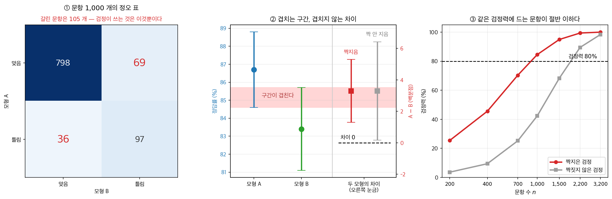
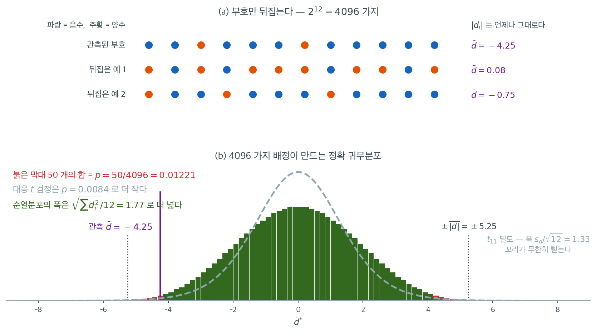

# 대응자료에 대한 순열검정

## 1. 차이의 대칭성만 가정한다

<div class="leadbox" markdown>

**들어가는 이야기** — 절댓값은 그대로 두고 부호만 뒤집는다

새 명상 프로그램을 $12$ 명에게 적용해 사전·사후를 재니 평균이 $4.25$ 만큼 내려갔다. 프로그램이 아무 일도 하지 않았다면 사람마다 그 차이가 양수일 확률과 음수일 확률이 같다. 그러면 관측된 열두 개 차이의 **부호만** 뒤집어 보는 $2^{12} = 4{,}096$ 가지가 모두 똑같이 그럴듯하고, 그중 $4.25$ 만큼 큰 평균이 몇인지 전부 세면 된다. $50$ 개여서 정확한 $p$ 값이 $0.01221$ 이다.

쓰인 가정은 하나뿐이다. 차이의 분포가 $0$ 에 대해 **대칭**이라는 것이다. 정규성보다는 약하고 「평균이 $0$ 이다」보다는 강하다. 부호를 뒤집어도 자료가 똑같이 그럴듯해야 하니, 뒤집은 것과 원래 것이 같은 분포여야 하기 때문이다.

그 가정이 깨지면 어긋나는 방향이 정해져 있다. 평균만 $0$ 이고 오른쪽으로 치우친 차이에서는 큰 양수 하나가 평균을 끌어올리는 일이 잦은데, 부호를 뒤집어 만든 귀무분포는 그 큰 값을 양쪽에 고르게 놓아 가운데가 실제보다 두꺼워진다. 그래서 관측값이 지나치게 극단으로 보이고 **거짓 기각이 늘어난다.**

대칭이 지켜질 때도 이 검정은 $t$ 검정과 다른 수를 낸다. 같은 자료에서 $0.01221$ 대 $0.0084$ 다. 귀무분포를 $0$ 둘레에서 짜는 쪽이 표준편차 $1.77$ 로 $t$ 검정이 쓰는 $1.33$ 보다 넓기 때문이다. 그러면 어느 쪽이 옳은가. 이 쪽이 부호 뒤집기를 세 단계로 적고 그것이 통하는 까닭을 밝힌 뒤, 대칭이 깨진 자리를 수로 재고 네 검정을 한 표에서 맞댄다.

</div>

대응 $t$ 검정은 같은 개체에서 얻은 두 측정(전후, 처치와 대조)을 차이 $d_i = x_i - y_i$로 요약하고 그 평균이 $0$인지 검정한다. 이 검정은 차이가 정규분포를 따른다고 가정하는데, 치우쳤거나 꼬리가 두꺼운 모집단에서 나온 작은 표본에서는 성립하지 않을 수 있다.

**대응자료에 대한 순열검정**은 정확하고 분포무관한 대안이다. 핵심 착상은 $H_0$ 아래에서 각 차이의 부호가 양수일 확률과 음수일 확률이 같다는 것이다. 관측된 차이들의 부호를 무작위로 뒤집어 이 대칭성을 활용한다.

---

## 2. 가설

$n$개의 대응 관측 $(x_1, y_1), \ldots, (x_n, y_n)$에서 차이를 계산한다.

$$
d_i = x_i - y_i, \quad i = 1, \ldots, n
$$

검정하는 가설은 다음과 같다.

$$
H_0: d_i \text{의 분포가 } 0 \text{에 대해 대칭이다} \quad \text{대} \quad H_1: d_i \text{의 중심이 } 0 \text{이 아니다}
$$

$H_0$ 아래에서 각 $d_i$는 양수일 가능성과 음수일 가능성이 같다. 관측 검정통계량은 보통 차이의 평균이다.

$$
\bar{d} = \frac{1}{n}\sum_{i=1}^n d_i
$$

또는 합 $T = \sum_{i=1}^n d_i$를 쓴다(검정 목적으로는 동등하다).

!!! note "대칭성 가정"
    대응 순열검정은 $H_0$ 아래에서 각 $d_i$의 분포가 $0$에 대해 대칭이라고 가정한다. 이는 대응 $t$ 검정의 정규성 가정보다 약하지만 단순히 $E[d_i] = 0$을 가정하는 것보다는 강하다. $H_0$ 아래에서도 차이가 치우쳐 있으면(실무에서 흔하지는 않다) 부호 뒤집기 방식이 타당하지 않을 수 있다. 연습문제 4에서 이 경우를 정량적으로 확인한다.

---

## 3. 알고리즘: 부호 뒤집기 순열

1. 관측된 차이 $d_1, \ldots, d_n$과 검정통계량 $\bar{d}_{\text{obs}} = \frac{1}{n}\sum_{i=1}^n d_i$를 계산한다.
2. $b = 1, 2, \ldots, B$에 대해 이렇게 된다.
    - 각 $i = 1, \ldots, n$에 대해 독립적으로 $s_i = +1$ 또는 $s_i = -1$을 같은 확률로 정한다.
    - $d_i^{*(b)} = s_i \cdot d_i$를 계산한다.
    - $\bar{d}^{*(b)} = \frac{1}{n}\sum_{i=1}^n d_i^{*(b)}$를 계산한다.
3. 양측 $p$값은 다음과 같다.

$$
p = \frac{\#\{b : |\bar{d}^{*(b)}| \ge |\bar{d}_{\text{obs}}|\} + 1}{B + 1}
$$

각 부호 배정은 $H_0$ 아래에서 동등하게 가능한 자료 배열 하나에 해당한다. 가능한 부호 배정은 모두 $2^n$가지이다.

---

## 4. 정확분포

$n$이 작으면 $2^n$가지 부호 배정을 모두 열거할 수 있다.

| $n$ | 배정 수 ($2^n$) | 가능성 |
|---|---|---|
| 5 | 32 | 자명 |
| 10 | 1,024 | 쉬움 |
| 15 | 32,768 | 가능 |
| 20 | 1,048,576 | 빠른 계산으로 가능 |
| 25 | 33,554,432 | 경계 |
| 30 | $> 10^9$ | 무작위 표집 필요 |

$n \le 20$이면 정확 열거가 현실적이다. 더 크면 $B = 10{,}000$ 이상의 무작위 부호 배정으로 충분히 좋은 근사를 얻는다.

---

## 5. 부호 뒤집기가 작동하는 이유

$H_0$ 아래에서 $d_i$의 분포는 $0$에 대해 대칭이다. 즉 $d_i$와 $-d_i$가 같은 분포를 갖는다. 따라서 $d_i$를 $-d_i$로 바꾸는 것("부호 뒤집기")은 $H_0$ 아래에서 동등하게 가능한 자료를 만든다.

$2^n$가지 부호 배정 전체는 절댓값 $|d_1|, \ldots, |d_n|$이 주어졌을 때 검정통계량의 **정확 조건부 분포**를 생성한다. 이 분포에서 얻은 $p$값은 정확하다. 어떤 표본크기에서도 제1종 오류율을 정확히 $\alpha$ 수준에서 통제한다.

<div class="aibox" markdown>

**AI로 보는 통계학 1.** 같은 문항을 풀렸으면 짝을 지어야 한다

언어모형의 점수표는 보통 이렇게 생겼다. 「모형 A $87\%$, 모형 B $84\%$.」 오차는 적혀
있지 않다. 적혀 있더라도 모형마다 따로 적혀 있어서, 읽는 사람은 두 구간이 겹치는지를
보고 판단한다. **두 번 틀린 읽기다.**

$2024$ 년 $11$ 월, 앤스로픽의 **에번 밀러**가 그 두 가지를 모두 짚는 글을 냈다. 요지는
첫 문단에 있다 — **「평가는 근본적으로 실험이다. 그런데 평가에 관한 문헌은 실험의 분석과
계획에 관한 다른 과학들의 문헌을 거의 무시해 왔다.」** 그가 내놓은 권고 다섯 가지 가운데
넷째가 이 쪽의 내용이다.

> **「두 모형을 견줄 때에는 모집단 수준의 요약통계량이 아니라 문항 수준의 짝지은 차이에
> 대해 통계적 추론을 하라.」**

까닭은 간단하다. 같은 문항 집합을 풀렸으면 두 점수는 **상관한다.** 쉬운 문항은 둘 다 맞고
어려운 문항은 둘 다 틀린다. 짝지은 차이의 분산은

$$
\operatorname{Var}(\bar s_A - \bar s_B) = \frac{\operatorname{Var}(s_A) + \operatorname{Var}(s_B) - 2\operatorname{Cov}(s_A, s_B)}{n}
$$

인데, 모형별 점수만 따로 보고하면 마지막 항이 버려진다. 밀러의 표현으로 **「순진한 비교는
두 모형이 같은 문항 집합을 평가할 때 표준오차를 줄일 기회를 놓친다.」**

문항반응 모형으로 문항 $1{,}000$ 개를 만들어 두 모형에 풀려 보았다.



- **①** $A$ 는 $86.7\%$, $B$ 는 $83.4\%$. 그런데 **둘의 답이 갈린 문항은 $105$ 개**뿐이다
  ($69 + 36$). 나머지 $895$ 개는 둘 다 맞았거나 둘 다 틀렸다. 짝지은 차이 $d_i$ 가 그
  $895$ 개에서 $0$ 이므로, **부호를 뒤집어도 아무 일이 일어나지 않는다.** 위 $2^n$ 가지
  배정 가운데 실제로 일하는 것은 $2^{105}$ 가지다.
- **②** 모형별 $95\%$ 구간은 $1.11$ 백분점만큼 **겹친다.** 그래서 「차이 없음」으로 읽기
  쉽다. 그러나 짝지은 차이의 구간은 $[1.30,\ 5.30]$ 으로 $0$ 을 넘지 않는다. 부호 뒤집기
  순열의 $p$ 값은 $0.0013$ 이고, 짝을 버리면 $0.0384$ 로 $30$ 배 가까이 무뎌진다.
  표준오차 자체가 $1.59$ 대 $1.02$ 백분점으로 $1.56$ 배 차이다.
- **③** 분산이 그만큼 줄면 문항 수로는 제곱만큼 돌아온다. $3$ 백분점 차이를 $80\%$ 의
  검정력으로 잡는 데 짝지으면 문항 $1{,}000$ 개, 짝을 버리면 $2{,}200$ 개가 든다.

밀러의 글에는 이 쪽 바깥의 권고도 있다. 문항이 **덩이로** 뽑히는 평가 — 지문 하나에 딸린
여러 문항, 같은 문제를 여러 언어로 옮긴 문항 — 에서는 군집 표준오차를 써야 한다. 실제
앤스로픽 모형으로 재어 보니 DROP 에서 군집 표준오차가 순진한 쪽의 **$3.05$ 배**였다.
나란히 쓰면 이렇게 된다. **분모는 겉보기보다 작고($\div 3$), 두 모형의 차이는 겉보기보다
크다($\times 1.6$).** 둘 다 같은 자료를 다르게 센 결과일 뿐이다.

부호 뒤집기가 특별한 알고리즘이어서 이기는 것이 아니다. **짝이 지어진 자료를 짝으로
다루었기 때문**에 이긴다. 실험계획에서 백 년 된 이야기인데, 평가표에는 아직 다 닿지 않았다.

_확인한 곳 — 에번 밀러(앤스로픽), "Adding Error Bars to Evals: A Statistical Approach to
Language Model Evaluations", arXiv:$2411.00640$($2024$ 년 $11$ 월 $1$ 일)의 초록·권고 목록·
$4.2$ 절에서 인용한 세 대목과 짝지은 분산 식, 그리고 표 $4$ 의 DROP 군집 표준오차 비
$3.05$ (논문이 「꾸며낸 수가 아니다」라고 밝혀 둔 표다). 그림의 자료는 문항반응 모형으로
직접 만든 것이며, 수는 모두 직접 계산한 값이다 — 실제 모형의 점수가 아니다. ①② 에 쓴
한 판은 관측 격차가 참값 $3$ 백분점에 가까운 **전형적인** 판을 고른 것이고, ③ 의 검정력은
고르지 않고 전부를 센 값이다_

</div>

---

## 6. 다른 검정통계량

부호 뒤집기 틀에서는 차이로부터 계산되는 어떤 통계량도 쓸 수 있다. 흔한 선택은 다음과 같다.

**차이의 평균** ($\bar{d}$): 차이가 대칭이고 꼬리가 가벼우면 가장 강력하다.

**양의 순위합** (Wilcoxon 부호순위 통계량):

$$
W^+ = \sum_{i=1}^n \text{rank}(|d_i|) \cdot \mathbf{1}(d_i > 0)
$$

원자료 대신 순위를 쓰므로 이상값에 더 로버스트하다.

**차이의 절사평균**: 가장 극단적인 차이를 제외하고 평균을 낸다. 평균과 중앙값의 절충이다.

!!! tip "어떤 통계량을 쓸 것인가"
    차이가 대략 대칭이고 극단적인 이상값이 없으면 $\bar{d}$를 쓴다. 이상값이 우려되면 Wilcoxon 부호순위 통계량을 쓴다. 어떤 통계량을 고르든 순열 방식(부호 뒤집기)은 동일하다. 연습문제 2에서 네 통계량의 검정력을 비교한다.

새로운 명상 프로그램의 효과를 $n = 12$명에게서 측정했다. 관측된 차이(사후 $-$ 사전)는 다음과 같다.

$$
d = (-8, -3, 2, -12, -5, -1, 4, -7, -6, -2, -9, -4)
$$

관측된 평균차는 $\bar{d}_{\text{obs}} = -4.25$, 표준편차는 $s_d = 4.595$이다.

<div class="exbox" markdown>

**보기 1.** <span class="diff easy" title="쉬움"></span> 대응자료에 대한 순열검정. 위 $n = 12$개의 차이에 부호 뒤집기 검정을 적용한다. $2^{12} = 4{,}096$가지이므로 **모두 열거할 수 있다.**

**(1)** 귀무분포 $\bar d^{*}$의 평균과 표준편차를 닫힌 꼴로 구하고, 그 지지집합이 $[-\overline{\lvert d\rvert},\ \overline{\lvert d\rvert}]$임을 보이시오.

**(2)** $\lvert \bar d^{*}\rvert \ge 4.25$라는 조건이 **뒤집는 쪽 $\lvert d_i\rvert$들의 합**에 대한 조건으로 바뀜을 보이고, 그런 배정의 수를 **손으로 세어** 정확 $p$값을 구하시오. 열거해 확인하고 대응 $t$ 검정·Wilcoxon 부호순위검정과 견주시오.

</div>

??? success "풀이"

    **(1) 해석적으로.** 독립인 부호 $\varepsilon_i \in \{-1, +1\}$을 각각 확률 $1/2$로 붙이므로 $E[\varepsilon_i] = 0$, $\operatorname{Var}(\varepsilon_i) = 1$이고

    $$
    E[\bar d^{*}] = 0,
    \qquad
    \operatorname{Var}(\bar d^{*}) = \frac{1}{n^2}\sum_{i=1}^n d_i^2
    $$

    이다. $\sum_i d_i^2 = 449$이므로

    $$
    \operatorname{SD}(\bar d^{*}) = \frac{\sqrt{449}}{12} = 1.765802
    $$

    **지지집합.** 삼각부등식에서 $\lvert \bar d^{*}\rvert \le \frac1n\sum_i \lvert d_i\rvert = \overline{\lvert d\rvert}$이고, 등호는 $\varepsilon_i d_i$의 부호가 모두 같을 때 성립한다. $\sum_i \lvert d_i \rvert = 63$이므로 지지집합은 $[-5.25,\ 5.25]$이고 양 끝은 실제로 도달한다. **순열분포는 유계다.** $t$ 검정이 쓰는 $t_{11}$에는 그런 경계가 없다.

    **(2) 해석적으로.** $\varepsilon_i d_i = \pm\lvert d_i\rvert$이고 부호가 자유로우므로, 부호 배정을 "어느 $\lvert d_i\rvert$를 음수로 둘 것인가"로 바꾸어 적을 수 있다. 음수로 둔 자리의 집합을 $A$, 그 합을 $s = \sum_{i \in A}\lvert d_i\rvert$라 하면

    $$
    \sum_i \varepsilon_i d_i = 63 - 2s
    $$

    이다. 관측값이 $\bar d_{\text{obs}} = -4.25$, 곧 합으로는 $-51$이므로

    $$
    \lvert \bar d^{*}\rvert \ge 4.25
    \iff \lvert 63 - 2s\rvert \ge 51
    \iff s \le 6 \;\text{또는}\; s \ge 57
    $$

    이다. $s \ge 57$은 여집합의 합이 $6$ 이하라는 뜻이므로 $A \mapsto A^c$가 두 쪽을 일대일로 맞바꾼다. **한쪽만 세면 된다.**

    $\lvert d\rvert = (8, 3, 2, 12, 5, 1, 4, 7, 6, 2, 9, 4)$에서 합이 $6$ 이하인 부분집합을 센다. $6$을 넘는 $7, 8, 9, 12$는 아예 들어갈 수 없고, 값 $2$와 값 $4$는 **두 개씩** 있다는 데 주의한다.

    | 합 $s$ | 부분집합 | 개수 |
    |---:|:---|---:|
    | $0$ | $\varnothing$ | $1$ |
    | $1$ | $\{1\}$ | $1$ |
    | $2$ | $\{2\}$ (둘 중 하나) | $2$ |
    | $3$ | $\{3\}$, $\{1,2\}$ | $1 + 2 = 3$ |
    | $4$ | $\{4\}$, $\{1,3\}$, $\{2,2\}$ | $2 + 1 + 1 = 4$ |
    | $5$ | $\{5\}$, $\{1,4\}$, $\{2,3\}$, $\{1,2,2\}$ | $1 + 2 + 2 + 1 = 6$ |
    | $6$ | $\{6\}$, $\{1,5\}$, $\{2,4\}$, $\{1,2,3\}$ | $1 + 1 + 4 + 2 = 8$ |

    합이 $25$다. 양쪽을 더하면

    $$
    p_{\text{정확}} = \frac{2 \times 25}{4096} = \frac{50}{4096} = 0.012207
    $$

    **수치적으로.** $n = 12$이므로 $2^{12} = 4{,}096$가지 부호 배정을 모두 열거한다.

    ```python
    import numpy as np, itertools
    from scipy import stats

    d = np.array([-8, -3, 2, -12, -5, -1, 4, -7, -6, -2, -9, -4])
    print(d.mean(), round(d.std(ddof=1), 4))     # -4.25  4.595

    S = np.array(list(itertools.product([1, -1], repeat=12)))
    m = (S * d).mean(axis=1)
    count = (np.abs(m) >= abs(d.mean()) - 1e-12).sum()
    print(count, len(m), count / len(m))         # 50  4096  0.012207

    print(stats.ttest_1samp(d, 0))               # t = -3.204, p = 0.00839
    print(stats.wilcoxon(d))                     # W = 8.0,   p = 0.012207
    ```

    출력:

    ```
    -4.25 4.595
    50 4096 0.01220703125
    TtestResult(statistic=-3.2040407749287168, pvalue=0.008394085815475436, df=11)
    WilcoxonResult(statistic=8.0, pvalue=0.01220703125)
    ```

    (1)과 (2)의 수를 모두 확인한다. 위 블록의 변수를 그대로 이어 쓴다.

    ```python
    import collections

    n = len(d)
    print(f"sum|d| = {np.abs(d).sum():.0f},  mean|d| = {np.abs(d).mean():.2f},"
          f"  sum d^2 = {(d ** 2).sum():.0f}")
    print(f"귀무 SD 닫힌 꼴 = {np.sqrt((d ** 2).sum()) / n:.6f},  열거 = {m.std():.6f}")
    print(f"지지집합의 끝   = {np.abs(m).max():.2f}")
    print(f"t 검정의 척도   = {d.std(ddof=1) / np.sqrt(n):.6f}")

    # |합| >= 51 은 뒤집는 쪽 |d_i| 들의 합 s 가 6 이하이거나 57 이상인 것과 같다.
    cnt = collections.Counter()
    for k in range(n + 1):
        for c in itertools.combinations(range(n), k):
            s = int(sum(abs(d[i]) for i in c))
            if s <= 6:
                cnt[s] += 1
    print(f"합이 s 인 부분집합의 수: {sorted(cnt.items())}"
          f"  ->  s <= 6 은 {sum(cnt.values())} 가지")

    # 두 통계량이 고르는 배정이 같은 집합인가
    r = stats.rankdata(np.abs(d))
    Wp = ((S * d > 0) * r).sum(axis=1)
    W_obs = ((d > 0) * r).sum()
    sel_mean = np.abs(m) >= abs(d.mean()) - 1e-12
    sel_w = (Wp <= W_obs + 1e-12) | (Wp >= r.sum() - W_obs - 1e-12)
    print(f"W+ obs = {W_obs:.1f},  순위합 전체 = {r.sum():.0f},"
          f"  Wilcoxon 이 고른 배정 = {sel_w.sum()}")
    print(f"두 집합이 같은가: {np.array_equal(sel_mean, sel_w)}")
    ```

    출력:

    ```
    sum|d| = 63,  mean|d| = 5.25,  sum d^2 = 449
    귀무 SD 닫힌 꼴 = 1.765802,  열거 = 1.765802
    지지집합의 끝   = 5.25
    t 검정의 척도   = 1.326450
    합이 s 인 부분집합의 수: [(0, 1), (1, 1), (2, 2), (3, 3), (4, 4), (5, 6), (6, 8)]  ->  s <= 6 은 25 가지
    W+ obs = 8.0,  순위합 전체 = 78,  Wilcoxon 이 고른 배정 = 50
    두 집합이 같은가: True
    ```

    **손으로 센 것이 그대로 맞는다.** 합 $0$부터 $6$까지의 개수가 $1, 1, 2, 3, 4, 6, 8$로 표와 한 칸도 다르지 않고, 합이 $25$다. 따라서 $4{,}096$가지 중 $50$가지가 걸리고 $p_{\text{정확}} = 50/4096 = 0.012207$이다. 닫힌 꼴 표준편차 $1.765802$와 지지집합의 끝 $5.25$도 열거와 일치한다.

    **Wilcoxon 부호순위검정이 정확히 같은 답을 주는 까닭도 드러난다.** $W^+ \le 8$ 또는 $W^+ \ge 70$인 배정이 $50$개인데, 코드가 확인하듯 그것이 평균 통계량이 고른 $50$개와 **같은 집합**이다. 두 검정이 같은 $2^{12}$가지 위에서 정의되고 이 자료에서는 극단 배정의 순서까지 겹치기 때문이다. 통계량이 달라도 기각역이 일치할 수 있다.

    **대응 $t$ 검정만 다른 답을 준다.** $t = -4.25/1.326450 = -3.204$에서 $p = 0.0084$로 순열검정의 $0.0122$보다 작다. 이 자료의 왜도는 $0.197$로 거의 대칭이므로 원인은 치우침이 아니다. 두 가지가 겹친다.

    - **척도가 다르다.** 순열은 $\sqrt{\sum d_i^2}/n = 1.766$으로 재고 $t$ 검정은 $s_d/\sqrt n = 1.326$으로 잰다. 아래 보기 3 에서 보는 대로 비가 $\sqrt{(n-1+t^2)/n} = \sqrt{(11 + 10.266)/12} = 1.331$이다.
    - **꼬리가 다르다.** 순열분포는 $\pm 5.25$에서 끊기는데 $t_{11}$은 끝없이 뻗는다.

    더 넓고 유계인 귀무분포에서 같은 관측값을 재니 $p$값이 커진다. **순열검정의 $0.0122$는 이 자료에서 정확한 값이고, $t$ 검정의 $0.0084$는 정규성을 빌려 온 근사다.**

## 7. 대칭이 깨지면 얼마나 틀어지는가

절 $2$ 의 쪽지는 대칭성 가정이 「대응 $t$ 검정의 정규성보다 약하지만 $E[d_i] = 0$ 보다는
강하다」고만 적었다. 그 사이가 얼마나 넓은지를 수로 잰다. 평균은 셋 다 $0$ 이고
치우침만 다른 분포에서 크기를 재면 된다.

<div class="exbox" markdown>

**보기 2.** <span class="diff easy" title="쉬움"></span> 대응 순열검정. 주석이 말하듯 이 검정은 **"차이의 분포가 $0$에 대해 대칭"**이라는 가정 위에 서 있다. 그 가정이 깨지면 어떻게 되는지 잰다.

**(1)** $E[d_i] = 0$이기만 하고 **대칭이 아니면** 왜 교환가능성이 깨지는지 적으시오. 제1종 오류율이 어느 방향으로 틀어지겠는가.

**(2)** $n = 15$에서 차이를 (가) 정규, (나) $\text{Exp}(1) - 1$, (다) 중심화한 로그정규로 두고 각각 크기를 재시오.

</div>

??? success "풀이"

    **(1) 해석적으로.** 부호 뒤집기가 타당한 근거는 **$d_i$와 $-d_i$가 같은 분포를 갖는다**는 것 하나다. 그래야 $\varepsilon_i d_i$가 $d_i$와 교환가능해지고 $2^n$가지 배정이 모두 똑같이 그럴듯해진다.

    평균만 $0$이고 분포가 치우쳐 있으면 그 전제가 깨진다. 예컨대 $d_i = E_i - 1$($E_i \sim \text{Exp}(1)$)이면 $d_i$는 $-1$ 아래로 못 가지만 $-d_i$는 $1$ 위로 뻗는다. **두 분포가 다르다.**

    결과는 한쪽으로 치우친다. $d_i$가 오른쪽으로 치우쳐 있으면 큰 양수 하나가 $\bar d$를 끌어올리는 일이 잦은데, 부호를 뒤집어 만든 귀무분포는 그 큰 값을 양쪽에 고르게 배치하므로 **대칭이 되어 실제 $\bar d$의 분포보다 가운데가 두껍다.** 그래서 관측된 $\bar d$가 과하게 극단으로 보이고, **제1종 오류율이 명목값보다 커진다.**

    **(2) 수치적으로.** 함수는 이렇다.

    ```python
    def paired_permutation_test(x, y, B=9999, rng=None):
        """차이의 부호를 뒤집는 대응 순열검정.

        대응자료에서는 이름표를 섞으면 안 된다. 짝 자체가 자료의 구조이기
        때문이다. 대신 귀무가설 아래에서 각 차이의 분포가 0 을 중심으로
        대칭이므로, 부호를 아무렇게나 뒤집어도 똑같이 그럴듯하다.
        """
        rng = rng or np.random.default_rng(0)
        d = np.asarray(x) - np.asarray(y)
        t_obs = d.mean()
        signs = rng.choice([-1, 1], size=(B, len(d)))
        t_perm = (signs * d).mean(axis=1)
        return t_obs, ((np.abs(t_perm) >= abs(t_obs)).sum() + 1) / (B + 1)
    ```

    평균이 모두 $0$이고 치우침만 다른 세 분포에서 크기를 잰다.

    ```python
    rng = np.random.default_rng(41)
    M, B, n = 2000, 999, 15
    for name, gen in [
            ("대칭 (정규)", lambda k: rng.normal(0, 1, k)),
            ("치우침 (지수-1)", lambda k: rng.exponential(1, k) - 1),
            ("강한 치우침 (로그정규 중심화)",
             lambda k: np.exp(rng.normal(0, 1.5, k)) - np.exp(1.5**2/2))]:
        rej = 0
        for _ in range(M):
            d = gen(n); t = d.mean()
            S = rng.choice([-1, 1], size=(B, n))
            tp = (S * d).mean(axis=1)
            rej += ((np.abs(tp) >= abs(t)).sum() + 1)/(B + 1) < 0.05
        print(f"{name:>22}: 제1종 오류율 {rej/M:.3f}"
              f"  (몬테카를로 오차 {np.sqrt(0.05*0.95/M):.4f})")
    ```

    출력:

    ```
                   대칭 (정규): 제1종 오류율 0.045  (몬테카를로 오차 0.0049)
                치우침 (지수-1): 제1종 오류율 0.088  (몬테카를로 오차 0.0049)
         강한 치우침 (로그정규 중심화): 제1종 오류율 0.248  (몬테카를로 오차 0.0049)
    ```

    **예측한 방향으로, 예상보다 크게 틀어진다.**

    | 차이의 분포 | 왜도 | 제1종 오류율 |
    |:---|---:|---:|
    | 정규 | $0$ | $0.045$ |
    | $\text{Exp}(1) - 1$ | $2$ | $0.088$ |
    | 중심화 로그정규 $(\sigma = 1.5)$ | $33.5$ | $0.248$ |

    대칭일 때는 $0.045$로 명목값 $0.049$를 지킨다. 지수분포로 바꾸면 $0.088$로 **$1.8$배**, 로그정규로 더 밀면 $0.248$로 **$5$배**가 된다. $n = 15$에서 $\alpha = 0.05$라 믿고 썼는데 넷에 하나꼴로 헛되이 기각하는 셈이다.

    **"대칭"은 장식이 아니다.** 순열검정이 "가정 없는 방법"으로 소개되곤 하지만, 정확히 말하면 가정이 **교환가능성 하나**로 줄어든 것일 뿐이다. 설계마다 그 하나가 다른 얼굴을 한다. 이표본에서는 $F_X = F_Y$였고([이표본](two_sample.md)), 상관에서는 독립성이었으며([상관](correlation.md)), 대응에서는 $0$에 대한 대칭이다. **셋 가운데 가장 깨지기 쉬운 것이 이 세 번째다.**

    차이가 크게 치우쳐 있다면 부호검정(중앙값이 $0$인지만 묻는다)이나 차이를 로그 척도로 옮긴 뒤의 부호 뒤집기를 생각해야 한다.

---

## 8. 부호 뒤집기를 그림으로

이 보기는 $2^{12} = 4096$가지를 모두 열거했으므로 귀무분포를 통째로 그릴 수 있다.



(a)에서 각 점은 한 사람의 차이 $d_i$이고 색은 부호다. 아래 두 줄은 부호를 무작위로 뒤집은 예인데, **$|d_i|$의 목록은 세 줄이 완전히 같다.** 바뀐 것은 부호뿐이며 그때마다 $\bar{d}$가 $-4.25$에서 $0.08$로, $-0.75$로 움직인다. 이것이 "$|d_i|$에 조건부인 정확분포"라는 말의 내용이다. 관측된 절댓값들을 그대로 둔 채 $H_0$가 참인 세계를 $4096$가지 만들어 낸 것이다.

(b)가 그 $4096$개 값의 분포다. 관측된 $-4.25$만큼 극단적인 배정은 붉게 칠한 $50$개뿐이고, $50/4096 = 0.01221$이 정확 $p$값이다. 분포가 $\pm\overline{|d|} = \pm 5.25$에서 뚝 끊기는 것도 눈에 띈다. **모든 부호를 같은 방향으로 맞추는 것이 가장 극단적인 배정**이므로 그보다 큰 값은 존재할 수 없다. 점선으로 그린 $t_{11}$ 밀도는 그 경계를 무시하고 양쪽으로 계속 뻗는다.

두 분포의 **폭**도 다르다. 부호 뒤집기 분포의 표준편차는 $\sqrt{\sum d_i^2}/12 = 1.77$인데 $t$ 검정이 쓰는 척도는 $s_d/\sqrt{12} = 1.33$이다. 순열분포는 $0$을 중심으로 짜이므로 제곱합을 $0$ 주위에서 재고, $s_d$는 관측된 평균 $-4.25$ 주위에서 잰다. 평균이 $0$에서 멀수록 이 차이가 커진다. 더 넓은 귀무분포에서 같은 관측값을 재니 $p$값도 커져서, 순열검정의 $0.0122$가 $t$ 검정의 $0.0084$보다 보수적인 답이 된다. **어느 쪽이 옳은가에 대한 답은 분명하다.** 순열분포는 이 자료에서 정확한 반면 $t_{11}$은 정규성을 빌려 온 근사이다.

---

## 9. 관련 검정과의 비교

| 검정 | 가정 | 통계량 | 정확성 |
|---|---|---|---|
| 대응 $t$ 검정 | 차이가 정규 | $t = \bar{d}/(s_d/\sqrt{n})$ | 근사(정규면 정확) |
| 부호검정 | 연속, 대칭 | 양수 $d_i$의 개수 | 정확(이항) |
| Wilcoxon 부호순위 | 차이가 대칭 | 양수의 순위합 | 정확(순위의 순열) |
| 순열(부호 뒤집기) | 차이가 대칭 | $d_i$의 임의 통계량 | 정확($\lvert d_i\rvert$ 조건부) |

부호 뒤집기 순열검정은 Wilcoxon 부호순위검정을 일반화한다. 순열 틀 안에서 Wilcoxon 통계량을 쓰면 표준 Wilcoxon 검정과 같은 결과가 나오고, 순열 틀은 여기에 더해 $\bar{d}$나 다른 임의의 통계량도 쓸 수 있게 한다.

!!! warning "차이가 0인 경우"
    어떤 $d_i = 0$이면 그 관측에 대한 부호 뒤집기는 아무 효과가 없다($0$의 부호를 바꿔도 $0$이다). 흔한 처리는 검정 전에 $0$인 차이를 제외하거나($n$이 줄어든다), 같은 확률로 양수나 음수에 무작위 배정하는 것이다.

---

<div class="exbox" markdown>

**보기 3.** <span class="diff easy" title="쉬움"></span> 대응자료의 부호 뒤집기 검정. 열 사람의 처치 전후 측정에서 차이 $d_i$를 얻고, 각 $d_i$의 부호를 독립으로 뒤집어 귀무분포를 만든다.

**(1)** 부호 뒤집기 귀무분포에서 $\bar d^{*}$의 평균과 분산을 닫힌 꼴로 구하시오. 또 $d_i$가 **모두 같은 부호**이면 $\lvert \bar d^{*}\rvert$의 최댓값이 $\lvert \bar d_{\text{obs}}\rvert$ 자신이고 그것을 이루는 배정이 꼭 둘뿐임을 보여, 정확 $p$값을 구하시오.

**(2)** 실행해 확인하고, (1)의 분산으로 한 정규근사와 대응 $t$ 검정이 각각 정확값과 얼마나 어긋나는지 재시오. 부호 뒤집기 귀무분포의 표준편차가 $t$ 검정의 표준오차보다 넓은 까닭도 밝히시오.

</div>

??? success "풀이"

    **(1) 해석적으로.** 차이는 $d = (2, 1, 3, 5, 3, 2, 1, 2, 1, 4)$로 $\bar d_{\text{obs}} = 2.4$, $\sum_i d_i^2 = 74$다. 귀무가설 아래에서 각 차이의 분포가 $0$을 중심으로 대칭이므로, 독립인 부호 $\varepsilon_i \in \{-1, +1\}$을 각각 확률 $1/2$로 붙인

    $$
    \bar d^{*} = \frac1n \sum_{i=1}^n \varepsilon_i d_i
    $$

    가 귀무분포다. $E[\varepsilon_i] = 0$, $\operatorname{Var}(\varepsilon_i) = 1$이고 $\varepsilon_i$들이 독립이므로

    $$
    E[\bar d^{*}] = 0,
    \qquad
    \operatorname{Var}(\bar d^{*}) = \frac{1}{n^2}\sum_{i=1}^n d_i^2
    $$

    이다. **차이의 크기만 쓰고 부호는 쓰지 않는다.** 수를 넣으면

    $$
    \operatorname{SD}(\bar d^{*}) = \frac{\sqrt{74}}{10} = 0.8602325
    $$

    **최댓값.** 삼각부등식에서

    $$
    \lvert \bar d^{*}\rvert = \frac1n\left\lvert \sum_i \varepsilon_i d_i \right\rvert
    \le \frac1n \sum_i \lvert d_i \rvert
    $$

    이고, 등호는 모든 $\varepsilon_i d_i$의 부호가 같을 때, 곧 $\varepsilon$이 전부 $+1$이거나 전부 $-1$일 때만 성립한다. 이 자료는 $d_i$가 **열 개 모두 양수**이므로 $\frac1n\sum_i \lvert d_i\rvert = \bar d_{\text{obs}} = 2.4$이고, 등호를 이루는 배정은 관측된 것과 그것을 통째로 뒤집은 것 **둘뿐**이다. 따라서

    $$
    p_{\text{정확}} = \frac{2}{2^{10}} = \frac{2}{1024} = 0.001953
    $$

    이고, 이것은 $n = 10$인 부호 뒤집기 검정이 낼 수 있는 **가장 작은 양측 $p$값**이다(연습문제 2가 일반 $n$에서 같은 셈을 한다).

    **(2) 수치적으로.** 먼저 쪽의 모의실험이다.

    ```python
    import numpy as np

    def paired_permutation_test(before, after, n_permutations=10000, seed=0):
        """대응자료에 대한 부호 뒤집기 순열검정.

        귀무가설 아래에서는 각 차이의 분포가 0 을 중심으로 대칭이다. 그러므로
        어느 차이들의 부호를 뒤집든 똑같이 그럴듯하다. 대응자료에서 이름표를
        섞으면 안 되는 대신 이 방법을 쓴다.
        """
        rng = np.random.default_rng(seed)
        differences = np.asarray(after) - np.asarray(before)
        observed_mean_diff = differences.mean()

        signs = rng.choice([-1, 1], size=(n_permutations, len(differences)))
        perm_means = (signs * differences).mean(axis=1)

        p_value = ((np.abs(perm_means) >= abs(observed_mean_diff)).sum() + 1) \
                  / (n_permutations + 1)
        return p_value, observed_mean_diff

    before = [70, 68, 75, 80, 72, 74, 69, 77, 73, 76]
    after = [72, 69, 78, 85, 75, 76, 70, 79, 74, 80]

    p_value, obs_diff = paired_permutation_test(before, after)
    print(f"Observed Mean Difference: {obs_diff:.2f}")   # 2.40
    print(f"P-value: {p_value:.4f}")                     # 0.002
    ```

    출력:

    ```
    Observed Mean Difference: 2.40
    P-value: 0.0020
    ```

    이제 $2^{10} = 1{,}024$가지를 모두 열거해 (1)을 확인한다. 위 블록의 변수를 그대로 이어 쓴다.

    ```python
    import itertools
    from scipy import stats

    d = np.asarray(after) - np.asarray(before)
    n = len(d)
    print(f"d = {d},  모두 양수인가: {bool((d > 0).all())}")
    print(f"d-bar = {d.mean():.4f},   sum d^2 = {int((d ** 2).sum())}")

    sd_null = np.sqrt((d ** 2).sum()) / n
    print(f"SD(d-bar*) 닫힌 꼴 = {sd_null:.7f}")

    # 2^10 = 1,024 가지 부호 배정을 모두 열거한다.
    S = np.array(list(itertools.product([1, -1], repeat=n)))
    m = (S * d).mean(1)
    hit = int((np.abs(m) >= abs(d.mean()) - 1e-12).sum())
    print(f"열거한 SD         = {m.std():.7f}")
    print(f"|d-bar*| 의 최댓값 = {np.abs(m).max():.4f}  (관측값 {d.mean():.4f})")
    print(f"|d-bar*| >= 2.4 인 배정 = {hit} 가지 / {len(m)}  ->  정확 p = {hit / len(m):.9f}")

    z = d.mean() / sd_null
    print(f"\n정규근사 z = {z:.6f},  양측 p = {2 * stats.norm.sf(z):.6f}"
          f"   (정확값의 {2 * stats.norm.sf(z) / (hit / len(m)):.2f} 배)")

    tt = stats.ttest_rel(after, before)
    se_t = d.std(ddof=1) / np.sqrt(n)
    print(f"\n대응 t 검정: t = {tt.statistic:.6f},  p = {tt.pvalue:.6f},  SE = {se_t:.7f}")
    print(f"SD(d-bar*)/SE_t  실제 = {sd_null / se_t:.7f}")
    print(f"                 예측 = {np.sqrt((n - 1 + tt.statistic ** 2) / n):.7f}")
    ```

    출력:

    ```
    d = [2 1 3 5 3 2 1 2 1 4],  모두 양수인가: True
    d-bar = 2.4000,   sum d^2 = 74
    SD(d-bar*) 닫힌 꼴 = 0.8602325
    열거한 SD         = 0.8602325
    |d-bar*| 의 최댓값 = 2.4000  (관측값 2.4000)
    |d-bar*| >= 2.4 인 배정 = 2 가지 / 1024  ->  정확 p = 0.001953125

    정규근사 z = 2.789943,  양측 p = 0.005272   (정확값의 2.70 배)

    대응 t 검정: t = 5.622255,  p = 0.000325,  SE = 0.4268749
    SD(d-bar*)/SE_t  실제 = 2.0151862
                     예측 = 2.0151862
    ```

    **(1)이 모두 맞는다.** 닫힌 꼴 $\sqrt{74}/10 = 0.8602325$가 열거한 표준편차와 일곱 자리까지 같고, $\lvert \bar d^{*}\rvert$의 최댓값이 정확히 관측값 $2.4$이며 그것을 이루는 배정이 $1{,}024$개 중 $2$개다. 몬테카를로값 $0.002000$도 예측 평균 $0.002053$에서 $-0.12$ 표준편차 떨어진 제자리다.

    **정규근사는 $2.70$배 크고 $t$ 검정은 $6.0$배 작다.** 정규근사가 틀리는 까닭은 관측값이 분포의 **지지집합 끝점**에 놓였기 때문이다. $\bar d^{*}$는 $[-2.4, 2.4]$ 밖으로 나갈 수 없는데 정규곡선은 그 너머에도 질량을 두므로 꼬리를 과대평가한다. 여기서는 $0.005272$ 대 $0.001953$이다.

    **$t$ 검정이 작은 값을 주는 까닭은 눈금이 좁기 때문이다.** $\sum_i d_i^2 = (n-1)s_d^2 + n\bar d^2$를 쓰고 $t = \bar d\sqrt n / s_d$를 넣으면

    $$
    \frac{\operatorname{SD}(\bar d^{*})}{\operatorname{SE}_t}
    = \sqrt{\frac{\sum_i d_i^2}{n\, s_d^2}}
    = \sqrt{\frac{n - 1 + t^2}{n}}
    $$

    이고, $t = 5.622255$에서 $\sqrt{(9 + 31.6098)/10} = 2.0151862$다. 코드가 낸 비와 일곱 자리까지 같다. **$t$ 검정은 효과를 뺀 나머지의 흩어짐 $s_d$로 눈금을 재고, 부호 뒤집기는 효과까지 포함한 $\sqrt{\sum d_i^2}$로 잰다.** 효과가 커서 $\lvert t\rvert > 1$ 이면 부호 뒤집기의 귀무분포가 더 넓어져 **스스로를 깎는다.** 여기서는 두 배가 넘게 넓다.

    두 어긋남의 성격이 다르다는 것이 요점이다. 정규근사의 $2.70$배는 **근사의 실패**이고, $t$ 검정의 $6.0$배는 **다른 가정 아래의 다른 답**이다. 정규성을 믿을 수 없는 $n = 10$에서 믿을 것은 $0.001953$ 하나다.

---

## 연습문제

<div class="drillbox" markdown>

**연습문제 1.** <span class="diff easy" title="쉬움"></span>
다음 전후 자료(혈압)에 대해 **대응 부호 뒤집기 순열검정**을 구현하라.

| 환자 | 사전 | 사후 |
|---|---|---|
| 1 | 148 | 140 |
| 2 | 142 | 138 |
| 3 | 136 | 132 |
| 4 | 155 | 147 |
| 5 | 129 | 131 |
| 6 | 161 | 152 |
| 7 | 138 | 135 |
| 8 | 144 | 139 |

**(a)** $2^8 = 256$가지 부호 배정을 모두 열거하여 정확 $p$값을 구하라.

**(b)** 대응 $t$ 검정 및 Wilcoxon 부호순위검정과 비교하라.

</div>

??? success "풀이"
    ```python
    import numpy as np, itertools
    from scipy import stats

    before = np.array([148, 142, 136, 155, 129, 161, 138, 144])
    after  = np.array([140, 138, 132, 147, 131, 152, 135, 139])
    d = after - before
    print(d)                      # [-8 -4 -4 -8  2 -9 -3 -5]
    print(d.mean(), round(d.std(ddof=1), 4))   # -4.875  3.5632

    S = np.array(list(itertools.product([1, -1], repeat=8)))
    m = (S * d).mean(axis=1)
    cnt = (np.abs(m) >= abs(d.mean()) - 1e-12).sum()
    print(cnt, len(m), cnt / len(m))           # 4  256  0.015625

    print(stats.ttest_rel(after, before))
    print(stats.wilcoxon(d, method='exact'))
    print(stats.binomtest((d > 0).sum(), 8, 0.5).pvalue)
    ```

    출력:

    ```
    [-8 -4 -4 -8  2 -9 -3 -5]
    -4.875 3.5632
    4 256 0.015625
    TtestResult(statistic=-3.8697136256193168, pvalue=0.006133954352036696, df=7)
    WilcoxonResult(statistic=1.0, pvalue=0.015625)
    0.0703125
    ```

    **(a)** 차이는 $(-8, -4, -4, -8, 2, -9, -3, -5)$이고 $\bar{d} = -4.875$이다. $256$가지 부호 배정 중 $|\bar{d}^*| \ge 4.875$를 만족하는 것은 **$4$가지**이므로

    $$
    p_{\text{exact}} = \frac{4}{256} = 0.015625
    $$

    **(b) 네 검정의 비교**

    | 검정 | 통계량 | $p$값 |
    |:---|---:|---:|
    | 부호 뒤집기 순열(평균) | $\bar{d} = -4.875$ | **0.015625** |
    | Wilcoxon 부호순위 (정확) | $W = 1$ | **0.015625** |
    | 대응 $t$ 검정 | $t = -3.870$, $\nu = 7$ | 0.00613 |
    | 부호검정 | 양수 $1$개 / $8$개 | 0.0703 |

    **순열검정과 Wilcoxon이 또 일치한다.** 본문 보기와 같은 현상이다. 두 통계량이 같은 $4$개의 배정을 극단으로 지목한다.

    **$t$ 검정이 $2.5$배 작은 $p$값을 준다**($0.0061$ 대 $0.0156$). 본문 보기와 방향이 같다. $n = 8$에서 $t_7$의 꼬리 근사가 순열분포보다 관대하다.

    **부호검정은 $p = 0.070$으로 기각하지 못한다.** 부호검정은 차이의 크기를 완전히 버리고 방향만 세기 때문이다. 여덟 명 중 일곱 명이 내려갔다는 사실만으로는 $\alpha = 0.05$에 못 미친다. 반면 순열검정과 Wilcoxon은 "내려간 사람들의 하락폭이 유일하게 올라간 사람의 상승폭($+2$)보다 훨씬 크다"는 정보를 쓴다.

    !!! note "$4/256$의 정체"
        어떤 $4$가지 배정인가? 관측된 배정, 전부 뒤집은 배정, 그리고 유일한 양수 $+2$의 부호만 뒤집은 두 배정이다.

        $+2$를 $-2$로 바꾸면 $\bar{d}^* = -5.375$로 더 극단이 된다. 이 자료에서 $|\bar{d}^*|$가 $4.875$ 이상인 배정은 이 넷뿐이다.

        최소 가능 $p$값이 $2/256 = 0.0078$이므로 $0.0156$은 그 다음으로 작은 값이다. **$n = 8$에서 얻을 수 있는 거의 최선의 증거이다.**

<div class="drillbox" markdown>

**연습문제 2.** <span class="diff med" title="중간"></span>
부호 뒤집기 틀에서 평균, Wilcoxon 통계량, 부호 통계량, $20$% 절사평균을 검정통계량으로 쓸 때의 검정력을 비교하라. 정규 차이와 오염된 차이($90$%는 $N(0,1)$, $10$%는 $N(0,6^2)$)에서 $n = 15$로 모의실험하라.

</div>

??? success "풀이"
    ```python
    import numpy as np
    from scipy import stats
    rng = np.random.default_rng(21)

    def signflip_p(d, stat, B=499):
        obs = abs(stat(d))
        S = rng.choice([-1, 1], size=(B, len(d)))
        v = np.abs(np.apply_along_axis(stat, 1, S * d))
        return ((v >= obs - 1e-12).sum() + 1) / (B + 1)

    def wil(a):
        r = stats.rankdata(np.abs(a))
        return (r * (a > 0)).sum() - (r * (a < 0)).sum()
    sign = lambda a: (a > 0).sum() - (a < 0).sum()
    trim = lambda a: stats.trim_mean(a, 0.2)
    ```

    **제1종 오류율 (이동 = 0)**

    | 차이의 분포 | 평균 | Wilcoxon | 부호 | 절사평균 | 대응 $t$ |
    |:---|---:|---:|---:|---:|---:|
    | 정규 | 0.039 | 0.041 | 0.032 | 0.047 | 0.040 |
    | 오염 | 0.050 | 0.049 | 0.032 | 0.053 | 0.038 |

    **네 순열검정 모두 크기를 지킨다.** 부호 통계량이 $0.032$로 보수적인데, 이는 부호검정의 귀무분포가 매우 이산적이기 때문이다($n = 15$에서 이항분포의 눈금).

    **검정력 (이동 = 0.8)**

    | 차이의 분포 | 평균 | Wilcoxon | 부호 | 절사평균 | 대응 $t$ |
    |:---|---:|---:|---:|---:|---:|
    | 정규 | 0.811 | 0.795 | 0.595 | 0.801 | **0.823** |
    | 오염 | 0.540 | 0.604 | 0.507 | **0.644** | 0.493 |

    **정규 차이에서는 평균이 최선이고 $t$ 검정과 사실상 같다**($0.811$ 대 $0.823$). Wilcoxon은 $0.795$로 $2$%p만 뒤진다. 이는 이론이 예측하는 바이다. 정규분포에서 Wilcoxon 부호순위검정의 $t$ 검정 대비 점근상대효율은 $3/\pi \approx 0.955$이다.

    **부호 통계량은 정규자료에서 $0.595$로 크게 뒤진다.** 크기 정보를 버리는 대가이다. 점근상대효율 $2/\pi \approx 0.637$과 부합한다.

    **오염 차이에서 순위가 뒤집힌다.** 절사평균이 $0.644$로 최선이고, Wilcoxon $0.604$, 평균 $0.540$, $t$ 검정 $0.493$ 순이다. 평균 기반 검정이 $0.811 \to 0.540$으로 $33$%의 검정력을 잃는 동안 Wilcoxon은 $0.795 \to 0.604$로 $24$%만 잃는다.

    주목할 점은 **부호 통계량이 오염자료에서 $0.507$로 거의 손실이 없다**는 것이다($0.595 \to 0.507$). 크기를 아예 보지 않으므로 이상값의 영향을 받지 않는다. 그럼에도 절사평균에 크게 뒤지는 것은 버리는 정보가 너무 많기 때문이다.

    **결론:** 자료의 꼬리를 모를 때는 절사평균이나 Wilcoxon이 합리적인 기본값이다. 두 상황 모두에서 최선에 가깝다.

<div class="drillbox" markdown>

**연습문제 3.** <span class="diff med" title="중간"></span>
$p$값 공식의 $+1$ 보정이 실제로 필요한지 확인하라. $n = 12$의 정규 차이에 대해 $B = 199$로 부호 뒤집기 검정을 하고, 보정을 넣은 경우와 넣지 않은 경우의 제1종 오류율을 비교하라.

</div>

??? success "풀이"
    ```python
    import numpy as np
    rng = np.random.default_rng(21)

    def signflip_p(d, B=199, plus1=True):
        obs = abs(d.mean())
        S = rng.choice([-1, 1], size=(B, len(d)))
        v = np.abs((S * d).mean(axis=1))
        if plus1:
            return ((v >= obs - 1e-12).sum() + 1) / (B + 1)
        return (v >= obs - 1e-12).mean()

    a = b = 0
    M = 4000
    for _ in range(M):
        d = rng.normal(0, 1, 12)
        a += signflip_p(d, plus1=True) < 0.05
        b += signflip_p(d, plus1=False) < 0.05
    print(a/M, b/M)
    ```

    출력:

    ```
    0.04575 0.05075
    ```

    | $p$값 정의 | 제1종 오류율 |
    |:---|---:|
    | $(\#\{\cdot\} + 1)/(B+1)$ | **0.0458** |
    | $\#\{\cdot\}/B$ | **0.0512** |

    **보정 없는 정의가 명목수준을 넘는다**($0.0512 > 0.05$). 보정을 넣으면 $0.0458$로 $\alpha$ 이하가 된다.

    차이가 $0.005$로 작아 보이지만 방향이 중요하다. **보정 없는 검정은 원리적으로 크기를 보장하지 못한다.** 보정된 검정은 어떤 $B$에서도 $P(\hat{p} \le \alpha) \le \alpha$를 만족한다.

    **왜 그런가.** $H_0$ 아래에서 관측된 배열은 $B$개의 무작위 배열과 **교환 가능**하다. 즉 관측 통계량의 순위는 $B+1$개 값 중에서 균등분포를 따른다. 따라서

    $$
    P\left(\frac{R + 1}{B+1} \le \alpha\right) \le \alpha
    $$

    가 정확히 성립한다. 여기서 $R$은 관측값 이상인 순열의 개수이다. 관측값을 세지 않으면 이 논증이 무너진다.

    **$B$가 클수록 차이가 줄어든다.** $B = 199$에서 $0.005$인 차이가 $B = 9999$에서는 $0.0001$ 수준이다. 그래도 보정을 넣는 데 드는 비용이 $0$이므로 항상 넣는 것이 맞다.

    !!! tip "$\alpha$와 $B$를 맞추기"
        $B$를 $(B+1)\alpha$가 정수가 되도록 고르면 검정이 $\alpha$ 수준을 **정확히** 달성한다. $\alpha = 0.05$이면 $B = 199, 999, 1999, 9999$ 등이다.

        모의실험에서 $B = 199$를 쓴 이유가 이것이다. $B = 200$을 쓰면 $(201)(0.05) = 10.05$가 정수가 아니어서 검정이 약간 보수적이 된다.

<div class="drillbox" markdown>

**연습문제 4.** <span class="diff med" title="중간"></span>
대칭성 가정이 깨지면 어떻게 되는가? $H_0: E[d_i] = 0$은 참이지만 차이가 오른쪽으로 치우친 경우 — $d_i \sim \text{Exp}(1) - 1$ 과 $d_i \sim \text{LogNormal}(0,1) - e^{0.5}$ — 에서 부호 뒤집기 검정과 대응 $t$ 검정의 제1종 오류율을 구하라.

</div>

??? success "풀이"
    ```python
    import numpy as np
    from scipy import stats
    rng = np.random.default_rng(21)
    # signflip_p 는 연습문제 2 의 것과 같고, 통계량으로 평균을 쓴다

    def size(gen, n, M=3000):
        a = b = 0
        for _ in range(M):
            d = gen(n)
            a += signflip_p(d, np.mean, B=499) < 0.05
            b += stats.ttest_1samp(d, 0).pvalue < 0.05
        return round(a/M, 3), round(b/M, 3)

    exp_c = lambda k: rng.exponential(1, k) - 1.0
    ln_c  = lambda k: rng.lognormal(0, 1, k) - np.exp(0.5)
    ```

    | 차이의 분포 | 왜도 | $n$ | 부호 뒤집기 | 대응 $t$ |
    |:---|---:|---:|---:|---:|
    | $\text{Exp}(1) - 1$ | 2.0 | 15 | 0.092 | 0.095 |
    | $\text{Exp}(1) - 1$ | 2.0 | 40 | 0.071 | 0.073 |
    | $\text{LogNormal}(0,1) - e^{0.5}$ | 6.2 | 15 | **0.146** | **0.150** |

    **부호 뒤집기 검정의 크기가 무너진다.** 지수 차이에서 $0.092$, 로그정규 차이에서 $0.146$으로 명목값의 $2$--$3$배이다.

    "정확검정"이 정확성을 잃은 것이 아니다. **다른 가설을 검정하고 있는 것**이다. 부호 뒤집기 검정의 실제 귀무가설은

    $$
    H_0: d_i \text{의 분포가 } 0 \text{에 대해 대칭}
    $$

    이며, $E[d_i] = 0$이지만 치우친 분포에서 이 가설은 **거짓**이다. 검정이 참인 대칭성 위반을 정확히 탐지하고 있으며, 우리가 그것을 "평균이 0이 아니다"로 잘못 읽는 것이다.

    **$t$ 검정도 똑같이 나쁘다.** $0.095$, $0.150$으로 사실상 구별되지 않는다. 이 상황에서 순열검정을 쓴다고 해서 더 나빠지지는 않는다.

    **$n$을 늘리면 개선된다.** 지수 차이에서 $n = 15$의 $0.092$가 $n = 40$에서 $0.071$로 줄어든다. 중심극한정리가 작동하기 때문이다. 다만 수렴이 느리다. 왜도가 $\gamma_1$일 때 $t$ 통계량의 왜도는 대략 $\gamma_1/\sqrt{n}$로 줄어들므로, $\text{Exp}(1)$의 $\gamma_1 = 2$를 $0.2$ 아래로 낮추려면 $n \ge 100$이 필요하다.

    **어떻게 해야 하는가.**

    | 접근 | 설명 |
    |:---|:---|
    | 변환 | 차이가 아니라 $\log$ 비를 분석한다. 비율 자료에서 흔히 대칭성을 회복시킨다. |
    | 중앙값을 대상으로 | $H_0: \text{median}(d) = 0$을 부호검정으로 검정한다. 대칭성이 필요 없다. |
    | 붓스트랩 | 중심화 붓스트랩이나 BCa 구간은 대칭성을 요구하지 않는다([단일 평균 붓스트랩 검정](../bootstrap_testing/single_mean.md) 참조). |
    | 스튜던트화 부호 뒤집기 | $\bar{d}/(s_d/\sqrt{n})$을 통계량으로 쓰면 점근적으로 타당해진다. |

    !!! warning "'정확검정'이라는 표현의 함정"
        순열검정을 "정확검정"이라고 부르는 것은 옳지만, **무엇에 대해** 정확한지를 놓치기 쉽다.

        - 이표본 순열검정은 $H_0: F_X = F_Y$에 대해 정확하다. $H_0: \mu_X = \mu_Y$에 대해서는 아니다([기초](foundations.md) 연습문제 1).
        - 부호 뒤집기 검정은 $H_0$: 차이가 $0$에 대해 대칭에 대해 정확하다. $H_0: E[d] = 0$에 대해서는 아니다.

        두 경우 모두 실제 귀무가설이 우리가 원하는 것보다 **강하다**. 자료가 그 추가 조건을 만족하지 않으면 정확성은 사라진다.

<div class="drillbox" markdown>

**연습문제 5.** <span class="diff med" title="중간"></span>
어떤 재활 프로그램의 전후 통증점수 차이가 $n = 6$명에게서

$$
d = (4,\ 0,\ -1,\ 2,\ 0,\ 3)
$$

으로 나왔다. 두 사람의 차이가 정확히 $0$이다. 검정통계량은 평균 $\bar d$를 쓴다.

**(a)** $2^6 = 64$가지 부호 배정을 모두 쓴 정확 $p$값과, $0$인 차이를 **버리고** 남은 $m = 4$개로 계산한 정확 $p$값이 같음을 손으로 세어 보이시오. 본문 8절의 경고상자가 말하는 두 가지 처리($0$을 버리기, $0$에 무작위 부호 주기)가 왜 평균 통계량에서는 아무것도 바꾸지 못하는지 설명하시오.

**(b)** $0$이 아닌 차이가 $m$개일 때 양측 정확 $p$값이 가질 수 있는 가장 작은 값을 $m$으로 적으시오. $\alpha = 0.05$에서 기각이 가능하려면 $m$이 얼마여야 하는가? 이 자료에서는 어떤가?

</div>

??? success "풀이"
    **(a) $0$인 차이는 아무 배정에서도 움직이지 않는다.** $\varepsilon_i \cdot 0 = 0$이므로

    $$
    \sum_{i=1}^{6} \varepsilon_i d_i = 4\varepsilon_1 - \varepsilon_3 + 2\varepsilon_4 + 3\varepsilon_6
    $$

    은 $\varepsilon_2, \varepsilon_5$에 **전혀 의존하지 않는다**. 따라서 $64$가지 배정이 만드는 귀무분포는 $0$이 아닌 네 자리만 뒤집어 얻는 $16$개의 값을 각각 $2^2 = 4$번씩 되풀이한 것이고, 관측통계량도 같은 수다. 분자와 분모가 똑같이 $4$배가 되므로 $p$값이 바뀔 수 없다.

    **세어 보자.** $\lvert d\rvert$의 $0$이 아닌 값은 $(4, 1, 2, 3)$이고 합은 $\sum_i \lvert d_i\rvert = 10$, 관측된 부호합은 $4 - 1 + 2 + 3 = 8$이다. 보기 1에서와 같이 음수로 뒤집는 자리의 집합을 $A$, 그 합을 $s = \sum_{i \in A}\lvert d_i\rvert$라 하면 $\sum_i \varepsilon_i d_i = 10 - 2s$이므로

    $$
    \lvert \bar d^{*}\rvert \ge \tfrac{8}{6}
    \iff \lvert 10 - 2s\rvert \ge 8
    \iff s \le 1 \;\text{또는}\; s \ge 9
    $$

    이다($0$을 버린 $m = 4$개로 세면 나누는 수가 $4$로 바뀌지만 합에 대한 조건은 글자 하나 다르지 않다). $\{4, 1, 2, 3\}$의 부분집합 중 합이 $1$ 이하인 것은 $\varnothing$과 $\{1\}$뿐이어서 $2$가지이고, $s \ge 9$는 그 여집합이므로 또 $2$가지다. 따라서

    $$
    p_{\text{정확}} = \frac{4}{16} = \frac{16}{64} = 0.25
    $$

    로 두 셈이 **정확히 같다**. $0$에 무작위 부호를 주는 처리도 $0 \cdot (\pm 1) = 0$이므로 같은 수를 준다. 평균 통계량에 대해서는 세 처리가 모두 같은 검정이다. (순위를 쓰는 통계량은 다르다. $0$을 남겨 두면 그것들이 가장 낮은 순위를 차지해 $0$이 아닌 차이들의 순위를 모두 밀어 올린다.)

    **(b) 가능한 가장 작은 $p$값.** $\lvert \sum_i \varepsilon_i d_i\rvert$의 최댓값은 $\sum_i \lvert d_i\rvert$이고, 이 값에 도달하는 배정은 $0$이 아닌 자리의 부호를 모두 같은 방향으로 맞춘 둘(전부 $+$, 전부 $-$)뿐이다. 그러므로 분자는 아무리 작아도 $2$이고

    $$
    p_{\min} = \frac{2}{2^{m}} = 2^{1-m}
    $$

    이다. $p_{\min} \le 0.05$이려면 $2^{m-1} \ge 20$, 곧 $m \ge 1 + \log_2 20 = 5.32$에서 $m \ge 6$이다. 실제로 $m = 5$면 $2/32 = 0.0625 > 0.05$이고 $m = 6$이면 $2/64 = 0.03125 \le 0.05$다.

    **이 자료는 $m = 4$다.** 따라서 어떤 $p$값도 $2/16 = 0.125$보다 작아질 수 없고, 차이가 얼마나 크든 $\alpha = 0.05$에서는 결코 기각할 수 없다. 관측된 $0.25$는 그 눈금의 두 번째 값($4/16$)이다. **유효 표본크기는 $n = 6$이 아니라 $m = 4$다.** $0$인 차이는 자유도를 주지 않는다.

    덧붙여 이 자료의 $64$가지 배정이 만드는 $\lvert \sum_i \varepsilon_i d_i\rvert$는 $10, 8, 6, 4, 2, 0$의 **여섯 값뿐**이다. $\lvert d\rvert$의 서로 다른 부분집합이 같은 합을 갖기 때문에($\{1,3\}$과 $\{4\}$ 등) 눈금은 $2k/2^m$보다도 더 거칠어질 수 있다.

<div class="drillbox" markdown>

**연습문제 6.** <span class="diff med" title="중간"></span>
부호 뒤집기 틀에서 **스튜던트화가 아무것도 바꾸지 못함**을 보이자. 관측된 차이 $d_1, \ldots, d_n$을 고정하고 $Q = \sum_i d_i^2$라 쓴다. 부호 배정 $\varepsilon$에 대해

$$
\bar d^{*} = \frac1n\sum_i \varepsilon_i d_i,
\qquad
s^{*2} = \frac{1}{n-1}\sum_i (\varepsilon_i d_i - \bar d^{*})^2,
\qquad
t^{*} = \frac{\bar d^{*}}{s^{*}/\sqrt n}
$$

이라 한다.

**(a)** $\sum_i (\varepsilon_i d_i)^2$이 $\varepsilon$에 의존하지 않음을 보이고, 이를 써서

$$
\lvert t^{*}\rvert = \sqrt{n(n-1)}\;\frac{\lvert \bar d^{*}\rvert}{\sqrt{Q - n\bar d^{*2}}}
$$

를 유도하시오. $\lvert t^{*}\rvert$가 $\lvert \bar d^{*}\rvert$의 **엄격히 증가하는** 함수임을 보이고, 그러므로 통계량을 $\bar d$에서 $t$로 바꾸어도 정확 $p$값이 한 자리도 바뀌지 않음을 논하시오.

**(b)** 같은 항등식에서 귀무분포의 척도비가

$$
\frac{\operatorname{SD}(\bar d^{*})}{s_d/\sqrt n} = \sqrt{\frac{n - 1 + t_{\text{obs}}^2}{n}}
$$

임을 보이고(본문 7절에서 쓴 식이다), 보기 1의 $n = 12$ 자료로 양변을 확인하시오. 이 비가 $1$보다 작아지는 것은 언제인가?

**(c)** 연습문제 4의 마지막 표에 있는 "스튜던트화 부호 뒤집기"라는 처방은 (a)에 비추어 무엇을 뜻하는가? 이표본 순열검정에서는 사정이 왜 다른가?

</div>

??? success "풀이"
    **(a) 제곱합은 부호 뒤집기의 불변량이다.** $\varepsilon_i^2 = 1$이므로 $(\varepsilon_i d_i)^2 = d_i^2$이고

    $$
    \sum_i (\varepsilon_i d_i)^2 = \sum_i d_i^2 = Q
    \qquad \text{(모든 } \varepsilon \text{에 대해)}
    $$

    이다. 표본분산을 펼치면 $(n-1)s^{*2} = \sum_i (\varepsilon_i d_i)^2 - n\bar d^{*2} = Q - n\bar d^{*2}$이므로

    $$
    \frac{s^{*}}{\sqrt n} = \sqrt{\frac{Q - n\bar d^{*2}}{n(n-1)}},
    \qquad
    \lvert t^{*}\rvert = \sqrt{n(n-1)}\;\frac{\lvert \bar d^{*}\rvert}{\sqrt{Q - n\bar d^{*2}}}
    $$

    를 얻는다. $u = \lvert \bar d^{*}\rvert$로 두면 $u \in [0, \sqrt{Q/n}]$이고

    $$
    g(u) = \sqrt{n(n-1)}\;\frac{u}{\sqrt{Q - nu^2}}
    $$

    는 분자가 증가하고 분모가 양수이면서 감소하므로 $[0, \sqrt{Q/n})$에서 **엄격히 증가**한다. 따라서 두 사건

    $$
    \{\lvert t^{*}\rvert \ge \lvert t_{\text{obs}}\rvert\}
    \quad\text{과}\quad
    \{\lvert \bar d^{*}\rvert \ge \lvert \bar d_{\text{obs}}\rvert\}
    $$

    은 **같은 부호 배정들의 집합**이다. 분자의 개수가 같고 분모 $B+1$도 같으므로 두 $p$값은 완전히 일치한다. 보기 1의 $n = 12$ 자료에서 평균이 고른 $50$개의 배정이 $\lvert t^{*}\rvert \ge 3.204$인 배정 $50$개와 정확히 같은 집합인 것이 그 예다. **부호 뒤집기 틀에서 $\bar d$와 $t$는 같은 검정이다.**

    **(b) 척도비.** $\sum_i(d_i - \bar d)^2 = Q - n\bar d^2$에서 $Q = (n-1)s_d^2 + n\bar d^2$이다. 보기 1 (1)에서 $\operatorname{SD}(\bar d^{*}) = \sqrt Q/n$이므로

    $$
    \frac{\sqrt Q/n}{s_d/\sqrt n}
    = \sqrt{\frac{Q}{n\,s_d^2}}
    = \sqrt{\frac{(n-1)s_d^2 + n\bar d^2}{n\,s_d^2}}
    = \sqrt{\frac{n - 1 + t_{\text{obs}}^2}{n}}
    $$

    이다. 마지막 단계에서 $t_{\text{obs}}^2 = n\bar d^2/s_d^2$를 썼다. 보기 1의 수로 확인하면 $Q = 449$, $n = 12$에서 왼쪽은 $1.765802/1.326450 = 1.331224$이고, $t_{\text{obs}} = -3.204041$에서 오른쪽은 $\sqrt{(11 + 10.265877)/12} = \sqrt{1.772156} = 1.331224$로 같다.

    **비가 $1$이 되는 것은 $t_{\text{obs}}^2 = 1$일 때다.** $\lvert t_{\text{obs}}\rvert > 1$이면 순열 귀무분포가 $t$ 검정의 척도보다 넓고, $\lvert t_{\text{obs}}\rvert < 1$이면 **더 좁다**. 보기 1과 연습문제 1에서 순열 $p$값이 더 컸던 것은 두 자료 모두 $\lvert t\rvert$가 $1$보다 훨씬 컸기 때문이지 일반 법칙이 아니다(연습문제 9가 그 반례다).

    **(c) 처방이 아니라 같은 검정이다.** (a)에 따르면 부호 뒤집기 틀에서 $\bar d/(s_d/\sqrt n)$을 통계량으로 바꾸는 것은 $\lvert \bar d\rvert$를 단조변환하는 것일 뿐이어서 $p$값을 **한 자리도** 바꾸지 못한다. 그러므로 연습문제 4의 표에서 "스튜던트화하면 점근적으로 타당해진다"는 말은, $\bar d$를 쓴 검정에 대해서도 **이미** 참이라는 뜻으로 읽어야 한다. 스튜던트화가 보태 주는 것이 없다.

    그리고 그 점근적 타당성 자체는 성립한다. $H_0: E[d] = 0$과 $\operatorname{Var}(d) = \sigma^2 < \infty$ 아래에서

    $$
    \operatorname{Var}(\bar d^{*}) = \frac{Q}{n^2} = \frac1n \cdot \frac1n\sum_i d_i^2 \;\xrightarrow{\;p\;}\; \frac{E[d^2]}{n} = \frac{\sigma^2}{n}
    $$

    이고 부호 뒤집기 귀무분포와 $\bar d$의 표집분포가 같은 $N(0, \sigma^2/n)$로 간다. 연습문제 4에서 크기가 무너진 것은 통계량을 잘못 골랐기 때문이 아니라 $n$이 작아 치우침이 아직 남아 있기 때문이고, 같은 표에서 $n$을 $15$에서 $40$으로 늘렸을 때 $0.092 \to 0.071$로 줄어든 것이 그 증거다.

    **이표본에서는 사정이 다르다.** 라벨을 섞는 순열에서 합동분산 $s_p^2$는 **불변량이 아니다**. 군 안의 자료 구성이 바뀌면 $s_p^2$도 바뀌므로 $\lvert \bar X - \bar Y\rvert$와 $\lvert t\rvert$가 서로 다른 배열을 극단으로 지목한다. 그래서 두 집단의 분산이 다를 때 스튜던트화가 실제로 도움이 된다. 불변량이 무엇인가가 모든 것을 가른다.

<div class="drillbox" markdown>

**연습문제 7.** <span class="diff hard" title="어려움"></span>
"정확검정"인데도 크기가 $\alpha$에 **못 미친다**. 차이가 $0$에 대해 대칭인 연속분포에서 왔다고 하자. 통계량은 평균을 쓴다.

**(a)** $2^n$가지 배정이 $(\varepsilon, -\varepsilon)$ 꼴의 쌍 $H = 2^{n-1}$개로 묶이고 한 쌍의 두 배정이 같은 $\lvert \bar d^{*}\rvert$를 준다는 데서, 양측 정확 $p$값이 $k/H$ ($k = 1, \ldots, H$) 꼴만 가질 수 있음을 보이시오. $H_0$ 아래에서 $k$가 $\{1, \ldots, H\}$에 균등하다는 것을 논하고, 수준 $\alpha$ 검정의 실제 크기가

$$
\frac{\lfloor \alpha\, 2^{n-1}\rfloor}{2^{n-1}}
$$

임을 보이시오.

**(b)** $\alpha = 0.05$에서 $n = 5$면 크기가 **정확히 $0$**임을 확인하고 $n = 6, \ldots, 12$의 크기를 공식으로 적으시오.

**(c)** $n = 5, \ldots, 12$에 대해 정규 차이와 코시 차이로 반복 $100{,}000$번 모의실험하여 (a)의 공식을 확인하시오. 분산도 평균도 없는 코시가 정규와 같은 값을 주는 까닭을 말하시오.

</div>

??? success "풀이"
    **(a) 배정은 쌍으로 온다.** 모든 부호를 한꺼번에 뒤집는 사상 $\varepsilon \mapsto -\varepsilon$은 $\bar d^{*} \mapsto -\bar d^{*}$이므로 $\lvert \bar d^{*}\rvert$는 쌍 안에서 일정하다. $2^n$가지가 $H = 2^{n-1}$개의 쌍으로 갈라지고, 쌍마다 $\lvert \bar d^{*}\rvert$의 값 하나가 붙는다.

    그 $H$개의 값은 확률 $1$로 서로 다르다. 두 쌍이 같은 값을 가지려면 어떤 $c \in \{-2, 0, 2\}^n \setminus \{0\}$에 대해 $\sum_i c_i d_i = 0$이어야 하는데, 이는 유한히 많은 초평면의 합집합이고 연속분포에서는 측도 $0$이다.

    관측된 자료는 그 $2^n$가지 중 하나에 해당한다. 그 배정이 속한 쌍의 값을 큰 것부터 세어 $k$번째라 하면, 그보다 크거나 같은 쌍이 $k$개이고 각 쌍이 배정 둘을 담으므로

    $$
    \#\{\lvert \bar d^{*}\rvert \ge \lvert \bar d_{\text{obs}}\rvert\} = 2k,
    \qquad
    p = \frac{2k}{2^n} = \frac{k}{H}
    $$

    이다. 가능한 $p$값은 $1/H, 2/H, \ldots, 1$뿐이다.

    **$k$는 균등하다.** $H_0$ 아래에서 $d_i$는 $0$에 대해 대칭이므로 $\lvert d_1\rvert, \ldots, \lvert d_n\rvert$을 고정했을 때 부호벡터는 $\{-1, +1\}^n$에 균등하다. 따라서 관측된 배정은 $2^n$가지에 균등하고, 그것이 속한 쌍은 $H$개 쌍에 균등하고, 순위 $k$는 $\{1, \ldots, H\}$에 균등하다. 그러므로

    $$
    P(p \le \alpha) = P\!\left(k \le \alpha H\right) = \frac{\lfloor \alpha H\rfloor}{H}
    = \frac{\lfloor \alpha\, 2^{n-1}\rfloor}{2^{n-1}}
    $$

    이다. 이것은 언제나 $\alpha$ 이하이고, $\alpha H$가 정수일 때만 $\alpha$와 같다. 연습문제 3의 $(B+1)\alpha$를 정수로 맞추라는 조언이 전수 열거에서는 $2^{n-1}\alpha$를 정수로 맞추라는 조언이 된다.

    **(b) $n = 5$에서는 기각이 불가능하다.** $H = 16$이고 $0.05 \times 16 = 0.8$이므로 $\lfloor 0.8\rfloor = 0$, 크기가 **정확히 $0$**이다. 가능한 가장 작은 $p$값이 $1/16 = 0.0625 > 0.05$이기 때문이다(연습문제 5 (b)의 $2^{1-m}$과 같은 수다). 다섯 쌍으로는 어떤 자료가 와도 $5$% 수준에서 기각할 수 없다.

    | $n$ | $H = 2^{n-1}$ | $\lfloor 0.05H\rfloor$ | 실제 크기 | $\alpha$의 손실 |
    |---:|---:|---:|---:|---:|
    | $5$ | $16$ | $0$ | $0$ | $100$% |
    | $6$ | $32$ | $1$ | $0.031250$ | $37.5$% |
    | $7$ | $64$ | $3$ | $0.046875$ | $6.3$% |
    | $8$ | $128$ | $6$ | $0.046875$ | $6.3$% |
    | $9$ | $256$ | $12$ | $0.046875$ | $6.3$% |
    | $10$ | $512$ | $25$ | $0.048828$ | $2.3$% |
    | $11$ | $1024$ | $51$ | $0.049805$ | $0.4$% |
    | $12$ | $2048$ | $102$ | $0.049805$ | $0.4$% |

    **(c) 수치로.**

    ```python
    import numpy as np, itertools

    rng = np.random.default_rng(0)

    def exact_size(n, gen, M=100000, alpha=0.05):
        """2^(n-1) 개의 부호쌍을 모두 열거해 정확 p 값을 구하고 기각률을 센다."""
        H = 2 ** (n - 1)
        S = np.array(list(itertools.product([1, -1], repeat=n - 1)), float)
        S = np.hstack([np.ones((H, 1)), S])          # 첫 부호를 +1 로 고정
        rej = 0
        for _ in range(M // 2000):
            d = gen(2000, n)
            null = np.abs(d @ S.T)                   # (2000, H)
            obs = np.abs(d.sum(axis=1))[:, None]
            p = (null >= obs - 1e-12).sum(axis=1) / H
            rej += (p <= alpha).sum()
        return rej / M

    nor = lambda M, n: rng.normal(0, 1, size=(M, n))
    cau = lambda M, n: rng.standard_cauchy(size=(M, n))

    print("  n    2^n    최소 p     정규     코시      공식")
    for n in range(5, 13):
        H = 2 ** (n - 1)
        print(f"{n:3d} {2 ** n:6d} {2 / 2 ** n:9.6f} {exact_size(n, nor):8.5f}"
              f" {exact_size(n, cau):8.5f} {np.floor(H * 0.05) / H:9.6f}")
    ```

    출력:

    ```text
      n    2^n    최소 p     정규     코시      공식
      5     32  0.062500  0.00000  0.00000  0.000000
      6     64  0.031250  0.03098  0.03239  0.031250
      7    128  0.015625  0.04822  0.04782  0.046875
      8    256  0.007812  0.04584  0.04636  0.046875
      9    512  0.003906  0.04574  0.04685  0.046875
     10   1024  0.001953  0.04892  0.04960  0.048828
     11   2048  0.000977  0.05020  0.05089  0.049805
     12   4096  0.000488  0.04917  0.05011  0.049805
    ```

    $100{,}000$번 반복의 몬테카를로 표준오차가 $\sqrt{0.05 \times 0.95/10^5} = 0.0007$이므로 모든 칸이 공식과 $2$ 표준오차 안에서 맞는다. $n = 5$에서는 단 한 번도 기각하지 않는다.

    **코시가 정규와 같은 값을 주는 까닭.** (a)의 논증에 자료의 분포는 $0$에 대한 대칭성 말고는 **아무것도** 들어가지 않았다. $k$가 균등하다는 사실만으로 크기가 정해지므로 꼬리가 얼마나 두껍든, 적률이 존재하든 말든 상관이 없다. 이것이 본문 5절의 "어떤 표본크기에서도 정확하다"는 말의 내용이다. 같은 자료로 대응 $t$ 검정을 돌리면 코시에서는 크기가 전혀 통제되지 않는다.

    **값을 놓치는 만큼 검정력도 잃는다.** $n = 6$에서 크기 $0.031$은 $\alpha$ 예산의 $37$%를 쓰지 못하고 버리는 것이다. 난수화 검정($p$가 $\alpha$ 바로 위인 경계 자료를 확률적으로 기각)으로 정확히 $\alpha$를 맞출 수 있지만, 같은 자료에 같은 결론을 주지 못하므로 실무에서는 쓰지 않는다. **작은 $n$에서 정확성의 값은 보수성으로 치른다.**

<div class="drillbox" markdown>

**연습문제 8.** <span class="diff hard" title="어려움"></span>
무엇을 다시 뽑는가가 결과를 가른다. $n = 20$쌍의 $(x_i, y_i)$가 상관 $\rho$의 이변량정규(주변분산은 둘 다 $1$)에서 오고 $y$에만 $\delta$만큼의 이동이 있다고 하자.

**(a)** $d_i = y_i - x_i$의 표준편차를 $\rho$의 함수로 적으시오.

**(b)** 쌍을 지키는 부호 뒤집기와, $2n = 40$개를 한 자루에 넣고 처치 라벨을 섞는 이표본 순열검정의 크기($\delta = 0$)와 검정력($\delta = 0.25$)을 $\rho \in \{-0.5, 0, 0.5, 0.9\}$에서 $B = 999$, 반복 $20{,}000$으로 재시오.

**(c)** 쌍을 허문 검정이 $\rho > 0$과 $\rho < 0$에서 각각 어느 쪽으로 틀리는지 그 귀무분포의 폭을 계산해 설명하시오. $\rho = 0$에서 두 검정이 같아지는 까닭도 쓰시오.

</div>

??? success "풀이"
    **(a)** $\operatorname{Var}(d) = \operatorname{Var}(y) + \operatorname{Var}(x) - 2\operatorname{Cov}(x,y) = 2(1-\rho)$이므로

    $$
    \operatorname{SD}(d) = \sqrt{2(1-\rho)}
    $$

    이다. $\rho = -0.5, 0, 0.5, 0.9$에서 각각 $1.732, 1.414, 1.000, 0.447$이다.

    **(b) 수치로.**

    ```python
    import numpy as np

    rng = np.random.default_rng(17)
    n, B, M, CH = 20, 999, 20000, 2000

    def run(rho, delta):
        """쌍을 지키는 부호 뒤집기와 쌍을 허무는 이표본 순열의 기각률."""
        r1 = r2 = 0
        for _ in range(M // CH):
            z1 = rng.normal(0, 1, size=(CH, n))
            z2 = rng.normal(0, 1, size=(CH, n))
            x = z1                                                    # 사전
            y = rho * z1 + np.sqrt(1 - rho ** 2) * z2 + delta         # 사후
            # (1) 쌍 안에서 부호를 뒤집는다
            d = y - x
            S = rng.choice([-1.0, 1.0], size=(B, n))
            null = np.abs(d @ S.T) / n
            obs = np.abs(d.mean(axis=1))[:, None]
            p1 = ((null >= obs - 1e-12).sum(axis=1) + 1) / (B + 1)
            # (2) 2n 개를 한 자루에 넣고 라벨을 섞는다
            z = np.hstack([x, y])
            L = np.where(np.argsort(rng.random((B, 2 * n)), axis=1) < n, -1.0, 1.0)
            null = np.abs(z @ L.T) / n
            obs = np.abs(y.mean(axis=1) - x.mean(axis=1))[:, None]
            p2 = ((null >= obs - 1e-12).sum(axis=1) + 1) / (B + 1)
            r1 += (p1 <= 0.05).sum()
            r2 += (p2 <= 0.05).sum()
        return r1 / M, r2 / M

    print("  rho   SD(d)   크기: 쌍 / 허뭄      검정력: 쌍 / 허뭄")
    for rho in [-0.5, 0.0, 0.5, 0.9]:
        a1, a2 = run(rho, 0.0)
        b1, b2 = run(rho, 0.25)
        print(f"{rho:5.1f} {np.sqrt(2 * (1 - rho)):7.3f}   "
              f"{a1:.4f} / {a2:.4f}        {b1:.4f} / {b2:.4f}")
    ```

    출력:

    ```text
      rho   SD(d)   크기: 쌍 / 허뭄      검정력: 쌍 / 허뭄
     -0.5   1.732   0.0518 / 0.1094        0.0913 / 0.1773
      0.0   1.414   0.0498 / 0.0486        0.1162 / 0.1202
      0.5   1.000   0.0515 / 0.0089        0.1807 / 0.0520
      0.9   0.447   0.0478 / 0.0000        0.6531 / 0.0030
    ```

    **쌍을 지키는 검정은 네 줄 모두에서 크기를 지킨다**($0.048$--$0.052$). 반복 $20{,}000$번의 표준오차가 $0.0015$이므로 명목값 $0.05$와 구별되지 않는다. 쌍을 허문 검정은 $\rho$에 따라 $0.0000$에서 $0.1094$까지 춤을 춘다.

    **(c) 귀무분포의 폭을 재 보자.** 라벨을 섞는 순열에서 $\bar y - \bar x$의 분산은 $40$개 값의 표본분산 $s_z^2$으로 정해진다. $N = 2n$개를 $n$개씩 둘로 가르는 순열의 정확분산은

    $$
    \operatorname{Var}_{\text{perm}}(\bar y - \bar x) = \frac{N}{n \cdot n}\, s_z^2 = \frac{2 s_z^2}{n}
    $$

    이고, 주변분산이 $\rho$와 무관하게 $1$이므로 $s_z^2 \approx 1$에서 $\operatorname{SD}_{\text{perm}} \approx \sqrt{2/n} = 0.316$이다. 반면 참값은

    $$
    \operatorname{SD}(\bar y - \bar x) = \sqrt{\frac{2(1-\rho)}{n}} = 0.316\sqrt{1-\rho}
    $$

    이다. 두 값의 비가 $1/\sqrt{1-\rho}$다.

    | $\rho$ | 순열 귀무분포 / 참 분포 | 결과 | 관측된 크기 |
    |---:|---:|:---|---:|
    | $-0.5$ | $0.816$ | 너무 **좁다** → 기각이 너무 많다 | $0.1094$ |
    | $0$ | $1.000$ | 맞다 | $0.0486$ |
    | $0.5$ | $1.414$ | 너무 넓다 → 거의 기각하지 못한다 | $0.0089$ |
    | $0.9$ | $3.162$ | 세 배 넓다 → 사실상 기각하지 않는다 | $0.0000$ |

    **$\rho > 0$에서는 개체차가 귀무분포 안으로 섞여 들어온다.** 쌍을 허물면 "사람마다 혈압 수준이 다르다"는 변동이 처치 효과의 불확실성으로 오해된다. $\rho = 0.9$에서 검정력이 $0.6531$에서 $0.0030$으로 떨어진 것은 설계를 통째로 버린 값이다. **$\rho < 0$에서는 반대쪽으로 틀린다.** 참 분포가 순열 분포보다 넓으므로 크기가 $0.109$로 두 배 넘게 부풀고, 이때의 검정력 $0.1773$은 쌍을 지킨 $0.0913$보다 커 보이지만 수준이 다른 검정이므로 비교할 수 없다.

    **$\rho = 0$에서는 두 검정이 모두 타당하고 검정력도 같다**($0.1162$ 대 $0.1202$). $x$와 $y$가 독립이면 $40$개 값이 정말로 교환가능해서 라벨을 섞어도 된다. 곧 **쌍으로 분석하는 것은 상관이 없을 때 잃는 것이 없고 상관이 클 때 크게 얻는다.** 쌍을 지키는 것이 언제나 옳은 선택이다.

    교환가능성은 "무엇을 섞어도 분포가 그대로인가"의 문제다. 대응자료에서 $H_0$가 보장하는 것은 **쌍 안에서** 두 측정을 맞바꿀 수 있다는 것뿐이고, 쌍을 넘어 섞을 수 있다는 말은 어디에도 없다. 시계열을 블록으로 뽑아야 하는 것, 군집자료를 군집째 뽑아야 하는 것이 모두 같은 이야기다. **자료의 구조가 다시 뽑는 단위를 정한다.**

<div class="drillbox" markdown>

**연습문제 9.** <span class="diff hard" title="어려움"></span>
$n = 6$인 두 자료의 차이가

$$
d^{A} = (1,\ 1,\ 1,\ 1,\ 1,\ 12),
\qquad
d^{B} = (-1,\ -1,\ 1,\ 1,\ 8,\ 9)
$$

라 하자.

**(a)** 두 자료의 $\bar d$와 $s_d$가 같음을 보이고, 공통의 $t$값과 대응 $t$ 검정의 양측 $p$값을 구하시오. ($t$는 분수로 딱 떨어진다.)

**(b)** 두 자료의 정확 양측 부호 뒤집기 $p$값을 **손으로 세어** 구하시오.

**(c)** 대응 $t$ 검정이 쓰는 요약과 부호 뒤집기 검정이 쓰는 요약이 어떻게 다른지 쓰고, "순열검정은 $t$ 검정보다 보수적이다"라는 말이 왜 일반적으로 틀린지 설명하시오. 연습문제 6 (b)의 척도비로는 이 결과를 설명할 수 있는가?

</div>

??? success "풀이"
    **(a) 두 자료는 $t$ 검정의 눈에 똑같다.** 합과 제곱합을 센다.

    $$
    \sum_i d^{A}_i = 5 + 12 = 17,
    \qquad
    \sum_i d^{B}_i = -1 - 1 + 1 + 1 + 8 + 9 = 17
    $$

    $$
    \sum_i (d^{A}_i)^2 = 5 + 144 = 149,
    \qquad
    \sum_i (d^{B}_i)^2 = 1 + 1 + 1 + 1 + 64 + 81 = 149
    $$

    평균은 둘 다 $\bar d = 17/6 = 2.8333$이고

    $$
    s_d^2 = \frac{149 - 6(17/6)^2}{5} = \frac{149 - 289/6}{5} = \frac{605/6}{5} = \frac{121}{6},
    \qquad
    s_d = \frac{11}{\sqrt 6} = 4.4907
    $$

    이다. 따라서

    $$
    t = \frac{\bar d}{s_d/\sqrt n} = \frac{17/6}{11/6} = \frac{17}{11} = 1.5455
    $$

    로 분수가 딱 떨어지고, $t_5$에서 양측 $p = 0.1829$다. **두 자료의 $t$ 검정은 글자 하나 다르지 않다.** 둘 다 기각하지 못한다.

    **(b) 정확 $p$값은 열한 배 다르다.**

    *자료 A.* 여섯 차이가 모두 양수이므로 $\lvert \sum_i \varepsilon_i d_i\rvert$는 관측된 배정에서 최댓값 $\sum_i \lvert d_i\rvert = 17$에 도달한다. 그 값을 내는 배정은 전부 $+$와 전부 $-$ 둘뿐이므로

    $$
    p^{A} = \frac{2}{64} = 0.03125
    $$

    이다. 연습문제 5 (b)가 말한 **$n = 6$에서 가능한 최솟값**이다.

    *자료 B.* $\sum_i \lvert d^{B}_i\rvert = 1+1+1+1+8+9 = 21$이고 관측된 부호합은 $17$이다. 음수로 뒤집는 자리의 합을 $s$라 하면 부호합이 $21 - 2s$이므로

    $$
    \lvert 21 - 2s\rvert \ge 17 \iff s \le 2 \;\text{또는}\; s \ge 19
    $$

    이다. 중복집합 $\{1, 1, 1, 1, 8, 9\}$에서 합이 $2$ 이하인 부분집합은 $\varnothing$($1$가지), $1$ 하나($\binom41 = 4$가지), $1$ 둘($\binom42 = 6$가지)로 모두 $11$가지다. $s \ge 19$는 그 여집합이므로 또 $11$가지다. 따라서

    $$
    p^{B} = \frac{22}{64} = 0.34375
    $$

    | 자료 | $\bar d$ | $s_d$ | $t$ | $p$ (대응 $t$) | $p$ (부호 뒤집기) |
    |:---|---:|---:|---:|---:|---:|
    | $A$ | $2.8333$ | $4.4907$ | $1.5455$ | $0.1829$ | **$0.03125$** |
    | $B$ | $2.8333$ | $4.4907$ | $1.5455$ | $0.1829$ | **$0.34375$** |

    $\alpha = 0.05$에서 **A는 기각하고 B는 기각하지 못하는데, $t$ 검정은 둘 다 $0.18$이라고 말한다.**

    **(c) 두 검정이 보는 것이 다르다.** 대응 $t$ 검정은 자료에서 $(\sum_i d_i, \sum_i d_i^2)$, 곧 $(\bar d, s_d)$ 두 수만 뽑아내고 정규성을 빌려 그 둘을 $p$값으로 바꾼다. 정규모형에서는 이 둘이 완비충분통계량이므로 그것이 옳은 일이다. 부호 뒤집기 검정은 중복집합 $\{\lvert d_i\rvert\}$ 전체에 조건을 걸고 **부호의 배치**가 $2^n$가지 중 어디쯤인지를 묻는다.

    그 눈으로 보면 두 자료는 전혀 다르다. A는 여섯 개가 **모두** 같은 방향이어서 부호의 증거가 가능한 최대다. B는 두 개가 반대 방향이고, 게다가 큰 두 값 $8, 9$가 작은 $1$들을 쉽게 뒤집어 관측된 배치보다 극단적인 배치를 $22$개나 만든다.

    **그러므로 순열검정은 $t$ 검정의 "보수적인 판본"이 아니다.** 두 검정은 서로 비교 불가능한 정보를 쓴다. 보기 1($0.0122$ 대 $0.0084$)과 연습문제 1($0.0156$ 대 $0.0061$)에서 순열 $p$값이 더 컸던 것은 그 두 자료에서 $\lvert t\rvert$가 컸기 때문이다.

    **척도비로는 설명되지 않는다.** 연습문제 6 (b)의 비는 이 자료에서

    $$
    \sqrt{\frac{n-1+t^2}{n}} = \sqrt{\frac{5 + (17/11)^2}{6}} = \sqrt{\frac{149}{121}} = 1.1097
    $$

    로 $1$보다 크다. 곧 순열 귀무분포가 $t$ 척도보다 **넓다**. 그런데도 A의 $p$값이 더 작다. 까닭은 **모양**이다. A의 순열분포는 $\lvert d\rvert$에 $12$ 하나가 지배하는 탓에 심하게 뭉쳐 있어서 꼬리의 원자 하나가 $2/64 = 0.031$나 되는데, $t_5$ 밀도는 그 자리에 $0.18$을 놓는다. **척도만으로는 $p$값의 순서를 가릴 수 없다.** 유계성(보기 1)과 이산성(연습문제 7)이 함께 작용한다.

    !!! warning "A의 $p = 0.031$을 어떻게 읽을 것인가"
        A의 $p$값은 **이 $n$에서 얻을 수 있는 가장 작은 값**이다(연습문제 5). 자료가 말할 수 있는 가장 강한 말을 들은 것이지, 효과가 크다는 말을 들은 것이 아니다. 여섯 사람이 모두 같은 방향으로 움직였다는 것이 전부이고, 그 사실만으로는 $0.03125$ 아래로 내려갈 길이 없다.

        거꾸로 B의 $p = 0.34$도 "효과가 없다"는 말이 아니다. 여섯 쌍으로는 구별할 수 없다는 말이다.

<div class="drillbox" markdown>

**연습문제 10.** <span class="diff hard" title="어려움"></span>
검정을 거꾸로 돌려 신뢰구간을 만든다. 보기 1의 $n = 12$ 자료에서 $d_i - \mu$에 부호 뒤집기 검정을 걸어 $p > 0.05$가 되는 $\mu$들의 집합을 구한다.

**(a)** 격자 $\mu = -8.995, -8.985, \ldots, 0.995$ 위에서 평균 통계량과 Wilcoxon 통계량으로 각각 받아들여지는 $\mu$의 집합을 전수 열거로 구하고, 그것이 **한 조각으로 이어진 구간**인지 확인하시오. 대응 $t$ 구간과 견주시오. 받아들임 집합이 구간이라는 보장이 처음부터 있었는가?

**(b)** Wilcoxon 통계량으로 뒤집은 구간의 양 끝이 Walsh 평균 $(d_i + d_j)/2$ ($i \le j$) $78$개 중 $14$번째와 $65$번째와 맞는지 확인하고, 이 자료에서 평균 통계량으로 뒤집은 구간이 더 좁은 까닭을 말하시오.

**(c)** 이 구간들의 포함확률이 정확히 얼마인지 연습문제 7의 공식으로 적으시오. $\mu = 0$이 어느 구간에도 들어 있지 않은 것이 보기 1의 $p = 0.012207$과 어떻게 맞물리는가?

</div>

??? success "풀이"
    **(a) 수치로.** $d - \mu$를 뒤집는 것이므로 배정마다의 합이 $\sum_i \varepsilon_i(d_i - \mu) = \sum_i \varepsilon_i d_i - \mu\sum_i \varepsilon_i$로 쪼개진다. 두 조각을 미리 계산해 두면 격자 전체를 한 번에 훑을 수 있다.

    ```python
    import numpy as np, itertools
    from scipy import stats

    d = np.array([-8, -3, 2, -12, -5, -1, 4, -7, -6, -2, -9, -4], float)
    n = len(d)
    S = np.array(list(itertools.product([1, -1], repeat=n)), float)
    A = S @ d                       # 배정마다 sum(eps_i d_i)
    r = S.sum(axis=1)               # 배정마다 sum(eps_i)
    grid = np.arange(-9.0, 1.0, 0.01) + 0.005      # 자료값·Walsh 평균을 비껴간다

    acc_m = np.zeros(len(grid), bool)                      # 통계량 = 평균
    for lo in range(0, len(grid), 200):
        g = grid[lo:lo + 200]
        null = np.abs(A[None, :] - g[:, None] * r[None, :])   # d - mu 를 뒤집는다
        obs = np.abs(d.sum() - n * g)[:, None]
        acc_m[lo:lo + 200] = (null >= obs - 1e-9).sum(axis=1) / 2 ** n > 0.05

    acc_w = np.zeros(len(grid), bool)                      # 통계량 = Wilcoxon
    for i, mu in enumerate(grid):
        e = d - mu
        rk = stats.rankdata(np.abs(e))
        W = (S * np.sign(e) > 0).astype(float) @ rk
        half = rk.sum() / 2
        dobs = abs(((e > 0) * rk).sum() - half)
        acc_w[i] = (np.abs(W - half) >= dobs - 1e-9).sum() / 2 ** n > 0.05

    def seg(acc):
        k = np.flatnonzero(acc)
        return grid[k[0]], grid[k[-1]], bool(np.all(np.diff(k) == 1))

    for name, acc in [("평균 통계량", acc_m), ("Wilcoxon 통계량", acc_w)]:
        lo, hi, one = seg(acc)
        print(f"{name} 뒤집기: [{lo:.3f}, {hi:.3f}]  폭 {hi - lo:.3f}  한 조각 {one}")
    ci = stats.ttest_1samp(d, 0).confidence_interval()
    print(f"대응 t 구간: [{ci.low:.3f}, {ci.high:.3f}]  폭 {ci.high - ci.low:.3f}")

    w = np.sort([(d[i] + d[j]) / 2 for i in range(n) for j in range(i, n)])
    print(f"Walsh 평균 {len(w)} 개 가운데 14 번째 = {w[13]:.1f},"
          f" 65 번째 = {w[64]:.1f},  HL 추정값 = {np.median(w):.1f}")
    ```

    출력:

    ```text
    평균 통계량 뒤집기: [-7.195, -1.335]  폭 5.860  한 조각 True
    Wilcoxon 통계량 뒤집기: [-7.495, -1.005]  폭 6.490  한 조각 True
    대응 t 구간: [-7.169, -1.331]  폭 5.839
    Walsh 평균 78 개 가운데 14 번째 = -7.5, 65 번째 = -1.0,  HL 추정값 = -4.5
    ```

    | 방법 | 구간 | 폭 |
    |:---|:---|---:|
    | 부호 뒤집기 (평균) | $[-7.195,\ -1.335]$ | $5.860$ |
    | 부호 뒤집기 (Wilcoxon) | $[-7.495,\ -1.005]$ | $6.490$ |
    | 대응 $t$ | $[-7.169,\ -1.331]$ | $5.839$ |

    평균으로 뒤집은 구간은 $t$ 구간을 양쪽에서 조금씩 감싼다($-7.195 < -7.169$, $-1.335 < -1.331$). 폭의 비가 $5.860/5.839 = 1.004$다. 이 자료에서 $\lvert t\rvert > 1$이므로 연습문제 6 (b)의 척도비가 $1$보다 컸던 것과 방향이 같다.

    **구간이라는 보장은 없었다.** $\mu$를 움직이면 통계량 $\lvert \bar d - \mu\rvert$와 귀무분포 $\{\lvert \overline{(d-\mu)^{*}}\rvert\}$가 **함께** 움직인다. $p(\mu)$가 $\mu$에 대해 단봉이라는 일반 정리는 없으므로 받아들임 집합이 두 조각으로 갈라질 수 있다. 코드가 `한 조각 True`를 찍어 확인하는 까닭이다(격자 간격 $0.01$ 안에서). 순열검정을 뒤집을 때는 끝점을 찾았다고 끝낼 것이 아니라 집합이 정말 이어졌는지를 보아야 한다.

    **(b) Wilcoxon 쪽 끝은 Walsh 평균이다.** 출력이 $14$번째 $= -7.5$, $65$번째 $= -1.0$을 주고 받아들임 집합이 $[-7.495, -1.005]$이므로, 참 끝점이 그 두 Walsh 평균임을 $0.01$ 격자가 양쪽에서 확인한다($-7.495$는 받아들이고 그 아래 격자점 $-7.505$는 기각한다). Wilcoxon 통계량은 $\lvert d_i - \mu\rvert$의 순위만 보고, 그 순위는 $\mu$가 Walsh 평균을 지날 때만 바뀐다. 그래서 끝점이 $78$개 눈금 위에만 놓일 수 있다. 같은 통계량을 뒤집어 얻는 점추정값은 Walsh 평균의 중앙값, 곧 Hodges–Lehmann 추정값 $-4.5$이고 $\bar d = -4.25$와 가깝다.

    **평균 쪽이 더 좁은 까닭은 두 가지다.** 첫째, 이 자료는 거의 대칭이고(왜도 $0.197$) 극단적인 이상값이 없어서 크기 정보를 모두 쓰는 평균 통계량이 더 효율적이다. 둘째, Wilcoxon 구간의 끝은 $0.5$ 간격의 Walsh 눈금 위에만 놓일 수 있어 눈금 하나만큼 바깥으로 밀린다.

    **둘 가운데 둘째가 더 크다.** 연습문제 2에서 본 점근상대효율 $3/\pi \approx 0.955$만 믿으면 폭의 비는 $1/\sqrt{0.955} = 1.023$이어야 하는데 실제로는 $6.490/5.860 = 1.108$이다. 남는 $8$%는 효율이 아니라 눈금에서 온다. $n = 12$에서 Walsh 눈금 한 칸은 폭의 $8$%쯤 되므로 작은 표본에서는 이 거칢이 효율 차이를 압도한다. 꼬리가 두꺼운 자료라면 첫째 까닭이 뒤집혀 Wilcoxon 쪽이 좁아진다.

    **(c) 포함확률.** 차이가 어떤 중심에 대해 대칭인 연속분포에서 온다고 하면, 구간은 수준 $0.05$ 검정을 뒤집어 얻은 것이므로 포함확률이 $1$에서 그 검정의 실제 크기를 뺀 값이 된다. 연습문제 7에서 $n = 12$의 크기가 $\lfloor 0.05 \times 2048\rfloor/2048 = 102/2048 = 0.049805$이므로

    $$
    P(\mu \in \text{구간}) = 1 - 0.049805 = 0.950195
    $$

    이다. 명목 $95$%보다 $0.02$%p 넉넉하다. 이산성 때문에 정확히 $95$%를 맞출 수는 없지만, 어느 쪽으로 틀리는지는 분명하다. **보수적인 쪽이다.**

    **$\mu = 0$은 두 구간 모두의 바깥이다.** 위쪽 끝이 $-1.335$와 $-1.005$이므로 그렇다. 검정과 구간의 쌍대성이 바로 이것이다. $\mu_0$가 구간 밖이라는 것과 $\mu_0$에서 검정이 기각한다는 것이 같은 말이고, 보기 1이 $\mu_0 = 0$에서 $p = 0.012207 < 0.05$로 기각했으니 $0$이 구간에 들어 있을 수 없다. 거꾸로 구간의 끝 $-1.335$는 "$p$값이 정확히 $0.05$를 지나는 자리"다.

    쌍대성은 $p$값 하나보다 많은 것을 준다. $p = 0.0122$는 "$0$이 아니다"까지만 말하지만 구간 $[-7.2, -1.3]$은 **얼마나** 아닌지를 말한다. 명상 프로그램이 점수를 적어도 $1.3$점, 많으면 $7.2$점 낮춘다는 것이다. 이 쪽이 쓸 만한 보고다.

---

<div class="drillbox" markdown>

**연습문제 11.** <span class="diff med" title="중간"></span> 처치 전후로 측정된 $n$명의 대응 실험을 생각하자. 대응 구조를 존중하는 순열검정을 설계하라. (힌트: 각 피험자에 대해 차이 $d_i = x_i^{\text{after}} - x_i^{\text{before}}$의 부호를 무작위로 뒤집는다.) 검정을 구현하고 `before = [82, 78, 91, 85, 73]`, `after = [88, 82, 95, 89, 78]`에 적용하라.

</div>

??? success "풀이"

    $H_0$(처치 효과 없음) 아래에서 각 차이 $d_i$는 양수일 확률과 음수일 확률이 같다. 부호를 무작위로 뒤집는다.

    $n = 5$이므로 $2^5 = 32$가지 부호 배정을 **모두 열거**할 수 있다. 몬테카를로를 쓸 이유가 없다.

    ```python
    import numpy as np, itertools
    from scipy import stats

    def paired_perm_exact(before, after):
        d = np.asarray(after) - np.asarray(before)
        n = len(d)
        S = np.array(list(itertools.product([1, -1], repeat=n)))
        m = (S * d).mean(axis=1)
        count = (np.abs(m) >= abs(d.mean()) - 1e-12).sum()
        return d.mean(), count, len(m), count / len(m)

    before = [82, 78, 91, 85, 73]
    after  = [88, 82, 95, 89, 78]
    print(paired_perm_exact(before, after))
    # (4.6, 2, 32, 0.0625)
    print(stats.ttest_rel(after, before))       # t = 11.5,  p = 0.00033
    print(stats.wilcoxon(np.array(after) - np.array(before), method='exact'))
    # W = 0.0,  p = 0.0625
    ```

    출력:

    ```
    (4.6, 2, 32, 0.0625)
    TtestResult(statistic=11.5, pvalue=0.00032642125636699325, df=4)
    WilcoxonResult(statistic=0.0, pvalue=0.0625)
    ```

    차이는 $d = (6, 4, 4, 4, 5)$이고 평균은 $4.6$이다.

    | 검정 | 통계량 | $p$값 |
    |:---|---:|---:|
    | 부호 뒤집기 순열(정확) | $\bar{d} = 4.6$ | **0.0625** |
    | Wilcoxon 부호순위(정확) | $W = 0$ | **0.0625** |
    | 대응 $t$ 검정 | $t = 11.5$ | 0.00033 |

    **순열 $p$값이 $t$ 검정의 $190$배이다.** 그리고 $\alpha = 0.05$에서 **기각하지 못한다**.

    **왜 그런가.** 다섯 차이가 모두 양수이므로, $|\bar{d}^*| \ge 4.6$을 만족하는 부호 배정은 관측된 배정과 그것을 전부 뒤집은 배정, 단 두 개뿐이다. 따라서

    $$
    p = \frac{2}{32} = 0.0625
    $$

    이고 이것이 $n = 5$에서 **가능한 최소 $p$값**이다. 자료가 지금보다 백 배 극단적이어도 이보다 작아질 수 없다.

    **$t$ 검정의 $p = 0.00033$을 믿어서는 안 된다.** $t = 11.5$라는 극단적인 값은 차이의 표준편차가 $0.894$로 매우 작기 때문에 나온 것이며, $t_4$ 분포의 매끄러운 꼬리가 이를 그대로 확률로 환산한다. 그러나 자료가 실제로 담고 있는 증거의 최대치는 "다섯 명 모두 증가했다"이며, 그것이 우연일 확률이 $2/32$이다.

    !!! danger "설계 단계의 교훈"
        $n = 5$인 대응 실험은 **비모수 검정으로 $\alpha = 0.05$에서 기각할 수 없다**. 이는 표본이 작아 검정력이 낮다는 이야기가 아니라, 기각이 원리적으로 불가능하다는 이야기이다.

        | 대응 $n$ | 최소 양측 $p$값 |
        |---:|---:|
        | 5 | 0.0625 |
        | 6 | 0.0313 |
        | 8 | 0.0078 |

        실험을 설계하기 전에 이 표를 확인해야 한다. 비모수 분석을 계획하고 있다면 $n \ge 6$이 최소 요건이고, $\alpha = 0.01$을 쓴다면 $n \ge 8$이다.

        모수적 검정을 쓸 계획이라면 이 제약이 없지만, 그 대신 $n = 5$에서 정규성 가정을 자료로 검증할 방법이 없다는 문제를 안게 된다.

---

<div class="drillbox" markdown>

**연습문제 12.** <span class="diff hard" title="어려움"></span> 연습문제 4 는 $n = 5$ 의 대응자료에서 $2^5 = 32$ 가지 부호 배정을 모두 열거해 $p = 2/32 = 0.0625$ 를 얻고, 최소 양측 $p$ 값이 $n = 5, 6, 8$ 에서 $0.0625$, $0.0313$, $0.0078$ 이라는 표를 실었다. 최소 $p$ 값은 바닥일 뿐 **크기**가 아니다. 이 전수열거 검정의 정확한 크기를 구한다. 차이 $d_i$ 는 독립이고 $H_0$ 아래에서 $0$ 에 대해 대칭이며 연속이라 하자(따라서 $2^n$ 개의 $\lvert \bar d^{*}\rvert$ 값에서 부호 뒤집기 짝 말고는 동점이 없다).

**(1)** 부호를 통째로 뒤집으면 $\bar d^{*}$ 의 부호만 바뀜을 쓰면 $\lvert \bar d^{*}\rvert$ 의 서로 다른 값이 정확히 $2^{n-1}$ 개다. 이로부터 전수열거 $p$ 값이 $j/2^{n-1}$ ($j = 1, \ldots, 2^{n-1}$) 꼴이며 $H_0$ 아래에서 그 격자 위에서 균등함을 보이시오.

**(2)** 따라서 크기가 $\lfloor \alpha 2^{n-1}\rfloor/2^{n-1}$ 임을 보이고 $\alpha = 0.05$ 와 $\alpha = 0.01$ 에서 $n = 5, \ldots, 12$ 의 값을 표로 적으시오. 연습문제 5 의 $\lfloor \alpha(B+1)\rfloor/(B+1)$ 과 견주어 $B + 1$ 자리에 들어가는 것이 무엇인지 말하시오.

**(3)** $\alpha = 0.05$ 에서 이 검정의 크기가 **어떤 $n$ 에서도 정확히 $0.05$ 가 되지 못함**을 보이시오. $B = 999$ 가 관행인 까닭([기초](./foundations.md) 연습문제 8)과 견주어 한 줄로 해석하시오.

</div>

??? success "풀이"

    **(1) 격자와 균등성.** 부호벡터 $s \in \{-1, +1\}^n$ 에 대해 $\bar d^{*}(s) = \frac1n\sum_i s_i d_i$ 이므로 $\bar d^{*}(-s) = -\bar d^{*}(s)$ 이고 $\lvert \bar d^{*}(-s)\rvert = \lvert \bar d^{*}(s)\rvert$ 다. 사상 $s \mapsto -s$ 는 고정점이 없는 대합이므로 $2^n$ 개의 부호벡터가 $2^{n-1}$ 개의 짝으로 완전히 나뉘고, 짝 안의 두 벡터는 같은 $\lvert \bar d^{*}\rvert$ 를 준다. 짝 사이에 동점이 없다고 했으므로 **서로 다른 값이 정확히 $2^{n-1}$ 개**다.

    $H_0$ 아래에서 $d_i$ 가 $0$ 에 대해 대칭이고 독립이므로 $(\operatorname{sign}(d_i))_i$ 는 $\{-1,+1\}^n$ 위에서 균등하고 $(\lvert d_i\rvert)_i$ 와 독립이다. 곧 $\lvert d\rvert$ 를 고정하면 관측된 부호벡터는 $2^n$ 가지 가운데 균등하게 하나이고, 따라서 $\lvert \bar d_{\text{obs}}\rvert$ 가 $2^{n-1}$ 개 값 가운데 위에서 $j$ 번째일 확률이 모두 $1/2^{n-1}$ 이다. 그 경우

    $$
    \#\big\{s : \lvert \bar d^{*}(s)\rvert \ge \lvert \bar d_{\text{obs}}\rvert\big\} = 2j
    \quad\Longrightarrow\quad
    p = \frac{2j}{2^n} = \frac{j}{2^{n-1}}
    $$

    이다. 곧 $p$ 는 $\{1/2^{n-1}, 2/2^{n-1}, \ldots, 1\}$ 위에서 균등하다. $\square$

    **(2) 정확한 크기.** $j$ 가 $\{1, \ldots, 2^{n-1}\}$ 에서 균등하므로

    $$
    P(p \le \alpha) = P\big(j \le \alpha 2^{n-1}\big)
    = \frac{\lfloor \alpha 2^{n-1}\rfloor}{2^{n-1}}
    $$

    이다. $\alpha = 0.05$ 와 $\alpha = 0.01$ 에 수를 넣는다.

    | $n$ | $2^{n-1}$ | $\lfloor 0.05 \cdot 2^{n-1}\rfloor$ | 크기 ($\alpha = 0.05$) | 크기 ($\alpha = 0.01$) | 최소 $p$ |
    |---:|---:|---:|---:|---:|---:|
    | 5 | 16 | 0 | **0.000000** | 0.000000 | 0.0625 |
    | 6 | 32 | 1 | 0.031250 | 0.000000 | 0.0313 |
    | 7 | 64 | 3 | 0.046875 | 0.000000 | 0.0156 |
    | 8 | 128 | 6 | 0.046875 | 0.007813 | 0.0078 |
    | 9 | 256 | 12 | 0.046875 | 0.007813 | 0.0039 |
    | 10 | 512 | 25 | 0.048828 | 0.009766 | 0.0020 |
    | 11 | 1024 | 51 | 0.049805 | 0.009766 | 0.0010 |
    | 12 | 2048 | 102 | 0.049805 | 0.009766 | 0.0005 |

    $n = 5$ 줄의 $0$ 이 연습문제 4 의 경고를 정확한 말로 바꾼 것이다. **최소 $p$ 값이 $0.0625$ 라는 것은 곧 크기가 $0$ 이라는 뜻이고, 크기 $0$ 인 검정은 검정력도 $0$ 이다.** 어떤 자료가 와도 기각하지 않으므로 그 실험은 $\alpha = 0.05$ 에 대해 정보를 하나도 주지 않는다. 그리고 $\alpha = 0.01$ 이면 $n \le 7$ 이 모두 그런 처지다.

    **$B + 1$ 자리에 들어가는 것은 "서로 다른 $p$ 값의 개수"다.** 연습문제 5 의 몬테카를로 판에서는 $T_0$ 를 포함한 $B+1$ 개 값이 교환가능해 그 수가 $B+1$ 이었고, 전수열거 부호 뒤집기에서는 $2^n$ 개 배정을 세지만 대칭 때문에 해상도가 절반으로 줄어 $2^{n-1}$ 이 된다. **배정의 수가 아니라 구별되는 통계량 값의 수가 해상도다.**

    **(3) $0.05$ 에 닿지 못한다.** 크기가 정확히 $\alpha$ 가 되는 것은 $\alpha 2^{n-1}$ 이 정수일 때뿐이다. $\alpha = 0.05 = 1/20$ 이면 $2^{n-1}/20$ 이 정수여야 하므로 $5 \mid 2^{n-1}$ 이 필요한데, $2^{n-1}$ 의 소인수는 $2$ 뿐이라 **어떤 $n$ 에서도 불가능하다.** 따라서 크기는 늘 $0.05$ 보다 작고, 손실은 $\alpha - \lfloor \alpha 2^{n-1}\rfloor/2^{n-1} < 1/2^{n-1}$ 이라 $n$ 이 커지면 사라진다($n = 12$ 에서 $0.049805$).

    **역설처럼 보이는 결론.** 기초 연습문제 8 은 $B + 1 = 1000$ 이 $20$ 의 배수라서 $\alpha(B+1) = 50$ 이 정수가 되고 몬테카를로 검정의 크기가 정확히 $0.050000$ 이 된다고 했다. 전수열거는 그 자유가 없다. **몬테카를로는 $B$ 를 고를 수 있어 수준을 정확히 맞출 수 있고, 전수열거는 해상도가 $2$ 의 거듭제곱으로 못 박혀 있어 늘 조금 보수적이다.** 더 정확한 쪽이 더 정확한 수준을 주지는 않는다.

    !!! note "동점이 있으면 더 보수적이 된다"
        (1) 의 "동점 없음"은 연속자료의 가정이다. 연습문제 4 의 자료 $d = (6, 4, 4, 4, 5)$ 는 정수이고 $4$ 가 셋이라 동점이 많다. $\lvert \sum_i s_i d_i \rvert$ 를 열거하면

        $$
        \{23,\ 15,\ 13,\ 11,\ 7,\ 5,\ 3,\ 1\}
        $$

        의 **여덟 가지**뿐이다($16$ 개 짝 가운데 서로 다른 값이 여덟 개). 예를 들어 $4$ 하나를 뒤집으면 $23 - 8 = 15$ 인데 그런 뒤집기가 세 가지이므로 $15$ 가 세 번 나온다. 그러면 $p$ 값의 격자가 $j/16$ 보다 거칠어지고 크기는 (1) 의 식이 주는 값보다 더 작아진다. 곧 $\lfloor \alpha 2^{n-1}\rfloor/2^{n-1}$ 은 **상한**이다. 연습문제 5 의 증명이 동점을 만나면 $p$ 가 커진다고 한 것과 같은 이야기다.

---

## 정리하며

대응자료 순열검정은 $H_0$ 아래 차이의 대칭성을 이용해 관측된 차이들의 부호를 무작위로 뒤집는다. 각 부호 배정은 귀무가설 아래에서 동등하게 가능하며, 이로부터 검정통계량의 정확 조건부 분포가 만들어진다. 분포무관하고($H_0$ 아래 차이의 대칭성만 요구한다), 어떤 검정통계량과도 결합되며, 어떤 표본크기에서도 정확 $p$값을 준다. 대응 $t$ 검정의 비모수 대응물이다.

다음 쪽 **[순열검정의 구현 (이표본·다집단·비율)](permutation_tests.md)**으로 넘어간다. 여기까지 세 설계를 하나씩 보았다면, 거기서는 셋을 **같은 코드 틀**로 묶어 평균차·분산분석·비율에 걸어 본다.
