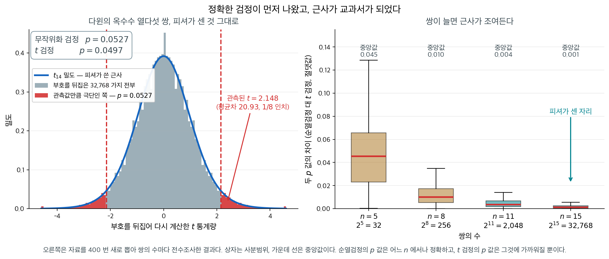

# 순열검정


## 1. 서론

**순열검정**(permutation test, 또는 무작위화검정 randomization test)은 가설검정을 위한 다재다능한 비모수 방법이다. 자료를 재배열(순열)하여 만든 분포와 관측된 검정통계량을 비교함으로써, 관측값이 귀무가설과 부합하는지 평가한다. 자료의 기저 분포에 대한 가정에 의존하지 않는다.

### 주요 특징

1. **가정이 없다**: 정규성이나 등분산성을 가정하지 않는다. 검정통계량의 분포는 전적으로 자료로부터 결정된다.
2. **유연하다**: 평균, 중앙값, 분산, 상관계수 등 어떤 통계량의 비교에도 쓸 수 있다.
3. **정확검정**: 표본이 작으면 가능한 모든 순열을 고려하므로 정확하다.
4. **근사검정**: 자료가 크면 순열의 일부만 표집하여 근사한다.

<div class="storybox" markdown>

**그림으로 보는 통계학 1.** 정확한 검정이 먼저 나왔고, 근사가 교과서가 되었다

순열검정이 $t$ 검정을 보완하러 뒤늦게 나온 방법처럼 읽히기 쉽다. 순서는 반대였다.

다윈은 1876 년에 옥수수를 길렀다. 같은 화분에 타가수분 포기와 자가수분 포기를 하나씩 심어 열다섯 쌍을 만들고, 키를 재어 차이를 적었다($1/8$ 인치 단위).

$$
49,\; -67,\; 8,\; 16,\; 6,\; 23,\; 28,\; 41,\; 14,\; 29,\; 56,\; 24,\; 75,\; 60,\; -48
$$

평균 차이는 $20.93$ 이다. 그런데 음수가 둘 섞여 있고 $-67$ 은 가장 큰 양수보다도 크다. 이만한 차이가 **우연일 수 있는가?**

피셔는 1935 년 『실험의 설계』에서 이 자료를 두 번 분석했다. 한 번은 $t$ 검정으로. 또 한 번은 이렇게 — **타가수분이 자가수분보다 나을 것이 없다면, 각 쌍에서 어느 쪽이 더 컸는지는 동전 던지기와 같다.** 그러면 열다섯 개 차이의 부호를 아무렇게나 뒤집어도 똑같이 그럴듯한 자료가 된다. 그런 자료가 $2^{15} = 32{,}768$ 가지다.

그는 그것을 **다 세었다.** 1935 년에, 컴퓨터 없이.

<figure markdown>
{ width="880" }
  <figcaption markdown>왼쪽은 피셔가 센 것을 그대로 다시 센 것이다. 부호를 뒤집은 $32{,}768$ 가지 전부에서 $t$ 를 다시 계산해 쌓았고, 붉은 쪽이 관측값만큼 극단인 경우다. 부호를 뒤집어도 $\sum d_i^2$ 은 변하지 않으므로 평균으로 세든 $t$ 로 세든 $p$ 값은 **같다**.</figcaption>
</figure>

두 답이 거의 겹친다.

| | $p$ 값 |
|---|---|
| 무작위화 검정 — $32{,}768$ 가지 전부 | $0.0527$ |
| $t$ 검정 — $t_{14}$ 곡선에서 읽음 | $0.0497$ |

차이가 $0.003$ 이다. 그림에서 보듯 무작위화 분포가 $t_{14}$ 밀도 위에 그대로 포개진다.

**이것이 피셔가 $t$ 검정을 쓸 수 있다고 본 근거였다.** 그가 정론으로 삼은 것은 무작위화 쪽이다. 거기에는 가정이 없다 — 정규성도, 모집단도 필요 없고, 실험자가 동전을 던졌다는 사실 하나로 분포가 정해진다. $t$ 검정은 그 분포를 **손으로 셀 수 있게 만든 근사**였다.

오른쪽 그림은 그 근사가 쌍이 늘수록 조여든다는 것을 잰다. $n = 5$ 에서는 두 $p$ 값이 중앙값 $0.045$ 만큼 어긋나지만, 피셔가 선 $n = 15$ 에서는 $0.001$ 이다.

그런데 셀 수 있는 쪽이 교과서가 되었다. 피트먼이 1937–38 년에 순열검정의 이론을 세웠지만, 쌍이 서른만 되어도 $2^{30} > 10^9$ 이라 아무도 쓸 수 없었다. **근사가 본문으로 올라가고 정론은 각주로 내려갔다.**

정확한 쪽이 돌아오는 데 걸린 시간은 사십 년이다. 걸린 것은 새 수학이 아니라 계산기였다.

</div>

---

## 2. 가설

- **귀무가설 ($H_0$)**: 관측된 자료가 같은 분포에서 나왔다. 또는 검정통계량이 집단 변수와 무관하다.
- **대립가설 ($H_1$)**: 관측된 자료가 다른 분포에서 나왔다. 또는 검정통계량이 집단 변수와 연관된다.

---

## 3. 일반 절차

### 1단계: 검정통계량 선택

검정하려는 효과나 차이를 반영하는 통계량을 고른다. 평균차, 중앙값차, 상관계수 등이다.

### 2단계: 관측 검정통계량 계산

원래 자료로 검정통계량을 계산한다.

### 3단계: 순열 생성

자료 라벨이나 집단 배정을 무작위로 섞어 집단 간 연관을 끊는다.

### 4단계: 각 순열의 검정통계량 계산

각 순열에 대해 검정통계량을 계산한다.

### 5단계: 관측 통계량과 비교

관측 통계량을 순열들의 통계량 분포와 비교한다. 관측값만큼 또는 그보다 극단적인 순열의 비율이 $p$값이다.

---

## 4. 평균차에 대한 순열검정

<div class="exbox" markdown>

**보기 1.** <span class="diff easy" title="쉬움"></span> 순열검정 절차. **자료:**

- 집단 A: $[8, 7, 9, 10, 6]$
- 집단 B: $[5, 6, 4, 3, 7]$

**가설:**

- $H_0$: 두 집단의 평균이 같다.
- $H_1$: 두 집단의 평균이 다르다.

</div>

??? success "풀이"
    ```python
    import numpy as np
    import matplotlib.pyplot as plt

    def permutation_test(group_a, group_b, n_permutations=10000, seed=0):
        """
        Permutation test for a difference in means.

        Parameters
        ----------
        group_a, group_b : array-like
            Data for each group.
        n_permutations : int
            Number of random permutations.

        Returns
        -------
        p_value : float
            Two-sided p-value with the +1 correction.
        observed_diff : float
            The observed difference in means.
        perm_differences : ndarray
            The permutation distribution.
        """
        rng = np.random.default_rng(seed)
        combined = np.concatenate([group_a, group_b])
        observed_diff = np.mean(group_a) - np.mean(group_b)
        na = len(group_a)

        perm_differences = np.empty(n_permutations)
        for i in range(n_permutations):
            p = rng.permutation(combined)
            perm_differences[i] = p[:na].mean() - p[na:].mean()

        p_value = ((np.abs(perm_differences) >= abs(observed_diff)).sum() + 1) \
                  / (n_permutations + 1)
        return p_value, observed_diff, perm_differences

    group_a = np.array([8, 7, 9, 10, 6])
    group_b = np.array([5, 6, 4, 3, 7])

    p_value, observed_diff, perm_dist = permutation_test(group_a, group_b)

    print(f"Observed Difference in Means: {observed_diff:.2f}")
    print(f"P-value: {p_value:.4f}")

    fig, ax = plt.subplots(figsize=(10, 4))
    ax.hist(perm_dist, bins=50, edgecolor='black', alpha=0.7,
            label='Permutation Distribution')
    ax.axvline(observed_diff, color='red', linestyle='--', linewidth=2,
               label=f'Observed = {observed_diff:.2f}')
    ax.axvline(-observed_diff, color='red', linestyle='--', linewidth=2)
    ax.legend()
    ax.set_xlabel('Difference in Means')
    ax.set_ylabel('Frequency')
    ax.set_title('Permutation Test Distribution')
    plt.show()
    ```

    출력:

    ```
    Observed Difference in Means: 3.00
    P-value: 0.0418
    ```


**출력 예:**

```
Observed Difference in Means: 3.00
P-value: 0.0397
```

$5$% 수준에서는 유의하지 않다. 각 집단이 $5$개뿐이므로 가능한 순열이 $\binom{10}{5} = 252$가지이고, 이를 **전부 열거**하면 정확 $p$값 $10/252 = 0.0397$을 얻는다. 몬테카를로 값이 이와 일치한다.

!!! warning "$t$ 검정과의 차이를 그냥 넘기지 말 것"
    같은 자료의 이표본 $t$ 검정은 $p = 0.0171$로 **유의하다**고 답한다. 순열검정은 $p = 0.0397$이다. 두 결론이 $\alpha = 0.02$ 부근에서 갈린다.

    차이의 원인은 이 표본이 너무 작다는 것이다. 정확 순열분포에서 $|d^*| \ge 3$인 순열은 $252$개 중 $10$개뿐이고, 가능한 $p$값의 최솟값은 $2/252 = 0.0079$이다. $t$ 분포는 이 이산성을 무시하고 매끄러운 꼬리를 가정한다.

    작은 표본에서는 **정확 순열 $p$값이 더 믿을 만하다**.

---

## 5. 상관에 대한 순열검정

두 변수 사이의 관측된 상관이 유의한지 검정한다.

<div class="exbox" markdown>

**보기 2.** <span class="diff easy" title="쉬움"></span> 상관에 대한 순열검정. $x = (1, 2, \ldots, 8)$과 $y = (2, 3, 5, 4, 6, 8, 7, 9)$에 대해 $y$만 뒤섞는 순열검정을 한다.

**(1)** 이 자료에서는 피어슨 $r$이 **스피어만 $\rho$와 같다.** 그 까닭을 밝히고 $\rho = 1 - \dfrac{6\sum_i d_i^2}{n^3-n}$으로 $r$을 기약분수로 구하시오. 순열 귀무분포에서 $\rho^{*}$의 평균과 분산도 구하시오.

**(2)** $\lvert \rho^{*}\rvert \ge r$인 순열이 어떤 것인지 $\sum_i d_i^2$으로 적고 그 개수를 **손으로 세어** 정확 $p$값을 분수로 구하시오. 실행값과 견주고, (1)의 분산으로 한 정규근사가 왜 쓸모없는지 밝히시오.

</div>

??? success "풀이"

    **(1) 해석적으로.** $y$의 값을 작은 것부터 늘어놓으면 $2, 3, 4, 5, 6, 7, 8, 9$이니 **$y_i$는 자기 순위 $R_i$보다 꼭 $1$ 크다.** 곧 $y_i = R_i + 1$이다. 피어슨 상관은 두 변수 각각의 **양의 일차변환에 불변**이고, $x_i = i$는 그 자체가 $x$의 순위이므로

    $$
    r(x, y) = r(x, R + 1) = r(x, R) = \rho
    $$

    가 된다. $R = (1, 2, 4, 3, 5, 7, 6, 8)$이므로 $d_i = i - R_i$가 $(0, 0, -1, 1, 0, -1, 1, 0)$이고 $\sum_i d_i^2 = 4$다. $n = 8$에서 $n^3 - n = 504$이므로

    $$
    r = 1 - \frac{6 \times 4}{504} = 1 - \frac{1}{21} = \frac{20}{21} = 0.9523810
    $$

    **평균과 분산.** $y$를 뒤섞으면 그 순위벡터 $R^{*}$가 $1, \ldots, n$의 무작위 순열이 된다. $a_i = i - \frac{n+1}{2}$, $V = \sum_i a_i^2 = \frac{n(n^2-1)}{12}$라 두면 두 순위벡터의 분산이 같으므로

    $$
    \rho^{*} = \frac{1}{V}\sum_{i=1}^n a_i\, a_{\pi(i)}
    $$

    로 적힌다($\pi$는 무작위 순열). $\pi$를 $i \mapsto n+1-\pi(i)$로 바꾸면 $\rho^{*}$의 부호만 뒤집히고 확률은 그대로이므로 $E[\rho^{*}] = 0$이다. 분산은 $\sum_i a_i = 0$을 쓰면 두 줄로 끝난다. $E[a_{\pi(i)}^2] = V/n$이고, $i \ne j$에서는

    $$
    E[a_{\pi(i)}a_{\pi(j)}] = \frac{\left(\sum_k a_k\right)^2 - \sum_k a_k^2}{n(n-1)} = \frac{-V}{n(n-1)}
    $$

    이므로

    $$
    E\!\left[\Big(\textstyle\sum_i a_i a_{\pi(i)}\Big)^2\right]
    = V\cdot\frac{V}{n} + \big(0 - V\big)\cdot\frac{-V}{n(n-1)}
    = \frac{V^2}{n-1}
    $$

    이고 따라서

    $$
    \operatorname{Var}(\rho^{*}) = \frac{1}{n-1} = \frac17,
    \qquad
    \operatorname{SD}(\rho^{*}) = \frac{1}{\sqrt 7} = 0.3779645
    $$

    다. **자료가 무엇이든 상관없다.** 순위만 쓰므로 분산이 $n$만으로 정해진다.

    **(2) 해석적으로.** 순열 통계량도 같은 공식을 따른다. $D^{*} = \sum_i (i - \pi(i))^2$이라 두면 $\rho^{*} = 1 - \dfrac{6D^{*}}{504}$이므로

    $$
    \rho^{*} \ge \frac{20}{21} \iff D^{*} \le 4,
    \qquad
    \rho^{*} \le -\frac{20}{21} \iff \frac{6D^{*}}{504} \ge \frac{41}{21} \iff D^{*} \ge 164
    $$

    이다. 먼저 $D^{*} \le 4$를 센다. $\sum_i (i - \pi(i)) = 0$이므로 홀수인 항의 개수가 짝수이고 따라서 **$D^{*}$는 언제나 짝수**다. 또 움직인 자리마다 적어도 $1$을 보태므로 $D^{*}$는 움직인 자리의 수 이상이다.

    | $D^{*}$ | 어떤 순열인가 | 개수 |
    |---:|:---|---:|
    | $0$ | 항등 | $1$ |
    | $2$ | 이웃 한 쌍의 맞바꿈($2 \times 1^2$) | $7$ |
    | $4$ | 겹치지 않는 이웃 맞바꿈 두 개 | $\binom72 - 6 = 15$ |

    $D^{*} = 2$에서 떨어진 두 자리를 맞바꾸면 $2(j-i)^2 \ge 8$이고 세 자리 이상을 움직이면 $D^{*} \ge 4$인데 제곱수 셋을 더해 $4$를 만들 수 없으므로($1+1+2$는 제곱이 아니다) 표가 전부다. $D^{*} = 4$의 $15$는 이웃 쌍 $7$개 중 자리를 공유하지 않는 두 개를 고르는 수다. 합이 $23$이다. $\pi$를 뒤집는 대응이 $D^{*} \le 4$와 $D^{*} \ge 164$를 일대일로 맞바꾸므로 뒤쪽도 $23$가지다. 따라서

    $$
    p_{\text{정확}} = \frac{2 \times 23}{8!} = \frac{46}{40320} = \frac{23}{20160} = 0.001141
    $$

    **정규근사는 여기서 쓸모가 없다.** $z = \dfrac{20/21}{1/\sqrt7} = 2.519763$이고 양측 $p \approx 0.011743$인데, 정확값의 $10$배가 넘는다. $\rho^{*}$는 $[-1, 1]$에 **갇혀 있고** 관측값 $20/21$이 그 경계 바로 앞에 있으므로, 경계를 모르는 정규곡선은 그 자리의 확률을 크게 어림잡는다. $n = 8$에서는 $40{,}320$가지를 다 세는 편이 빠르기도 하다.

    **수치적으로.** 먼저 쪽의 몬테카를로 검정이다.

    ```python
    import numpy as np

    def permutation_correlation_test(x, y, n_permutations=10000, seed=0):
        """상관계수의 유의성에 대한 순열검정.

        y 만 섞고 x 는 그대로 둔다. 이러면 두 변수의 짝만 부서지고 각각의
        주변분포는 온전히 남으므로, "관계가 없다"는 상태를 정확히 흉내 낼 수
        있다. 둘 다 섞으면 헛일이 되고, x 를 섞어도 결과는 같다.
        """
        rng = np.random.default_rng(seed)
        observed_corr = np.corrcoef(x, y)[0, 1]

        perm_corrs = np.empty(n_permutations)
        for i in range(n_permutations):
            perm_corrs[i] = np.corrcoef(x, rng.permutation(y))[0, 1]

        p_value = ((np.abs(perm_corrs) >= abs(observed_corr)).sum() + 1) \
                  / (n_permutations + 1)
        return p_value, observed_corr, perm_corrs

    x = np.array([1, 2, 3, 4, 5, 6, 7, 8])
    y = np.array([2, 3, 5, 4, 6, 8, 7, 9])

    p_value, observed_corr, _ = permutation_correlation_test(x, y)
    print(f"Observed Correlation: {observed_corr:.4f}")   # 0.9524
    print(f"Permutation P-value: {p_value:.4f}")          # 0.0011
    ```

    출력:

    ```
    Observed Correlation: 0.9524
    Permutation P-value: 0.0013
    ```

    이제 (1)과 (2)의 수를 모두 확인한다. 위 블록의 변수를 그대로 이어 쓴다.

    ```python
    import itertools
    from collections import Counter
    from scipy import stats
    from fractions import Fraction

    n = len(x)
    R = stats.rankdata(y)
    print(f"y 의 순위 = {R.astype(int)},   y - 순위 = {(y - R).astype(int)}")
    print(f"피어슨 r = {observed_corr:.10f}")
    print(f"스피어만 rho = {stats.spearmanr(x, y).statistic:.10f}")
    print(f"20/21 = {20 / 21:.10f},   sum d^2 = {int(((x - R) ** 2).sum())}")

    # 8! = 40,320 가지 순위 배정을 모두 열거한다.
    D = np.array([int(((x - np.array(p)) ** 2).sum())
                  for p in itertools.permutations(range(1, n + 1))])
    rho = 1 - 6 * D / (n ** 3 - n)
    cnt = Counter(D.tolist())
    print(f"\nD = 0, 2, 4 의 개수 = {cnt[0]}, {cnt[2]}, {cnt[4]}   (합 {cnt[0] + cnt[2] + cnt[4]})")
    print(f"D >= 164 의 개수     = {int((D >= 164).sum())},   D 의 최댓값 = {D.max()}")
    hit = int((np.abs(rho) >= 20 / 21 - 1e-12).sum())
    print(f"|rho*| >= 20/21 인 순열 = {hit} 가지 / {len(D)}"
          f"  =  {Fraction(hit, len(D))}  =  {hit / len(D):.6f}")

    print(f"\nSD(rho*) 열거 = {rho.std():.10f},   1/sqrt(n-1) = {1 / np.sqrt(n - 1):.10f}")
    z = (20 / 21) * np.sqrt(n - 1)
    print(f"정규근사 z = {z:.6f},  양측 p = {2 * stats.norm.sf(z):.6f}"
          f"   (정확값의 {2 * stats.norm.sf(z) / (hit / len(D)):.1f} 배)")

    p_exact = hit / len(D)
    B = 10_000
    mean_hat = (B * p_exact + 1) / (B + 1)
    sd = np.sqrt(B * p_exact * (1 - p_exact)) / (B + 1)
    print(f"\n몬테카를로 실행값 = {p_value:.6f}")
    print(f"E[p-hat] = {mean_hat:.6f},  SD = {sd:.6f}"
          f"   -> 실행값은 {(p_value - mean_hat) / sd:+.2f} SD")
    print(f"피어슨 t 검정 p = {stats.pearsonr(x, y).pvalue:.6f}")
    ```

    출력:

    ```
    y 의 순위 = [1 2 4 3 5 7 6 8],   y - 순위 = [1 1 1 1 1 1 1 1]
    피어슨 r = 0.9523809524
    스피어만 rho = 0.9523809524
    20/21 = 0.9523809524,   sum d^2 = 4

    D = 0, 2, 4 의 개수 = 1, 7, 15   (합 23)
    D >= 164 의 개수     = 23,   D 의 최댓값 = 168
    |rho*| >= 20/21 인 순열 = 46 가지 / 40320  =  23/20160  =  0.001141

    SD(rho*) 열거 = 0.3779644730,   1/sqrt(n-1) = 0.3779644730
    정규근사 z = 2.519763,  양측 p = 0.011743   (정확값의 10.3 배)

    몬테카를로 실행값 = 0.001300
    E[p-hat] = 0.001241,  SD = 0.000338   -> 실행값은 +0.18 SD
    피어슨 t 검정 p = 0.000260
    ```

    **유도한 것이 모두 맞는다.** $y$에서 순위를 뺀 값이 여덟 자리 모두 $1$이라 $r$과 $\rho$가 열 자리까지 같고, 둘 다 $20/21$이다. 손으로 센 $1 + 7 + 15 = 23$이 열거 결과와 같고, $D^{*} \ge 164$ 쪽도 $23$이라 $46/40320 = 23/20160$이 나온다. $\operatorname{SD}(\rho^{*})$도 $1/\sqrt7$과 열 자리까지 일치한다.

    **세 $p$값의 크기 차이를 읽어 둘 것.** 정확 $0.001141$, 몬테카를로 $0.001300$, 정규근사 $0.011743$, 피어슨 $t$ 검정 $0.000260$이다. 몬테카를로값은 예측 평균 $0.001241$에서 $+0.18$ 표준편차 떨어진 제자리이고, $B = 10{,}000$에서 $\hat p$의 표준편차가 $0.000338$이라 **유효숫자가 한 자리뿐이다.** 반면 정규근사는 $10.3$배 크고 $t$ 검정은 $4.4$배 작다. **둘 다 틀린 방향으로 틀렸고, 경계가 있는 이산 통계량에서는 세는 것 말고 믿을 것이 없다.**

---

## 6. 대응자료에 대한 순열검정

대응자료에서는 집단 라벨을 섞는 대신 차이의 **부호**를 섞는다.

<div class="exbox" markdown>

**보기 3.** <span class="diff easy" title="쉬움"></span> 대응자료의 부호 뒤집기 검정. 열 사람의 처치 전후 측정에서 차이 $d_i$를 얻고, 각 $d_i$의 부호를 독립으로 뒤집어 귀무분포를 만든다.

**(1)** 부호 뒤집기 귀무분포에서 $\bar d^{*}$의 평균과 분산을 닫힌 꼴로 구하시오. 또 $d_i$가 **모두 같은 부호**이면 $\lvert \bar d^{*}\rvert$의 최댓값이 $\lvert \bar d_{\text{obs}}\rvert$ 자신이고 그것을 이루는 배정이 꼭 둘뿐임을 보여, 정확 $p$값을 구하시오.

**(2)** 실행해 확인하고, (1)의 분산으로 한 정규근사와 대응 $t$ 검정이 각각 정확값과 얼마나 어긋나는지 재시오. 부호 뒤집기 귀무분포의 표준편차가 $t$ 검정의 표준오차보다 넓은 까닭도 밝히시오.

</div>

??? success "풀이"

    **(1) 해석적으로.** 차이는 $d = (2, 1, 3, 5, 3, 2, 1, 2, 1, 4)$로 $\bar d_{\text{obs}} = 2.4$, $\sum_i d_i^2 = 74$다. 귀무가설 아래에서 각 차이의 분포가 $0$을 중심으로 대칭이므로, 독립인 부호 $\varepsilon_i \in \{-1, +1\}$을 각각 확률 $1/2$로 붙인

    $$
    \bar d^{*} = \frac1n \sum_{i=1}^n \varepsilon_i d_i
    $$

    가 귀무분포다. $E[\varepsilon_i] = 0$, $\operatorname{Var}(\varepsilon_i) = 1$이고 $\varepsilon_i$들이 독립이므로

    $$
    E[\bar d^{*}] = 0,
    \qquad
    \operatorname{Var}(\bar d^{*}) = \frac{1}{n^2}\sum_{i=1}^n d_i^2
    $$

    이다. **차이의 크기만 쓰고 부호는 쓰지 않는다.** 수를 넣으면

    $$
    \operatorname{SD}(\bar d^{*}) = \frac{\sqrt{74}}{10} = 0.8602325
    $$

    **최댓값.** 삼각부등식에서

    $$
    \lvert \bar d^{*}\rvert = \frac1n\left\lvert \sum_i \varepsilon_i d_i \right\rvert
    \le \frac1n \sum_i \lvert d_i \rvert
    $$

    이고, 등호는 모든 $\varepsilon_i d_i$의 부호가 같을 때, 곧 $\varepsilon$이 전부 $+1$이거나 전부 $-1$일 때만 성립한다. 이 자료는 $d_i$가 **열 개 모두 양수**이므로 $\frac1n\sum_i \lvert d_i\rvert = \bar d_{\text{obs}} = 2.4$이고, 등호를 이루는 배정은 관측된 것과 그것을 통째로 뒤집은 것 **둘뿐**이다. 따라서

    $$
    p_{\text{정확}} = \frac{2}{2^{10}} = \frac{2}{1024} = 0.001953
    $$

    이고, 이것은 $n = 10$인 부호 뒤집기 검정이 낼 수 있는 **가장 작은 양측 $p$값**이다(연습문제 2가 일반 $n$에서 같은 셈을 한다).

    **(2) 수치적으로.** 먼저 쪽의 모의실험이다.

    ```python
    import numpy as np

    def paired_permutation_test(before, after, n_permutations=10000, seed=0):
        """대응자료에 대한 부호 뒤집기 순열검정.

        귀무가설 아래에서는 각 차이의 분포가 0 을 중심으로 대칭이다. 그러므로
        어느 차이들의 부호를 뒤집든 똑같이 그럴듯하다. 대응자료에서 이름표를
        섞으면 안 되는 대신 이 방법을 쓴다.
        """
        rng = np.random.default_rng(seed)
        differences = np.asarray(after) - np.asarray(before)
        observed_mean_diff = differences.mean()

        signs = rng.choice([-1, 1], size=(n_permutations, len(differences)))
        perm_means = (signs * differences).mean(axis=1)

        p_value = ((np.abs(perm_means) >= abs(observed_mean_diff)).sum() + 1) \
                  / (n_permutations + 1)
        return p_value, observed_mean_diff

    before = [70, 68, 75, 80, 72, 74, 69, 77, 73, 76]
    after = [72, 69, 78, 85, 75, 76, 70, 79, 74, 80]

    p_value, obs_diff = paired_permutation_test(before, after)
    print(f"Observed Mean Difference: {obs_diff:.2f}")   # 2.40
    print(f"P-value: {p_value:.4f}")                     # 0.002
    ```

    출력:

    ```
    Observed Mean Difference: 2.40
    P-value: 0.0020
    ```

    이제 $2^{10} = 1{,}024$가지를 모두 열거해 (1)을 확인한다. 위 블록의 변수를 그대로 이어 쓴다.

    ```python
    import itertools
    from scipy import stats

    d = np.asarray(after) - np.asarray(before)
    n = len(d)
    print(f"d = {d},  모두 양수인가: {bool((d > 0).all())}")
    print(f"d-bar = {d.mean():.4f},   sum d^2 = {int((d ** 2).sum())}")

    sd_null = np.sqrt((d ** 2).sum()) / n
    print(f"SD(d-bar*) 닫힌 꼴 = {sd_null:.7f}")

    # 2^10 = 1,024 가지 부호 배정을 모두 열거한다.
    S = np.array(list(itertools.product([1, -1], repeat=n)))
    m = (S * d).mean(1)
    hit = int((np.abs(m) >= abs(d.mean()) - 1e-12).sum())
    print(f"열거한 SD         = {m.std():.7f}")
    print(f"|d-bar*| 의 최댓값 = {np.abs(m).max():.4f}  (관측값 {d.mean():.4f})")
    print(f"|d-bar*| >= 2.4 인 배정 = {hit} 가지 / {len(m)}  ->  정확 p = {hit / len(m):.9f}")

    z = d.mean() / sd_null
    print(f"\n정규근사 z = {z:.6f},  양측 p = {2 * stats.norm.sf(z):.6f}"
          f"   (정확값의 {2 * stats.norm.sf(z) / (hit / len(m)):.2f} 배)")

    tt = stats.ttest_rel(after, before)
    se_t = d.std(ddof=1) / np.sqrt(n)
    print(f"\n대응 t 검정: t = {tt.statistic:.6f},  p = {tt.pvalue:.6f},  SE = {se_t:.7f}")
    print(f"SD(d-bar*)/SE_t  실제 = {sd_null / se_t:.7f}")
    print(f"                 예측 = {np.sqrt((n - 1 + tt.statistic ** 2) / n):.7f}")
    ```

    출력:

    ```
    d = [2 1 3 5 3 2 1 2 1 4],  모두 양수인가: True
    d-bar = 2.4000,   sum d^2 = 74
    SD(d-bar*) 닫힌 꼴 = 0.8602325
    열거한 SD         = 0.8602325
    |d-bar*| 의 최댓값 = 2.4000  (관측값 2.4000)
    |d-bar*| >= 2.4 인 배정 = 2 가지 / 1024  ->  정확 p = 0.001953125

    정규근사 z = 2.789943,  양측 p = 0.005272   (정확값의 2.70 배)

    대응 t 검정: t = 5.622255,  p = 0.000325,  SE = 0.4268749
    SD(d-bar*)/SE_t  실제 = 2.0151862
                     예측 = 2.0151862
    ```

    **(1)이 모두 맞는다.** 닫힌 꼴 $\sqrt{74}/10 = 0.8602325$가 열거한 표준편차와 일곱 자리까지 같고, $\lvert \bar d^{*}\rvert$의 최댓값이 정확히 관측값 $2.4$이며 그것을 이루는 배정이 $1{,}024$개 중 $2$개다. 몬테카를로값 $0.002000$도 예측 평균 $0.002053$에서 $-0.12$ 표준편차 떨어진 제자리다.

    **정규근사는 $2.70$배 크고 $t$ 검정은 $6.0$배 작다.** 정규근사가 틀리는 까닭은 관측값이 분포의 **지지집합 끝점**에 놓였기 때문이다. $\bar d^{*}$는 $[-2.4, 2.4]$ 밖으로 나갈 수 없는데 정규곡선은 그 너머에도 질량을 두므로 꼬리를 과대평가한다. 여기서는 $0.005272$ 대 $0.001953$이다.

    **$t$ 검정이 작은 값을 주는 까닭은 눈금이 좁기 때문이다.** $\sum_i d_i^2 = (n-1)s_d^2 + n\bar d^2$를 쓰고 $t = \bar d\sqrt n / s_d$를 넣으면

    $$
    \frac{\operatorname{SD}(\bar d^{*})}{\operatorname{SE}_t}
    = \sqrt{\frac{\sum_i d_i^2}{n\, s_d^2}}
    = \sqrt{\frac{n - 1 + t^2}{n}}
    $$

    이고, $t = 5.622255$에서 $\sqrt{(9 + 31.6098)/10} = 2.0151862$다. 코드가 낸 비와 일곱 자리까지 같다. **$t$ 검정은 효과를 뺀 나머지의 흩어짐 $s_d$로 눈금을 재고, 부호 뒤집기는 효과까지 포함한 $\sqrt{\sum d_i^2}$로 잰다.** 효과가 커서 $\lvert t\rvert > 1$ 이면 부호 뒤집기의 귀무분포가 더 넓어져 **스스로를 깎는다.** 여기서는 두 배가 넘게 넓다.

    두 어긋남의 성격이 다르다는 것이 요점이다. 정규근사의 $2.70$배는 **근사의 실패**이고, $t$ 검정의 $6.0$배는 **다른 가정 아래의 다른 답**이다. 정규성을 믿을 수 없는 $n = 10$에서 믿을 것은 $0.001953$ 하나다.

---

## 7. 정확 순열검정과 근사 순열검정

| 측면 | 정확 | 근사 |
|---|---|---|
| **방법** | 가능한 모든 순열 열거 | 순열의 무작위 부분집합 |
| **가능성** | 작은 표본에서만 | 어떤 크기에서도 |
| **순열 수** | 이표본이면 $\binom{n_1+n_2}{n_1}$, 대응이면 $2^n$ | 사용자가 지정(예: 10{,}000) |
| **$p$값** | 정확 | 근사(순열을 늘리면 개선) |

크기 $5$인 두 집단이면 $\binom{10}{5} = 252$가지로 열거가 쉽다. 큰 표본에서는 무작위 순열 $10{,}000$개면 대개 충분하다.

!!! tip "최소 $p$값을 먼저 확인하라"
    정확 순열검정에서 얻을 수 있는 가장 작은 양측 $p$값은 이표본이면 $2/\binom{n_1+n_2}{n_1}$, 대응이면 $2/2^n$이다.

    | 설계 | 최소 양측 $p$값 |
    |:---|---:|
    | 이표본 $n_1 = n_2 = 4$ | $2/70 = 0.0286$ |
    | 이표본 $n_1 = n_2 = 5$ | $2/252 = 0.0079$ |
    | 대응 $n = 5$ | $2/32 = 0.0625$ |
    | 대응 $n = 6$ | $2/64 = 0.0313$ |

    **대응 $n = 5$이면 $\alpha = 0.05$에서 절대 기각할 수 없다.** 자료가 아무리 극단적이어도 그렇다. 실험을 설계할 때 이 계산을 먼저 해야 한다.

---

## 8. 장단점

| 장점 | 단점 |
|---|---|
| 분포 가정이 없다 | 자료가 크면 계산이 무겁다 |
| 작은 자료에서 정확하다 | 정확도가 순열 수에 의존한다 |
| 어떤 검정통계량에도 유연하다 | 대응자료는 방식을 바꿔야 한다(부호 뒤집기) |
| 표본크기가 같으면 이분산에 로버스트하다 | 이분산과 불균형이 겹치면 스튜던트화가 필요하다 |

---

## 9. 응용

1. **평균·중앙값 차 검정**: 정규성 가정 없이 집단 비교
2. **상관 검정**: 상관계수의 유의성 검정
3. **변수선택**: 기계학습·예측모형에서 중요 변수 식별
4. **유전체학과 생물학**: 유전자 발현 등 고차원 자료 분석에 널리 쓰인다
5. **시계열**: 종속자료에 대한 블록 순열검정

---

## 연습문제

<div class="drillbox" markdown>

**연습문제 1.** <span class="diff easy" title="쉬움"></span>
이 페이지의 세 보기 — 평균차, 상관, 대응자료 — 각각에서 가능한 모든 순열을 열거하여 정확 $p$값을 구하고, 대응하는 모수적 검정과 비교하라.

</div>

??? success "풀이"
    ```python
    import numpy as np, itertools
    from scipy import stats

    # (1) 평균차: C(10,5) = 252 가지
    a = np.array([8, 7, 9, 10, 6]); b = np.array([5, 6, 4, 3, 7])
    z = np.concatenate([a, b]); obs = a.mean() - b.mean()
    d = [z[list(c)].mean() - np.delete(z, list(c)).mean()
         for c in itertools.combinations(range(10), 5)]
    d = np.array(d)
    print(len(d), (np.abs(d) >= obs - 1e-12).sum(), (np.abs(d) >= obs - 1e-12).mean())
    print(stats.ttest_ind(a, b))

    # (2) 상관: 8! = 40,320 가지
    x = np.arange(1, 9); y = np.array([2, 3, 5, 4, 6, 8, 7, 9])
    r = np.corrcoef(x, y)[0, 1]
    rs = np.array([np.corrcoef(x, y[list(p)])[0, 1]
                   for p in itertools.permutations(range(8))])
    print((np.abs(rs) >= abs(r) - 1e-12).mean(), stats.pearsonr(x, y).pvalue)

    # (3) 대응: 2^10 = 1,024 가지
    before = np.array([70, 68, 75, 80, 72, 74, 69, 77, 73, 76])
    after  = np.array([72, 69, 78, 85, 75, 76, 70, 79, 74, 80])
    dd = after - before
    S = np.array(list(itertools.product([1, -1], repeat=10)))
    m = (S * dd).mean(1)
    print((np.abs(m) >= abs(dd.mean()) - 1e-12).sum(),
          (np.abs(m) >= abs(dd.mean()) - 1e-12).mean())
    print(stats.ttest_rel(after, before))
    ```

    출력:

    ```
    252 10 0.03968253968253968
    TtestResult(statistic=3.0, pvalue=0.017071681233782634, df=8.0)
    0.001140873015873016 0.0002604000243872564
    2 0.001953125
    TtestResult(statistic=5.622255427989818, pvalue=0.0003248947130212966, df=9)
    ```

    | 보기 | 순열 수 | 관측 통계량 | 정확 순열 $p$ | 모수적 $p$ |
    |:---|---:|---:|---:|---:|
    | 평균차 | 252 | $3.00$ | **0.0397** | 0.0171 ($t$) |
    | 상관 | 40{,}320 | $r = 0.9524$ | **0.00114** | 0.00026 ($t$) |
    | 대응 | 1{,}024 | $\bar{d} = 2.40$ | **0.00195** | 0.00032 ($t$) |

    **세 경우 모두 순열 $p$값이 $t$ 검정보다 크다.** 비율로는 $2.3$배, $4.4$배, $6.0$배이다.

    이는 우연이 아니라 구조적이다. 두 가지 이유가 겹친다.

    **첫째, 이산성.** 순열 $p$값은 유한한 격자 위의 값만 취한다. 평균차 보기에서는 $1/252 = 0.004$ 간격, 대응 보기에서는 $1/1024 = 0.00098$ 간격이다. 대응 보기의 $p = 0.00195$는 **가능한 최솟값**이다. 자료가 지금보다 열 배 극단적이어도 이보다 작아질 수 없다.

    **둘째, 순열분포의 꼬리가 짧다.** 순열분포는 관측된 값들만 재배열하므로 유계이다. 평균차의 순열분포는 $[-4.0, 4.0]$ 안에만 값을 갖는다. $t$ 분포는 무한한 꼬리를 가정하므로 극단값에 더 작은 확률을 배정한다.

    **어느 쪽을 믿을 것인가.** 순열 $p$값이다. $t$ 검정의 $p$값은 정규성이 성립할 때만 정확하며, $n = 5$에서 그 가정을 자료로 확인할 방법이 없다. 순열 $p$값은 교환가능성만으로 정확하다.

    실무적 함의는 분명하다. **아주 작은 표본에서 $t$ 검정은 유의성을 과장한다.**

<div class="drillbox" markdown>

**연습문제 2.** <span class="diff med" title="중간"></span>
대응 보기에서 정확 $p$값 $0.00195$가 "가능한 최솟값"이라고 했다. 이것이 검정력에 어떤 제약을 주는지 설명하고, $\alpha = 0.01$로 검정하려면 대응표본이 최소 몇 개 필요한지 구하라.

</div>

??? success "풀이"
    **최소 $p$값의 구조.**

    부호 뒤집기 순열검정에서 가능한 부호 배정은 $2^n$가지이다. 관측된 배정 자체는 항상 $|\bar{d}^*| = |\bar{d}_{\text{obs}}|$를 만족하고, 모든 부호를 뒤집은 배정도 그렇다($\bar{d}^* = -\bar{d}_{\text{obs}}$).

    따라서 양측 $p$값은 최소한 $2/2^n = 2^{1-n}$이다.

    | $n$ | $2^n$ | 최소 양측 $p$값 | $\alpha = 0.05$ 가능? | $\alpha = 0.01$ 가능? |
    |---:|---:|---:|:---:|:---:|
    | 4 | 16 | 0.1250 | ✗ | ✗ |
    | 5 | 32 | 0.0625 | ✗ | ✗ |
    | 6 | 64 | 0.0313 | ✓ | ✗ |
    | 7 | 128 | 0.0156 | ✓ | ✗ |
    | 8 | 256 | 0.0078 | ✓ | ✓ |
    | 10 | 1{,}024 | 0.0020 | ✓ | ✓ |

    **답: $\alpha = 0.01$에는 $n \ge 8$이 필요하다.** $2^{1-8} = 0.0078 < 0.01$이 처음 성립하는 $n$이다.

    **검정력에 대한 제약은 절대적이다.** $n = 5$이면 대립가설이 아무리 강해도, 자료가 아무리 완벽하게 한 방향을 가리켜도, $\alpha = 0.05$에서의 검정력이 **정확히 0**이다. 기각 자체가 불가능하기 때문이다.

    이는 "검정력이 낮다"와 질적으로 다르다. 표본크기 계산에서 흔히 놓치는 지점이다. 모수적 검정력 공식은 $n = 5$에서도 $0.8$ 같은 숫자를 내놓지만, 비모수 정확검정을 쓸 계획이라면 그 숫자는 무의미하다.

    **일반화.** 이표본 설계에서는 최소 $p$값이 $2/\binom{n_1+n_2}{n_1}$이다.

    | $n_1 = n_2$ | $\binom{2n}{n}$ | 최소 양측 $p$값 |
    |---:|---:|---:|
    | 3 | 20 | 0.100 |
    | 4 | 70 | 0.029 |
    | 5 | 252 | 0.0079 |
    | 6 | 924 | 0.0022 |

    이표본 설계가 대응 설계보다 순열 개수가 빨리 늘어난다. 같은 총 관측 수 $2n = 10$에 대해 이표본은 $252$가지, 대응 $n = 10$은 $1024$가지로 대응 쪽이 많지만, 대응은 관측 수가 $20$개(쌍 $10$개)이다. **관측 수를 고정하면 이표본 설계의 눈금이 더 촘촘하다.**

    다만 이는 눈금의 문제일 뿐 검정력의 전부가 아니다. 대응 설계는 개체 간 변동을 제거하므로 실제 검정력은 대개 훨씬 높다.

<div class="drillbox" markdown>

**연습문제 3.** <span class="diff med" title="중간"></span>
순열검정의 유연성을 분산 비교로 확인하라. $H_0: \sigma_X^2 = \sigma_Y^2$를 $\log(s_X^2/s_Y^2)$를 통계량으로 하는 순열검정으로 검정하고, $F$ 검정 및 Levene 검정과 제1종 오류율·검정력을 비교하라. 자료는 정규분포와 $t(3)$ 분포에서 생성한다.

</div>

??? success "풀이"
    ```python
    import numpy as np
    from scipy import stats
    rng = np.random.default_rng(31)

    def perm_var_p(x, y, B=499):
        obs = np.log(x.var(ddof=1) / y.var(ddof=1))
        z = np.concatenate([x, y]); m = len(x); c = 0
        for _ in range(B):
            p = rng.permutation(z)
            c += abs(np.log(p[:m].var(ddof=1) / p[m:].var(ddof=1))) >= abs(obs) - 1e-12
        return (c + 1) / (B + 1)

    def F_p(x, y):
        f = x.var(ddof=1) / y.var(ddof=1)
        d1, d2 = len(x) - 1, len(y) - 1
        return 2 * min(stats.f.cdf(f, d1, d2), stats.f.sf(f, d1, d2))

    def run(gen, ratio, n=25, M=1500):
        r = dict(F=0, levene=0, perm=0)
        for _ in range(M):
            x = gen(n) * ratio; y = gen(n)
            r['F'] += F_p(x, y) < 0.05
            r['levene'] += stats.levene(x, y, center='median').pvalue < 0.05
            r['perm'] += perm_var_p(x, y) < 0.05
        return {k: round(v/M, 3) for k, v in r.items()}
    ```

    **제1종 오류율 ($\sigma_X/\sigma_Y = 1$, $n = 25$)**

    | 자료 | $F$ 검정 | Levene | 순열검정 |
    |:---|---:|---:|---:|
    | 정규 | 0.047 | 0.045 | 0.051 |
    | $t(3)$ | **0.318** | 0.038 | 0.044 |

    **$F$ 검정이 $t(3)$ 자료에서 붕괴한다.** 제1종 오류율이 $0.318$로 명목값의 **6배가 넘는다**. 등분산인 두 표본을 놓고 세 번에 한 번꼴로 "분산이 다르다"고 선언한다.

    이유는 $F$ 검정이 정규성에 극도로 민감하기 때문이다. $s^2$의 표집분포는 4차 적률(첨도)에 의존하는데, $F$ 분포는 정규분포의 첨도 $3$을 전제한다. $t(3)$의 첨도는 무한대이다.

    **순열검정과 Levene 검정은 크기를 지킨다**($0.044$, $0.038$). 순열검정의 정확성은 여기서도 작동한다. $\sigma_X = \sigma_Y$이고 두 표본이 같은 분포에서 오면 교환가능성이 정확히 성립한다.

    **검정력 ($\sigma_X/\sigma_Y = 2$)**

    | 자료 | $F$ 검정 | Levene | 순열검정 |
    |:---|---:|---:|---:|
    | 정규 | **0.903** | 0.807 | 0.867 |
    | $t(3)$ | ~~0.787~~ | 0.559 | **0.538** |

    **정규자료에서 $F$ 검정이 가장 강력하다**($0.903$). 이는 이론이 예측하는 바이다. 정규성이 성립하면 $F$ 검정이 최적이다. 순열검정은 $0.867$로 $0.036$을 잃을 뿐이다. Levene은 $0.807$로 더 잃는다.

    **$t(3)$ 자료에서 $F$ 검정의 $0.787$은 읽으면 안 되는 숫자이다.** 크기가 $0.318$인 검정의 검정력은 의미가 없다. 크기를 $0.05$로 보정하면 실제 검정력은 훨씬 낮다. 표에 취소선을 그은 이유이다.

    !!! note "순열검정이 여기서 특히 값진 이유"
        분산비 검정에는 이미 $F$ 검정과 Levene 검정이 있다. 그런데도 순열검정이 유용한 것은 **통계량을 자유롭게 고를 수 있기** 때문이다.

        $\log(s_X^2/s_Y^2)$ 대신 사분위범위의 비, 중앙값절대편차(MAD)의 비, 또는 문제에 특화된 임의의 산포 측도를 넣어도 절차가 그대로 작동한다. 각각에 대해 새로운 표집분포 이론을 유도할 필요가 없다.

        Levene 검정 자체가 이 아이디어의 특수한 경우이다. $|x_i - \text{med}(x)|$로 변환한 뒤 평균차를 보는 것이며, 이를 순열 틀 안에 넣으면 정규 근사 없이 정확해진다.

    !!! warning "분산 순열검정의 한계"
        $H_0: \sigma_X^2 = \sigma_Y^2$만 참이고 두 분포의 **모양이 다르면** 교환가능성이 깨진다. 위 모의실험은 두 표본을 같은 분포족에서 생성했으므로 유리한 상황이다.

        평균이 다르면서 분산만 같은 경우도 마찬가지다. 이때는 각 표본을 자기 평균으로 중심화한 뒤 순열하는 등의 보정이 필요하며, 그렇게 해도 근사적으로만 타당하다. [교환가능성에 대한 논의](foundations.md)의 연습문제 1이 같은 문제를 평균 비교에서 다룬다.

<div class="drillbox" markdown>

**연습문제 4.** <span class="diff med" title="중간"></span>
연습문제 1의 풀이는 "평균차의 순열분포는 $[-4.0, 4.0]$ 안에만 값을 갖는다"고 적었다. 참이지만 느슨한 상한이다. 보기 1의 자료($A = [8,7,9,10,6]$, $B = [5,6,4,3,7]$)에서 지지집합을 끝까지 깎아 보자.

**(1)** 합친 자료의 총합이 $T = 65$임을 쓰고, 순열 통계량 $d^{*} = \bar A^{*} - \bar B^{*}$를 집단 $A$ 쪽 합 $S_A$만의 함수로 적으시오. 이어서 $S_A$가 가질 수 있는 값이 $24$부터 $41$까지의 **모든 정수**임을 한 원소씩 바꾸는 사슬로 보이고, 정확한 지지집합과 그 최댓값을 구하시오.

**(2)** $\lvert d^{*}\rvert \ge 3$이 $S_A \ge 40$ 또는 $S_A \le 25$와 같은 뜻임을 보이고, $S_A \ge 40$인 다섯 자리 선택을 **손으로 모두 적어** 개수를 세시오. 여기서 정확 $p$값 $10/252$를 다시 얻으시오.

**(3)** 관측값 $3.0$은 지지집합의 최댓값이 아니다. 최댓값이었다면 $p$값이 얼마였겠는가? 또 이 자료에서 얻을 수 있는 $p$값 가운데 $10/252$ 바로 아래 값을 구하고, 그것이 $\alpha = 0.05$ 판정에 어떤 뜻인지 한 줄로 적으시오.

</div>

??? success "풀이"

    **(1) 통계량을 합 하나로 줄인다.** 합친 자료는 $\{3,4,5,6,6,7,7,8,9,10\}$이고 $T = 65$다. 두 집단이 각각 다섯이므로

    $$
    d^{*} = \frac{S_A}{5} - \frac{65 - S_A}{5} = \frac{2S_A - 65}{5}
    $$

    이다. **순열 통계량은 $S_A$ 하나로 정해진다.** 따라서 지지집합을 구하는 일은 다섯 자리를 골라 만들 수 있는 합을 모두 찾는 일이 된다.

    가장 작은 합은 작은 다섯 개 $\{3,4,5,6,6\}$에서 $24$, 가장 큰 합은 큰 다섯 개 $\{7,7,8,9,10\}$에서 $41$이다. 그 사이의 정수가 모두 나오는 것은 **한 원소를 바로 위의 값으로 바꾸어 합을 $1$씩 올리는 사슬**을 만들면 끝난다.

    $$
    \{3,4,5,6,6\} \to \{3,4,5,6,7\} \to \{3,4,5,6,8\} \to \{3,4,5,6,9\} \to \{3,4,5,6,10\}
    $$

    $$
    \to \{3,4,5,7,10\} \to \{3,4,5,8,10\} \to \{3,4,5,9,10\} \to \{3,4,6,9,10\} \to \{3,4,7,9,10\}
    $$

    $$
    \to \{3,4,8,9,10\} \to \{3,5,8,9,10\} \to \{3,6,8,9,10\} \to \{3,7,8,9,10\} \to \{4,7,8,9,10\}
    $$

    $$
    \to \{5,7,8,9,10\} \to \{6,7,8,9,10\} \to \{7,7,8,9,10\}
    $$

    열여덟 집합의 합이 차례로 $24, 25, \ldots, 41$이다(쓰인 값은 모두 자료에 있다 — $6$과 $7$이 각각 두 개씩이라 양 끝의 $\{3,4,5,6,6\}$과 $\{7,7,8,9,10\}$이 가능하다). 그러므로

    $$
    \text{지지집합} = \left\{\frac{2k-65}{5} : k = 24, 25, \ldots, 41\right\}
    = \{-3.4,\, -3.0,\, -2.6,\, \ldots,\, 3.0,\, 3.4\}
    $$

    이고, **눈금 $0.4$의 격자 위 $18$개 점**이다. 최댓값은 $3.4$이고 $[-4.0, 4.0]$보다 양쪽으로 $0.6$씩 좁다.

    **(2) 꼬리를 센다.** $\lvert 2S_A - 65\rvert \ge 15$를 풀면 $S_A \ge 40$ 또는 $S_A \le 25$다. 다섯 자리의 값을 큰 것부터 $v_1 \ge \cdots \ge v_5$라 하면 $v_i$는 자료의 $i$번째 큰 값 이하이므로 $S_A \le 10+9+8+7+7 = 41$이고, 등호는 큰 다섯 개를 모두 고를 때만이다.

    | $S_A$ | 어떤 선택인가 | 개수 |
    |---:|:---|---:|
    | $41$ | $\{10,9,8,7,7\}$ | $1$ |
    | $40$ | $\{10,9,8,7,6\}$ — $7$ 두 개 중 하나, $6$ 두 개 중 하나 | $2 \times 2 = 4$ |

    $S_A = 40$에 다른 꼴이 없는 까닭은 이렇다. $41$에서 $1$만 잃어야 하는데, $v_5 = 7$을 $6$으로 내리면 꼭 $1$을 잃는다. $v_4$를 $7$에서 $6$으로 내리면 $v_5 \le 6$이 되어 $S_A \le 10+9+8+6+6 = 39$이고, $v_3$을 $8$에서 내리면 $v_3, v_4, v_5 \le 7,7,6$이라 $S_A \le 10+9+7+7+6 = 39$다. 그러니 $S_A \ge 40$은 $1 + 4 = 5$가지다.

    $S_A \le 25$ 쪽은 **여집합 대응**으로 끝난다. 다섯 자리를 고르는 것은 나머지 다섯을 고르는 것과 일대일이고 $S_A \le 25 \iff 65 - S_A \ge 40$이므로 역시 $5$가지다. 따라서

    $$
    p_{\text{정확}} = \frac{5 + 5}{\binom{10}{5}} = \frac{10}{252} = 0.039683
    $$

    으로 보기 1의 값이 다시 나온다.

    **(3) 관측값은 두 번째로 큰 값이다.** $\lvert d^{*}\rvert \ge 3.4$인 선택은 $S_A = 41$과 그 여집합 $S_A = 24$ 둘뿐이므로, 관측 평균차가 $3.4$였다면

    $$
    p = \frac{2}{252} = 0.007937
    $$

    로 이 설계의 **최소 양측 $p$값**(7절의 표)을 얻었을 것이다. 그러니 이 자료에서 가능한 $p$값은 아래부터 $2/252 = 0.0079$, $10/252 = 0.0397$, $20/252 = 0.0794$, $\ldots$로 이어지고, **$10/252$ 바로 아래 값은 $2/252$다.** 그 사이에는 아무 값도 없다.

    **$\alpha = 0.05$는 이 틈 안에 떨어진다.** $0.0079 < 0.05 < 0.0397$이므로, 이 열 개의 수를 어떻게 두 집단으로 갈라도 $5$% 수준에서 기각되는 배치는 **가장 극단적인 두 배치뿐**이다. 관측된 배치는 두 번째로 극단적인데 벌써 기각선 밖이다. 눈금이 $0.4$씩 띄어 있는 이산 검정에서는 유의수준보다 **격자의 위치**가 결론을 정한다.

<div class="drillbox" markdown>

**연습문제 5.** <span class="diff med" title="중간"></span>
이 쪽의 모든 코드가 $\hat p = (1 + \#\{\lvert T^{*}\rvert \ge \lvert T_{\text{obs}}\rvert\})/(B+1)$을 쓴다. 분자·분모의 $1$이 어디서 오는지 끝까지 따지자.

**(1)** 순열군을 $G$, 관측자료를 $Z$라 하고 $\pi_1, \ldots, \pi_B$를 $G$에서 독립 균등으로 뽑는다. 귀무가설(교환가능성) 아래에서 합친 자료를 조건으로 주면 $Z, \pi_1 Z, \ldots, \pi_B Z$가 **같은 궤도 위의 독립 균등**임을 보이고, 동점이 없을 때 $\hat p = R/(B+1)$에서 $R$이 $\{1, \ldots, B+1\}$에 균등함을 보이시오. 이어서 $P(\hat p \le \alpha) = \lfloor \alpha(B+1)\rfloor/(B+1) \le \alpha$와 $E[\hat p] = (Bp+1)/(B+1)$을 얻으시오($p$는 참 순열 $p$값).

**(2)** 보정 없는 $\tilde p = \#/B$를 쓰면 $\tilde p = 0$이 나올 수 있다. 보기 1의 자료($p = 10/252$)에서 $P(\tilde p = 0)$을 $B = 49, 249$에 대해 구하고, 이 확률을 $0.001$ 아래로 내리는 가장 작은 $B$를 구하시오. 또 $B = 49, 249, 999$에서 $E[\hat p]$를 구하고, 작은 $B$가 왜 $\alpha = 0.05$ 판정을 뒤집을 수 있는지 밝히시오.

</div>

??? success "풀이"

    **(1) 궤도 위의 균등분포.** $Z$의 **궤도**를 $\mathcal{O} = \{gZ : g \in G\}$라 하자. 이표본이면 합친 열 개의 수를 두 집단으로 가르는 모든 배치의 모음이고, 대응자료면 부호를 뒤집는 모든 배치의 모음이다. 귀무가설 아래에서 $Z \overset{d}{=} gZ$가 모든 $g \in G$에 대해 성립하므로, **궤도를 조건으로 주면 $Z$는 그 궤도에 균등하다.**

    이제 $\pi$를 $G$에서 균등하게 뽑고 $Z$와 독립이라 하자. 임의의 $w \in \mathcal{O}$에 대해

    $$
    P(\pi Z = w \mid Z = z) = P\big(\pi \in \{g : gz = w\}\big) = \frac{\lvert G\rvert / \lvert \mathcal{O}\rvert}{\lvert G\rvert} = \frac{1}{\lvert \mathcal{O}\rvert}
    $$

    이다($G$가 궤도에 추이적으로 작용하므로 $z$를 $w$로 보내는 $g$의 수는 $z$와 무관하다). 오른쪽이 $z$에 의존하지 않으니 **$\pi Z$는 궤도에 균등하고 $Z$와 독립이다.** $\pi_1, \ldots, \pi_B$가 독립이므로, $Z$를 조건으로 주면 $\pi_1 Z, \ldots, \pi_B Z$는 조건부 독립 균등이고, 따라서 궤도를 조건으로 준

    $$
    Z,\ \pi_1 Z,\ \ldots,\ \pi_B Z \quad \text{는 독립이고 각각 } \mathcal{O} \text{에 균등하다.}
    $$

    그러므로 $T_0 = T(Z)$와 $T_b = T(\pi_b Z)$를 묶은 $(T_0, T_1, \ldots, T_B)$는 **교환가능**하다.

    동점이 없으면 $T_0$을 내림차순으로 세었을 때의 순위 $R = 1 + \#\{b \ge 1 : T_b \ge T_0\}$이 $\{1, \ldots, B+1\}$에 균등하다(교환가능한 $B+1$개 값에서 어느 자리가 $0$번일 확률이 모두 같다). 그런데 $\hat p$의 분자가 바로 $R$이므로

    $$
    \hat p = \frac{R}{B+1},
    \qquad
    P(\hat p \le \alpha) = P\!\left(R \le \alpha(B+1)\right) = \frac{\lfloor \alpha(B+1)\rfloor}{B+1} \le \alpha
    $$

    다. **$1$을 더하는 것은 관측된 배치 자신을 세는 일이고, 그것이 정확성의 근거다.** $\hat p \ge 1/(B+1)$이므로 참 $p$값이 $0$일 수 없다는 사실도 그대로 반영된다($\alpha = 0.05$로 검정하려면 $B + 1 \ge 20$이 먼저 필요하다).

    기댓값은 자료를 조건으로 주고 센다. 자료가 주어지면 $\#$은 성공확률 $p = P_\pi(T(\pi Z) \ge T_{\text{obs}} \mid Z)$인 이항 $\mathrm{B}(B, p)$이므로

    $$
    E[\hat p \mid Z] = \frac{Bp + 1}{B+1} = p + \frac{1-p}{B+1} > p
    $$

    다. **보정한 $p$값은 늘 참값보다 크다(보수적이다)**, 그리고 그 초과분은 $B$에 반비례해 사라진다.

    **(2) 보정하지 않으면.** $\tilde p = 0$은 $\# = 0$과 같은 뜻이고, $\#\sim\mathrm{B}(B, p)$이므로

    $$
    P(\tilde p = 0) = (1-p)^B,
    \qquad p = \frac{10}{252} = 0.039683
    $$

    이다. $\ln(1-p) = -0.040491$을 써서

    | $B$ | $P(\tilde p = 0) = (1-p)^B$ | $E[\hat p] = (Bp+1)/(B+1)$ |
    |---:|---:|---:|
    | $49$ | $0.1375$ | $0.0589$ |
    | $249$ | $4.18 \times 10^{-5}$ | $0.0435$ |
    | $999$ | $2.71 \times 10^{-18}$ | $0.0406$ |

    를 얻는다. $B = 49$이면 **일곱 번에 한 번꼴로 "$p = 0$"이라고 적게 된다.** 정확 $p$값이 $0.0397$인 자료에서 그렇다. $0.001$ 아래로 내리려면

    $$
    (1-p)^B < 0.001
    \iff B > \frac{\ln 0.001}{\ln(1-p)} = \frac{-6.907755}{-0.040491} = 170.6
    $$

    이므로 $B \ge 171$이다.

    **작은 $B$는 결론을 뒤집는다.** $B = 49$에서 $E[\hat p] = 0.0589 > 0.05$다. 참 $p$값이 $0.0397$로 $5$% 아래인데도 **평균적으로는 기각하지 못한다.** $\hat p$가 $0.05$ 아래로 내려가려면 $R \le 0.05 \times 50 = 2.5$, 곧 $\# \le 1$이어야 하는데 $E[\#] = 49 \times 0.039683 = 1.94$이니 반도 안 되는 확률이다. 보정의 대가는 이렇게 몬테카를로 오차가 **한 방향으로** 나타난다는 것이고, 값이 작을 때 치명적이다. 그래서 $p$값이 $\alpha$ 근처면 $B$를 $10{,}000$ 이상으로 올리는 것이 규칙이다.

    **두 오차를 섞지 말 것.** $\hat p$의 흔들림은 순열을 몇 개 뽑았는지($B$)가 만드는 **몬테카를로 오차**이고, $p$ 자신이 자료에서 얻을 수 있는 가장 작은 값이 $2/252$라는 것은 표본이 얼마나 작은지($n$)가 만드는 **통계적 한계**다. $B$를 늘리면 앞의 것만 사라지고, 뒤의 것은 그대로 남는다.

<div class="drillbox" markdown>

**연습문제 6.** <span class="diff hard" title="어려움"></span>
연습문제 5의 셈을 모의로 확인하라. $H_0$가 참인 교환가능 자료($n_1 = n_2 = 8$, 표준정규, 통계량은 $\lvert \bar X - \bar Y\rvert$)에서 $\tilde p = \#/B$와 $\hat p = (1+\#)/(B+1)$의 **실제 기각률**을 $B = 20, 39, 100$에 대해 $\alpha = 0.05$로 재고, 두 닫힌 꼴

$$
P(\tilde p \le \alpha) = \frac{1 + \lfloor \alpha B\rfloor}{B+1},
\qquad
P(\hat p \le \alpha) = \frac{\lfloor \alpha(B+1)\rfloor}{B+1}
$$

과 견주어라. $B = 39$에서 두 값이 같아지는 조건을 일반 $\alpha$에 대해 적고, $B = 20$에서 보정 없는 쪽이 왜 **정확히 두 배**로 부푸는지 밝혀라. 또 $\tilde p = 0$이 나오는 비율의 닫힌 꼴도 함께 확인하라.

</div>

??? success "풀이"

    **먼저 두 닫힌 꼴.** 연습문제 5에서 $R = 1 + \#$이 $\{1, \ldots, B+1\}$에 균등하다. 보정 없는 쪽은

    $$
    \tilde p = \frac{R-1}{B} \le \alpha
    \iff R \le 1 + \alpha B
    \iff R \le 1 + \lfloor \alpha B\rfloor
    $$

    이므로 기각률이 $(1 + \lfloor \alpha B\rfloor)/(B+1)$이고, 보정한 쪽은 $R \le \lfloor \alpha(B+1)\rfloor$이므로 $\lfloor \alpha(B+1)\rfloor/(B+1)$이다. $\alpha = 0.05$에 넣으면

    | $B$ | $\lfloor \alpha B\rfloor$ | $P(\tilde p \le \alpha)$ | $\lfloor \alpha(B+1)\rfloor$ | $P(\hat p \le \alpha)$ |
    |---:|---:|---:|---:|---:|
    | $20$ | $1$ | $2/21 = 0.0952$ | $1$ | $1/21 = 0.0476$ |
    | $39$ | $1$ | $2/40 = 0.0500$ | $2$ | $2/40 = 0.0500$ |
    | $100$ | $5$ | $6/101 = 0.0594$ | $5$ | $5/101 = 0.0495$ |

    **$\tilde p = 0$의 비율**은 $\# = 0 \iff R = 1$이므로 자료와 무관하게 $1/(B+1)$이다 — $0.0476$, $0.0250$, $0.0099$.

    **수치적으로.**

    ```python
    import numpy as np

    rng = np.random.default_rng(17)
    n1 = n2 = 8
    N = n1 + n2
    M, alpha = 40_000, 0.05

    def sizes(B, chunk=2_000):
        """귀무가설 아래에서 두 p 값 정의의 실제 기각률."""
        rej_naive = rej_plus = zero = 0
        for start in range(0, M, chunk):
            C = min(chunk, M - start)
            z = rng.normal(size=(C, N))
            tot = z.sum(1)
            obs = np.abs(2 * z[:, :n1].sum(1) - tot) / n1
            # 재현마다 독립인 B 개의 순열. 앞 n1 자리만 쓰면 되므로 거기까지만 꺼낸다.
            idx = rng.random((C, B, N)).argsort(axis=2)[:, :, :n1]
            s = np.take_along_axis(z[:, None, :], idx, axis=2).sum(2)
            star = np.abs(2 * s - tot[:, None]) / n1
            cnt = (star >= obs[:, None] - 1e-12).sum(1)
            rej_naive += int((cnt / B <= alpha).sum())
            rej_plus += int(((cnt + 1) / (B + 1) <= alpha).sum())
            zero += int((cnt == 0).sum())
        return rej_naive / M, rej_plus / M, zero / M

    print(f"{'B':>5}{'naive':>10}{'theory':>9}"
          f"{'plus1':>9}{'theory':>9}{'P(naive=0)':>12}")
    for B in (20, 39, 100):
        rn, rp, z0 = sizes(B)
        t_naive = (1 + int(alpha * B + 1e-9)) / (B + 1)
        t_plus = int(alpha * (B + 1) + 1e-9) / (B + 1)
        print(f"{B:5d}{rn:10.4f}{t_naive:9.4f}{rp:9.4f}{t_plus:9.4f}{z0:12.4f}")
    ```

    출력:

    ```text
        B     naive   theory    plus1   theory  P(naive=0)
       20    0.0950   0.0952   0.0476   0.0476      0.0476
       39    0.0505   0.0500   0.0505   0.0500      0.0256
      100    0.0593   0.0594   0.0501   0.0495      0.0094
    ```

    $M = 40{,}000$에서 기각률의 표준오차가 $\sqrt{0.05 \times 0.95/40000} = 0.0011$이니, 여섯 칸 모두 닫힌 꼴과 한 표준오차 안에서 맞는다. $\tilde p = 0$의 비율도 $1/(B+1)$과 맞는다.

    **$B = 39$에서 둘이 같아지는 조건.** 두 공식이 같다는 것은 $1 + \lfloor \alpha B\rfloor = \lfloor \alpha B + \alpha\rfloor$, 곧 구간 $(\alpha B,\ \alpha B + \alpha]$ 안에 정수가 있다는 뜻이다. $\alpha = 1/m$이면 이는 **$m \mid (B+1)$**과 같다. $B = 39$는 $40 = 2 \times 20$이라 들어맞고, $B = 19, 99, 999$도 그렇다. 반대로 $B = 100$은 $101$이 $20$의 배수가 아니라 어긋난다.

    이것이 실무에서 $B$를 $99, 999, 9{,}999$로 잡는 이유다. **$B + 1$을 $1/\alpha$의 배수로 두면 기각률이 정확히 $\alpha$가 되어 검정력을 한 푼도 버리지 않는다.** $B = 100$으로 두면 보정한 검정의 크기가 $0.0495$로 조금 손해다.

    **$B = 20$에서 왜 정확히 두 배인가.** $\alpha B = 1$이 **정수**라서 그렇다. 보정 없는 쪽은 $R \le 1 + 1 = 2$를 기각하고 보정한 쪽은 $R \le \lfloor 1.05\rfloor = 1$만 기각하니, 두 기각영역의 크기가 $2$와 $1$이다. 일반적으로 비는

    $$
    \frac{P(\tilde p \le \alpha)}{P(\hat p \le \alpha)} = \frac{1 + \lfloor \alpha B\rfloor}{\lfloor \alpha(B+1)\rfloor}
    $$

    이고 $\alpha B$가 정수일 때 $\lfloor \alpha(B+1)\rfloor = \alpha B$가 되어 비가 $1 + 1/(\alpha B)$로 가장 커진다. $B = 20$에서 $2$배, $B = 40$에서 $1.5$배, $B = 100$에서 $1.2$배다. **$B$가 작으면 $1$을 빼먹는 실수가 검정의 크기를 그대로 두 배로 만든다.**

<div class="drillbox" markdown>

**연습문제 7.** <span class="diff hard" title="어려움"></span>
8절의 표는 "표본크기가 같으면 이분산에 로버스트"하다고 적었다. 그 단서가 왜 필요한지 계산으로 보이자. $N = n_1 + n_2$개의 값을 무작위로 가르는 순열분포를 생각한다.

**(1)** 합친 자료의 표본분산을 $s_N^2 = \frac{1}{N-1}\sum_i (z_i - \bar z)^2$이라 할 때, 순열분포에서

$$
E[d^{*}] = 0,
\qquad
\operatorname{Var}(d^{*}) = s_N^2\left(\frac{1}{n_1} + \frac{1}{n_2}\right)
$$

임을 비복원추출의 분산으로 **정확히** 보이시오.

**(2)** $H_0: \mu_1 = \mu_2$는 참이고 분산은 $\sigma_1^2 \ne \sigma_2^2$라 하자. $\lambda = n_1/N$이라 두고 $E[s_N^2] = \lambda\sigma_1^2 + (1-\lambda)\sigma_2^2$임을 보인 뒤, 순열분산과 참분산의 비

$$
r = \frac{E\left[\operatorname{Var}(d^{*})\right]}{\operatorname{Var}(\bar X - \bar Y)}
$$

를 $\lambda, \sigma_1^2, \sigma_2^2$만으로 적으시오. $r = 1$이 되는 경우가 정확히 두 가지임을 밝히시오.

**(3)** 큰 표본에서 평균차 순열검정의 실제 크기가 $2\Phi(-z_{\alpha/2}\sqrt r)$로 가는 까닭을 밝히고, $\alpha = 0.05$에서 $(n_1, n_2, \sigma_1, \sigma_2) = (10, 40, 4, 1)$, $(10, 40, 1, 4)$, $(25, 25, 1, 4)$ 세 설정의 $r$과 예측 크기를 구하시오.

</div>

??? success "풀이"

    **(1) 비복원추출의 분산.** 순열분포에서 합친 값 $z_1, \ldots, z_N$은 **고정**이고, 집단 $A$에 갈 $n_1$자리가 무작위로 뽑힌다. $S_1$을 그 합이라 하면

    $$
    d^{*} = \frac{S_1}{n_1} - \frac{T - S_1}{n_2} = \frac{N}{n_1 n_2}S_1 - \frac{T}{n_2},
    \qquad T = \sum_i z_i
    $$

    이다. $E[S_1] = n_1\bar z = n_1 T/N$이므로 $E[d^{*}] = \frac{N}{n_1n_2}\cdot\frac{n_1T}{N} - \frac{T}{n_2} = 0$이다.

    분산은 한 번 뽑기의 분산과 공분산으로 쪼갠다. 유한모집단의 분산을 $\sigma_N^2 = \frac1N\sum_i(z_i-\bar z)^2$이라 하면 한 자리의 값은 $\operatorname{Var} = \sigma_N^2$이고, 서로 다른 두 자리의 공분산은 $\operatorname{Var}\!\left(\sum_{i=1}^N z_{(i)}\right) = 0$(전부 뽑으면 합이 $T$로 고정)에서

    $$
    0 = N\sigma_N^2 + N(N-1)\operatorname{Cov}
    \implies
    \operatorname{Cov} = -\frac{\sigma_N^2}{N-1}
    $$

    이다. 따라서

    $$
    \operatorname{Var}(S_1) = n_1\sigma_N^2 - \frac{n_1(n_1-1)}{N-1}\sigma_N^2
    = n_1\sigma_N^2\,\frac{N-n_1}{N-1}
    = \frac{n_1 n_2}{N-1}\sigma_N^2
    = \frac{n_1n_2}{N}s_N^2
    $$

    이고($\sigma_N^2 = \frac{N-1}{N}s_N^2$), 이것을 넣으면

    $$
    \operatorname{Var}(d^{*}) = \left(\frac{N}{n_1n_2}\right)^2\frac{n_1n_2}{N}s_N^2
    = \frac{N}{n_1n_2}s_N^2
    = s_N^2\left(\frac{1}{n_1}+\frac{1}{n_2}\right)
    $$

    이다. $\square$

    **읽어 둘 것.** 이것은 **합동분산을 쓴 등분산 표준오차와 똑같은 꼴**이다. 순열검정은 가정이 없다지만, 평균차를 통계량으로 고른 순간 그 귀무분포의 눈금은 "모든 값이 한 통에서 나왔다"는 눈금이 된다.

    **(2) 기대 순열분산.** $\mu_1 = \mu_2 = 0$으로 두어도 분산은 변하지 않는다. $\sum_i(z_i-\bar z)^2 = \sum_i z_i^2 - N\bar z^2$이고

    $$
    E\left[\sum_i z_i^2\right] = n_1\sigma_1^2 + n_2\sigma_2^2,
    \qquad
    E[\bar z^2] = \operatorname{Var}(\bar z) = \frac{n_1\sigma_1^2+n_2\sigma_2^2}{N^2}
    $$

    이므로 $E\left[\sum_i(z_i-\bar z)^2\right] = (n_1\sigma_1^2+n_2\sigma_2^2)\frac{N-1}{N}$이고

    $$
    E[s_N^2] = \frac{n_1\sigma_1^2+n_2\sigma_2^2}{N} = \lambda\sigma_1^2 + (1-\lambda)\sigma_2^2
    $$

    다(근사가 아니라 등식이다). 한편 참분산은 $\operatorname{Var}(\bar X - \bar Y) = \sigma_1^2/n_1 + \sigma_2^2/n_2$다. $n_1 = \lambda N$, $n_2 = (1-\lambda)N$을 넣으면 $\frac{1}{n_1}+\frac{1}{n_2} = \frac{1}{N\lambda(1-\lambda)}$이고 $\frac{\sigma_1^2}{n_1}+\frac{\sigma_2^2}{n_2} = \frac{(1-\lambda)\sigma_1^2+\lambda\sigma_2^2}{N\lambda(1-\lambda)}$이므로 공통인자가 지워져

    $$
    r = \frac{\lambda\sigma_1^2 + (1-\lambda)\sigma_2^2}{(1-\lambda)\sigma_1^2 + \lambda\sigma_2^2}
    $$

    가 된다. **$N$이 사라진다 — 어긋남은 표본이 커져도 줄지 않는다.** 분자에서 분모를 빼면

    $$
    (\lambda - (1-\lambda))(\sigma_1^2 - \sigma_2^2) = (2\lambda-1)(\sigma_1^2-\sigma_2^2)
    $$

    이니 $r = 1 \iff \lambda = \tfrac12$ 또는 $\sigma_1^2 = \sigma_2^2$다. 두 가지뿐이다. 이것이 8절 표의 단서 "표본크기가 같으면"의 정체다. $\lambda$가 $\tfrac12$보다 작은데(작은 집단) 그 집단의 분산이 크면 $r < 1$이고, 반대면 $r > 1$이다.

    **(3) 실제 크기.** 중심극한정리로 $d = \bar X - \bar Y$는 대략 $\mathcal{N}(0, \tau^2)$, $\tau^2 = \sigma_1^2/n_1+\sigma_2^2/n_2$다. 한편 순열분포는 중심이 $0$이고 분산이 $s_N^2(1/n_1+1/n_2) \to r\tau^2$(대수법칙)로 역시 근사적으로 정규이므로, 양측 임계값은 $\pm z_{\alpha/2}\tau\sqrt r$가 된다. 따라서 실제 기각확률은

    $$
    P\big(\lvert d\rvert > z_{\alpha/2}\tau\sqrt r\big)
    = 2\Phi\!\left(-z_{\alpha/2}\sqrt r\right)
    $$

    다. **참분산이 아니라 순열분산으로 눈금을 재기 때문에 $\sqrt r$만큼 눈금이 어긋난다.**

    $\alpha = 0.05$, $z_{0.025} = 1.959964$로 세 설정을 채우면

    | $(n_1, n_2)$ | $(\sigma_1, \sigma_2)$ | $\lambda$ | $r$ | $\sqrt r$ | 예측 크기 |
    |:---|:---|---:|---:|---:|---:|
    | $(10, 40)$ | $(4, 1)$ | $0.2$ | $\dfrac{0.2(16)+0.8(1)}{0.8(16)+0.2(1)} = \dfrac{4.0}{13.0} = 0.3077$ | $0.5547$ | $0.2770$ |
    | $(10, 40)$ | $(1, 4)$ | $0.2$ | $\dfrac{13.0}{4.0} = 3.2500$ | $1.8028$ | $0.00041$ |
    | $(25, 25)$ | $(1, 4)$ | $0.5$ | $1.0000$ | $1.0000$ | $0.0500$ |

    **작은 집단의 분산이 크면 재앙이다.** 첫 줄에서 순열분포의 너비가 참분포의 $0.55$배뿐이라 명목 $5$%가 실제 $27.7$%가 된다. 다섯 번에 한 번 이상 없는 차이를 선언한다. 둘째 줄은 거꾸로 $0.041$%로 **사실상 아무것도 못 잡는다** — 크기를 지나치게 깎았으니 검정력도 함께 사라진다. 어느 쪽이든 "순열검정은 가정이 없으니 안전하다"는 말이 틀렸음을 보여 준다.

    셋째 줄처럼 $n_1 = n_2$면 분자와 분모가 같아져 $r = 1$이다. **교환가능성이 깨져 있는데도 크기가 맞는 것은 운이 아니라 $\lambda = \tfrac12$의 대칭 덕이다.** 다만 이것은 분산 두 개가 맞았다는 것일 뿐이므로, 유한표본에서 완전히 맞으리라는 보장은 없다. 연습문제 8이 그 차이까지 재어 본다.

<div class="drillbox" markdown>

**연습문제 8.** <span class="diff hard" title="어려움"></span>
연습문제 7의 예측을 모의로 확인하고, 처방까지 재어라. $H_0: \mu_1 = \mu_2$가 참이고 분산만 다른 정규자료에서 $\alpha = 0.05$ 순열검정($B = 99$, $\hat p = (1+\#)/100$)의 실제 크기를 두 통계량

- 평균차 $\lvert \bar X - \bar Y\rvert$
- **스튜던트화한** 웰치 $\lvert t\rvert = \lvert \bar X - \bar Y\rvert / \sqrt{s_X^2/n_1 + s_Y^2/n_2}$

에 대해 재고, 연습문제 7의 예측 크기와 견주어라. 세 설정은 $(n_1,n_2,\sigma_1,\sigma_2) = (10,40,4,1)$, $(10,40,1,4)$, $(25,25,1,4)$다.

이어서 **$n_1 = n_2$이면 두 통계량이 같은 검정을 준다**는 것을 증명하라(힌트: 순열마다 총제곱합이 고정된다). 모의 결과에서 그 사실이 어떻게 드러나는지 지적하라.

</div>

??? success "풀이"

    ```python
    import numpy as np
    from scipy import stats

    rng = np.random.default_rng(2024)
    M, B, alpha = 20_000, 99, 0.05

    def welch(s1, q1, m1, s2, q2, m2):
        """두 집단의 합·제곱합만으로 웰치 t 를 만든다 (원자료를 다시 보지 않는다)."""
        v1 = (q1 - s1 ** 2 / m1) / (m1 - 1)
        v2 = (q2 - s2 ** 2 / m2) / (m2 - 1)
        return (s1 / m1 - s2 / m2) / np.sqrt(v1 / m1 + v2 / m2)

    def size(n1, n2, sd1, sd2, chunk=500):
        """H0: mu1 = mu2 이고 분산은 다른 자료에서 두 통계량의 실제 크기."""
        N = n1 + n2
        rej_d = rej_t = 0
        for start in range(0, M, chunk):
            C = min(chunk, M - start)
            z = np.concatenate([rng.normal(0, sd1, (C, n1)),
                                rng.normal(0, sd2, (C, n2))], axis=1)
            tot, totq = z.sum(1), (z ** 2).sum(1)
            s1o, q1o = z[:, :n1].sum(1), (z[:, :n1] ** 2).sum(1)
            obs_d = np.abs(s1o / n1 - (tot - s1o) / n2)
            obs_t = np.abs(welch(s1o, q1o, n1, tot - s1o, totq - q1o, n2))
            idx = rng.random((C, B, N)).argsort(axis=2)[:, :, :n1]
            g = np.take_along_axis(z[:, None, :], idx, axis=2)
            s1, q1 = g.sum(2), (g ** 2).sum(2)
            s2, q2 = tot[:, None] - s1, totq[:, None] - q1
            star_d = np.abs(s1 / n1 - s2 / n2)
            star_t = np.abs(welch(s1, q1, n1, s2, q2, n2))
            p_d = ((star_d >= obs_d[:, None] - 1e-12).sum(1) + 1) / (B + 1)
            p_t = ((star_t >= obs_t[:, None] - 1e-12).sum(1) + 1) / (B + 1)
            rej_d += int((p_d <= alpha).sum())
            rej_t += int((p_t <= alpha).sum())
        return rej_d / M, rej_t / M

    z_half = stats.norm.isf(alpha / 2)
    print(f"{'n1':>4}{'n2':>4}{'sd1':>5}{'sd2':>5}"
          f"{'r':>8}{'pred':>8}{'mean-diff':>11}{'studentized':>13}")
    for n1, n2, sd1, sd2 in [(10, 40, 4, 1), (10, 40, 1, 4), (25, 25, 1, 4)]:
        lam = n1 / (n1 + n2)
        r = ((lam * sd1 ** 2 + (1 - lam) * sd2 ** 2)
             / ((1 - lam) * sd1 ** 2 + lam * sd2 ** 2))
        pred = 2 * stats.norm.sf(z_half * np.sqrt(r))
        rd, rt = size(n1, n2, sd1, sd2)
        print(f"{n1:4d}{n2:4d}{sd1:5d}{sd2:5d}{r:8.4f}{pred:8.4f}{rd:11.4f}{rt:13.4f}")
    ```

    출력:

    ```text
      n1  n2  sd1  sd2       r    pred  mean-diff  studentized
      10  40    4    1  0.3077  0.2770     0.2801       0.0551
      10  40    1    4  3.2500  0.0004     0.0010       0.0408
      25  25    1    4  1.0000  0.0500     0.0573       0.0573
    ```

    **예측이 맞는다.** 평균차 열의 $0.2801$은 연습문제 7의 $0.2770$과 $M = 20{,}000$의 표준오차($\sqrt{0.28\times0.72/20000} = 0.0032$) 안에서 일치한다. 둘째 줄의 $0.0010$ 대 $0.00041$은 한쪽이 두 배 넘게 크지만, 둘 다 $0.05$에 비하면 사실상 $0$이다(정규근사가 $z = 3.53$의 꼬리에서 쓰이는 자리라 이 정도 어긋남은 당연하다). **$0.28$과 $0.001$ — 같은 검정, 같은 명목수준, 집단을 맞바꾸기만 했는데 크기가 $280$배 차이난다.**

    **스튜던트화가 고친다.** 같은 두 설정에서 $0.0551$과 $0.0408$로 돌아온다. 까닭은 눈금이다. 웰치 $t$는 분모에 **각 집단의 분산을 따로** 넣으므로, 라벨을 섞어 분산이 섞인 순열표본에서도 통계량이 스스로 눈금을 다시 맞춘다. 이 성질 덕에 스튜던트화한 순열검정은 교환가능성이 깨져도 **점근적으로** 타당하다. 다만 $n_1 = 10$에서는 $0.055$와 $0.041$처럼 $0.05$를 조금씩 벗어난다 — **점근적 타당성이지 정확성이 아니다.** 교환가능성이 성립할 때의 순열검정만 정확하다.

    **$n_1 = n_2$이면 두 통계량이 같은 검정이다.** $n_1 = n_2 = n$이라 하고 순열 하나를 고정하자. 총제곱합은 순열에 따라 바뀌지 않으므로 $\mathrm{SST} = \sum_{i}(z_i - \bar z)^2$은 상수다. 분산분석의 분해를 쓰면

    $$
    \mathrm{SST} = \underbrace{(n-1)(s_X^2 + s_Y^2)}_{\text{집단 안}}
    + \underbrace{n(\bar X - \bar z)^2 + n(\bar Y - \bar z)^2}_{\text{집단 간}}
    = (n-1)(s_X^2+s_Y^2) + \frac{n}{2}d^2
    $$

    이다($\bar z = (\bar X + \bar Y)/2$이므로 집단 간 제곱합이 $\frac n2 d^2$). 따라서

    $$
    \lvert t\rvert = \frac{\lvert d\rvert}{\sqrt{(s_X^2+s_Y^2)/n}}
    = \frac{\lvert d\rvert}{\sqrt{\dfrac{\mathrm{SST} - \frac n2 d^2}{n(n-1)}}}
    $$

    이고, 오른쪽은 $\lvert d\rvert$의 **순증가함수**다(분자는 커지고 분모는 작아진다). 순위를 바꾸지 않는 변환이므로 $\lvert t^{*}\rvert \ge \lvert t_{\text{obs}}\rvert$와 $\lvert d^{*}\rvert \ge \lvert d_{\text{obs}}\rvert$를 세는 일이 완전히 같다. 곧 **두 $p$값이 모든 자료에서 한 치도 다르지 않다.** $\square$

    모의 결과의 셋째 줄에서 두 열이 $0.0573$으로 **똑같은** 것이 그 증명의 지문이다. 우연이 아니라 항등식이다.

    **그리고 그 $0.0573$을 그냥 넘기지 말 것.** $r = 1$인데도 $0.05$가 아니다($0.0073$은 표준오차 $0.0016$의 네 배가 넘는다). $r = 1$은 **분산 두 개가 같다**는 말일 뿐이고, 섞인 모집단의 첨도가 커서 $O(n^{-1})$의 유한표본 오차가 남는다. $\lambda = \tfrac12$의 보호는 점근적이고 일차적인 것이다. 8절 표의 "표본크기가 같으면 로버스트"는 그 뜻으로 읽어야 한다.

<div class="drillbox" markdown>

**연습문제 9.** <span class="diff hard" title="어려움"></span>
보기 3의 부호 뒤집기를 평균 대신 **순위**에 적용하면 14~16장의 윌콕슨 부호순위검정이 된다. 그 다리를 놓아 보자. 차이 $d_1, \ldots, d_n$이 $0$이 아니고 $\lvert d_i\rvert$에 동점이 없다 하고, $R_i$를 $\lvert d_i\rvert$의 순위라 하자.

**(1)** 부호 $\varepsilon_i \in \{-1,+1\}$에 대해 $T = \sum_i \varepsilon_i R_i$와 $W^{+} = \sum_{i:\,\varepsilon_i = +1} R_i$ 사이의 관계를 구하고, 두 통계량의 부호 뒤집기 순열검정이 **같은 $p$값**을 준다는 것을 밝히시오.

**(2)** $n = 4$에서 $2^4 = 16$가지 부호배정을 **모두 열거하여** $W^{+}$의 귀무분포를 표로 적으시오. 네 차이가 모두 같은 부호일 때의 양측 정확 $p$값을 구하고 7절의 최소 $p$값 표와 맞추시오. $n = 5$에서 단측 $\alpha = 0.05$ 정확 기각영역도 구하시오.

**(3)** 이 귀무분포는 자료에 **의존하지 않는데** 보기 3의 $\bar d^{*}$ 분포는 의존한다. 그 까닭을 한 줄로 밝히시오. 그런데도 보기 3의 자료에서는 두 검정의 양측 정확 $p$값이 똑같이 $2/1024$다. 왜 그런지 $c_i > 0$인 일반 통계량 $\sum_i \varepsilon_i c_i$로 설명하시오.

</div>

??? success "풀이"

    **(1) 두 통계량은 일차변환으로 이어진다.** 양수 쪽 순위합을 $W^{+}$, 음수 쪽을 $W^{-}$라 하면 $W^{+} + W^{-} = \sum_i R_i = \frac{n(n+1)}{2}$이고 $T = W^{+} - W^{-}$이므로

    $$
    W^{+} = \frac{1}{2}\left(T + \frac{n(n+1)}{2}\right)
    $$

    다. $T \mapsto W^{+}$가 **증가하는 일차함수**이므로 두 통계량의 순서가 완전히 같다. 양측검정에서도 $T$의 분포가 $0$에 대칭이고 $W^{+}$의 분포가 $\frac{n(n+1)}{4}$에 대칭이므로, $\lvert T^{*}\rvert \ge \lvert T_{\text{obs}}\rvert$와 $\left\lvert W^{+*} - \frac{n(n+1)}{4}\right\rvert \ge \left\lvert W^{+}_{\text{obs}} - \frac{n(n+1)}{4}\right\rvert$가 같은 사건이다. 세는 배정이 같으니 $p$값도 같다.

    그런데 $W^{+}$를 $\varepsilon$의 함수로 보면, $\varepsilon_i = +1$인 자리의 모음 $S \subseteq \{1,\ldots,n\}$에 대해 $W^{+} = \sum_{i \in S} R_i$이고 $\varepsilon$이 균등하므로 $S$도 $2^n$개 부분집합에 균등하다. $\{R_i\} = \{1, \ldots, n\}$이므로

    $$
    P(W^{+} = w) = \frac{\#\{S \subseteq \{1,\ldots,n\} : \textstyle\sum_{i \in S} i = w\}}{2^n}
    $$

    다. **이것이 윌콕슨 부호순위통계량의 귀무분포 정의 그대로다.** 윌콕슨 검정은 부호 뒤집기 순열검정의 한 경우이고, 표에 실린 임계값은 이 셈의 결과다.

    **(2) $n = 4$를 끝까지 센다.** $\{1,2,3,4\}$의 부분집합 $16$개를 합으로 묶는다.

    | $w$ | 어떤 $S$ | 개수 | $w$ | 어떤 $S$ | 개수 |
    |---:|:---|---:|---:|:---|---:|
    | $0$ | $\varnothing$ | $1$ | $6$ | $\{2,4\}, \{1,2,3\}$ | $2$ |
    | $1$ | $\{1\}$ | $1$ | $7$ | $\{3,4\}, \{1,2,4\}$ | $2$ |
    | $2$ | $\{2\}$ | $1$ | $8$ | $\{1,3,4\}$ | $1$ |
    | $3$ | $\{3\}, \{1,2\}$ | $2$ | $9$ | $\{2,3,4\}$ | $1$ |
    | $4$ | $\{4\}, \{1,3\}$ | $2$ | $10$ | $\{1,2,3,4\}$ | $1$ |
    | $5$ | $\{1,4\}, \{2,3\}$ | $2$ | | 합 | $16$ |

    분포가 $w = 5$에 대칭이다($S \mapsto S^c$가 $w \mapsto 10-w$를 주므로). 네 차이가 모두 양수면 $S = \{1,2,3,4\}$이므로 $W^{+}_{\text{obs}} = 10$이고

    $$
    p_{\text{정확}} = P(W^{+} \ge 10) + P(W^{+} \le 0) = \frac{1}{16} + \frac{1}{16} = \frac{2}{16} = 0.1250
    $$

    이다. 7절의 표에서 대응 $n = 4$의 최소 양측 $p$값이 $2/2^4 = 0.1250$이었다. **정확히 맞는다** — 모두 같은 부호인 배정은 $W^{+}$를 최대로 만드므로 최소 $p$값을 주는 자료다.

    $n = 5$는 $\{1,\ldots,5\}$의 부분집합 $32$개로 같은 셈을 한다. 합이 $15$인 $S$는 전체 하나뿐이고 $14$인 것은 $\{2,3,4,5\}$ 하나뿐이므로

    $$
    P(W^{+} \ge 15) = \frac{1}{32} = 0.03125,
    \qquad
    P(W^{+} \ge 14) = \frac{2}{32} = 0.0625
    $$

    다. 단측 $\alpha = 0.05$에서 기각영역은 $\{W^{+} = 15\}$, 곧 **다섯 차이가 모두 양수일 때만** 기각한다(실제 크기 $0.031$). 윌콕슨표의 $n = 5$ 임계값이 바로 이 수다.

    **(3) 왜 표가 존재하는가.** $W^{+}$는 $\lvert d_i\rvert$의 **순위만** 쓰고 그 크기를 버린다. 순위의 모음은 자료가 무엇이든 늘 $\{1, \ldots, n\}$이므로 귀무분포가 $n$ 하나로 정해진다. 반면 보기 3의 $\bar d^{*} = \frac1n\sum_i \varepsilon_i d_i$는 $d_i$의 크기를 그대로 쓰고, 그 표준편차가 $\sqrt{\sum_i d_i^2}/n$으로 **자료마다 다르다.** 자료마다 다른 분포는 표로 만들 수 없다. 그래서 평균 쪽은 그때그때 열거하거나 뽑아야 하고, 순위 쪽은 백 년 전에 만든 표를 쓸 수 있다.

    **그런데도 두 $p$값이 같은 까닭.** 보기 3의 차이 $d = (2,1,3,5,3,2,1,2,1,4)$는 **열 개 모두 양수**다. $c_i > 0$인 임의의 통계량 $U(\varepsilon) = \sum_i \varepsilon_i c_i$를 보면

    $$
    \lvert U(\varepsilon)\rvert = \left\lvert \sum_i \varepsilon_i c_i\right\rvert \le \sum_i c_i = U(+1, \ldots, +1)
    $$

    이고 등호는 모든 $\varepsilon_i$가 같을 때만이다(보기 3의 삼각부등식과 같은 논법). 관측된 배정이 전부 $+1$이므로 **$U$가 무엇이든 관측값이 최대이고 그것을 이루는 배정은 둘뿐**이다. 따라서

    $$
    p_{\text{정확}} = \frac{2}{2^{10}} = \frac{2}{1024} = 0.001953
    $$

    이 되어, $c_i = d_i$(평균)든 $c_i = R_i$(윌콕슨)든 $c_i = 1$(부호검정)이든 같은 값이다.

    **여기서 배울 것.** 모든 차이가 한 방향을 가리키는 자료에서는 **통계량을 고르는 일이 아무것도 바꾸지 못한다.** 세는 배정이 $2$개로 고정되어 있기 때문이다. 통계량의 선택이 힘을 발휘하는 것은 부호가 섞여 있을 때뿐이고, 그때 평균은 큰 $\lvert d_i\rvert$ 하나에 휘둘리고 순위는 그렇지 않다(2장의 강건성 논의와 같은 결이다). 그리고 어느 통계량을 쓰든 $2/2^n$이라는 바닥은 그대로다 — 그것은 통계량의 문제가 아니라 **설계의 문제**다.

<div class="drillbox" markdown>

**연습문제 10.** <span class="diff hard" title="어려움"></span>
9절은 종속자료에 "블록 순열검정"을 쓴다고만 적었다. 왜 보통 순열로는 안 되는지 재어 보자. 서로 **독립인** 두 AR(1) 계열

$$
x_t = \phi x_{t-1} + \varepsilon_t,
\qquad
y_t = \phi y_{t-1} + \eta_t,
\qquad t = 1, \ldots, n
$$

을 정상분포에서 출발시켜 만든다($n = 40$, $\varepsilon, \eta$는 독립 표준정규). $H_0$ "두 계열은 상관이 없다"가 **참**인 자료다. 여기에 두 가지 재배열을 적용해 $\alpha = 0.05$ 검정의 실제 크기를 $\phi = 0, 0.7, 0.9$에서 재어라.

- **(가) 보통 순열**: $y$를 통째로 뒤섞는다($B = 99$, $\hat p = (1+\#)/100$).
- **(나) 순환이동**: $y$를 $k$칸 돌린다($k = 0, 1, \ldots, n-1$을 **모두 열거**, $\hat p = \#/n$).

보기 2에서 순열 귀무분포의 표준편차가 자료와 무관하게 $1/\sqrt{n-1}$임을 보았다. 한편 독립인 두 AR(1)에서 $\operatorname{SD}(r) \approx \sqrt{\frac{1+\phi^2}{(1-\phi^2)n}}$이다. 연습문제 7과 같은 논법으로 (가)의 크기를 예측하고 모의값과 견주어라. (나)가 왜 (가)보다 나은지, 그러면서도 왜 $\phi = 0.9$에서 완전하지 않은지 밝혀라.

</div>

??? success "풀이"

    **먼저 예측.** 보기 2에서 $y$를 뒤섞는 순열분포는 $E[r^{*}] = 0$, $\operatorname{SD}(r^{*}) = 1/\sqrt{n-1}$이고 **이것은 자료가 무엇이든 같다.** 그러니 (가)는 임계값을 $\pm z_{\alpha/2}/\sqrt{n-1}$로 고정해 놓은 검정과 거의 같다. 반면 종속자료에서 관측 $r$의 실제 표준편차는

    $$
    \operatorname{Var}(r) \approx \frac1n\sum_{k=-\infty}^{\infty}\rho_x(k)\rho_y(k)
    = \frac1n\left(1 + 2\sum_{k\ge1}\phi^{2k}\right)
    = \frac{1}{n}\cdot\frac{1+\phi^2}{1-\phi^2}
    $$

    로 커진다($\rho_x(k) = \rho_y(k) = \phi^{\lvert k\rvert}$, 바틀렛 공식). 연습문제 7의 논법을 그대로 쓰면 실제 크기는

    $$
    2\Phi\!\left(-z_{\alpha/2}\,\frac{\operatorname{SD}(r^{*})}{\operatorname{SD}(r)}\right)
    $$

    다. $\phi = 0.7$이면 $\operatorname{SD}(r) = \sqrt{1.49/(0.51\times40)} = 0.2703$인데 순열분포는 $1/\sqrt{39} = 0.1601$뿐이니, 눈금이 $0.59$배로 **좁다**.

    **수치적으로.**

    ```python
    import numpy as np
    from scipy import stats

    rng = np.random.default_rng(7)
    n, M, B, alpha = 40, 20_000, 99, 0.05

    def ar1(phi, C):
        """정상분포에서 출발하는 AR(1) 표본 C 개 — 재현을 축으로 한꺼번에."""
        x = np.empty((C, n))
        x[:, 0] = rng.normal(0, 1 / np.sqrt(1 - phi ** 2), C)
        e = rng.normal(size=(C, n - 1))
        for t in range(1, n):
            x[:, t] = phi * x[:, t - 1] + e[:, t - 1]
        return x

    def size(phi, chunk=500):
        """서로 독립인 두 AR(1) 계열에서 "상관 없음" 검정의 실제 크기."""
        rej_perm = rej_shift = 0
        for start in range(0, M, chunk):
            C = min(chunk, M - start)
            a, b = ar1(phi, C), ar1(phi, C)
            a = a - a.mean(1, keepdims=True)
            b = b - b.mean(1, keepdims=True)
            na, nb = np.sqrt((a ** 2).sum(1)), np.sqrt((b ** 2).sum(1))
            obs = np.abs((a * b).sum(1) / (na * nb))
            # (가) 관측값을 흩는 순열: y 를 통째로 섞는다
            idx = rng.random((C, B, n)).argsort(axis=2)
            bp = np.take_along_axis(b[:, None, :], idx, axis=2)
            r_perm = np.abs((a[:, None, :] * bp).sum(2) / (na * nb)[:, None])
            p_perm = ((r_perm >= obs[:, None] - 1e-12).sum(1) + 1) / (B + 1)
            # (나) 구조를 지키는 순환이동: n 가지를 모두 열거한다 (FFT 로 한꺼번에)
            cc = np.fft.irfft(np.fft.rfft(a, axis=1) * np.conj(np.fft.rfft(b, axis=1)),
                              n=n, axis=1)
            r_shift = np.abs(cc / (na * nb)[:, None])
            p_shift = (r_shift >= obs[:, None] - 1e-9).sum(1) / n
            rej_perm += int((p_perm <= alpha).sum())
            rej_shift += int((p_shift <= alpha).sum())
        return rej_perm / M, rej_shift / M

    z_half = stats.norm.isf(alpha / 2)
    sd_perm = 1 / np.sqrt(n - 1)
    print(f"{'phi':>5}{'SD(r)':>9}{'SD_perm':>9}{'pred':>8}"
          f"{'shuffle':>10}{'cyc-shift':>11}")
    for phi in (0.0, 0.7, 0.9):
        sd_r = np.sqrt((1 + phi ** 2) / ((1 - phi ** 2) * n))
        pred = 2 * stats.norm.sf(z_half * sd_perm / sd_r)
        rp, rs = size(phi)
        print(f"{phi:5.1f}{sd_r:9.4f}{sd_perm:9.4f}{pred:8.4f}{rp:10.4f}{rs:11.4f}")
    ```

    출력:

    ```text
      phi    SD(r)  SD_perm    pred   shuffle  cyc-shift
      0.0   0.1581   0.1601  0.0472    0.0501     0.0503
      0.7   0.2703   0.1601  0.2455    0.2198     0.0565
      0.9   0.4880   0.1601  0.5202    0.4401     0.0843
    ```

    **독립이면 둘 다 맞는다.** $\phi = 0$에서 $0.0501$과 $0.0503$이다. 순환이동 쪽은 $n = 40$가지를 다 세므로 $\hat p \ge 1/40 = 0.025$이고 $\hat p \le 0.05$가 $\#\le 2$를 뜻하니 크기가 정확히 $2/40 = 0.05$다.

    **종속이면 보통 순열이 무너진다.** $\phi = 0.7$에서 $0.2198$, $\phi = 0.9$에서 $0.4401$이다. 명목 $5$%가 $22$%, $44$%가 된다. 예측값 $0.2455$, $0.5202$와 방향과 크기가 맞고(정규근사를 $n = 40$의 강한 종속에 쓴 탓에 조금 어긋난다), **어긋남의 정체가 눈금임을 확인해 준다.** $y$를 뒤섞는 순간 $y$의 자기상관이 지워져 순열분포는 "독립자료였다면"의 너비를 갖게 되는데, 관측된 $r$은 그보다 $1.7$배 넓게 흔들린다. 흩어 놓은 자료가 실제 자료보다 **덜 흔들리므로** 표준오차를 과소평가하고 $p$값을 과소평가한다. 이것이 붓스트랩에서 시계열을 블록으로 뽑아야 하는 까닭과 같다.

    **순환이동은 구조를 지킨다.** $y$를 $k$칸 돌리면 $y$의 **순서가 그대로 남아** 자기상관이 보존된다(끝이 앞으로 돌아오는 자리만 빠진다). 두 계열이 결합해서 순환정상이면 $n$개 이동은 $H_0$ 아래에서 교환가능하므로 검정이 정확하다. 실제로 $\phi = 0.7$에서 $0.0565$로 명목수준 근처에 머문다.

    **그래도 $\phi = 0.9$에서 $0.0843$이다.** 두 가지가 겹친다. 첫째, AR(1)은 **순환정상이 아니다**. $t = n$과 $t = 1$을 이어 붙이는 자리에서 상관이 $\phi$가 아니라 $\phi^{n-1} \approx 0$으로 끊기므로, 돌린 계열은 원래 계열과 꼭 같은 분포가 아니다. 둘째, $\phi = 0.9$에서 상관시간이 $1/(1-\phi) = 10$이라 $n = 40$에 **사실상 독립인 덩어리가 네 개**뿐이다. 유효표본이 $4$인 셈이니 어떤 재배열로도 정확해질 수 없다. 처방은 두 가지다 — $n$을 상관시간의 수십 배로 키우거나, 블록 길이를 상관시간보다 길게 잡는 블록 순열로 바꾸는 것이다.

    **정리하면 이 쪽의 긴장이 그대로 드러난다.** 순열검정은 "무엇을 섞어도 분포가 같은가"에 기대고, 그 질문의 답은 자료의 구조가 정한다. **독립자료에서는 관측값을 흩어도 되지만, 종속자료에서는 지켜야 할 구조를 남기고 섞어야 한다.**

---

## 정리하며

순열검정은 **라벨을 섞어** 귀무분포를 만든다.

- **논리가 직접적이다.** $H_0$ 이 "두 집단이 같다"면 어느 관측이 어느 집단에 속했는지가 무의미하므로, **라벨을 무작위로 바꿔도 통계량의 분포가 같아야 한다.**
- **교환가능성이 핵심 가정이다.** 분포가 같다는 것보다 약간 약한 조건이며, 이것만 있으면 $p$ 값이 **정확**하다.
- **근사가 아니라 정확검정이다.** 가능한 모든 순열을 다 보면 $p$ 값이 정확하며, 많으면 무작위로 일부만 뽑아 근사한다.
- **어떤 통계량에도 쓸 수 있다.** 평균차, 중앙값차, 절사평균차, 상관계수 무엇이든 순열분포를 만들 수 있다.
- **무작위 배정 실험과 논리가 일치한다.** A/B 검정에서 특히 자연스러운 이유다.

다음 절 **순열검정 (코드)** 로 넘어간다.
