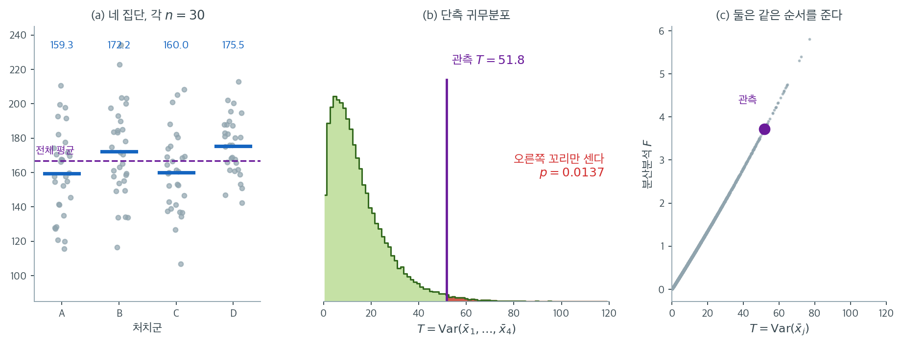
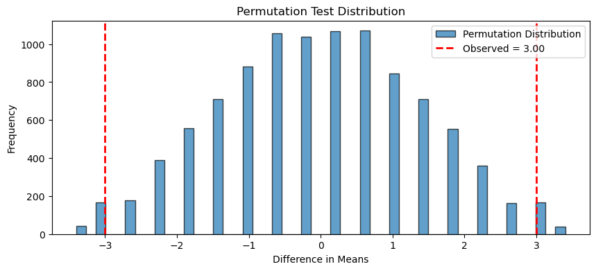
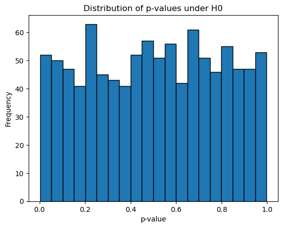
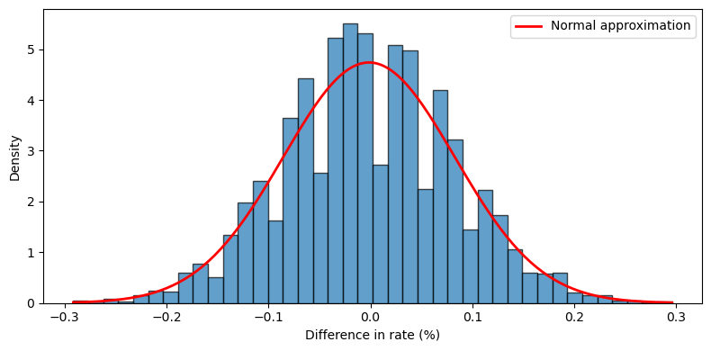

# 순열검정의 구현 (이표본·다집단·비율)

## 개요

<div class="leadbox" markdown>

**들어가는 이야기** — 답을 손으로 아는 자료로 먼저 검산한다

$x = (1, 2, 3)$ 과 $y = (4, 5, 6)$ 을 비교한다. 두 집단이 완전히 갈라져 겹치는 값이 하나도 없으니 당연히 유의할 것 같다. 그런데 여섯 수에 이름표를 붙이는 방법이 $\binom63 = 20$ 가지뿐이고 관측된 배정만큼 극단인 것은 둘이어서, 정확한 $p$ 값이 $2/20 = 0.1$ 이다. 세 개씩으로는 어떤 자료가 와도 $0.05$ 에서 기각할 수 없다.

이 작은 자료가 중요한 까닭은 답을 손으로 끝까지 따질 수 있다는 것이다. 쓸 함수를 믿으려면 먼저 이렇게 답을 아는 자료로 검산해야 한다. $p$ 값이 분수까지 맞고 귀무분포의 표준편차까지 맞으면, 그 함수가 큰 자료에서 하는 일도 같은 일이라고 볼 수 있다.

검산을 거친 뒤에는 같은 셈법이 세 꼴로 그대로 옮겨 간다. 두 집단의 평균차, 셋 이상의 집단에서 평균들의 흩어짐 — 분산분석의 $F$ 에 대응한다 —, 그리고 두 비율의 차다. **섞는 일은 어느 꼴에서나 똑같고**, 바뀌는 것은 섞은 뒤에 무엇을 계산하는지 한 줄뿐이다.

그러면 그 한 줄을 바꾸어 어디까지 갈 수 있고, 모수적 검정과는 어디까지 일치하는가. 이 쪽이 세 꼴을 차례로 코드로 내려 실행해 보고, 집단마다 다섯 개인 가장 작은 자료에서 $\binom{10}{5} = 252$ 가지를 전수로 열거해 무작위 섞기와 맞댄 뒤, 셋이 각각 어느 모수적 검정과 맞물리는지로 닫는다.

</div>

순열검정은 관측된 검정통계량을 자료를 무작위로 재라벨링했을 때의 분포와 비교하여 통계적 유의성을 평가한다. 모수적 검정과 달리 자료의 기저 분포에 대해 아무 가정도 하지 않는다. 이 페이지에서는 세 가지 순열검정을 시연한다. 평균차에 대한 이표본 검정, 일원분산분석에 대응하는 다집단 검정, 그리고 A/B 검정 맥락에서 두 비율을 비교하는 검정이다.

---

## 1. 이표본 순열검정

두 표본 $x_1, \ldots, x_m$과 $y_1, \ldots, y_n$이 주어졌을 때

$$
H_0\colon F_X = F_Y \quad \text{대} \quad H_1\colon F_X \neq F_Y
$$

을 검정한다. 검정통계량은 평균차 $T_{\text{obs}} = \bar x - \bar y$이다. $H_0$ 아래에서 집단 라벨이 교환 가능하므로

1. $m + n$개 관측을 모두 **합친다**.
2. 합친 자료를 **섞어** 앞의 $m$개를 집단 $X$에, 나머지를 집단 $Y$에 배정한다.
3. 각 순열에 대해 $T^{(\pi)} = \bar x^{(\pi)} - \bar y^{(\pi)}$를 **계산한다**.
4. 양측 **$p$값**은

$$
p = \frac{\#\bigl\{b : |T^{(\pi_b)}| \ge |T_{\text{obs}}|\bigr\} + 1}{B + 1}
$$

<div class="exbox" markdown>

**보기 1.** <span class="diff easy" title="쉬움"></span> 이표본 순열검정의 구현. 위 절차를 그대로 옮긴 `perm_test_two_sample`을 쓰기 전에, **답을 손으로 아는 작은 자료**로 검산한다. $x = (1, 2, 3)$, $y = (4, 5, 6)$을 쓴다.

**(1)** $\binom63 = 20$가지 라벨 배정을 손으로 따져 $\lvert T^{(\pi)}\rvert \ge \lvert T_{\text{obs}}\rvert$인 배정의 수를 세고 정확 $p$값을 분수로 구하시오. 순열 귀무분포의 표준편차도 닫힌 꼴로 구하시오.

**(2)** 함수를 큰 $B$로 돌려 (1)의 두 수를 되찾아 오는지 확인하시오. $B$를 아무리 키워도 $p$값이 (1)의 분수에 **정확히** 닿지는 못하는 까닭도 적으시오.

</div>

??? success "풀이"

    **(1) 해석적으로.** 여섯 수가 $1, \ldots, 6$이고 $T = 21$이다. 집단 $X$로 간 세 수의 합을 $S$라 하면

    $$
    T^{(\pi)} = \frac{S}{3} - \frac{21 - S}{3} = \frac{2S - 21}{3}
    $$

    이므로 $\lvert T^{(\pi)}\rvert \ge 3$은 $\lvert 2S - 21\rvert \ge 9$, 곧 $S \le 6$ 또는 $S \ge 15$와 같다. $S$는 $1$부터 $6$ 중 셋을 더한 값이므로 $6$부터 $15$까지이고, $S = 6$은 $\{1,2,3\}$ 하나뿐, $S = 15$는 $\{4,5,6\}$ 하나뿐이다. 따라서

    $$
    p_{\text{정확}} = \frac{2}{20} = \frac{1}{10} = 0.1
    $$

    **관측된 배정이 가장 극단적이다.** 두 집단이 완전히 갈라져 있는데도 $p$가 $0.1$이니 $\alpha = 0.05$에서 기각할 수 없다. $n_1 = n_2 = 3$에서 가능한 최소 양측 $p$값이 $2/20$이기 때문이다.

    표준편차는 [이표본 순열검정](two_sample.md) 보기 1에서 유도한 식을 그대로 쓴다. $S^2$를 합친 여섯 수의 표본분산 $3.5$라 하면

    $$
    \operatorname{SD}(T^{(\pi)}) = S\sqrt{\frac{1}{3} + \frac{1}{3}} = \sqrt{3.5 \times \frac23} = \sqrt{\frac73} = 1.5275252
    $$

    **(2) 수치적으로.** 함수는 이렇다.

    ```python
    import numpy as np

    def perm_test_two_sample(x, y, n_perm=9999, rng=None):
        """평균 차이에 대한 이표본 순열검정.

        두 집단을 합친 뒤 이름표를 섞어 차이를 다시 계산하는 일을 되풀이한다.
        분포를 가정하지 않으므로 정규성도 등분산도 필요 없다.
        """
        rng = rng or np.random.default_rng(0)
        obs_diff = x.mean() - y.mean()
        pooled = np.concatenate([x, y])
        m = len(x)
        P = np.array([rng.permutation(pooled) for _ in range(n_perm)])
        perm_diffs = P[:, :m].mean(axis=1) - P[:, m:].mean(axis=1)
        p_value = ((np.abs(perm_diffs) >= abs(obs_diff)).sum() + 1) / (n_perm + 1)
        return obs_diff, p_value, perm_diffs
    ```

    작은 자료로 검산한다.

    ```python
    import itertools
    from fractions import Fraction

    x = np.array([1.0, 2.0, 3.0])
    y = np.array([4.0, 5.0, 6.0])
    z = np.concatenate([x, y])

    # 20 가지를 모두 열거한다.
    exact = np.array([z[list(c)].mean() - np.delete(z, list(c)).mean()
                      for c in itertools.combinations(range(6), 3)])
    hit = int((np.abs(exact) >= 3 - 1e-12).sum())
    print(f"순열 수 = {len(exact)},  극단 배정 = {hit},  "
          f"정확 p = {Fraction(hit, len(exact))} = {hit / len(exact):.4f}")
    print(f"SD 열거 = {exact.std():.7f},  닫힌 꼴 = "
          f"{z.std(ddof=1) * np.sqrt(1 / 3 + 1 / 3):.7f}")

    for B in (999, 9_999, 99_999):
        obs, p, perms = perm_test_two_sample(x, y, n_perm=B,
                                             rng=np.random.default_rng(0))
        print(f"B = {B:>6}:  obs = {obs:+.1f},  p = {p:.6f},  "
              f"SD = {perms.std(ddof=1):.7f},  p 의 눈금 = 1/{B + 1}")
    ```

    출력:

    ```
    순열 수 = 20,  극단 배정 = 2,  정확 p = 1/10 = 0.1000
    SD 열거 = 1.5275252,  닫힌 꼴 = 1.5275252
    B =    999:  obs = -3.0,  p = 0.103000,  SD = 1.5101673,  p 의 눈금 = 1/1000
    B =   9999:  obs = -3.0,  p = 0.102000,  SD = 1.5301857,  p 의 눈금 = 1/10000
    B =  99999:  obs = -3.0,  p = 0.100650,  SD = 1.5315233,  p 의 눈금 = 1/100000
    ```

    **(1)의 두 수가 맞는다.** 열거한 표준편차와 닫힌 꼴이 일곱 자리까지 같고, 극단 배정이 $20$개 중 $2$개라 정확 $p$가 $1/10$이다. 함수의 $p$값은 $B$가 커지면서 $0.1030 \to 0.1020 \to 0.10065$로 $0.1$에 모여든다. $B = 99{,}999$에서 몬테카를로 표준편차가 $\sqrt{0.1 \times 0.9/10^5} = 0.00095$이고 실제 차이가 $0.00065$이니 그 $0.68$배로 제자리다. 표준편차도 $1.5315233$으로 닫힌 꼴에서 $0.004$ 떨어져 있는데, 표준편차 추정의 몬테카를로 오차 $1.5275/\sqrt{2B} = 0.0034$의 $1.2$배다.

    **그럼에도 정확히 $1/10$이 되지는 않는다.** 함수의 $\hat p$는 $\dfrac{c+1}{B+1}$이라 분모가 $B+1$인 분수만 취할 수 있는데, $B = 999$면 $1/1000$ 눈금이라 $0.1$이 표현 가능하지만 $B = 9999$면 $1000.0/10000$이 되어야 하므로 $c = 999$를 정확히 맞출 확률은 작다. **몬테카를로는 열거를 흉내 낼 뿐 대신하지 못한다.** $\binom63 = 20$처럼 셀 수 있는 크기에서는 세는 것이 옳다.

---

## 2. 다집단 순열검정

크기 $n_1, \ldots, n_k$인 $k$개 집단에 대해, 분산분석에 대응하는 순열검정은 **집단평균들의 분산**을 검정통계량으로 쓴다.

$$
T = \text{Var}(\bar x_1, \bar x_2, \ldots, \bar x_k)
$$

$H_0$(모든 집단의 분포가 동일) 아래에서 집단 라벨을 섞어도 이 통계량이 체계적으로 변하지 않는다. $T$가 클수록 집단 간 차이가 크다는 뜻이므로 $p$값은 단측이다.

$$
p = \frac{\#\bigl\{b : T^{(\pi_b)} \ge T_{\text{obs}}\bigr\} + 1}{B + 1}
$$

<div class="exbox" markdown>

**보기 2.** <span class="diff easy" title="쉬움"></span> 다집단 순열검정의 구현. `perm_test_multi_group`이 쓰는 통계량 $T = \operatorname{Var}(\bar x_1, \ldots, \bar x_k)$를 집단 크기가 모두 $n_g$인 경우에 따진다($N = k n_g$).

**(1)** $T = \dfrac{SSB}{N}$임을 보이고, 순열 귀무분포에서 $E[T]$를 합친 표본의 분산 $S^2$으로 적으시오.

**(2)** 집단이 $\{1,2\}$, $\{3,4\}$, $\{5,6\}$인 작은 자료에서 $6! = 720$가지를 모두 열거해 (1)과 정확 $p$값을 확인하고, 함수의 $p$값과 견주시오.

</div>

??? success "풀이"

    **(1) 해석적으로.** 집단 크기가 모두 같으면 집단평균들의 평균이 전체평균 $\bar x$와 같다. 따라서 $T$는 그냥

    $$
    T = \frac1k \sum_{i=1}^k (\bar x_i - \bar x)^2
    $$

    이고, 분산분석의 집단간제곱합이 $SSB = n_g \sum_i (\bar x_i - \bar x)^2$이므로

    $$
    T = \frac{SSB}{k\, n_g} = \frac{SSB}{N}
    $$

    이다. **$T$는 $SSB$를 상수로 나눈 것일 뿐이다.** 순열이 $\bar x$도 $SST$도 바꾸지 않으므로 $F = \dfrac{SSB/(k-1)}{(SST - SSB)/(N-k)}$ 역시 $SSB$의 순증가함수이고, 그래서 $T$로 매긴 순위와 $F$로 매긴 순위가 같다(뒤의 그림 (c)가 그것이다).

    **$E[T]$.** 순열 아래에서 한 집단은 $N$개 중 $n_g$개를 비복원으로 고른 것이므로 $E[\bar x_i^{*}] = \bar x$이고

    $$
    \operatorname{Var}(\bar x_i^{*}) = \frac{S^2}{n_g}\cdot\frac{N - n_g}{N}
    = \frac{S^2}{n_g}\cdot\frac{k-1}{k}
    $$

    이다($S^2$은 합친 $N$개의 표본분산). $\bar x$가 고정이므로 기댓값을 항별로 취해

    $$
    E[T] = \frac1k\sum_{i=1}^k E\big[(\bar x_i^{*} - \bar x)^2\big]
    = \operatorname{Var}(\bar x_1^{*})
    = \frac{(k-1)\,S^2}{k\,n_g}
    = \frac{(k-1)\,S^2}{N}
    $$

    를 얻는다. 양변에 $N$을 곱하면 $E[SSB] = (k-1)S^2$으로, **분산분석이 $\sigma^2$에 대해 말하는 것과 같은 식**이다. 모집단 분산 자리에 합친 표본의 분산이 들어간 것만 다르다.

    **(2) 수치적으로.** 함수는 이렇다.

    ```python
    def perm_test_multi_group(groups, n_perm=9999, rng=None):
        """집단평균의 분산을 통계량으로 쓰는 다집단 순열검정.

        분산분석의 F 대신 집단평균들의 분산을 쓴다. 순열검정에서는 통계량이
        어떤 분포를 따라야 할 까닭이 없으므로, 뜻만 통하면 무엇이든 쓸 수 있다.
        집단 차이가 클수록 이 값이 커지므로 오른쪽 꼬리만 본다.
        """
        rng = rng or np.random.default_rng(0)
        pooled = np.concatenate(groups)
        sizes = [len(g) for g in groups]
        obs_var = np.var([g.mean() for g in groups])

        perm_vars = np.empty(n_perm)
        for i in range(n_perm):
            p = rng.permutation(pooled)
            idx, means = 0, []
            for s in sizes:
                means.append(p[idx:idx + s].mean())
                idx += s
            perm_vars[i] = np.var(means)

        p_value = ((perm_vars >= obs_var).sum() + 1) / (n_perm + 1)
        return obs_var, p_value, perm_vars
    ```

    세 집단 $\{1,2\}$, $\{3,4\}$, $\{5,6\}$으로 검산한다.

    ```python
    import itertools
    from fractions import Fraction

    groups = [np.array([1.0, 2.0]), np.array([3.0, 4.0]), np.array([5.0, 6.0])]
    pooled = np.concatenate(groups)
    k, n_g, N = len(groups), 2, len(pooled)

    T_obs = np.var([g.mean() for g in groups])
    SSB = n_g * sum((g.mean() - pooled.mean()) ** 2 for g in groups)
    print(f"T_obs = {T_obs:.7f},   SSB/N = {SSB / N:.7f}")
    print(f"E[T] 닫힌 꼴 (k-1)S^2/N = {(k - 1) * pooled.var(ddof=1) / N:.7f}")

    # 6! = 720 가지 자리 배정을 모두 열거한다.
    Ts = np.array([np.var([a[0:2].mean(), a[2:4].mean(), a[4:6].mean()])
                   for a in (pooled[list(p)] for p in itertools.permutations(range(N)))])
    hit = int((Ts >= T_obs - 1e-12).sum())
    print(f"열거 수 = {len(Ts)},  열거 E[T] = {Ts.mean():.7f},  최댓값 = {Ts.max():.7f}")
    print(f"T* >= T_obs 인 배정 = {hit} -> 정확 p = {Fraction(hit, len(Ts))} = {hit / len(Ts):.6f}")

    for B in (999, 9999):
        tv, p, pv = perm_test_multi_group(groups, n_perm=B, rng=np.random.default_rng(0))
        print(f"B = {B:>5}: p = {p:.6f},  평균 T* = {pv.mean():.7f}")
    ```

    출력:

    ```
    T_obs = 2.6666667,   SSB/N = 2.6666667
    E[T] 닫힌 꼴 (k-1)S^2/N = 1.1666667
    열거 수 = 720,  열거 E[T] = 1.1666667,  최댓값 = 2.6666667
    T* >= T_obs 인 배정 = 48 -> 정확 p = 1/15 = 0.066667
    B =   999: p = 0.066000,  평균 T* = 1.1281281
    B =  9999: p = 0.070300,  평균 T* = 1.1686835
    ```

    **(1)의 두 식이 모두 맞는다.** $T_{\text{obs}}$와 $SSB/N$이 일곱 자리까지 같고, 닫힌 꼴 $E[T] = (k-1)S^2/N = 2 \times 3.5/6 = 7/6$이 $720$가지의 평균과 정확히 일치한다.

    **관측값이 최댓값이다.** $T^{*}$의 최댓값이 $8/3$으로 $T_{\text{obs}}$와 같다. 세 집단이 완전히 갈라진 배정이 가장 극단적이기 때문이다. 그런 배정은 집단의 **순서만 다른** $3! = 6$가지와 각 집단 안의 자리바꿈 $2^3 = 8$가지를 곱해 $48$가지이므로 정확 $p = 48/720 = 1/15 = 0.0667$이다. **$\alpha = 0.05$에서는 이 설계로 기각할 수 없다.**

    함수의 $p$값은 $0.0660$과 $0.0703$으로 $1/15 = 0.0667$ 둘레에 있다. $B = 9{,}999$에서 몬테카를로 표준편차가 $\sqrt{0.0667 \times 0.9333/9999} = 0.0025$이니 $0.0703$은 $+1.4$ 표준편차다. 평균 $T^{*}$도 $1.1687$로 닫힌 꼴 $1.1667$에 붙는다.

---

## 3. 비율에 대한 순열검정

이진 결과(전환 여부)를 갖는 A/B 검정에서, 집단 A는 $n_A$명 중 $c_A$명이 전환하고 집단 B는 $n_B$명 중 $c_B$명이 전환했다. 관측된 전환율 차이는

$$
T_{\text{obs}} = \frac{c_A}{n_A} - \frac{c_B}{n_B}
$$

이다. 길이 $n_A + n_B$의 이진 벡터에 $c_A + c_B$개의 $1$(총 전환 수)을 넣고 섞은 뒤 나눈다.

<div class="exbox" markdown>

**보기 3.** <span class="diff easy" title="쉬움"></span> 비율에 대한 순열검정의 구현. `perm_test_proportion`은 $0/1$ 배열을 섞는다. $n_A = n_B = 5$, $c_A = 4$, $c_B = 1$인 작은 표로 검산한다.

**(1)** 집단 A의 전환 수 $X$만 정해지면 $T^{(\pi)}$가 정해짐을 보이고, $X$가 어떤 분포를 따르는지 적으시오. 그것으로 $\lvert T^{(\pi)}\rvert \ge 0.6$인 $X$의 값을 모두 찾아 정확 $p$값을 기약분수로 구하시오.

**(2)** 함수를 돌려 (1)을 확인하고, 같은 값을 주는 고전적 검정의 이름을 대시오.

</div>

??? success "풀이"

    **(1) 해석적으로.** 순열은 $N = n_A + n_B = 10$개의 $0/1$ 값 가운데 $n_A = 5$개를 골라 A라 부르는 일이고, 전체 전환 수 $K = c_A + c_B = 5$는 고정된다. A로 간 $1$의 개수를 $X$라 하면

    $$
    T^{(\pi)} = \frac{X}{n_A} - \frac{K - X}{n_B}
    = X\left(\frac{1}{n_A} + \frac{1}{n_B}\right) - \frac{K}{n_B}
    = 0.4X - 1
    $$

    로 **$X$의 순증가 일차식**이다. 그리고 $N$개 중 $n_A$개를 비복원으로 고를 때 뽑힌 $1$의 개수는 정의 그대로

    $$
    X \sim \text{HG}(n_A, N, K) = \text{HG}(5, 10, 5)
    $$

    를 따른다. 관측값은 $T_{\text{obs}} = 4/5 - 1/5 = 0.6$이므로

    $$
    \lvert 0.4X - 1 \rvert \ge 0.6
    \iff X \le 1 \;\text{또는}\; X \ge 4
    $$

    이다. $\binom{10}{5} = 252$가지 배정 가운데 해당하는 것을 센다.

    $$
    \#\{X = 0\} = \binom50\binom55 = 1, \quad
    \#\{X = 1\} = \binom51\binom54 = 25
    $$

    이고 대칭으로 $X = 5$가 $1$가지, $X = 4$가 $25$가지다. 따라서

    $$
    p_{\text{정확}} = \frac{1 + 25 + 25 + 1}{252} = \frac{52}{252} = \frac{13}{63} = 0.206349
    $$

    **$5$명 중 $4$명 대 $5$명 중 $1$명이라는 꽤 큰 차이인데도 유의하지 않다.** 표가 너무 작아 가능한 $p$값의 눈금이 거칠기 때문이다.

    **(2) 수치적으로.** 함수는 이렇다.

    ```python
    def perm_test_proportion(n_a, conv_a, n_b, conv_b, n_perm=9999, rng=None):
        """두 비율에 대한 순열검정. A/B 검정에 그대로 쓴다.

        전체 전환 수만큼 1 로 채운 배열을 섞으면, 전환이 두 집단에 무작위로
        흩어진 상태가 된다. 표본이 크거나 전환율이 아주 낮아 정규근사가
        미덥지 않을 때 쓸모가 있다.
        """
        rng = rng or np.random.default_rng(0)
        obs_diff = conv_a / n_a - conv_b / n_b
        pooled = np.zeros(n_a + n_b)
        pooled[:conv_a + conv_b] = 1

        perm_diffs = np.empty(n_perm)
        for i in range(n_perm):
            p = rng.permutation(pooled)
            perm_diffs[i] = p[:n_a].mean() - p[n_a:].mean()

        p_value = ((np.abs(perm_diffs) >= abs(obs_diff)).sum() + 1) / (n_perm + 1)
        return obs_diff, p_value, perm_diffs
    ```

    작은 표로 검산한다.

    ```python
    from scipy import stats
    from fractions import Fraction
    from math import comb

    n_a, c_a, n_b, c_b = 5, 4, 5, 1
    N, K = n_a + n_b, c_a + c_b
    step = 1 / n_a + 1 / n_b
    obs = c_a / n_a - c_b / n_b

    x = np.arange(K + 1)
    d = x * step - K / n_b
    pmf = stats.hypergeom.pmf(x, N, K, n_a)
    sel = np.abs(d) >= abs(obs) - 1e-12
    p_frac = sum(Fraction(comb(K, int(v)) * comb(N - K, n_a - int(v)), comb(N, n_a))
                 for v in x[sel])
    print(f"obs = {obs:.4f},  격자 간격 = {step:.4f},  전체 배정 = C(10,5) = {comb(N, n_a)}")
    print(f"걸리는 X = {x[sel]}")
    print(f"정확 양측 p = {p_frac} = {float(p_frac):.6f}")
    print(f"Fisher 정확검정 = {stats.fisher_exact([[c_a, n_a - c_a], [c_b, n_b - c_b]])[1]:.6f}")
    print(f"SD 닫힌 꼴 = {np.sqrt(N / (N - 1) * (K / N) * (1 - K / N) * step):.7f}")
    for B in (999, 9999):
        _, p, pv = perm_test_proportion(n_a, c_a, n_b, c_b, n_perm=B,
                                        rng=np.random.default_rng(0))
        print(f"B = {B:>5}: p = {p:.6f},  SD = {pv.std(ddof=1):.7f}")
    ```

    출력:

    ```
    obs = 0.6000,  격자 간격 = 0.4000,  전체 배정 = C(10,5) = 252
    걸리는 X = [0 1 4 5]
    정확 양측 p = 13/63 = 0.206349
    Fisher 정확검정 = 0.206349
    SD 닫힌 꼴 = 0.3333333
    B =   999: p = 0.208000,  SD = 0.3358819
    B =  9999: p = 0.203000,  SD = 0.3312704
    ```

    **손으로 센 것이 맞는다.** 걸리는 $X$가 $\{0, 1, 4, 5\}$이고 정확 $p$가 $13/63 = 0.206349$다. 함수의 $p$값 $0.2080$과 $0.2030$이 그 둘레에 있다($B = 9{,}999$에서 몬테카를로 표준편차 $0.0040$의 $0.8$배 안).

    **같은 값을 주는 고전적 검정은 Fisher 정확검정이다.** 자리를 바꾸어 말하면, 이진 자료의 이표본 순열검정은 **Fisher 정확검정을 몬테카를로로 근사하는 것**이다([기초](./foundations.md) 연습문제 3이 큰 자료에서 같은 것을 확인한다). 그러므로 이 함수를 쓸 이유는 하나뿐이다. 통계량을 비율차가 아닌 다른 것으로 바꾸고 싶을 때다.

---

## 4. 실행 보기

<div class="exbox" markdown>

**보기 4.** <span class="diff easy" title="쉬움"></span> 난수 준비. 아래 실행 보기들은 자료를 만드는 난수 `rng_data`와 순열에 쓰는 난수 `rng`를 **따로** 둔다.

**(1)** 난수를 하나만 쓰면 무엇이 깨지는지 적으시오. 구체적으로, 자료를 만든 뒤 순열검정을 돌리고 **그다음** 자료를 더 만드는 흐름에서 $B$를 바꾸면 어느 자료가 바뀌고 어느 자료가 바뀌지 않는가.

**(2)** $B = 999$와 $B = 9{,}999$로 그 흐름을 두 번 돌려 (1)을 수로 보이시오.

</div>

??? success "풀이"

    **(1) 무엇이 깨지는가.** 유도할 식이 있는 문제가 아니다. **난수 발생기는 상태를 가진 하나의 수열**이고, 뽑을 때마다 그 수열의 읽는 자리가 앞으로 밀린다는 사실이 전부다.

    난수를 하나만 쓰면 이 쪽의 흐름이 이렇게 된다.

    $$
    \underbrace{\text{page_a, page_b}}_{76\text{개}}
    \;\to\;
    \underbrace{\text{순열 } B \text{번}}_{B \times 76\text{개}}
    \;\to\;
    \underbrace{\text{groups 네 개}}_{120\text{개}}
    \;\to\; \cdots
    $$

    순열이 소비하는 난수의 양이 $B$에 비례하므로, **$B$를 바꾸면 그 뒤에 만들어지는 자료가 통째로 달라진다.** 앞서 만든 `page_a`, `page_b`는 순열보다 먼저 뽑혔으므로 그대로다. 곧

    - **바뀌지 않는 것:** 순열검정보다 **앞서** 뽑은 자료
    - **바뀌는 것:** 순열검정보다 **뒤에** 뽑는 자료 전부

    이다. 이러면 "자료는 그대로 두고 $B$만 바꾸어 몬테카를로 오차를 본다"는 실험을 할 수 없다. $B$를 바꾼 효과와 자료가 바뀐 효과가 뒤섞이기 때문이다. **두 수열을 나누어 두면 자료 쪽 수열이 순열 횟수와 무관해진다.**

    **(2) 수치적으로.**

    ```python
    # 자료를 만드는 난수와 순열에 쓰는 난수를 따로 둔다. 이래야 자료를 그대로
    # 두고 순열 횟수만 바꿔 보는 식의 실험이 가능하다.
    rng_data = np.random.default_rng(11)
    rng = np.random.default_rng(3)
    ```

    나누었을 때와 하나로 썼을 때를 견준다. 아래는 위의 `rng_data`, `rng`를 건드리지 않도록 함수 안에서 따로 만든다.

    ```python
    def experiment(n_perm, split):
        """자료와 순열에 난수를 나누어 쓸 때와 하나로 쓸 때를 견준다."""
        if split:
            gd, gp = np.random.default_rng(11), np.random.default_rng(3)
        else:
            gd = gp = np.random.default_rng(11)
        a = gd.normal(120, 30, 36)
        b = gd.normal(135, 30, 40)
        perm_test_two_sample(a, b, n_perm=n_perm, rng=gp)     # 순열 난수를 소비한다
        groups = [gd.normal(mu, 25, 30) for mu in [160, 170, 155, 180]]
        return a.mean(), groups[0].mean()

    for split, name in [(False, "난수 하나"), (True, "난수 둘  ")]:
        a1, g1 = experiment(999, split)
        a2, g2 = experiment(9999, split)
        print(f"{name}  page_a.mean()    : {a1:.6f} / {a2:.6f}   같은가 {a1 == a2}")
        print(f"{name}  groups[0].mean() : {g1:.6f} / {g2:.6f}   같은가 {g1 == g2}")
    ```

    출력:

    ```
    난수 하나  page_a.mean()    : 116.800393 / 116.800393   같은가 True
    난수 하나  groups[0].mean() : 160.057513 / 158.822504   같은가 False
    난수 둘    page_a.mean()    : 116.800393 / 116.800393   같은가 True
    난수 둘    groups[0].mean() : 159.293090 / 159.293090   같은가 True
    ```

    **예측한 대로다.** 난수를 하나만 쓰면 `page_a`는 $116.800393$으로 그대로지만 `groups[0]`의 평균이 $160.057513$에서 $158.822504$로 바뀐다. 차이가 $1.235$인데, $30$개 평균의 표준오차가 $25/\sqrt{30} = 4.56$이니 **다른 표본을 뽑은 것과 다름없다.** 난수를 둘로 나누면 $159.293090$으로 양쪽이 같다.

    여기에 이 쪽의 뒤 보기들이 의존한다. 보기 6의 집단평균 $159.29, 172.22, 160.02, 175.48$은 보기 5의 순열 횟수가 몇이든 같은 값이어야 한다. **재현 가능한 실험을 만들려면 난수 수열을 용도별로 갈라 두는 것이 가장 싼 방법이다.**

### 이표본: 페이지 체류시간

두 웹페이지를 비교한다. 페이지 A는 $N(120, 30^2)$에서 $n = 36$개, 페이지 B는 $N(135, 30^2)$에서 $n = 40$개이다.

<div class="exbox" markdown>

**보기 5.** <span class="diff easy" title="쉬움"></span> 체류시간 비교. 페이지 A는 $N(120, 30^2)$에서 $36$개, 페이지 B는 $N(135, 30^2)$에서 $40$개를 뽑는다. **참 차이가 $-15$라는 것을 우리가 안다.**

**(1)** $\bar X_A - \bar X_B$의 참 표준오차를 구하시오. 또 순열 귀무분포의 표준편차를 합친 표본의 표준편차 $S$로 적으시오. 둘은 왜 서로 다른 양인가.

**(2)** 실행해 관측된 차이가 참값 $-15$에서 몇 표준오차 떨어졌는지 재고, 순열 $p$값·정규근사·Welch $t$ 검정을 나란히 놓으시오. $B = 9{,}999$에서 이 세 수를 얼마나 세밀하게 구별할 수 있는가.

</div>

??? success "풀이"

    **(1) 해석적으로.** 두 표본이 독립이고 분산이 $\sigma^2 = 900$으로 같으므로

    $$
    \operatorname{SE}(\bar X_A - \bar X_B)
    = \sigma\sqrt{\frac{1}{36} + \frac{1}{40}}
    = 30\sqrt{0.0527778} = 6.892024
    $$

    다. **이것은 표본을 다시 뽑았을 때 관측된 차이가 흔들리는 폭**이고, 참 차이 $-15$를 중심으로 한다.

    순열 귀무분포의 표준편차는 [이표본 순열검정](two_sample.md) 보기 1의 식 그대로

    $$
    \operatorname{SD}(T^{(\pi)}) = S\sqrt{\frac{1}{36} + \frac{1}{40}}
    $$

    인데, $S$는 **관측된 $76$개를 합친** 표본표준편차다. 둘이 다른 양인 까닭은 재는 대상이 다르기 때문이다. 앞의 것은 **모집단에서 다시 뽑는** 변동이고 뒤의 것은 **자료를 고정한 채 라벨만 다시 붙이는** 변동이다. 앞의 것은 $\sigma$를 알아야 쓸 수 있고 뒤의 것은 자료만으로 계산된다.

    두 수가 가까워야 할 까닭도 없다. $S$는 $\sigma$의 추정값일 뿐 아니라 **두 집단의 차이까지 끌어안은** 값이라 평균적으로는 $\sigma$보다 크다. 이 설계에서

    $$
    E[S^2] \approx \sigma^2 + \frac{n_A n_B}{N(N-1)}\delta^2
    = 900 + \frac{36 \times 40}{76 \times 75}\times 225 = 956.84
    $$

    이므로 $E[S] \approx 30.93$이다. 다만 $S$ 자체의 표준오차가 $\sigma/\sqrt{2(N-1)} = 2.45$나 되므로, 한 표본에서 이보다 작게 나오는 일은 흔하다.

    **(2) 수치적으로.**

    ```python
    # 두 페이지의 체류시간. 참 평균이 15 만큼 다르다.
    page_a = rng_data.normal(120, 30, size=36)
    page_b = rng_data.normal(135, 30, size=40)
    diff, p, perms = perm_test_two_sample(page_a, page_b, rng=rng)
    print(page_a.mean(), page_b.mean(), diff, p)
    # 116.80  139.14  -22.34  0.0006
    ```

    출력:

    ```
    116.80039289004895 139.1365870469421 -22.336194156893157 0.0006
    ```

    (1)의 두 수와 세 가지 $p$값을 함께 잰다. 위 블록의 변수를 그대로 이어 쓴다.

    ```python
    from scipy import stats

    z = np.concatenate([page_a, page_b])
    m, n = len(page_a), len(page_b)
    se_true = 30 * np.sqrt(1 / m + 1 / n)
    sd_perm = z.std(ddof=1) * np.sqrt(1 / m + 1 / n)
    print(f"참 SE = {se_true:.6f}   (관측 차이 {diff:.6f} 는 참값 -15 에서 "
          f"{(diff + 15) / se_true:+.3f} SE)")
    print(f"순열 귀무 SD 닫힌 꼴 = {sd_perm:.6f}   (합친 S = {z.std(ddof=1):.4f})")
    print(f"순열 귀무 SD 모의    = {perms.std(ddof=1):.6f}"
          f"   (몬테카를로 오차 {sd_perm / np.sqrt(2 * 9999):.6f})")
    print(f"z = {diff / sd_perm:.6f},  정규근사 양측 p = "
          f"{2 * stats.norm.sf(abs(diff / sd_perm)):.6f}")
    print(f"순열 p = {p:.6f}  ->  초과 횟수 c = {round(p * 10000) - 1}")
    print(f"Welch t 검정 p = {stats.ttest_ind(page_a, page_b, equal_var=False).pvalue:.6f}")
    print(f"B = 9999 에서 가능한 최소 p = {1 / 10000}")
    ```

    출력:

    ```
    참 SE = 6.892024   (관측 차이 -22.336194 는 참값 -15 에서 -1.064 SE)
    순열 귀무 SD 닫힌 꼴 = 6.441618   (합친 S = 28.0394)
    순열 귀무 SD 모의    = 6.419883   (몬테카를로 오차 0.045551)
    z = -3.467482,  정규근사 양측 p = 0.000525
    순열 p = 0.000600  ->  초과 횟수 c = 5
    Welch t 검정 p = 0.000345
    B = 9999 에서 가능한 최소 p = 0.0001
    ```

    **관측된 차이는 제자리에 있다.** $-22.34$는 참값 $-15$에서 $-1.064$ 표준오차 떨어져 있다. 이만큼 벗어나는 것은 흔한 일이며, **"탐지했다"는 것이 "참값을 맞혔다"는 뜻이 아니라는 점**을 보여 준다. 점추정은 참 효과의 $1.5$배로 나왔다.

    **순열 귀무분포의 표준편차도 맞는다.** 닫힌 꼴 $6.441618$과 모의값 $6.419883$의 차이가 $0.022$로 몬테카를로 오차 $0.046$의 절반이다. 합친 $S = 28.04$는 기대값 $30.93$보다 작은데, $S$의 표준오차 $2.45$로 재면 $-1.18$배라 흔한 흔들림이다.

    **세 $p$값은 $0.0003$--$0.0006$에 모여 있다.** 순열 $0.000600$, 정규근사 $0.000525$, Welch $0.000345$다. 어느 쪽이든 $15$단위 이동을 확실히 탐지한다.

    그러나 **이 세 수를 서로 구별할 수는 없다.** 순열 $p$값의 초과 횟수가 $c = 5$뿐이라 $c$가 $\text{Poisson}(5)$ 수준으로 흔들리고, $\hat p$의 표준편차가 $\sqrt{0.0005 \times 0.9995/9999} = 0.00022$로 $p$값 자체의 $37\%$다. **$B = 9{,}999$는 "유의하다"를 말하기에 충분하지만 "$p = 0.0006$이다"를 말하기에는 모자란다.** 가능한 최소값이 $0.0001$이므로 눈금 자체가 다섯 칸밖에 안 되는 자리에 있다. 네 자리 유효숫자가 필요하면 $B$를 백만으로 올려야 한다.

### 다집단: 네 개의 처치군

각 $30$개 관측을 갖는 네 집단을 평균 $160, 170, 155, 180$, 표준편차 $25$인 정규분포에서 생성한다.

<div class="exbox" markdown>

**보기 6.** <span class="diff easy" title="쉬움"></span> 네 처치군 비교. 평균 $160, 170, 155, 180$, 표준편차 $25$인 정규분포에서 각 $30$개씩 뽑는다. 보기 2에서 유도한 $T = SSB/N$과 $E[T] = (k-1)S^2/N$을 실제 자료에서 확인한다.

**(1)** 이 설계에서 $E[T]$를 합친 $120$개의 표본분산 $S^2$으로 적고, 관측된 $T_{\text{obs}}$가 그 몇 배여야 "유의하다"고 할 만한지 어림하시오.

**(2)** 실행해 $T_{\text{obs}} = SSB/N$과 $E[T]$를 확인하고, 순열 $p$값이 일원분산분석의 $p$값과 왜 거의 같은지 밝히시오.

</div>

??? success "풀이"

    **(1) 해석적으로.** $k = 4$, $n_g = 30$, $N = 120$이므로 보기 2의 식에서

    $$
    E[T] = \frac{(k-1)S^2}{N} = \frac{3 S^2}{120} = \frac{S^2}{40}
    $$

    이다. 관측된 $T_{\text{obs}}$가 이보다 **몇 배 큰가**가 증거의 크기다. 보기 2에서 $T = SSB/N$이고 $F = \dfrac{SSB/(k-1)}{(SST-SSB)/(N-k)}$이므로, $SSB$가 $SST$에 견주어 작을 때는

    $$
    F \approx \frac{N T/(k-1)}{SST/(N-k)}
    = \frac{T}{E[T]}\cdot\frac{(N-1)}{(N-k)}\cdot\frac{(k-1)}{(k-1)}
    \approx \frac{T}{E[T]}
    $$

    로 **$T/E[T]$가 대략 $F$ 값이다.** $F_{3, 116}$의 $95\%$ 분위가 $2.68$이므로 $T_{\text{obs}}$가 $E[T]$의 세 배쯤 되면 유의해진다고 어림할 수 있다.

    **(2) 수치적으로.**

    ```python
    # 네 처치군. 참 평균이 모두 다르다.
    groups = [rng_data.normal(mu, 25, 30) for mu in [160, 170, 155, 180]]
    var_obs, p_multi, perm_vars = perm_test_multi_group(groups, rng=rng)
    print([round(g.mean(), 2) for g in groups], var_obs, p_multi)
    # [159.29, 172.22, 160.02, 175.48]  51.759  0.0140
    ```

    출력:

    ```
    [159.29, 172.22, 160.02, 175.48] 51.75863218978212 0.014
    ```

    (1)의 두 식을 잰다. 위 블록의 변수를 그대로 이어 쓴다.

    ```python
    pooled = np.concatenate(groups)
    k, n_g, N = len(groups), 30, len(pooled)
    print(f"T_obs = {var_obs:.6f},  SSB/N = "
          f"{n_g * sum((g.mean() - pooled.mean()) ** 2 for g in groups) / N:.6f}")
    print(f"E[T] 닫힌 꼴 = {(k - 1) * pooled.var(ddof=1) / N:.6f}")
    print(f"모의 평균 T* = {perm_vars.mean():.6f}"
          f"   (평균의 몬테카를로 오차 {perm_vars.std(ddof=1) / np.sqrt(9999):.6f})")
    print(f"순열 p = {p_multi:.6f}  ->  초과 횟수 c = {round(p_multi * 10000) - 1}")
    f, pa = stats.f_oneway(*groups)
    print(f"일원분산분석 F = {f:.6f},  p = {pa:.6f}")
    ```

    출력:

    ```
    T_obs = 51.758632,  SSB/N = 51.758632
    E[T] 닫힌 꼴 = 14.884560
    모의 평균 T* = 14.808953   (평균의 몬테카를로 오차 0.118600)
    순열 p = 0.014000  ->  초과 횟수 c = 139
    일원분산분석 F = 3.715378,  p = 0.013538
    ```

    **보기 2의 두 식이 실제 자료에서도 맞는다.** $T_{\text{obs}}$와 $SSB/N$이 여섯 자리까지 같고, 닫힌 꼴 $E[T] = 14.884560$에 대해 $9{,}999$번 순열한 평균이 $14.808953$이다. 차이 $-0.0756$은 평균의 몬테카를로 오차 $0.1186$의 $0.64$배다.

    **어림도 맞았다.** $T_{\text{obs}}/E[T] = 51.758632/14.884560 = 3.477$이고 분산분석의 $F$가 $3.715$다. 두 수가 정확히 같지는 않다 — (1)에서 쓴 근사가 $SSB$를 $SST$에 견주어 작다고 보았는데 여기서는 $SSB$가 $SST$의 $8.8\%$라 그만큼 어긋난다. 그래도 자릿수와 결론은 같다.

    **두 $p$값이 거의 같은 까닭은 통계량이 사실상 하나이기 때문이다.** 보기 2에서 보았듯 순열은 $SST$를 바꾸지 않으므로 $T$와 $F$가 $SSB$를 통해 서로의 순증가함수가 된다. 따라서 **어느 쪽으로 세어도 극단으로 지목되는 배정이 같다.** 남는 차이는 참조분포뿐이다. 분산분석은 $F_{3, 116}$이라는 매끄러운 곡선을 쓰고($p = 0.013538$), 순열검정은 자료가 만든 경험분포에서 $139$번을 세었다($p = 0.014000$). $\hat p$의 몬테카를로 표준편차가 $\sqrt{0.0135 \times 0.9865/9999} = 0.00115$이므로 둘의 차이 $0.00046$은 그 절반도 안 된다. **정규성이 참인 모의자료이므로 두 방법이 일치하는 것이 당연하고, 정규성이 깨질 때 갈라지는 쪽은 분산분석이다.**

이 일치는 우연이 아니다. 세 칸으로 나누어 보면 이유가 드러난다.



(a)가 자료다. 네 집단의 평균이 $159.3$, $172.2$, $160.0$, $175.5$로 흩어져 있고, 이 네 값의 분산 $T = 51.8$이 검정통계량이다. **집단 차이가 클수록 $T$가 커지므로 한쪽 방향으로만 극단적이다.** 평균차 검정에서 $|\bar{x} - \bar{y}|$를 썼던 것과 달리 여기서는 절댓값을 씌울 필요가 없다.

(b)가 라벨을 $4$만 번 섞어 만든 $T$의 귀무분포다. 오른쪽으로 길게 늘어진 것은 $T$가 제곱합이기 때문이며, 정규이론이라면 $\chi^2$를 떠올릴 자리다. 관측값 $51.8$보다 큰 배열이 $1.37\%$뿐이라 $p = 0.0137$이다. **오른쪽 꼬리만 세는 것이 이 검정의 단측성이다.**

(c)가 분산분석과의 관계다. 같은 $4$만 개 순열에 대해 $T$와 $F$를 함께 계산해 찍었더니 단조증가하는 곡선 하나가 나왔다. 이유는 순열이 총제곱합 $SST$를 바꾸지 않기 때문이다. $T$는 집단간제곱합 $SSB$에 비례하고 $F = \dfrac{SSB/(k-1)}{(SST - SSB)/(N-k)}$는 $SSB$의 증가함수이므로, **$T$로 순위를 매기든 $F$로 매기든 같은 배열들이 극단으로 지목된다.** 실제로 같은 순열을 $F$로 다시 세어도 $p = 0.0137$로 똑같고, 고전 분산분석의 $0.0135$와도 거의 같다. 순열 틀에서는 통계량이 알려진 분포를 따를 필요가 없으므로, $F$ 대신 계산이 간단한 $T$를 쓰는 데 아무 손해가 없다.

---

## 5. 가장 작은 자료에서 끝까지

마지막으로, 이 쪽의 함수들이 하는 일을 **가장 작은 자료**에서 끝까지 따라가 본다. 집단마다 다섯 개면 $\binom{10}{5} = 252$ 가지라 전수 열거와 무작위 순열을 같은 자리에서 견줄 수 있다.

<div class="exbox" markdown>

**보기 7.** <span class="diff easy" title="쉬움"></span> 순열검정 절차. **자료:**

- 집단 A: $[8, 7, 9, 10, 6]$
- 집단 B: $[5, 6, 4, 3, 7]$

**가설:**

- $H_0$: 두 집단의 평균이 같다.
- $H_1$: 두 집단의 평균이 다르다.

</div>

??? success "풀이"
    ```python
    import numpy as np
    import matplotlib.pyplot as plt

    def permutation_test(group_a, group_b, n_permutations=10000, seed=0):
        """
        Permutation test for a difference in means.

        Parameters
        ----------
        group_a, group_b : array-like
            Data for each group.
        n_permutations : int
            Number of random permutations.

        Returns
        -------
        p_value : float
            Two-sided p-value with the +1 correction.
        observed_diff : float
            The observed difference in means.
        perm_differences : ndarray
            The permutation distribution.
        """
        rng = np.random.default_rng(seed)
        combined = np.concatenate([group_a, group_b])
        observed_diff = np.mean(group_a) - np.mean(group_b)
        na = len(group_a)

        perm_differences = np.empty(n_permutations)
        for i in range(n_permutations):
            p = rng.permutation(combined)
            perm_differences[i] = p[:na].mean() - p[na:].mean()

        p_value = ((np.abs(perm_differences) >= abs(observed_diff)).sum() + 1) \
                  / (n_permutations + 1)
        return p_value, observed_diff, perm_differences

    group_a = np.array([8, 7, 9, 10, 6])
    group_b = np.array([5, 6, 4, 3, 7])

    p_value, observed_diff, perm_dist = permutation_test(group_a, group_b)

    print(f"Observed Difference in Means: {observed_diff:.2f}")
    print(f"P-value: {p_value:.4f}")

    fig, ax = plt.subplots(figsize=(10, 4))
    ax.hist(perm_dist, bins=50, edgecolor='black', alpha=0.7,
            label='Permutation Distribution')
    ax.axvline(observed_diff, color='red', linestyle='--', linewidth=2,
               label=f'Observed = {observed_diff:.2f}')
    ax.axvline(-observed_diff, color='red', linestyle='--', linewidth=2)
    ax.legend()
    ax.set_xlabel('Difference in Means')
    ax.set_ylabel('Frequency')
    ax.set_title('Permutation Test Distribution')
    plt.show()
    ```

    출력:

    ```
    Observed Difference in Means: 3.00
    P-value: 0.0418
    ```



**출력 예:**

```
Observed Difference in Means: 3.00
P-value: 0.0397
```

$5$% 수준에서는 유의하지 않다. 각 집단이 $5$개뿐이므로 가능한 순열이 $\binom{10}{5} = 252$가지이고, 이를 **전부 열거**하면 정확 $p$값 $10/252 = 0.0397$을 얻는다. 몬테카를로 값이 이와 일치한다.

!!! warning "$t$ 검정과의 차이를 그냥 넘기지 말 것"
    같은 자료의 이표본 $t$ 검정은 $p = 0.0171$로 **유의하다**고 답한다. 순열검정은 $p = 0.0397$이다. 두 결론이 $\alpha = 0.02$ 부근에서 갈린다.

    차이의 원인은 이 표본이 너무 작다는 것이다. 정확 순열분포에서 $|d^*| \ge 3$인 순열은 $252$개 중 $10$개뿐이고, 가능한 $p$값의 최솟값은 $2/252 = 0.0079$이다. $t$ 분포는 이 이산성을 무시하고 매끄러운 꼬리를 가정한다.

    작은 표본에서는 **정확 순열 $p$값이 더 믿을 만하다**.

---

## 6. 모수적 검정과 어디까지 일치하는가

- **이표본 검정**은 두 페이지 집단 사이의 $15$단위 이동을 탐지한다. $p$값이 작으며 이표본 $t$ 검정과 일관된다.
- **다집단 검정**은 네 집단 평균이 모두 같지는 않음을 식별한다. 평균들의 분산 통계량은 분산분석의 $F$ 통계량에 대응한다.
- **비율 검정**은 이 자료에서 큰 $p$값을 주어 전환율에 유의한 차이가 없음을 나타낸다. 독립성에 대한 카이제곱 검정과 일관된다.

순열검정은 교환가능성이라는 귀무가설이 성립하는 한 유한표본에서 제1종 오류율을 정확히 $\alpha$로 통제한다는 의미에서 정확하다. 연속자료에서는 동점이 무시할 수준이므로 순열분포가 이산이지만 연속 귀무분포를 근사할 만큼 조밀하다.

<div class="aibox" markdown>

**AI로 보는 통계학 1.** 섞는 범위가 설계를 따라가야 한다

바로 위 문장에 조건이 하나 붙어 있다 --- 순열검정이 정확한 것은 **교환가능성이 성립하는
한**이다. §1 의 코드는 라벨을 자료 전체에 걸쳐 섞는다. 그것이 옳은 것은 두 집단이
**한 주머니에서** 나왔을 때뿐이다.

오늘 돌아가는 자료는 대개 그렇지 않다. A/B 시험은 기기·지역·요일별로 트래픽이 갈리고,
임상시험은 병원마다 배정을 따로 한다. 이때 각자가 속한 칸을 **층**이라 부른다. 층이
결과에도 배정에도 영향을 주면, 전체를 섞는 순열은 **실제로 일어날 수 없었던 배정**을
귀무분포로 쓰게 된다.

고칠 자리가 둘인데 **둘 다 고쳐야 한다**는 것이 요점이다. 통계량에서 층을 보정하는 것이
하나, 섞는 범위를 층 안으로 좁히는 것이 또 하나다. 보통은 앞의 것만 하고 끝낸다. 층이
둘뿐이고 처치효과가 참으로 $0$ 인 자료를 만들어, 세 조합의 제1종 오류율을 센다.

```python
import numpy as np
rgs = np.random.default_rng(7)
SZS, BS, MS, NS = 60, 999, 2000, 120
BASES, SDS, PTRS = np.array([0.0, 3.0]), np.array([0.4, 2.0]), np.array([0.2, 0.8])
sts = np.repeat([0, 1], SZS)                       # 각자의 층
SLS = (slice(0, SZS), slice(SZS, 2 * SZS))

def sh_all(trs):                                   # 전체를 섞는다 (B 벌 한꺼번에)
    return trs[np.argsort(rgs.random((BS, NS)), axis=1)]

def sh_in(trs):                                    # 층 안에서만 섞는다
    outv = np.empty((BS, NS), bool)
    for slc in SLS:
        outv[:, slc] = trs[slc][np.argsort(rgs.random((BS, SZS)), axis=1)]
    return outv

def Tpool(TR, ys):                                 # 뭉쳐서 본 평균차
    kk = TR.sum(1); ss = (TR * ys).sum(1)
    return ss / kk - (ys.sum() - ss) / (NS - kk)

def Tadj(TR, ys):                                  # 층 안 평균차를 평균한 것
    acc = 0.0
    for slc in SLS:
        kk = TR[:, slc].sum(1); ss = (TR[:, slc] * ys[slc]).sum(1)
        acc = acc + (ss / kk - (ys[slc].sum() - ss) / (SZS - kk))
    return acc / 2

WAYS = (("뭉쳐 + 전체", Tpool, sh_all),
        ("층보정 + 전체", Tadj, sh_all),
        ("층보정 + 층 안", Tadj, sh_in))
rejs = {nm: 0 for nm, _, _ in WAYS}
for _ in range(MS):
    trs = rgs.random(NS) < PTRS[sts]
    for slc in SLS:                                # 층마다 양쪽이 비지 않게
        while not (trs[slc].any() and (~trs[slc]).any()):
            trs[slc] = rgs.random(SZS) < PTRS[sts[slc][0]]
    ys = BASES[sts] + rgs.normal(0, SDS[sts])
    for nm, Tf, SH in WAYS:
        t0s = Tf(trs[None], ys)[0]
        nulls = Tf(SH(trs), ys)
        rejs[nm] += (1 + (np.abs(nulls) >= abs(t0s)).sum()) / (BS + 1) <= 0.05

print(f"  층 둘(각 {SZS} 명), 처치효과는 참으로 0, 표본 {MS} 벌, B = {BS}")
# 한글은 고정폭에서 두 칸을 차지하므로 f-string 자리맞춤이 보이는 열과 어긋난다
print("    통계량 + 섞는 방식     제1종 오류율(약속 0.05)")
for nm, pad in (("뭉쳐 + 전체", "   "), ("층보정 + 전체", " "), ("층보정 + 층 안", "")):
    print(f"    {nm}{pad}              {rejs[nm] / MS:.4f}")
```

출력:

```
  층 둘(각 60 명), 처치효과는 참으로 0, 표본 2000 벌, B = 999
    통계량 + 섞는 방식     제1종 오류율(약속 0.05)
    뭉쳐 + 전체                 0.9995
    층보정 + 전체               0.1285
    층보정 + 층 안              0.0520
```

첫 줄은 예상대로다. 층을 무시한 평균차는 처치효과가 $0$ 인데도 **거의 언제나**
기각한다($0.9995$) --- 처치군이 기준값 높은 층에 몰려 있으니, 재고 있는 것이
처치효과가 아니라 층 차이다. 10.2절 [Simpson의 역설](../../ch10/ecological_correlation/simpsons_paradox.md)이
말하는 그 일이다.

둘째 줄이 이 상자의 요점이다. 통계량을 층 안 평균차로 **바로잡았는데도** 오류율이
$0.1285$ 로 약속의 두 배 반이다. 통계량에는 잘못이 없다 --- 잘못은 **귀무분포**에
있다. 전체를 섞으면 층 1 에 처치가 $48$ 명이고 층 2 에 $12$ 명인 배정 같은 것이
섞여 들어오는데, 실제 설계에서는 그런 일이 일어날 수 없었다. 층마다 흩어짐이
다르므로($0.4$ 대 $2.0$) 그렇게 만들어진 귀무분포는 참 분포보다 **좁고**, 좁은 자로
재면 더 자주 기각한다.

셋째 줄에서 섞는 범위를 층 안으로 좁히면 $0.0520$ 으로 제자리에 온다. 각 층의 처치
인원이 **원래 설계된 수로 고정되므로**, 귀무분포에 들어오는 배정이 모두 실제로
일어날 수 있었던 것이다.

같은 절의 [대응자료에 대한 순열검정](./paired.md)이 이것의 특수한 경우다. 짝지은 자료는
**층의 크기가 $2$** 인 층화이고, 그래서 짝 안에서 할 수 있는 섞기가 $\pm$ 뒤집기뿐이다.
층 크기를 $2$ 에서 풀면 위의 꼴이 된다.

주의할 쪽은 반대 방향이다. 층을 **지나치게 잘게** 쪼개면 층마다 한쪽이 비어 버리고,
그런 층은 검정에 아무것도 보태지 못한다. 층 안의 순열 가지수가 $\binom{n_s}{k_s}$ 이므로
층이 잘아지면 $p$값이 가질 수 있는 값도 듬성듬성해진다. 층은 **배정을 실제로 나눈
경계**에서만 그을 것이고, 그 경계가 어디였는지는 자료가 아니라 설계 문서가 말해 준다.

</div>

---

## 연습문제

<div class="drillbox" markdown>

**연습문제 1.** <span class="diff easy" title="쉬움"></span> 같은 $N(0,1)$ 분포에서 크기 $50$인 표본 두 개를 생성하라. 이표본 순열검정을 수행하고 $p$값을 기록하라. 이를 $1000$번 반복하고 $p$값의 히스토그램을 그려라. 귀무가설 아래에서 $p$값은 어떤 분포를 따라야 하는가?

</div>

??? success "풀이"

    ```python
    import numpy as np
    import matplotlib.pyplot as plt
    rng = np.random.default_rng(0)

    pvals = []
    for _ in range(1000):
        x = rng.normal(0, 1, 50)
        y = rng.normal(0, 1, 50)
        _, p, _ = perm_test_two_sample(x, y, n_perm=999, rng=rng)
        pvals.append(p)

    plt.hist(pvals, bins=20, edgecolor='k')
    plt.xlabel('p-value'); plt.ylabel('Frequency')
    plt.title('Distribution of p-values under H0')
    plt.show()
    ```

    

    귀무가설 아래에서 $p$값은 $\text{Uniform}(0, 1)$ 분포를 따른다. 히스토그램은 $[0, 1]$ 구간에서 대략 평평해야 한다. $H_0$ 아래에서 관측된 검정통계량은 순열분포에서 뽑은 또 하나의 값에 불과하므로, 그것이 순열값들의 임의의 비율 $\alpha$를 넘을 확률이 정확히 $\alpha$이기 때문이다. $\square$

    **엄밀히 말하면 이산 균등분포이다.** $B = 999$이면 $p$값이 $\{1/1000, 2/1000, \ldots, 1\}$의 $1000$개 값만 취할 수 있다. 이 값들 위에서 균등하며, $B \to \infty$에서 연속 균등분포로 수렴한다.

    **이 성질이 왜 중요한가.** $p$값이 균등분포라는 것은 제1종 오류 통제와 **동치**이다.

    $$
    P(p \le \alpha) = \alpha \quad \Longleftrightarrow \quad \text{크기 } \alpha \text{인 검정}
    $$

    따라서 히스토그램 그리기는 검정이 올바르게 구현되었는지 확인하는 가장 좋은 진단법이다. 히스토그램이 왼쪽으로 쏠려 있으면 검정이 과도하게 기각하고 있고(제1종 오류 부풀림), 오른쪽으로 쏠려 있으면 지나치게 보수적이다.

    이 진단은 다른 상황으로 그대로 확장된다. [기초](./foundations.md) 연습문제 1에서 이분산·불균형 표본의 순열검정이 이 균등성을 잃는 것을 보았다.
---

<div class="drillbox" markdown>

**연습문제 2.** <span class="diff med" title="중간"></span> 다집단 검정이 단측 $p$값을 쓰는($T^{(\pi)} \ge T_{\text{obs}}$만 세는) 반면 이표본 검정이 양측 $p$값을 쓰는 이유를 설명하라.

</div>

??? success "풀이"

    이표본 검정통계량은 평균의 *차이* $\bar x - \bar y$로, 양수일 수도 음수일 수도 있다. 대립가설 아래에서 차이는 어느 방향으로든 갈 수 있다(집단 $X$의 평균이 클 수도 작을 수도 있다). 따라서 $|T^{(\pi)}| \ge |T_{\text{obs}}|$인 순열을 세는 양측검정을 쓴다.

    다집단 검정통계량은 집단평균들의 *분산*으로, 항상 음이 아니다. $H_0$ 아래에서 모든 집단평균이 비슷하므로 $T$가 작다. 대립가설 아래에서(적어도 한 집단이 다르면) $T$가 커진다. 분산에는 "음의 방향"이라는 개념이 없다. 따라서 큰 $T$만이 $H_0$에 반하는 증거이며 $T^{(\pi)} \ge T_{\text{obs}}$를 세는 단측 $p$값을 쓴다. $\square$

    **더 일반적인 원리.** 검정통계량이 대립가설의 방향과 어떻게 대응하는지가 기준이다.

    | 통계량 | 귀무가설 아래 | 대립가설 아래 | $p$값 |
    |:---|:---|:---|:---|
    | $\bar x - \bar y$ | $0$ 근처 | 양이나 음 | 양측($\lvert \cdot\rvert$) |
    | $\text{Var}(\bar x_1, \ldots, \bar x_k)$ | 작다 | 크다 | 단측(위쪽) |
    | $F$ 통계량 | $1$ 근처 | 크다 | 단측(위쪽) |
    | $\chi^2$ 통계량 | 작다 | 크다 | 단측(위쪽) |
    | $\log(s_1^2/s_2^2)$ | $0$ 근처 | 양이나 음 | 양측($\lvert \cdot\rvert$) |

    분산분석의 $F$ 통계량과 여기서 쓴 평균들의 분산은 사실상 같은 정보를 담는다. 실행 보기에서 두 $p$값이 $0.0140$과 $0.0135$로 일치한 이유이다.

    **차이가 나는 지점.** 집단 크기가 다르면 두 통계량이 달라진다. $\text{Var}(\bar x_i)$는 각 집단평균을 똑같이 취급하지만 $F$ 통계량은 집단 크기로 가중한다. 불균형 설계에서는 가중된 버전

    $$
    T = \sum_{i=1}^k n_i(\bar x_i - \bar x)^2
    $$

    을 쓰는 것이 낫다. 이는 분산분석의 집단간 제곱합과 정확히 같다.
---

<div class="drillbox" markdown>

**연습문제 3.** <span class="diff med" title="중간"></span> 전환율 보기는 $23{,}739$명과 $22{,}588$명을 쓴다. 이렇게 표본이 크면 중심극한정리에 의해 순열분포가 정규분포에 가까울 것이다. 순열된 차이들의 히스토그램에 정규밀도를 겹쳐 그려 경험적으로 확인하라.

</div>

??? success "풀이"

    ```python
    import numpy as np
    import matplotlib.pyplot as plt
    from scipy import stats
    rng = np.random.default_rng(1)

    diff_ab, p_ab, perms_ab = perm_test_proportion(23739, 200, 22588, 182,
                                                   n_perm=5000, rng=rng)
    mu, sigma = perms_ab.mean(), perms_ab.std()

    fig, ax = plt.subplots(figsize=(8, 4))
    ax.hist(perms_ab * 100, bins=40, density=True, alpha=0.7, edgecolor='k')
    x = np.linspace(perms_ab.min() * 100, perms_ab.max() * 100, 200)
    ax.plot(x, stats.norm.pdf(x, mu * 100, sigma * 100), 'r-', lw=2,
            label='Normal approximation')
    ax.set_xlabel('Difference in rate (%)')
    ax.set_ylabel('Density')
    ax.legend()
    plt.tight_layout()
    plt.show()
    ```

    

    정규밀도가 히스토그램과 잘 맞아, 표본이 클 때 순열분포가 근사적으로 정규임을 확인한다. 표본비율의 차이에 적용된 중심극한정리의 결과이다. $\square$

    **정확한 이론값과 비교할 수 있다.** 순열분포는 초기하분포에서 정확히 유도된다([기초](./foundations.md) 연습문제 3). 처치군의 전환 수를 $X$라 하면 $X \sim \text{Hypergeometric}(46327, 382, 22588)$이고

    $$
    E[X] = \frac{382 \times 22588}{46327} = 186.26, \qquad
    \text{Var}(X) = n\frac{K}{N}\Bigl(1-\frac{K}{N}\Bigr)\frac{N-n}{N-1} = 94.66
    $$

    이다. 전환율 차이로 환산하면 표준편차가

    $$
    \text{sd}(T) = \text{sd}(X)\Bigl(\frac{1}{n_B} + \frac{1}{n_A}\Bigr) = 9.729 \times 8.640\times10^{-5} = 8.41\times10^{-4}
    $$

    이다. 모의실험에서 얻은 `perms_ab.std()`가 이 값과 일치해야 한다.

    **정규 근사가 좋은 이유와 한계.** 여기서는 $E[X] = 186$으로 충분히 크지만, 이진 자료의 정규 근사는 기대 셀 도수가 작으면 무너진다. 경험칙은 모든 기대 셀 도수가 $5$ 이상이어야 한다는 것이다.

    이 보기는 전환 수 $382$가 전체 $46{,}327$의 $0.8$%에 불과하므로 **희귀사건**에 가깝다. 그럼에도 절대 개수가 크므로 정규 근사가 작동한다. 전환이 $10$건 정도였다면 포아송 근사나 정확검정을 써야 한다.
---

<div class="drillbox" markdown>

**연습문제 4.** <span class="diff hard" title="어려움"></span> 양측 순열 $p$값이 $H_0$ 아래에서 모든 $\alpha \in (0,1)$에 대해 $P(p \le \alpha) \le \alpha$를 만족함을 증명하라. (이것이 순열검정이 제1종 오류율을 통제한다는 사실을 확립한다.)

</div>

??? success "풀이"

    $T_0 = T_{\text{obs}}$라 하고 $T_1, T_2, \ldots, T_B$를 순열된 검정통계량이라 하자. $H_0$ 아래에서 모든 순열이 동등하게 가능하므로 $T_0, T_1, \ldots, T_B$는 **교환 가능**하다.

    **$p$값의 정의에 $+1$ 보정이 반드시 들어가야 한다.**

    $$
    p = \frac{\#\{b : |T_b| \ge |T_0|\} + 1}{B + 1}
    $$

    확장된 집합 $\{|T_0|, |T_1|, \ldots, |T_B|\}$를 생각한다. 교환가능성에 의해 $|T_0|$는 이 $B+1$개 값 중 어떤 순위든 같은 확률로 차지한다. $R$을 내림차순 순위($|T_0|$가 가장 크면 $R = 1$)라 하면 $R$은 $\{1, \ldots, B+1\}$ 위에서 균등분포이다.

    동점이 없으면 $\#\{b : |T_b| \ge |T_0|\} = R - 1$이므로 $p = R/(B+1)$이고

    $$
    P(p \le \alpha) = P\!\left(R \le \alpha(B+1)\right) = \frac{\lfloor \alpha(B+1) \rfloor}{B+1} \le \alpha
    $$

    이다. 동점이 있으면 $\#\{b : |T_b| \ge |T_0|\} \ge R - 1$이므로 $p$가 더 커지고 부등식이 유지된다. $\square$

    !!! warning "$+1$을 빼면 증명이 무너진다"
        $p = \#\{b : |T_b| \ge |T_0|\}/B$로 정의하면 위 논증이 성립하지 않는다. 이 정의에서 $|T_0|$가 모든 순열값보다 크면 $p = 0$이 되는데, $P(p \le \alpha)$가 $\alpha$보다 커질 수 있다.

        구체적으로 $R = 1$일 확률이 $1/(B+1)$이고 그때 $p = 0 \le \alpha$이다. $\alpha$가 아주 작으면($\alpha < 1/(B+1)$) $P(p \le \alpha) \ge 1/(B+1) > \alpha$가 되어 통제가 깨진다.

        [대응 순열검정](./paired.md) 연습문제 2에서 $B = 199$, $\alpha = 0.05$일 때 보정 없는 정의의 제1종 오류율이 $0.0512$로 명목값을 넘고, 보정하면 $0.0458$로 내려가는 것을 수치로 확인했다.

        $(B+1)\alpha$가 정수가 되도록 $B$를 고르면($\alpha = 0.05$에서 $B = 199, 999, 9999$) 위 부등식이 등식이 되어 검정이 $\alpha$ 수준을 정확히 달성한다.
---

<div class="drillbox" markdown>

**연습문제 5.** <span class="diff hard" title="어려움"></span> 보기 5 (1) 은 합친 표본의 분산의 기댓값을 $E[S^2] \approx \sigma^2 + \frac{n_A n_B}{N(N-1)}\delta^2$ 라 적고 $956.84$ 를 얻었다. 그 "$\approx$" 는 실은 등식이며, 그 사실이 순열 귀무분포의 **폭**에 대해 깔끔한 한 줄을 준다. 두 표본이 독립이고 분산이 $\sigma^2$ 로 같으며 평균차가 $\delta = \mu_A - \mu_B$ 라 하자. 정규성은 쓰지 않는다.

**(1)** 합친 $N = n_A + n_B$ 개의 제곱합 분해를 써서

$$
E[S^2] = \sigma^2 + \frac{n_A n_B}{N(N-1)}\,\delta^2
$$

이 **정확히** 성립함을 보이시오. 보기 5 의 수를 넣어 $956.84$ 를 되찾아 오시오.

**(2)** 순열 귀무분포의 분산 $\operatorname{SD}(T^{(\pi)})^2 = S^2\left(\frac{1}{n_A}+\frac{1}{n_B}\right)$ 의 기댓값이 참 $\operatorname{SE}^2$ 를 정확히 $\dfrac{\delta^2}{N-1}$ 만큼 넘음을 보이시오. 보기 5 의 설계에서 두 수를 적고, 보기 5 가 실제로 얻은 $6.441618$ 과 견주시오.

**(3)** 균형설계 $n_A = n_B = n$ 에서 부푸는 비율을 $\delta/\sigma$ 의 함수로 적고 $n \to \infty$ 의 극한을 구하시오. 표본을 아무리 키워도 이 부풀음이 사라지지 않는데, 그런데도 이것이 순열검정의 결함이 아닌 까닭을 밝히시오.

</div>

??? success "풀이"

    **(1) 제곱합 분해.** 합친 값을 $z_1, \ldots, z_N$, 집단평균을 $\bar z_A$, $\bar z_B$, 전체평균을 $\bar z$ 라 하자. 집단 안과 집단 사이로 갈라 쓰면

    $$
    \sum_{i=1}^N (z_i - \bar z)^2
    = \sum_{A} (z_i - \bar z_A)^2 + \sum_{B} (z_i - \bar z_B)^2
    + n_A(\bar z_A - \bar z)^2 + n_B(\bar z_B - \bar z)^2
    $$

    이다. $d = \bar z_A - \bar z_B$ 라 하면 $\bar z_A - \bar z = \frac{n_B}{N}d$, $\bar z_B - \bar z = -\frac{n_A}{N}d$ 이므로 마지막 두 항은

    $$
    \frac{n_A n_B^2 + n_B n_A^2}{N^2}\,d^2 = \frac{n_A n_B}{N}\,d^2
    $$

    로 묶인다. 이제 항별로 기댓값을 취한다. 집단 안 제곱합은 $E\big[\sum_A (z_i - \bar z_A)^2\big] = (n_A - 1)\sigma^2$ 이고 $B$ 쪽도 같은 꼴이다. 그리고 $E[d] = \delta$, $\operatorname{Var}(d) = \sigma^2\left(\frac{1}{n_A}+\frac{1}{n_B}\right) = \frac{N\sigma^2}{n_A n_B}$ 이므로

    $$
    \frac{n_A n_B}{N}E[d^2]
    = \frac{n_A n_B}{N}\left(\delta^2 + \frac{N\sigma^2}{n_A n_B}\right)
    = \frac{n_A n_B}{N}\delta^2 + \sigma^2
    $$

    다. 셋을 더하면 $(n_A - 1 + n_B - 1 + 1)\sigma^2 + \frac{n_A n_B}{N}\delta^2 = (N-1)\sigma^2 + \frac{n_A n_B}{N}\delta^2$ 이고, $N-1$ 로 나누면

    $$
    E[S^2] = \sigma^2 + \frac{n_A n_B}{N(N-1)}\,\delta^2
    $$

    이다. **근사가 아니라 등식이고, 분포 가정도 쓰지 않았다.** 쓴 것은 분산이 둘 다 $\sigma^2$ 라는 것뿐이다. $\square$

    보기 5 의 수를 넣으면 $n_A = 36$, $n_B = 40$, $N = 76$, $\sigma^2 = 900$, $\delta^2 = 225$ 이므로

    $$
    E[S^2] = 900 + \frac{1440}{76 \times 75}\times 225 = 900 + 56.8421 = 956.8421
    $$

    이고 $\sqrt{956.8421} = 30.9328$ 이다. 보기 5 가 적은 $956.84$, $30.93$ 이 그것이다(엄밀히는 $E[S] \le \sqrt{E[S^2]}$ 이므로 $30.93$ 은 위쪽 어림이다).

    **(2) 순열 귀무분포의 폭.** 양변에 $\frac{1}{n_A}+\frac{1}{n_B} = \frac{N}{n_A n_B}$ 를 곱하면 가운뎃항이 통째로 약분된다.

    $$
    E\big[\operatorname{SD}(T^{(\pi)})^2\big]
    = \left(\sigma^2 + \frac{n_A n_B}{N(N-1)}\delta^2\right)\frac{N}{n_A n_B}
    = \sigma^2\left(\frac{1}{n_A}+\frac{1}{n_B}\right) + \frac{\delta^2}{N-1}
    = \operatorname{SE}^2 + \frac{\delta^2}{N-1}
    $$

    **집단 크기가 어떻게 배치되어도 초과분은 $\delta^2/(N-1)$ 하나다.** 보기 5 에서는 $\operatorname{SE}^2 = 47.5$, $\delta^2/(N-1) = 225/75 = 3$ 이므로

    $$
    E\big[\operatorname{SD}(T^{(\pi)})^2\big] = 50.5,
    \qquad \sqrt{50.5} = 7.1063
    $$

    로, 참 $\operatorname{SE} = 6.8920$ 의 $1.0311$ 배다. 보기 5 가 실제로 얻은 닫힌 꼴은 $6.441618$ 로 이보다 **작다**. 그 자료에서 $S = 28.04$ 가 기대값 $30.93$ 아래로 나왔기 때문이고, 보기 5 가 적었듯 $S$ 의 표준오차 $2.45$ 로 재면 $-1.18$ 배라 흔한 흔들림이다. 한 표본에서 부풀음이 보이지 않을 수 있지만 **평균적으로는 반드시 부푼다.**

    **(3) 균형설계와 극한.** 비를 일반적으로 적으면

    $$
    \frac{E\big[\operatorname{SD}(T^{(\pi)})^2\big]}{\operatorname{SE}^2}
    = 1 + \frac{n_A n_B}{N(N-1)}\left(\frac{\delta}{\sigma}\right)^2
    $$

    이고, $n_A = n_B = n$ ($N = 2n$) 이면 $\frac{n_A n_B}{N(N-1)} = \frac{n}{2(2n-1)}$ 이므로

    $$
    \frac{\operatorname{SD}(T^{(\pi)})}{\operatorname{SE}}
    \;\longrightarrow\;
    \sqrt{1 + \frac{n}{2(2n-1)}\left(\frac{\delta}{\sigma}\right)^2}
    \;\xrightarrow[n \to \infty]{}\;
    \sqrt{1 + \frac14\left(\frac{\delta}{\sigma}\right)^2}
    $$

    다. $\delta/\sigma = 0.5$ 면 $1.0308$, $1$ 이면 $1.1180$, $2$ 면 $1.4142$ 로 **$n$ 과 무관한 상수**다. 보기 5 는 $\delta/\sigma = 0.5$, $n \approx 38$ 이라 $1.0312$ 로 (2) 의 $1.0311$ 과 맞는다.

    **그런데도 결함이 아니다.** 까닭은 $t$ 검정이 **똑같은 $S$ 로 나누기** 때문이다. 합동 $t$ 통계량은 $t = d/\big(S\sqrt{1/n_A + 1/n_B}\big)$ 로, 분모가 순열 귀무분포의 표준편차와 글자 그대로 같다. 대립가설 아래에서 $S$ 가 부푸는 비용을 두 검정이 **함께** 치르는 것이고, 실제로 평균차 순열검정과 합동 $t$ 순열검정은 어떤 표본크기에서도 같은 $p$ 값을 준다([기초](./foundations.md) 연습문제 6(1)).

    게다가 손실은 상수배인데 신호는 $\sqrt n$ 으로 자란다. 표준화한 값이

    $$
    \frac{\delta}{\sigma}\sqrt{\frac n2}\Big/\sqrt{1 + \tfrac14(\delta/\sigma)^2}
    \;\xrightarrow[n \to \infty]{}\; \infty
    $$

    이므로 검정력은 여전히 $1$ 로 간다. 보기 5 에서 $z = -3.47$, $p = 0.0005$ 가 나온 것이 그 모습이다. **부풀음은 귀무분포를 자료로 추정하는 값이고, 그 값은 모수적 검정도 같이 낸다.**
---

<div class="drillbox" markdown>

**연습문제 6.** <span class="diff hard" title="어려움"></span> 보기 2 는 집단 크기가 모두 $n_g$ 인 경우에 $E[T] = (k-1)S^2/N$ 을 얻었고, 연습문제 2 의 풀이는 불균형 설계에서는 가중판 $\sum_i n_i(\bar x_i - \bar x)^2$ 을 쓰는 것이 "낫다"고만 적었다. 무엇이 어떻게 나은지 비가중 $T = \operatorname{Var}(\bar x_1, \ldots, \bar x_k)$ 의 귀무평균을 불균형 설계로 일반화해 밝힌다. 라벨을 무작위로 섞을 때

$$
\operatorname{Var}(\bar x_i^{*}) = \frac{S^2}{n_i}\cdot\frac{N - n_i}{N},
\qquad
\operatorname{Cov}(\bar x_i^{*}, \bar x_j^{*}) = -\frac{S^2}{N} \;\;(i \ne j)
$$

를 써도 된다($S^2$ 은 합친 $N$ 개의 표본분산).

**(1)** $T = \frac1k\sum_i (\bar x_i^{*})^2 - \big(\frac1k\sum_i \bar x_i^{*}\big)^2$ 에서 출발해

$$
E[T] = \frac{(k-1)S^2}{k^2}\sum_{i=1}^{k}\frac{1}{n_i}
$$

을 보이시오. 집단 크기가 모두 $n_g$ 일 때 보기 2 의 식으로 되돌아옴을 확인하시오.

**(2)** $N = 120$, $k = 4$ 를 고정하고 크기가 $(30, 30, 30, 30)$ 인 경우와 $(5, 5, 5, 105)$ 인 경우에 $E[T]$ 를 $S^2$ 의 배수로 구해 비를 적으시오. 가중판 $SSB$ 의 귀무평균은 두 경우에 어떻게 되는가.

**(3)** 크기 $n_1$ 인 집단 하나만 평균이 $\delta$ 만큼 다를 때 두 통계량의 **신호**가 각각 $\frac{k-1}{k^2}\delta^2$ 와 $\frac{n_1(N-n_1)}{N}\delta^2$ 임을 보이고, $(5,5,5,105)$ 에서 큰 집단이 움직일 때와 작은 집단이 움직일 때의 신호대잡음비를 견주시오. 끝으로 연습문제 4 의 증명에 비추어, 비가중판을 쓰면 **무엇을 잃고 무엇을 잃지 않는지** 한 줄로 적으시오.

</div>

??? success "풀이"

    **(1) 일반 공식.** $V_i = \operatorname{Var}(\bar x_i^{*}) = S^2\left(\frac{1}{n_i} - \frac1N\right)$ 라 쓰고 $M = \frac1k\sum_i \bar x_i^{*}$ 라 하자. 순열 아래에서 $E[\bar x_i^{*}] = \bar x$ 이므로 $E[M] = \bar x$ 이고

    $$
    E[T] = \frac1k\sum_i \big(\bar x^2 + V_i\big) - \big(\bar x^2 + \operatorname{Var}(M)\big)
    = \frac1k\sum_i V_i - \operatorname{Var}(M)
    $$

    이다. $M$ 의 분산은 주어진 공분산으로

    $$
    \operatorname{Var}(M) = \frac{1}{k^2}\left(\sum_i V_i + k(k-1)\Big(-\frac{S^2}{N}\Big)\right)
    = \frac{1}{k^2}\sum_i V_i - \frac{(k-1)S^2}{kN}
    $$

    이므로

    $$
    E[T] = \left(\frac1k - \frac{1}{k^2}\right)\sum_i V_i + \frac{(k-1)S^2}{kN}
    = \frac{k-1}{k^2}\sum_i V_i + \frac{(k-1)S^2}{kN}
    $$

    다. 여기에 $\sum_i V_i = S^2\big(\sum_i \frac{1}{n_i} - \frac kN\big)$ 를 넣으면 둘째 항과 $-\frac{k-1}{k^2}\cdot\frac{kS^2}{N} = -\frac{(k-1)S^2}{kN}$ 가 **정확히 지워지고**

    $$
    E[T] = \frac{(k-1)S^2}{k^2}\sum_{i=1}^{k}\frac{1}{n_i}
    $$

    만 남는다. $\square$

    크기가 모두 $n_g$ 면 $\sum_i 1/n_i = k/n_g$ 이므로

    $$
    E[T] = \frac{(k-1)S^2}{k^2}\cdot\frac{k}{n_g} = \frac{(k-1)S^2}{k n_g} = \frac{(k-1)S^2}{N}
    $$

    로 보기 2 의 식이 된다. **$N$ 자리에 들어가야 할 것은 $n_i$ 들의 조화평균이었다.** 균형설계에서는 조화평균이 $n_g$ 라서 둘이 같아 보였을 뿐이다.

    **(2) 두 배치.** $k = 4$ 이므로 계수가 $\frac{k-1}{k^2} = \frac{3}{16}$ 이다.

    - 균형 $(30,30,30,30)$: $\sum 1/n_i = 4/30 = 2/15$ 이고 $E[T] = \frac{3}{16}\cdot\frac{2}{15}S^2 = \frac{S^2}{40} = 0.025\,S^2$. 보기 6 (1) 의 $S^2/40$ 그대로다.
    - 불균형 $(5,5,5,105)$: $\sum 1/n_i = \frac35 + \frac{1}{105} = \frac{64}{105}$ 이고 $E[T] = \frac{3}{16}\cdot\frac{64}{105}S^2 = \frac{4}{35}S^2 = 0.1142857\,S^2$.

    비는 $\dfrac{4/35}{1/40} = \dfrac{32}{7} = 4.5714$ 배다. **같은 $N = 120$ 개 자료인데 비가중 통계량의 귀무분포가 네 배 반 넓어졌다.** 작은 집단의 평균은 다섯 개로 만든 것이라 그 자체로 요란하고, 비가중판은 그 요란함을 큰 집단의 조용한 평균과 똑같은 무게로 받아들인다.

    가중판은 그렇지 않다. 보기 2 의 유도를 그대로 따르면 $E[SSB] = (k-1)S^2 = 3S^2$ 으로 **집단 크기 배치에 전혀 의존하지 않는다**($SSB = N \cdot T$ 였던 균형설계의 관계가 깨진 자리가 바로 여기다).

    **(3) 신호.** 집단 $1$ 의 평균만 $\delta$ 만큼 다르다고 하자. 비가중 $T$ 는 평행이동에 불변이므로 집단평균을 $(\delta, 0, \ldots, 0)$ 으로 놓아도 되고, 그 $k$ 개 수의 분산은

    $$
    \frac1k\left[\Big(\delta - \frac\delta k\Big)^2 + (k-1)\Big(\frac\delta k\Big)^2\right]
    = \frac{\delta^2}{k^3}\big[(k-1)^2 + (k-1)\big] = \frac{k-1}{k^2}\delta^2
    $$

    이다. 가중판은 전체평균이 $n_1\delta/N$ 만큼 끌려가므로

    $$
    SSB = n_1\Big(\delta - \frac{n_1\delta}{N}\Big)^2 + (N - n_1)\Big(\frac{n_1\delta}{N}\Big)^2
    = \frac{n_1(N-n_1)}{N}\,\delta^2
    $$

    다. **비가중 신호는 어느 집단이 움직였는지에 전혀 반응하지 않고, 가중 신호는 움직인 집단의 크기에 거의 비례한다.** 이것이 둘의 차이 전부다. $(5,5,5,105)$, $N = 120$, $k = 4$ 에서 신호를 잡음으로 나누면

    | 움직인 집단 | 비가중 신호 | 비가중 비 | 가중 신호 | 가중 비 | 유리한 쪽 |
    |:---|---:|---:|---:|---:|:---:|
    | 큰 집단 ($n_1 = 105$) | $0.1875\,\delta^2$ | $1.641\,\delta^2/S^2$ | $13.125\,\delta^2$ | $4.375\,\delta^2/S^2$ | 가중 |
    | 작은 집단 ($n_1 = 5$) | $0.1875\,\delta^2$ | $1.641\,\delta^2/S^2$ | $4.792\,\delta^2$ | $1.597\,\delta^2/S^2$ | 비가중 |

    큰 집단이 움직이면 가중판이 $2.7$ 배 유리하고, 작은 집단이 움직이면 비가중판이 아주 약간 유리하다. **가중판이 "낫다"는 말의 뜻은 이것이다** — 자료가 많이 들어 있는 집단의 신호를 그만큼 크게 세어 주므로, 어느 집단이 움직일지 모르는 상황에서 평균적으로 유리하다.

    **그러나 잃는 것은 검정력뿐이다.** 연습문제 4 의 증명을 다시 보면 통계량에 아무 조건도 걸지 않았다. 쓴 것은 $H_0$ 아래에서 $T_0, T_1, \ldots, T_B$ 가 교환가능하다는 것뿐이고, 그것은 통계량이 무엇이든 라벨을 섞는 방식에서 나온다. 따라서

    - **잃지 않는 것:** 타당성. 비가중판도 정확히 수준 $\alpha$ 인 검정이다.
    - **잃는 것:** 검정력. 어떤 대립가설을 잘 보는지가 달라진다.

    **순열검정에서 통계량 선택은 옳고 틀림의 문제가 아니라 겨냥의 문제다.** 연습문제 7 가 이 예측을 수로 확인한다.
---

<div class="drillbox" markdown>

**연습문제 7.** <span class="diff hard" title="어려움"></span> 연습문제 7 의 예측을 수로 확인한다.

**(1)** 보기 2 의 여섯 수 $1, \ldots, 6$ 을 이번에는 크기 $(1, 2, 3)$ 의 세 집단에 넣는다. 라벨 붙은 분할 $6!/(1!\,2!\,3!) = 60$ 가지를 모두 열거하여 (가) 연습문제 6 의 두 귀무평균 공식을 확인하고, (나) 관측 배정 $A = \{6\}$, $B = \{4,5\}$, $C = \{1,2,3\}$ 의 정확 $p$ 값을 두 통계량으로 각각 구하고, (다) 두 통계량이 배정에 매기는 순위가 **같지 않음**을 보이시오. 보기 2 의 균형설계에서는 왜 이런 일이 생기지 않았는가?

**(2)** 크기 $(5, 5, 50)$ 인 세 집단을 표준정규에서 만들고 $B = 99$, $M = 20{,}000$, $\alpha = 0.05$ 로 (가) $H_0$ 아래의 크기, (나) 큰 집단만 $+0.8$ 이동, (다) 작은 두 집단이 $+1$ 과 $-1$ 로 이동일 때의 기각률을 두 통계량에 대해 재시오. 연습문제 6(3) 의 신호대잡음비로 세 줄을 각각 설명하시오.

</div>

??? success "풀이"

    **(1) 전수열거.** 집단 크기가 다르면 $T$ 와 $SSB$ 가 더 이상 상수배가 아니므로 둘을 따로 세어야 한다.

    ```python
    import numpy as np
    import itertools
    from fractions import Fraction
    from scipy import stats

    z = np.arange(1.0, 7.0)                       # 보기 2 와 같은 여섯 수
    sizes = (1, 2, 3)                             # 이번에는 집단 크기를 다르게 둔다
    N, k, S2 = len(z), len(sizes), z.var(ddof=1)

    def two_stats(part):
        """비가중 T = Var(집단평균들), 가중 T = SSB = sum n_i (m_i - 전체평균)^2."""
        m = np.array([z[list(g)].mean() for g in part])
        return np.var(m), float(np.sum(np.array(sizes) * (m - z.mean()) ** 2))

    parts = []                                    # 크기 (1,2,3) 의 라벨 붙은 분할 전부
    for a in itertools.combinations(range(N), 1):
        rest = [i for i in range(N) if i not in a]
        for b in itertools.combinations(rest, 2):
            parts.append((a, b, tuple(i for i in rest if i not in b)))

    Tu, Tw = (np.array(v) for v in zip(*(two_stats(p) for p in parts)))
    print(f"배정 수 = {len(parts)} = 6!/(1!2!3!)")
    print(f"E[T] 비가중: 열거 {Tu.mean():.7f},  식 {(k - 1) * S2 / k ** 2 * sum(1 / n for n in sizes):.7f}")
    print(f"E[T] 가중  : 열거 {Tw.mean():.7f},  식 {(k - 1) * S2:.7f}")
    print(f"최댓값 비가중 = {Tu.max():.7f} ({int((Tu > Tu.max() - 1e-12).sum())} 개 배정), "
          f"가중 = {Tw.max():.7f} ({int((Tw > Tw.max() - 1e-12).sum())} 개 배정)")

    obs = ((5,), (3, 4), (0, 1, 2))               # A={6}, B={4,5}, C={1,2,3}
    i = parts.index(obs)
    cu = int((Tu >= Tu[i] - 1e-12).sum())
    cw = int((Tw >= Tw[i] - 1e-12).sum())
    print(f"관측 배정: T 비가중 = {Tu[i]:.7f},  T 가중 = {Tw[i]:.7f}")
    print(f"정확 p 비가중 = {Fraction(cu, len(parts))} = {cu / len(parts):.6f},  "
          f"가중 = {Fraction(cw, len(parts))} = {cw / len(parts):.6f}")
    print(f"두 통계량의 순위상관 = {stats.spearmanr(Tu, Tw).statistic:.6f}")
    ```

    출력:

    ```text
    배정 수 = 60 = 6!/(1!2!3!)
    E[T] 비가중: 열거 1.4259259,  식 1.4259259
    E[T] 가중  : 열거 7.0000000,  식 7.0000000
    최댓값 비가중 = 3.3888889 (2 개 배정), 가중 = 15.0000000 (6 개 배정)
    관측 배정: T 비가중 = 2.7222222,  T 가중 = 15.0000000
    정확 p 비가중 = 1/15 = 0.066667,  가중 = 1/10 = 0.100000
    두 통계량의 순위상관 = 0.923784
    ```

    **(가) 두 공식이 맞는다.** 비가중 쪽은 $\frac{(k-1)S^2}{k^2}\sum_i \frac1{n_i} = \frac{2 \times 3.5}{9}\left(1 + \frac12 + \frac13\right) = \frac79 \times \frac{11}{6} = \frac{77}{54} = 1.4259259$ 이고 $60$ 가지의 평균이 그 값이다. 가중 쪽은 $(k-1)S^2 = 2 \times 3.5 = 7$ 로 집단 크기와 무관하다. 비가중 귀무평균이 균형설계 $(2,2,2)$ 의 $(k-1)S^2/N = 7/6 = 1.1667$ 보다 큰 것도 연습문제 6(2) 가 말한 대로다 — 크기 $1$ 인 집단이 $\sum 1/n_i$ 를 끌어올린다.

    **(나) 정확 $p$ 값이 다르다.** 같은 자료, 같은 관측 배정, 같은 전수열거인데 비가중판은 $1/15 = 0.0667$, 가중판은 $1/10 = 0.1000$ 을 준다. 까닭은 출력의 넷째 줄에 있다. 관측 배정의 $SSB = 15$ 는 **최댓값**인데 그 최댓값을 공유하는 배정이 여섯 개여서 $6/60$ 이 되고, 비가중 $T = 2.7222$ 는 최댓값 $3.3889$ 가 아니라 둘째로 큰 값이어서 그보다 큰 둘과 자기 짝 둘을 합쳐 $4/60$ 이 된다. 말하자면 **가중판이 묶어 놓은 자리를 비가중판이 갈라 놓는다.** $SSB = 15$ 를 공유하는 여섯 배정에 비가중 $T$ 를 먹이면 $3.3889$ 가 둘($A=\{6\}, B=\{1,2\}$ 와 $A=\{1\}, B=\{5,6\}$), $2.7222$ 가 둘(관측 배정과 그 거울상), $2.0556$ 이 둘로 **세 층으로 쪼개지고** 관측 배정은 가운데 층이다. 가중판은 여섯을 모두 똑같이 극단으로 세어 $6/60$ 을 주고, 비가중판은 위쪽 두 층만 세어 $4/60$ 을 준다.

    **(다) 순위가 다르다.** 두 통계량의 순위상관이 $0.9238$ 로 $1$ 이 아니다. 보기 2 의 균형설계에서는 $T = SSB/N$ 이라 서로의 순증가함수였고, 그래서 "$T$ 로 세든 $F$ 로 세든 같은 배정이 극단으로 지목된다"고 할 수 있었다. 그 등식이 집단 크기가 모두 같다는 데서만 나온다. 크기가 다르면 집단평균들의 단순평균이 전체평균과 어긋나므로

    $$
    T = \frac1k\sum_i (\bar x_i - \bar{\bar x})^2
    \quad\text{와}\quad
    SSB = \sum_i n_i (\bar x_i - \bar x)^2
    $$

    가 중심도 무게도 서로 달라진다. **그러면 두 검정은 이름만 비슷한 서로 다른 검정이다.**

    **(2) 크기와 검정력.** 두 통계량을 **같은 순열**에 먹여 재면 비교가 깨끗하고 계산도 한 번만 든다.

    ```python
    import numpy as np

    sizes = np.array([5, 5, 50])                  # 불균형 세 집단
    N, k = int(sizes.sum()), len(sizes)
    edge = np.concatenate([[0], np.cumsum(sizes)])

    def two_stats(a):
        """마지막 축이 N 인 배열에서 비가중 T 와 가중 T 를 함께 낸다."""
        m = np.stack([a[..., edge[i]:edge[i + 1]].mean(axis=-1) for i in range(k)], axis=-1)
        grand = a.mean(axis=-1, keepdims=True)
        return m.var(axis=-1), (sizes * (m - grand) ** 2).sum(axis=-1)

    def size_or_power(shift, M=20_000, B=99, alpha=0.05, seed=0, chunk=250):
        """같은 순열에 두 통계량을 함께 먹여 기각률을 잰다."""
        rng = np.random.default_rng(seed)
        rej = np.zeros(2)
        for s in range(0, M, chunk):
            c = min(chunk, M - s)
            x = rng.normal(0, 1, size=(c, N)) + np.repeat(shift, sizes)
            obs = two_stats(x)
            perm = two_stats(rng.permuted(np.broadcast_to(x[:, None, :], (c, B, N)), axis=-1))
            for j in (0, 1):
                p = ((perm[j] >= obs[j][:, None]).sum(axis=1) + 1) / (B + 1)
                rej[j] += (p <= alpha).sum()
        return rej / M

    print("크기 (5, 5, 50),  B = 99,  M = 20,000,  alpha = 0.05")
    for name, shift in [("H0: 이동 없음        ", [0.0, 0.0, 0.0]),
                        ("큰 집단만 +0.8       ", [0.0, 0.0, 0.8]),
                        ("작은 두 집단 +1, -1  ", [1.0, -1.0, 0.0])]:
        r = size_or_power(shift)
        print(f"{name} 비가중 {r[0]:.4f}   가중 {r[1]:.4f}")
    ```

    출력:

    ```text
    크기 (5, 5, 50),  B = 99,  M = 20,000,  alpha = 0.05
    H0: 이동 없음         비가중 0.0489   가중 0.0493
    큰 집단만 +0.8        비가중 0.2362   가중 0.4929
    작은 두 집단 +1, -1   비가중 0.8531   가중 0.7780
    ```

    **(가) 두 검정이 모두 타당하다.** $H_0$ 아래에서 $0.0489$ 와 $0.0493$ 이다. 기각률의 몬테카를로 표준오차가 $\sqrt{0.05 \times 0.95/20000} = 0.0015$ 이므로 $0.05$ 에서 각각 $-0.7$ 배와 $-0.5$ 배 떨어진 자리다. $B = 99$ 라 $\alpha(B+1) = 5$ 가 정수이고, 연습문제 4 의 부등식이 등식이 되어 둘 다 정확히 수준 $0.05$ 다. **통계량을 잘못 골라도 제1종 오류는 망가지지 않는다** — 연습문제 6 의 "잃지 않는 것"이 이 줄이다.

    **(나)(다) 검정력은 겨냥에 따라 갈린다.** $(5,5,50)$, $N = 60$, $k = 3$ 에서 연습문제 6(3) 의 식에 수를 넣으면 잡음은 비가중 $\frac{2}{9}\left(\frac15+\frac15+\frac1{50}\right)S^2 = 0.093333\,S^2$, 가중 $2S^2$ 이고 신호는 이렇다.

    | 이동 | 비가중 신호 | 비가중 비 | 가중 신호 | 가중 비 | 예측 | 모의 기각률 |
    |:---|---:|---:|---:|---:|:---:|:---|
    | 큰 집단 $+\delta$ | $\frac29\delta^2$ | $2.381\,\delta^2/S^2$ | $\frac{50 \times 10}{60}\delta^2$ | $4.167\,\delta^2/S^2$ | 가중 | $0.2362$ 대 $0.4929$ |
    | 작은 두 집단 $\pm\delta$ | $\frac23\delta^2$ | $7.143\,\delta^2/S^2$ | $10\delta^2$ | $5.000\,\delta^2/S^2$ | 비가중 | $0.8531$ 대 $0.7780$ |

    **예측한 방향이 그대로 나왔다.** 큰 집단이 움직일 때는 가중판이 $0.4929$ 대 $0.2362$ 로 두 배 넘게 세고(신호대잡음비가 $1.75$ 배), 작은 두 집단이 서로 반대로 움직일 때는 비가중판이 $0.8531$ 대 $0.7780$ 으로 앞선다(비가 $1.43$ 배). 두 번째 줄에서 가중판이 지는 까닭은 작은 두 집단의 이동이 서로 상쇄되어 전체평균을 건드리지 않는데도 $SSB$ 는 그 신호에 $n_i = 5$ 라는 작은 무게만 붙이는 반면, 비가중판은 $1/3$ 씩 붙이기 때문이다.

    **그러므로 "불균형이면 가중판"은 규칙이 아니라 기본 선택이다.** 어느 집단이 움직일지 모른다면 자료가 많이 든 집단을 무겁게 세는 쪽이 평균적으로 유리하고, 작은 집단들 사이의 차이를 특히 보고 싶다면 비가중판이 그것을 겨냥한 검정이다. 순열 틀에서는 어느 쪽을 골라도 수준이 지켜지므로 **고르는 기준은 오직 무엇을 보고 싶은가**다.
---

<div class="drillbox" markdown>

**연습문제 8.** <span class="diff hard" title="어려움"></span> 연습문제 1 은 "$H_0$ 아래 $p$ 값의 히스토그램이 평평한가"를 구현 점검법으로 삼고, 그것이 제1종 오류 통제와 **동치**라고 적었다. 그 동치는 동점이 없을 때의 이야기이고, 이진 자료에서는 깨진다. 보기 3 의 설계로 확인한다. $n_A = n_B = n$ 이고 두 집단의 참 전환율이 같은 $\pi$ 라 하자. 보기 3 에서 보았듯 $p$ 값은 초기하분포로 **재표집 없이 정확히** 계산되므로 $B$ 가 아예 없고, 따라서 몬테카를로 오차 없이 크기를 끝까지 셀 수 있다.

**(1)** $n = 5$ 에서 가능한 표 $(c_A, c_B)$ 는 $36$ 가지다. 그중 $p \le 0.05$ 를 주는 것을 모두 찾아 각 $p$ 값을 기약분수로 적으시오. 그로부터 $\pi = 0.5$ 와 $\pi = 0.1$ 에서 이 검정의 **정확한 크기**를 구하시오.

**(2)** 표본공간 $(c_A, c_B)$ 를 모두 열거해 $n = 5, 10, 20, 50, 100, 200, 500$ 과 $\pi \in \{0.1, 0.5\}$ 에서 정확한 크기와 $E[p]$ 를 계산하시오. 크기가 $0.05$ 를 **넘는 일이 결코 없는데도** 연습문제 1 의 진단을 이 자료에 쓸 수 없는 까닭, 그리고 $n = 500$ 에서도 보수성이 남는 까닭을 적으시오.

</div>

??? success "풀이"

    **(1) $n = 5$ 를 끝까지 세기.** 보기 3 에서 $T^{(\pi)} = X\left(\frac1{n_A}+\frac1{n_B}\right) - \frac{K}{n_B} = \frac{2X - K}{n}$ 이고 $X \sim \text{HG}(n, 2n, K)$ 였다($K = c_A + c_B$). 관측값은 $T_{\text{obs}} = (c_A - c_B)/n$ 이므로 양측 기각 조건이

    $$
    \lvert T^{(\pi)}\rvert \ge \lvert T_{\text{obs}}\rvert
    \iff \lvert 2X - K\rvert \ge \lvert c_A - c_B \rvert
    $$

    로 $n$ 이 지워진다. $n = 5$ 면 전체 배정이 $\binom{10}{5} = 252$ 가지다. 극단적인 표부터 센다.

    - $(c_A, c_B) = (5, 0)$: $K = 5$, $\lvert 2X - 5\rvert \ge 5$ 이므로 $X \in \{0, 5\}$. 질량은 $\binom55\binom50 + \binom50\binom55 = 2$ 이고 $p = \frac{2}{252} = \frac{1}{126} = 0.007937$.
    - $(4, 0)$: $K = 4$, $\lvert 2X - 4\rvert \ge 4$ 이므로 $X \in \{0, 4\}$. 질량은 $\binom44\binom61 + \binom40\binom65 = 6 + 6 = 12$ 이고 $p = \frac{12}{252} = \frac{1}{21} = 0.047619$.
    - $(5, 1)$: $K = 6$, $\lvert 2X - 6\rvert \ge 4$ 이므로 $X \in \{1, 5\}$. 질량은 $\binom61\binom44 + \binom65\binom40 = 6 + 6 = 12$ 이고 $p = \frac{1}{21} = 0.047619$.

    다음 후보는 모두 $0.05$ 를 넘는다. $(3,0)$ 은 $\frac{\binom33\binom72 + \binom30\binom75}{252} = \frac{42}{252} = \frac16 = 0.1667$, $(5,2)$ 도 $\frac{42}{252} = \frac16 = 0.1667$, $(4,1)$ 은 보기 3 이 센 $\frac{13}{63} = 0.2063$ 이다. $A$ 와 $B$ 를 맞바꾼 표도 같은 $p$ 를 주므로 **기각역은 여섯 개 표**

    $$
    (5,0),\ (0,5),\ (4,0),\ (0,4),\ (5,1),\ (1,5)
    $$

    뿐이다. 이제 $c_A, c_B \sim \text{Bin}(5, \pi)$ 가 독립임을 쓰면 크기가 나온다. $\pi = 0.5$ 에서는 $P(0) = P(5) = \frac1{32}$, $P(1) = P(4) = \frac5{32}$ 이므로

    $$
    \text{크기} = 2\left(\frac{1}{32}\cdot\frac{5}{32} + \frac{1}{32}\cdot\frac{1}{32}
    + \frac{5}{32}\cdot\frac{1}{32}\right) = \frac{22}{1024} = \frac{11}{512} = 0.021484
    $$

    이고, $\pi = 0.1$ 에서는 $P(0) = 0.59049$, $P(1) = 0.32805$, $P(4) = 0.00045$, $P(5) = 0.00001$ 이므로

    $$
    \text{크기} = 2\big(0.59049 \times 0.00045 + 0.59049 \times 0.00001
    + 0.32805 \times 0.00001\big) = 0.00054981
    $$

    이다. **명목 $0.05$ 짜리 검정의 참 크기가 $0.0215$ 와 $0.00055$ 다.** 뒤쪽은 명목값의 $1/91$ 에 지나지 않는다.

    **(2) 표본공간 전수열거.** 모의실험이 아니다. $(c_A, c_B)$ 가 $(n+1)^2$ 가지뿐이므로 각 표의 정확 $p$ 값을 구해 이항확률로 무게를 달면 크기가 **정확히** 나온다.

    ```python
    import numpy as np
    from scipy import stats

    def exact_p_grid(n):
        """(c_A, c_B) 마다 정확 양측 순열 p 값. 초기하 질량을 더할 뿐 재표집이 없다."""
        P = np.ones((n + 1, n + 1))
        for K in range(2 * n + 1):
            xs = np.arange(max(0, K - n), min(n, K) + 1)
            pmf = stats.hypergeom.pmf(xs, 2 * n, K, n)
            for ca in xs:
                P[ca, K - ca] = pmf[np.abs(2 * xs - K) >= abs(2 * ca - K)].sum()
        return P

    def exact_size(n, pi, P, alpha=0.05):
        """표본공간 (c_A, c_B) 를 모두 열거해 정확한 크기와 E[p] 를 낸다."""
        w = stats.binom.pmf(np.arange(n + 1), n, pi)
        W = np.outer(w, w)
        return (W * (P <= alpha)).sum(), (W * P).sum()

    print("   n    기각 표 / 전체     pi=0.1: 크기    E[p]      pi=0.5: 크기    E[p]")
    for n in (5, 10, 20, 50, 100, 200, 500):
        P = exact_p_grid(n)
        rej = int((P <= 0.05).sum())
        s1, e1 = exact_size(n, 0.1, P)
        s2, e2 = exact_size(n, 0.5, P)
        print(f"{n:4d}   {rej:7d} / {(n + 1) ** 2:7d}       {s1:.6f}  {e1:.6f}       "
              f"{s2:.6f}  {e2:.6f}")
    ```

    출력:

    ```text
       n    기각 표 / 전체     pi=0.1: 크기    E[p]      pi=0.5: 크기    E[p]
       5         6 /      36       0.000550  0.940877       0.021484  0.793449
      10        34 /     121       0.001147  0.861280       0.012779  0.719931
      20       214 /     441       0.011824  0.766885       0.020447  0.662178
      50      1740 /    2601       0.017862  0.673360       0.035202  0.606367
     100      7842 /   10201       0.028653  0.625169       0.040037  0.576564
     200     33852 /   40401       0.033690  0.589977       0.040231  0.554812
     500    225746 /  251001       0.039222  0.557796       0.046291  0.535042
    ```

    첫 줄이 (1) 의 손계산과 맞는다. 기각 표가 $36$ 개 가운데 여섯 개이고 크기가 $0.000550$ 과 $0.021484$ 다.

    **진단을 쓸 수 없는 까닭.** $p$ 값이 균등분포라는 것과 $P(p \le \alpha) = \alpha$ 는 동치지만, 이진 자료에서 성립하는 것은 등식이 아니라 **부등식** $P(p \le \alpha) \le \alpha$ 다. 연습문제 4 의 증명을 다시 보면 동점이 있을 때 $\#\{b : \lvert T_b\rvert \ge \lvert T_0\rvert\} \ge R - 1$ 이라 $p$ 가 **커지고** 부등식이 유지된다고만 했다. 이진 자료는 그 동점이 규칙이다 — $p$ 값이 취할 수 있는 값이 $n = 5$ 에서 아예 열 개도 안 되고, 같은 $(K, \lvert c_A - c_B\rvert)$ 를 주는 표가 모두 같은 $p$ 를 공유한다. 그래서

    - $p$ 의 분포는 **결코 평평하지 않다.** $E[p]$ 가 $0.5$ 가 아니라 $n = 5$, $\pi = 0.1$ 에서 $0.9409$, $n = 500$, $\pi = 0.5$ 에서도 $0.5350$ 이다. 히스토그램은 몇 개의 막대에 뭉친다.
    - 그런데도 검정은 **타당하다.** 어느 줄에서도 크기가 $0.05$ 를 넘지 않는다.

    곧 "평평하지 않다"가 결함을 뜻하지 않으므로 이 자료에서 히스토그램은 구현의 옳고 틀림을 가려내지 못한다. **균등성은 타당성의 특수한 모습일 뿐, 타당성 자체가 아니다.** 연속자료에서 그 둘이 같아 보였던 것은 동점이 없었기 때문이다.

    **$n = 500$ 에서도 보수성이 남는 까닭.** $p$ 값의 격자가 $n$ 과 함께 촘촘해지기는 한다($E[p]$ 가 $0.94 \to 0.56$ 으로 내려간다). 그러나 기각역의 경계에서 "$0.05$ 를 채우지 못하고 버려지는 질량"은 사라지지 않는다. 다음 표가 $p$ 를 $0.05$ 위로 밀어 올리면 그 표는 버려야 하고, 그 간격이 $0$ 으로 가는 속도가 느리다. $n = 500$, $\pi = 0.1$ 에서 크기가 $0.0392$ 로 명목값의 $78\%$ 이고, $\pi = 0.5$ 에서는 $0.0463$ 으로 $93\%$ 다. **희귀사건일수록 더 거칠다** — $\pi = 0.1$ 이면 자료가 실어 오는 정보가 사실상 전환 수 $K \approx 100$ 뿐이라 $n$ 이 $500$ 이어도 유효 해상도는 $\pi = 0.5$ 쪽의 $500$ 에 한참 못 미친다.

    이 보수성은 순열검정 구현의 흠이 아니라 **이진 자료 정확검정 전체의 성질**이다. 보기 3 에서 이 검정이 Fisher 정확검정과 같은 것임을 보았고, Fisher 정확검정이 보수적이라는 오래된 비판이 바로 이 표다. 흔한 처방은 경계의 질량을 절반만 세는 중간 $p$ 값(mid-$p$)인데, 그러면 크기가 $0.05$ 에 가까워지는 대신 $P(p \le \alpha) \le \alpha$ 의 보증을 잃는다. **정확성과 명목 수준 달성 가운데 하나를 골라야 한다.**

---

## 정리하며

순열검정 **세 가지 상황**을 구현했다.

- **이표본 평균차**가 기본형이다. 라벨을 섞고 평균차를 계산하기를 반복한다.
- **다집단 검정**은 $F$ 통계량을 그대로 쓰되 귀무분포를 순열로 만든다. **분산분석의 정규성 가정을 걷어낸 판본**이다.
- **두 비율 비교**도 같은 방식이며, A/B 검정의 표준 도구가 된다.
- **통계량을 자유롭게 고를 수 있다는 것이 최대 강점이다.** 이론적 분포를 알 필요가 없으므로, 중앙값차나 절사평균차처럼 강건한 통계량도 쓸 수 있다.
- **계산량이 유일한 제약이다.** $B$ 를 크게 잡으면 시간이 들며, 작은 $p$ 값을 정밀하게 재려면 더 그렇다.

다음 절 **[A/B 검정에서의 순열검정](ab_testing_permutation.md)**으로 넘어간다.
