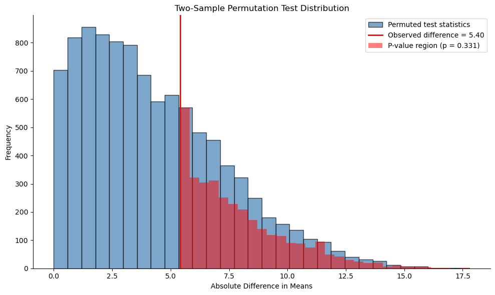

# 이표본 순열검정


## 개요

이표본 순열검정은 두 독립표본이 위치(보통 평균)에서 차이가 나는지 검정하는 비모수 방법이다. $t$ 검정과 달리 정규성이나 등분산성을 가정하지 않는다. A/B 검정과 인과추론에서 특히 유용하다.

---

## 1. 귀무가설

집단 간 차이가 없다는 귀무가설 아래에서

- 관측된 평균차(또는 다른 통계량)는 무작위 변동에 의한 것이다.
- 집단 라벨은 임의적이다. 라벨을 섞으면 관측값만큼 극단적인 통계량이 $p$값에 해당하는 확률로 나타난다.

---

## 2. 검정 절차

### 알고리즘

1. 실제 자료에서 **관측 검정통계량을 계산한다**.

    $$T_{obs} = |\bar{X}_1 - \bar{X}_2|$$

2. 모든 관측값을 크기 $n_1 + n_2$의 하나의 자료로 **합친다**.

3. **$B$번 순열한다**(보통 $B = 1{,}000$--$10{,}000$).
    - 집단 라벨을 무작위로 섞는다.
    - $n_1$개를 집단 1에, $n_2$개를 집단 2에 무작위로 배정한다.
    - 이 순열에 대해 검정통계량을 계산한다.

4. **$p$값을 계산한다**.

    $$p = \frac{\#\{T_b \ge T_{obs}\} + 1}{B + 1}$$

    분자·분모의 $+1$은 관측된 배열 자신을 세는 것이다. 이것이 검정의 크기를 $\alpha$ 이하로 보장한다([기초](foundations.md) 연습문제 2 참조).

두 웹페이지의 사용자 참여도(세션 시간, 초)를 비교한다.

<div class="exbox" markdown>

**보기 1.** <span class="diff easy" title="쉬움"></span> 웹페이지 A/B 검정. 두 페이지의 체류시간을 각각 $n_1 = n_2 = 10$개 관측해 $T_{\text{obs}} = \lvert \bar x_1 - \bar x_2\rvert = 5.40$을 얻었다. 위 절차대로 $B = 10{,}000$번 순열하고 $p$값을 $\hat p = (c+1)/(B+1)$로 보고한다.

**(1)** 참된 순열 $p$값을 $p$라 할 때 $\hat p$의 기댓값과 표준편차를 $p$와 $B$로 적으시오. $+1$ 보정이 가져오는 **치우침의 방향과 크기**는 얼마이며, 몬테카를로 요동에 견주어 언제 무시할 수 있는가.

**(2)** $\binom{20}{10} = 184{,}756$가지를 모두 열거해 $p$를 정확히 구하고, (1)의 예측과 실행 결과를 견주시오. 귀무분포 히스토그램의 중심 $E[T]$도 미리 예측하고 확인하시오.

</div>

??? success "풀이"

    **(1) 해석적으로.** $B$번의 순열을 서로 독립으로 뽑으므로 극단적인 횟수 $c$는 이항분포를 따른다. 곧 $c \sim \text{Binomial}(B, p)$이고

    $$
    E[\hat p] = \frac{Bp + 1}{B + 1} = p + \frac{1-p}{B+1},
    \qquad
    \operatorname{SD}(\hat p) = \frac{\sqrt{B p(1-p)}}{B+1} \approx \sqrt{\frac{p(1-p)}{B}}
    $$

    이다. **치우침은 늘 위쪽이고 크기가 $\dfrac{1-p}{B+1}$다.** 보수적인 쪽으로만 틀리므로 검정의 크기를 지키는 데 해롭지 않다. 치우침은 $B$에 **반비례**해 줄고 요동은 $\sqrt B$에 반비례해 주므로, 둘의 비가

    $$
    \frac{\text{치우침}}{\operatorname{SD}(\hat p)}
    \approx \frac{(1-p)/B}{\sqrt{p(1-p)/B}}
    = \sqrt{\frac{1-p}{pB}}
    $$

    이다. **$pB$가 크면 치우침은 요동에 묻히고, 작으면 묻히지 않는다.** 뒤에 볼 $p \approx 0.326$과 $B = 10{,}000$에서는 $\sqrt{0.674/3256} = 0.0144$로 요동의 $1.4\%$에 지나지 않는다. 그러나 $p = 0.001$, $B = 10{,}000$이면 $pB = 10$이어서 비가 $\sqrt{0.999/10} = 0.32$로 $32\%$가 되고, 연습문제 2에서 보듯 $B = 200$까지 내려가면 치우침이 $p$ 자체를 세 배로 부풀린다.

    **$E[T]$의 예측.** $T = \lvert d^{*}\rvert$이고 $d^{*} = \bar X_1^{*} - \bar X_2^{*}$는 [기초](foundations.md) 보기 1에서 본 대로 평균 $0$, 표준편차

    $$
    \operatorname{SD}(d^{*}) = S\sqrt{\frac{1}{n_1} + \frac{1}{n_2}} = 5.227257
    $$

    를 갖는다($S$는 합친 $20$개의 표본표준편차). $d^{*}$가 정규라면 반정규분포의 평균이 되어

    $$
    E[T] = \operatorname{SD}(d^{*})\sqrt{\frac{2}{\pi}} = 5.227257 \times 0.797885 = 4.170747
    $$

    이다. **이것은 근사다.** $N = 20$짜리 열거분포는 정확히 정규가 아니므로 뒤에서 어긋남의 크기를 재어 본다.

    **(2) 수치적으로.** 먼저 자료와 관측된 차이다.

    ```python
    import numpy as np
    import matplotlib.pyplot as plt

    # A 페이지와 B 페이지의 체류시간
    page_a = np.array([185, 188, 142, 160, 161, 157, 182, 181, 159, 167])
    page_b = np.array([173, 181, 182, 170, 169, 177, 168, 183, 169, 164])

    obs_diff = np.abs(page_a.mean() - page_b.mean())
    print(f"Page A: mean = {page_a.mean():.2f}")    # 168.20
    print(f"Page B: mean = {page_b.mean():.2f}")    # 173.60
    print(f"Observed |difference|: {obs_diff:.2f}") # 5.40
    ```

    출력:

    ```
    Page A: mean = 168.20
    Page B: mean = 173.60
    Observed |difference|: 5.40
    ```

    순열검정 자체다.

    ```python
    def two_sample_permutation_test(x, y, n_perms=1000, seed=0):
        """
        Two-sample permutation test for a difference in means.

        Parameters
        ----------
        x, y : array-like
            The two samples.
        n_perms : int
            Number of random permutations.

        Returns
        -------
        p_value : float
            Two-sided p-value, with the +1 correction.
        perm_diffs : ndarray
            The permutation distribution of |mean difference|.
        """
        rng = np.random.default_rng(seed)
        obs_diff = np.abs(x.mean() - y.mean())
        pooled = np.concatenate([x, y])
        nx = len(x)

        perm_diffs = np.empty(n_perms)
        for i in range(n_perms):
            p = rng.permutation(pooled)
            perm_diffs[i] = np.abs(p[:nx].mean() - p[nx:].mean())

        p_value = ((perm_diffs >= obs_diff).sum() + 1) / (n_perms + 1)
        return p_value, perm_diffs

    p_val, perm_stats = two_sample_permutation_test(page_a, page_b, n_perms=10000)

    print(f"Permutation test p-value: {p_val:.4f}")
    print(f"Conclusion: {'Reject H0' if p_val < 0.05 else 'Fail to reject H0'}")
    ```

    출력:

    ```
    Permutation test p-value: 0.3307
    Conclusion: Fail to reject H0
    ```

    이제 열거로 정확값을 얻고 (1)의 예측과 맞춰 본다. 위 블록의 변수를 그대로 이어 쓴다.

    ```python
    import itertools
    from scipy import stats

    z = np.concatenate([page_a, page_b]).astype(float)
    n1, N, total = len(page_a), len(z), float(np.sum(page_a) + np.sum(page_b))

    # 가능한 라벨 배정 184,756 가지를 모두 열거한다. d* 는 부호까지 담는다.
    signed = np.array([(2 * z[list(c)].sum() - total) / n1
                       for c in itertools.combinations(range(N), n1)])
    exact = np.abs(signed)
    p_exact = (exact >= obs_diff - 1e-9).mean()
    print(f"순열 수 = {len(signed)},  정확 p = {p_exact:.6f}")

    B = 10_000
    mean_hat = (B * p_exact + 1) / (B + 1)
    bias = (1 - p_exact) / (B + 1)
    sd = np.sqrt(B * p_exact * (1 - p_exact)) / (B + 1)
    print(f"E[p-hat] = {mean_hat:.6f}   (치우침 +{bias:.3e},  SD {sd:.6f},"
          f"  치우침/SD = {bias / sd:.4f})")
    print(f"실행값   = {p_val:.6f}   -> 예측에서 {(p_val - mean_hat) / sd:+.2f} SD")

    sd_null = z.std(ddof=1) * np.sqrt(1 / n1 + 1 / (N - n1))
    print(f"\nSD(d*) 닫힌 꼴      = {sd_null:.6f}")
    print(f"열거한 d* 의 SD     = {signed.std(ddof=0):.6f}"
          f"   (왜도 {stats.skew(signed):.1e}, 초과첨도 {stats.kurtosis(signed):+.4f})")
    print(f"E[T] 반정규 예측    = {sd_null * np.sqrt(2 / np.pi):.6f}")
    print(f"E[T] 정확 열거      = {exact.mean():.6f}   (SD 의 {exact.mean() / sd_null:.6f} 배)")
    print(f"E[T] 모의 (B=10000) = {perm_stats.mean():.6f}"
          f"   (평균의 몬테카를로 오차 {perm_stats.std(ddof=1) / np.sqrt(B):.6f})")
    ```

    출력:

    ```
    순열 수 = 184756,  정확 p = 0.325586
    E[p-hat] = 0.325654   (치우침 +6.743e-05,  SD 0.004685,  치우침/SD = 0.0144)
    실행값   = 0.330667   -> 예측에서 +1.07 SD

    SD(d*) 닫힌 꼴      = 5.227257
    열거한 d* 의 SD     = 5.227257   (왜도 -8.2e-17, 초과첨도 -0.3076)
    E[T] 반정규 예측    = 4.170747
    E[T] 정확 열거      = 4.234476   (SD 의 0.810076 배)
    E[T] 모의 (B=10000) = 4.262900   (평균의 몬테카를로 오차 0.030767)
    ```

    **$p$값에 대한 예측이 맞는다.** 정확값은 $p = 0.325586$이고, $(1)$이 예측한 $\hat p$의 평균은 $0.325654$, 표준편차는 $0.004685$다. 실행값 $0.330667$은 그 평균에서 $+1.07$ 표준편차 떨어져 있다. 치우침 $6.743\times10^{-5}$은 요동의 $1.44\%$로, 예측한 $\sqrt{(1-p)/(pB)} = 0.0144$ 그대로다. **$B = 10{,}000$에서 $+1$ 보정의 대가는 사실상 없다.**

    **$E[T]$의 예측은 반쯤 맞는다.** 닫힌 꼴 $5.227257$은 열거분포의 표준편차와 **열다섯 자리까지** 같다. 왜도도 $-8\times10^{-17}$로 $0$인데, 라벨을 뒤집으면 $d^{*}$의 부호가 바뀌어 모든 배정이 짝을 이루기 때문이다. 그러나 반정규 예측 $4.170747$은 정확값 $4.234476$보다 $1.5\%$ 작다. 까닭은 열거분포의 **초과첨도가 $-0.3076$**이어서 정규보다 꼬리가 가볍고 어깨가 두껍기 때문이다. 대칭분포에서 $E\lvert X\rvert/\operatorname{SD}(X)$는 꼬리가 가벼워질수록 커지며, 여기서는 정규의 $0.797885$ 대신 $0.810076$이 나온다. **표준편차는 분포의 모양과 무관하게 정확히 맞고, 절댓값의 평균은 모양에 기대므로 정규근사만큼만 맞는다.**

    모의값 $4.262900$은 정확값에서 $+0.028$ 떨어져 있고 평균의 몬테카를로 오차 $0.030767$의 $0.92$배다. 셋이 모두 제자리에 있다.

    아래는 그 귀무분포다.

    ```python
    fig, ax = plt.subplots(figsize=(10, 6))

    ax.hist(perm_stats, bins=30, alpha=0.7, color='steelblue', edgecolor='black',
            label='Permuted test statistics')

    obs_stat = np.abs(page_a.mean() - page_b.mean())
    ax.axvline(obs_stat, color='red', linewidth=2,
               label=f'Observed difference = {obs_stat:.2f}')

    rejection_region = perm_stats[perm_stats >= obs_stat]
    ax.hist(rejection_region, bins=30, alpha=0.5, color='red',
            label=f'P-value region (p = {p_val:.3f})')

    ax.set_xlabel('Absolute Difference in Means')
    ax.set_ylabel('Frequency')
    ax.set_title('Two-Sample Permutation Test Distribution')
    ax.legend()
    ax.spines['top'].set_visible(False)
    ax.spines['right'].set_visible(False)

    plt.tight_layout()
    plt.show()
    ```

    

    붉은 세로선 $5.40$이 분포의 중심 $4.23$ 바로 오른쪽에 서 있고 붉게 칠한 꼬리가 전체의 삼분의 일이다. **눈으로 보아도 기각할 자료가 아니다.**

!!! warning "합친 배열을 제자리에서 섞지 말 것"
    `np.random.shuffle(pooled)`처럼 **제자리 섞기**를 쓰면 `pooled`가 매 반복마다 바뀐다. 이 코드처럼 순열 결과를 새 배열로 받으면(`rng.permutation`) 원본이 보존되어 디버깅이 쉽다.

    관측 통계량을 순열 루프 **이전에** 계산하는 것도 중요하다. 루프 안에서 원본이 이미 섞여버린 뒤에 계산하면 조용히 틀린 답이 나온다.

이진 결과(전환 = 1, 비전환 = 0)에서도 순열검정은 똑같이 작동한다.

<div class="exbox" markdown>

**보기 2.** <span class="diff easy" title="쉬움"></span> A/B 전환율 검정. 대조군 $23{,}739$명 중 $200$명, 실험군 $22{,}588$명 중 $182$명이 전환해 비율차 $-0.000368$을 얻었다. 순열 귀무분포의 표준편차가 $\operatorname{SD}(d^{*}) = 0.00084056$임은 [기초](foundations.md) 보기 2에서 유도했다.

**(1)** 이 실험이 $\alpha = 0.05$ 양측에서 **유의하다고 부를 수 있는 가장 작은 비율차**를 구하고, 그것이 기저 전환율 $\bar p = 0.00825$의 몇 %인지 말하시오. 관측된 차이는 그 문턱의 몇 배인가.

**(2)** $B = 5{,}000$으로 $\hat p = (c+1)/(B+1)$을 구하시오. 정확 순열 $p$값은 초기하분포로 $0.681128$이다. 실행값과의 차이를 보기 1 (1)의 **치우침**과 **요동**으로 가르시오.

</div>

??? success "풀이"

    **(1) 해석적으로.** 귀무분포가 평균 $0$, 표준편차 $\sigma_0 = 0.00084056$인 거의 정규인 분포이므로, 양측 $\alpha = 0.05$에서 기각되는 것은

    $$
    \lvert d_{\text{obs}}\rvert \ge z_{0.975}\,\sigma_0 = 1.959964 \times 0.00084056 = 0.00164747
    $$

    일 때다. 이 문턱을 기저 전환율로 나누면

    $$
    \frac{0.00164747}{0.00824573} = 0.1998
    $$

    이다. **곧 이 실험은 전환율이 상대적으로 $20\%$ 움직여야 겨우 유의해진다.** 관측된 $0.000368$은 문턱의 $0.223$배에 지나지 않으므로, 어떤 $p$값이 나오든 기각과는 거리가 멀다.

    이것은 "유의해지는 최소 효과"이지 "검정력 있게 잡아내는 최소 효과"가 아니다. 참 효과가 정확히 문턱만 하면 기각할 확률이 $50\%$뿐이다. 검정력 $80\%$를 요구하면 $z_{0.975} + z_{0.80} = 2.801585$를 곱해야 하므로 문턱이 $1.43$배인 $0.0023549$, 상대적으로 $28.6\%$가 된다.

    $\sigma_0 \propto \sqrt{1/n_T + 1/n_C}$이므로 **문턱은 표본크기의 제곱근에 반비례한다.** 상대 $10\%$ 변화를 잡으려면 지금의 네 배, 곧 집단마다 $9$만 명이 필요하다. $4.6$만 명이라는 큰 자료가 $0.8\%$짜리 희귀사건 앞에서는 결코 크지 않다는 뜻이다.

    **(2) 해석적으로.** 보기 1 (1)에서

    $$
    E[\hat p] = p + \frac{1-p}{B+1},
    \qquad
    \operatorname{SD}(\hat p) = \frac{\sqrt{Bp(1-p)}}{B+1}
    $$

    이었다. $p = 0.681128$, $B = 5{,}000$을 넣으면 치우침이 $+6.376\times10^{-5}$, 표준편차가 $0.006589$다. **치우침이 요동의 $1\%$도 되지 않으므로 차이는 거의 전부 요동일 것이다.**

    **수치적으로.**

    ```python
    import numpy as np
    rng = np.random.default_rng(0)

    # 대조군: 23,739명 중 200명 전환
    # 실험군: 22,588명 중 182명 전환
    n_control, conv_control = 23739, 200
    n_treatment, conv_treat = 22588, 182

    rate_control = conv_control / n_control
    rate_treatment = conv_treat / n_treatment
    obs_diff_rates = rate_treatment - rate_control

    print(f"Control conversion rate:   {rate_control:.4f}")     # 0.0084
    print(f"Treatment conversion rate: {rate_treatment:.4f}")   # 0.0081
    print(f"Observed difference: {obs_diff_rates:.6f}")         # -0.000368

    # 이진 반응벡터. 앞의 (대조군 전환 + 실험군 전환) 개가 1 이다
    binary_response = np.zeros(n_control + n_treatment)
    binary_response[:conv_control + conv_treat] = 1

    B = 5000
    perm_diffs = np.empty(B)
    for b in range(B):
        p = rng.permutation(binary_response)
        perm_diffs[b] = p[:n_treatment].mean() - p[n_treatment:].mean()

    p_value_ab = ((np.abs(perm_diffs) >= abs(obs_diff_rates)).sum() + 1) / (B + 1)
    print(f"A/B test p-value: {p_value_ab:.4f}")   # 0.68
    ```

    출력:

    ```
    Control conversion rate:   0.0084
    Treatment conversion rate: 0.0081
    Observed difference: -0.000368
    A/B test p-value: 0.6785
    ```

    두 물음의 수를 모두 확인한다. 위 블록의 변수를 그대로 이어 쓴다.

    ```python
    from scipy import stats

    N = n_control + n_treatment
    K = conv_control + conv_treat
    pbar = K / N
    step = 1 / n_treatment + 1 / n_control
    sd_null = np.sqrt(N / (N - 1) * pbar * (1 - pbar) * step)

    mde = stats.norm.ppf(0.975) * sd_null
    print(f"SD(d*)        = {sd_null:.8f}")
    print(f"탐지 가능한 최소 |차| = {mde:.8f}"
          f"   (기저 전환율의 {100 * mde / pbar:.2f}%)")
    print(f"관측 |차| / 문턱      = {abs(obs_diff_rates) / mde:.4f}")

    # 정확 순열 p. 실험군 전환 수가 Hypergeometric(N, K, n_treatment) 을 따른다.
    x = np.arange(K + 1)
    d = x * step - K / n_control
    pmf = stats.hypergeom.pmf(x, N, K, n_treatment)
    p_exact = pmf[np.abs(d) >= abs(obs_diff_rates) - 1e-18].sum()

    mean_hat = (B * p_exact + 1) / (B + 1)
    bias = (1 - p_exact) / (B + 1)
    sd = np.sqrt(B * p_exact * (1 - p_exact)) / (B + 1)
    print(f"\n정확 순열 p   = {p_exact:.6f}")
    print(f"E[p-hat]      = {mean_hat:.6f}   (치우침 +{bias:.3e},  SD {sd:.6f},"
          f"  치우침/SD = {bias / sd:.4f})")
    print(f"실행값        = {p_value_ab:.6f}   -> 예측에서 {(p_value_ab - mean_hat) / sd:+.2f} SD")
    ```

    출력:

    ```
    SD(d*)        = 0.00084056
    탐지 가능한 최소 |차| = 0.00164747   (기저 전환율의 19.98%)
    관측 |차| / 문턱      = 0.2231

    정확 순열 p   = 0.681128
    E[p-hat]      = 0.681192   (치우침 +6.376e-05,  SD 0.006589,  치우침/SD = 0.0097)
    실행값        = 0.678464   -> 예측에서 -0.41 SD
    ```

    **(1)의 두 수가 맞는다.** 문턱이 $0.00164747$로 기저 전환율의 $19.98\%$이고, 관측된 차이는 그 $0.2231$배다.

    **(2)의 분해도 맞는다.** 실행값 $0.678464$는 정확값 $0.681128$보다 $0.002664$ 작다. 치우침은 $+6.376\times10^{-5}$로 **방향이 반대이고 크기도 요동의 $0.97\%$**이므로, 차이는 전부 몬테카를로 요동이다. 실제로 예측 평균에서 $-0.41$ 표준편차 떨어져 있다. **$B$를 키우면 $0.6811$로 모여든다.**

    여기서 한 가지가 분명해진다. 이 자료에서 순열 $p$값의 불확실성 $\pm 0.0066$은 **결론과 아무 상관이 없다.** $0.678$이든 $0.681$이든 기각하지 않는다. $B$를 키워 얻는 것은 $p$값의 소수점 자리일 뿐이고, 정작 부족한 것은 (1)이 보인 대로 **표본크기**다.

!!! tip "이진 자료에서는 재표집이 필요 없다"
    이 상황의 순열분포는 **초기하분포**로 정확히 알려져 있다. 즉 이 순열검정은 Fisher 정확검정과 같은 것이며, `stats.fisher_exact`가 근사 없이 $p = 0.6811$을 곧바로 준다. 자세한 계산은 [기초](foundations.md) 연습문제 4에 있다.

---

## 3. 모수적 검정과의 비교

### 이표본 순열검정 대 t 검정

두 검정은 같은 가설을 다루지만 접근이 다르다.

| 측면 | 순열검정 | $t$ 검정 |
|---|---|---|
| **가정** | 교환가능성 | 정규성 또는 큰 $n$ |
| **이분산** | 표본크기가 같으면 자동 처리, 다르면 스튜던트화 필요 | Welch 보정 필요 |
| **직관** | 무작위화에 근거 | 확률이론에 근거 |
| **$p$값 정밀도** | 순열 수에 제한됨 | 연속적(정확) |
| **검정력** | 가정이 성립하면 사실상 동일 | 사실상 동일 |
| **계산비용** | 높음 | 무시할 수준 |

!!! note "'순열검정은 검정력이 낮다'는 오해"
    평균차 통계량을 쓰는 한 순열검정과 $t$ 검정의 검정력 차이는 몬테카를로 오차 수준이다([기초](foundations.md) 연습문제 3). 순열검정의 대가는 검정력이 아니라 계산 시간이다.

    반대로 이분산과 불균형 표본이 겹치면 **순열검정이 $t$ 검정보다 나쁠 수 있다**. 이때는 스튜던트화 통계량을 써야 한다.

### 결과 비교

<div class="exbox" markdown>

**보기 3.** <span class="diff easy" title="쉬움"></span> 순열검정과 $t$ 검정 견주기. 보기 1의 체류시간 자료를 그대로 쓴다. 합친 표본의 분산 $S^2$은 라벨을 어떻게 바꾸어도 변하지 않는다는 데서 출발한다.

**(1)** 어떤 라벨 배정에서든 $(N-1)S^2 = (N - 2 + t^{*2})\,s_p^{*2}$임을 보이시오($s_p^{*2}$는 그 배정의 합동분산, $t^{*}$는 합동 $t$ 통계량). 이것으로 $\lvert d^{*}\rvert$로 매긴 순위와 $\lvert t^{*}\rvert$로 매긴 순위가 **완전히 같음**을 보이고, 두 통계량의 순열 $p$값이 어떻게 되는지 말하시오. 또 순열 귀무분포의 표준편차와 $t$ 검정 표준오차의 비를 $N$과 $t_{\text{obs}}$로 적으시오.

**(2)** 실행해 (1)을 확인하시오. 그럼에도 순열 $p$값과 Welch $t$ 검정의 $p$값이 다른 **진짜 까닭**은 무엇인가.

</div>

??? success "풀이"

    **(1) 해석적으로.** 어떤 라벨 배정을 잡아도 $N = n_1 + n_2$개의 수 전체는 그대로이므로 **총제곱합**

    $$
    \text{SST} = \sum_{i=1}^N (x_i - \bar x)^2 = (N-1)S^2
    $$

    이 상수다. 한편 두 집단으로 가르면 총제곱합이 집단내와 집단간으로 쪼개진다.

    $$
    \text{SST} = \underbrace{(N-2)\,s_p^{*2}}_{\text{집단내}} \;+\; \underbrace{\frac{n_1 n_2}{N}\,d^{*2}}_{\text{집단간}}
    $$

    집단간 항을 $t^{*}$로 고쳐 쓴다. $t^{*} = d^{*}\big/\sqrt{s_p^{*2}(1/n_1 + 1/n_2)}$이고 $\dfrac{1}{1/n_1 + 1/n_2} = \dfrac{n_1 n_2}{N}$이므로 $\dfrac{n_1 n_2}{N}d^{*2} = t^{*2} s_p^{*2}$다. 따라서

    $$
    (N-1)S^2 = (N - 2 + t^{*2})\,s_p^{*2}
    $$

    **왼쪽이 상수라는 것이 전부다.** 이 식을 $s_p^{*2}$에 대해 풀어 $d^{*2} = t^{*2}s_p^{*2}(1/n_1+1/n_2)$에 넣으면

    $$
    d^{*2} = (N-1)S^2\left(\frac{1}{n_1}+\frac{1}{n_2}\right)\cdot\frac{t^{*2}}{N-2+t^{*2}}
    $$

    인데, $u \mapsto \dfrac{u}{N-2+u}$가 $u > 0$에서 **순증가**하므로 $\lvert d^{*}\rvert$와 $\lvert t^{*}\rvert$는 서로의 순증가함수다. 그러므로 $\lvert d^{*}\rvert \ge \lvert d_{\text{obs}}\rvert$인 배정과 $\lvert t^{*}\rvert \ge \lvert t_{\text{obs}}\rvert$인 배정이 **같은 집합**이고,

    $$
    p_{\text{perm}}(\lvert d\rvert) = p_{\text{perm}}(\lvert t\rvert)
    $$

    이다. **평균차로 순열검정을 하든 합동 $t$ 통계량으로 하든 $p$값이 한 글자도 다르지 않다.** 표준화할지 말지를 고민할 필요가 없다는 뜻이다. (등분산이 깨지면 이야기가 달라진다. 그때 쓰는 것은 합동분산이 아니라 **Welch 식 스튜던트화**이고, 그것은 $\lvert d^{*}\rvert$의 순증가함수가 아니다. [기초](foundations.md) 연습문제 1이 그 경우다.)

    관측된 배정에 같은 항등식을 쓰면 두 척도의 비도 나온다. $\operatorname{SD}(d^{*}) = S\sqrt{1/n_1+1/n_2}$이고 $t$ 검정의 표준오차는 $s_p\sqrt{1/n_1+1/n_2}$이므로

    $$
    \frac{\operatorname{SD}(d^{*})}{\operatorname{SE}_t} = \frac{S}{s_p}
    = \sqrt{\frac{N-2+t_{\text{obs}}^2}{N-1}}
    $$

    이다. **$\lvert t_{\text{obs}}\rvert > 1$이면 순열 쪽 눈금이 더 넓고, $\lvert t_{\text{obs}}\rvert < 1$이면 더 좁다.** 관측된 효과가 자기 자신의 귀무분포를 넓히기 때문이다. 이 자료는 $t_{\text{obs}} = -1.034980$이라 비가 $\sqrt{(18 + 1.07118)/19} = 1.001872$로 $0.19\%$ 넓다.

    **(2) 수치적으로.** 먼저 쪽의 비교다. 보기 1의 변수를 그대로 이어 쓴다.

    ```python
    from scipy import stats

    # 앞의 순열검정 결과를 Welch t 검정과 견준다. 자료가 정규에 가깝고
    # 표본이 넉넉하면 두 p-값이 거의 같게 나온다. 순열검정이 t 검정을
    # 대신하는 것이 아니라, 가정이 미덥지 않을 때 기댈 곳이 된다는 뜻이다.
    t_stat, p_ttest = stats.ttest_ind(page_a, page_b, equal_var=False)
    print(f"Welch's t-test p-value: {p_ttest:.4f}")
    print(f"Permutation test p-value: {p_val:.4f}")
    ```

    출력:

    ```
    Welch's t-test p-value: 0.3204
    Permutation test p-value: 0.3307
    ```

    이제 (1)의 세 주장을 모두 확인한다.

    ```python
    import itertools
    import numpy as np

    z = np.concatenate([page_a, page_b]).astype(float)
    n1, n2 = len(page_a), len(page_b)
    N, T, Q = n1 + n2, z.sum(), (z ** 2).sum()

    t_obs = stats.ttest_ind(page_a, page_b).statistic
    sp2 = ((n1 - 1) * page_a.var(ddof=1) + (n2 - 1) * page_b.var(ddof=1)) / (N - 2)
    S2 = z.var(ddof=1)
    print(f"s_p^2 = {sp2:.6f},   S^2 = {S2:.6f},   t_obs = {t_obs:.6f}")
    print(f"항등식  (N-1)S^2      = {(N - 1) * S2:.6f}")
    print(f"        (N-2+t^2)s_p^2 = {(N - 2 + t_obs ** 2) * sp2:.6f}")
    print(f"SD(d*)/SE_t  예측 = {np.sqrt((N - 2 + t_obs ** 2) / (N - 1)):.8f}")
    print(f"SD(d*)/SE_t  실제 = {np.sqrt(S2 / sp2):.8f}")

    # 모든 배정에서 |d*| 와 |t*| 를 함께 구한다.
    # 둘 다 A 집단의 합 SA 하나로 정해진다.
    SA = np.array([z[list(c)].sum() for c in itertools.combinations(range(N), n1)])
    d = SA / n1 - (T - SA) / n2
    sp2s = (Q - SA ** 2 / n1 - (T - SA) ** 2 / n2) / (N - 2)
    t = d / np.sqrt(sp2s * (1 / n1 + 1 / n2))

    obs_d = abs(page_a.mean() - page_b.mean())
    print(f"\n정확 순열 p (|d*| 기준) = {(np.abs(d) >= obs_d - 1e-9).mean():.6f}")
    print(f"정확 순열 p (|t*| 기준) = {(np.abs(t) >= abs(t_obs) - 1e-9).mean():.6f}")
    order = np.argsort(np.abs(d))
    print(f"|t*| 가 |d*| 의 증가함수인가: "
          f"{bool(np.all(np.diff(np.abs(t)[order]) >= -1e-9))}")
    print(f"두 기준이 고르는 배정 집합이 같은가: "
          f"{np.array_equal(np.abs(d) >= obs_d - 1e-9, np.abs(t) >= abs(t_obs) - 1e-9)}")

    w = stats.ttest_ind(page_a, page_b, equal_var=False)
    print(f"\nWelch  t 검정 p = {w.pvalue:.6f}   (df = {w.df:.4f},  SE = "
          f"{np.sqrt(page_a.var(ddof=1) / n1 + page_b.var(ddof=1) / n2):.6f})")
    print(f"합동   t 검정 p = {stats.ttest_ind(page_a, page_b).pvalue:.6f}"
          f"   (df = {N - 2},  SE = {np.sqrt(sp2 * (1 / n1 + 1 / n2)):.6f})")
    print(f"순열   (B=10000) = {p_val:.6f}   (귀무분포 SD = {np.sqrt(S2 * (1 / n1 + 1 / n2)):.6f})")
    ```

    출력:

    ```
    s_p^2 = 136.111111,   S^2 = 136.621053,   t_obs = -1.034980
    항등식  (N-1)S^2      = 2595.800000
            (N-2+t^2)s_p^2 = 2595.800000
    SD(d*)/SE_t  예측 = 1.00187150
    SD(d*)/SE_t  실제 = 1.00187150

    정확 순열 p (|d*| 기준) = 0.325586
    정확 순열 p (|t*| 기준) = 0.325586
    |t*| 가 |d*| 의 증가함수인가: True
    두 기준이 고르는 배정 집합이 같은가: True

    Welch  t 검정 p = 0.320403   (df = 12.4246,  SE = 5.217492)
    합동   t 검정 p = 0.314384   (df = 18,  SE = 5.217492)
    순열   (B=10000) = 0.330667   (귀무분포 SD = 5.227257)
    ```

    **셋 모두 맞는다.** 항등식의 두 변이 $2595.800000$으로 같고, 척도의 비가 예측 $1.00187150$과 여덟 자리까지 일치한다. $184{,}756$가지 배정에서 $\lvert t^{*}\rvert$가 $\lvert d^{*}\rvert$의 증가함수이며 두 기준이 고르는 극단 배정의 집합이 **완전히 같아서** 정확 $p$값이 둘 다 $0.325586$이다.

    **그렇다면 $0.3307$과 $0.3204$의 차이는 어디서 오는가.** 통계량의 차이가 아니다. 이 자료는 $n_1 = n_2$라서 Welch의 표준오차 $5.217492$가 합동 표준오차와 소수점 이하까지 같다. **차이는 전부 참조분포에서 온다.**

    | 검정 | 참조분포 | 표준오차 | $p$값 |
    |:---|:---|---:|---:|
    | 순열 (정확 열거) | $184{,}756$가지의 경험분포 | $5.227257$ | $0.325586$ |
    | 순열 ($B = 10{,}000$) | 그 분포에서 뽑은 $10{,}000$개 | $5.227257$ | $0.330667$ |
    | Welch $t$ | $t_{12.4246}$ | $5.217492$ | $0.320403$ |
    | 합동 $t$ | $t_{18}$ | $5.217492$ | $0.314384$ |

    정확 순열값 $0.325586$에 가장 가까운 모수적 값은 자유도를 깎은 Welch의 $0.320403$이고, 자유도를 다 쓴 합동 $t$의 $0.314384$가 가장 멀다. 두 집단의 분산이 $227.29$ 대 $44.93$으로 다섯 배 갈리는 자료이므로 Welch가 자유도를 $18$에서 $12.42$로 깎은 것이 옳은 쪽이었다. 순열 모의값 $0.330667$이 정확값보다 큰 것은 보기 1에서 본 대로 몬테카를로 요동($+1.07$ 표준편차)이다.

    네 값이 $0.314$--$0.331$ 안에 모두 들어 있다. **어느 쪽을 보고하든 결론이 같고, 그 일치가 바로 가정을 점검한 결과다.** 순열검정이 $t$ 검정을 대신하는 것이 아니라, 가정이 미덥지 않을 때 기댈 곳이 된다는 뜻이다.

---

## 4. 장점

1. **분포 가정이 없다**: 어떤 자료에도 쓸 수 있다.
2. **직관적이다**: 무작위화 아래의 해석이 직접적이다.
3. **로버스트하다**: 이상값과 비정규성을 자연스럽게 다룬다.
4. **유연하다**: 임의의 검정통계량에 적용된다.

---

## 5. 단점

1. **계산량**: 모수적 검정보다 무겁다.
2. **이산적인 $p$값**: $p$값이 $1/(B+1)$의 배수이다.
3. **작은 표본**: 표본이 아주 작으면 $p$값의 눈금이 거칠다. 예를 들어 각 집단 4개면 가능한 순열이 $\binom{8}{4} = 70$가지뿐이므로 최소 $p$값이 $2/70 = 0.029$이다.

---

## 6. 언제 쓰는가

- **항상 타당하다**: 작은 표본, 비정규 자료, 알 수 없는 분포
- **A/B 검정**: 업계의 표준적 접근
- **로버스트성 점검**: 모수적 결과와 비교
- **비표준 통계량**: 중앙값, 절사평균 등 특이한 통계량이 필요할 때

---

## 7. 단측검정과 양측검정

### 양측검정 (기본)

$$
p = \frac{\#\{|T_b| \ge |T_{obs}|\} + 1}{B + 1}
$$

$H_a: \mu_1 \neq \mu_2$를 검정한다.

### 단측검정

$H_a: \mu_1 > \mu_2$에 대해

$$
p = \frac{\#\{T_b \ge T_{obs}\} + 1}{B + 1}
$$

여기서 $T_b = \bar{X}_{1,b} - \bar{X}_{2,b}$로 절댓값을 취하지 않는다.

---

## 연습문제

<div class="drillbox" markdown>

**연습문제 1.** <span class="diff easy" title="쉬움"></span>
두 표본이 다음과 같다.

- 집단 A: 14.2, 16.8, 13.5, 15.9, 17.3, 12.8, 16.1, 14.7
- 집단 B: 11.3, 13.6, 10.9, 12.4, 14.1, 11.8, 13.2, 12.7

**(a)** 평균차에 대한 이표본 순열검정을 수행하라.

**(b)** **중앙값** 차를 검정통계량으로 하는 순열검정을 수행하라.

**(c)** 두 $p$값을 Welch $t$ 검정과 비교하라.

</div>

??? success "풀이"
    표본이 각 8개뿐이므로 $\binom{16}{8} = 12{,}870$가지 순열을 **전부 열거**할 수 있다. 몬테카를로 근사 없이 정확 $p$값을 얻는다.

    ```python
    import numpy as np, itertools
    from scipy import stats

    A = np.array([14.2, 16.8, 13.5, 15.9, 17.3, 12.8, 16.1, 14.7])
    B = np.array([11.3, 13.6, 10.9, 12.4, 14.1, 11.8, 13.2, 12.7])
    z = np.concatenate([A, B]); n = 8

    obs_mean = A.mean() - B.mean()
    obs_med = np.median(A) - np.median(B)
    print(round(obs_mean, 4), round(obs_med, 4))   # 2.6625  2.75

    dm, dmd = [], []
    for c in itertools.combinations(range(16), n):
        a = z[list(c)]; b = np.delete(z, list(c))
        dm.append(a.mean() - b.mean())
        dmd.append(np.median(a) - np.median(b))
    dm, dmd = np.array(dm), np.array(dmd)

    print("perms:", len(dm))                                    # 12870
    print("mean  :", (np.abs(dm)  >= abs(obs_mean) - 1e-12).mean())
    print("median:", (np.abs(dmd) >= abs(obs_med)  - 1e-12).mean())
    print(stats.ttest_ind(A, B, equal_var=False))
    ```

    출력:

    ```
    2.6625 2.75
    perms: 12870
    mean  : 0.002641802641802642
    median: 0.003108003108003108
    TtestResult(statistic=3.837370691851344, pvalue=0.0022024857203016353, df=12.494270083405828)
    ```

    **(a)–(c) 결과**

    | 검정 | 통계량 | $p$값 |
    |:---|---:|---:|
    | 순열검정(평균차) | $2.6625$ | **0.00264** |
    | 순열검정(중앙값차) | $2.75$ | **0.00311** |
    | Welch $t$ 검정 | $t = 3.837$, $\nu = 12.49$ | **0.00220** |
    | 스튜던트 $t$ 검정 | $t = 3.837$, $\nu = 14$ | 0.00181 |

    세 $p$값이 모두 $0.003$ 부근으로 일치하며 $\alpha = 0.01$에서도 강하게 기각한다.

    **관찰 1: 평균과 중앙값이 거의 같은 답을 준다.** 이 자료는 이상값이 없고 대칭에 가까우므로 두 통계량이 같은 정보를 담는다. 중앙값 쪽이 근소하게 $p$값이 크다($0.00311$ 대 $0.00264$). 이는 정규에 가까운 자료에서 중앙값이 평균보다 효율이 낮다는 사실의 반영이다(점근상대효율 $2/\pi \approx 0.64$).

    **관찰 2: 정확 순열 $p$값이 Welch $t$와 매우 가깝다.** $0.00264$ 대 $0.00220$. 순열검정이 조금 더 보수적인데, 여기에는 이산성이 작용한다. 가능한 $p$값이 $1/12870 = 0.0000777$의 배수뿐이다.

    **관찰 3: 열거가 가능하면 열거하라.** $12{,}870$가지는 현대의 컴퓨터에서 순식간이다. 몬테카를로를 쓰면 $B = 10{,}000$에서도 $p$값의 표준오차가 $\sqrt{0.0026 \times 0.9974/10000} = 0.0005$로, $p$값 자체의 $20$%에 달한다. **작은 표본일수록 정확 열거의 이점이 크다.**

    열거 가능 여부의 기준은 $\binom{n_1+n_2}{n_1}$이다.

    | $n_1 = n_2$ | 순열 수 |
    |---:|---:|
    | 5 | 252 |
    | 8 | 12{,}870 |
    | 10 | 184{,}756 |
    | 12 | 2{,}704{,}156 |
    | 15 | 155{,}117{,}520 |

    각 집단 12개 정도까지는 열거가 현실적이고, 그 이상은 몬테카를로가 낫다.

<div class="drillbox" markdown>

**연습문제 2.** <span class="diff med" title="중간"></span>
순열 개수 $B$가 $p$값에 어떤 영향을 주는지 조사하라. 연습문제 1의 자료에서 $B = 200, 1000, 10000$으로 몬테카를로 순열검정을 각각 $300$번 반복하고, $p$값의 분포를 정확값 $0.00264$와 비교하라.

</div>

??? success "풀이"
    ```python
    import numpy as np
    rng = np.random.default_rng(11)
    A = np.array([14.2, 16.8, 13.5, 15.9, 17.3, 12.8, 16.1, 14.7])
    B = np.array([11.3, 13.6, 10.9, 12.4, 14.1, 11.8, 13.2, 12.7])
    z = np.concatenate([A, B]); n = 8
    obs = abs(A.mean() - B.mean())

    for Bp in (200, 1000, 10000):
        ps = []
        for _ in range(300):
            P = np.array([rng.permutation(z) for _ in range(Bp)])
            d = P[:, :n].mean(1) - P[:, n:].mean(1)
            ps.append(((np.abs(d) >= obs - 1e-12).sum() + 1) / (Bp + 1))
        ps = np.array(ps)
        print(Bp, round(ps.mean(), 5), round(ps.std(), 5),
              round((ps < 0.05).mean(), 3))
    ```

    출력:

    ```
    200 0.00789 0.00401 1.0
    1000 0.00363 0.00155 1.0
    10000 0.00274 0.00051 1.0
    ```

    | $B$ | $\hat{p}$ 평균 | $\hat{p}$ 표준편차 | 최소 가능 $p$값 | $\hat{p} < 0.05$ 비율 |
    |---:|---:|---:|---:|---:|
    | 200 | 0.00789 | 0.00401 | 0.00498 | 1.000 |
    | 1{,}000 | 0.00363 | 0.00155 | 0.00100 | 1.000 |
    | 10{,}000 | 0.00274 | 0.00051 | 0.00010 | 1.000 |
    | 정확값 | **0.00264** | 0 | — | 1.000 |

    **$B$가 작으면 $\hat{p}$가 위쪽으로 편향된다.** $B = 200$에서 평균 $0.00789$로 정확값의 세 배이다.

    이는 오류가 아니라 $+1$ 보정의 구조적 결과이다. $B = 200$일 때 가능한 최소 $p$값이 $1/201 = 0.00498$이므로, 참값 $0.00264$를 **원리적으로 표현할 수 없다**. 편향은 $B$가 커지면서 사라진다($0.00789 \to 0.00363 \to 0.00274$).

    **결론이 바뀌지는 않았다.** $\alpha = 0.05$ 기준으로는 $B = 200$에서도 $300$번 모두 기각한다. $B$가 문제되는 것은 **$p$값 자체를 보고할 때**이다.

    !!! tip "$B$를 얼마로 잡을 것인가"
        판단 기준은 목표하는 유의수준이다.

        - $\alpha = 0.05$ 근처의 결정만 필요하면 $B = 1{,}000$이면 충분하다. $p = 0.05$에서 표준오차가 $\sqrt{0.05 \times 0.95/1000} = 0.0069$이다.
        - **작은 $p$값을 보고**하려면 훨씬 커야 한다. $p \approx 0.001$을 두 자리 유효숫자로 보고하려면 $B \ge 100{,}000$이 필요하다.
        - 다중비교를 하면 요구가 급증한다. Bonferroni 보정으로 $\alpha = 0.05/50 = 0.001$을 쓴다면, $B = 1{,}000$으로는 그 문턱을 넘는 $p$값을 만들 수조차 없다.

        **경험칙:** 보고하려는 가장 작은 $p$값의 역수의 $100$배 정도를 $B$로 잡는다.

<div class="drillbox" markdown>

**연습문제 3.** <span class="diff med" title="중간"></span>
순열검정의 진짜 장점은 어떤 통계량이든 쓸 수 있다는 것이다. 평균차, 중앙값차, $20$% 절사평균차를 통계량으로 하는 순열검정과 Welch $t$ 검정의 검정력을, 정규자료와 오염된 정규자료에서 비교하라.

</div>

??? success "풀이"
    오염 모형은 $90$%가 $N(0,1)$, $10$%가 $N(0,5^2)$이다. 평균은 $0$으로 같지만 꼬리가 훨씬 두껍다.

    ```python
    import numpy as np
    from scipy import stats
    rng = np.random.default_rng(11)

    def perm_p(x, y, stat, Bp=499):
        obs = abs(stat(x) - stat(y))
        z = np.concatenate([x, y]); m = len(x)
        c = 0
        for _ in range(Bp):
            p = rng.permutation(z)
            c += abs(stat(p[:m]) - stat(p[m:])) >= obs - 1e-12
        return (c + 1) / (Bp + 1)

    trim = lambda a: stats.trim_mean(a, 0.2)

    def power(gen, shift, M=800, m=20, n=20):
        r = dict(mean=0, median=0, trim=0, welch=0)
        for _ in range(M):
            x = gen(m) + shift; y = gen(n)
            r['mean']   += perm_p(x, y, np.mean)   < 0.05
            r['median'] += perm_p(x, y, np.median) < 0.05
            r['trim']   += perm_p(x, y, trim)      < 0.05
            r['welch']  += stats.ttest_ind(x, y, equal_var=False).pvalue < 0.05
        return {k: round(v/M, 3) for k, v in r.items()}

    norm = lambda k: rng.normal(0, 1, k)
    def contam(k):
        a = rng.normal(0, 1, k)
        mask = rng.random(k) < 0.1
        a[mask] = rng.normal(0, 5, mask.sum())
        return a

    for name, gen in [("normal", norm), ("contaminated", contam)]:
        for sh in (0.0, 1.0):
            print(name, sh, power(gen, sh))
    ```

    출력:

    ```
    normal 0.0 {'mean': 0.041, 'median': 0.055, 'trim': 0.045, 'welch': 0.039}
    normal 1.0 {'mean': 0.866, 'median': 0.789, 'trim': 0.838, 'welch': 0.87}
    contaminated 0.0 {'mean': 0.056, 'median': 0.056, 'trim': 0.048, 'welch': 0.042}
    contaminated 1.0 {'mean': 0.47, 'median': 0.664, 'trim': 0.712, 'welch': 0.464}
    ```

    **제1종 오류율 (이동 = 0)**

    | 자료 | 평균 | 중앙값 | 절사평균 | Welch $t$ |
    |:---|---:|---:|---:|---:|
    | 정규 | 0.040 | 0.044 | 0.044 | 0.041 |
    | 오염 | 0.048 | 0.048 | 0.045 | 0.041 |

    **네 검정 모두 크기를 지킨다.** 순열검정은 통계량을 무엇으로 바꾸든 제1종 오류율이 보장된다. 이것이 순열검정의 결정적 장점이다. 새로운 통계량의 귀무분포를 이론적으로 유도할 필요가 없다.

    **검정력 (이동 = 1)**

    | 자료 | 평균 | 중앙값 | 절사평균 | Welch $t$ |
    |:---|---:|---:|---:|---:|
    | 정규 | **0.868** | 0.781 | 0.829 | **0.872** |
    | 오염 | 0.480 | 0.679 | **0.718** | 0.475 |

    **정규자료:** 평균이 최선이다($0.868$). 순열검정과 $t$ 검정이 사실상 동일하다($0.868$ 대 $0.872$). 중앙값을 쓰면 $0.087$을 잃는다.

    **오염자료:** 순위가 완전히 뒤집힌다. 평균은 $0.868 \to 0.480$으로 **검정력의 절반 가까이를 잃는다**. 이상값 하나가 평균을 흔들어 신호를 잡음에 묻어버린다.

    절사평균이 $0.718$로 최선이고, 중앙값 $0.679$가 그 다음이다. 평균 대비 **$50$% 개선**이다.

    **절사평균이 두 상황 모두에서 좋은 절충이다.** 정규자료에서 평균 대비 $0.039$만 잃고($0.829$ 대 $0.868$), 오염자료에서 $0.238$을 얻는다($0.718$ 대 $0.480$). 자료의 꼬리를 모를 때의 합리적 기본값이다.

    !!! note "Welch $t$ 검정은 통계량을 바꿀 수 없다"
        표의 마지막 열은 오염자료에서 $0.475$에 갇혀 있다. $t$ 검정은 정의상 평균에 묶여 있기 때문이다.

        "$t$ 검정에서 절사평균을 쓰자"고 하면 곧바로 문제가 생긴다. 절사평균차의 표집분포가 무엇인가? Yuen의 절사 $t$ 검정 같은 특수 이론이 필요하고, 그 자체로 근사이다.

        순열검정에서는 이 문제가 **존재하지 않는다**. 통계량 함수를 바꿔 넣기만 하면 귀무분포가 자동으로 따라온다. 두 상관계수의 차, 두 지니계수의 차, 두 집단의 $90$번째 백분위수의 차 — 무엇이든 같은 방식이다.

<div class="drillbox" markdown>

**연습문제 4.** <span class="diff med" title="중간"></span>
5 절은 각 집단이 $4$ 개면 순열이 $\binom{8}{4} = 70$ 가지뿐이어서 최소 $p$ 값이 $2/70 = 0.029$ 라고 적었다. 그 수를 끝까지 세어 보고, 2 절의 $+1$ 보정이 전수열거에서 어떻게 되는지 가리자. 자료는 다음 여덟 개다.

- 집단 A: 12, 14, 16, 18
- 집단 B: 3, 5, 7, 9

**(a)** $d_{\text{obs}} = \bar x_A - \bar x_B$ 를 구하고, $70$ 가지를 모두 적지 않고도 $\#\{\lvert d^{*}\rvert \ge \lvert d_{\text{obs}}\rvert\} = 2$ 임을 논증하시오. 정확 양측 $p$ 값과 단측 $p$ 값은 얼마인가.

**(b)** 누군가 이 전수열거에 2 절의 공식을 그대로 써서 "$B = 70$, $c = 2$ 이니 $p = (2+1)/(70+1) = 0.0423$" 이라 적었다. 전수열거에서는 $+1$ 을 넣으면 **안 되는** 까닭과 몬테카를로에서는 **넣어야 하는** 까닭을 각각 한 문장으로 적으시오.

**(c)** 순열검정의 참 $p$ 값은 결코 $0$ 이 될 수 없음을 (a) 의 논리로 설명하시오. 그런데 보정 없이 $\tilde p = c/B$ 로 적는 사람은 $\tilde p = 0$ 을 본다. 보기 1 의 자료에서 가장 극단적인 배열이 관측되었다고 할 때(참 $p$ 값이 $2/184{,}756$ 이다) $B = 999$ 로 $\tilde p = 0$ 이 나올 확률을 구하시오.

**(d)** 이 자료에서 양측 $p$ 값이 취할 수 있는 값을 작은 것부터 셋 적고, $\alpha = 0.05$ 순열검정의 실제 크기를 말하시오.

</div>

??? success "풀이"
    **(a)** $\bar x_A = 60/4 = 15$, $\bar x_B = 24/4 = 6$ 이므로 $d_{\text{obs}} = 9$ 다.

    라벨 배정은 여덟 개 가운데 넷을 집단 1 에 넣는 것이고 전체 합 $T = 84$ 가 고정이므로

    $$
    d^{*} = \frac{S_1}{4} - \frac{T - S_1}{4} = \frac{2S_1 - 84}{4}
    $$

    로 집단 1 의 합 $S_1$ **하나로 정해진다**. 그러므로 $\lvert d^{*}\rvert$ 가 가장 큰 배정은 $S_1$ 이 최대이거나 최소인 배정이다. 관측된 집단 A $\{12, 14, 16, 18\}$ 은 여덟 수 가운데 가장 큰 넷이어서 $S_1 = 60$ 으로 최대이고 그 여집합 $\{3, 5, 7, 9\}$ 은 $S_1 = 24$ 로 최소다. 여덟 수가 모두 다르므로 최대와 최소를 주는 배정은 각각 **하나뿐**이며 둘 다 $\lvert d^{*}\rvert = 9$ 를 준다. 나머지 $68$ 가지는 $24 < S_1 < 60$ 이므로 $\lvert d^{*}\rvert < 9$ 다. 곧 $\#\{\lvert d^{*}\rvert \ge 9\} = 2$ 이고

    $$
    p_{\text{two}} = \frac{2}{70} = 0.028571,
    \qquad
    p_{\text{one}} = \frac{1}{70} = 0.014286
    $$

    이다(단측에서 $d^{*} \ge 9$ 를 주는 배정은 관측된 것 하나뿐이다).

    **(b)** 전수열거의 $70$ 가지는 **관측된 배정 자신을 이미 포함한다**. $c = 2$ 라는 셈 안에 그것이 들어 있으므로 다시 $1$ 을 더하면 같은 배정을 두 번 세는 것이고, 분모를 $71$ 로 늘리면 있지도 않은 배정을 하나 만들어 내는 것이다. 바른 값은 $2/70 = 0.028571$ 이다.

    - **전수열거**: 관측된 배치가 열거 목록의 원소이므로 보정은 중복이다.
    - **몬테카를로**: $B$ 개의 순열을 독립으로 뽑으므로 관측된 배치가 그 안에 들어 있을 보장이 없다(거의 언제나 들어 있지 않다). 그 하나를 손으로 더해 주어야 분모 $B+1$ 짜리 셈이 관측값까지 센 셈이 된다.

    **(c)** 관측된 배정 자신은 언제나 $\lvert d^{*}\rvert = \lvert d_{\text{obs}}\rvert$ 를 만족하므로 분자가 적어도 $1$ 이고, 양측이면 라벨을 통째로 뒤집은 짝까지 세어지므로 적어도 $2$ 다. 그러므로

    $$
    p \ge \frac{2}{\binom{N}{n_1}} > 0
    $$

    이며 참 $p$ 값은 결코 $0$ 이 아니다. 보기 1 의 자료라면 바닥이 $2/184{,}756 = 1.0825 \times 10^{-5}$ 다. 그 가장 극단적인 배열이 관측되었다면 무작위로 뽑은 순열 하나가 극단에 들 확률이 바로 $1.0825\times10^{-5}$ 이므로

    $$
    P(\tilde p = 0) = (1 - 1.0825\times 10^{-5})^{999} = 0.98924
    $$

    다. **천 번 돌리면 $989$ 번은 $\tilde p = 0$ 이 나온다.** $B = 9{,}999$ 로 늘려도 아직 $0.8974$ 다. 곧 "$p = 0$" 은 자료가 한 말이 아니라 $B$ 가 모자란다는 말이고, 보정을 넣으면 그 자리에 참 바닥보다 보수적인 $1/(B+1)$ 이 들어선다.

    **(d)** $S_1$ 을 큰 쪽부터 짚으면 $60$(두 배정, $\lvert d^{*}\rvert = 9$), $57$(곧 $\{9,14,16,18\}$ 과 그 여집합, $\lvert d^{*}\rvert = 7.5$), 그 다음이 $\lvert d^{*}\rvert = 6.5$ 를 주는 네 배정이다. 양측 셈은 여집합과 짝을 이루어 늘 둘씩 늘므로 가능한 $p$ 값은

    $$
    \frac{2}{70} = 0.028571,
    \qquad
    \frac{4}{70} = 0.057143,
    \qquad
    \frac{8}{70} = 0.114286,
    \;\ldots
    $$

    이다. $0.05$ 이하인 것은 $2/70$ 하나뿐이므로 $\alpha = 0.05$ 순열검정의 **실제 크기는 $0.028571$** 이고 명목 수준의 $57\%$ 만 쓴다. 작은 표본에서 순열검정이 보수적인 까닭은 $+1$ 보정이 아니라 **배정의 개수**다.

<div class="drillbox" markdown>

**연습문제 5.** <span class="diff med" title="중간"></span>
7 절은 양측과 단측 $p$ 값의 공식을 나란히 적었다. 둘 사이에 "양측은 단측의 두 배" 가 **정확히** 성립하는지 따지자.

**(a)** $n_1 = n_2$ 이면 전수열거로 얻는 $d^{*}$ 의 분포가 원점대칭임을 보이시오. 보기 1 의 출력에서 이 사실을 뒷받침하는 수 하나를 가리키시오.

**(b)** (a) 를 써서 $c = \lvert d_{\text{obs}}\rvert > 0$ 일 때 전수열거 $p$ 값이 $p_{\text{two}} = 2p_{\text{one}}$ 을 **정확히** 만족함을 보이시오. $c = 0$ 이면 어떻게 되는가.

**(c)** $n_1 \ne n_2$ 이면 깨진다. 자료가 $0, 0, 0, 1$ 네 개이고 $n_1 = 1$, $n_2 = 3$ 이며 관측된 집단 1 이 $\{1\}$ 인 보기에서 $p_{\text{one}}$ 과 $p_{\text{two}}$ 를 모두 구해 둘이 **같음**을 보이시오.

**(d)** $n_1 = n_2$ 여서 (b) 가 성립해도 몬테카를로 추정값에서는 등식이 어긋난다. $E[\hat p_{\text{two}}] = 2E[\hat p_{\text{one}}] - \dfrac{1}{B+1}$ 임을 보이시오.

</div>

??? success "풀이"
    **(a)** 열거 목록은 크기 $n_1$ 인 모든 부분집합 $C$ 다. $n_1 = n_2$ 이면 여집합 $C^{c}$ 도 크기가 $n_1$ 이므로 **같은 목록 안에 있고**, $C \mapsto C^{c}$ 는 두 번 하면 제자리로 돌아오는 일대일 대응이다. 그런데 여집합을 집단 1 로 삼는 것은 두 라벨을 맞바꾼 것이므로

    $$
    d^{*}(C^{c}) = -\,d^{*}(C)
    $$

    다. 곧 목록이 내놓는 $d^{*}$ 값의 다중집합이 $-1$ 배에 대해 닫혀 있으니 분포가 원점대칭이다. 보기 1 의 출력에서 **열거한 $d^{*}$ 의 왜도가 $-8.2\times10^{-17}$**, 곧 반올림오차 수준의 $0$ 인 것이 그 증거다. 평균이 정확히 $0$ 인 것도 같은 대응에서 나온다.

    **(b)** $c > 0$ 이면 두 꼬리가 겹치지 않으므로

    $$
    \{\lvert d^{*}\rvert \ge c\} = \{d^{*} \ge c\} \;\sqcup\; \{d^{*} \le -c\}
    $$

    이고, (a) 의 대응이 오른쪽 두 집합을 일대일로 맞바꾸므로 둘의 크기가 같다. 분자가 정확히 두 배이고 분모 $\binom{N}{n_1}$ 는 같으니 $p_{\text{two}} = 2p_{\text{one}}$ 이다. **근사가 아니라 등식이다.**

    $c = 0$ 이면 깨진다. $\{\lvert d^{*}\rvert \ge 0\}$ 이 목록 전체이므로 $p_{\text{two}} = 1$ 인데, 한편 $\{d^{*} \ge 0\}$ 은 절반에 $d^{*} = 0$ 인 배정까지 더한 것이어서 $p_{\text{one}} \ge 1/2$ 이고 두 배는 $1$ 을 넘는다. 두 꼬리가 $0$ 에서 겹치기 때문이다.

    **(c)** 배정이 네 가지다. 집단 1 이 $\{1\}$ 이면 $d^{*} = 1 - 0 = 1$ 이고, 집단 1 이 세 개의 $0$ 가운데 하나이면 $d^{*} = 0 - \tfrac13 = -\tfrac13$ 이다(세 가지). 관측값은 $d_{\text{obs}} = 1$ 이므로

    $$
    p_{\text{one}} = \frac{\#\{d^{*} \ge 1\}}{4} = \frac14,
    \qquad
    p_{\text{two}} = \frac{\#\{\lvert d^{*}\rvert \ge 1\}}{4} = \frac14
    $$

    다. $-\tfrac13$ 은 절댓값이 $\tfrac13$ 이라 양측 셈에 들지 않으므로 두 배가 아니라 **아예 같다**. 까닭은 분명하다. $n_1 \ne n_2$ 면 여집합의 크기가 달라 (a) 의 대응이 없고, 작은 집단 쪽이 극단값을 훨씬 쉽게 만들어 분포가 한쪽으로 쏠린다. 그러므로 단측 $p$ 값을 두 배 하는 손쉬운 길은 **균형자료에서만** 옳다.

    **(d)** 보기 1 (1) 에서 $E[\hat p] = p + \dfrac{1-p}{B+1}$ 였다. $p_{\text{two}} = 2p_{\text{one}}$ 을 넣으면

    $$
    E[\hat p_{\text{two}}] - 2E[\hat p_{\text{one}}]
    = \frac{(1 - p_{\text{two}}) - 2(1 - p_{\text{one}})}{B+1}
    = \frac{1 - 2p_{\text{one}} - 2 + 2p_{\text{one}}}{B+1}
    = -\frac{1}{B+1}
    $$

    이다. 양측 공식을 그대로 쓰는 것과 단측을 두 배 하는 것이 몬테카를로에서는 $1/(B+1)$ 만큼 체계적으로 다르다($B = 999$ 면 $0.001$). 보정의 $+1$ 이 양측에서는 한 번, 단측을 두 배 할 때는 두 번 들어가기 때문이다. 요령도 하나 보인다. 순열을 하나 뽑을 때마다 그 **여집합 배정까지 함께** 세면($n_1 = n_2$ 일 때) 두 꼬리가 결정적으로 짝지어져 (b) 의 등식이 모의에서도 되살아난다.

<div class="drillbox" markdown>

**연습문제 6.** <span class="diff hard" title="어려움"></span>
보기 3 의 항등식 $(N-1)S^2 = (N - 2 + t^{*2})\,s_p^{*2}$ 에는 더 뽑아낼 것이 남아 있다. 관측된 자료의 **표준화된 평균차**를

$$
z_{\text{obs}} = \frac{\lvert d_{\text{obs}}\rvert}{\operatorname{SD}(d^{*})},
\qquad
\operatorname{SD}(d^{*}) = S\sqrt{\frac{1}{n_1} + \frac{1}{n_2}}
$$

이라 하자.

**(a)** $z_{\text{obs}}^2 = \dfrac{(N-1)\,t_{\text{obs}}^2}{N - 2 + t_{\text{obs}}^2}$ 임을 보이고, 이로부터 $n_1, n_2$ 가 무엇이든 $z_{\text{obs}} \le \sqrt{N-1}$ 임을 보이시오. 등호는 언제 성립하는가.

**(b)** (a) 는 순열분포를 정규로 어림한 $p$ 값에 **바닥**이 있다는 뜻이다. $p_{\text{normal}} = 2\Phi(-z_{\text{obs}}) \ge 2\Phi(-\sqrt{N-1})$ 의 바닥을 $N = 8$ 과 $N = 20$ 에서 구하고, 같은 경우의 정확 열거 바닥 $2/\binom{N}{n_1}$($n_1 = n_2$) 과 견주시오. 어느 쪽이 큰가. $N = 50$ 에서는 어떻게 되는가.

**(c)** 보기 1 의 자료에서 가능한 가장 큰 $\lvert d^{*}\rvert$ 는 $18.6$ 이다. 그에 해당하는 $z$ 를 구해 (a) 의 천장과 견주고, 왜 천장에 닿지 못하는지 설명하시오.

</div>

??? success "풀이"
    **(a)** 보기 3 에서 $d^{2} = t^{2} s_p^{2}\left(\dfrac{1}{n_1} + \dfrac{1}{n_2}\right)$ 였으므로

    $$
    z_{\text{obs}}^2 = \frac{d_{\text{obs}}^2}{S^2\left(\frac1{n_1} + \frac1{n_2}\right)}
    = t_{\text{obs}}^2\,\frac{s_p^2}{S^2}
    $$

    이고, 항등식을 $s_p^2/S^2 = (N-1)/(N-2+t_{\text{obs}}^2)$ 로 읽으면

    $$
    z_{\text{obs}}^2 = \frac{(N-1)\,t_{\text{obs}}^2}{N - 2 + t_{\text{obs}}^2}
    $$

    를 얻는다. 함수 $u \mapsto \dfrac{(N-1)u}{N-2+u}$ 는 $u \ge 0$ 에서 순증가하고 $u \to \infty$ 에서 $N-1$ 로 올라가 멈춘다. 그러므로 $t_{\text{obs}}$ 가 유한하면 $z_{\text{obs}}^2 < N-1$ 이다.

    천장에 닿는 것은 $u = t_{\text{obs}}^2 \to \infty$, 곧 $s_p^2 = 0$ 인 극단뿐이다. 그때는 $t_{\text{obs}}$ 가 정의되지 않으므로 직접 센다. 집단 1 이 모두 $a$, 집단 2 가 모두 $b$($a \ne b$) 라면 총제곱합이 집단간 항뿐이어서

    $$
    (N-1)S^2 = \frac{n_1 n_2}{N}(a-b)^2,
    \qquad
    S^2\left(\frac1{n_1} + \frac1{n_2}\right) = \frac{n_1n_2 (a-b)^2}{(N-1)N}\cdot\frac{N}{n_1n_2} = \frac{(a-b)^2}{N-1}
    $$

    이고 $d_{\text{obs}} = a - b$ 이므로 $z_{\text{obs}}^2 = N-1$ 이 **정확히** 나온다. 정리하면

    $$
    z_{\text{obs}} \le \sqrt{N-1}
    $$

    이고 등호는 두 집단이 각각 한 값으로 뭉쳐 있을 때, 그리고 그때만 성립한다($n_1, n_2$ 의 균형과는 무관하다). 까닭은 보기 3 이 이미 말했다. 순열검정의 눈금 $S$ 는 **자료 자신에서 나오므로** 효과가 커지면 귀무분포도 함께 넓어진다. 신호와 눈금이 같이 자라므로 비에는 천장이 있다.

    **(b)** $N = 8$ 이면 천장이 $\sqrt7 = 2.645751$ 이고

    $$
    2\Phi(-2.645751) = 8.150972\times10^{-3},
    \qquad
    \frac{2}{\binom84} = \frac{2}{70} = 2.857143\times10^{-2}
    $$

    이다. 정확 바닥이 정규 바닥의 $3.5$ 배다. 곧 작은 표본에서 정규근사는 **실제로는 낼 수 없는 작은 $p$ 값을 약속한다.** $N = 20$ 이면 천장이 $\sqrt{19} = 4.358899$ 이고

    $$
    2\Phi(-4.358899) = 1.307185\times10^{-5},
    \qquad
    \frac{2}{\binom{20}{10}} = \frac{2}{184{,}756} = 1.082509\times10^{-5}
    $$

    로 이번에는 정규 바닥이 $1.21$ 배 크다. $N = 50$, $n_1 = 25$ 면 $2\Phi(-7) = 2.559625\times10^{-12}$ 대 $1.582146\times10^{-14}$ 로 정규 바닥이 **$162$ 배** 크다.

    두 바닥은 서로 다른 기제가 정한다. 정확 바닥은 **배정의 개수**가 정하므로 $N$ 과 함께 조합적으로 폭발해 작아지고, 정규 바닥은 $\sqrt{N-1}$ 자리의 꼬리확률이라 $e^{-(N-1)/2}$ 꼴로만 작아진다. 조합 쪽이 훨씬 빠르므로 $N$ 이 조금만 커지면 정규근사는 지나치게 보수적인 바닥을 주고, $N$ 이 아주 작으면 거꾸로 너무 낙관적인 바닥을 준다. $N = 20$ 에서 둘이 가까운 것은 두 곡선이 교차하는 자리에 걸린 **우연**이다.

    실용적인 교훈 하나. $N = 20$ 짜리 자료에서 "$p < 10^{-10}$" 같은 보고는 순열검정으로는 불가능하다. 자료가 가진 배정이 $184{,}756$ 가지뿐이기 때문이다.

    **(c)** $18.6 / 5.227257 = 3.558272$ 로 천장 $4.358899$ 에 한참 못 미친다. 천장에 닿으려면 열 개씩 두 묶음이 **각각 한 값**이어야 하는데 이 자료는 안에서도 흩어져 있어 $s_p^{*2} > 0$ 이고, 따라서 (a) 의 부등식이 엄격하다.

    관측된 배정 자체는 더 멀다. $z_{\text{obs}} = 5.40/5.227257 = 1.033047$ 이고 정규근사는 $2\Phi(-1.033047) = 0.301582$ 를 주는데 정확값은 $0.325586$ 이다. **꼬리뿐 아니라 분포의 가운데에서도 정규근사가 $0.024$ 어긋난다** — 보기 1 이 초과첨도 $-0.3076$ 으로 설명한 그 모양 차이다. $N = 20$ 에서 순열분포는 정규가 아니고, 그 사실이 $p$ 값의 셋째 자리를 지배한다.

<div class="drillbox" markdown>

**연습문제 7.** <span class="diff hard" title="어려움"></span>
보기 3 은 평균차와 합동 $t$ 가 **같은** 순열 $p$ 값을 준다고 했고, 3 절의 표는 "표본크기가 같으면 이분산이 자동 처리되고 다르면 스튜던트화가 필요하다" 고 했다. 두 말이 어떻게 맞물리는지 보자. 보기 1 의 자료에서 A 페이지는 앞의 일곱 개만, B 페이지는 열 개를 모두 써 $n_1 = 7$, $n_2 = 10$ 으로 불균형하게 만든다($\binom{17}{7} = 19{,}448$ 가지).

**(a)** $n_1 = n_2$ 이면 Welch 분모 $s_1^{*2}/n_1 + s_2^{*2}/n_2$ 가 합동 분모 $s_p^{*2}(1/n_1 + 1/n_2)$ 와 **대수적으로 같음**을 보이시오. 그러므로 균형자료에서는 스튜던트화해도 보기 3 의 결론이 그대로다.

**(b)** 불균형이면 Welch 통계량이 왜 $\lvert d^{*}\rvert$ 의 단조함수가 아닌가. 보기 3 의 항등식에서 무엇이 더는 쓰이지 못하는지 밝히시오.

**(c)** $19{,}448$ 가지를 모두 열거해 세 통계량($\lvert d^{*}\rvert$, 합동 $\lvert t^{*}\rvert$, Welch $\lvert t^{*}\rvert$) 의 정확 순열 $p$ 값을 구하고, 순서가 뒤바뀌는 배정을 하나 찾아 보이시오. 어느 $p$ 값을 보고해야 하는가.

</div>

??? success "풀이"
    **(a)** $n_1 = n_2 = n$ 이면

    $$
    s_p^{*2} = \frac{(n-1)s_1^{*2} + (n-1)s_2^{*2}}{2n-2} = \frac{s_1^{*2} + s_2^{*2}}{2},
    \qquad
    s_p^{*2}\left(\frac1n + \frac1n\right) = \frac{s_1^{*2} + s_2^{*2}}{n}
    $$

    인데 Welch 분모도 $s_1^{*2}/n + s_2^{*2}/n = (s_1^{*2}+s_2^{*2})/n$ 이다. 두 분모가 같으므로 **균형자료에서 Welch 통계량은 합동 $t$ 와 글자까지 같은 수**이고, 보기 3 이 보인 "$\lvert d^{*}\rvert$ 와 같은 순열 $p$ 값" 이 그대로 적용된다. 보기 1 의 자료에서 Welch 표준오차가 합동 표준오차와 똑같이 $5.217492$ 였던 것이 이 등식이다.

    **(b)** 보기 3 의 항등식이 통했던 까닭은 총제곱합이 라벨 배정과 무관하게 고정이라는 것, 그래서 **집단내 제곱합의 합** $(N-2)s_p^{*2}$ 이 $d^{*}$ 하나로 정해진다는 것이었다. 그런데 Welch 분모는 두 집단내 제곱합을

    $$
    \frac{s_1^{*2}}{n_1} + \frac{s_2^{*2}}{n_2}
    = \frac{1}{n_1(n_1-1)}\mathrm{SS}_1 + \frac{1}{n_2(n_2-1)}\mathrm{SS}_2
    $$

    처럼 **서로 다른 무게로** 더한 것이다. 무게가 다르면 합이 같아도 값이 달라지므로, $\mathrm{SS}_1 + \mathrm{SS}_2$ 만 아는 것으로는 정해지지 않는다. 곧 $\lvert d^{*}\rvert$ 가 같은 두 배정이라도 집단내 변동이 집단 1 과 2 에 **어떻게 나뉘었는지**에 따라 Welch 통계량이 다르다. $n_1 = n_2$ 일 때만 두 무게가 같아져 합으로 환원되고, 그래서 (a) 가 성립한다.

    **(c)** 전수열거다.

    ```python
    import numpy as np, itertools

    page_a = np.array([185, 188, 142, 160, 161, 157, 182, 181, 159, 167], float)
    page_b = np.array([173, 181, 182, 170, 169, 177, 168, 183, 169, 164], float)

    g1, g2 = page_a[:7], page_b          # n1 = 7, n2 = 10 으로 불균형하게 만든다
    z = np.concatenate([g1, g2])
    n1, n2 = len(g1), len(g2)
    N, T, Q = n1 + n2, z.sum(), (z ** 2).sum()

    # C(17, 7) = 19,448 가지 배정. 첫 행 (0,...,6) 이 관측된 배정이다.
    idx = np.array(list(itertools.combinations(range(N), n1)))
    S1 = z[idx].sum(1)
    Q1 = (z[idx] ** 2).sum(1)
    S2, Q2 = T - S1, Q - Q1

    d = S1 / n1 - S2 / n2
    s1sq = (Q1 - S1 ** 2 / n1) / (n1 - 1)
    s2sq = (Q2 - S2 ** 2 / n2) / (n2 - 1)
    sp2 = ((n1 - 1) * s1sq + (n2 - 1) * s2sq) / (N - 2)
    t_pool = d / np.sqrt(sp2 * (1 / n1 + 1 / n2))
    t_welch = d / np.sqrt(s1sq / n1 + s2sq / n2)
    ad, ap, aw = np.abs(d), np.abs(t_pool), np.abs(t_welch)

    print(f"배정 수 = {len(idx)},  관측 d = {d[0]:.6f},  합동 t = {t_pool[0]:.6f},"
          f"  Welch t = {t_welch[0]:.6f}")

    ext_d, ext_p, ext_w = (ad >= ad[0] - 1e-9), (ap >= ap[0] - 1e-9), (aw >= aw[0] - 1e-9)
    print(f"정확 순열 p (|d*|)       = {ext_d.mean():.6f}   (극단 배정 {ext_d.sum()} 개)")
    print(f"정확 순열 p (합동 |t*|)  = {ext_p.mean():.6f}   (극단 배정 {ext_p.sum()} 개)")
    print(f"정확 순열 p (Welch |t*|) = {ext_w.mean():.6f}   (극단 배정 {ext_w.sum()} 개)")
    print(f"|d*| 와 합동 |t*| 가 같은 집합을 고르는가 : {np.array_equal(ext_d, ext_p)}")
    print(f"|d*| 와 Welch |t*| 가 같은 집합을 고르는가: {np.array_equal(ext_d, ext_w)}")
    print(f"|d*| 만 극단이라 부르는 배정 {(ext_d & ~ext_w).sum()} 개,"
          f"  Welch 만 극단이라 부르는 배정 {(ext_w & ~ext_d).sum()} 개")

    # Welch 는 극단이라 부르지만 |d*| 는 부르지 않는 배정 가운데 |d*| 가 가장 작은 것
    r = int(np.where(ext_w & ~ext_d, ad, np.inf).argmin())
    print(f"\n                      |d*|        Welch |t*|   s_1        s_2")
    print(f"관측된 배정      {ad[0]:10.6f}  {aw[0]:10.6f}  {np.sqrt(s1sq[0]):9.4f}  {np.sqrt(s2sq[0]):9.4f}")
    print(f"뒤바뀐 배정      {ad[r]:10.6f}  {aw[r]:10.6f}  {np.sqrt(s1sq[r]):9.4f}  {np.sqrt(s2sq[r]):9.4f}")
    print(f"뒤바뀐 배정의 집단 1 = {np.sort(z[idx[r]])}")
    ```

    출력:

    ```text
    배정 수 = 19448,  관측 d = -5.742857,  합동 t = -0.962410,  Welch t = -0.835657
    정확 순열 p (|d*|)       = 0.358186   (극단 배정 6966 개)
    정확 순열 p (합동 |t*|)  = 0.358186   (극단 배정 6966 개)
    정확 순열 p (Welch |t*|) = 0.422563   (극단 배정 8218 개)
    |d*| 와 합동 |t*| 가 같은 집합을 고르는가 : True
    |d*| 와 Welch |t*| 가 같은 집합을 고르는가: False
    |d*| 만 극단이라 부르는 배정 0 개,  Welch 만 극단이라 부르는 배정 1252 개

                          |d*|        Welch |t*|   s_1        s_2
    관측된 배정        5.742857    0.835657    17.2957     6.7032
    뒤바뀐 배정        4.457143    0.841280     6.3095    14.9607
    뒤바뀐 배정의 집단 1 = [168. 169. 169. 170. 177. 182. 182.]
    ```

    **(a) 가 쓰이지 않는 자리에서도 보기 3 은 산다.** $n_1 = 7 \ne 10 = n_2$ 인데도 $\lvert d^{*}\rvert$ 와 합동 $\lvert t^{*}\rvert$ 가 똑같은 $6{,}966$ 개의 배정을 고르고 $p$ 값이 둘 다 $0.358186$ 이다. 보기 3 의 항등식은 표본크기의 균형을 쓰지 않았으니 당연하다.

    **Welch 는 다른 검정이다.** $8{,}218$ 개를 골라 $p = 0.422563$ 을 준다. $\lvert d^{*}\rvert$ 가 고른 $6{,}966$ 개를 모두 포함하면서 $1{,}252$ 개를 더 세었다. 더 세어진 쪽의 극단은 (b) 가 말한 "변동이 어떻게 나뉘었는지" 의 결과다. 뒤바뀐 배정을 보면 평균차는 $4.457143$ 으로 관측값 $5.742857$ 보다 **작은데** Welch 통계량은 $0.841280$ 으로 관측값 $0.835657$ 보다 **크다**. 관측된 배정은 작은 집단이 요란하고($s_1 = 17.2957$) 큰 집단이 조용한데($s_2 = 6.7032$), 뒤바뀐 배정은 그 반대다($s_1 = 6.3095$, $s_2 = 14.9607$). Welch 분모는 작은 집단의 분산을 $7$ 로만 나누므로 **조용한 작은 집단**이 통계량을 키운다. $\lvert d^{*}\rvert$ 는 이 정보를 아예 보지 않는다.

    **보고할 것은 Welch 쪽 $0.422563$ 이다.** 이 자료는 작은 집단($n_1 = 7$) 이 큰 분산($s_1 = 17.30$) 을 가진 배치여서 평균차 순열검정의 귀무분포가 실제보다 좁아지고 검정이 과다기각하는 쪽으로 틀어진다([기초](foundations.md) 연습문제 5 가 그 부호까지 계산했다). 실제로 $\lvert d^{*}\rvert$ 가 주는 $0.358$ 이 Welch 의 $0.423$ 보다 작다. **표본크기가 같으면 두 선택이 같은 수이므로 고민할 것이 없고, 다르면 스튜던트화한 쪽을 써야 한다** — 3 절의 표가 바로 이 말이었다. (물론 여기서는 어느 쪽이든 기각하지 않으므로 결론은 같다.)

<div class="drillbox" markdown>

**연습문제 8.** <span class="diff hard" title="어려움"></span>
어떤 사람이 2 절 3 단계에서 `rng.permutation(pooled)` 대신 `rng.choice(pooled, size=N, replace=True)` 를 써서 합친 $20$ 개를 **복원추출**한 뒤 앞의 $10$ 개를 집단 1, 뒤의 $10$ 개를 집단 2 로 갈랐다. 17 장의 말로 하면 라벨을 다시 뽑는 대신 **자료를 다시 뽑은** 것이다. 두 귀무분포가 어떻게 다른지 끝까지 재자.

**(a)** 복원추출 귀무분포의 분산이 $\hat\sigma^2\left(\dfrac1{n_1} + \dfrac1{n_2}\right)$ 임을 보이시오($\hat\sigma^2 = \frac1N\sum(x_i - \bar x)^2$). 순열 귀무분포의 분산 $S^2\left(\dfrac1{n_1} + \dfrac1{n_2}\right)$ 와의 비를 적고, $N = 20$ 에서 표준편차가 몇 % 좁은지 구하시오.

**(b)** 보기 1 의 자료에서 두 귀무분포의 표준편차와 두 $p$ 값을 실제로 구해 (a) 를 확인하시오. 두 $p$ 값의 차이가 (a) 의 폭 차이만으로 설명되는가.

**(c)** $n_1 = n_2 = 10$ 인 정규자료에서 임계값을 $1.96 \times$ (귀무 SD) 로 잡을 때 두 방식의 실제 크기를 $t_{18}$ 분포로 정확히 구하시오. 연습문제 6(a) 의 관계를 거꾸로 쓰면 $z$ 눈금의 임계값이 $t$ 눈금에서 $t^2 = z^2(N-2)/(N-1-z^2)$ 로 옮겨진다.

**(d)** 그럼에도 복원추출 쪽을 쓰면 안 되는 더 근본적인 까닭을 적으시오.

</div>

??? success "풀이"
    **(a)** 복원추출에서 $N$ 개의 값은 합친 자료의 경험분포에서 **독립으로** 뽑힌 것이고 그 분포의 분산은 $\hat\sigma^2$ 다. 두 집단의 평균이 서로 독립이므로

    $$
    \operatorname{Var}(d^{*}_{\text{boot}}) = \frac{\hat\sigma^2}{n_1} + \frac{\hat\sigma^2}{n_2}
    = \hat\sigma^2\left(\frac1{n_1} + \frac1{n_2}\right)
    $$

    다. 한편 순열 쪽은 같은 꼴에 $S^2 = \dfrac{N}{N-1}\hat\sigma^2$ 가 들어간다(비복원추출의 유한모집단 보정이 $\hat\sigma^2$ 를 $S^2$ 로 바꾼다). 따라서

    $$
    \frac{\operatorname{Var}(d^{*}_{\text{boot}})}{\operatorname{Var}(d^{*}_{\text{perm}})} = \frac{N-1}{N},
    \qquad
    \frac{\operatorname{SD}_{\text{boot}}}{\operatorname{SD}_{\text{perm}}} = \sqrt{\frac{N-1}{N}} = \sqrt{\frac{19}{20}} = 0.974679
    $$

    로 **복원추출 쪽 귀무분포가 $2.53\%$ 좁다.** 좁은 귀무분포는 더 작은 $p$ 값을 주므로 이 실수는 과다기각 쪽으로 틀어진다.

    **(b)** 둘을 나란히 세운다.

    ```python
    import numpy as np, itertools
    from scipy import stats

    page_a = np.array([185, 188, 142, 160, 161, 157, 182, 181, 159, 167], float)
    page_b = np.array([173, 181, 182, 170, 169, 177, 168, 183, 169, 164], float)
    z = np.concatenate([page_a, page_b])
    n1 = n2 = 10
    N, T = len(z), z.sum()
    obs = abs(page_a.mean() - page_b.mean())
    step = 1 / n1 + 1 / n2

    # (1) 라벨만 섞는 쪽: 184,756 가지를 전수열거한다
    idx = np.array(list(itertools.combinations(range(N), n1)))
    d_perm = (2 * z[idx].sum(1) - T) / n1
    p_perm = (np.abs(d_perm) >= obs - 1e-9).mean()

    # (2) 합친 자료를 복원추출하는 쪽: 20 개를 다시 뽑아 10 / 10 으로 가른다
    rng = np.random.default_rng(1)
    B = 200_000
    draw = z[rng.integers(0, N, size=(B, N))]
    d_boot = draw[:, :n1].mean(1) - draw[:, n1:].mean(1)
    p_boot = ((np.abs(d_boot) >= obs - 1e-9).sum() + 1) / (B + 1)

    sd_p, sd_b = d_perm.std(ddof=0), d_boot.std(ddof=0)
    print(f"라벨 섞기  SD  닫힌 꼴 {z.std(ddof=1) * np.sqrt(step):.6f}   열거 {sd_p:.6f}"
          f"   초과첨도 {stats.kurtosis(d_perm):+.4f}")
    print(f"복원추출   SD  닫힌 꼴 {z.std(ddof=0) * np.sqrt(step):.6f}   모의 {sd_b:.6f}"
          f"   초과첨도 {stats.kurtosis(d_boot):+.4f}")
    print(f"           (모의 SD 의 몬테카를로 오차 {sd_b / np.sqrt(2 * B):.6f})")
    print(f"SD 의 비   예측 sqrt(19/20) = {np.sqrt((N - 1) / N):.6f}   실제 {sd_b / sd_p:.6f}")

    print(f"\n라벨 섞기  p = {p_perm:.6f}   (정규근사 {2 * stats.norm.sf(obs / sd_p):.6f})")
    print(f"복원추출   p = {p_boot:.6f}   (정규근사 {2 * stats.norm.sf(obs / sd_b):.6f})")

    # (3) 임계값 1.96 x SD 를 쓸 때 n1 = n2 = 10 정규자료에서의 실제 크기
    print("\n임계값 1.96 x SD 가 정규자료에서 갖는 실제 크기")
    for name, c in [("라벨 섞기 (ddof=1)", 1.0), ("복원추출  (ddof=0)", np.sqrt((N - 1) / N))]:
        zc = 1.959964 * c
        tc = np.sqrt(zc ** 2 * (N - 2) / (N - 1 - zc ** 2))
        print(f"  {name}: z = {zc:.6f} -> |t_18| > {tc:.6f},"
              f"  크기 {2 * stats.t.sf(tc, N - 2):.6f}")
    ```

    출력:

    ```text
    라벨 섞기  SD  닫힌 꼴 5.227257   열거 5.227257   초과첨도 -0.3076
    복원추출   SD  닫힌 꼴 5.094899   모의 5.092426   초과첨도 -0.0123
               (모의 SD 의 몬테카를로 오차 0.008052)
    SD 의 비   예측 sqrt(19/20) = 0.974679   실제 0.974206

    라벨 섞기  p = 0.325586   (정규근사 0.301582)
    복원추출   p = 0.293799   (정규근사 0.288963)

    임계값 1.96 x SD 가 정규자료에서 갖는 실제 크기
      라벨 섞기 (ddof=1): z = 1.959964 -> |t_18| > 2.135776,  크기 0.046690
      복원추출  (ddof=0): z = 1.910337 -> |t_18| > 2.068632,  크기 0.053256
    ```

    **(a) 의 예측이 맞는다.** 복원추출 쪽 닫힌 꼴 $5.094899$ 가 모의값 $5.092426$ 과 몬테카를로 오차 $0.008$ 안에서 같고, SD 의 비도 예측 $0.974679$ 대 실제 $0.974206$ 이다.

    **그러나 $p$ 값의 차이는 폭만으로 설명되지 않는다.** $0.325586$ 과 $0.293799$ 의 차이는 $0.0318$ 인데, 폭만 고친 정규근사끼리의 차이는 $0.301582 - 0.288963 = 0.0126$ 으로 절반도 안 된다. 나머지는 **모양**에서 온다. 열거분포는 초과첨도 $-0.3076$ 으로 어깨가 두껍고 꼬리가 가벼운데, 복원추출분포는 $-0.0123$ 으로 거의 정규다(독립인 $20$ 개의 합이라 중심극한정리가 바로 듣는다). 관측값은 $z \approx 1.03$ 이라 바로 그 **어깨** 자리에 있고, 어깨가 두꺼운 분포는 그 지점 밖에 질량을 더 둔다. 그래서 순열 $p$ $0.325586$ 은 자기 정규근사 $0.301582$ 보다 눈에 띄게 큰 반면, 복원추출 $p$ $0.293799$ 는 자기 정규근사 $0.288963$ 과 거의 같다. **라벨을 바꾸는 것과 자료를 바꾸는 것은 폭도 모양도 다른 분포를 만든다.**

    **(c)** 정규자료에서 $\lvert d\rvert = \lvert t\rvert\,s_p\sqrt{1/n_1+1/n_2}$ 이고 연습문제 6(a) 가 $z$ 와 $t$ 를 잇는다. $z$ 를 $t$ 눈금으로 옮기면 $t^2 = z^2(N-2)/(N-1-z^2)$ 이므로 각 임계값은 $t_{18}$ 눈금의 한 점이 된다.

    - 라벨 섞기($S$, 곧 `ddof=1`): $z = 1.959964 \Rightarrow \lvert t_{18}\rvert > 2.135776$, 크기 $0.046690$.
    - 복원추출($\hat\sigma$, 곧 `ddof=0`): $z = 1.910337 \Rightarrow \lvert t_{18}\rvert > 2.068632$, 크기 $0.053256$.

    둘의 차이 $0.0066$ 은 $\alpha$ 의 $13\%$ 다. 좁은 귀무분포를 쓴 쪽이 명목 $0.05$ 를 넘는다. 여기서 재는 것이 **순열검정 자체의 크기가 아님**을 분명히 해 두자. 참된 순열검정은 교환가능성 아래에서 정확하다. (c) 가 재는 것은 "귀무 SD $\times\,1.96$" 이라는 정규근사를 썼을 때의 크기이고, 폭의 $2.53\%$ 차이가 결정으로 얼마나 옮겨지는지 보려는 자다.

    **(d)** 숫자를 $\sqrt{N/(N-1)}$ 로 고치면 끝나는 일이 아니다. 순열검정이 정확한 까닭은 합친 자료의 **다중집합을 고정하고** 라벨만 다시 뽑는다는 데 있다. 귀무가설이 교환가능성이면 그 다중집합이 주어진 조건부에서 $\binom{N}{n_1}$ 가지 라벨 배치가 **모두 같은 확률을 갖는다는 것이 가정이 아니라 사실**이고, 그래서 검정의 크기가 모집단의 모양과 무관하게 $\alpha$ 이하로 보장된다. 복원추출은 자료 자체를 바꾸므로 이 논리가 끊긴다. 남는 것은 "경험분포가 참 분포와 비슷하다" 는 붓스트랩 근사뿐이어서 정확성은 사라지고 $(N-1)/N$ 같은 체계적 편향이 들어온다. 게다가 복원추출은 같은 값을 여러 번 뽑아 원자료에 없던 표본(이를테면 한 집단이 한 값으로만 채워진 표본) 을 만들어 내고, 그런 표본에서 스튜던트화 통계량은 분모가 $0$ 이 되어 정의되지 않는다. **고칠 것은 눈금이 아니라 무엇을 고정하는가다.** 두 집단의 분포가 다를 때 붓스트랩으로 검정을 하려면 라벨을 섞는 대신 [붓스트랩 검정](../bootstrap_testing/two_means.md)의 방식대로 각 집단 안에서 따로 다시 뽑고 귀무가설에 맞추어 중심을 옮겨야 한다.

<div class="drillbox" markdown>

**연습문제 9.** <span class="diff hard" title="어려움"></span>
연습문제 2 의 마지막 상자는 "보고하려는 가장 작은 $p$ 값의 역수의 $100$ 배 정도를 $B$ 로 잡는다" 는 경험칙을 적었다. 그 경험칙의 정체를 밝히고, $B$ 의 몬테카를로 오차가 **결정**으로 어떻게 옮겨지는지 재자.

**(a)** $\hat p$ 의 상대표준오차 $\operatorname{SD}(\hat p)/p$ 를 $p$ 와 $B$ 로 적고, $B = 100/p$ 를 넣으면 그 값이 $p$ 와 **무관하게** 약 $10\%$ 가 됨을 보이시오. 유효숫자 두 자리로 보고하려면(상대오차 $1\%$) $B$ 가 얼마여야 하는가.

**(b)** 연습문제 1 의 정확값 $p = 0.0026418$ 에 (a) 를 적용해 $B = 1{,}000$, $10{,}000$ 과 두 경험칙의 $B$ 에서 상대오차를 표로 만드시오.

**(c)** 이번에는 경계에 있는 자료다. 정확 순열 $p$ 값이 $p_{\text{ex}} = 0.042$ 인 자료에서 $\hat p = (1+X)/(B+1)$, $X \sim \mathrm{Bin}(B, p_{\text{ex}})$ 로 $\alpha = 0.05$ 를 판정한다. $B = 199, 999, 2{,}999, 4{,}999, 9{,}999$ 에서 **기각에 실패할 확률**을 이항분포로 정확히 구하고, 그 확률이 $1\%$ 아래로 내려가 머무르는 가장 작은 $B$ 를 구하시오.

**(d)** $B$ 를 무한히 키워도 사라지지 않는 불확실성은 무엇인가. (c) 의 요동과 크기를 견주시오.

</div>

??? success "풀이"
    **(a)** 보기 1 (1) 에서 $\operatorname{SD}(\hat p) = \sqrt{Bp(1-p)}/(B+1) \approx \sqrt{p(1-p)/B}$ 였으므로

    $$
    \frac{\operatorname{SD}(\hat p)}{p} \approx \sqrt{\frac{1-p}{pB}}
    $$

    이다. 여기에 $B = 100/p$ 를 넣으면

    $$
    \sqrt{\frac{1-p}{p}\cdot\frac{p}{100}} = \sqrt{\frac{1-p}{100}} \approx 0.1
    $$

    로 **$p$ 가 사라진다.** 작은 $p$ 값이든 큰 $p$ 값이든 경험칙을 따르면 상대오차가 $10\%$ 로 같다는 뜻이다. 이것이 그 경험칙의 정체다. 상대오차를 $1\%$ 로 줄이려면 $\sqrt{(1-p)/(pB)} = 0.01$ 에서

    $$
    B = \frac{10^4(1-p)}{p}
    $$

    이니 경험칙의 $100$ 배가 든다. **상대오차를 열 배 줄이려면 계산을 백 배 해야 한다.**

    **(b)** 와 **(c)** 를 한 번에 센다.

    ```python
    import numpy as np
    from scipy import stats

    p_ex = 0.002641802641802642
    print(f"연습문제 1 의 자료:  정확 p = {p_ex:.7f}")
    print(f"{'B':>10}  {'SD(p-hat)':>10}  {'상대오차':>8}")
    for Bv in (1_000, 10_000, round(100 / p_ex), round(1e4 * (1 - p_ex) / p_ex)):
        sd = np.sqrt(p_ex * (1 - p_ex) / Bv)
        print(f"{Bv:>10}  {sd:>10.3e}  {sd / p_ex:>8.2%}")
    print(f"경험칙 B = 100/p = {round(100 / p_ex)} 이고"
          f" 그때 상대오차는 sqrt((1-p)/100) = {np.sqrt((1 - p_ex) / 100):.4%}")
    print(f"상대오차 1% 에는 B = 10^4 (1-p)/p = {round(1e4 * (1 - p_ex) / p_ex)} 가 든다")

    pe = 0.042
    print(f"\np_ex = {pe} 인 경계 자료에서 p-hat = (1+X)/(B+1) 로 alpha = 0.05 판정")
    print(f"{'B':>7}  {'X <= ?':>6}  {'기각 확률':>9}  {'놓칠 확률':>9}")
    for Bv in (199, 999, 2_999, 4_999, 9_999):
        kmax = int(np.floor(0.05 * (Bv + 1) - 1))
        pr = stats.binom.cdf(kmax, Bv, pe)
        print(f"{Bv:>7}  {kmax:>6}  {pr:>9.6f}  {1 - pr:>9.6f}")

    Bs = np.arange(100, 30_001)
    miss = 1 - stats.binom.cdf(np.floor(0.05 * (Bs + 1) - 1), Bs, pe)
    bad = np.nonzero(miss >= 0.01)[0]
    print(f"놓칠 확률이 1% 아래로 내려가 머무르는 가장 작은 B = {Bs[bad[-1] + 1]}")
    ```

    출력:

    ```text
    연습문제 1 의 자료:  정확 p = 0.0026418
             B   SD(p-hat)      상대오차
          1000   1.623e-03    61.44%
         10000   5.133e-04    19.43%
         37853   2.638e-04     9.99%
       3775294   2.642e-05     1.00%
    경험칙 B = 100/p = 37853 이고 그때 상대오차는 sqrt((1-p)/100) = 9.9868%
    상대오차 1% 에는 B = 10^4 (1-p)/p = 3775294 가 든다

    p_ex = 0.042 인 경계 자료에서 p-hat = (1+X)/(B+1) 로 alpha = 0.05 판정
          B  X <= ?      기각 확률      놓칠 확률
        199       9   0.673142   0.326858
        999      49   0.881251   0.118749
       2999     149   0.982018   0.017982
       4999     249   0.996745   0.003255
       9999     499   0.999944   0.000056
    놓칠 확률이 1% 아래로 내려가 머무르는 가장 작은 B = 3899
    ```

    **(b) 의 읽기.** $B = 1{,}000$ 으로는 상대오차가 $61\%$ 여서 $p$ 값의 **첫 자리조차** 믿을 수 없다. 연습문제 2 가 $B = 1{,}000$ 에서 $\hat p$ 의 평균을 $0.00363$ 으로, 정확값의 $1.4$ 배로 재었던 것이 이 수와 맞는다. 경험칙의 $B = 37{,}853$ 에서 상대오차가 $9.9868\%$ 로 (a) 가 예측한 $\sqrt{(1-p)/100}$ 그대로이고, 두 자리를 보고하려면 $B = 3{,}775{,}294$ — 거의 사백만 번이 필요하다. **"$p = 0.0026$" 이라고 두 자리를 적는 순간 백만 단위의 계산을 약속한 셈이다.** 열거가 가능하면 열거하라는 연습문제 1 의 교훈이 여기서 값으로 환산된다.

    **(c) 의 읽기.** 경계 자료에서는 $B$ 가 결정을 뒤집는다. 판정 규칙 $\hat p \le 0.05$ 는 $X \le 0.05(B+1) - 1$ 과 같으므로 $B = 999$ 면 $X \le 49$ 를 요구하는데, $X \sim \mathrm{Bin}(999, 0.042)$ 의 평균이 $41.96$ 이라 아슬아슬하다. 그래서 **참으로 기각해야 할 자료를 $11.9\%$ 의 확률로 놓친다.** $B = 199$ 면 $32.7\%$ 다. 놓칠 확률을 $1\%$ 아래로 누르려면 $B = 3{,}899$ 가 필요하다. 정규근사로 어림하면 $0.008B - 0.95 \ge 2.3263\sqrt{0.042 \times 0.958\,B}$ 에서 $B \ge 3{,}636$ 이 나오는데, 이산성과 $+1$ 보정 때문에 참값이 그보다 조금 크다.

    **(d)** $p_{\text{ex}}$ 는 **관측된 자료의 함수**이므로 $B \to \infty$ 면 $\hat p$ 가 그 값으로 정확히 수렴한다. 몬테카를로 오차는 "내가 계산을 덜 했다" 는 오차이고 $B$ 로 얼마든지 줄인다. 사라지지 않는 것은 **자료가 모르는 것**이다. 같은 모집단에서 표본을 새로 뽑으면 $p_{\text{ex}}$ 자체가 크게 움직인다. $H_0$ 가 참이고 이산성을 무시하면 $p$ 값은 $U(0,1)$ 을 따르므로 표준편차가 $1/\sqrt{12} = 0.2887$ 인데, 이는 $B = 999$ 의 몬테카를로 표준편차 $\sqrt{0.042\times0.958/999} = 0.0063$ 의 **$46$ 배**다.

    두 오차는 종류가 다르므로 섞어 말하면 안 된다. 그러나 (c) 가 보인 대로 결정이 문턱에 걸려 있으면 작은 쪽 오차도 결론을 뒤집는다. **공짜로 줄일 수 있는 오차를 남겨 둘 이유는 없다** — $B$ 를 키우는 값은 CPU 시간이고, 표본크기를 키우는 값은 실험 비용이다.

<div class="drillbox" markdown>

**연습문제 10.** <span class="diff hard" title="어려움"></span>
이 쪽은 검정만 다루었다. 한 걸음 더 가면 구간이 나온다. 이동모형(집단 A 의 분포가 집단 B 의 분포를 $\Delta$ 만큼 옮긴 것) 을 받아들이면 $H_0: \Delta = \Delta_0$ 는 집단 A 에서 $\Delta_0$ 를 뺀 뒤 순열검정을 하여 검정할 수 있고, 기각되지 않는 $\Delta_0$ 를 모으면 신뢰구간이 된다. 연습문제 1 의 자료($n_1 = n_2 = 8$, $\binom{16}{8} = 12{,}870$ 가지) 로 이를 실행하자.

**(a)** 왜 $\Delta_0$ 를 **합치기 전에** 빼야 하는가. 그렇게 하면 귀무가설 아래에서 무엇이 교환가능해지는가.

**(b)** 집단 1 의 배정을 $C$, 그 안에 든 원래 A 의 개수를 $k_C$ 라 할 때 이동한 자료의 평균차가 $d^{*}(C, \Delta) = d^{*}(C, 0) + \Delta(4 - k_C)/4$ 로 $\Delta$ 에 **선형**임을 보이시오. 이 식이 있으면 $\Delta$ 를 바꿀 때마다 열거를 다시 하지 않아도 된다.

**(c)** $\Delta$ 를 $0.001$ 눈금으로 훑어 정확 순열 $95\%$ 신뢰구간을 구하고 Welch $t$ 구간과 견주시오. $\Delta = 0$ 에서의 $p$ 값이 연습문제 1 의 답과 같은지 확인하시오.

**(d)** "관측된 평균차 $\pm\,1.96 \times$ (귀무분포 SD)" 로 구간을 만들면 $[0.781, 4.544]$ 가 되어 (c) 보다 $25\%$ 넓다. 왜 그 방법이 틀렸는지 (c) 의 출력으로 설명하시오.

</div>

??? success "풀이"
    **(a)** 이동모형 아래에서 $A_i - \Delta$ 와 $B_j$ 는 **같은 분포**를 따른다. 그러므로 $\Delta_0$ 가 참값이라면 $16$ 개의 수 $\{A_i - \Delta_0\} \cup \{B_j\}$ 가 교환가능하고, 라벨을 어떻게 섞어도 결합분포가 변하지 않는다. 이것이 순열검정의 유일한 근거다.

    원자료를 그대로 합쳐 섞은 뒤 나중에 $\Delta_0$ 를 빼면 아무것도 되지 않는다. $\Delta \ne 0$ 이면 두 묶음의 분포가 다르므로 섞을 권리가 없고, 섞어 만든 분포는 어떤 가설의 귀무분포도 아니다. **빼고 나서 섞는다** 는 순서가 전부다. 더 넓게 말하면 이 장의 질문 — 무엇을 고정하고 무엇을 다시 뽑는가 — 에 "가설이 참이 되도록 자료를 옮겨 놓은 뒤 라벨을 다시 뽑는다" 고 답하는 것이다.

    **(b)** $z$ 를 합친 $16$ 개라 하고 $\Delta$ 만큼 옮긴 자료를 $z(\Delta)$ 라 하면, A 자리에서만 $\Delta$ 가 빠지므로 배정 $C$ 에 대한 합은 $S_C(\Delta) = S_C - \Delta k_C$ 이고 전체 합은 $T(\Delta) = T - 8\Delta$ 다. $n_1 = n_2 = 8$ 이므로

    $$
    d^{*}(C, \Delta) = \frac{2S_C(\Delta) - T(\Delta)}{8}
    = \frac{2S_C - T}{8} + \frac{-2\Delta k_C + 8\Delta}{8}
    = d^{*}(C, 0) + \Delta\,\frac{4 - k_C}{4}
    $$

    다. 기울기는 $k_C$ 에만 걸리고 $k_C \in \{0, 1, \ldots, 8\}$ 이므로 기울기는 $1$ 에서 $-1$ 까지 아홉 값뿐이다. 관측된 배정은 $k_C = 8$ 이라 기울기가 $-1$ 이고 실제로 $d_{\text{obs}}(\Delta) = 2.6625 - \Delta$ 다. 그러므로 $d^{*}(C, 0)$ 과 $k_C$ 를 한 번만 구해 두면 어떤 $\Delta$ 에서도 열거분포가 덧셈 한 번으로 나온다.

    **(c)**

    ```python
    import numpy as np, itertools
    from scipy import stats

    gA = np.array([14.2, 16.8, 13.5, 15.9, 17.3, 12.8, 16.1, 14.7])
    gB = np.array([11.3, 13.6, 10.9, 12.4, 14.1, 11.8, 13.2, 12.7])
    z = np.concatenate([gA, gB])
    n, M = 8, 12870
    d_obs = gA.mean() - gB.mean()

    # 배정마다 (1) 이동이 없을 때의 평균차 d0 와 (2) 집단 1 안의 원래 A 개수 k.
    # A 를 Delta 만큼 내리면 d*(Delta) = d0 + Delta * (4 - k) / 4 로 Delta 에 선형이다.
    idx = np.array(list(itertools.combinations(range(2 * n), n)))
    d0 = (2 * z[idx].sum(1) - z.sum()) / n
    k = (idx < n).sum(1)
    slope = (n / 2 - k) / (n / 2)
    print(f"배정 수 = {len(idx)},  관측 평균차 = {d_obs:.4f},"
          f"  관측 배정의 (d0, k, 기울기) = ({d0[0]:.4f}, {k[0]}, {slope[0]:.1f})")

    grid = np.round(np.arange(0.0, 6.0005, 0.001), 3)
    pvals = np.empty(len(grid))
    for i, delta in enumerate(grid):
        pvals[i] = (np.abs(d0 + delta * slope) >= abs(d_obs - delta) - 1e-9).mean()

    acc = grid[pvals > 0.05]
    lo, hi = acc.min(), acc.max()
    print(f"\n받아들여지는 Delta 가 {len(acc)} 개이고 한 구간으로 이어지는가: "
          f"{bool(np.allclose(np.diff(acc), 0.001))}")
    print(f"순열 95% 신뢰구간       = [{lo:.3f}, {hi:.3f}]   (폭 {hi - lo:.3f})")
    print(f"Delta = 0 에서의 p = {pvals[0]:.6f}  (연습문제 1 의 정확 p),"
          f"  Delta = {d_obs:.4f} 에서의 p = {pvals[np.argmin(np.abs(grid - d_obs))]:.6f}")
    print(f"p 값이 놓이는 격자의 간격 = 2/{M} = {2 / M:.8f}")

    w = stats.ttest_ind(gA, gB, equal_var=False).confidence_interval()
    se0 = z.std(ddof=1) * np.sqrt(2 / n)
    print(f"\nWelch t 신뢰구간        = [{w.low:.3f}, {w.high:.3f}]   (폭 {w.high - w.low:.3f})")
    print(f"귀무 SD 를 쓴 정규 구간 = [{d_obs - 1.959964 * se0:.3f},"
          f" {d_obs + 1.959964 * se0:.3f}]   (폭 {2 * 1.959964 * se0:.3f})")

    print("\nDelta 를 옮기면 귀무분포의 폭 자체가 달라진다")
    print(f"{'Delta':>8}  {'S_Delta':>8}  {'귀무 SD':>8}  {'|d|':>7}  {'|d|/귀무 SD':>11}")
    for delta in (0.0, lo, d_obs, hi):
        s = np.concatenate([gA - delta, gB]).std(ddof=1)
        print(f"{delta:>8.4f}  {s:>8.4f}  {s * np.sqrt(2 / n):>8.4f}"
              f"  {abs(d_obs - delta):>7.4f}  {abs(d_obs - delta) / (s * np.sqrt(2 / n)):>11.4f}")
    ```

    출력:

    ```text
    배정 수 = 12870,  관측 평균차 = 2.6625,  관측 배정의 (d0, k, 기울기) = (2.6625, 8, -1.0)

    받아들여지는 Delta 가 3017 개이고 한 구간으로 이어지는가: True
    순열 95% 신뢰구간       = [1.150, 4.166]   (폭 3.016)
    Delta = 0 에서의 p = 0.002642  (연습문제 1 의 정확 p),  Delta = 2.6625 에서의 p = 1.000000
    p 값이 놓이는 격자의 간격 = 2/12870 = 0.00015540

    Welch t 신뢰구간        = [1.157, 4.168]   (폭 3.010)
    귀무 SD 를 쓴 정규 구간 = [0.781, 4.544]   (폭 3.764)

    Delta 를 옮기면 귀무분포의 폭 자체가 달라진다
       Delta   S_Delta     귀무 SD      |d|    |d|/귀무 SD
      0.0000    1.9203    0.9602   2.6625       2.7730
      1.1500    1.5515    0.7758   1.5125       1.9497
      2.6625    1.3406    0.6703   0.0000       0.0000
      4.1660    1.5492    0.7746   1.5035       1.9410
    ```

    **구간은 $[1.150,\ 4.166]$ 이다.** Welch $t$ 구간 $[1.157,\ 4.168]$ 과 소수점 둘째 자리까지 거의 같다. 가정을 하나(정규성) 버리고 다른 하나(이동모형) 를 들였는데 답이 같다는 것은, 이 자료에서 두 가정 모두 무리가 없다는 뜻이다.

    확인할 것 둘이 맞는다. $\Delta = 0$ 에서의 $p$ 값이 $0.002642$ 로 연습문제 1 의 정확값과 같다 — **검정을 뒤집은 구간이 원래 검정을 품고 있다**는 보증이다. 그리고 $\Delta = 2.6625$ 에서 $p = 1$ 인데, 평균차를 정확히 상쇄하면 $d_{\text{obs}} = 0$ 이 되어 모든 배정이 $\lvert d^{*}\rvert \ge 0$ 을 만족하기 때문이다. 연습문제 5(b) 가 말한 $c = 0$ 자리다. 받아들여지는 $\Delta$ 가 $3{,}017$ 개로 끊김 없이 이어지므로 구간이 참으로 구간이다. $p$ 값이 $2/12{,}870 = 0.00015540$ 의 배수에만 놓이므로 실제 신뢰수준은 $95\%$ 보다 조금 높다(이산성 때문에 보수적이다).

    **(d)** 틀린 까닭이 출력의 마지막 표에 있다. 귀무분포의 폭은 $\Delta$ 에 따라 **변한다**. $\Delta = 0$ 에서 $S_\Delta = 1.9203$ 인데 구간의 왼쪽 끝 $1.150$ 에서는 $1.5515$, 중심 $2.6625$ 에서는 $1.3406$ 이다. 보기 3 의 항등식이 말한 그대로다 — 관측된 효과가 자기 자신의 귀무분포를 넓히므로, 두 집단이 $2.66$ 만큼 갈려 있는 $\Delta = 0$ 에서 합친 분산이 가장 부풀어 있다.

    그런데 신뢰구간의 끝을 정하는 데 필요한 폭은 **그 끝에서의** 폭이다. 실제로 두 끝에서 표준화된 거리가 $1.9497$ 과 $1.9410$ 로 $1.96$ 바로 아래에 멈춰 있다. 올바른 구간은 $\Delta$ 마다 그때의 귀무분포로 재고 있는 것이다. $\Delta = 0$ 의 부푼 폭 $0.9602$ 를 모든 $\Delta$ 에 돌려쓰면 구간이 $1.9203/1.55 \approx 1.24$ 배 넓어지고, 그것이 $3.764$ 대 $3.016$ 의 차이다.

    **검정을 뒤집는다는 것은 $\Delta$ 마다 검정을 다시 한다는 뜻이다.** 눈금을 한 번 재서 모든 곳에 돌려쓰는 것이 아니다. 이 구별은 붓스트랩 신뢰구간에서도 그대로 되풀이된다. 추정값 주위에 표준오차를 한 번 붙이는 것과([기본 구간](../bootstrap_ci/bootstrap_ci.md)) 복제값의 분포를 직접 읽는 것은 치우친 분포에서 서로 다른 답을 준다.

---

## 정리하며

이표본 순열검정은 $t$ 검정을 대신하는 강력한 무가정 방법이다. 무작위화 설계가 "처치군 간 차이 없음"이라는 귀무가설을 자연스럽게 만드는 A/B 검정 맥락에서 특히 값지다. 순열분포는 귀무가설 아래에서 집단을 무작위로 섞었을 때 무엇을 기대할지를 직접 보여준다.
