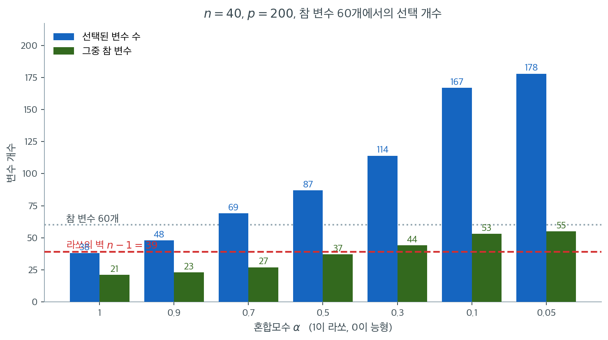
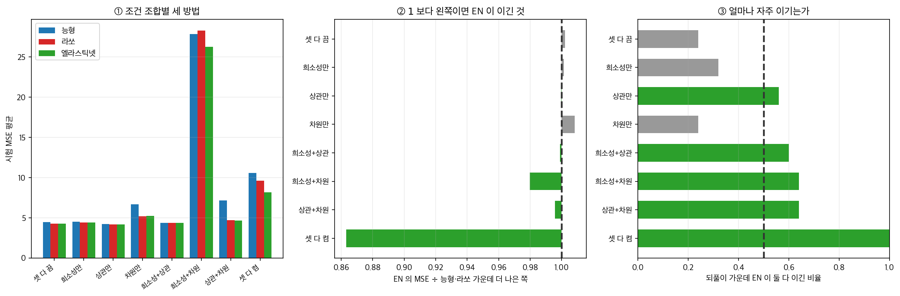

# 순수 능형·라쏘 대비 장점

엘라스틱넷은 능형회귀와 라쏘의 구체적 한계를 다루기 위해 설계되었다. 능형회귀는 변수선택을 하지 못하고, 라쏘는 상관된 설명변수와 $p > n$ 상황에서 잘 알려진 어려움을 겪는다. 두 벌점을 결합함으로써 엘라스틱넷은 각각의 강점을 유지하면서 이 한계들을 극복한다.

---

## 1. 라쏘의 포화 한계 극복

$p > n$일 때 라쏘는 **최대 $n$개의 변수만** 고를 수 있다. 라쏘 해가 차원이 최대 $n$인 $\mathbf{X}$의 열공간에 놓이기 때문이다. 참 모형에 $n$개보다 많은 유의미한 변수가 있으면 라쏘는 그것들을 모두 복원할 수 없다.

엘라스틱넷에는 이 한계가 없다. 벌점의 L2 성분이 목적함수를 강볼록으로 만들어 $n$개보다 많은 변수를 고를 수 있다. 유의미한 유전자의 수가 표본크기를 넘을 수 있는 유전체학 같은 응용에 적합하다.



$n = 40$, $p = 200$, 참 변수 60개인 자료에서 $\lambda = 0.05$로 고정하고 $\alpha$만 바꾼 결과다. 파란 막대가 선택된 변수의 총수, 초록 막대가 그중 참 변수의 개수다.

$\alpha = 1$(라쏘)에서 파란 막대가 $38$에 멈춘다. 빨간 점선으로 표시한 $n - 1 = 39$ 바로 아래다. $\lambda$를 $0.5$에서 $0.005$까지 바꾸어 보아도 라쏘가 고르는 변수는 **최대 $39$개**이며 그 벽을 넘지 못한다. 참 변수가 60개인데 구조적으로 도달할 수 없는 것이다. 실제로 그 38개 중 참 변수는 21개뿐이라 **60개 중 39개를 놓친다.**

$\alpha$를 낮추면 벽이 사라진다. $\alpha = 0.5$에서 87개, $\alpha = 0.1$에서 167개를 고르고, 참 변수 적중은 $21 \to 37 \to 53$으로 늘어난다. L2 성분이 목적함수를 강볼록으로 만들어 해가 $n$차원 부분공간에 갇히지 않기 때문이다.

그러나 초록 막대와 파란 막대의 간격이 동시에 벌어진다는 점을 놓치면 안 된다. $\alpha = 0.1$에서 167개를 골라 참 변수 53개를 건졌다면 **잡음변수 114개를 함께 들인 것**이다. $\alpha = 0.05$에서는 178개 중 123개가 잡음이다. 적중률로 보면 $\alpha = 1$의 $21/38 = 55\%$가 $\alpha = 0.05$의 $55/178 = 31\%$보다 오히려 높다. **한계를 없애는 것과 올바른 집합을 고르는 것은 다른 문제다.** $\alpha$는 "얼마나 많이 고를 것인가"를 정하는 손잡이이며, 참 변수의 개수를 대략 아는 경우에만 그 손잡이를 자신 있게 돌릴 수 있다.

| 상황 | 라쏘 | 엘라스틱넷 |
|---|---|---|
| $p < n$ | 최대 $p$개 선택 | 최대 $p$개 선택 |
| $p > n$ | 최대 $n$개 선택 | 선택 개수에 상한 없음 |
| $p \gg n$ | 심하게 제한됨 | 잘 작동함 |

---

## 2. 상관된 설명변수 집단의 처리

서로 강하게 상관되어 있고 반응변수와도 상관된 변수 집단을 생각하자. 라쏘는 집단에서 하나를 (사실상 무작위로) 고르고 나머지를 0으로 만드는 경향이 있다. 어느 것이 선택되는지가 자료의 작은 교란에 따라 바뀌므로 해가 불안정하다.

능형회귀는 상관된 집단에 계수 질량을 고르게 분배하지만 무관한 변수를 포함해 모든 변수를 남긴다.

엘라스틱넷은 중간 지점을 달성한다. 희소성을 유지하면서 **상관된 변수를 집단으로 선택하거나 배제**하는 경향이 있다. 집단의 한 변수가 선택되면 같은 집단의 다른 변수도 선택될 가능성이 높아진다(그룹 효과).

!!! note "해석에 대한 실무적 결과"
    과학적 응용에서는 상관된 변수 집단 전체가 유의미하다는 사실을 아는 편이, 그 집단에서 어느 하나가 임의로 선택되었는지를 아는 것보다 유용한 경우가 많다. 엘라스틱넷의 집단 선택은 과학적으로 더 의미 있는 결과를 낸다.

---

## 3. 해의 유일성

순수 라쏘($\alpha = 1$)는 $p > n$이거나 일부 변수가 정확히 선형종속일 때 해가 유일하지 않다. 구현이나 시작점이 다르면 같은 목적함숫값을 갖는 서로 다른 해가 나올 수 있다.

$\alpha < 1$인 엘라스틱넷은 목적함수가 **강볼록**이므로 $p$와 $n$에 무관하게 유일한 해를 갖는다. 이 유일성이 재현성, 안정성, 경로의 연속성을 보장한다.

---

## 4. 예측 정확도의 개선

Zou와 Hastie(2005)는 모의실험으로 엘라스틱넷이 능형이나 라쏘 단독보다 나은 예측 정확도를 자주 달성함을 보였다. 특히 다음 상황에서 그렇다.

1. 참 모형의 0이 아닌 계수 개수가 중간 정도일 때.
2. 설명변수가 집단으로 상관되어 있을 때.
3. $p$가 $n$과 비슷하거나 더 클 때.

기제는 L2 성분이 추정량의 분산을 줄이고(능형처럼) L1 성분이 희소성 쪽의 적절한 귀납적 편향을 제공하는 것이다.

<div class="storybox" markdown>

**그림으로 보는 통계학 1.** 셋을 나열한 목록이 아니라 셋을 요구하는 하나의 조건이다

위의 세 줄은 **목록**으로 적혀 있다. 그렇게 적힌 것을 읽으면 셋 가운데 하나만
해당해도 엘라스틱넷을 쓸 이유가 된다고 읽기 쉽다. 하나씩 떼어 켜 보자.

요인설계로 갈랐다. 되풀이 $25$ 번, 시험자료 $3{,}000$ 개, 모든 초모수는 $5$ 겹
교차검증으로 고른다. **엘라스틱넷의 $\alpha$ 는 $0.1$–$0.9$ 안쪽만 쓴다** —
끝값을 넣으면 엘라스틱넷이 능형($\alpha = 0$)과 라쏘($\alpha = 1$)를 특수한
경우로 품어 버려 「이긴다」가 공허해지기 때문이다.



**하나씩 켜면 아무 일도 일어나지 않는다.**

| 켠 조건 | 없음 | 희소성만 | 상관만 | 차원만 |
|---|---|---|---|---|
| EN $\div$ 능형·라쏘 가운데 더 나은 쪽 | $1.002$ | $1.001$ | $1.000$ | $1.008$ |
| EN 이 둘 다 이긴 비율 | $0.24$ | $0.32$ | $0.56$ | $0.24$ |

$1.000$ 은 「더 나은 쪽과 똑같다」는 뜻이다. **차원만 켠 자리는 오히려 지고 있다**
($1.008$). $p = 200 > n = 100$ 인데 참 변수가 셋뿐인 자료는 라쏘의 앞마당이라,
$\alpha$ 를 하나 더 고르는 일이 선택 잡음만 보태는 것이다.

**둘씩 켜도 거의 그대로다.** 희소성+상관 $0.999$, 상관+차원 $0.996$,
희소성+차원 $0.980$.

**셋을 다 켜면 달라진다.**

| | 능형 | 라쏘 | 엘라스틱넷 |
|---|---|---|---|
| 시험 MSE 평균 ($n = 100$, $p = 200$, 집단 상관, $0$ 아닌 계수 $40$ 개) | $10.57$ | $9.59$ | $\mathbf{8.17}$ |

더 나은 쪽(라쏘)의 $0.863$ 배이고, **되풀이 $25$ 번 가운데 $25$ 번 모두** 둘을
이긴다. 승률이 $1.00$ 인 칸은 여덟 조합 가운데 여기뿐이다.

그러니 $\S 4$ 의 세 줄은 「이 중 하나라도 해당하면」이 아니라 **「셋이 함께
있을 때」**로 읽어야 한다. 셋은 각각 **필요하지만 어느 것도 혼자서는 충분하지
않다.** 뒤집어 말하면, 자료가 셋 가운데 하나만 갖추었다면 $(\lambda, \alpha)$
이차원 탐색은 계산과 선택 잡음을 치르고 아무것도 못 받는 셈이다 — $\S 6$ 이
권하는 「$\alpha$ 를 고정하고 $\lambda$ 만」이나 그냥 라쏘·능형이 맞는 선택이다.
안쪽 $\alpha$ 가 제값을 하는 것은 셋이 겹칠 때이고, 거기서는 $13.7\%$ 를 번다.

덧붙일 것이 하나 있다. 위는 **설계 여덟 개**로 잰 것이지 정리가 아니다. 여기서
말할 수 있는 것은 수치의 정확한 크기가 아니라 **주장의 모양** — 나열이 아니라
연언이라는 것 — 까지다.

</div>

---

## 5. 한계의 비교

| 한계 | 능형 | 라쏘 | 엘라스틱넷 |
|---|---|---|---|
| 변수선택 불가 | 그렇다 | 아니다 | 아니다 |
| 상관 집단에서 임의 선택 | 해당 없음 | 그렇다 | 아니다(그룹 효과) |
| $p > n$일 때 최대 $n$개 | 해당 없음 | 그렇다 | 아니다 |
| 해가 유일하지 않음 ($p > n$) | 아니다 | 그렇다 | 아니다 ($\alpha < 1$) |
| 큰 계수에 과도한 편향 | 중간 | 높음 | 중간 |
| 계산 비용 | 낮음(닫힌 형태) | 중간 | 중간 |

---

## 6. 유연성의 대가

엘라스틱넷은 골라야 할 초모수 $\alpha$를 하나 더 들여온다. 능형이나 라쏘는 $\lambda$에 대한 1차원 탐색이면 되지만 엘라스틱넷은 $(\lambda, \alpha)$의 2차원 탐색이 된다.

다만 실무에서는 $\alpha$를 합리적인 값($\alpha = 0.5$ 등)에 고정하고 $\lambda$만 최적화해도 잘 작동하며, 순수 라쏘 대비 추가 계산이 거의 없다.

!!! tip "기본 권고"
    능형과 라쏘 중 무엇이 적절한지 확신이 없다면 $\alpha = 0.5$의 엘라스틱넷이 안전한 기본값이다. 희소성과 안정성의 합리적 균형을 제공하며, 능형과 라쏘 중 더 나은 쪽보다 크게 나쁜 경우가 드물다.

---

## 7. 순진한 엘라스틱넷과 보정 엘라스틱넷

원래의 엘라스틱넷 추정량은 이중 축소 문제를 겪는다. L1 벌점이 계수를 축소하고 L2 벌점이 다시 축소한다. Zou와 Hastie(2005)는 계수를 되돌리는 보정을 제안했다.

$$
\hat{\boldsymbol{\beta}}_{\text{corrected}} = (1 + \lambda(1-\alpha))\,\hat{\boldsymbol{\beta}}_{\text{EN}}
$$

!!! danger "scikit-learn은 이 보정을 적용하지 않는다"
    "대부분의 현대 구현이 이 보정을 자동으로 적용한다"고 서술한 자료를 종종 보지만, **scikit-learn에는 해당하지 않는다.**

    확인은 간단하다. 보정이 적용된다면 `l1_ratio`를 0으로 보낸 엘라스틱넷은 능형회귀에 $(1+\lambda)$를 곱한 값이 되어야 한다. 실제로는 정확히 능형과 일치한다(연습문제 참조, 최대 차이 $7\times10^{-9}$).

    따라서 sklearn의 `ElasticNet` 계수는 **순진한(보정되지 않은) 엘라스틱넷**이다. 보정이 필요하면 직접 $(1 + \lambda(1-\alpha))$를 곱해야 한다. 다만 예측만이 목적이면 $\lambda$를 교차검증으로 고르는 과정에서 이 배율이 흡수되므로 대개 문제가 되지 않는다.

---

## 연습문제

<div class="drillbox" markdown>

**연습문제 1.** <span class="diff med" title="중간"></span>
"$p > n$일 때 라쏘는 최대 $n$개"라는 한계와 엘라스틱넷이 그것을 넘는다는 주장을 수치로 확인하라.

</div>

??? success "풀이"
    $n = 40$, $p = 200$, 참 변수 60개에서 선택 개수를 센다.

    | 방법 | 선택 개수 |
    |:---|---:|
    | 라쏘 | **39** ($= n - 1$) |
    | 엘라스틱넷 ($\alpha = 0.5$) | 89 |
    | 엘라스틱넷 ($\alpha = 0.1$) | 167 |

    라쏘가 $n$에서 정확히 막히고 엘라스틱넷은 막히지 않는다. 자세한 코드와 논의는 [엘라스틱넷의 정식화](formulation.md) 연습문제 2에 있다.

    **주의할 점:** 엘라스틱넷이 더 많이 고른다고 해서 더 정확한 것은 아니다. $\alpha = 0.1$의 167개는 참값 60개를 크게 넘어 잡음변수를 대량으로 포함한다. **한계를 없애는 것과 올바른 집합을 고르는 것은 다른 문제다.**

<div class="drillbox" markdown>

**연습문제 2.** <span class="diff med" title="중간"></span>
sklearn이 보정 엘라스틱넷을 적용하는지 직접 확인하라.

</div>

??? success "풀이"
    `l1_ratio`를 0에 가깝게 보내면 엘라스틱넷은 순수 능형이 된다. 보정이 적용된다면 결과가 능형에 $(1 + \lambda)$를 곱한 값이어야 한다.

    ```python
    import numpy as np
    from sklearn.linear_model import ElasticNet, Ridge

    rng = np.random.default_rng(0)
    n, p = 60, 8
    X = rng.normal(0, 1, (n, p))
    X = (X - X.mean(0)) / X.std(0)          # 표준화
    y = X @ np.array([2., -1., 0.5, 0, 0, 0, 0, 0]) + rng.normal(0, 1, n)
    y = y - y.mean()

    a, l1 = 0.5, 1e-8
    be = ElasticNet(alpha=a, l1_ratio=l1, fit_intercept=False,
                    max_iter=500000, tol=1e-14).fit(X, y).coef_
    br = Ridge(alpha=n*a*(1-l1), fit_intercept=False).fit(X, y).coef_
    print(f"{np.abs(be - br).max():.2e}")        # 사실상 0
    print(f"{np.abs(be - (1+a)*br).max():.4f}")  # 크게 0이 아님
    ```

    출력:

    ```
    5.58e-09
    0.6645
    ```

    **차이가 $5.6\times10^{-9}$로 사실상 0이다.** 즉 sklearn의 엘라스틱넷은 보정 없이 능형과 정확히 일치한다.

    보정이 적용되었다면 $\lambda = 0.5$에서 계수가 $1.5$배여야 하고 차이가 $0$이 아니어야 한다.

    **결론: sklearn은 순진한 엘라스틱넷을 반환한다.** 원 논문의 보정된 추정량이 필요하면 직접 $(1 + \lambda(1-\alpha))$를 곱하라.

<div class="drillbox" markdown>

**연습문제 3.** <span class="diff med" title="중간"></span>
1절은 $n = 40$, $p = 200$, 참 변수 60개, $\lambda = 0.05$에서 다음 수를 보고한다.

| $\alpha$ | 선택 개수 | 그중 참 변수 |
|---:|---:|---:|
| 1 | 38 | 21 |
| 0.5 | 87 | 37 |
| 0.1 | 167 | 53 |
| 0.05 | 178 | 55 |

**(a)** 네 $\alpha$에 대해 정밀도(본문의 "적중률"), 재현율, 그리고 $F_1 = 2PR/(P+R)$을 구하라.

**(b)** $F_1$을 가장 크게 하는 $\alpha$는 무엇인가? 6절의 기본 권고와 견주어라.

**(c)** "라쏘의 적중률 $55\%$가 가장 높으니 라쏘가 가장 정확하다"는 결론의 결함을 지적하라.

</div>

??? success "풀이"
    **(a)** 참 변수가 $T = 60$개, 선택 개수를 $S$, 적중을 $H$라 하면 $P = H/S$, $R = H/T$이고

    $$
    F_1 = \frac{2PR}{P+R} = \frac{2H^2/(ST)}{H(S+T)/(ST)} = \frac{2H}{S + T}
    $$

    이므로 $F_1$은 $2H/(S+60)$으로 바로 계산된다.

    | $\alpha$ | 선택 $S$ | 적중 $H$ | 거짓양성 $S-H$ | 정밀도 $P$ | 재현율 $R$ | $F_1$ |
    |---:|---:|---:|---:|---:|---:|---:|
    | 1 | 38 | 21 | 17 | **55.3%** | 35.0% | 42.9% |
    | 0.5 | 87 | 37 | 50 | 42.5% | 61.7% | **50.3%** |
    | 0.1 | 167 | 53 | 114 | 31.7% | 88.3% | 46.7% |
    | 0.05 | 178 | 55 | 123 | 30.9% | **91.7%** | 46.2% |

    예를 들어 $\alpha = 0.5$는 $P = 37/87 = 0.4253$, $R = 37/60 = 0.6167$, $F_1 = 74/147 = 0.5034$다.

    **(b)** $F_1$은 $\alpha = 0.5$에서 최대($50.3\%$)다. 정밀도의 최대는 $\alpha = 1$, 재현율의 최대는 $\alpha = 0.05$인데 둘을 함께 재면 **가운데가 이긴다.** 6절의 "확신이 없으면 $\alpha = 0.5$"라는 권고가 이 자료에서는 $F_1$ 기준으로도 옳은 선택이 된다. $\alpha$를 0으로 더 내려도 $F_1$이 다시 오르지 않는 것($46.7 \to 46.2$)은 추가로 고른 11개 중 참 변수가 2개뿐이기 때문이다.

    **(c)** 정밀도는 **적게 고르면 쉽게 높아진다.** 라쏘의 $55.3\%$는 고를 수 있는 개수가 $n - 1 = 39$로 막혀 있어서 가장 자신 있는 38개만 고른 결과이며, 놓친 참 변수 39개는 정밀도에 전혀 나타나지 않는다. 재현율 $35.0\%$를 함께 보면 라쏘는 참 모형의 3분의 1만 복원한 셈이다.

    즉 정밀도 하나로는 순위를 정할 수 없다. 어느 $\alpha$가 좋은지는 **잃는 비용**에 달려 있다. 후속 실험이 비싸서 거짓양성 하나가 치명적이면 $\alpha = 1$, 참 변수를 놓치는 쪽이 치명적이면 $\alpha = 0.05$, 둘을 대등하게 보면 $\alpha = 0.5$다. 본문의 "한계를 없애는 것과 올바른 집합을 고르는 것은 다른 문제다"가 수로 그렇게 나타난다.

<div class="drillbox" markdown>

**연습문제 4.** <span class="diff med" title="중간"></span>
직교설계 $\mathbf{X}^\top\mathbf{X} = n\mathbf{I}_p$에서 엘라스틱넷 해는 $\hat\beta_j^{\text{EN}} = S(\hat\beta_j^{\text{OLS}}, \lambda\alpha)/(1 + \lambda(1-\alpha))$다([엘라스틱넷 정칙화](elastic_net.md) 연습문제 5). 여기서 $S(z, \gamma) = \operatorname{sign}(z)(\lvert z \rvert - \gamma)_+$는 연성문턱 연산자다. 이제 $j$번째 열의 **단위만** 바꾸어 $\tilde{\mathbf{x}}_j = c\,\mathbf{x}_j$($c > 0$)로 두자. 다른 열은 그대로이므로 직교성은 유지된다.

**(a)** $\tilde\beta_j$의 닫힌 꼴을 구하라.

**(b)** $\lambda = 0$이면 $\tilde\beta_j = \hat\beta_j^{\text{OLS}}/c$가 되어 적합값이 변하지 않음을 확인하라.

**(c)** $\hat\beta_j^{\text{OLS}} = 1$, $\lambda = 1$, $\alpha = 0.5$에서 $c = 10$과 $c = 0.1$의 $\tilde\beta_j$를 구하고 척도불변이라면 나와야 할 값 $\hat\beta_j^{\text{EN}}/c$와 비교하라.

**(d)** 그 결과가 2절의 그룹 효과 주장과 이 쪽 연습문제 2의 코드에 대해 무엇을 말하는가?

</div>

??? success "풀이"
    **(a)** $\tilde{\mathbf{x}}_j$만 바꾸어도 설계가 여전히 직교이므로 문제는 좌표마다 분리된다. $\lVert \tilde{\mathbf{x}}_j \rVert^2/n = c^2$이고 $\tilde{\mathbf{x}}_j^\top\mathbf{y}/n = c\,\hat\beta_j^{\text{OLS}}$이므로 $\beta_j$만의 목적함수는

    $$
    \frac{1}{2}\bigl(c^2 + \lambda(1-\alpha)\bigr)\beta_j^2 - c\,\hat\beta_j^{\text{OLS}}\beta_j + \lambda\alpha\lvert \beta_j \rvert + \text{const}
    $$

    이고, 따라서

    $$
    \tilde\beta_j = \frac{S\bigl(c\,\hat\beta_j^{\text{OLS}},\ \lambda\alpha\bigr)}{c^2 + \lambda(1-\alpha)}.
    $$

    **(b)** $\lambda = 0$이면 $\tilde\beta_j = c\,\hat\beta_j^{\text{OLS}}/c^2 = \hat\beta_j^{\text{OLS}}/c$다. 단위를 $c$배 하면 계수가 $1/c$배 되어 $\tilde\beta_j \tilde{\mathbf{x}}_j = \hat\beta_j^{\text{OLS}}\mathbf{x}_j$로 적합값이 그대로다. **OLS는 척도에 등변(equivariant)이다.**

    **(c)** 먼저 $\hat\beta_j^{\text{EN}} = S(1, 0.5)/(1 + 0.5) = 0.5/1.5 = 0.3333$이다.

    | $c$ | $\tilde\beta_j$ | 척도불변이라면 $\hat\beta_j^{\text{EN}}/c$ | 원 단위로 되돌린 효과 $c\,\tilde\beta_j$ |
    |---:|---:|---:|---:|
    | 10 | $9.5/100.5 = 0.0945$ | 0.0333 | **0.9453** |
    | 0.1 | $S(0.1, 0.5) = 0$이므로 **0** | 3.3333 | 0 |

    $c = 10$에서는 등변일 때보다 $0.0945/0.0333 = 2.84$배 큰 계수가 나온다. 원 단위로 환산한 효과가 $0.3333$에서 $0.9453$으로 커졌으니 **단위를 키우는 것만으로 벌점이 약해진 것이다.** $c = 0.1$에서는 상관의 변화 없이, 자료의 정보가 하나도 줄지 않았는데도 연성 문턱이 변수를 **완전히 탈락**시킨다. 벌점은 척도에 불변이 아니다.

    **(d)** 2절의 "상관된 변수에 비슷한 계수를 준다"는 주장은 **열들의 척도가 같을 때만** 뜻이 있다. 같은 양을 미터와 센티미터로 적은 두 열은 상관이 1인데도 계수가 100배 차이난다. 그래서 그룹 효과를 점검하기 전에 반드시 표준화해야 한다.

    sklearn의 `Ridge`·`Lasso`·`ElasticNet`은 표준화를 해 주지 않는다(1.2부터 `normalize` 인수도 사라졌다). 연습문제 2의 코드가 `X = (X - X.mean(0)) / X.std(0)`로 손수 표준화한 까닭이 이것이다. 실무에서는 `StandardScaler`를 `Pipeline`으로 묶어 **교차검증 폴드 안에서** 표준화해야 한다. 전체 자료로 먼저 표준화하면 검증 폴드의 평균·표준편차가 새 나가 오차를 과소평가한다. 절편은 벌점에서 빼야 하며 `fit_intercept=True`가 그 일을 한다. $\square$

<div class="drillbox" markdown>

**연습문제 5.** <span class="diff med" title="중간"></span>
2절은 라쏘가 상관된 집단에서 "사실상 무작위로" 하나를 고르므로 해가 불안정하다고 말한다. 그 불안정이 **예측에 들어가는 양**에도 나타나는지 확인하라. $n = 100$, 공통인자로 만든 $\rho = 0.95$짜리 세 변수 집단과 잡음변수 7개, 참 계수는 집단만 $1.0$인 자료를 400번 새로 만들고 $\lambda = 0.5$에서 라쏘와 엘라스틱넷($\alpha = 0.5$)을 적합하여 (가) 집단 계수의 최대$-$최소 폭, (나) 세 계수의 합, (다) 셋을 모두 유지한 비율을 비교하라. 무엇이 불안정하고 무엇이 안정한가?

</div>

??? success "풀이"
    ```python
    import numpy as np
    from sklearn.linear_model import ElasticNet

    def make(seed, n=100, rho=0.95):
        rng = np.random.default_rng(seed)
        z = rng.normal(size=n)
        X = rng.normal(size=(n, 10))
        for j in (0, 1, 2):                        # 상관 집단
            X[:, j] = np.sqrt(rho)*z + np.sqrt(1-rho)*X[:, j]
        X -= X.mean(0); X /= X.std(0)
        beta = np.zeros(10); beta[:3] = 1.0
        y = X @ beta + rng.normal(0, 1, n)
        return X, y - y.mean()

    B, lam = 400, 0.5
    for a, name in ((1.0, "라쏘"), (0.5, "엘라스틱넷")):
        spread, ssum, keep3 = [], [], 0
        for b in range(B):
            X, y = make(1000 + b)
            g = ElasticNet(alpha=lam, l1_ratio=a, fit_intercept=False,
                           max_iter=100000, tol=1e-10).fit(X, y).coef_[:3]
            spread.append(g.max() - g.min())
            ssum.append(g.sum())
            keep3 += int((np.abs(g) > 1e-8).all())
        print(f"{name:6s} 폭 평균 {np.mean(spread):.4f}   "
              f"합 평균 {np.mean(ssum):.4f} (표준편차 {np.std(ssum):.4f})   "
              f"셋 모두 유지 {100*keep3/B:.1f}%")
    ```

    출력:

    ```text
    라쏘     폭 평균 0.8109   합 평균 2.4824 (표준편차 0.1002)   셋 모두 유지 94.2%
    엘라스틱넷  폭 평균 0.1339   합 평균 2.5228 (표준편차 0.0923)   셋 모두 유지 100.0%
    ```

    **불안정한 것은 배분이다.** 집단 안 계수의 폭이 라쏘는 평균 $0.8109$로 합 $2.48$의 3분의 1에 달한다. 엘라스틱넷은 $0.1339$로 6배 작다. 세 변수가 거의 같은 변수인데 라쏘는 매번 다르게 쪼개고 엘라스틱넷은 거의 똑같이 나눈다.

    **안정한 것은 합이다.** 세 변수가 거의 같으므로 예측은 $\hat\beta_1 x_1 + \hat\beta_2 x_2 + \hat\beta_3 x_3 \approx (\hat\beta_1+\hat\beta_2+\hat\beta_3)z$로 **합에만** 의존한다. 그 합은 두 방법이 $2.4824$와 $2.5228$로 거의 같고 표준편차도 $0.1002$와 $0.0923$으로 거의 같다. 즉 라쏘의 "임의 선택"은 **해석을 망가뜨리지만 예측은 거의 망가뜨리지 않는다.**

    이것이 2절(해석)과 4절(예측 정확도)을 구별해야 하는 까닭이다. 어느 유전자가 유의미한지 보고해야 한다면 라쏘의 배분은 믿을 수 없는 보고서가 되지만, 예측값만 쓸 작정이면 이 설정에서 엘라스틱넷의 이득은 크지 않다. 4절의 예측 개선은 상관 집단이 여럿이거나 $p$가 $n$에 가까워 분산이 커질 때 나타난다.

    한 가지 더 눈에 담을 것: 라쏘도 $94.2\%$에서 셋을 **모두** 남긴다. "집단에서 하나만 고른다"는 말은 $\lambda$가 크거나 상관이 1에 더 가까울 때 뚜렷해지는 **경향**이며 법칙이 아니다. 같은 설정에서 $\lambda$를 $1.5$로 올리면 라쏘의 "셋 모두 유지"가 $68.8\%$로 떨어지는데, 엘라스틱넷은 그때도 $100\%$다.

<div class="drillbox" markdown>

**연습문제 6.** <span class="diff hard" title="어려움"></span>
3절의 비유일성을 극단으로 밀어 보자. 두 열이 **정확히 같아서** $\mathbf{x}_1 = \mathbf{x}_2 = \mathbf{x}$이고 $\lVert \mathbf{x} \rVert^2/n = 1$, $b = \mathbf{x}^\top\mathbf{y}/n = 1$이라 하자. $\lambda = 0.4$로 둔다.

**(a)** 라쏘($\alpha = 1$)의 해집합을 **모두** 적어라.

**(b)** $\alpha = 0.5$인 엘라스틱넷의 해를 구하라.

**(c)** 같은 열이 $k$개일 때 두 해를 일반화하고 $k \to \infty$의 극한을 해석하라.

</div>

??? success "풀이"
    $s = \beta_1 + \beta_2$라 하면 적합항은 $s$에만 의존한다.

    $$
    \frac{1}{2n}\lVert \mathbf{y} - s\mathbf{x} \rVert^2 = \text{const} - sb + \frac{s^2}{2}
    $$

    **(a)** 라쏘 벌점은 $\lambda(\lvert \beta_1 \rvert + \lvert \beta_2 \rvert) \geq \lambda\lvert s \rvert$이고 등호는 두 값의 부호가 같을 때(또는 하나가 0일 때) 성립한다. 따라서 목적함수는 $s$만의 함수

    $$
    g(s) = \frac{s^2}{2} - sb + \lambda\lvert s \rvert
    $$

    로 내려가고 최소점은 $s^* = S(b, \lambda) = S(1, 0.4) = 0.6$이다. $s^* > 0$이므로 등호 조건은 $\beta_1, \beta_2 \geq 0$이고, 해집합은

    $$
    \bigl\{(t,\ 0.6 - t) : 0 \leq t \leq 0.6\bigr\}
    $$

    인 **선분 전체**다. 양 끝점 $(0.6, 0)$과 $(0, 0.6)$은 희소하고 가운데 $(0.3, 0.3)$은 희소하지 않은데 목적함숫값이 모두 같다. 어느 것이 나오는지는 구현과 시작점이 정한다. 유일한 양은 합 $0.6$과 적합값뿐이다.

    **(b)** 엘라스틱넷 벌점은 $\lambda\bigl[\alpha(\lvert \beta_1 \rvert + \lvert \beta_2 \rvert) + \frac{1-\alpha}{2}(\beta_1^2+\beta_2^2)\bigr]$다. $s$를 고정하면 L1 항은 균등배분에서도 최솟값 $\alpha\lvert s \rvert$를 갖고 L2 항은 균등배분 $\beta_1 = \beta_2 = s/2$에서만 최소 $\frac{1-\alpha}{2}\cdot\frac{s^2}{2}$를 가지므로, 최적해는 반드시 균등배분이다. 남은 문제는

    $$
    g(s) = \frac{s^2}{2} - sb + \lambda\alpha\lvert s \rvert + \frac{\lambda(1-\alpha)}{4}s^2
    $$

    의 최소화이고, $s > 0$에서 $g'(s) = s\bigl(1 + \frac{\lambda(1-\alpha)}{2}\bigr) - b + \lambda\alpha = 0$이므로

    $$
    s^* = \frac{S(b, \lambda\alpha)}{1 + \lambda(1-\alpha)/2} = \frac{S(1, 0.2)}{1 + 0.1} = \frac{0.8}{1.1} = 0.7273,
    \qquad \hat\beta_1 = \hat\beta_2 = 0.3636.
    $$

    해가 **하나**다. 3절의 주장이 가장 나쁜 설계에서도 그대로 성립한다.

    **(c)** 같은 열이 $k$개면 라쏘는 여전히 $s^* = S(b, \lambda) = 0.6$이고 해집합은 $\{\boldsymbol\beta \geq 0 : \sum_j \beta_j = 0.6\}$인 $(k-1)$차원 단체(simplex)로 **더 커진다.** 엘라스틱넷은 균등배분 $\beta_j = s/k$에서 L2 항이 $\frac{1-\alpha}{2}\cdot\frac{s^2}{k}$이므로

    $$
    s_k^* = \frac{S(b, \lambda\alpha)}{1 + \lambda(1-\alpha)/k}
    $$

    이고, $k = 1, 2, 3$에서 $0.6667,\ 0.7273,\ 0.7500$으로 커져 $k \to \infty$에서 $S(b, \lambda\alpha) = 0.8$로 간다. 즉 **복제가 늘면 L2 축소가 사라지고 문턱만 남아 엘라스틱넷의 집단 총합이 문턱 $\lambda\alpha$의 라쏘와 같아진다.** L2 벌점이 개별 계수에 걸리므로 같은 총합을 더 많은 변수에 나눠 담을수록 벌점이 싸지기 때문이다.

    여기서 주의할 것: $k = 2$의 분모는 $1 + \lambda(1-\alpha)/2 = 1.1$로 직교설계 공식의 $1 + \lambda(1-\alpha) = 1.2$와 다르다. **직교설계의 닫힌 꼴을 상관된 설계에 그대로 가져다 쓰면 틀린다.** $\square$

<div class="drillbox" markdown>

**연습문제 7.** <span class="diff hard" title="어려움"></span>
7절의 보정 $\hat{\boldsymbol\beta}_{\text{corrected}} = (1 + \lambda(1-\alpha))\hat{\boldsymbol\beta}_{\text{EN}}$을 직교설계에서 액면대로 따라가 보라.

**(a)** 보정된 추정량이 문턱 $\lambda\alpha$의 **라쏘와 정확히 같음**을 보여라. $\hat{\boldsymbol\beta}^{\text{OLS}} = (2.0,\ 0.3)$, $\lambda = 1$, $\alpha = 0.5$에서 수로 확인하라.

**(b)** $\alpha \to 0$이면 보정된 추정량이 OLS가 됨을 보이고, 이것이 연습문제 2의 확인 방법과 어떻게 맞물리는지 설명하라.

**(c)** 그렇다면 보정은 어떤 설계에서 뜻을 갖는가?

</div>

??? success "풀이"
    **(a)** 직교설계에서 $\hat\beta_j^{\text{EN}} = S(\hat\beta_j^{\text{OLS}}, \lambda\alpha)/(1+\lambda(1-\alpha))$이므로 보정은 분모를 정확히 지운다.

    $$
    \hat\beta_j^{\text{corrected}} = \bigl(1+\lambda(1-\alpha)\bigr)\cdot\frac{S(\hat\beta_j^{\text{OLS}}, \lambda\alpha)}{1+\lambda(1-\alpha)} = S\bigl(\hat\beta_j^{\text{OLS}},\ \lambda\alpha\bigr)
    $$

    오른쪽은 벌점모수 $\lambda' = \lambda\alpha$인 **라쏘 해**다($\alpha = 1$이면 분모가 1이 되므로). 수로 보면

    | 추정량 | $\beta_1$ | $\beta_2$ |
    |:---|---:|---:|
    | OLS | 2.0000 | 0.3000 |
    | 엘라스틱넷 ($\lambda=1$, $\alpha=0.5$) | $1.5/1.5 = 1.0000$ | $S(0.3, 0.5) = 0$ |
    | 보정 엘라스틱넷 | $1.5 \times 1.0000 = 1.5000$ | 0 |
    | 라쏘 ($\lambda' = 0.5$) | $S(2.0, 0.5) = 1.5000$ | 0 |

    마지막 두 줄이 **똑같다.** 직교설계에서 보정 엘라스틱넷은 $\alpha$를 바꾼 라쏘에 지나지 않는다 — 보정이 L2 성분을 통째로 지워 버린 것이다.

    **(b)** $\alpha \to 0$이면 문턱이 사라져 $\hat\beta_j^{\text{corrected}} = S(\hat\beta_j^{\text{OLS}}, 0) = \hat\beta_j^{\text{OLS}}$다. **보정 능형은 직교설계에서 OLS와 같다.** 정칙화가 통째로 사라지니 추정량으로서 무의미하다.

    이것이 연습문제 2의 확인 방법 뒤에 있는 논리다. 그 연습문제는 "보정이 적용된다면 `l1_ratio` $\to 0$의 엘라스틱넷은 능형의 $(1+\lambda)$배여야 한다"는 점을 이용했다. 직교설계로 좁혀 보면 그 $(1+\lambda)$배가 바로 OLS이므로, 보정 여부는 "$\lambda$를 줬는데 축소가 하나도 일어나지 않는가"를 보는 것과 같다. 실제 출력은 차이 $5.6\times10^{-9}$, 즉 축소가 그대로 남아 있었다.

    **(c)** 핵심은 $(1+\lambda(1-\alpha))$가 **스칼라** 하나라는 데 있다. 직교설계에서는 L2 축소가 모든 방향에 똑같이 $1/(1+\lambda(1-\alpha))$로 걸리므로 스칼라 한 번으로 정확히 되돌려진다. 상관된 설계에서는 축소가 $\bigl(\frac{1}{n}\mathbf{X}^\top\mathbf{X} + \lambda(1-\alpha)\mathbf{I}\bigr)^{-1}$를 통해 **방향마다 다른 비율로** 걸리므로(연습문제 9의 $d_j^2/(d_j^2+\lambda)$) 어떤 스칼라도 그것을 되돌릴 수 없다.

    따라서 보정은 상관된 설계에서만 "L2 축소를 지우지 않으면서 이중축소를 덜어 준다"는 뜻을 가지며, 거기서도 배율의 크기는 원리에서 유도된 것이 아니라 직교 근사에서 빌려 온 편법이다. 예측이 목적이면 보정하기보다 $\lambda$를 교차검증으로 고르는 것이 낫고, 그 "흡수" 주장이 어디까지 정확한지는 연습문제 8에서 따진다. $\square$

<div class="drillbox" markdown>

**연습문제 8.** <span class="diff hard" title="어려움"></span>
7절은 "예측만이 목적이면 $\lambda$를 교차검증으로 고르는 과정에서 이 배율이 흡수되므로 대개 문제가 되지 않는다"고 적었다. 이 말이 정확히 성립하려면 보정한 추정량의 모임 $\{(1+\lambda(1-\alpha))\hat{\boldsymbol\beta}_{\text{EN}}(\lambda)\}_\lambda$가 순진한 모임 $\{\hat{\boldsymbol\beta}_{\text{EN}}(\lambda)\}_\lambda$를 다시 매개화한 것이어야 한다.

**(a)** 직교설계에서 $\hat{\boldsymbol\beta}^{\text{OLS}} = (2, 1)$, $\lambda = 1$, $\alpha = 0.5$를 잡아, 보정한 해와 같아지는 $\lambda'$가 **없음**을 보여라.

**(b)** 상관된 설계 네 개에서 $\lambda$ 격자 위의 최소 시험오차를 두 모임에 대해 재어 비교하라. 배율은 흡수되는가?

</div>

??? success "풀이"
    **(a)** 연습문제 7에 의해 보정한 해는 $\bigl(S(2, 0.5),\ S(1, 0.5)\bigr) = (1.5,\ 0.5)$다. 순진한 모임의 $\lambda'$에서의 해는

    $$
    \left(\frac{S(2, \lambda'/2)}{1 + \lambda'/2},\ \frac{S(1, \lambda'/2)}{1 + \lambda'/2}\right)
    $$

    이다. 두 좌표가 모두 살아 있다면 비율은 $\dfrac{2 - u}{1 - u}$($u = \lambda'/2$)이고, 보정한 해의 비율 $1.5/0.5 = 3$과 같으려면 $2 - u = 3 - 3u$에서 $u = 0.5$, 즉 $\lambda' = 1$이다. 그런데 $\lambda' = 1$에서 순진한 해는 $(1.5/1.5,\ 0.5/1.5) = (1.0000,\ 0.3333)$으로 $(1.5,\ 0.5)$가 아니다. 비율을 맞추는 $\lambda'$가 하나뿐이고 그것이 크기를 못 맞추므로 **해를 일치시키는 $\lambda'$는 없다.**

    까닭은 간단하다. 보정은 문턱 $\lambda\alpha$를 그대로 둔 채 축소만 되돌리는데, 순진한 모임에서 $\lambda$를 움직이면 문턱과 축소가 **함께** 움직인다. 두 손잡이를 하나로 흉내낼 수 없다.

    **(b)** $n = 80$, $p = 20$, 앞 6개가 강하게 상관된 집단, 시험표본 20{,}000개로 재어 본다.

    ```python
    import numpy as np
    from sklearn.linear_model import ElasticNet

    n, p, ntest, a = 80, 20, 20000, 0.5
    grid = np.logspace(-3, 0, 31)

    def one(seed):
        rng = np.random.default_rng(seed)
        z = rng.normal(size=n + ntest)
        X = rng.normal(size=(n + ntest, p))
        for j in range(6):                            # 강하게 상관된 집단
            X[:, j] = np.sqrt(0.9)*z + np.sqrt(0.1)*X[:, j]
        X = (X - X.mean(0)) / X.std(0)
        beta = np.zeros(p); beta[:6] = 1.0; beta[6:9] = -0.8
        y = X @ beta + rng.normal(0, 1, n + ntest)
        Xtr, Xte, yte = X[:n], X[n:], y[n:]
        ytr = y[:n] - y[:n].mean()
        nv, cr = [], []
        for lam in grid:
            b = ElasticNet(alpha=lam, l1_ratio=a, fit_intercept=False,
                           max_iter=100000, tol=1e-10).fit(Xtr, ytr).coef_
            nv.append(np.mean((yte - Xte @ b)**2))
            cr.append(np.mean((yte - Xte @ ((1 + lam*(1 - a))*b))**2))
        return np.array(nv), np.array(cr)

    print("씨앗   순진한 꼴 최소MSE (lambda)   보정한 꼴 최소MSE (lambda)")
    for seed in (7, 8, 9, 10):
        nv, cr = one(seed)
        print(f"{seed:3d}      {nv.min():.4f} ({grid[nv.argmin()]:.4f})"
              f"            {cr.min():.4f} ({grid[cr.argmin()]:.4f})")
    ```

    출력:

    ```text
    씨앗   순진한 꼴 최소MSE (lambda)   보정한 꼴 최소MSE (lambda)
      7      1.2578 (0.1000)            1.0803 (0.1995)
      8      1.1609 (0.1259)            1.1832 (0.0794)
      9      1.2417 (0.0794)            1.2662 (0.0631)
     10      2.2165 (0.0794)            1.4518 (0.5012)
    ```

    **흡수되지 않는다.** 씨앗 7과 10에서는 보정한 쪽이 $1.2578 \to 1.0803$, $2.2165 \to 1.4518$로 눈에 띄게 **낫고**, 씨앗 8과 9에서는 $1.1609 \to 1.1832$, $1.2417 \to 1.2662$로 약간 **나쁘다.** 같은 모임을 다시 매개화한 것이라면 두 열의 최솟값이 격자 해상도 안에서 일치해야 하는데 그렇지 않다. (a)가 보인 대로 두 모임은 서로 다른 곡선이다.

    선택된 $\lambda$가 보정한 쪽에서 더 큰 쪽으로 밀리는 것($0.1000 \to 0.1995$, $0.0794 \to 0.5012$)이 "부분적 흡수"의 모습이다. 보정이 계수를 키우므로 교차검증은 그만큼 더 큰 $\lambda$로 되갚으려 한다. 그러나 문턱과 축소를 한꺼번에 움직이는 $\lambda$로는 배율만 되갚을 수 없어 잔차가 남는다.

    실무 결론 둘. 첫째, **계수의 크기 자체를 해석에 쓸 때는 보정 여부를 반드시 밝혀야 한다.** 둘째, 예측이 목적이면 "흡수되니 신경 쓰지 말라"가 아니라 두 모임을 각각 교차검증해 고르면 된다 — 보정이 이득인 자료는 순진한 추정량이 과도하게 축소된 자료(씨앗 10처럼 상관 집단의 신호가 센 경우)다.

<div class="drillbox" markdown>

**연습문제 9.** <span class="diff hard" title="어려움"></span>
5절의 표는 능형의 계산 비용을 "낮음(닫힌 형태)"이라 적었다. 한 걸음 더 가 보자. $\mathbf{X} = \mathbf{U}\mathbf{D}\mathbf{V}^\top$를 특이값분해라 하고 $d_j$를 특잇값이라 한다.

**(a)** $\hat{\boldsymbol\beta}^{\text{ridge}}(\lambda) = \sum_j \frac{d_j}{d_j^2+\lambda}(\mathbf{u}_j^\top\mathbf{y})\,\mathbf{v}_j$를 유도하고, $\lambda$ 격자 **전체**의 경로가 특이값분해 한 번으로 끝남을 설명하라.

**(b)** 모자행렬의 대각합이 $\sum_j d_j^2/(d_j^2+\lambda)$임을 보이고 $\lambda \to 0$, $\lambda \to \infty$의 극한을 말하라.

**(c)** 거의 같은 두 열이 있는 자료에서 (a)를 수치로 검산하고, $\lambda = 1$에서 잃은 자유도가 어느 방향에서 나왔는지 따져라.

**(d)** $\alpha > 0$인 엘라스틱넷에는 같은 수법을 쓸 수 없다. 왜인가?

</div>

??? success "풀이"
    **(a)** $\mathbf{X}^\top\mathbf{X} = \mathbf{V}\mathbf{D}^2\mathbf{V}^\top$이고 $\mathbf{V}^\top\mathbf{V} = \mathbf{I}$이므로

    $$
    (\mathbf{X}^\top\mathbf{X} + \lambda\mathbf{I})^{-1}\mathbf{X}^\top\mathbf{y} = \mathbf{V}(\mathbf{D}^2+\lambda\mathbf{I})^{-1}\mathbf{V}^\top\mathbf{V}\mathbf{D}\mathbf{U}^\top\mathbf{y} = \mathbf{V}(\mathbf{D}^2+\lambda\mathbf{I})^{-1}\mathbf{D}\mathbf{U}^\top\mathbf{y}
    $$

    이고 성분으로 적으면 $\sum_j \frac{d_j}{d_j^2+\lambda}(\mathbf{u}_j^\top\mathbf{y})\mathbf{v}_j$다. $\mathbf{U}, \mathbf{D}, \mathbf{V}$와 $\mathbf{U}^\top\mathbf{y}$는 $\lambda$에 의존하지 않으므로, 분해 한 번($O(np^2)$) 뒤에는 $\lambda$ 하나당 $O(p^2)$의 곱셈만 든다. **100개짜리 $\lambda$ 격자가 한 번 푸는 값과 거의 같다.**

    **(b)** 모자행렬은

    $$
    \mathbf{H}_\lambda = \mathbf{X}(\mathbf{X}^\top\mathbf{X}+\lambda\mathbf{I})^{-1}\mathbf{X}^\top = \mathbf{U}\mathbf{D}(\mathbf{D}^2+\lambda\mathbf{I})^{-1}\mathbf{D}\mathbf{U}^\top
    $$

    이고 대각합은 직교변환에 불변이므로 $\operatorname{tr}\mathbf{H}_\lambda = \sum_j d_j^2/(d_j^2+\lambda)$다. 이것이 능형의 **유효 자유도**다. $\lambda \to 0$이면 각 항이 1이 되어 $\operatorname{rank}(\mathbf{X})$로, $\lambda \to \infty$이면 0으로 간다. 즉 $\lambda$는 자유도를 $\operatorname{rank}(\mathbf{X})$에서 0까지 **연속적으로** 줄이는 손잡이다. 변수를 넣고 빼는 것이 자유도를 정수로만 바꾸는 것과 대비된다.

    **(c)** 두 번째 열을 첫 열에 잡음을 조금 더해 만든다.

    ```python
    import numpy as np
    from sklearn.linear_model import Ridge

    rng = np.random.default_rng(3)
    n, p = 50, 6
    X = rng.normal(size=(n, p))
    X[:, 1] = X[:, 0] + 0.05*rng.normal(size=n)      # 거의 같은 두 열
    X = (X - X.mean(0)) / X.std(0)
    y = X @ np.array([1., 1., -1., 0., 0., 0.]) + rng.normal(0, 1, n)
    y = y - y.mean()

    U, d, Vt = np.linalg.svd(X, full_matrices=False)
    uy = U.T @ y
    print("특잇값 " + "  ".join(f"{v:.4f}" for v in d))
    print("lambda=1 의 방향별 축소율 " + "  ".join(f"{v:.4f}" for v in d**2/(d**2 + 1)))

    print("lambda    유효자유도   SVD 식과 Ridge 의 차이 < 1e-10")
    for lam in (0.0, 1.0, 10.0, 100.0, 1000.0):
        b_svd = Vt.T @ (d*uy/(d**2 + lam))
        b_skl = Ridge(alpha=lam, fit_intercept=False, solver="svd").fit(X, y).coef_
        df = np.sum(d**2/(d**2 + lam))
        ok = np.abs(b_svd - b_skl).max() < 1e-10
        print(f"{lam:7.1f}   {df:8.4f}     {'예' if ok else '아니오'}")
    ```

    출력:

    ```text
    특잇값 10.3517  7.8219  7.4039  6.2239  6.1690  0.2247
    lambda=1 의 방향별 축소율 0.9908  0.9839  0.9821  0.9748  0.9744  0.0481
    lambda    유효자유도   SVD 식과 Ridge 의 차이 < 1e-10
        0.0     6.0000     예
        1.0     4.9540     예
       10.0     4.2116     예
      100.0     1.8063     예
     1000.0     0.2804     예
    ```

    닫힌 꼴이 `Ridge`와 $10^{-10}$ 안에서 일치한다(실제 차이는 $10^{-14}$ 수준이지만 그 자리는 선형대수 라이브러리에 따라 달라지므로 판정만 찍는다). 거의 같은 두 열이 만든 작은 특잇값 $d_6 = 0.2247$이 눈에 띈다.

    **잃은 자유도는 거의 전부 그 방향에서 나온다.** $\lambda = 1$에서 자유도가 $6 \to 4.9540$으로 $1.0460$ 줄었는데, 마지막 방향 하나가 $1 - 0.0481 = 0.9519$를 담당하고 나머지 다섯 방향을 합쳐도 $0.0941$뿐이다. 벌점 $\lambda$는 $d_j^2$와 견주어 작동하므로 $d_j^2 \gg \lambda$인 방향은 거의 손대지 않고 $d_j^2 \ll \lambda$인 방향만 꺾는다. **능형은 조건이 나쁜 방향을 먼저 죽인다** — 거기가 분산이 가장 큰 자리이므로($\operatorname{Var} \propto 1/d_j^2$) 편향을 사서 분산을 파는 거래가 가장 유리한 곳이다. 18장의 다중공선성 논의와 5장의 편향–분산 분해가 이 한 줄에서 만난다.

    **(d)** L1 항은 회전에 불변이 아니다. SVD 기저로 돌리면 $\lVert \mathbf{y}-\mathbf{X}\boldsymbol\beta \rVert^2$와 $\lVert \boldsymbol\beta \rVert_2^2$는 좌표마다 분리되지만 $\lVert \mathbf{V}^\top\boldsymbol\beta \rVert_1 \neq \lVert \boldsymbol\beta \rVert_1$이어서 L1 항이 좌표를 뒤섞는다. 그래서 $\alpha > 0$이면 분해가 $\lambda$에 대한 닫힌 꼴을 주지 못하고, $\lambda$마다 좌표하강을 다시 돌려야 한다(따뜻한 시작으로 비용을 줄일 뿐이다). 유효 자유도도 닫힌 꼴이 없어서, 라쏘에서는 0이 아닌 계수의 **개수**가 자유도의 불편추정이라는 사실을 대신 쓴다. 5절 표의 "능형: 낮음(닫힌 형태) / 엘라스틱넷: 중간"이 바로 이 차이다. $\square$

<div class="drillbox" markdown>

**연습문제 10.** <span class="diff hard" title="어려움"></span>
6.3절 [최대사후확률 추정](../../ch06/bayesian/map_estimation.md) 정리 1 은 능형이 정규 사전분포, 라쏘가 라플라스 사전분포의 MAP임을 말한다. 엘라스틱넷에 대해 다음을 따져라.

**(a)** $\mathbf{y} \mid \boldsymbol\beta \sim N(\mathbf{X}\boldsymbol\beta, \sigma^2\mathbf{I})$일 때 엘라스틱넷 목적함수의 최소점이 MAP가 되는 사전분포를 배율까지 정확히 적어라.

**(b)** 그 사전분포 아래 사후분포는 $\beta_j = 0$에 양의 확률을 주는가? 사후평균이 정확히 0이 될 수 있는가?

**(c)** $\alpha = 0$에서는 최빈값과 사후평균이 일치함을 보이고, $\alpha > 0$에서 어긋나는 까닭을 말하라. 엘라스틱넷의 변수선택은 사후분포의 어떤 성질인가?

</div>

??? success "풀이"
    **(a)** 로그사후는 $\log p(\boldsymbol\beta \mid \mathbf{y}) = -\frac{1}{2\sigma^2}\lVert \mathbf{y}-\mathbf{X}\boldsymbol\beta \rVert^2 + \log p(\boldsymbol\beta) + \text{const}$다. 한편 목적함수

    $$
    \frac{1}{2n}\lVert \mathbf{y}-\mathbf{X}\boldsymbol\beta \rVert^2 + \lambda\Bigl[\alpha\lVert \boldsymbol\beta \rVert_1 + \frac{1-\alpha}{2}\lVert \boldsymbol\beta \rVert_2^2\Bigr]
    $$

    에 양수 $n/\sigma^2$를 곱하면 $\frac{1}{2\sigma^2}\lVert \mathbf{y}-\mathbf{X}\boldsymbol\beta \rVert^2 + \frac{n\lambda}{\sigma^2}\bigl[\alpha\lVert \boldsymbol\beta \rVert_1 + \frac{1-\alpha}{2}\lVert \boldsymbol\beta \rVert_2^2\bigr]$이 되어 최소점이 바뀌지 않는다. 두 식을 맞추면

    $$
    p(\boldsymbol\beta) \propto \prod_{j=1}^p \exp\Bigl(-a\lvert \beta_j \rvert - \frac{b}{2}\beta_j^2\Bigr),
    \qquad a = \frac{n\lambda\alpha}{\sigma^2},\quad b = \frac{n\lambda(1-\alpha)}{\sigma^2}
    $$

    이다. **라플라스 밀도와 정규 밀도의 곱**이며($a, b$ 중 하나라도 양수면 적분가능하다) Zou와 Hastie가 엘라스틱넷 사전분포라 부르는 것이다. $\alpha = 1$이면 라플라스, $\alpha = 0$이면 정규로 환원되어 6장의 두 결과를 특수한 경우로 포함한다. 배율에 $n$과 $\sigma^2$가 들어가는 것을 놓치면 안 된다 — 같은 $\lambda$라도 표본이 커지면 사전분포가 더 세게 조이는 셈이다.

    **(b)** 사전분포는 르베그 측도에 대한 **밀도**를 가지므로 $P(\beta_j = 0) = 0$이다. 가능도는 유계이고 어디서나 양수이므로 사후분포도 밀도를 갖고 $P(\beta_j = 0 \mid \mathbf{y}) = 0$이다. 따라서 사후평균 $E[\beta_j \mid \mathbf{y}]$는 양쪽 꼬리를 모두 적분한 값이어서, 우연한 상쇄를 빼면 **정확히 0이 되지 않는다.** 사후평균은 $\mathbf{y}$의 매끄러운 함수이고 문턱 같은 평평한 구간을 갖지 않는다. 즉 **엘라스틱넷 사전분포로 베이즈 추정을 하면 변수선택은 일어나지 않는다.**

    **(c)** $\alpha = 0$이면 $a = 0$이어서 로그사후가 $\boldsymbol\beta$의 이차식이 되고 사후분포는 정규분포다.

    $$
    \boldsymbol\beta \mid \mathbf{y} \sim N\bigl((\mathbf{X}^\top\mathbf{X}+n\lambda\mathbf{I})^{-1}\mathbf{X}^\top\mathbf{y},\ \sigma^2(\mathbf{X}^\top\mathbf{X}+n\lambda\mathbf{I})^{-1}\bigr)
    $$

    정규분포는 대칭 단봉이므로 최빈값과 평균이 같고, 둘 다 능형추정량이다. **능형만은 MAP이면서 동시에 사후평균이다.**

    $\alpha > 0$이면 라플라스 인자가 밀도를 원점에서 꺾고(미분불가능한 첨점) 꼬리를 두껍게 만들어 사후분포가 더 이상 정규가 아니다. 최빈값은 그 첨점에 걸려 정확히 0에 놓일 수 있지만 평균은 분포 전체를 적분하므로 꼬리에 끌려 0을 벗어난다. 사후평균을 쓰면 라쏘·엘라스틱넷 추정량이 **나오지 않는다.**

    결론은 한 줄이다. **벌점추정은 사후분포의 봉우리 한 점을 고르는 일이고, 그 봉우리가 첨점에 걸릴 수 있다는 사실이 변수선택의 전부다.** 그래서 "라쏘는 라플라스 사전분포의 베이즈 방법"이라는 말은 최빈값에 한정해서만 옳다. 희소성을 사후분포 자체의 성질로 만들려면 0에 **점질량**을 주는 사전분포(spike-and-slab)가 필요하고, 그것은 더 이상 볼록최적화가 아니다. $\square$

---

## 정리하며

엘라스틱넷은 $p > n$일 때 라쏘가 최대 $n$개만 고를 수 있다는 한계, 상관된 변수에서의 불안정성, 해의 비유일성을 해결한다. 희소성을 유지하면서 상관된 변수의 집단 선택을 달성하고, 강볼록 목적함수가 유일하고 안정적인 해를 보장한다. 초모수 $\alpha$가 하나 늘어나지만, 상관된 설명변수가 있을 때의 견고함과 예측 정확도 개선이 대개 그 비용을 정당화한다.

다음 쪽 **[상관된 변수에 대한 그룹 효과](grouping_effect.md)**로 넘어간다. 앞에서 말한 이점 가운데 **가장 특징적인 것**을 따로 본다 — 라쏘는 상관된 둘 중 하나를 골라 버리는데, 엘라스틱넷은 둘을 함께 살리거나 함께 버린다.
