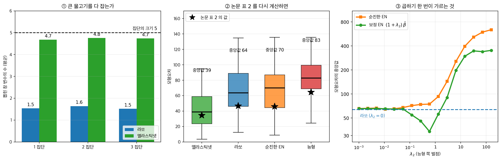
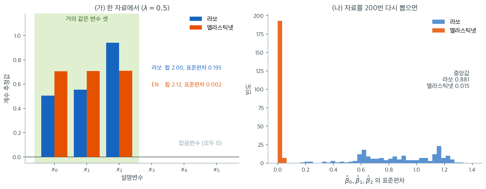
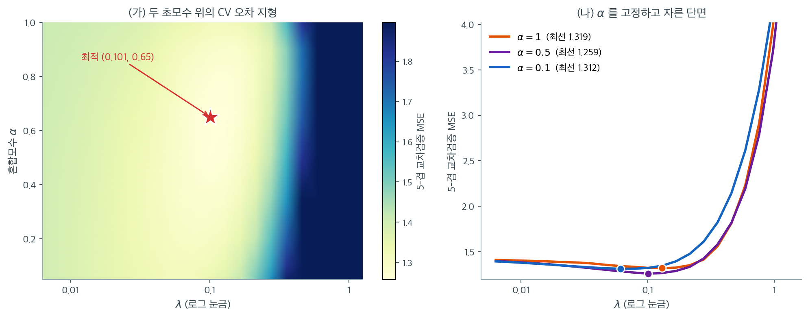

# 엘라스틱넷 정칙화


## 1. 서론

엘라스틱넷은 능형회귀와 라쏘 회귀의 강점을 결합한 정칙화 기법이다. 능형회귀(L2)는 계수 축소에 효과적이지만 변수선택을 하지 못한다. 라쏘(L1)는 일부 계수를 정확히 0으로 만들어 변수선택을 할 수 있지만 상관된 변수에서 어려움을 겪으며 하나만 고르고 나머지를 무시하는 경우가 많다. 엘라스틱넷은 L1과 L2 벌점을 목적함수에 함께 넣어 이 한계들을 다루며, 더 유연하고 견고한 정칙화 접근을 제공한다.

---

## 2. 엘라스틱넷 목적함수

엘라스틱넷은 능형과 라쏘 벌점의 선형결합을 벌점으로 쓴다.

$$
J(\mathbf{w}) = \sum_{i=1}^n \left( y_i - \mathbf{w}^\top \mathbf{x}_i \right)^2 + \lambda_1 \sum_{j=1}^p |w_j| + \lambda_2 \sum_{j=1}^p w_j^2
$$

- $\mathbf{w}$는 회귀계수 벡터다.
- $\lambda_1 \geq 0$은 **L1 정칙화**(라쏘)를 조절하며 일부 계수를 0으로 만들어 희소성을 촉진한다.
- $\lambda_2 \geq 0$은 **L2 정칙화**(능형)를 조절하며 계수를 0으로 만들지 않으면서 축소한다.
- 첫 항은 표준 선형회귀와 같은 잔차제곱합이다.

<div class="storybox" markdown>

**그림으로 보는 통계학 1.** 저자들이 자기 첫 판에 붙인 이름

조우와 헤이스티는 $2005$ 년 논문에서 이 방법에 이름을 붙이며 이렇게 적었다. **"늘어나는 그물이 「큰 물고기를 다 잡는」 것과 비슷하다."** 라쏘는 상관된 변수 집단에서 하나만 건져 올리고 나머지를 놓치는데, 두 벌점을 함께 쓰면 집단을 통째로 건진다는 뜻이다.

그런데 바로 위 $\S 2$ 의 식에는 논문이 따로 붙여 둔 이름이 있다. **「순진한 엘라스틱넷」**(naive elastic net)이다. 자기네가 처음 만든 것에 저자들이 직접 그렇게 적었고, 까닭도 적었다. **"경험적 증거는 순진한 엘라스틱넷이 능형이나 라쏘에 아주 가깝지 않은 한 만족스럽게 작동하지 않음을 보여 준다. 그것이 우리가 이것을 순진하다고 부르는 까닭이다."**

왜 그런가. 순진한 엘라스틱넷은 사실상 두 단계다 — $\lambda_2$ 를 고정해 능형 계수를 구한 뒤 그 경로를 따라 라쏘식 수축을 한 번 더 한다. **"이중의 수축이 일어나는 것으로 보인다. 이중 수축은 분산을 크게 줄여 주지 못하면서 불필요한 편향을 더한다."** 고치는 방법은 곱하기 한 번이다.

$$
\hat{\boldsymbol\beta}(\text{엘라스틱넷}) = (1 + \lambda_2)\,\hat{\boldsymbol\beta}(\text{순진한 엘라스틱넷})
$$

논문의 **보기 4**를 그대로 재현해 보았다. 훈련 $50$ · 검증 $50$ · 시험 $400$, $p = 40$, $\boldsymbol\beta = (3$ 이 $15$ 개, $0$ 이 $25$ 개$)$, $\sigma = 15$. 설명변수는 $x_i = Z_g + \varepsilon_i$ 로 다섯씩 세 집단을 이루고(집단 안 상관이 거의 $1$ 이다) 나머지 $25$ 개는 순수 잡음이다. 자료 $50$ 벌을 만들어 검증집합으로 조율했다.



**① 그물 비유는 사실이다.** 다섯 명짜리 참 집단에서 몇 명을 건지는지 세었다.

| | 집단당 평균 | 가짜 $25$ 개 중 | $0$ 이 아닌 계수 (중앙값) |
|---|---|---|---|
| 라쏘 | $1.5$ / $5$ | $6.1$ 개 | $11$ (논문 $11$) |
| 엘라스틱넷 | $\mathbf{4.7}$ / $5$ | $4.0$ 개 | $17$ (논문 $16$) |

라쏘는 집단마다 한두 개만 건지고, 엘라스틱넷은 거의 다섯을 다 건진다. 그러면서 **가짜는 오히려 덜 집는다**($4.0$ 대 $6.1$).

**② 논문 표 $2$ 가 재현된다.** 그들이 보고한 모형오차의 중앙값과 내 계산을 나란히 놓으면

| | 내 계산 | 논문 |
|---|---|---|
| 엘라스틱넷 | $38.9$ | $34.5$ |
| 라쏘 | $63.5$ | $46.6$ |
| 순진한 EN | $70.1$ | $45.9$ |
| 능형 | $82.7$ | $64.5$ |

절대값은 내 쪽이 고르게 높지만(격자와 조율 방식이 다르다) **네 방법의 순서가 그대로**다. 라쏘 대비 엘라스틱넷의 감소가 내 계산 $39\%$, 논문 $27\%$ 다.

**③ 그 곱하기 하나가 전부다.** $\lambda_2$ 를 하나 고정하고 $\lambda_1$ 만 검증집합으로 고르며 두 추정량을 따라가 보면

- **순진한 엘라스틱넷이 가장 좋은 자리는 $\lambda_2 = 0$ 이다.** 다시 말해 **라쏘 그 자체**이고, $\lambda_2$ 를 조금이라도 넣으면 나빠지기만 한다(그림 ③의 주황 곡선이 파란 점선 위로만 간다).
- 같은 곡선에 $(1+\lambda_2)$ 를 곱하면 $\lambda_2 = 0.59$ 에서 모형오차가 $33.8$ 로 내려간다. **라쏘보다 $47\%$ 낫다.**

같은 추정량이고 다른 것은 상수 하나인데, 하나는 라쏘를 한 번도 이기지 못하고 하나는 절반 가까이 이긴다. 이중 수축이 그만큼이다.

논문은 자기네 방법의 첫 판이 왜 안 되는지를 한 절을 들여 설명하고 그 절에 「순진한」이라는 이름을 남겼다. 통계학 논문에서 흔한 일은 아니다.

_확인한 곳 — 조우와 헤이스티의 「엘라스틱넷을 통한 정칙화와 변수선택」($2003$ 년 $12$ 월 작성, $2004$ 년 $8$ 월 개정) 원문. 인용한 세 문장, 식 $(3)$ 의 순진한 엘라스틱넷 기준과 식 $(11)$ 의 보정 $\hat\beta = \sqrt{1+\lambda_2}\,\hat\beta^*$, 보기 $4$ 의 설정 전부, 표 $2$ 의 네 수 $46.6 / 34.5 / 64.5 / 45.9$ 와 표 $3$ 의 $11 / 16$, 라쏘 대비 감소 $27\%$ 를 모두 그 글에서 확인했다. 그림과 표의 「내 계산」 열은 그 설정을 그대로 돌려 얻은 값이다_

</div>

두 정칙화 항의 결합 덕분에 엘라스틱넷은 변수선택을 수행하면서 상관된 설명변수를 라쏘보다 효과적으로 다룬다.

---

## 3. 주요 특징

### L1과 L2의 결합

L1과 L2 벌점을 섞음으로써 엘라스틱넷은 라쏘와 능형의 이점을 모두 물려받는다. 라쏘처럼 변수선택을 하면서 능형처럼 다중공선성을 관리하고 해를 안정시킨다.

### 상관된 설명변수의 처리

라쏘의 문제 중 하나는 설명변수가 강하게 상관되어 있을 때 하나를 고르고 나머지를 무시하는 경향이다. 엘라스틱넷은 능형 벌점을 적용하여 상관된 변수의 **집단 선택**을 가능하게 한다. 결과적으로 상관된 변수 집단을 함께 선택하거나 함께 배제하는 경향을 보여 더 안정적이고 신뢰할 만한 모형을 만든다.

### 정칙화의 유연성

L1과 L2 벌점의 상대적 기여는 $\lambda_1$과 $\lambda_2$로 조정된다.

- $\lambda_1 = 0$이면 **능형회귀**로 환원된다.
- $\lambda_2 = 0$이면 **라쏘**로 환원된다.

### 라쏘와 갈리는 자리 — 집단 선택

서로 거의 같은 설명변수 셋을 만들어 놓고 라쏘와 엘라스틱넷을 나란히 적합하면
두 방법이 갈리는 자리가 계수에 그대로 드러난다.

갈리는 자리가 어디인지 계수를 직접 보는 것이 목적이다.

<div class="exbox" markdown>

**보기 1.** <span class="diff easy" title="쉬움"></span> 라쏘와 엘라스틱넷의 집단 선택. 공통 신호 $z$에 작은 잡음을 더해 서로 거의 같은 설명변수 $x_0, x_1, x_2$를 만들고 잡음변수 셋을 덧붙인다. 참 모형은 $y = 3z + \varepsilon$이다.

**(1)** 세 계수의 합이 $s > 0$으로 고정되고 셋이 모두 음이 아닐 때, $L_1$ 벌점과 $L_2$ 벌점이 **배분**에 따라 각각 어떻게 달라지는지 구하시오. 이로부터 라쏘의 배분이 불안정한 까닭을 설명하시오.

**(2)** 라쏘와 엘라스틱넷을 적합해 (1)의 예측이 맞는지 확인하시오.

</div>

??? success "풀이"

    **(1) 해석적으로.** $\beta_0 + \beta_1 + \beta_2 = s$이고 $\beta_j \ge 0$이라 하자.

    $L_1$ 벌점은

    $$
    \lvert\beta_0\rvert + \lvert\beta_1\rvert + \lvert\beta_2\rvert = \beta_0+\beta_1+\beta_2 = s
    $$

    로 **배분과 무관하게 언제나 $s$다.** $(s, 0, 0)$이든 $(s/3, s/3, s/3)$이든 벌점이 똑같다. 즉 $L_1$은 이 평면 위에서 완전히 평평하고 어떤 배분도 선호하지 않는다. 잔차제곱합 쪽도 세 변수가 사실상 같으므로 거의 평평하다. **목적함수가 평평하면 배분을 결정하는 것은 자료의 잡음뿐이고**, 자료를 다시 뽑을 때마다 답이 달라진다.

    $L_2$ 벌점은 다르다. $\beta_j = s/3 + e_j$($\sum e_j = 0$)로 쓰면

    $$
    \sum_j \beta_j^2 = \sum_j\left(\frac{s}{3}+e_j\right)^2
    = \frac{s^2}{3} + \frac{2s}{3}\sum_j e_j + \sum_j e_j^2
    = \frac{s^2}{3} + \sum_j e_j^2
    $$

    이고 $\sum_j e_j^2 \ge 0$이므로 **균등배분 $\beta_j = s/3$에서 유일한 최소 $s^2/3$을 갖는다.** 등호는 $e_j$가 모두 0일 때만이다. 따라서 $\alpha < 1$이어서 $L_2$ 성분이 조금이라도 섞이면 평평하던 바닥이 기울어지고 배분이 곧바로 하나로 정해진다. 이것이 **그룹 효과**다.

    **(2) 수치적으로.**

    ```python
    import numpy as np
    from sklearn.linear_model import ElasticNet, Lasso

    rng = np.random.default_rng(42)

    # 서로 거의 같은 설명변수 셋(x0, x1, x2)을 일부러 만든다. 라쏘는 이런 집단에서
    # 하나만 남기고 나머지를 0으로 보내지만, 엘라스틱넷은 셋을 함께 살린다.
    n = 100
    z = rng.normal(size=n)
    X = np.column_stack([
        z + rng.normal(0, 0.05, n),      # x0
        z + rng.normal(0, 0.05, n),      # x1
        z + rng.normal(0, 0.05, n),      # x2
        rng.normal(size=(n, 3)),         # x3, x4, x5 — 잡음 변수
    ])
    y = 3 * z + rng.normal(0, 1, n)

    # l1_ratio 는 두 벌점의 배합비다. 1 이면 순수 라쏘, 0 이면 순수 능형이다.
    lasso = Lasso(alpha=0.5).fit(X, y)
    enet = ElasticNet(alpha=0.5, l1_ratio=0.5).fit(X, y)

    print("계수 (x0~x2 가 서로 거의 같은 변수):")
    print(f"  라쏘      : {np.round(lasso.coef_, 3)}")
    print(f"  엘라스틱넷: {np.round(enet.coef_, 3)}")
    # 두 방법 모두 잡음 변수는 0 으로 보낸다. 갈리는 곳은 x0~x2 안에서다.
    # 라쏘는 셋에 제멋대로 나누어 주고, 엘라스틱넷은 거의 똑같이 나누어 준다.
    # 이 고르기가 곧 집단 선택이며, 능형 벌점이 하는 일이다.
    print(f"x0~x2 계수의 표준편차 — 라쏘 {lasso.coef_[:3].std():.3f}, "
          f"엘라스틱넷 {enet.coef_[:3].std():.3f}")

    # --- (1) 의 유도를 수로 확인한다 ---
    print(f"x0~x2 사이의 상관 = {np.corrcoef(X[:, :3], rowvar=False)[0, 1]:.4f}")
    for name, c in [("라쏘", lasso.coef_[:3]), ("엘라스틱넷", enet.coef_[:3])]:
        s = c.sum()
        print(f"{name:6s} 합 s = {s:.4f}   L1 = {np.abs(c).sum():.4f}   "
              f"L2^2 = {np.sum(c**2):.4f}   균등배분의 L2^2 = s^2/3 = {s**2/3:.4f}")
    ```

    출력:

    ```
    계수 (x0~x2 가 서로 거의 같은 변수):
      라쏘      : [ 0.505  0.555  0.941  0.    -0.    -0.   ]
      엘라스틱넷: [ 0.705  0.707  0.71  -0.    -0.    -0.   ]
    x0~x2 계수의 표준편차 — 라쏘 0.195, 엘라스틱넷 0.002
    x0~x2 사이의 상관 = 0.9959
    라쏘     합 s = 2.0008   L1 = 2.0008   L2^2 = 1.4480   균등배분의 L2^2 = s^2/3 = 1.3344
    엘라스틱넷  합 s = 2.1227   L1 = 2.1227   L2^2 = 1.5019   균등배분의 L2^2 = s^2/3 = 1.5019
    ```

    

    **유도가 수에서 그대로 확인된다.** 두 방법 모두 $L_1$ 값이 세 계수의 합과 소수 넷째 자리까지 **똑같다**($2.0008$과 $2.1227$). (1)에서 말한 "$L_1$은 배분과 무관하다"가 이 등식이다. 반면 $L_2$ 제곱합은 엘라스틱넷에서 $1.5019$로 균등배분의 하한 $s^2/3 = 1.5019$와 **일치**하고, 라쏘에서는 $1.4480$으로 그 하한 $1.3344$보다 $8.5\%$ 크다. 라쏘는 균등배분에서 벗어나 있고 엘라스틱넷은 바닥에 정확히 앉아 있다.

    왼쪽 그림은 위 출력을 막대로 옮긴 것이다. 초록 띠 안의 세 변수는 쌍별 상관이 모두 $0.995$를 넘는 사실상 같은 변수이고, 참값은 셋을 합쳐 $3$이다. 두 방법 모두 **잡음변수 세 개를 정확히 0으로 만들었고 세 계수의 합도 $2.00$ 대 $2.12$로 비슷하다.** 갈리는 곳은 그 합을 어떻게 쪼개느냐뿐이다. 라쏘는 $0.505,\ 0.555,\ 0.941$로 마지막 변수에 두 배 가까이 몰아주고, 엘라스틱넷은 $0.705,\ 0.707,\ 0.710$으로 소수 셋째 자리까지 고르게 나눈다.

    합이 $3$에 못 미치는 것도 읽어 둘 일이다. 벌점이 $\lambda = 0.5$로 세기 때문에 **살아남은 계수도 참값보다 작게 나온다.** 변수를 고르는 일과 계수를 바르게 재는 일은 서로 다른 문제다.

    오른쪽은 그 결과를 200번의 반복으로 확인한 것이다. 세 계수의 표준편차를 재면 엘라스틱넷은 거의 전부 $0.05$ 미만에 쌓이고(중앙값 $0.015$) 라쏘는 $0.2$에서 $1.3$까지 넓게 퍼진다(중앙값 $0.881$). **위 보기에서 본 $0.195$는 라쏘 치고 얌전한 축에 속한 자료였다는 뜻이다.** 자료를 다시 뽑았을 뿐인데 라쏘의 배분은 매번 달라지고, 엘라스틱넷의 배분은 매번 같다. 예측만이 목적이라면 둘 다 쓸 만하지만, 계수를 읽고 보고해야 한다면 이 차이가 결론의 재현성을 가른다.

실무에서는 `sklearn.linear_model.ElasticNetCV`로 $\lambda$와 $\alpha$를 교차검증으로 함께
고른다.

---

## 4. 엘라스틱넷 문제의 풀이

정칙화 항이 결합되어 있어 능형이나 라쏘 단독보다 계산이 무겁다. 그러나 라쏘에 쓰이는 **좌표하강**을 엘라스틱넷에도 효율적으로 적용할 수 있다.

좌표하강은 다른 계수를 고정한 채 계수 하나에 대한 1차원 최적화를 반복적으로 푼다. 고차원 최적화 문제를 단순한 문제들의 열로 분해하므로 설명변수가 많을 때 특히 적합하다. 갱신식은 [엘라스틱넷의 정식화](formulation.md)에 있다.

### 정규직교 계획에서의 해

$X^\top X = n I_p$일 때 $j$번째 계수의 엘라스틱넷 추정치는

$$
\hat{\beta}_j^{\text{EN}} = \frac{1}{1 + \lambda(1 - \alpha)}\, S\!\left(\hat{\beta}_j^{\text{OLS}},\; \lambda \alpha\right)
$$

로 단순해진다. 여기서 $S(\cdot, \cdot)$는 연성 문턱 연산자다. 즉 엘라스틱넷은 먼저 연성
문턱을 적용하고(라쏘 단계) 그다음 축소 배율을 곱한다(능형 단계).

---

### 엘라스틱넷의 좌표하강

좌표하강에서 $j$번째 계수의 갱신식은

$$
\beta_j \leftarrow \frac{S\!\left(X_j^\top r_j / n,\; \lambda \alpha\right)}{1 + \lambda(1 - \alpha)}
$$

이며, 여기서 $r_j = y - X_{-j}\beta_{-j}$는 부분잔차다. 라쏘 갱신식과 비교하면 능형 성분에서
나온 분모 $1 + \lambda(1 - \alpha)$만이 유일한 차이다.

---

## 5. 정칙화 모수의 선택

엘라스틱넷은 두 개의 정칙화 모수 $\lambda_1$, $\lambda_2$를 도입하며, 편향·분산·모형 복잡도의 절충을 위해 신중히 골라야 한다. 보통 **교차검증**으로 선택한다.

### 혼합모수 정식화

실무에서 흔한 접근은 단일 정칙화 모수 $\lambda$와 혼합모수 $\alpha$를 쓰는 것이다.

$$
J(\mathbf{w}) = \sum_{i=1}^n \left( y_i - \mathbf{w}^\top \mathbf{x}_i \right)^2 + \lambda \left( \alpha \sum_{j=1}^p |w_j| + (1-\alpha) \sum_{j=1}^p w_j^2 \right)
$$

- $\alpha = 1$이면 **라쏘**(L1)
- $\alpha = 0$이면 **능형**(L2)
- 그 사이 값은 둘의 균형



두 초모수를 고른다는 것이 실제로 어떤 일인지 보자. 상관 $0.95$인 변수 집단 두 개와 잡음변수 열넷을 가진 자료($n = 80$, $p = 20$)에서 $\lambda$ 22개와 $\alpha$ 9개의 모든 조합에 5-겹 교차검증을 돌린 결과다. 밝을수록 오차가 작다.

지형의 모양을 먼저 보라. **밝은 골짜기가 세로로 길게 뻗어 있다.** 오차는 $\lambda$가 조금만 커져도 급격히 나빠지지만($\lambda = 1$ 근처에서 최선의 네 배가 넘는다) $\alpha$를 따라서는 거의 변하지 않는다. 최적점은 $(\lambda, \alpha) = (0.101,\ 0.65)$에서 CV $1.257$인데, 순수 라쏘($\alpha = 1$)의 최선이 $1.319$, 거의 능형인 $\alpha = 0.05$의 최선도 $1.319$다. **$\alpha$를 최적으로 고른 이득은 5%에 못 미친다.**

오른쪽은 세 $\alpha$에서 자른 단면인데, 세 곡선이 거의 포개져 있고 최저점의 위치만 조금씩 다르다. $\alpha$가 작을수록 최적 $\lambda$가 작아진다는 규칙성은 보이지만($\alpha = 1$에서 $0.13$, $\alpha = 0.1$에서 $0.06$), 그 차이가 오차에 미치는 영향은 미미하다. L1 벌점의 총량 $\alpha\lambda$가 비슷하게 유지되도록 $\lambda$가 저절로 보정되기 때문이다.

여기서 실무 규칙이 나온다. **$(\lambda, \alpha)$ 2차원 격자를 촘촘히 뒤지는 것은 대개 낭비다.** $\alpha$를 $0.5$처럼 합리적인 값에 고정하고 $\lambda$만 정성껏 고르면 최적에 거의 도달한다. $\alpha$를 고르는 일이 중요해지는 때는 예측오차를 마지막 한 자리까지 다툴 때가 아니라, **선택되는 변수의 개수와 집단 구조를 통제하고 싶을 때**다.

---

## 6. 장점과 한계

### 라쏘와 능형 사이를 조절할 수 있다

1. **유연성**: 문제에 따라 라쏘, 능형, 또는 그 조합처럼 행동하도록 조정할 수 있다.
2. **예측 정확도 개선**: 상관된 설명변수를 라쏘보다 잘 다루므로, 변수들이 독립이 아닌 자료에서 예측 정확도가 개선될 수 있다.
3. **집단 선택**: 변수가 자연스럽게 군집을 이루는 유전체학이나 영상처리 같은 분야에서 특히 유용하다.

### 조정할 모수가 하나에서 둘로 는다

1. **조정모수의 복잡성**: $\lambda$와 $\alpha$ 두 모수를 조정해야 하므로 모형선택 과정이 복잡해지고 세심한 교차검증이 필요하다.
2. **계산비용 증가**: 좌표하강으로 풀 수 있지만 정칙화 항이 둘이므로 능형이나 라쏘 단독보다 계산이 무겁다.

---

## 7. 실용적 응용

- **유전체학과 생물정보학**: 수천 개의 유전자 발현 수준이 설명변수이고 상당수가 상관되어 있다. 엘라스틱넷은 다중공선성을 통제하면서 질병이나 형질과 연관된 유전자 집단을 식별할 수 있다.
- **금융**: 여러 시장지수, 금리, 경제지표가 흔히 상관되어 있다. 자산가격이나 위험요인 예측을 위한 견고한 변수 부분집합을 고르는 데 도움이 된다.
- **영상처리**: 영상에서 추출한 변수는 고차원이고 상관되어 있다. 예측 정확도를 유지하면서 차원을 줄이는 데 쓸 수 있다.

---

## 연습문제

<div class="drillbox" markdown>

**연습문제 1.** <span class="diff med" title="중간"></span>
이 페이지의 목적함수와 [정식화 페이지](formulation.md)의 목적함수가 어떻게 다른지 비교하고, 배율의 차이가 실무에서 왜 문제가 되는지 설명하라.

</div>

??? success "풀이"
    두 정식화를 나란히 놓는다.

    | 출처 | 목적함수 |
    |:---|:---|
    | 이 페이지 | $\|\mathbf{y}-\mathbf{X}\mathbf{w}\|^2 + \lambda(\alpha\|\mathbf{w}\|_1 + (1-\alpha)\|\mathbf{w}\|_2^2)$ |
    | 정식화 페이지 | $\frac{1}{2n}\|\mathbf{y}-\mathbf{X}\boldsymbol\beta\|^2 + \lambda(\alpha\|\boldsymbol\beta\|_1 + \frac{1-\alpha}{2}\|\boldsymbol\beta\|_2^2)$ |
    | scikit-learn | 정식화 페이지와 같음(`alpha`$=\lambda$, `l1_ratio`$=\alpha$) |

    **세 가지가 다르다.** 손실항의 $1/(2n)$ 유무, L2 항의 $1/2$ 유무, 그리고 그로부터 따라오는 $\lambda$의 척도다.

    같은 해를 얻으려면 어떻게 환산해야 하는가. sklearn 목적함수에 $2n$을 곱하면 손실항이 이 페이지와 같아지고 벌점은 $2n\lambda_{\text{sk}}\bigl(\alpha_{\text{sk}}\lVert\boldsymbol\beta\rVert_1 + \frac{1-\alpha_{\text{sk}}}{2}\lVert\boldsymbol\beta\rVert_2^2\bigr)$가 된다. 이것을 §2의 $\lambda_1\lVert\mathbf{w}\rVert_1 + \lambda_2\lVert\mathbf{w}\rVert_2^2$와 항마다 맞추면

    $$
    \lambda_1 = 2n\,\lambda_{\text{sk}}\,\alpha_{\text{sk}}, \qquad \lambda_2 = n\,\lambda_{\text{sk}}\,(1 - \alpha_{\text{sk}})
    $$

    이다. **두 항의 배율이 $2n$과 $n$으로 서로 다르다**는 데 주의하라. 그래서 $\lambda$ 하나만 고쳐서는 맞출 수 없고 혼합모수까지 함께 바뀐다. $\lambda = \lambda_1 + \lambda_2$, $\alpha = \lambda_1/(\lambda_1+\lambda_2)$로 되돌리면

    $$
    \lambda_{\text{이 페이지}} = n\,\lambda_{\text{sk}}(1 + \alpha_{\text{sk}}), \qquad \alpha_{\text{이 페이지}} = \frac{2\alpha_{\text{sk}}}{1 + \alpha_{\text{sk}}}
    $$

    가 된다. 예컨대 $\alpha_{\text{sk}} = 0.5$는 이 페이지의 $\alpha = 2/3$에 해당한다.

    **왜 실무에서 문제가 되는가.** 이 페이지의 $\lambda = 1$, $\alpha = 0.5$(즉 $\lambda_1 = \lambda_2 = 0.5$)를 뜻하면서 `ElasticNet(alpha=1, l1_ratio=0.5)`를 그대로 쓰면, $n = 100$에서 실제로 걸리는 벌점은 $\lambda_1 = 100$, $\lambda_2 = 50$이다. **L1은 200배, L2는 100배 강해진다.** 모든 계수가 0이 되는 결과를 보고 "정칙화가 너무 세다"고 오해하기 쉽다.

    **실무 규칙:** $\lambda$의 절대값을 문헌에서 가져오지 말고, 언제나 $\lambda_{\max}$를 기준으로 한 **상대 격자**($\lambda_{\max}$의 $10^{-3}$배에서 $1$배까지)를 쓰고 교차검증으로 고른다. 그러면 배율 규약이 무엇이든 자동으로 흡수된다.

---

<div class="drillbox" markdown>

**연습문제 2.** <span class="diff med" title="중간"></span>
$\lambda_1, \lambda_2$ 매개화와 $\lambda, \alpha$ 매개화가 동등함을 보이고, 후자가 실무에서 선호되는 이유를 설명하라.

</div>

??? success "풀이"
    $\lambda_1 = \lambda\alpha$, $\lambda_2 = \lambda(1-\alpha)$로 두면 두 벌점이 일치한다. 역방향은

    $$
    \lambda = \lambda_1 + \lambda_2, \qquad \alpha = \frac{\lambda_1}{\lambda_1 + \lambda_2}
    $$

    이다. 두 매개화는 $(0,\infty)^2$와 $(0,\infty)\times(0,1)$ 사이의 일대일 대응이므로 완전히 동등하다.

    **그런데도 $(\lambda, \alpha)$가 선호되는 이유는 두 축이 서로 다른 일을 하기 때문이다.**

    | 모수 | 조절하는 것 |
    |:---|:---|
    | $\lambda$ | 전체 정칙화 **강도** — 모형이 얼마나 단순해지는가 |
    | $\alpha$ | 벌점의 **성격** — 희소성이냐 안정성이냐 |

    $(\lambda_1, \lambda_2)$ 매개화에서는 두 모수가 강도와 성격에 **동시에** 영향을 준다. $\lambda_1$만 키우면 강도도 세지고 성격도 라쏘 쪽으로 간다. 격자탐색의 결과를 해석하기 어렵다.

    $(\lambda, \alpha)$에서는 축이 분리된다. 그래서 실무 절차가 단순해진다.

    1. $\alpha$를 몇 개(예: $0.1, 0.5, 0.9, 1.0$)로 고정한다.
    2. 각 $\alpha$에 대해 $\lambda_{\max}(\alpha)$부터 내려오는 경로를 계산한다.
    3. 전체에서 CV 오차가 가장 낮은 $(\lambda, \alpha)$를 고른다.

    2단계가 값싼 이유가 여기에 있다. $\alpha$가 고정되면 좌표하강의 온기 시작으로 전체 $\lambda$ 경로를 한 번에 계산할 수 있다. $(\lambda_1, \lambda_2)$ 격자에서는 이런 경로 구조를 쓸 수 없다.

---

<div class="drillbox" markdown>

**연습문제 3.** <span class="diff med" title="중간"></span>
설명변수가 서로 직교하고 $\mathbf{x}_j^\top\mathbf{x}_j = 1$이며 $\mathbf{y}$가 중심화되어 있다고 하자. $b_j = \mathbf{x}_j^\top\mathbf{y}$로 둔다.

**(a)** §2의 목적함수 $J(\mathbf{w})$가 좌표마다 분리됨을 보이고 $\hat{w}_j$를 $b_j, \lambda_1, \lambda_2$의 닫힌 꼴로 구하라.

**(b)** $b = (3,\ 1,\ 0.4)$, $\lambda_1 = \lambda_2 = 1$에서 OLS·라쏘·능형·엘라스틱넷의 네 해를 수로 적어라. 이 $(\lambda_1, \lambda_2)$는 §5의 매개화로 어떤 $(\lambda, \alpha)$인가?

**(c)** 모든 계수를 0으로 만드는 가장 작은 $\lambda$를 $\alpha$의 식으로 구하고, $\alpha = 0$에서 무슨 일이 일어나는지 말하라.

</div>

??? success "풀이"
    **(a)** $\mathbf{X}^\top\mathbf{X} = \mathbf{I}$이므로 잔차제곱합이

    $$
    \lVert \mathbf{y} - \mathbf{X}\mathbf{w}\rVert^2 = \lVert \mathbf{y}\rVert^2 - 2\sum_j b_j w_j + \sum_j w_j^2
    $$

    로 풀린다. 벌점도 좌표별 합이므로 $J(\mathbf{w}) = \lVert\mathbf{y}\rVert^2 + \sum_j g(w_j)$이고

    $$
    g(w) = (1+\lambda_2)w^2 - 2 b_j w + \lambda_1 \lvert w\rvert
    $$

    이다. $w > 0$ 구간에서 $g'(w) = 2(1+\lambda_2)w - 2b_j + \lambda_1 = 0$이므로 $w = (b_j - \lambda_1/2)/(1+\lambda_2)$인데, 이것이 양수일 조건이 $b_j > \lambda_1/2$다. $w<0$에서 대칭으로 하고, $\lvert b_j\rvert \le \lambda_1/2$이면 좌미분이 음이 아니고 우미분이 양이 아니어서 $w=0$이 최소점이다. 합치면

    $$
    \hat{w}_j = \frac{\operatorname{sign}(b_j)\bigl(\lvert b_j\rvert - \lambda_1/2\bigr)_+}{1 + \lambda_2}
    $$

    이다. **문턱이 $\lambda_1$이 아니라 $\lambda_1/2$인 것에 주의하라.** §2의 손실항에 $1/2$이 없기 때문에 미분에서 2가 나오고 그 2가 벌점 쪽으로 넘어간 것이다. 손실을 $\frac{1}{2}\lVert\mathbf{y}-\mathbf{X}\mathbf{w}\rVert^2$로 쓰는 책의 공식을 그대로 베끼면 문턱이 두 배로 틀어진다.

    **(b)** $\mathbf{x}_j$가 단위노름이고 직교이므로 $\hat w_j^{\text{OLS}} = b_j$다. 문턱은 $\lambda_1/2 = 0.5$, 분모는 $1+\lambda_2 = 2$다.

    | 방법 | $(\lambda_1, \lambda_2)$ | $\hat w_1$ | $\hat w_2$ | $\hat w_3$ |
    |:---|:---|---:|---:|---:|
    | OLS | $(0, 0)$ | 3 | 1 | 0.4 |
    | 라쏘 | $(1, 0)$ | 2.5 | 0.5 | **0** |
    | 능형 | $(0, 1)$ | 1.5 | 0.5 | 0.2 |
    | 엘라스틱넷 | $(1, 1)$ | 1.25 | 0.25 | **0** |

    $\lambda_1 = \lambda\alpha = 1$, $\lambda_2 = \lambda(1-\alpha) = 1$을 풀면 $\lambda = 2$, $\alpha = 0.5$다.

    두 가지가 눈에 띈다. 능형은 $\hat w_3 = 0.2$로 작지만 0이 아니다. **분모로 나누는 연산은 0을 만들 수 없다.** 반면 라쏘와 엘라스틱넷은 문턱 연산이 앞에 붙어 $\lvert b_3\rvert = 0.4 < 0.5$를 정확히 0으로 지운다. §3에서 "$\lambda_2$는 0으로 만들지 않으면서 축소한다"고 한 말의 수식이 바로 이 분모와 분자의 역할 분담이다.

    **(c)** 모든 $j$에서 $\hat w_j = 0$이려면 $\lvert b_j\rvert \le \lambda_1/2 = \alpha\lambda/2$가 모두 성립해야 한다. 따라서

    $$
    \lambda_{\max}(\alpha) = \frac{2\max_j \lvert b_j\rvert}{\alpha} = \frac{6}{\alpha}
    $$

    이다. $\alpha = 1$이면 $6$, $\alpha = 0.5$이면 $12$, $\alpha = 0.1$이면 $60$이다. $\alpha = 0$에서는 분모가 0이 되어 **어떤 유한한 $\lambda$로도 계수가 0이 되지 않는다.** 능형 경로는 $\lambda \to \infty$에서만 0에 닿는다.

    이것이 연습문제 1의 실무 규칙이 왜 $\lambda_{\max}$를 기준으로 한 상대 격자를 쓰라고 했는지 설명한다. $\lambda_{\max}$ 자체가 $1/\alpha$로 변하므로 $\alpha$가 다른 두 모형을 같은 $\lambda$ 격자에서 비교하는 것은 애초에 공정하지 않다.

---

<div class="drillbox" markdown>

**연습문제 4.** <span class="diff med" title="중간"></span>
연습문제 3과 같은 직교설계에서 $\mathbf{y} = \mathbf{X}\mathbf{w} + \boldsymbol\varepsilon$, $\boldsymbol\varepsilon \sim N(\mathbf{0}, \sigma^2\mathbf{I})$라 하자. 그러면 $b_j \sim N(w_j, \sigma^2)$이다. 순수 능형($\lambda_1 = 0$)을 쓴다.

**(a)** $\hat w_j = b_j/(1+\lambda_2)$의 평균제곱오차를 $\lambda_2$의 함수로 적고, 도함수가 $\lambda_2 = 0$에서 음수임을 보여라. 즉 **OLS를 이기는 $\lambda_2 > 0$이 언제나 존재한다.**

**(b)** 그 MSE를 최소화하는 $\lambda_2^\ast$와 그때의 MSE를 구하라. $w_j = 1$, $\sigma^2 = 0.25$이면 수가 얼마인가?

**(c)** $p$개 좌표의 MSE 합을 최소화하는 공통 $\lambda_2^\ast$를 구하고, 능형의 이득이 어떤 상황에서 커지는지 한 줄로 말하라.

</div>

??? success "풀이"
    **(a)** 축소인자를 $c = 1/(1+\lambda_2)$로 쓰면 $\hat w_j = c\,b_j$이므로 분산은 $c^2\sigma^2$, 편향은 $(c-1)w_j$다. 5장의 편향–분산 분해로

    $$
    \text{MSE}(\lambda_2) = \frac{\sigma^2}{(1+\lambda_2)^2} + \frac{\lambda_2^2 w_j^2}{(1+\lambda_2)^2} = \frac{\sigma^2 + \lambda_2^2 w_j^2}{(1+\lambda_2)^2}
    $$

    이다. 미분하면

    $$
    \frac{d}{d\lambda_2}\text{MSE} = \frac{2\lambda_2 w_j^2 (1+\lambda_2)^2 - 2(1+\lambda_2)(\sigma^2 + \lambda_2^2 w_j^2)}{(1+\lambda_2)^4} = \frac{2\bigl(\lambda_2 w_j^2 - \sigma^2\bigr)}{(1+\lambda_2)^3}
    $$

    이고, $\lambda_2 = 0$에서 값이 $-2\sigma^2 < 0$이다. **$\sigma^2 > 0$이면 언제나 음수다.** $\lambda_2 = 0$에서 분산은 1차로 줄어드는데($O(\lambda_2)$) 편향제곱은 2차로만 늘어나므로($O(\lambda_2^2)$), 벌점을 조금 켜는 것은 **공짜에 가까운 거래**다. 이 장 전체의 긴장이 이 한 줄에 들어 있다.

    **(b)** 도함수가 0이 되는 점이 $\lambda_2^\ast = \sigma^2/w_j^2$이고, 그 좌우에서 부호가 음에서 양으로 바뀌므로 최소점이다. 대입하면

    $$
    \text{MSE}(\lambda_2^\ast) = \frac{\sigma^2 + \sigma^4/w_j^2}{(1+\sigma^2/w_j^2)^2} = \frac{\sigma^2 w_j^2}{w_j^2 + \sigma^2} = \frac{\sigma^2}{1 + \sigma^2/w_j^2} < \sigma^2
    $$

    이다. $w_j = 1$, $\sigma^2 = 0.25$이면 $\lambda_2^\ast = 0.25$이고 $\text{MSE} = 0.25/1.25 = 0.2$다. OLS의 MSE는 $\sigma^2 = 0.25$이므로 **20% 개선**이다. $\lambda_2^\ast = \sigma^2/w_j^2$는 신호 대 잡음비의 역수이니, 잡음이 크고 참 계수가 작을 때 최적 벌점이 세다.

    **(c)** 좌표마다 분모가 같으므로 합의 도함수는

    $$
    \frac{d}{d\lambda_2}\sum_{j=1}^p \text{MSE}_j = \frac{2\bigl(\lambda_2 \lVert\mathbf{w}\rVert^2 - p\sigma^2\bigr)}{(1+\lambda_2)^3}
    $$

    이고 $\lambda_2^\ast = p\sigma^2/\lVert\mathbf{w}\rVert^2$다. 분자에 $p$가 있으므로 **설명변수가 많을수록, 그리고 참 계수들이 작을수록 최적 벌점이 커지고 이득도 커진다.** 참 계수가 0인 좌표가 섞여 있으면 그 좌표는 $\lVert\mathbf{w}\rVert^2$에 기여하지 않으면서 분자에는 $\sigma^2$을 더하므로 최적 $\lambda_2$를 끌어올린다. §7의 유전체학처럼 약한 효과가 수천 개 깔린 자료에서 정칙화가 특히 유리한 까닭이다.

---

<div class="drillbox" markdown>

**연습문제 5.** <span class="diff hard" title="어려움"></span>
연습문제 3의 설계에서 $\mathbf{x}_3$이 미터 단위로 재어진 변수였다고 하자. 이것을 센티미터로 바꾸면 열이 $\tilde{\mathbf{x}}_3 = 100\,\mathbf{x}_3$으로 바뀐다. 다른 열과 $\lambda_1 = 1$, $\lambda_2 = 0$은 그대로 둔다.

**(a)** 열의 노름이 $\mathbf{x}_j^\top\mathbf{x}_j = s_j$로 일반화된 경우의 라쏘 해를 구하라.

**(b)** 단위를 바꾼 뒤 $\hat{\tilde w}_3$과 그 변수의 **원래 척도 기여** $100\,\hat{\tilde w}_3$을 계산하여 연습문제 3(b)의 결과와 비교하라. OLS에서는 같은 일이 일어나는가?

**(c)** 일반적으로 $\mathbf{x}_j \to c\,\mathbf{x}_j$($c>0$)일 때 원래 척도에서 본 **실효 문턱**이 어떻게 변하는지 식으로 적고, 표준화가 왜 선택이 아니라 필수인지 설명하라.

</div>

??? success "풀이"
    **(a)** 좌표별 목적함수가 $g(w) = s_j w^2 - 2 b_j w + \lambda_1\lvert w\rvert$로 바뀌므로(여기서 $b_j = \mathbf{x}_j^\top\mathbf{y}$) 연습문제 3(a)와 같은 계산으로

    $$
    \hat w_j = \frac{\operatorname{sign}(b_j)\bigl(\lvert b_j\rvert - \lambda_1/2\bigr)_+}{s_j}
    $$

    이다. **분모는 척도를 따라 커지지만 분자의 문턱 $\lambda_1/2$는 척도를 모른다.** 이 비대칭이 모든 문제의 근원이다.

    **(b)** 단위를 바꾸면 $\tilde s_3 = 100^2 = 10^4$, $\tilde b_3 = 100 \times 0.4 = 40$이다. 문턱 $0.5$를 넘으므로

    $$
    \hat{\tilde w}_3 = \frac{40 - 0.5}{10^4} = 0.00395, \qquad 100\,\hat{\tilde w}_3 = 0.395
    $$

    가 된다. 미터로 재었을 때는 $\lvert b_3 \rvert = 0.4 < 0.5$라서 **배제되었던 변수**가, 센티미터로 재자 원래 척도 기준 $0.395$라는 거의 OLS($0.4$)에 가까운 계수로 **살아 돌아온다.** 자료는 한 비트도 바뀌지 않았고 바뀐 것은 자의 단위뿐이다.

    OLS에서는 이런 일이 없다. $\hat{\tilde w}_3^{\text{OLS}} = \tilde b_3/\tilde s_3 = 40/10^4 = 0.004$이고 원래 척도 기여는 $100 \times 0.004 = 0.4$로 전과 똑같다. **OLS는 열의 재척도에 등변이고(적합값이 불변) 벌점추정량은 그렇지 않다.**

    **(c)** $\mathbf{x}_j \to c\,\mathbf{x}_j$이면 $b_j \to c\,b_j$, $s_j \to c^2 s_j$이므로 원래 척도에서 본 기여는

    $$
    c\,\hat{\tilde w}_j = \frac{c\bigl(c\lvert b_j\rvert - \lambda_1/2\bigr)_+}{c^2 s_j} = \frac{\bigl(\lvert b_j\rvert - \lambda_1/(2c)\bigr)_+}{s_j}
    $$

    다. 즉 **변수를 $c$배 하는 것은 그 변수에만 벌점을 $1/c$배로 깎아 주는 것과 똑같다.** 센티미터로 바꾸면 벌점이 100분의 1이 되고, 킬로미터로 바꾸면 1000배가 되어 거의 확실히 지워진다.

    따라서 공통 $\lambda_1$은 **모든 열이 같은 척도에 있을 때만** 의미가 있다. 표준화( $s_j$를 모두 같게 만드는 것)는 취향이 아니라 벌점을 공정하게 분배하기 위한 전제조건이다. 실무에서 조심할 점이 둘이다.

    - sklearn의 `Ridge`·`Lasso`·`ElasticNet`은 **표준화를 해 주지 않는다.** `StandardScaler`를 파이프라인으로 앞에 붙여야 한다.
    - 절편은 벌점에서 빼야 한다. 절편에 벌점을 걸면 $\mathbf{y}$에 상수를 더하는 것만으로 해가 달라진다. 설명변수를 중심화하고 $\mathbf{y}$를 중심화하면 절편이 분리되어 이 문제가 사라진다.

---

<div class="drillbox" markdown>

**연습문제 6.** <span class="diff hard" title="어려움"></span>
§5는 $\alpha$가 달라도 오차가 비슷한 이유를 "L1 벌점의 총량 $\alpha\lambda$가 비슷하게 유지되도록 $\lambda$가 저절로 보정되기 때문"이라고 설명한다. 같은 절에 적힌 세 최적점($\alpha = 1$에서 $\lambda = 0.13$, 최적점 $(\lambda, \alpha) = (0.101,\ 0.65)$, $\alpha = 0.1$에서 $\lambda = 0.06$)으로 이 설명을 검증하라. 설명이 맞지 않다면 틀어진 곳을 지적하고, 연습문제 3(a)의 축소공식으로 올바른 설명을 제시하라.

</div>

??? success "풀이"
    먼저 $\alpha\lambda$를 세 점에서 계산한다.

    | $\alpha$ | $\lambda^\ast$ | L1 총량 $\alpha\lambda$ | L2 총량 $(1-\alpha)\lambda$ |
    |---:|---:|---:|---:|
    | 1 | 0.13 | 0.130 | 0 |
    | 0.65 | 0.101 | 0.0657 | 0.0354 |
    | 0.1 | 0.06 | 0.0060 | 0.0540 |

    **$\alpha\lambda$는 전혀 일정하지 않다.** 가장 큰 값과 가장 작은 값의 비가 $0.130/0.0060 \approx 21.7$배다. 반면 $\lambda$ 자체는 $0.13$에서 $0.06$으로 **2.2배**밖에 움직이지 않는다. 그러니 "$\lambda$가 $\alpha\lambda$를 지키려고 보정된다"는 설명은 자료가 말하는 것과 반대다.

    방향도 반대다. $\alpha\lambda$를 일정하게 유지하려면 $\alpha$가 작아질 때 $\lambda$가 **커져야** 한다($\alpha = 0.1$이면 $\lambda = 1.3$). 그러나 §5가 보고한 최적 $\lambda$는 오히려 작아졌고, 게다가 같은 절은 $\lambda = 1$ 근처에서 오차가 최선의 네 배가 넘는다고 적어 놓았다. $\alpha\lambda$ 불변 규칙은 그 규칙대로 가면 오차가 네 배 나빠지는 자리를 가리킨다. **스스로를 반증한다.**

    **옳은 설명은 축소공식에서 나온다.** 연습문제 3(a)에 $(\lambda, \alpha)$를 넣으면

    $$
    \hat w_j = \frac{\operatorname{sign}(b_j)\bigl(\lvert b_j\rvert - \alpha\lambda/2\bigr)_+}{1 + (1-\alpha)\lambda}
    $$

    이다. $\alpha$는 두 곳에 들어가는데 서로 반대로 작동한다. $\alpha$를 줄이면 분자의 문턱 $\alpha\lambda/2$가 약해지지만 분모의 축소 $1+(1-\alpha)\lambda$가 세진다. **빠진 벌점이 사라지는 것이 아니라 L1에서 L2로 옮겨 가는 것이다.** 큰 계수 $b_j = 1.5$가 어떻게 되는지 세 설정에서 보자.

    | 설정 | 문턱 $\alpha\lambda/2$ | 분모 $1+(1-\alpha)\lambda$ | $b_j = 1.5$의 추정값 |
    |:---|---:|---:|---:|
    | $\alpha = 1,\ \lambda = 0.13$ | 0.0650 | 1.000 | 1.435 |
    | $\alpha = 0.65,\ \lambda = 0.101$ | 0.0328 | 1.035 | 1.417 |
    | $\alpha = 0.1,\ \lambda = 0.06$ | 0.0030 | 1.054 | 1.420 |
    | $\alpha = 0.1,\ \lambda = 1.3$ (총량 고정) | 0.0650 | 2.170 | **0.661** |

    앞의 세 줄은 경로가 전혀 다른데도 같은 계수를 $1.42 \sim 1.44$로 거의 똑같이 축소한다. **예측오차를 결정하는 것은 벌점의 성격이 아니라 계수에 실제로 가해진 총 축소량이고, 그 총량은 $\alpha\lambda$가 아니라 대체로 $\lambda$가 정한다.** 이것이 §5의 그림에서 밝은 골짜기가 $\lambda$ 축에 수직으로, $\alpha$ 축에 평행하게 길게 뻗는 이유다.

    마지막 줄이 $\alpha\lambda$ 규칙의 대가를 보여 준다. L1 문턱을 $\alpha = 1$과 같게 맞추려고 $\lambda$를 1.3까지 올리면 분모가 $2.17$이 되어 계수가 절반 이하로 짓눌린다. $\alpha$가 작을 때 $\lambda$를 키우는 것이 위험한 이유는, L2 축소가 **작은 계수만 고르는 문턱과 달리 모든 계수에 비례로 작용**하기 때문이다.

---

<div class="drillbox" markdown>

**연습문제 7.** <span class="diff hard" title="어려움"></span>
§5의 격자탐색은 각 $(\lambda, \alpha)$에서 5-겹 교차검증 오차를 쓴다. 그런데 자료를 폴드로 나누기 전에 전체 자료로 $\mathbf{y}$를 중심화했다고 하자($\mathbf{y} \leftarrow \mathbf{y} - \bar y$). 격자의 오른쪽 끝, 즉 모든 계수가 0이 되는 $\lambda$에서 LOOCV($K = n$) 오차를 생각한다.

**(a)** 누수가 있는 계산과 정직한 계산의 오차를 각각 $\{y_i\}$로 적고, 둘의 비를 $n$의 식으로 구하라.

**(b)** $n = 5$, $\mathbf{y} = (2, 4, 4, 6, 9)$에서 두 값을 수로 구하라. §5의 $n = 80$에서는 과소평가가 몇 %인가?

**(c)** 설명변수 표준화를 폴드 밖에서 하는 누수는 (a)의 한계와 같은 방식으로 작아지는가?

</div>

??? success "풀이"
    **(a)** 모든 계수가 0이면 예측값은 절편뿐이다.

    *누수가 있는 계산.* 전체 평균으로 이미 중심화했으므로 각 검증점의 예측값은 $0$, 즉 원래 척도로는 $\bar y$다. 그래서

    $$
    \text{CV}_{\text{누수}} = \frac{1}{n}\sum_{i=1}^n (y_i - \bar y)^2
    $$

    가 보고된다. **검증점 $y_i$가 자기 예측값을 만드는 데 이미 참여했다.**

    *정직한 계산.* $i$를 뺀 나머지로 절편을 추정해야 한다. $\bar y_{-i} = (n\bar y - y_i)/(n-1)$이므로

    $$
    y_i - \bar y_{-i} = \frac{(n-1)y_i - n\bar y + y_i}{n-1} = \frac{n}{n-1}(y_i - \bar y)
    $$

    이고

    $$
    \text{CV}_{\text{정직}} = \left(\frac{n}{n-1}\right)^2 \frac{1}{n}\sum_{i=1}^n (y_i - \bar y)^2 = \left(\frac{n}{n-1}\right)^2 \text{CV}_{\text{누수}}
    $$

    다. 따라서 비는

    $$
    \frac{\text{CV}_{\text{누수}}}{\text{CV}_{\text{정직}}} = \left(\frac{n-1}{n}\right)^2
    $$

    로 **언제나 1보다 작다.** 누수는 오차를 반드시 과소평가한다.

    **(b)** $\bar y = 5$, 편차가 $(-3, -1, -1, 1, 4)$, 제곱합이 $9+1+1+1+16 = 28$이므로 $\text{CV}_{\text{누수}} = 28/5 = 5.6$이다. 정직한 쪽은 편차를 $5/4$배 한 $(-3.75, -1.25, -1.25, 1.25, 5)$의 제곱평균이니

    $$
    \text{CV}_{\text{정직}} = \frac{14.0625 + 1.5625 + 1.5625 + 1.5625 + 25}{5} = \frac{43.75}{5} = 8.75
    $$

    이고, 과연 $5.6 = (4/5)^2 \times 8.75$다. **36% 과소평가**다. $n = 80$이면 $1 - (79/80)^2 = 2.48\%$로 작다.

    **(c)** 둘을 구별해야 한다. 누수가 얼마나 나쁜지는 그 전처리가 **$\mathbf{y}$를 보는가**로 갈린다.

    설명변수 표준화는 $\mathbf{X}$만 쓰는 비지도 조작이다. 검증점이 자기 열의 평균·표준편차에 $1/n$만큼 기여할 뿐 반응을 들여다보지 않으므로, 편향은 (a)와 같은 $O(1/n)$ 수준이고 방향도 일정하지 않다. $n = 80$ 규모에서 실질적인 왜곡을 주는 일은 드물다. 그래서 (c)의 답은 "대체로 그렇다"다.

    위험한 것은 $\mathbf{y}$를 쓰는 조작이다. (a)의 중심화가 그 가장 약한 형태이고, 반응과의 상관으로 변수를 미리 선별하는 것이 가장 심한 형태다. 후자는 $p \gg n$에서 순수한 잡음만으로도 CV 오차를 거의 0까지 끌어내릴 수 있고, 표본이 커져도 $p$가 함께 커지면 사라지지 않는다. 같은 교차검증으로 $(\lambda, \alpha)$를 고르고 그 최솟값을 성능으로 보고하는 것도 — 격자가 클수록 커지는 — $\mathbf{y}$ 쪽 누수다.

    그래서 규칙은 하나다. **모든 전처리를 파이프라인으로 묶어 그 전체를 교차검증에 넘긴다.** 그러면 훈련 폴드에서 계산한 평균과 표준편차가 검증 폴드에 적용되어 중심화·표준화·선별·결측 대치의 누수가 구조적으로 막히고, 초모수 선택까지 포함해 정직하게 재려면 안쪽 격자탐색을 감싸는 **중첩 교차검증**을 쓴다.

---

<div class="drillbox" markdown>

**연습문제 8.** <span class="diff hard" title="어려움"></span>
능형의 유효자유도는 $\mathbf{X}$의 특잇값 $d_j$로 $\text{df}(\lambda_2) = \sum_j d_j^2/(d_j^2 + \lambda_2)$이고($\to$ [정보기준](../tuning/information_criteria.md)), 고유방향 $j$의 계수 분산과 편향은 각각 $d_j^2\sigma^2/(d_j^2+\lambda_2)^2$, $-\lambda_2 w_j/(d_j^2+\lambda_2)$다. $p = 2$이고 특잇값이 $d = (3,\ 0.1)$인 심한 다중공선 설계를 생각한다.

**(a)** §5의 최적점 $(\lambda, \alpha) = (0.101,\ 0.65)$에 대응하는 $\lambda_2$를 구하고 $\text{df}$를 계산하라. $\alpha = 1$(순수 라쏘)이면 $\text{df}$는 어떻게 되는가?

**(b)** 두 고유방향에서 OLS와 능형의 MSE를 $\sigma = 1$, $w_j = 1$로 비교하라.

**(c)** §5는 "$\alpha$를 최적으로 고른 이득은 5%에 못 미친다"고 했다. 그렇다면 $\alpha < 1$을 쓸 이유가 무엇인지 (b)의 수로 답하라.

</div>

??? success "풀이"
    **(a)** 연습문제 2의 대응으로 $\lambda_2 = \lambda(1-\alpha) = 0.101 \times 0.35 = 0.03535$다.

    $$
    \text{df}(0.03535) = \frac{9}{9.03535} + \frac{0.01}{0.04535} = 0.9961 + 0.2205 = 1.2166
    $$

    이다. **두 변수를 썼는데 유효자유도가 1.22다.** 강한 방향($d_1 = 3$)은 거의 손대지 않고($0.996$) 약한 방향($d_2 = 0.1$)만 $0.22$로 눌렸다. 벌점이 자료가 잘 아는 방향은 놓아두고 모르는 방향만 지운다.

    $\alpha = 1$이면 $\lambda_2 = \lambda(1-\alpha) = 0$이어서 $\text{df} = 1 + 1 = 2$다. **L1 벌점은 고유방향을 축소하지 않는다.** 라쏘는 계수를 0으로 지울 수는 있어도, 두 변수가 둘 다 선택된 뒤 그 둘의 **차이 방향**에 생기는 불안정은 전혀 다루지 못한다.

    **(b)** $\sigma = 1$, $w_j = 1$에서 OLS의 MSE는 분산뿐이므로 $1/d_j^2$다.

    | 방향 | $d_j$ | OLS MSE | 능형 분산 | 능형 편향$^2$ | 능형 MSE |
    |:---|---:|---:|---:|---:|---:|
    | 강함 | 3 | 0.1111 | 0.1102 | 0.0000 | 0.1103 |
    | 약함 | 0.1 | **100.0** | 4.862 | 0.6076 | **5.470** |

    약한 방향에서 $\lambda_2 = 0.03535$는 편향을 $-0.7795$(참값의 78%!)나 만들지만 분산을 $100$에서 $4.86$으로 20배 줄여, MSE를 $100 \to 5.47$로 **18배 낮춘다.** 강한 방향은 $0.1111 \to 0.1103$으로 사실상 그대로다. 편향을 사서 분산을 파는 거래가 **어디서 남는 장사인지**가 이 표에 있다. 거래가 유리한 곳은 자료가 방향을 결정하지 못하는 곳, 곧 작은 특잇값이 있는 곳이다.

    **(c)** 교차검증 오차의 5%는 **예측** 성능의 차이일 뿐이다. 예측은 강한 방향이 거의 다 설명하므로 약한 방향을 어떻게 처리해도 평균제곱예측오차는 조금만 움직인다. 그러나 **계수를 읽으려면** 이야기가 달라진다. $\alpha = 1$에서 약한 방향의 계수분산은 $100\sigma^2$로, 자료를 다시 뽑을 때마다 부호까지 바뀐다. $\alpha = 0.65$면 그것이 $4.86\sigma^2$이 된다.

    §5의 마지막 문단이 바로 이것을 말한다. $\alpha$를 고르는 일이 중요해지는 때는 예측오차를 마지막 한 자리까지 다툴 때가 아니라 **선택되는 변수와 계수의 안정성을 통제하고 싶을 때**다. 같은 이야기를 상관된 쌍의 언어로 옮긴 것이 [그룹 효과](grouping_effect.md)의 Zou–Hastie 한계이며, 그 한계의 분모에 있는 $\lambda(1-\alpha)$가 여기서 계산한 $\lambda_2$와 같은 양이다.

---

<div class="drillbox" markdown>

**연습문제 9.** <span class="diff hard" title="어려움"></span>
능형이 가우스 사전분포의 MAP라는 것은 [능형의 베이즈 해석](../ridge/bayesian.md)에 있다. $\boldsymbol\varepsilon \sim N(\mathbf{0}, \sigma^2\mathbf{I})$일 때 §2의 $J(\mathbf{w})$를 최소화하는 엘라스틱넷 해도 어떤 사전분포의 MAP다.

**(a)** 그 사전분포를 밝히고 $\lambda_1, \lambda_2$를 사전분포의 모수로 환산하라. 왜 사전분포가 $\sigma^2$에 의존하는가?

**(b)** 연습문제 3의 직교설계에서 좌표 하나만 보자. $\lvert b_j \rvert \le \lambda_1/2$이면 MAP는 정확히 0이다. 같은 자료에서 **사후평균**도 0인가? $b_j \ne 0$이면 사후평균이 결코 0이 아님을 증명하라.

**(c)** (b)가 "엘라스틱넷은 변수선택을 한다"는 §3의 서술에 어떤 각주를 다는지 한 줄로 쓰라.

</div>

??? success "풀이"
    **(a)** 가능도의 음의 로그는 $\lVert\mathbf{y}-\mathbf{X}\mathbf{w}\rVert^2/(2\sigma^2)$이다. 사전분포를 좌표마다 독립으로

    $$
    \pi(w_j) \propto \exp\!\left(-\frac{\lambda_1 \lvert w_j\rvert + \lambda_2 w_j^2}{2\sigma^2}\right)
    $$

    로 두면 음의 로그사후분포가 $\frac{1}{2\sigma^2}J(\mathbf{w})$ + 상수가 되어 MAP가 엘라스틱넷 해와 **정확히** 일치한다. 이 $\pi$는 라플라스 밀도와 정규 밀도의 곱(규격화하면 적분이 유한하므로 적정 사전분포)이다.

    | 성분 | 대응하는 사전분포 | 모수 |
    |:---|:---|:---|
    | $\lambda_1\lvert w_j\rvert$ | 라플라스 | 척도 $2\sigma^2/\lambda_1$ |
    | $\lambda_2 w_j^2$ | 정규 | 분산 $\sigma^2/\lambda_2$ |

    $\lambda_2$만 있으면 $\lambda_2 = \sigma^2/\tau^2$으로 능형의 베이즈 해석과 일치한다. 사전분포가 $\sigma^2$에 의존하는 까닭은 **벌점이 손실과 같은 저울에 올라 있어야** 하기 때문이다. 자료의 잡음이 커지면 같은 $\lambda$가 상대적으로 약한 벌점이 되므로, 고정된 $\lambda$를 쓰는 것은 사전분산이 $\sigma^2$에 비례해 함께 커진다고 믿는 것과 같다. 벌점의 척도를 잡음 수준에 맞추는 것이 베이즈 쪽에서는 당연한 일이고, 그래서 $\lambda$를 교차검증으로 고른다는 것은 신호 대 잡음비를 자료에서 읽는 일이 된다.

    **(b)** 사후평균은 0이 아니다. 좌표 하나의 사후밀도는 연습문제 3(a)의 전개로

    $$
    p(w \mid \mathbf{y}) \propto \exp\!\left(-\frac{(1+\lambda_2)w^2 - 2b_j w + \lambda_1\lvert w\rvert}{2\sigma^2}\right)
    $$

    이고 모든 $w$에서 **양이다.** $w > 0$에 대해 $p(w)$와 $p(-w)$를 견주면, 지수의 $w^2$ 항과 $\lvert w\rvert$ 항은 짝함수라 상쇄되고 $-2b_j w$ 항만 남아

    $$
    \frac{p(w\mid\mathbf{y})}{p(-w\mid\mathbf{y})} = \exp\!\left(\frac{2 b_j w}{\sigma^2}\right)
    $$

    이다. $b_j > 0$이면 모든 $w>0$에서 이 비가 1보다 크므로 $p(w) - p(-w) > 0$이고

    $$
    E[w\mid\mathbf{y}] = \int_0^\infty w\,\bigl[p(w\mid\mathbf{y}) - p(-w\mid\mathbf{y})\bigr]dw > 0
    $$

    이다. $b_j<0$이면 부호를 뒤집어 같은 결론을 얻는다. 따라서 $b_j \ne 0$인 한 사후평균은 **결코** 0이 아니다. $\lvert b_j\rvert \le \lambda_1/2$라서 MAP가 0인 경우에도 그렇다. $\square$

    라플라스 사전분포가 0에서 뾰족한 덕분에 **최빈값**은 0에 붙을 수 있지만, 평균은 밀도의 질량 전체를 보므로 뾰족한 점 하나에 붙지 못한다.

    **(c)** 엘라스틱넷의 희소성은 자료가 "이 변수의 계수는 0이다"라고 말한 결과가 아니라 **사후분포를 최빈값 하나로 요약하기로 한 선택**의 결과다. 같은 사후분포를 평균으로 요약하면 0은 하나도 나오지 않는다. 그러므로 $\hat w_j = 0$을 "$w_j = 0$의 증거"로 읽으면 안 되고, 선택되지 않은 변수에 대해서도 불확실성 진술이 필요하면 사후분포(또는 선택 후 추론 절차)를 따로 봐야 한다.

---

<div class="drillbox" markdown>

**연습문제 10.** <span class="diff hard" title="어려움"></span>
§3은 라쏘가 상관된 변수 중 하나만 고르고 나머지를 무시한다고 말한다. 극단으로 보내 그 말을 증명하자. 두 열이 **완전히 같다**고 하자: $\mathbf{x}_1 = \mathbf{x}_2 = \mathbf{x}$, $\lVert\mathbf{x}\rVert = 1$, $c = \mathbf{x}^\top\mathbf{y} = 1$. $\mathbf{y}$는 중심화되어 있다.

**(a)** $J$를 $u = w_1 + w_2$만의 함수로 줄여라. 라쏘($\lambda_1 = 1$, $\lambda_2 = 0$)의 최적해 **전체**를 구하라.

**(b)** $\lambda_2 = 1$을 더한 엘라스틱넷의 최적해를 구하고 유일함을 보여라.

**(c)** 같은 열이 $k$개 있으면 어떻게 되는가? $k \to \infty$에서 무슨 일이 일어나며, 그것이 §7의 유전체학 응용에 어떤 경고가 되는가?

</div>

??? success "풀이"
    **(a)** $\mathbf{X}\mathbf{w} = (w_1+w_2)\mathbf{x} = u\mathbf{x}$이므로 $\lVert\mathbf{x}\rVert = 1$에서

    $$
    \lVert\mathbf{y} - \mathbf{X}\mathbf{w}\rVert^2 = \lVert\mathbf{y}\rVert^2 - 2cu + u^2
    $$

    가 되어 손실은 $u$에만 의존한다. 그러니 $u$를 고정하고 벌점을 최소화하는 배분을 먼저 찾으면 된다.

    $\lambda_2 = 0$일 때 $\min\{\lvert w_1\rvert + \lvert w_2\rvert : w_1 + w_2 = u\} = \lvert u\rvert$이고, 이 최솟값은 $w_1, w_2$가 **둘 다 $u$와 같은 부호(0 포함)인 모든 배분**에서 달성된다. 삼각부등식이 등호가 되는 조건이다. 남은 1차원 문제는

    $$
    \min_u\ u^2 - 2cu + \lambda_1\lvert u\rvert \ \Longrightarrow\ \hat u = \operatorname{sign}(c)\bigl(\lvert c\rvert - \lambda_1/2\bigr)_+ = 1 - 0.5 = 0.5
    $$

    이다. 따라서 라쏘의 최적해 집합은

    $$
    \{(t,\ 0.5 - t) : 0 \le t \le 0.5\}
    $$

    **라는 선분 전체**다. $(0.5,\ 0)$도, $(0,\ 0.5)$도, $(0.25,\ 0.25)$도 목적함숫값이 완전히 같다. "라쏘가 하나를 **임의로** 고른다"는 말은 비유가 아니라 **최적해가 유일하지 않다**는 사실의 서술이고, 어느 점이 출력되는지는 좌표하강의 순서와 수렴 판정이 정한다. 자료를 조금 흔들면 선분이 기울어 다른 꼭짓점이 뽑힌다.

    **(b)** $\lambda_2 > 0$이면 배분 문제가 $\min\{w_1^2 + w_2^2 : w_1+w_2 = u\}$로 바뀌고, 이것은 엄격히 볼록이어서 $w_1 = w_2 = u/2$에서 **유일한** 최솟값 $u^2/2$를 갖는다. 남는 문제는

    $$
    \min_u\ \left(1 + \frac{\lambda_2}{2}\right)u^2 - 2cu + \lambda_1\lvert u\rvert
    \ \Longrightarrow\
    \hat u = \frac{\bigl(\lvert c\rvert - \lambda_1/2\bigr)_+}{1 + \lambda_2/2} = \frac{0.5}{1.5} = \frac{1}{3}
    $$

    이므로 $\hat w_1 = \hat w_2 = 1/6 \approx 0.1667$이고 이 점이 유일한 해다. 두 단계 모두 최소점이 유일하므로 전체 해도 유일하다($J$가 $\lambda_2>0$에서 강볼록이라는 것과 같은 말이다).

    $\rho = 1$이니 [그룹 효과](grouping_effect.md)의 Zou–Hastie 한계 $\lvert \hat w_1 - \hat w_2\rvert \le \sqrt{2(1-\rho)}\,\lVert\mathbf{y}\rVert/[\lambda(1-\alpha)]$가 우변 0을 주어 $\hat w_1 = \hat w_2$를 강제한다. 우리가 손으로 얻은 답이 그 한계와 정확히 맞는다. $\lambda(1-\alpha) = \lambda_2 = 0$인 라쏘에서는 한계가 $0 \le \infty$가 되어 아무 말도 하지 못하고, 그 무력함이 (a)의 선분으로 나타난다.

    **(c)** 같은 열이 $k$개이면 $u = \sum_j w_j$에 대해 $\min \sum_j w_j^2 = u^2/k$이므로

    $$
    \hat u = \frac{\bigl(\lvert c\rvert - \lambda_1/2\bigr)_+}{1 + \lambda_2/k}, \qquad \hat w_j = \frac{\hat u}{k}
    $$

    다. L1 문턱은 $k$와 무관한데 **L2 벌점의 실효 강도는 $\lambda_2/k$로 묽어진다.** $k \to \infty$에서 분모가 1로 가서 집단 전체의 합 $\hat u$는 라쏘의 값 $(\lvert c\rvert - \lambda_1/2)_+$에 수렴하고, 개별 계수는 $0$으로 간다.

    경고는 이것이다. §7의 유전체학처럼 거의 같은 변수가 수십·수백 개 들어오는 자료에서는 $\alpha$를 그대로 두어도 집단이 실제로 받는 L2 안정화가 집단 크기만큼 약해진다. **집단이 커질수록 같은 $\alpha$가 라쏘처럼 행동한다.** 집단 구조가 중요하다면 $\alpha$를 집단 크기에 맞춰 더 낮추거나, 집단마다 벌점을 따로 주는 방법(집단 라쏘 등)을 생각해야 한다. 한편 합 $\hat u$는 $k$가 커져도 안정적이라는 점은 예측에는 좋은 소식이다. 흔들리는 것은 배분이지 집단의 총 효과가 아니다.

---

<div class="drillbox" markdown>

**연습문제 11.** <span class="diff easy" title="쉬움"></span> scikit-learn의 `ElasticNetCV`를 써서 $n = 200$, $p = 50$이고 참 계수 중 5개만
0이 아니며 앞의 10개 설명변수끼리 쌍별 상관이 $\rho = 0.95$인 인공자료에 엘라스틱넷을
적합하라. 선택된 $\alpha$, $\lambda$, 그리고 0이 아닌 계수의 개수를 보고하라.

</div>

??? success "풀이"

    ```python
    import numpy as np
    from sklearn.linear_model import ElasticNetCV
    from sklearn.preprocessing import StandardScaler

    np.random.seed(42)
    n, p = 200, 50

    # 앞의 열 변수는 서로 상관된 덩어리를 이룬다
    Sigma = np.eye(p)
    for i in range(10):
        for j in range(10):
            if i != j:
                Sigma[i, j] = 0.95
    L = np.linalg.cholesky(Sigma)
    X = np.random.randn(n, p) @ L.T

    beta_true = np.zeros(p)
    beta_true[:5] = [3, -2, 4, -1, 2]
    y = X @ beta_true + np.random.randn(n)

    X_s = StandardScaler().fit_transform(X)

    enet_cv = ElasticNetCV(
        l1_ratio=[0.1, 0.5, 0.7, 0.9, 0.95],
        n_alphas=100, cv=5, max_iter=10000
    )
    enet_cv.fit(X_s, y)

    n_nonzero = np.sum(np.abs(enet_cv.coef_) > 1e-6)
    print(f"Selected alpha (l1_ratio): {enet_cv.l1_ratio_}")
    print(f"Selected lambda:           {enet_cv.alpha_:.6f}")
    print(f"Non-zero coefficients:     {n_nonzero}")
    ```

    출력:

    ```
    Selected alpha (l1_ratio): 0.95
    Selected lambda:           0.014625
    Non-zero coefficients:     41
    ```

    실행 결과는 $\alpha = 0.95$, $\lambda = 0.014625$이고 0이 아닌 계수는 **41개**다.
    참 신호가 5개뿐인데 41개가 살아남은 것은 실수가 아니라 교차검증의 성질이다. CV는 예측오차를
    최소화하므로 계수가 아주 작은 잡음변수를 남겨 두는 데 대한 벌칙이 거의 없고, 그 결과
    $\lambda$가 선택 관점에서는 지나치게 작게 잡힌다. 다만 상관 블록 안(앞의 10개 변수)에서는
    6개가 함께 선택되어 그룹 효과가 실제로 나타난다. 순수 라쏘였다면 이 블록에서 보통 한두 개만
    남는다.

    **희소성이 목표라면** CV 최소점을 그대로 쓰지 말고 1-표준오차 규칙(`cv_tuning.md` 참조),
    사후 라쏘, 또는 안정성 선택을 함께 써야 한다. $\square$

---

<div class="drillbox" markdown>

**연습문제 12.** <span class="diff med" title="중간"></span> 상관계수 $\rho$가 1에 가까운 두 설명변수 $x_1$, $x_2$를 생각하자. 라쏘는 왜
둘 중 하나만 고르는 반면 엘라스틱넷은 둘 다 고르는 경향이 있는지 정성적으로 설명하고, 제약
영역의 기하와 연결지어라.

</div>

??? success "풀이"

    라쏘의 제약영역 $\|\beta\|_1 \le t$는 좌표축 위에 뾰족한 꼭짓점을 갖는다.
    $x_1 \approx x_2$이면 손실함수의 등고선은 직선 $\beta_1 = \beta_2$와 거의 평행한, 길게
    늘어난 타원이 된다. 이 타원과 마름모꼴 $L_1$ 공이 처음 닿는 곳은 대개 꼭짓점이고, 그곳에서는
    한 계수가 0이다. 그래서 라쏘는 둘 중 하나만 고른다.

    엘라스틱넷의 제약영역은 $L_1$ 마름모와 $L_2$ 공을 섞은 모양이다. $L_2$ 성분이 꼭짓점을
    둥글게 만들므로 $(\beta_1, \beta_2) = (c, c)$ 부근의 경계가 매끄럽다. 길게 늘어난 타원은
    두 계수가 모두 0이 아닌 이 매끄러운 경계에서 처음 닿을 가능성이 더 크고, 그 결과 집단
    선택이 일어난다.

    형식적으로 Zou와 Hastie(2005)는 $x_i^\top x_j / n = \rho$이고
    $\hat{\beta}_i, \hat{\beta}_j \ne 0$이면
    $|\hat{\beta}_i - \hat{\beta}_j| \le \frac{\|y\|_1}{\lambda(1-\alpha)n}\sqrt{2(1 - \rho)}$
    임을 증명하였다. 상관이 높을수록 두 계수가 가까워진다. $\square$

---

<div class="drillbox" markdown>

**연습문제 13.** <span class="diff hard" title="어려움"></span> 엘라스틱넷 목적함수에서 출발하여 좌표하강 갱신식
$\beta_j \leftarrow S(X_j^\top r_j / n,\, \lambda\alpha) / (1 + \lambda(1 - \alpha))$를
유도하라.

</div>

??? success "풀이"

    $\beta_j$를 제외한 모든 계수를 고정하자. $\beta_j$만의 함수로 본 목적함수는

    $$
    g(\beta_j) = \frac{1}{2n}\|r_j - X_j \beta_j\|_2^2 + \lambda\alpha |\beta_j| + \frac{\lambda(1 - \alpha)}{2}\beta_j^2
    $$

    이며, 여기서 $r_j = y - X_{-j}\beta_{-j}$이다. 이차항을 전개하고 $\beta_j$가 없는 항을
    무시하면

    $$
    g(\beta_j) = \frac{1}{2}\!\left(\frac{\|X_j\|^2}{n} + \lambda(1-\alpha)\right)\beta_j^2 - \frac{X_j^\top r_j}{n}\,\beta_j + \lambda\alpha|\beta_j| + C
    $$

    를 얻는다. $\|X_j\|^2/n = 1$이 되도록 표준화되어 있다고 하면,
    $\frac{1}{2}a\, z^2 - b\, z + \lambda\alpha|z|$ 꼴의 함수는 $a = 1 + \lambda(1-\alpha)$일 때

    $$
    \beta_j^* = \frac{S(b,\, \lambda\alpha)}{a} = \frac{S(X_j^\top r_j/n,\, \lambda\alpha)}{1 + \lambda(1-\alpha)}
    $$

    에서 최소가 된다. $\square$

---

<div class="drillbox" markdown>

**연습문제 14.** <span class="diff hard" title="어려움"></span> $\alpha < 1$이고 $\lambda > 0$이면 엘라스틱넷 목적함수가 강볼록임을 증명하고,
해가 유일함을 결론지어라.

</div>

??? success "풀이"

    엘라스틱넷 목적함수는 $f(\beta) = h(\beta) + \lambda\alpha\|\beta\|_1$이고, 여기서

    $$
    h(\beta) = \frac{1}{2n}\|y - X\beta\|_2^2 + \frac{\lambda(1-\alpha)}{2}\|\beta\|_2^2
    $$

    이다. $h$의 헤세행렬은 $\nabla^2 h = \frac{1}{n}X^\top X + \lambda(1-\alpha)I_p$이다.
    $\alpha < 1$이고 $\lambda > 0$이면 $\lambda(1-\alpha)I_p$가 양정치이므로 $\nabla^2 h$도
    양정치이고, 따라서 $h$는 강볼록이다.

    $f = h + \lambda\alpha\|\cdot\|_1$는 강볼록함수와 볼록함수의 합이므로 강볼록이다. 강볼록
    함수는 최소점을 많아야 하나 가지며, $f$의 강제성(coercivity)이 존재성을 보장한다. 따라서
    엘라스틱넷 해는 유일하다. $\square$

---

<div class="drillbox" markdown>

**연습문제 15.** <span class="diff hard" title="어려움"></span> 정규직교 계획($X^\top X = nI_p$)에서 엘라스틱넷 추정량이
$\hat{\beta}_j^{\text{EN}} = \frac{1}{1+\lambda(1-\alpha)}\,S(\hat{\beta}_j^{\text{OLS}},\, \lambda\alpha)$
로 쓰임을 보이고, 두 연산(연성 문턱 뒤 재척도)을 기하학적으로 해석하라.

</div>

??? success "풀이"

    $X^\top X = nI_p$이면 엘라스틱넷 목적함수는 $p$개의 독립된 일변량 문제로 분리된다.

    $$
    \min_{\beta_j} \left\{ \frac{1}{2}(\hat{\beta}_j^{\text{OLS}} - \beta_j)^2 + \lambda\alpha|\beta_j| + \frac{\lambda(1-\alpha)}{2}\beta_j^2 \right\}.
    $$

    이차항을 합치면

    $$
    \min_{\beta_j} \left\{ \frac{1 + \lambda(1-\alpha)}{2}\beta_j^2 - \hat{\beta}_j^{\text{OLS}}\beta_j + \lambda\alpha|\beta_j| \right\}
    $$

    이고, 연습문제 13의 근접 연산자 결과에 의해 해는

    $$
    \hat{\beta}_j^{\text{EN}} = \frac{S(\hat{\beta}_j^{\text{OLS}},\, \lambda\alpha)}{1 + \lambda(1-\alpha)}
    $$

    이다.

    **기하학적 해석:** 연성 문턱은 OLS 추정치를 0 쪽으로 평행이동하고 작은 값은 정확히 0으로
    잘라 낸다(희소성을 만드는 라쏘 단계). 이어서 $1 + \lambda(1-\alpha)$로 나누는 것은 살아남은
    계수를 0 쪽으로 균일하게 축소한다(추가 축소를 주는 능형 단계). 두 연산이 합쳐져 희소성과
    연속적 축소를 동시에 얻는다. $\square$

---

<div class="drillbox" markdown>

**연습문제 16.** <span class="diff hard" title="어려움"></span> 정규직교 계획($X^\top X = nI_p$)에서 $p = 4$이고
$\hat{\beta}^{\text{OLS}} = (3.0,\; 0.8,\; -0.3,\; 0.1)$이며 $\lambda = 0.4$로 고정되어 있다고 하자.

**(1)** 절 $4$ 의 「정규직교 계획에서의 해」으로 $\alpha = 1,\ 0.5,\ 0$ 세 경우의 $\hat{\beta}^{\text{EN}}$을 손으로 구하고, 각 경우 0이 아닌 계수의 개수를 적으시오.

**(2)** $\lambda = 0.4$를 고정한 채 $\alpha$만 움직일 때, 0이 아닌 계수가 **정확히 두 개**가 되는 $\alpha$의 범위를 구하시오.

**(3)** (1)의 수를 보면 $\alpha$가 작아질수록 **살아남는 변수는 늘어나는데 가장 큰 계수는 더 많이 줄어든다.** 이 두 가지가 왜 함께 일어나는지 공식의 어느 부분이 무엇을 하는지로 설명하시오.

</div>

??? success "풀이"

    절 $4$ 의 「정규직교 계획에서의 해」은
    $\hat{\beta}_j^{\text{EN}} = S(\hat{\beta}_j^{\text{OLS}},\, \lambda\alpha) / (1 + \lambda(1-\alpha))$
    이다. $\lambda = 0.4$이므로 문턱은 $\lambda\alpha = 0.4\alpha$이고 배율의 분모는
    $1 + 0.4(1-\alpha)$이다.

    **(1) $\alpha = 1$** (순수 라쏘). 문턱 $0.4$, 분모 $1$.
    $S$를 각 성분에 적용하면 $(3.0-0.4,\ 0.8-0.4,\ 0,\ 0) = (2.6,\ 0.4,\ 0,\ 0)$이다
    ($\lvert -0.3\rvert = 0.3 < 0.4$, $\lvert 0.1\rvert = 0.1 < 0.4$이므로 둘은 0으로 잘린다).

    $$
    \hat{\beta}^{\text{EN}} = (2.6,\; 0.4,\; 0,\; 0), \qquad \text{0이 아닌 계수 2개}
    $$

    **$\alpha = 0.5$.** 문턱 $0.2$, 분모 $1 + 0.4 \times 0.5 = 1.2$.
    $S$를 적용하면 $(2.8,\ 0.6,\ -0.1,\ 0)$이고 이를 $1.2$로 나누면

    $$
    \hat{\beta}^{\text{EN}} = \left(\tfrac{2.8}{1.2},\; \tfrac{0.6}{1.2},\; -\tfrac{0.1}{1.2},\; 0\right) = (2.3333,\; 0.5000,\; -0.0833,\; 0), \qquad \text{3개}
    $$

    **$\alpha = 0$** (순수 능형). 문턱 $0$이므로 아무것도 잘리지 않고, 분모는 $1 + 0.4 = 1.4$다.

    $$
    \hat{\beta}^{\text{EN}} = \frac{1}{1.4}(3.0,\; 0.8,\; -0.3,\; 0.1) = (2.1429,\; 0.5714,\; -0.2143,\; 0.0714), \qquad \text{4개}
    $$

    **(2)** 변수 $j$가 살아남는 조건은 $\lvert \hat{\beta}_j^{\text{OLS}}\rvert > \lambda\alpha = 0.4\alpha$다. 배율의 분모는 양수이므로 **살아남는지 아닌지는 문턱만이 결정한다.** $\lvert \hat{\beta}_j^{\text{OLS}}\rvert$를 크기순으로 적으면 $3.0 > 0.8 > 0.3 > 0.1$이다. 정확히 두 개가 살아남으려면 $3.0$과 $0.8$은 문턱을 넘고 $0.3$과 $0.1$은 넘지 못해야 하므로

    $$
    0.3 \le 0.4\alpha < 0.8 \quad\Longleftrightarrow\quad 0.75 \le \alpha < 2
    $$

    이고, $\alpha \in [0, 1]$과 교차하면

    $$
    \alpha \in [0.75,\; 1]
    $$

    이다. 즉 $\alpha = 0.75$ 아래로 내려가는 순간 세 번째 변수가 되살아난다.

    **(3)** 공식은 **서로 다른 일을 하는 두 조각의 곱**이다.

    - 문턱 $\lambda\alpha$는 **몇 개를 죽일지**를 정한다. $\alpha$가 작아지면 $\lambda\alpha$가 작아져서 죽는 변수가 줄어든다(2개 → 3개 → 4개).
    - 배율 $1/(1+\lambda(1-\alpha))$는 **살아남은 것을 얼마나 줄일지**를 정한다. $\alpha$가 작아지면 $\lambda(1-\alpha)$가 커져서 분모가 커지고 축소가 세진다($1 \to 1.2 \to 1.4$).

    $\lambda$를 고정한 채 $\alpha$를 내리면 $\lambda\alpha$는 줄고 $\lambda(1-\alpha)$는 늘기 때문에 **두 효과가 반대 방향으로 간다.** 가장 큰 계수에서 이것이 눈에 보인다.

    $$
    2.6 \;>\; 2.3333 \;>\; 2.1429
    $$

    $\alpha = 1$일 때 $3.0$은 $0.4$만 깎여 $2.6$이 되지만, $\alpha = 0$일 때는 $1.4$로 나뉘어 $2.1429$가 된다. **연성 문턱은 큰 계수에 상수만큼의 상처를 주고, 비례 축소는 큰 계수에 비례해서 상처를 준다.** 그래서 큰 계수에는 능형 쪽이 더 아프고 작은 계수에는 라쏘 쪽이 더 아프다. $\alpha$는 "희소성을 얼마나 원하는가"의 손잡이지만, $\lambda$를 함께 조정하지 않으면 희소성을 포기하는 대가로 **살아남은 계수의 편향까지 키운다.** $\square$

---

<div class="drillbox" markdown>

**연습문제 17.** <span class="diff hard" title="어려움"></span> 절 $3$ 은 엘라스틱넷이 상관된 변수를 **함께** 고른다고 했다. 그 뒤에는 $\alpha < 1$ 일 때 해가 유일하다는 사실이 있고, 라쏘 해는 그렇지 않다고 말한다. 이것을 가장 단순한 경우에서 끝까지 계산해 보자. $p = 2$이고 두 열이 **완전히 똑같다**고 하자. 즉 $x_1 = x_2 = x$이고 $\lVert x \rVert_2^2 = n$이며 $c := x^\top y / n > 0$이다.

**(1)** $\alpha = 1$(순수 라쏘)일 때 목적함수가 $\beta_1 + \beta_2$를 통해서만 자료에 의존함을 보이고, $c > \lambda$이면 **해집합이 선분 전체**임을 구하시오. 유일하게 정해지는 양은 무엇인가?

**(2)** $0 < \alpha < 1$일 때 해를 닫힌 꼴로 구하고, 두 계수가 **정확히 같음**을 보이시오.

**(3)** 두 열을 하나로 합쳐(즉 $x$ 하나만 쓰는 $p = 1$ 문제로) 절 $4$ 의 「정규직교 계획에서의 해」를 쓴 결과와 (2)의 $\beta_1 + \beta_2$를 비교하시오. $c = 1.2$, $\lambda = 0.4$, $\alpha = 0.5$로 수를 넣어 확인하고, 변수를 복제하는 것이 두 벌점 가운데 **어느 쪽을 약화시키는지** 말하시오.

</div>

??? success "풀이"

    $s := \beta_1 + \beta_2$라 쓰자. $x_1 = x_2 = x$이므로 $X\beta = (\beta_1+\beta_2)x = sx$이고, $\lVert x\rVert_2^2 = n$을 쓰면 적합 항은

    $$
    \frac{1}{2n}\lVert y - sx\rVert_2^2 = \frac{1}{2n}\lVert y\rVert_2^2 - \frac{x^\top y}{n}s + \frac{\lVert x\rVert_2^2}{2n}s^2 = \text{const} - cs + \frac{s^2}{2}
    $$

    이다. **적합 항은 $s$만의 함수다.**

    **(1)** $\alpha = 1$이면 목적함수는

    $$
    F(\beta_1,\beta_2) = \text{const} - cs + \frac{s^2}{2} + \lambda\left(\lvert\beta_1\rvert + \lvert\beta_2\rvert\right)
    $$

    이다. $s$를 고정하면 삼각부등식에서 $\lvert\beta_1\rvert + \lvert\beta_2\rvert \ge \lvert s \rvert$이고, **등호는 두 계수의 부호가 같을 때(또는 하나가 0일 때)만** 성립한다. 따라서 $s > 0$인 직선 위에서 최솟값은 $\beta_1, \beta_2 \ge 0$인 선분에서 달성되고 그 값은

    $$
    \varphi(s) = \text{const} - cs + \frac{s^2}{2} + \lambda s = \text{const} + \frac{s^2}{2} - (c - \lambda)s
    $$

    이다. $\varphi'(s) = s - (c-\lambda) = 0$에서 $s^\ast = c - \lambda$이고, $c > \lambda$이므로 이것은 양수다($s \le 0$ 쪽은 $\varphi$가 증가하므로 후보가 아니다). 그러므로 해집합은

    $$
    \left\{(\beta_1, \beta_2) = (t,\; s^\ast - t) \;:\; 0 \le t \le s^\ast \right\}
    $$

    이라는 **선분 전체**이고 원소가 무한히 많다. 유일하게 정해지는 양은 $\beta_1 + \beta_2 = c - \lambda$, 따라서 적합값 $\hat{y} = s^\ast x$와 예측도 유일하다. **개별 계수는 정해지지 않고 합과 예측만 정해진다** — 라쏘의 계수를 그대로 읽고 "이 변수가 중요하다"고 말할 수 없는 까닭이 여기에 있다.

    **(2)** $0 < \alpha < 1$이면 벌점에 $\frac{\lambda(1-\alpha)}{2}(\beta_1^2+\beta_2^2)$이 더해진다. $s$를 고정하고 이 항만 최소화하면, $\beta_1 = s/2 + e$, $\beta_2 = s/2 - e$로 쓸 때

    $$
    \beta_1^2 + \beta_2^2 = \frac{s^2}{2} + 2e^2
    $$

    이므로 $e = 0$, 즉 $\beta_1 = \beta_2 = s/2$에서 **유일한** 최소 $s^2/2$를 갖는다(보기 1 (1)에서 세 변수에 대해 한 계산과 같다). 따라서 $s > 0$인 직선 위의 최솟값은

    $$
    \psi(s) = \text{const} + \frac{s^2}{2} - (c - \lambda\alpha)s + \frac{\lambda(1-\alpha)}{2}\cdot\frac{s^2}{2} = \text{const} + \frac{1}{2}\left(1 + \frac{\lambda(1-\alpha)}{2}\right)s^2 - (c-\lambda\alpha)s
    $$

    이고, $\psi'(s) = 0$에서

    $$
    s^\ast = \frac{(c - \lambda\alpha)_+}{1 + \frac{\lambda(1-\alpha)}{2}} = \frac{2\,(c-\lambda\alpha)_+}{2 + \lambda(1-\alpha)}, \qquad \hat{\beta}_1 = \hat{\beta}_2 = \frac{(c-\lambda\alpha)_+}{2+\lambda(1-\alpha)}
    $$

    이다. $L_2$ 항이 $s$를 쪼개는 방식까지 혼자 결정해 버리므로 해가 하나로 못 박힌다 — 이것이 연습문제 14의 강볼록성이 이 예에서 드러나는 모습이고, 상관이 $\rho = 1$인 극단에서의 **그룹 효과**다.

    **(3)** 열을 하나로 합치면 $p = 1$인 정규직교 문제이므로 절 $4$ 의 「정규직교 계획에서의 해」이 그대로 쓰여

    $$
    \hat{\beta}^{\text{merge}} = \frac{(c - \lambda\alpha)_+}{1 + \lambda(1-\alpha)}
    $$

    이다. (2)의 합과 비교하면

    $$
    \frac{s^\ast}{\hat{\beta}^{\text{merge}}} = \frac{2\,(1+\lambda(1-\alpha))}{2+\lambda(1-\alpha)} = \frac{2 + 2\lambda(1-\alpha)}{2+\lambda(1-\alpha)} > 1 \quad (\lambda(1-\alpha) > 0)
    $$

    이므로 **복제된 쪽의 합이 더 크다.** 수를 넣자. $c = 1.2$, $\lambda = 0.4$, $\alpha = 0.5$이면 $\lambda\alpha = 0.2$, $\lambda(1-\alpha) = 0.2$이므로

    $$
    \hat{\beta}_1 = \hat{\beta}_2 = \frac{1.2 - 0.2}{2 + 0.2} = \frac{1.0}{2.2} = 0.4545, \qquad s^\ast = 0.9091
    $$

    이고 합친 쪽은 $\hat{\beta}^{\text{merge}} = 1.0/1.2 = 0.8333$이다.

    까닭은 두 벌점이 복제에 다르게 반응하기 때문이다. 합이 $s$로 고정될 때 복제된 두 계수의

    - $L_1$ 값은 $\lvert\beta_1\rvert+\lvert\beta_2\rvert = s$로 **합치기 전과 같다**(변하지 않는다).
    - $L_2$ 값은 $\beta_1^2+\beta_2^2 = s^2/2$로 **합치기 전 $s^2$의 절반**이다.

    즉 **변수를 둘로 복제하면 $L_1$ 벌점은 그대로이고 $L_2$ 벌점만 반으로 깎인다.** 그래서 라쏘의 합 $c - \lambda$는 복제와 무관하지만, 능형 성분이 섞인 엘라스틱넷은 복제된 쪽에서 축소를 덜 받는다. 상관된 변수 묶음이 클수록 엘라스틱넷이 그 묶음에 주는 총계수가 커지는 경향도 같은 이유다. $\square$

---

<div class="drillbox" markdown>

**연습문제 18.** <span class="diff hard" title="어려움"></span> 연습문제 1의 코드는 `ElasticNetCV`를 부르기 전에 `StandardScaler`로 설명변수를 표준화한다. 왜 그 한 줄이 없으면 안 되는지를 끝까지 계산해 보자. 설명변수가 서로 직교하지만 **척도가 다른** 계획

$$
X^\top X = n\,\operatorname{diag}(d_1, \dots, d_p), \qquad d_j = \frac{\lVert x_j \rVert_2^2}{n}
$$

을 생각하고 $c_j := x_j^\top y / n$이라 쓰자.

**(1)** 엘라스틱넷 해가 좌표별로 분리되어 $\hat{\beta}_j^{\text{EN}} = S(c_j,\, \lambda\alpha) / \left(d_j + \lambda(1-\alpha)\right)$임을 보이고, 변수 $j$가 **탈락하는 조건**을 $c_j$로 쓰시오. $d_j = 1$이면 절 $4$ 의 「정규직교 계획에서의 해」으로 돌아감을 확인하시오.

**(2)** $x_j$를 $\gamma x_j$로 바꾸는 것은 **단위만 바꾸는 일**이어서 OLS의 적합값을 전혀 바꾸지 않는다. 그런데 (1)의 탈락 조건은 바뀜을 보이시오. $\lambda = 0.5$, $\alpha = 1$이고 $d_1 = 1$, $c_1 = 0.3$(길이를 미터로 재었다)인 변수를 센티미터로 바꾸어($\gamma = 100$) 라쏘가 이 변수를 **버리는 것에서 거의 OLS 값으로 살리는 것으로** 뒤집히는 것을 수로 확인하시오.

**(3)** 표준화하면 (1)의 탈락 조건이 어떤 꼴이 되는가? `sklearn`의 `Lasso`와 `ElasticNet`은 표준화를 해 주지 않는다는 사실과 묶어, 표준화를 왜 **반드시** 해야 하는지 한 문장으로 적으시오.

</div>

??? success "풀이"

    **(1)** $X^\top X$가 대각이므로 적합 항이 좌표별로 쪼개진다.

    $$
    \frac{1}{2n}\lVert y - X\beta\rVert_2^2 = \frac{1}{2n}\lVert y \rVert_2^2 - \sum_j \frac{x_j^\top y}{n}\beta_j + \sum_j \frac{\lVert x_j\rVert_2^2}{2n}\beta_j^2 = \text{const} + \sum_j\left(\frac{d_j}{2}\beta_j^2 - c_j\beta_j\right)
    $$

    벌점도 좌표별로 쪼개지므로 $j$번째 문제는

    $$
    \min_{\beta_j}\left\{\frac{d_j + \lambda(1-\alpha)}{2}\beta_j^2 - c_j\beta_j + \lambda\alpha\lvert\beta_j\rvert\right\}
    $$

    이다. 연습문제 13에서 쓴 $\frac{a}{2}z^2 - bz + \lambda\alpha\lvert z\rvert$의 최소점 $S(b,\lambda\alpha)/a$를 $a = d_j + \lambda(1-\alpha)$, $b = c_j$에 적용하면

    $$
    \hat{\beta}_j^{\text{EN}} = \frac{S(c_j,\, \lambda\alpha)}{d_j + \lambda(1-\alpha)}
    $$

    이다. $d_j = 1$이면 $c_j = \hat{\beta}_j^{\text{OLS}}$이고 분모가 $1+\lambda(1-\alpha)$가 되어 절 $4$ 의 「정규직교 계획에서의 해」과 일치한다. 분모는 언제나 양수이므로 **탈락 조건은 분자만의 일**이다.

    $$
    \hat{\beta}_j^{\text{EN}} = 0 \quad\Longleftrightarrow\quad \lvert c_j \rvert = \frac{\lvert x_j^\top y\rvert}{n} \le \lambda\alpha
    $$

    즉 변수의 운명을 정하는 것은 OLS 계수 $\hat{\beta}_j^{\text{OLS}} = c_j/d_j$가 아니라 $y$와의 **내적** $c_j$다.

    **(2)** $x_j \mapsto \gamma x_j$($\gamma > 0$)이면

    $$
    d_j \mapsto \gamma^2 d_j, \qquad c_j \mapsto \gamma c_j, \qquad \hat{\beta}_j^{\text{OLS}} = \frac{c_j}{d_j} \mapsto \frac{\gamma c_j}{\gamma^2 d_j} = \frac{\hat{\beta}_j^{\text{OLS}}}{\gamma}
    $$

    이다. OLS에서는 계수가 $1/\gamma$배로 바뀌고 열은 $\gamma$배가 되었으므로 기여 $\gamma x_j \cdot \hat{\beta}_j^{\text{OLS}}/\gamma = x_j\hat{\beta}_j^{\text{OLS}}$가 **그대로**다. 단위를 바꾼 것일 뿐이니 당연하다. 그러나 엘라스틱넷의 탈락 조건은 $\lvert\gamma c_j\rvert \le \lambda\alpha$로 바뀌어 **$\gamma$에 의존한다.** $\lambda\alpha$는 그대로인데 비교 대상이 $\gamma$배가 되기 때문이다.

    수로 보자. $\lambda = 0.5$, $\alpha = 1$이므로 문턱은 $\lambda\alpha = 0.5$이고 분모는 $d_1 + 0 = d_1$이다.

    - **미터.** $d_1 = 1$, $c_1 = 0.3$. $\lvert c_1\rvert = 0.3 \le 0.5$이므로 $\hat{\beta}_1^{\text{EN}} = 0$. 라쏘는 **"효과 없음"**이라고 보고한다(OLS는 $\hat{\beta}_1^{\text{OLS}} = 0.3$).
    - **센티미터.** $\gamma = 100$이므로 $d_1' = 10^4$, $c_1' = 30$. 이제 $30 > 0.5$이므로

    $$
    \hat{\beta}_1^{\text{EN}} = \frac{30 - 0.5}{10^4} = 0.00295 \ (\text{cm당})
    $$

    이고, 미터 단위로 환산하면 $100 \times 0.00295 = 0.295$다. **OLS 값 $0.3$과 사실상 같다** — 라쏘가 이 변수를 거의 손대지 않고 살렸다는 뜻이다.

    경계는 $\lvert\gamma c_1\rvert = \lambda\alpha$, 즉 $\gamma = 0.5/0.3 = 1.667$이다. 길이의 단위를 $1.667$배보다 잘게 쪼개는 순간 결론이 "효과 없음"에서 "효과 있음"으로 넘어간다. **자료는 한 글자도 바뀌지 않았고 바뀐 것은 자(尺)뿐이다.**

    덧붙여, $p = 2$에서 $c = (0.3,\ 0.6)$, $d = (1,\ 1)$이면 문턱 $0.5$는 두 번째 변수만 남긴다. 첫 변수를 센티미터로 바꾸면 $c' = (30,\ 0.6)$이 되어 둘 다 남고 $\lvert c_j\rvert$의 **순위까지 뒤집힌다.** 벌점회귀에서 "큰 계수가 중요한 변수"라는 읽기는 척도를 맞춘 뒤에만 뜻을 가진다.

    **(3)** 모든 열을 평균 0, $\lVert x_j\rVert_2^2 = n$(표본표준편차 1)로 표준화하면 $d_j = 1$이고 $c_j = \hat{\beta}_j^{\text{OLS}}$이므로 탈락 조건은

    $$
    \lvert \hat{\beta}_j^{\text{OLS}} \rvert \le \lambda\alpha
    $$

    가 된다. 이제 모든 변수가 **같은 자로 재어진 같은 문턱**을 놓고 경쟁하고, 어느 변수를 어떤 단위로 기록했는지는 결과에 영향을 주지 않는다.

    `sklearn`의 `Lasso`·`ElasticNet`·`ElasticNetCV`는 `fit` 안에서 표준화를 해 주지 않으므로(`normalize` 인수는 없어졌다) 표준화는 **사용자의 책임**이다. 한 문장으로: **$L_1$·$L_2$ 벌점은 척도에 불변이 아니어서 표준화를 빼먹으면 단위 선택이 변수선택을 대신하게 되고, 라이브러리는 그 잘못을 경고해 주지 않는다.**

    (교차검증과 함께 쓸 때는 한 걸음 더 조심해야 한다. 표준화에 쓰는 평균과 표준편차는 **훈련 폴드만으로** 계산해야 하고, 전체 자료로 먼저 표준화하면 검증 폴드의 정보가 새 나가 CV 오차를 과소평가한다. `Pipeline(StandardScaler(), ElasticNetCV())` 꼴이 안전한 이유다.) $\square$

---

<div class="drillbox" markdown>

**연습문제 19.** <span class="diff hard" title="어려움"></span> 엘라스틱넷의 $\alpha = 0$ 끝점, 곧 능형회귀가 **언제나** OLS보다 나은 $\lambda$를 가짐을 보이자. 정규직교 계획 $X^\top X = nI_p$에서 $y = X\beta + \varepsilon$, $\varepsilon \sim N(0, \sigma^2 I_n)$이라 하면 $\hat{\beta}^{\text{OLS}} = X^\top y/n \sim N(\beta,\, \tau^2 I_p)$이고 $\tau^2 = \sigma^2/n$이다. $\alpha = 0$에서 절 $4$ 의 「정규직교 계획에서의 해」은 $\hat{\beta}^{\text{EN}} = \hat{\beta}^{\text{OLS}} / (1+\lambda)$다.

**(1)** 총 평균제곱오차 $M(\lambda) = \sum_{j=1}^p \mathbb{E}\big[(\hat{\beta}_j^{\text{EN}} - \beta_j)^2\big]$를 편향–분산 분해로 $\lambda$의 함수로 적으시오.

**(2)** $M'(\lambda)$를 구해 $M'(0) < 0$임을 보이고($\sigma > 0$인 한 언제나), 최소점 $\lambda^\ast$와 그때의 값을 구하시오. $M(\lambda^\ast) = M(0)/(1+\lambda^\ast)$라는 깔끔한 꼴로 정리될 것이다.

**(3)** 연습문제 11의 참 계수 $\beta = (3, -2, 4, -1, 2)$, $p = 5$, $n = 200$, $\sigma = 1$에 수를 넣어 $\lambda^\ast$와 이득의 크기를 구하시오. 그리고 이득이 **절반 이상**(즉 $M(\lambda^\ast) \le M(0)/2$)이 되는 조건을 $p$, $n$, $\sigma$, $\lVert\beta\rVert_2$로 쓰고 해석하시오.

</div>

??? success "풀이"

    **(1)** $\hat{\beta}_j^{\text{EN}} = \hat{\beta}_j^{\text{OLS}}/(1+\lambda)$이고 $\hat{\beta}_j^{\text{OLS}} \sim N(\beta_j, \tau^2)$이므로

    $$
    \mathbb{E}\hat{\beta}_j^{\text{EN}} = \frac{\beta_j}{1+\lambda}, \qquad \text{편향} = \frac{\beta_j}{1+\lambda} - \beta_j = -\frac{\lambda\beta_j}{1+\lambda}, \qquad \operatorname{Var} = \frac{\tau^2}{(1+\lambda)^2}
    $$

    이다. 5.11절 [편향–분산 분해](../../ch05/estimators/bias_variance.md) 정리 1 로 좌표별 MSE는 $\dfrac{\lambda^2\beta_j^2 + \tau^2}{(1+\lambda)^2}$이고, $B := \lVert\beta\rVert_2^2 = \sum_j \beta_j^2$라 쓰면

    $$
    M(\lambda) = \frac{\lambda^2 B + p\tau^2}{(1+\lambda)^2}, \qquad \tau^2 = \frac{\sigma^2}{n}
    $$

    이다. $\lambda = 0$에서 $M(0) = p\tau^2 = p\sigma^2/n$으로 OLS의 MSE이고, $\lambda \to \infty$에서 $M \to B$로 $\hat{\beta} = 0$의 MSE다.

    **(2)** 미분한다.

    $$
    M'(\lambda) = \frac{2\lambda B(1+\lambda)^2 - (\lambda^2 B + p\tau^2)\cdot 2(1+\lambda)}{(1+\lambda)^4} = \frac{2\left[\lambda B(1+\lambda) - \lambda^2 B - p\tau^2\right]}{(1+\lambda)^3} = \frac{2\left(\lambda B - p\tau^2\right)}{(1+\lambda)^3}
    $$

    분자가 $\lambda$의 **일차식**으로 깔끔하게 줄어든다. 따라서

    $$
    M'(0) = -2p\tau^2 = -\frac{2p\sigma^2}{n} < 0
    $$

    이다. $\sigma > 0$이면 $\lambda = 0$에서 $M$은 **반드시 감소**하므로, 충분히 작은 $\lambda > 0$에 대해 $M(\lambda) < M(0)$이다. 즉 **참 계수가 무엇이든 OLS를 이기는 능형 모수가 존재한다.** 까닭은 분해를 보면 분명하다. $\lambda = 0$ 근방에서 편향제곱은 $\lambda^2$의 차수로 ($O(\lambda^2)$) 늘지만 분산은 $1/(1+\lambda)^2 \approx 1-2\lambda$로 **일차**로 줄기 때문이다. **처음 한 걸음은 거래가 아니라 공짜다.**

    $M'$의 부호는 $\lambda B - p\tau^2$의 부호와 같으므로 $M$은 $\lambda < \lambda^\ast$에서 감소, $\lambda > \lambda^\ast$에서 증가한다.

    $$
    \lambda^\ast = \frac{p\tau^2}{B} = \frac{p\sigma^2}{n\lVert\beta\rVert_2^2}
    $$

    이 값을 넣으면 분자가 $\dfrac{p^2\tau^4}{B^2}B + p\tau^2 = p\tau^2\left(\dfrac{p\tau^2}{B}+1\right) = p\tau^2(1+\lambda^\ast)$이므로

    $$
    M(\lambda^\ast) = \frac{p\tau^2(1+\lambda^\ast)}{(1+\lambda^\ast)^2} = \frac{p\tau^2}{1+\lambda^\ast} = \frac{M(0)}{1+\lambda^\ast}
    $$

    이다. **이득의 비율이 $\lambda^\ast$ 하나로 요약된다.**

    **(3)** $B = 9+4+16+1+4 = 34$, $p = 5$, $\tau^2 = \sigma^2/n = 1/200 = 0.005$이므로

    $$
    \lambda^\ast = \frac{5 \times 0.005}{34} = \frac{0.025}{34} = 7.3529 \times 10^{-4}
    $$

    $$
    M(0) = p\tau^2 = 0.025, \qquad M(\lambda^\ast) = \frac{0.025}{1.00073529} = 0.0249816
    $$

    이다. 줄어든 양은 $1 - 1/(1+\lambda^\ast) = 0.000735$, 즉 **고작 $0.07\%$다.** 신호 $B = 34$가 잡음 $p\tau^2 = 0.025$보다 1000배 이상 크니 축소할 거리가 거의 없다. ($p = 50$으로 늘리면 $\lambda^\ast = 0.00735$, 이득 $0.73\%$로 열 배가 된다. 추정할 모수가 많아질수록 능형이 벌어 가는 몫이 커진다.)

    이득이 절반 이상이려면 $M(0)/(1+\lambda^\ast) \le M(0)/2$, 즉 $\lambda^\ast \ge 1$이어야 하므로

    $$
    \frac{p\sigma^2}{n} \ge \lVert\beta\rVert_2^2
    $$

    이다. 좌변은 OLS의 총분산이고 우변은 신호의 총세기다. **능형이 OLS를 크게 이기는 것은 신호가 잡음에 묻히는 곳**, 곧 $p$가 $n$에 비해 크거나 $\sigma$가 크거나 계수가 작은 곳이다. 반대로 $n$이 넉넉하고 신호가 센 (3)의 설정에서는 OLS도 이미 충분히 좋아 정칙화가 벌 것이 없다. **"편향을 사서 분산을 판다"는 거래는 분산이 비쌀 때만 남는 장사다.** $\square$

---

<div class="drillbox" markdown>

**연습문제 20.** <span class="diff hard" title="어려움"></span> 앞의 세 문제에서 손으로 얻은 닫힌 꼴을 `sklearn`으로 확인한다. 이 쪽의 목적함수와 `sklearn`의 `ElasticNet`은 `alpha` $= \lambda$, `l1_ratio` $= \alpha$로 **정확히 같은 것**을 최소화한다는 점을 먼저 확인하라.

**(1)** QR 분해로 $X^\top X = nI_p$인 계획을 만들고 잡음 없이 $y = X\beta$로 두어 $\hat{\beta}^{\text{OLS}} = (2.5,\ 0.9,\ -0.45,\ 0.15)$가 정확히 나오게 하라. $\lambda = 0.5$를 고정하고 $\alpha \in \{1,\ 0.8,\ 0.5,\ 0.2\}$에서 2 절의 닫힌 꼴과 `ElasticNet`의 계수를 나란히 찍어 일치를 보이고, 문턱·배율·0이 아닌 계수의 개수가 연습문제 16에서 설명한 대로 움직이는지 확인하라.

**(2)** 똑같은 열 두 개로 이루어진 계획에서 연습문제 17의 결과를 확인하라. 라쏘는 **개별 계수가 유일하지 않으므로 합만** 찍고, 엘라스틱넷은 개별 계수를 찍어 둘이 같은지 보라. 엘라스틱넷의 합을 열을 하나로 합친 경우와도 비교하라.

</div>

??? success "풀이"

    ```python
    import numpy as np
    from sklearn.linear_model import ElasticNet, Lasso

    rng = np.random.default_rng(0)


    def soft(b, t):
        """연성 문턱 S(b, t) = sign(b) (|b| - t)_+."""
        return np.sign(b) * np.maximum(np.abs(b) - t, 0.0)


    def clean(v):
        """출력 직전에 -0.0 과 수치 먼지를 0 으로 눌러 둔다."""
        return np.where(np.abs(v) < 1e-10, 0.0, v)


    # === (1) 정규직교 계획에서 2 절의 닫힌 꼴을 확인한다 ===
    # QR 분해로 X^T X = n I 를 정확히 만든다.
    n, p = 200, 4
    Q, _ = np.linalg.qr(rng.normal(size=(n, p)))
    X = np.sqrt(n) * Q
    beta_ols = np.array([2.5, 0.9, -0.45, 0.15])
    y = X @ beta_ols  # 잡음이 없으면 OLS 추정치가 beta_ols 와 정확히 같다

    print(f"X^T X / n 이 I 에서 벗어난 양 < 1e-10: "
          f"{np.abs(X.T @ X / n - np.eye(p)).max() < 1e-10}")
    print("OLS = X^T y / n = ["
          + " ".join(f"{v:7.4f}" for v in clean(X.T @ y / n)) + "]")
    print()

    lam = 0.5
    print("alpha  문턱  배율   닫힌 꼴                            sklearn                            일치  0 아닌 개수")
    for a in [1.0, 0.8, 0.5, 0.2]:
        closed = soft(beta_ols, lam * a) / (1.0 + lam * (1.0 - a))
        en = ElasticNet(alpha=lam, l1_ratio=a, fit_intercept=False,
                        max_iter=100000, tol=1e-12).fit(X, y)
        same = np.abs(closed - en.coef_).max() < 1e-10
        nz = int(np.sum(np.abs(en.coef_) > 1e-8))
        cs = " ".join(f"{v:7.4f}" for v in clean(closed))
        ss = " ".join(f"{v:7.4f}" for v in clean(en.coef_))
        print(f"{a:4.2f}  {lam*a:5.2f} {1+lam*(1-a):5.2f}  [{cs}]  [{ss}]  {str(same):5s}     {nz}")

    # === (2) 완전히 겹친 두 열: 라쏘의 합과 엘라스틱넷의 개별 계수 ===
    x = X[:, 0]                      # ||x||^2 = n
    X2 = np.column_stack([x, x])     # 똑같은 열 두 개
    y2 = 1.2 * x                     # c = x^T y2 / n = 1.2
    c = x @ y2 / n
    print()
    print(f"c = x^T y / n = {c:.4f}")

    lam, a = 0.4, 1.0                # 순수 라쏘
    las = Lasso(alpha=lam * a, fit_intercept=False, max_iter=100000, tol=1e-12).fit(X2, y2)
    print(f"라쏘     계수의 합 = {las.coef_.sum():.4f}   닫힌 꼴 (c - la)_+ = {max(c - lam*a, 0.0):.4f}")

    lam, a = 0.4, 0.5                # 엘라스틱넷
    en2 = ElasticNet(alpha=lam, l1_ratio=a, fit_intercept=False,
                     max_iter=100000, tol=1e-12).fit(X2, y2)
    each = (c - lam * a) / (2.0 + lam * (1.0 - a))
    print(f"엘라스틱넷 계수     = [{en2.coef_[0]:.4f} {en2.coef_[1]:.4f}]   "
          f"닫힌 꼴 (c - la)_+/(2 + l(1-a)) = {each:.4f}")
    print(f"엘라스틱넷 계수의 합 = {en2.coef_.sum():.4f}   "
          f"열을 하나로 합쳤을 때 = {soft(np.array([c]), lam*a)[0]/(1+lam*(1-a)):.4f}")
    ```

    출력:

    ```text
    X^T X / n 이 I 에서 벗어난 양 < 1e-10: True
    OLS = X^T y / n = [ 2.5000  0.9000 -0.4500  0.1500]

    alpha  문턱  배율   닫힌 꼴                            sklearn                            일치  0 아닌 개수
    1.00   0.50  1.00  [ 2.0000  0.4000  0.0000  0.0000]  [ 2.0000  0.4000  0.0000  0.0000]  True      2
    0.80   0.40  1.10  [ 1.9091  0.4545 -0.0455  0.0000]  [ 1.9091  0.4545 -0.0455  0.0000]  True      3
    0.50   0.25  1.25  [ 1.8000  0.5200 -0.1600  0.0000]  [ 1.8000  0.5200 -0.1600  0.0000]  True      3
    0.20   0.10  1.40  [ 1.7143  0.5714 -0.2500  0.0357]  [ 1.7143  0.5714 -0.2500  0.0357]  True      4

    c = x^T y / n = 1.2000
    라쏘     계수의 합 = 0.8000   닫힌 꼴 (c - la)_+ = 0.8000
    엘라스틱넷 계수     = [0.4545 0.4545]   닫힌 꼴 (c - la)_+/(2 + l(1-a)) = 0.4545
    엘라스틱넷 계수의 합 = 0.9091   열을 하나로 합쳤을 때 = 0.8333
    ```

    **모수 대응.** `sklearn`이 최소화하는 것은
    $\frac{1}{2n}\lVert y - Xw\rVert_2^2 + \texttt{alpha}\cdot\texttt{l1_ratio}\,\lVert w\rVert_1 + \frac{\texttt{alpha}(1-\texttt{l1_ratio})}{2}\lVert w\rVert_2^2$
    이고 절 $2$ 의 목적함수는
    $\frac{1}{2n}\lVert y - X\beta\rVert_2^2 + \lambda\alpha\lVert\beta\rVert_1 + \frac{\lambda(1-\alpha)}{2}\lVert\beta\rVert_2^2$
    이므로 `alpha` $= \lambda$, `l1_ratio` $= \alpha$로 **항마다 똑같다.** 그래서 변환 없이 바로 비교할 수 있다. (교과서에서 흔히 쓰는 $\lVert y-X\beta\rVert_2^2 + \tilde{\lambda}\lVert\beta\rVert_1$ 꼴과 맞추려면 $\tilde{\lambda} = n\lambda\alpha$로 고쳐야 한다. 두 규약을 섞으면 수가 전부 틀어진다.)

    **(1)** 네 줄 모두 `일치 True`다 — 닫힌 꼴과 좌표하강이 배정밀도 안에서 같은 답을 준다. 문턱 $\lambda\alpha$는 $0.5 \to 0.4 \to 0.25 \to 0.10$으로 줄고 배율의 분모 $1+\lambda(1-\alpha)$는 $1.00 \to 1.10 \to 1.25 \to 1.40$으로 늘며, 0이 아닌 계수는 $2 \to 3 \to 3 \to 4$로 **늘어난다.** 연습문제 16 (3)에서 말한 두 효과가 그대로다. 가장 큰 계수를 따라가면

    $$
    2.0000 \;>\; 1.9091 \;>\; 1.8000 \;>\; 1.7143
    $$

    으로 **변수를 더 많이 살리는 쪽이 살아남은 계수를 더 세게 줄인다.** $\alpha$를 내릴 때 $\lambda$를 함께 내려 주지 않으면 희소성과 맞바꾸는 것이 편향이라는 뜻이다. $\lvert \hat{\beta}_3^{\text{OLS}}\rvert = 0.45$가 $\alpha = 1$($0.5$)에서는 죽고 $\alpha = 0.8$($0.4$)에서는 살아나는 것도 눈여겨볼 만하다 — $\lambda$를 그대로 둔 채 $\alpha$만 건드려도 선택 집합이 바뀐다.

    **(2)** 라쏘의 계수 합은 $0.8000$으로 닫힌 꼴 $(c - \lambda\alpha)_+ = 1.2 - 0.4 = 0.8$과 일치한다. **개별 계수는 찍지 않았다.** 연습문제 17 (1)에서 보았듯 $(t,\ 0.8-t)$가 모두 최적해이므로 좌표하강이 어느 $t$에서 멈출지는 열의 순서와 구현에 달린 일이고, 그 수를 책에 싣는 것은 재현되지 않는 값을 싣는 것이다. 유일하게 정해진 양만 보고해야 한다.

    엘라스틱넷은 두 계수가 $0.4545$로 **소수 넷째 자리까지 같고** 닫힌 꼴 $(1.2-0.2)/(2+0.2) = 0.4545$와 일치한다. $\alpha < 1$이 목적함수를 강볼록으로 만들어(연습문제 14) 해가 하나로 못 박힌 결과다. 합은 $0.9091$로, 두 열을 하나로 합쳐 절 $4$ 의 「정규직교 계획에서의 해」를 쓴 $0.8333$보다 크다. 연습문제 17 (3)에서 유도한 대로 **복제가 $L_1$ 벌점은 그대로 두고 $L_2$ 벌점만 반으로 깎기** 때문이다.

    두 결과를 한 줄로 묶으면 이렇다. **라쏘는 예측은 주지만 계수를 주지 못하고, 엘라스틱넷은 둘 다 준다.** 상관된 변수 묶음에서 계수를 읽어 보고해야 한다면 $\alpha$를 1보다 작게 두어야 하는 실질적인 이유다. $\square$

---

## 정리하며

엘라스틱넷은 능형과 라쏘의 강점을 결합한 강력하고 다재다능한 정칙화 기법이다. L1과 L2 벌점의 균형을 맞춤으로써 상관된 설명변수를 다루면서 변수선택을 수행하는 유연한 접근을 제공한다. 조정 과정이 더 복잡하지만, 고차원 자료에서 예측 정확도와 해석 가능성을 개선하는 능력 덕분에 값진 도구가 된다.

다음 절부터 **[λ 선택을 위한 교차검증](../tuning/cross_validation.md)**으로 넘어간다. 18.2~18.4절이 세 벌점을 세웠는데 셋 다 $\lambda$ 를 고르지 않으면 쓸 수 없다. 훈련오차는 $\lambda$ 가 작아질수록 언제나 줄어드므로 **그것으로는 고를 수 없다**는 데서 출발한다.
