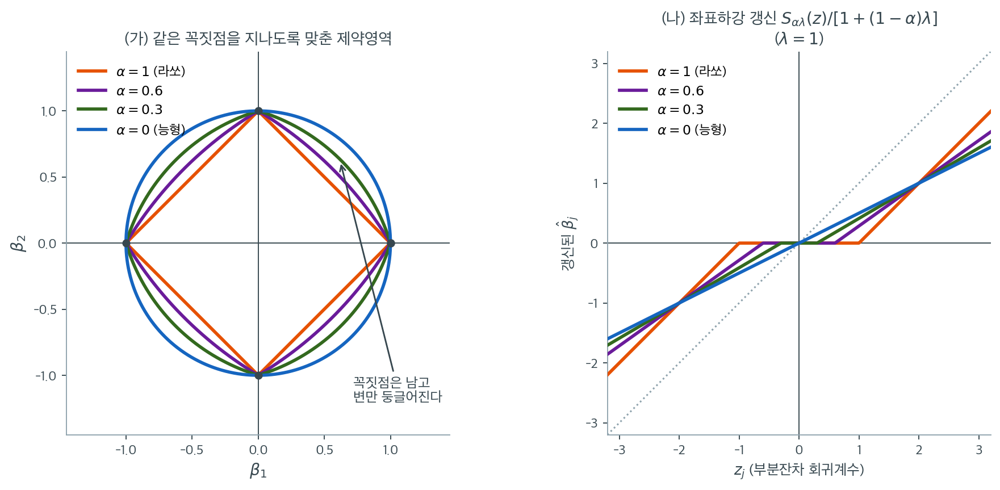

# 엘라스틱넷의 정식화

능형회귀는 상관된 설명변수를 잘 다루지만 변수선택을 하지 못한다. 라쏘는 변수선택을 하지만 상관된 변수에서 어려움을 겪으며, 집단에서 하나를 임의로 고르고 나머지를 버린다. **엘라스틱넷**(Zou and Hastie, 2005)은 두 벌점을 결합하여 라쏘의 희소성과 능형의 안정성을 함께 물려받는다.

---

## 1. 엘라스틱넷 목적함수

$$
\hat{\boldsymbol{\beta}}_{\text{EN}} = \arg\min_{\boldsymbol{\beta}} \left\{\frac{1}{2n}\|\mathbf{y} - \mathbf{X}\boldsymbol{\beta}\|^2 + \lambda\bigl[\alpha\|\boldsymbol{\beta}\|_1 + (1 - \alpha)\tfrac{1}{2}\|\boldsymbol{\beta}\|_2^2\bigr]\right\}
$$

- $\lambda \geq 0$은 전체 정칙화 강도다.
- $\alpha \in [0, 1]$은 L1과 L2의 균형을 잡는 **혼합모수**다.
- $\|\boldsymbol{\beta}\|_2^2$ 앞의 $1/2$은 좌표하강 갱신을 단순하게 만드는 관례다.

---

## 2. 특수한 경우

| $\alpha$ | 방법 | 벌점 |
|---|---|---|
| $\alpha = 0$ | 능형회귀 | $\frac{\lambda}{2}\|\boldsymbol{\beta}\|_2^2$ |
| $\alpha = 1$ | 라쏘 | $\lambda\|\boldsymbol{\beta}\|_1$ |
| $0 < \alpha < 1$ | 엘라스틱넷 | $\lambda\bigl[\alpha\|\boldsymbol{\beta}\|_1 + (1-\alpha)\tfrac{1}{2}\|\boldsymbol{\beta}\|_2^2\bigr]$ |

$\alpha$가 1에 가까우면 더 희소한 모형(라쏘에 가까움), 0에 가까우면 더 조밀하고 축소가 강한 모형(능형에 가까움)이 된다.

---

## 3. 다른 매개화

두 개의 정칙화 모수를 따로 쓰는 정식화도 있다.

$$
\hat{\boldsymbol{\beta}}_{\text{EN}} = \arg\min_{\boldsymbol{\beta}} \left\{\frac{1}{2n}\|\mathbf{y} - \mathbf{X}\boldsymbol{\beta}\|^2 + \lambda_1\|\boldsymbol{\beta}\|_1 + \lambda_2\|\boldsymbol{\beta}\|_2^2\right\}
$$

두 매개화는 $\lambda_1 = \lambda\alpha$, $\lambda_2 = \lambda(1 - \alpha)/2$로 연결된다. $(\lambda, \alpha)$ 매개화가 더 흔한데, 전체 벌점 강도와 벌점 혼합을 분리하여 $\alpha$를 고정한 채 $\lambda$에 대해 교차검증할 수 있기 때문이다.

### scikit-learn 의 모수 이름은 위 수식과 다르다

!!! warning "scikit-learn의 모수 이름은 위 수식과 다르다"
    이 페이지의 $\lambda$와 $\alpha$는 통계 문헌의 관례이다. scikit-learn은 다른 이름을 쓴다.

    | 수식 | scikit-learn |
    |:---|:---|
    | $\lambda$ (전체 벌점 강도) | `alpha` |
    | $\alpha$ (L1 혼합비) | `l1_ratio` |

    즉 `ElasticNet(alpha=0.6, l1_ratio=0.2)`는 이 페이지의 표기로 $\lambda = 0.6$, $\alpha = 0.2$를 뜻한다. `l1_ratio=1`이면 라쏘, `l1_ratio=0`이면 능형이다.

    또한 sklearn의 목적함수는 잔차제곱합을 $2n$으로 나눈다.

    $$
    \frac{1}{2n}\|y - X\beta\|^2 + \lambda\left(\alpha\|\beta\|_1 + \frac{1-\alpha}{2}\|\beta\|_2^2\right)
    $$

    따라서 다른 소프트웨어의 $\lambda$와 직접 비교할 때는 $n$ 배율에 주의해야 한다.

---

---

## 4. 제약최적화 형태

$$
\min_{\boldsymbol{\beta}} \|\mathbf{y} - \mathbf{X}\boldsymbol{\beta}\|^2 \quad \text{제약} \quad \alpha\|\boldsymbol{\beta}\|_1 + (1-\alpha)\tfrac{1}{2}\|\boldsymbol{\beta}\|_2^2 \leq t
$$

2차원에서 이 제약영역은 **모서리가 둥근 마름모**다. L1 마름모의 꼭짓점은 남아 있어(희소성 가능) 평평한 변이 곡선으로 바뀐다(안정성 제공). $\alpha \to 0$이면 원에, $\alpha \to 1$이면 마름모에 가까워진다.

!!! note "엘라스틱넷 제약의 기하"
    엘라스틱넷 제약집합은 L1 공에서 꼭짓점(정확한 0을 만든다)을, L2 공에서 매끄러움(상관된 변수에 안정성을 준다)을 물려받는다. 이 기하적 결합이 다중공선성을 다루면서 변수선택을 수행하는 능력의 핵심이다.



왼쪽은 네 $\alpha$ 값의 제약영역을 네 꼭짓점 $(\pm 1, 0)$, $(0, \pm 1)$을 모두 지나도록 $t$를 맞춰 겹쳐 그린 것이다. 주황 마름모($\alpha = 1$)에서 파랑 원($\alpha = 0$)으로 갈수록 변이 바깥으로 부풀지만 **네 꼭짓점의 위치는 조금도 움직이지 않는다.** $\alpha > 0$이면 절댓값 항이 살아 있어 축 위에서 여전히 미분 불가능하기 때문이다. 희소성을 만드는 것은 꼭짓점이고, 안정성을 만드는 것은 변의 곡률이므로, 엘라스틱넷은 둘을 동시에 가질 수 있다. 이 그림 한 장이 "라쏘의 희소성과 능형의 안정성을 함께 물려받는다"는 말의 전부다.

변이 둥글어지는 것이 왜 안정성인지는 [라쏘의 기하](../lasso/geometry.md)와 견주면 분명해진다. 마름모의 평평한 변 위에서는 RSS 타원이 어디에 닿아도 목적함숫값이 거의 같아서 접점이 변을 따라 미끄러진다. 변이 바깥으로 휘면 그 미끄러짐이 사라지고 접점이 한 곳에 고정된다. **곡률이 곧 유일성이다.**

오른쪽은 같은 이야기를 좌표하강 갱신식으로 본 것이다. 갱신 $S_{\alpha\lambda}(z_j)/[1 + (1-\alpha)\lambda]$는 두 가지 일을 한다. 분자의 문턱 $\alpha\lambda$는 $\lambda = 1$에서 $\alpha$와 같으므로 $1 \to 0.6 \to 0.3 \to 0$으로 줄고, 그만큼 **0으로 눌리는 구간(가운데 평평한 부분)이 좁아진다.** 동시에 분모가 $1 \to 1.4 \to 1.7 \to 2$로 커져 기울기가 $1 \to 0.714 \to 0.588 \to 0.5$로 완만해진다. 문턱은 라쏘에서 받아 오고 기울기는 능형에서 받아 오는 셈이다.

네 직선이 $z = 2$에서 한 점 $(2, 1)$을 지나는 것은 우연이 아니다. $z = 1 + \lambda$에서 갱신값이 $\dfrac{z - \alpha\lambda}{1 + (1-\alpha)\lambda} = \dfrac{2 - \alpha}{2 - \alpha} = 1$이 되어 $\alpha$가 사라진다. 그 점보다 큰 계수는 $\alpha$가 클수록 덜 깎이고, 작은 계수는 $\alpha$가 클수록 더 깎인다. **$\alpha$를 키운다는 것은 벌점의 무게를 큰 계수에서 작은 계수로 옮기는 일이다.**

---

## 5. 엘라스틱넷의 좌표하강

표준화된 설명변수에서 $\beta_j$의 갱신은

$$
\hat{\beta}_j \leftarrow \frac{S_{\alpha\lambda}(z_j)}{1 + (1-\alpha)\lambda}
$$

이다. 분자가 L1 연성 문턱(라쏘 성분)을, 분모가 L2 축소(능형 성분)를 담당한다. $\alpha = 1$이면 분모가 1이 되어 라쏘 갱신으로, $\alpha = 0$이면 분자에 문턱이 없어져 능형 갱신으로 환원된다.

---

## 6. 강볼록성

엘라스틱넷 목적함수는 $\alpha < 1$이면(L2 성분이 있으면) $p > n$이더라도 **강볼록**이다. L2 벌점이 헤세 행렬을 양정치로 만들기 때문이다. 반면 순수 라쏘($\alpha = 1$)는 $p > n$일 때 볼록이지만 강볼록은 아니어서 해가 유일하지 않을 수 있다.

!!! tip "강볼록성의 실무적 함의"
    $\alpha < 1$에서 해가 유일하다는 성질 덕분에, $p > n$일 때 엘라스틱넷의 해 경로가 라쏘 경로보다 안정적이고 재현 가능하다. 고차원 상황에서 순수 라쏘보다 엘라스틱넷을 선호하는 이유 중 하나다.

---

## 7. α의 선택

1. **격자탐색과 교차검증.** $(\lambda, \alpha)$의 2차원 격자를 $K$-겹 교차검증으로 평가한다. 가장 철저하지만 계산이 비싸다.
2. **$\alpha$를 고정하고 $\lambda$만 최적화.** 영역 지식에 근거해 $\alpha$를 정하고($\alpha = 0.5$ 등) $\lambda$만 교차검증한다. 빠르고 대개 충분하다.

흔한 선택은 $\alpha = 0.5$(L1과 L2 동등), $\alpha = 0.9$(대체로 라쏘에 약간의 능형 안정화), $\alpha = 0.1$(대체로 능형에 약간의 라쏘 희소성)이다.

---

## 연습문제

<div class="drillbox" markdown>

**연습문제 1.** <span class="diff med" title="중간"></span>
scikit-learn의 `alpha`와 `l1_ratio`가 이 페이지의 $\lambda$, $\alpha$와 어떻게 대응하는지 확인하고, `l1_ratio`를 0에 보내면 정말 능형회귀와 일치하는지 검증하라.

</div>

??? success "풀이"
    scikit-learn의 `ElasticNet` 목적함수는

    $$
    \frac{1}{2n}\|\mathbf{y}-\mathbf{X}\boldsymbol\beta\|^2
    + \texttt{alpha}\cdot\texttt{l1_ratio}\,\|\boldsymbol\beta\|_1
    + \frac{\texttt{alpha}(1-\texttt{l1_ratio})}{2}\|\boldsymbol\beta\|_2^2
    $$

    이므로 대응은 $\texttt{alpha} = \lambda$, $\texttt{l1_ratio} = \alpha$이다. **이름이 뒤바뀌어 있으므로 주의해야 한다.**

    한편 `Ridge`의 목적함수는 $\|\mathbf{y}-\mathbf{X}\boldsymbol\beta\|^2 + \texttt{alpha}\|\boldsymbol\beta\|_2^2$로 $1/(2n)$ 배율이 없다. 따라서 `ElasticNet(alpha=a, l1_ratio=0)`에 대응하는 능형은 $\texttt{alpha}_{\text{ridge}} = n\,a\,(1-\texttt{l1_ratio})$이다.

    ```python
    import numpy as np
    from sklearn.linear_model import ElasticNet, Ridge

    rng = np.random.default_rng(0)
    n, p = 60, 8
    X = rng.normal(0, 1, (n, p))
    X = (X - X.mean(0)) / X.std(0)          # 표준화
    y = X @ np.array([2., -1., 0.5, 0, 0, 0, 0, 0]) + rng.normal(0, 1, n)
    y = y - y.mean()

    a, l1 = 0.5, 1e-8
    be = ElasticNet(alpha=a, l1_ratio=l1, fit_intercept=False,
                    max_iter=500000, tol=1e-14).fit(X, y).coef_
    br = Ridge(alpha=n*a*(1-l1), fit_intercept=False).fit(X, y).coef_
    print(f"{np.abs(be - br).max():.2e}")
    ```

    출력:

    ```
    5.58e-09
    ```

    **최대 차이가 $5.6\times10^{-9}$로 사실상 일치한다.** 배율 관계가 정확함이 확인된다.

    실무적 함의: **`Ridge(alpha=1)`과 `Lasso(alpha=1)`의 벌점 강도는 전혀 다르다.** 두 방법을 같은 격자에서 비교하려면 배율 $n$을 반드시 고려해야 한다.

<div class="drillbox" markdown>

**연습문제 2.** <span class="diff med" title="중간"></span>
$\alpha < 1$이면 $p > n$에서도 해가 유일하다는 강볼록성 주장이 실제 선택 개수에 어떻게 나타나는지 확인하라.

</div>

??? success "풀이"
    $n = 40$, $p = 200$, 참 변수 60개인 자료에서 세 방법을 비교한다.

    ```python
    import numpy as np
    from sklearn.linear_model import Lasso, ElasticNet
    rng = np.random.default_rng(77)
    n, p = 40, 200
    X = rng.normal(size=(n, p)); X -= X.mean(0); X /= X.std(0)
    beta = np.zeros(p); beta[:60] = 1.0
    y = X @ beta + rng.normal(0, 1, n); y -= y.mean()
    ```

    | 방법 | 선택된 변수 수 |
    |:---|---:|
    | 라쏘 ($\alpha = 1$) | **39** |
    | 엘라스틱넷 ($\alpha = 0.5$) | **89** |
    | 엘라스틱넷 ($\alpha = 0.1$) | **167** |

    ($n = 40$, $p = 200$, 참 변수 60개)

    **라쏘가 정확히 $n - 1 = 39$개에서 멈춘다.** 참 변수가 60개인데 그중 대부분을 놓친다. 이것이 "$p > n$에서 라쏘는 최대 $n$개"라는 한계의 직접적 관측이다.

    **엘라스틱넷은 이 벽을 넘는다.** $\alpha = 0.5$에서 89개, $\alpha = 0.1$에서 167개를 고른다. L2 항이 목적함수를 강볼록으로 만들어 해가 $n$차원 부분공간에 갇히지 않기 때문이다.

    다만 $\alpha = 0.1$의 167개는 참 변수 60개를 크게 넘는다. **한계를 없앤 대가로 희소성을 잃는다.** 참 변수 개수를 대략 안다면 그에 맞춰 $\alpha$를 조정해야 한다.

<div class="drillbox" markdown>

**연습문제 3.** <span class="diff med" title="중간"></span>
3절의 두 매개화 $(\lambda, \alpha)$와 $(\lambda_1, \lambda_2)$를 생각하자.
(가) $\lambda_1 \geq 0$, $\lambda_2 \geq 0$, $\lambda_1 + \lambda_2 > 0$인 임의의 쌍에 대해 그것을 주는 $(\lambda, \alpha)$가 $\lambda > 0$, $\alpha \in [0, 1]$ 안에 유일하게 있음을 보여라.
(나) $(\lambda_1, \lambda_2) = (0.2,\, 0.05)$를 $(\lambda, \alpha)$로 옮기고 `ElasticNet`의 인수로 적어라.
(다) $\lambda_1$을 고정한 채 $\lambda_2$만 키우면 $(\lambda, \alpha)$는 어느 쪽으로 움직이는가. 그것으로부터 "$\alpha$를 고정한 채 $\lambda$에 대해 교차검증한다"는 것이 $(\lambda_1, \lambda_2)$ 평면에서는 어떤 탐색인지 적어라.

</div>

??? success "풀이"
    **(가)** 두 식 $\lambda_1 = \lambda\alpha$, $\lambda_2 = \lambda(1-\alpha)/2$를 더할 때 둘째를 두 배로 쓰면

    $$
    \lambda_1 + 2\lambda_2 = \lambda\alpha + \lambda(1-\alpha) = \lambda
    $$

    이다. 따라서

    $$
    \lambda = \lambda_1 + 2\lambda_2, \qquad \alpha = \frac{\lambda_1}{\lambda_1 + 2\lambda_2}
    $$

    이고, 오른쪽이 $(\lambda_1, \lambda_2)$만으로 정해지므로 대응은 유일하다. 가정에서 $\lambda = \lambda_1 + 2\lambda_2 > 0$이고 $0 \leq \lambda_1 \leq \lambda_1 + 2\lambda_2$이므로 $\alpha \in [0, 1]$도 자동으로 지켜진다. 두 매개화는 서로의 일대일 재좌표화다.

    **(나)** $\lambda = 0.2 + 2(0.05) = 0.3$이고 $\alpha = 0.2/0.3 = 2/3 \approx 0.6667$이다. 연습문제 1의 대응에 따라 `ElasticNet(alpha=0.3, l1_ratio=2/3)`이다. 검산하면 L1 계수가 $0.3 \times (2/3) = 0.2 = \lambda_1$, L2 계수가 $0.3 \times (1/3)/2 = 0.05 = \lambda_2$로 맞다.

    **(다)** $\lambda = \lambda_1 + 2\lambda_2$는 커지고 $\alpha = \lambda_1/(\lambda_1 + 2\lambda_2)$는 작아진다. 즉 $(\lambda_1, \lambda_2)$ 평면에서 **한 좌표만 움직여도 $(\lambda, \alpha)$의 두 좌표가 함께 변한다.**

    거꾸로 $\alpha$를 고정하고 $\lambda$만 훑는 것은 $(\lambda_1, \lambda_2)$ 평면에서 원점을 지나는 직선

    $$
    \lambda_2 = \frac{1-\alpha}{2\alpha}\,\lambda_1
    $$

    을 따라가는 1차원 탐색이다. **$(\lambda, \alpha)$ 매개화가 하는 일은 두 벌점의 절대 크기와 비(比)를 분리하는 것이다.** $\lambda$를 훑는 동안 비는 고정되므로, 교차검증 곡선이 "같은 종류의 벌점을 세기만 바꿔 가며" 그려진다. $\lambda_1$ 또는 $\lambda_2$ 하나만 바꾸는 탐색은 비까지 함께 흔들어 곡선의 해석을 흐린다.

<div class="drillbox" markdown>

**연습문제 4.** <span class="diff med" title="중간"></span>
scikit-learn의 `ElasticNet`은 설명변수를 표준화해 주지 않는다. 설명변수 열 하나의 **단위만** 바꾸었을 때(예: m를 cm로) (가) OLS의 계수는 단위를 되돌리면 조금도 바뀌지 않지만 (나) 엘라스틱넷의 계수는 바뀌고 **선택되는 변수 집합까지** 바뀜을 수로 보여라. 그리고 왜 그런지 1절의 목적함수에서 한 줄로 설명하라.

</div>

??? success "풀이"
    $x_j \to c\,x_j$로 단위를 바꾸면 같은 적합값을 주는 계수는 $\beta_j \to \beta_j/c$다. 목적함수의 RSS 항 $\frac{1}{2n}\lVert \mathbf{y} - \mathbf{X}\boldsymbol\beta\rVert^2$은 이 재매개화에 **불변**이지만 벌점

    $$
    \lambda\left[\alpha\lvert \beta_j \rvert + \frac{1-\alpha}{2}\beta_j^2\right]
    $$

    은 불변이 아니다. $c$가 크면 $\beta_j/c$가 작아져 그 변수의 벌점이 거의 공짜가 되고, 사실상 그 열만 **벌점에서 면제**된다.

    ```python
    import numpy as np
    from sklearn.linear_model import ElasticNet

    rng = np.random.default_rng(31)
    n = 80
    Z = rng.normal(0, 1, (n, 3))
    X = np.column_stack([Z[:, 0], Z[:, 1], 0.8 * Z[:, 1] + 0.6 * Z[:, 2]])
    X -= X.mean(0)
    y = X @ np.array([1.0, 0.6, 0.0]) + rng.normal(0, 0.5, n)
    y -= y.mean()

    c = 100.0                        # 둘째 열의 단위만 바꾼다 (m -> cm)
    Xc = X.copy()
    Xc[:, 1] *= c
    back = np.array([1.0, c, 1.0])   # 원래 단위의 계수로 되돌리는 배율

    def en(A):
        return ElasticNet(alpha=0.1, l1_ratio=0.5, fit_intercept=False,
                          max_iter=100000, tol=1e-12).fit(A, y).coef_

    def ols(A):
        return np.linalg.lstsq(A, y, rcond=None)[0]

    def row(name, b):
        b = np.array([0.0 if v == 0 else v for v in b])   # 음수 0 을 없앤다
        k = int(np.sum(np.abs(b) > 1e-10))
        return f"{name}  " + "".join(f"{v:9.4f}" for v in b) + f"   선택 {k}개"

    print("                 b1       b2       b3")
    print(row("EN  원래 단위", en(X)))
    print(row("EN  cm 단위  ", en(Xc) * back))
    print(row("OLS 원래 단위", ols(X)))
    print(row("OLS cm 단위  ", ols(Xc) * back))
    ```

    출력:

    ```text
                     b1       b2       b3
    EN  원래 단위     0.8700   0.4019   0.1580   선택 3개
    EN  cm 단위       0.8627   0.6193   0.0000   선택 2개
    OLS 원래 단위     0.9579   0.4884   0.1322   선택 3개
    OLS cm 단위       0.9579   0.4884   0.1322   선택 3개
    ```

    **OLS 두 줄은 소수 넷째 자리까지 완전히 같다.** 최소제곱은 열의 단위를 바꾸는 것에 등변(equivariant)이므로 계수를 되돌리면 같은 수가 나온다.

    **엘라스틱넷 두 줄은 다르다.** $\hat\beta_2$가 $0.4019$에서 $0.6193$으로 뛰었다. $0.6193$은 OLS 값 $0.4884$보다도 크다 — 벌점에서 면제된 $x_2$가, 함께 눌려 0으로 떨어진 상관 변수 $x_3$의 몫까지 흡수한 것이다. 선택된 변수 집합도 $\{x_1, x_2, x_3\}$에서 $\{x_1, x_2\}$로 바뀌었다.

    **단위를 바꾸는 것만으로 "어느 변수가 중요한가"에 대한 답이 바뀐다.** 그러므로 `Ridge`·`Lasso`·`ElasticNet`에는 반드시 표준화를 앞에 붙여야 하고, 교차검증을 함께 쓸 때는 `make_pipeline(StandardScaler(), ElasticNet(...))`처럼 **폴드 안에서** 표준화해야 한다.

<div class="drillbox" markdown>

**연습문제 5.** <span class="diff med" title="중간"></span>
4절의 그림 왼쪽은 네 $\alpha$ 값의 제약영역을 네 꼭짓점 $(\pm 1, 0)$, $(0, \pm 1)$을 모두 지나도록 $t$를 맞춰 겹쳐 그린 것이다.
(가) 그 $t$를 $\alpha$의 함수 $t(\alpha)$로 구하라.
(나) 그 $t(\alpha)$에서 경계가 대각선 $\beta_1 = \beta_2 > 0$과 만나는 점 $(s, s)$의 $s$를 $\alpha$의 식으로 구하고, $\alpha = 1,\, 0.6,\, 0.3,\, 0$에서 값을 소수 넷째 자리까지 적어라.
(다) $s(\alpha)$가 $\alpha$에 대해 감소함을 확인하고, "변이 바깥으로 부푼다"와 "꼭짓점은 조금도 움직이지 않는다"가 모순이 아닌 까닭을 적어라.

</div>

??? success "풀이"
    벌점함수를 $g(\boldsymbol\beta) = \alpha\lVert\boldsymbol\beta\rVert_1 + \frac{1-\alpha}{2}\lVert\boldsymbol\beta\rVert_2^2$로 쓴다.

    **(가)** $g(1, 0) = \alpha \cdot 1 + \frac{1-\alpha}{2}\cdot 1 = \frac{1+\alpha}{2}$이고, 네 점 $(\pm1,0)$, $(0,\pm1)$에서 값이 모두 같다. 따라서

    $$
    t(\alpha) = \frac{1+\alpha}{2}.
    $$

    $\alpha = 1,\, 0.6,\, 0.3,\, 0$에서 $t = 1,\, 0.8,\, 0.65,\, 0.5$다.

    **(나)** $s > 0$인 점 $(s, s)$에서 $\lVert\cdot\rVert_1 = 2s$, $\lVert\cdot\rVert_2^2 = 2s^2$이므로 경계 조건은

    $$
    2\alpha s + (1-\alpha)s^2 = \frac{1+\alpha}{2}.
    $$

    $\alpha = 1$이면 일차식 $2s = 1$이므로 $s = 0.5$다. $\alpha < 1$이면 이차식의 양근을 취해

    $$
    s(\alpha) = \frac{-2\alpha + \sqrt{4\alpha^2 + 2(1-\alpha)(1+\alpha)}}{2(1-\alpha)} = \frac{\sqrt{2\alpha^2 + 2} - 2\alpha}{2(1-\alpha)}
    $$

    를 얻는다($4\alpha^2 + 2(1-\alpha^2) = 2\alpha^2 + 2$를 썼다).

    | $\alpha$ | $t(\alpha)$ | $s(\alpha)$ | 원점까지 거리 $s\sqrt2$ |
    |---:|---:|---:|---:|
    | $1.0$ | $1.0000$ | $0.5000$ | $0.7071$ |
    | $0.6$ | $0.8000$ | $0.5616$ | $0.7942$ |
    | $0.3$ | $0.6500$ | $0.6261$ | $0.8854$ |
    | $0.0$ | $0.5000$ | $0.7071$ | $1.0000$ |

    손으로 확인해 보면 $\alpha = 0.6$에서 $0.4s^2 + 1.2s - 0.8 = 0$, 즉 $s^2 + 3s - 2 = 0$이므로 $s = (\sqrt{17}-3)/2 = 0.5616$이고, $\alpha = 0$에서 $s^2 = 1/2$이므로 $s = 0.7071$이다. 마지막 열이 $\alpha = 0$에서 정확히 $1$인 것은 그때 영역이 반지름 $1$인 원이기 때문이다.

    **(다)** $s(\alpha)$는 $0.5000 \to 0.5616 \to 0.6261 \to 0.7071$로 $\alpha$가 줄 때 늘어난다. 모순이 없는 까닭은 **고정된 것과 움직이는 것이 다른 점들**이기 때문이다. $t(\alpha)$를 맞춤으로써 축 위의 네 점은 모든 $\alpha$에서 경계에 묶여 있고, 그 사이의 경계만 밖으로 밀린다. 영역은 "같은 네 점을 지나는" 곡선족이다.

    이 두 사실이 엘라스틱넷의 두 성질에 그대로 대응한다. 꼭짓점이 고정이고 $\alpha > 0$이면 절댓값 항 때문에 축 위에서 경계가 여전히 꺾여 있어 **희소성**이 살아 있다. 변의 곡률은 $\alpha$가 줄수록 커지므로 RSS 타원의 접점이 변을 따라 미끄러지지 못하고 **안정성**이 생긴다. 다만 $\alpha = 0$에서는 꺾임도 사라져(원은 어디서나 매끄럽다) 희소성이 완전히 없어진다.

<div class="drillbox" markdown>

**연습문제 6.** <span class="diff hard" title="어려움"></span>
4절은 네 갱신 직선이 $z = 1 + \lambda$에서 한 점을 지난다고 적었다. 연성 문턱 밖($z > \alpha\lambda$)에서 갱신값을 $\alpha$의 함수로 보아 $g(\alpha) = \dfrac{z - \alpha\lambda}{1 + (1-\alpha)\lambda}$라 하자.
(가) $dg/d\alpha$를 구하라.
(나) 그 부호가 $z$와 $1+\lambda$의 크기 비교만으로 정해짐을 보여라.
(다) 그로부터 "$\alpha$를 키운다는 것은 벌점의 무게를 큰 계수에서 작은 계수로 옮기는 일이다"라는 본문의 주장을 증명하라.
(라) $\lambda = 1$일 때 고정점의 좌표를 적어라.

</div>

??? success "풀이"
    **(가)** 분모를 $D(\alpha) = 1 + \lambda - \alpha\lambda$로 쓰면 $\alpha \in [0,1]$, $\lambda \geq 0$에서 $D \geq 1 > 0$이다. 몫의 미분법으로

    $$
    \frac{dg}{d\alpha} = \frac{(-\lambda)D - (z - \alpha\lambda)(-\lambda)}{D^2} = \frac{\lambda\bigl[(z - \alpha\lambda) - D\bigr]}{D^2}
    $$

    이고, 괄호 안은 $(z - \alpha\lambda) - (1 + \lambda - \alpha\lambda) = z - 1 - \lambda$로 **$\alpha\lambda$가 상쇄된다.** 따라서

    $$
    \frac{dg}{d\alpha} = \frac{\lambda\,\bigl[z - (1+\lambda)\bigr]}{\bigl[1 + (1-\alpha)\lambda\bigr]^2}.
    $$

    **(나)** 분모는 양수이고 $\lambda > 0$이므로 부호는 $z - (1+\lambda)$의 부호와 같다. **이 부호는 $\alpha$에 전혀 의존하지 않는다.** 그러므로 $g$는 $[0,1]$ 전체에서 단조이며, $z = 1+\lambda$에서는 $g$가 상수다.

    **(다)** 세 경우로 갈린다.

    - $z > 1 + \lambda$ (큰 계수): $dg/d\alpha > 0$이므로 $\alpha$를 키우면 갱신값이 **커진다.** 덜 깎인다.
    - $\alpha\lambda < z < 1 + \lambda$ (작지만 살아 있는 계수): $dg/d\alpha < 0$이므로 $\alpha$를 키우면 갱신값이 **작아진다.** 더 깎인다.
    - $z \leq \alpha\lambda$: 갱신값이 정확히 0이고, 이 구간은 $\alpha$가 커질수록 **넓어진다.**

    즉 $\alpha$를 키우면 축소가 큰 계수에서 빠져 작은 계수로 몰리고, 가장 작은 계수들은 아예 0으로 떨어진다. 전체 축소량을 다른 방식으로 배분하는 것이지 더하거나 덜 하는 것이 아니다. $\square$

    **(라)** $z = 1 + \lambda$를 넣으면

    $$
    g(\alpha) = \frac{1 + \lambda - \alpha\lambda}{1 + \lambda - \alpha\lambda} = 1
    $$

    로 $\alpha$가 사라진다. 또 $\alpha\lambda \leq \lambda < 1 + \lambda = z$이므로 이 점은 모든 $\alpha$에서 연성 문턱 구간 **밖**에 있어 네 직선이 모두 선형 부분으로 그 점을 지난다. $\lambda = 1$이면 좌표는 $(2, 1)$이고, 그림 오른쪽에서 네 직선이 만나는 바로 그 점이다.

<div class="drillbox" markdown>

**연습문제 7.** <span class="diff hard" title="어려움"></span>
5절의 갱신식 $\hat\beta_j \leftarrow S_{\alpha\lambda}(z_j)/[1 + (1-\alpha)\lambda]$, $z_j = \mathbf{X}_j^\top \mathbf{r}_j/n$을 그대로 구현하여 scikit-learn과 맞춰 보라. 열은 $\lVert \mathbf{X}_j \rVert^2 = n$이 되도록 맞춘다. $\alpha = 0$에서는 `ElasticNet` 대신 `Ridge(alpha=`$n\lambda$`)`와 비교해야 하는데, 왜 $n\lambda$인지 밝혀라. 그리고 $\alpha > 0$인 행과 $\alpha = 0$인 행에서 정확히 0인 계수의 개수를 견주어라.

</div>

??? success "풀이"
    먼저 $n\lambda$의 출처를 밝힌다. 1절의 목적함수에 $2n$을 곱하면

    $$
    \lVert \mathbf{y} - \mathbf{X}\boldsymbol\beta \rVert^2 + 2n\lambda\alpha\lVert\boldsymbol\beta\rVert_1 + n\lambda(1-\alpha)\lVert\boldsymbol\beta\rVert_2^2
    $$

    이고, $\alpha = 0$을 넣으면 $\lVert \mathbf{y} - \mathbf{X}\boldsymbol\beta \rVert^2 + n\lambda\lVert\boldsymbol\beta\rVert_2^2$다. `Ridge`가 최소화하는 꼴 $\lVert \mathbf{y} - \mathbf{X}\boldsymbol\beta \rVert^2 + \texttt{alpha}\lVert\boldsymbol\beta\rVert_2^2$와 맞추면 $\texttt{alpha} = n\lambda$다. 연습문제 1의 $n\,a\,(1-\texttt{l1_ratio})$에 $\texttt{l1_ratio} = 0$을 넣은 것과 같다.

    ```python
    import numpy as np
    from sklearn.linear_model import ElasticNet, Ridge

    def soft(z, t):
        return np.sign(z) * np.maximum(np.abs(z) - t, 0.0)

    def en_cd(X, y, lam, alpha, n_sweep=500):
        n, p = X.shape
        beta = np.zeros(p)
        r = y.copy()
        for _ in range(n_sweep):
            for j in range(p):
                r = r + X[:, j] * beta[j]                 # 부분잔차 r_j
                z = X[:, j] @ r / n
                beta[j] = soft(z, alpha * lam) / (1.0 + (1.0 - alpha) * lam)
                r = r - X[:, j] * beta[j]
        return beta

    rng = np.random.default_rng(11)
    n, p = 120, 6
    X = rng.normal(size=(n, p))
    X -= X.mean(0)
    X *= np.sqrt(n) / np.linalg.norm(X, axis=0)           # ||X_j||^2 = n
    y = X @ np.array([1.5, 0., -0.8, 0., 0.4, 0.]) + rng.normal(0, 1, n)
    y -= y.mean()

    print("lambda alpha    내 좌표하강 해                                   0 개수  일치")
    for lam, alpha in [(0.05, 1.0), (0.05, 0.5), (0.20, 0.5), (0.20, 0.0)]:
        mine = en_cd(X, y, lam, alpha)
        if alpha == 0.0:
            ref = Ridge(alpha=n * lam, fit_intercept=False).fit(X, y).coef_
        else:
            ref = ElasticNet(alpha=lam, l1_ratio=alpha, fit_intercept=False,
                             max_iter=100000, tol=1e-14).fit(X, y).coef_
        show = "".join(f"{0.0 if v == 0 else v:8.4f}" for v in mine)
        nz = int(np.sum(mine == 0))
        ok = "예" if np.abs(mine - ref).max() < 1e-10 else "아니오"
        print(f" {lam:.2f}   {alpha:.1f}  {show}   {nz:4d}    {ok}")
    ```

    출력:

    ```text
    lambda alpha    내 좌표하강 해                                   0 개수  일치
     0.05   1.0    1.3822  0.1380 -0.8177  0.0000  0.2923  0.0173      1    예
     0.05   0.5    1.3748  0.1579 -0.8232  0.0000  0.3118  0.0466      1    예
     0.20   0.5    1.2027  0.0787 -0.6948  0.0000  0.2042  0.0000      2    예
     0.20   0.0    1.1940  0.1488 -0.7221 -0.0076  0.2729  0.0592      0    예
    ```

    네 설정 모두 $10^{-10}$ 이내로 일치한다. 열을 $\lVert \mathbf{X}_j \rVert^2 = n$으로 맞춘 덕분에 갱신식의 분모에 $\lVert \mathbf{X}_j \rVert^2/n = 1$이 들어가 5절의 꼴이 그대로 쓰인다. 이 정규화를 빼면 분모가 $\lVert \mathbf{X}_j \rVert^2/n + (1-\alpha)\lambda$가 되어 열마다 달라진다.

    **0의 개수가 갈린다.** $\alpha > 0$인 세 행은 넷째 계수가 정확히 0이고, $\lambda$를 $0.20$으로 올린 행에서는 여섯째까지 0이 된다. 반면 $\alpha = 0$인 마지막 행은 **0이 하나도 없다** — 넷째 계수가 $-0.0076$으로 작지만 0이 아니다.

    까닭이 갱신식 한 줄에 있다. 분모 $1 + (1-\alpha)\lambda$는 **비례 축소**이므로 0이 아닌 수를 0으로 만들 수 없고, 분자의 연성 문턱 $S_{\alpha\lambda}$만 $\lvert z_j \rvert \leq \alpha\lambda$인 좌표를 정확히 0으로 떨어뜨린다. $\alpha = 0$이면 문턱이 사라져 그 장치가 없다. **변수선택을 하는 것은 L1 성분뿐이다.**

<div class="drillbox" markdown>

**연습문제 8.** <span class="diff hard" title="어려움"></span>
$\alpha > 0$이면 유한한 $\lambda$에서 해가 정확히 $\boldsymbol\beta = \mathbf{0}$이 된다.
(가) 그 문턱 $\lambda_{\max}(\alpha)$를 1절 목적함수의 $\boldsymbol\beta = \mathbf{0}$에서의 열미분(劣微分)으로 유도하라.
(나) $\alpha = 0$이면 어떤 유한한 $\lambda$에서도 $\boldsymbol\beta = \mathbf{0}$이 되지 않음을 같은 조건으로 보여라.
(다) 수치로 확인하라.

</div>

??? success "풀이"
    **(가)** 1절의 목적함수를

    $$
    f(\boldsymbol\beta) = \frac{1}{2n}\lVert \mathbf{y} - \mathbf{X}\boldsymbol\beta \rVert^2 + \lambda\alpha\lVert\boldsymbol\beta\rVert_1 + \frac{\lambda(1-\alpha)}{2}\lVert\boldsymbol\beta\rVert_2^2
    $$

    로 쓴다. $\boldsymbol\beta = \mathbf{0}$에서 RSS 항의 기울기는 $-\frac{1}{n}\mathbf{X}^\top\mathbf{y}$이고, L2 항은 미분가능하며 기울기가 $\mathbf{0}$이다. L1 항의 열미분은 $\lambda\alpha\,[-1, 1]^p$다. $f$가 볼록이므로 $\mathbf{0}$이 최소점인 것은 $\mathbf{0} \in \partial f(\mathbf{0})$과 동치이고, 이는

    $$
    \frac{1}{n}\mathbf{X}^\top\mathbf{y} \in \lambda\alpha\,[-1, 1]^p \quad\Longleftrightarrow\quad \frac{\lVert \mathbf{X}^\top\mathbf{y}\rVert_\infty}{n} \leq \lambda\alpha
    $$

    와 같다. 따라서

    $$
    \lambda_{\max}(\alpha) = \frac{\lVert \mathbf{X}^\top\mathbf{y}\rVert_\infty}{n\,\alpha}, \qquad \alpha > 0.
    $$

    **L2 항은 이 문턱에 전혀 끼어들지 않는다.** $\lVert\boldsymbol\beta\rVert_2^2$의 기울기가 원점에서 $\mathbf{0}$이어서 "0에서 떠날 것인가"의 판정에 아무 힘을 못 쓰기 때문이다. 문턱을 정하는 것은 $\alpha\lambda$ 하나다.

    **(나)** $\alpha = 0$이면 위 조건이 $\lVert \mathbf{X}^\top\mathbf{y}\rVert_\infty/n \leq 0$이 되어, $\mathbf{X}^\top\mathbf{y} \neq \mathbf{0}$인 한 어떤 $\lambda$에서도 성립하지 않는다. 실제로 $\alpha = 0$의 정규방정식은 $(\mathbf{X}^\top\mathbf{X} + n\lambda \mathbf{I})\boldsymbol\beta = \mathbf{X}^\top\mathbf{y}$이므로 $\lambda \to \infty$에서 $\hat{\boldsymbol\beta} \approx \mathbf{X}^\top\mathbf{y}/(n\lambda) \to \mathbf{0}$이지만 **어느 유한한 $\lambda$에서도 정확히 $\mathbf{0}$은 아니다.** 능형은 0에 수렴할 뿐 0에 도달하지 않는다.

    **(다)**

    ```python
    import numpy as np
    from sklearn.linear_model import ElasticNet, Ridge

    rng = np.random.default_rng(5)
    n, p = 100, 10
    X = rng.normal(size=(n, p))
    X -= X.mean(0)
    X *= np.sqrt(n) / np.linalg.norm(X, axis=0)
    y = X @ np.array([2., -1.5, 1., 0., 0., 0., 0., 0., 0., 0.]) + rng.normal(0, 1, n)
    y -= y.mean()

    g = np.abs(X.T @ y).max() / n          # ||X'y||_inf / n
    print(f"||X'y||_inf / n = {g:.4f}")
    print()
    print("alpha   lambda_max   0.99*lmax 에서 선택   1.01*lmax 에서 선택")
    for alpha in (1.0, 0.5, 0.1):
        lmax = g / alpha
        k = []
        for f in (0.99, 1.01):
            b = ElasticNet(alpha=f * lmax, l1_ratio=alpha, fit_intercept=False,
                           max_iter=100000, tol=1e-12).fit(X, y).coef_
            k.append(int(np.sum(np.abs(b) > 1e-10)))
        print(f" {alpha:.1f}      {lmax:9.4f}   {k[0]:12d}{k[1]:21d}")

    print()
    for lam in (1e2, 1e6, 1e10):
        b = Ridge(alpha=n * lam, fit_intercept=False).fit(X, y).coef_
        print(f"능형 lambda = {lam:.0e}:  max|beta| = {np.abs(b).max():.3e},"
              f"  선택 {int(np.sum(np.abs(b) > 0)):d}개")
    ```

    출력:

    ```text
    ||X'y||_inf / n = 2.0748

    alpha   lambda_max   0.99*lmax 에서 선택   1.01*lmax 에서 선택
     1.0         2.0748              1                    0
     0.5         4.1496              1                    0
     0.1        20.7480              1                    0

    능형 lambda = 1e+02:  max|beta| = 2.051e-02,  선택 10개
    능형 lambda = 1e+06:  max|beta| = 2.075e-06,  선택 10개
    능형 lambda = 1e+10:  max|beta| = 2.075e-10,  선택 10개
    ```

    세 $\alpha$ 모두에서 $0.99\lambda_{\max}$에서는 정확히 한 변수가 살아 있고 $1.01\lambda_{\max}$에서는 하나도 남지 않는다. 문턱이 **칼처럼** 작동한다. 그리고 $\lambda_{\max}$가 $2.0748 \to 4.1496 \to 20.7480$으로 $1/\alpha$에 비례해 커진다.

    능형 쪽은 $\lambda = 10^{10}$에서도 열 개가 모두 살아 있고, 최대 계수가 $2.075\times10^{-6}$, $2.075\times10^{-10}$으로 정확히 $\lVert \mathbf{X}^\top\mathbf{y}\rVert_\infty/(n\lambda) = 2.0748/\lambda$를 따른다. (나)의 근사식이 수로 확인된다.

    실무적 함의가 하나 있다. $\lambda$ 격자의 상한으로 쓰는 값이 바로 이 $\lambda_{\max}(\alpha)$이고 그것이 $1/\alpha$로 움직이므로, $(\lambda, \alpha)$ 2차원 격자를 **직사각형으로** 깔면 $\alpha$가 작은 쪽에서 모든 계수가 이미 0인 쓸모없는 구역을 길게 훑는다. $\alpha$마다 $[\epsilon\lambda_{\max}(\alpha),\, \lambda_{\max}(\alpha)]$를 따로 잡아야 한다 — `ElasticNetCV`가 `l1_ratio`를 목록으로 받을 때 하는 일이 그것이다.

<div class="drillbox" markdown>

**연습문제 9.** <span class="diff hard" title="어려움"></span>
6절은 $\alpha < 1$이면 목적함수가 강볼록이라고만 말한다. 그 강볼록성이 "안정성"이라는 말로 정확히 무엇을 보장하는지 수로 적어라. 설계행렬 $\mathbf{X}$는 그대로 두고 반응벡터만 $\mathbf{y}$에서 $\tilde{\mathbf{y}}$로 바뀌었을 때 두 해 $\hat{\boldsymbol\beta}$, $\tilde{\boldsymbol\beta}$에 대해

$$
\lVert \hat{\boldsymbol\beta} - \tilde{\boldsymbol\beta} \rVert_2 \leq \frac{\lVert \mathbf{X}^\top(\mathbf{y} - \tilde{\mathbf{y}})\rVert_2}{n\,\lambda(1-\alpha)}
$$

임을 증명하고, $\alpha \to 1$에서 이 한계가 어떻게 되는지, 그것이 서론의 "라쏘는 집단에서 하나를 임의로 고른다"는 말과 어떻게 이어지는지 적어라.

</div>

??? success "풀이"
    두 해 각각에서 최적성 조건(열미분에 $\mathbf{0}$이 들어 있다)을 쓰면, 어떤 $\mathbf{g} \in \partial\lVert\hat{\boldsymbol\beta}\rVert_1$와 $\tilde{\mathbf{g}} \in \partial\lVert\tilde{\boldsymbol\beta}\rVert_1$에 대해

    $$
    \frac{1}{n}\mathbf{X}^\top\mathbf{X}\hat{\boldsymbol\beta} - \frac{1}{n}\mathbf{X}^\top\mathbf{y} + \lambda(1-\alpha)\hat{\boldsymbol\beta} + \lambda\alpha\mathbf{g} = \mathbf{0},
    $$

    $$
    \frac{1}{n}\mathbf{X}^\top\mathbf{X}\tilde{\boldsymbol\beta} - \frac{1}{n}\mathbf{X}^\top\tilde{\mathbf{y}} + \lambda(1-\alpha)\tilde{\boldsymbol\beta} + \lambda\alpha\tilde{\mathbf{g}} = \mathbf{0}
    $$

    이다. 두 식을 빼고 $\boldsymbol\Delta = \hat{\boldsymbol\beta} - \tilde{\boldsymbol\beta}$와 내적하면

    $$
    \frac{1}{n}\lVert \mathbf{X}\boldsymbol\Delta \rVert^2 + \lambda(1-\alpha)\lVert\boldsymbol\Delta\rVert^2 + \lambda\alpha(\mathbf{g} - \tilde{\mathbf{g}})^\top\boldsymbol\Delta = \frac{1}{n}(\mathbf{y} - \tilde{\mathbf{y}})^\top\mathbf{X}\boldsymbol\Delta
    $$

    를 얻는다. 왼쪽의 세 항 가운데 첫째는 제곱이므로 $\geq 0$이고, 셋째는 볼록함수의 열미분이 단조사상이므로 $(\mathbf{g} - \tilde{\mathbf{g}})^\top\boldsymbol\Delta \geq 0$이다(실제로 $\lVert\cdot\rVert_1$에서는 좌표별로 $(\mathrm{sign}$ 성분의 차$)\times$(값의 차$) \geq 0$이다). 그러므로 두 항을 버려

    $$
    \lambda(1-\alpha)\lVert\boldsymbol\Delta\rVert^2 \leq \frac{1}{n}(\mathbf{y} - \tilde{\mathbf{y}})^\top\mathbf{X}\boldsymbol\Delta \leq \frac{1}{n}\lVert \mathbf{X}^\top(\mathbf{y} - \tilde{\mathbf{y}})\rVert_2\,\lVert\boldsymbol\Delta\rVert_2
    $$

    가 되고(마지막은 코시–슈바르츠), $\boldsymbol\Delta \neq \mathbf{0}$이면 양변을 $\lVert\boldsymbol\Delta\rVert_2$로 나누어 결론을 얻는다. $\boldsymbol\Delta = \mathbf{0}$이면 부등식은 자명하다. $\square$

    한계의 모양을 읽는다. 오른쪽에 $\mathbf{X}$의 조건수도, 최소특잇값도, VIF도 **전혀 들어 있지 않다.** 분모는 L2 벌점의 세기 $\lambda(1-\alpha)$ 하나다. 즉 L2 항은 자료의 흔들림이 계수의 흔들림으로 번지는 **증폭률에 상한을 씌우며, 그 상한은 설명변수가 얼마나 상관되어 있든 변하지 않는다.** 이것이 "곡률이 곧 유일성"이라는 4절 문장의 정량판이다.

    $\alpha \to 1$이면 분모가 0으로 가므로 한계가 발산한다. 라쏘($\alpha = 1$)에서는 이 보장이 아예 없고, $\mathbf{X}$의 두 열이 거의 평행하면 $\mathbf{y}$의 미세한 변화가 두 계수를 서로 바꿔치기할 수 있다. 바로 그것이 서론의 "집단에서 하나를 임의로 고르고 나머지를 버린다"는 불안정성이다. 엘라스틱넷은 $(1-\alpha)$만큼의 L2를 섞어 그 임의성을 **정량적으로 묶는** 것이다.

    한계는 느슨하다 — $\lVert \mathbf{X}\boldsymbol\Delta\rVert^2/n$ 항을 버렸기 때문이다. 쓸모는 수의 크기가 아니라 $\alpha \to 1$에서 보장이 사라진다는 구조에 있다.

<div class="drillbox" markdown>

**연습문제 10.** <span class="diff hard" title="어려움"></span>
7절은 "$\alpha$를 고정하고 $\lambda$만 최적화"하는 것이 "빠르고 대개 충분하다"고 적었다. 이 말이 언제 맞고 언제 틀리는지 수로 가려라. $n = 200$, $p = 50$이고 앞 10개 열이 쌍별 상관 $\rho = 0.9$인 블록을 이루는 설계에서 두 설정 — (A) 블록 안에 참 신호가 하나뿐인 희소 모형, (B) 블록 열 개가 모두 참 신호인 모형 — 을 만들고, $(\lambda, \alpha)$ 2차원 격자의 5-겹 교차검증 최솟값과 각 $\alpha$를 고정했을 때의 최솟값의 비를 표로 적어라. 표준화는 **폴드 안에서** 해야 한다.

</div>

??? success "풀이"
    ```python
    import numpy as np
    from sklearn.linear_model import ElasticNet
    from sklearn.model_selection import KFold

    rng = np.random.default_rng(2024)
    n, p, rho = 200, 50, 0.9
    Sigma = np.zeros((p, p))
    Sigma[:10, :10] = rho
    np.fill_diagonal(Sigma, 1.0)
    X = rng.normal(size=(n, p)) @ np.linalg.cholesky(Sigma).T

    lams = np.logspace(-2.5, 0.5, 20)
    alphas = np.array([0.1, 0.25, 0.5, 0.75, 0.9, 1.0])
    kf = KFold(n_splits=5, shuffle=True, random_state=0)

    def cv_grid(y):
        cv = np.zeros((len(alphas), len(lams)))
        for tr, te in kf.split(X):
            mu, sd, ym = X[tr].mean(0), X[tr].std(0), y[tr].mean()
            Xtr, Xte = (X[tr] - mu) / sd, (X[te] - mu) / sd
            for i, a in enumerate(alphas):
                for j, lam in enumerate(lams):
                    m = ElasticNet(alpha=lam, l1_ratio=a, fit_intercept=False,
                                   max_iter=100000, tol=1e-10).fit(Xtr, y[tr] - ym)
                    cv[i, j] += np.mean((y[te] - ym - Xte @ m.coef_) ** 2) / 5
        return cv

    bA = np.zeros(p); bA[[0, 20, 30]] = [2.0, 1.5, -1.5]          # 블록 안 신호 하나
    bB = np.zeros(p); bB[:10] = 0.7; bB[[20, 30]] = [1.5, -1.5]   # 블록 전체가 신호

    res = {}
    for name, b in (("A", bA), ("B", bB)):
        y = X @ b + rng.normal(0, 1.0, n)
        cv = cv_grid(y)
        i0, j0 = np.unravel_index(cv.argmin(), cv.shape)
        res[name] = (cv, i0, j0)
        print(f"설정 {name}: 격자 최적 alpha = {alphas[i0]:.2f}, "
              f"lambda = {lams[j0]:.4f}, CV MSE = {cv[i0, j0]:.4f}")

    print()
    print("alpha   A 손해(배)   B 손해(배)")
    for i, a in enumerate(alphas):
        r = []
        for name in ("A", "B"):
            cv, i0, j0 = res[name]
            r.append(cv[i].min() / cv[i0, j0])
        print(f" {a:.2f}      {r[0]:.3f}        {r[1]:.3f}")
    ```

    출력:

    ```text
    설정 A: 격자 최적 alpha = 1.00, lambda = 0.0834, CV MSE = 1.1598
    설정 B: 격자 최적 alpha = 0.75, lambda = 0.0834, CV MSE = 1.0627

    alpha   A 손해(배)   B 손해(배)
     0.10      1.310        1.099
     0.25      1.235        1.052
     0.50      1.123        1.012
     0.75      1.034        1.000
     0.90      1.009        1.004
     1.00      1.000        1.012
    ```

    **최적 $\alpha$가 자료에 따라 뒤집힌다.** 설정 A에서 격자가 고른 것은 $\alpha = 1$(순수 라쏘)이고 설정 B에서는 $\alpha = 0.75$다. 상관 블록이 있다는 사실만으로는 엘라스틱넷이 이기지 않는다 — 그 블록 안에 신호가 **여럿** 있어야 L2의 묶음 효과가 값을 낸다. 설정 A에서는 블록의 나머지 아홉 열이 잡음이므로 그것들을 함께 끌어들이는 것이 손해다.

    **$\alpha = 0.5$ 고정은 한쪽에서만 안전하다.** 설정 B에서는 $1.2\%$만 잃지만 설정 A에서는 $12.3\%$를 잃는다. 7절의 "대개 충분하다"는 말은 신호가 아주 희소하지 않을 때의 이야기다.

    **$\alpha = 0.9$가 두 설정에서 모두 거의 손해가 없다**($0.9\%$, $0.4\%$). 7절이 $\alpha = 0.9$를 "대체로 라쏘에 약간의 능형 안정화"로 권하는 데 근거가 있다. 반대로 $\alpha = 0.1$은 두 설정에서 모두 가장 나쁘다($31.0\%$, $9.9\%$) — 능형에 가까우면 잡음 변수 47개를 다 남기게 되어 희소 신호를 복구하지 못한다.

    표를 세로로 읽으면 **위험이 한쪽으로 기울어 있다.** $\alpha$를 너무 크게 잡아서 잃는 최대치는 $1.2\%$인데 너무 작게 잡아서 잃는 최대치는 $31.0\%$다. 2차원 격자를 아껴야 할 때 $\alpha$를 하나만 고른다면 1 쪽으로 치우쳐 고르는 것이 안전하다. 그리고 최적 $\lambda$가 두 설정에서 똑같이 $0.0834$인 것도 눈여겨볼 만하다 — $\lambda$는 신호의 세기가 정하고 $\alpha$는 신호의 **배치**가 정한다.

    교차검증에서 표준화를 폴드 안에서 한 것은 자료 누수를 막기 위함이다. 전체 자료의 평균과 표준편차를 먼저 써 버리면 검증 폴드의 정보가 훈련에 섞여 CV 오차를 과소평가한다.

<div class="drillbox" markdown>

**연습문제 11.** <span class="diff med" title="중간"></span>
위의 경고 상자는 모수 **이름**이 다르다는 것만 알려 준다. 그보다 더 자주 사고를 내는 것은 sklearn 의 `Ridge` 가 설명변수를 **표준화해 주지 않는다**는 사실이다. $p = 3$인 자료에서 셋째 설명변수의 단위만 m 에서 cm 로 바꾸어(값을 100 배) 능형 해가 달라지는지 확인하라. OLS 는 어떤가? 표준화를 먼저 하면 어떻게 되는가?

</div>

??? success "풀이"
    단위를 바꾼 뒤 얻은 계수에는 $100$을 곱해 **같은 척도로 되돌려** 비교해야 한다. 셋째 변수를 $100$배 했으면 그 계수는 $1/100$배가 되는 것이 "올바른" 변환이기 때문이다.

    ```python
    import numpy as np
    from sklearn.linear_model import Ridge, LinearRegression

    rng = np.random.default_rng(4)
    n = 40
    X = rng.normal(size=(n, 3))
    y = X @ np.array([2.0, -1.0, 0.5]) + rng.normal(0, 0.5, n)

    X2 = X.copy()
    X2[:, 2] *= 100.0                    # 셋째 변수의 단위만 m -> cm
    back = np.array([1.0, 1.0, 100.0])   # 같은 척도로 되돌리는 배수

    def row(name, b1, b2):
        print(f"{name:12s}" + " ".join(f"{v:8.4f}" for v in b1)
              + "  |" + " ".join(f"{v:8.4f}" for v in b2 * back))

    print("             -------- 원래 단위 --------  ---- cm 로 바꾼 뒤 되돌림 ----")
    row("OLS",
        LinearRegression(fit_intercept=False).fit(X, y).coef_,
        LinearRegression(fit_intercept=False).fit(X2, y).coef_)
    row("Ridge(10)",
        Ridge(alpha=10.0, fit_intercept=False).fit(X, y).coef_,
        Ridge(alpha=10.0, fit_intercept=False).fit(X2, y).coef_)

    s1, s2 = X.std(axis=0), X2.std(axis=0)
    row("Ridge(std)",
        Ridge(alpha=10.0, fit_intercept=False).fit(X / s1, y).coef_ / s1,
        Ridge(alpha=10.0, fit_intercept=False).fit(X2 / s2, y).coef_ / s2)
    ```

    출력:

    ```text
                 -------- 원래 단위 --------  ---- cm 로 바꾼 뒤 되돌림 ----
    OLS           2.0268  -0.9881   0.5566  |  2.0268  -0.9881   0.5566
    Ridge(10)     1.5987  -0.9354   0.5427  |  1.5501  -0.9565   0.6996
    Ridge(std)    1.6588  -0.9066   0.5336  |  1.6588  -0.9066   0.5336
    ```

    **OLS 는 단위에 전혀 영향을 받지 않는다.** 되돌린 계수가 소수 넷째 자리까지 같다. OLS 는 $\hat\beta = (X^\top X)^{-1}X^\top y$이므로 $X \to XD$($D$는 양의 대각행렬)에 대해 $\hat\beta \to D^{-1}\hat\beta$가 정확히 성립하고, 적합값 $X\hat\beta$는 아예 변하지 않는다. 척도 **동변**이다.

    **능형은 달라진다.** 셋째 계수가 $0.5427$에서 $0.6996$으로 $29\%$ 커졌고 첫째 계수는 $1.5987 \to 1.5501$로 줄었다. 벌점이 $\lambda\sum_j \beta_j^2$이므로 $\beta_3 \to \beta_3/100$이 되면 그 항의 벌점이 $10^4$배 가벼워진다. **즉 단위를 키운 변수는 벌점을 거의 받지 않게 되어 사실상 특별 대우를 받는다.** 단위 선택이라는 임의의 결정이 추정값을 바꾼 것이다.

    **표준화하면 불변이 회복된다.** `Ridge(std)` 줄의 두 쪽이 소수 넷째 자리까지 같다. 각 열을 표준편차로 나눈 뒤 벌점을 걸면, 어떤 대각 $D$로 척도를 바꾸어도 표준화 후의 설계행렬이 같아지기 때문이다.

    실무 규칙은 하나다. **능형·라쏘·엘라스틱넷을 쓸 때는 설명변수를 반드시 표준화하라.** 절편은 벌점에서 빼야 하므로(`fit_intercept=True`가 그렇게 한다) 절편에는 표준화가 필요하지 않다. 2 장의 표준화와 13 장의 다중공선성 논의가 여기서 합쳐진다.


<div class="drillbox" markdown>

**연습문제 12.** <span class="diff hard" title="어려움"></span>
위의 경고 상자는 sklearn 의 목적함수가 잔차제곱합을 $2n$으로 나눈다고 적었다. 그런데 그 상자가 적은 식은 `ElasticNet` 의 것이고, **`Ridge` 는 그 식을 쓰지 않는다.** $n = 50$, $p = 4$인 자료에서 `Ridge(alpha=2)` 의 해가 $(X^\top X + 2I)^{-1}X^\top y$와 $(X^\top X + 2nI)^{-1}X^\top y$ 가운데 어느 것과 같은지 확인하라. 이어서 열이 정규직교인 설계에서 `Lasso(alpha=0.1)` 의 해가 연습문제 5 의 연성문턱과 어떤 문턱에서 일치하는지 확인하고, 교과서 꼴 $\lambda$와 sklearn 의 `alpha` 의 관계를 적어라.

</div>

??? success "풀이"
    ```python
    import numpy as np
    from sklearn.linear_model import Ridge, Lasso

    rng = np.random.default_rng(6)
    n, p, a = 50, 4, 2.0
    X = rng.normal(size=(n, p))
    y = X @ np.array([1.5, -1.0, 0.0, 0.8]) + rng.normal(0, 0.5, n)

    def show(name, b):
        print(f"{name:18s}" + " ".join(f"{v:9.4f}" for v in np.round(b, 4) + 0.0))

    G, Xty = X.T @ X, X.T @ y
    show("Ridge(alpha=2)", Ridge(alpha=a, fit_intercept=False).fit(X, y).coef_)
    show("(G+2I)^-1 X.y", np.linalg.solve(G + a * np.eye(p), Xty))
    show("(G+2nI)^-1 X.y", np.linalg.solve(G + n * a * np.eye(p), Xty))

    Q = np.linalg.qr(X)[0]          # 열이 정규직교인 설계
    z = Q.T @ y
    al = 0.1
    show("Lasso(alpha=0.1)", Lasso(alpha=al, fit_intercept=False,
                                   max_iter=100000, tol=1e-9).fit(Q, y).coef_)
    show("soft(z, n*alpha)", np.sign(z) * np.maximum(np.abs(z) - n * al, 0.0))
    print(f"n*alpha = {n * al:.4f},   2*n*alpha = {2 * n * al:.4f}")
    ```

    출력:

    ```text
    Ridge(alpha=2)       1.4704   -0.8191    0.1484    0.9217
    (G+2I)^-1 X.y        1.4704   -0.8191    0.1484    0.9217
    (G+2nI)^-1 X.y       0.5977   -0.2189    0.1549    0.3505
    Lasso(alpha=0.1)    -8.3102    0.2977    0.0000   -0.4993
    soft(z, n*alpha)    -8.3102    0.2977    0.0000   -0.4993
    n*alpha = 5.0000,   2*n*alpha = 10.0000
    ```

    **`Ridge(alpha=2)` 는 $(X^\top X + 2I)^{-1}X^\top y$와 소수 넷째 자리까지 같다.** 즉 `Ridge` 의 `alpha` 는 **교과서 꼴 $\lambda$ 그 자체**이고, $1/(2n)$ 규약을 쓰지 않는다. `Ridge` 가 최소화하는 것은

    $$
    \lVert y - X\beta\rVert^2 + \texttt{alpha}\cdot\lVert\beta\rVert_2^2
    $$

    이다. 5 절의 상자가 적은 $\frac{1}{2n}$ 꼴을 `Ridge` 에도 적용했다고 믿으면 $(X^\top X + 2nI)^{-1}X^\top y$를 기대하게 되는데, 그 해는 첫째 계수가 $1.4704$가 아니라 $0.5977$로 **$2.5$배나 작다.** $n = 50$만큼 벌점을 더 세게 걸었기 때문이다.

    따라서 `ElasticNet(alpha=A, l1_ratio=0)` 과 `Ridge(alpha=a)` 를 같게 만들려면 변환이 필요하다. `ElasticNet` 의 목적함수에 $2n$을 곱하면 L2 항이 $nA\lVert\beta\rVert_2^2$가 되므로

    $$
    a = n A, \qquad\text{즉}\qquad A = a/n
    $$

    이다. 같은 수를 두 함수에 넣으면 벌점 강도가 $n$배 어긋난다.

    **라쏘 쪽.** `Lasso(alpha=0.1)` 의 해가 문턱 $n\alpha = 5$의 연성문턱 $\operatorname{sign}(z)(\lvert z\rvert - 5)_+$와 네 좌표 모두 소수 넷째 자리까지 일치한다(셋째 좌표는 $\lvert z_3\rvert \le 5$라서 정확히 0 이 되었다). 연습문제 5 에서 교과서 꼴의 문턱이 $\lambda/2$였으므로 $\lambda/2 = n\alpha$, 곧

    $$
    \lambda = 2n\alpha
    $$

    이다. 여기서는 $\lambda = 2\cdot 50\cdot 0.1 = 10$이다.

    **정리하면 sklearn 안에서조차 벌점의 척도가 세 가지다.**

    | 추정기 | 교과서 꼴 $\lambda$ |
    |:---|:---|
    | `Ridge(alpha=a)` | $\lambda = a$ |
    | `Lasso(alpha=A)` | $\lambda = 2nA$ |
    | `ElasticNet(alpha=A)` L2 부분 | $\lambda = nA$ |

    **논문의 $\lambda$를 그대로 `alpha` 에 넣으면 수가 전부 틀어진다.** 비교하기 전에 반드시 $n$ 배율을 맞추고, 가장 안전한 검산은 `Ridge` 처럼 닫힌 꼴이 있는 경우에 직접 풀어 대조해 보는 것이다.


---

## 정리하며

엘라스틱넷은 혼합모수 $\alpha$를 통해 L1과 L2 벌점을 결합하며 능형($\alpha = 0$)과 라쏘($\alpha = 1$) 사이를 보간한다. L1 성분이 희소성을, L2 성분이 강볼록성과 상관된 변수에 대한 안정성을 제공한다. 좌표하강 갱신이 두 벌점을 자연스럽게 담아내며, 제약집합은 L1에서 꼭짓점을, L2에서 매끄러움을 물려받은 둥근 마름모다.
