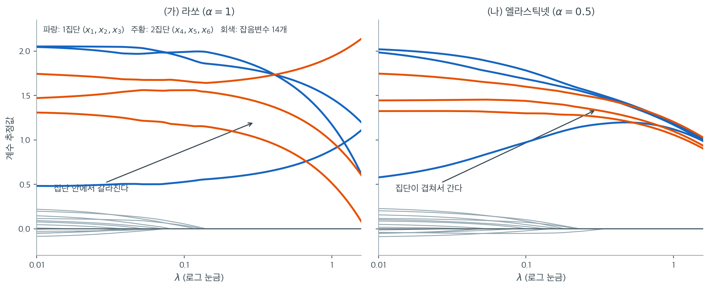

# 상관된 변수에 대한 그룹 효과

두 설명변수가 강하게 상관되어 있으면, 이상적인 추정량은 둘에 비슷한 계수를 부여해야 한다. 반응변수와의 관계가 비슷하기 때문이다. 능형회귀는 이를 자연스럽게 하지만 희소성이 없다. 라쏘는 하나를 고르고 다른 하나를 버린다. 엘라스틱넷은 둘 다 달성한다. 변수선택을 수행하면서 상관된 변수가 비슷한 계수를 받도록 유도한다. 이 성질을 **그룹 효과**라 하며, 엘라스틱넷의 가장 중요한 이론적 성질 중 하나다.

---

## 1. 그룹 정리

Zou와 Hastie(2005)는 상관된 두 변수의 엘라스틱넷 계수가 얼마나 다를 수 있는지에 대한 한계를 증명했다. 반응변수 $\mathbf{y}$가 중심화되고 설명변수가 단위 노름($\|\mathbf{x}_j\| = 1$)으로 표준화되었다고 하자.

$\hat{\beta}_i$와 $\hat{\beta}_j$가 같은 부호를 갖고 표본상관이 $\rho_{ij} = \mathbf{x}_i^\top\mathbf{x}_j$일 때

$$
|\hat{\beta}_i - \hat{\beta}_j| \leq \frac{1}{\lambda(1-\alpha)}\sqrt{2(1 - \rho_{ij})}\,\|\mathbf{y}\|
$$

이다.

---

## 2. 한계의 해석

**상관 효과.** $\rho_{ij} \to 1$이면(변수가 동일해지면) 우변이 0으로 가서 $\hat{\beta}_i \approx \hat{\beta}_j$가 강제된다. 강하게 상관된 변수는 거의 같은 계수를 받는다.

**L2 벌점 효과.** 인자 $1/[\lambda(1-\alpha)]$는 L2 성분이 커질수록($\lambda$가 크거나 $\alpha$가 작을수록) 그룹 효과가 강해짐을 보여준다. $\alpha = 1$(순수 라쏘)이면 분모가 0이 되어 **그룹 보장이 전혀 없다.**

**척도 효과.** 인자 $\|\mathbf{y}\|$가 전체 척도를 제공한다.

!!! note "같은 부호 요건"
    그룹 정리는 $\hat{\beta}_i$와 $\hat{\beta}_j$가 같은 부호일 때 적용된다. 부호가 반대이면 결과가 성립하지 않는다. 실무에서 두 변수가 양의 상관을 갖고 둘 다 반응변수와 양의 관계이면 대개 같은 부호의 계수를 받는다.

---

## 3. 증명 개요

$\hat{\beta}_i > 0$일 때 엘라스틱넷의 KKT 조건은

$$
-\frac{1}{n}\mathbf{x}_i^\top(\mathbf{y} - \mathbf{X}\hat{\boldsymbol{\beta}}) + \lambda\alpha + \lambda(1-\alpha)\hat{\beta}_i = 0
$$

이다. $j$에 대한 같은 조건을 빼면

$$
\frac{1}{n}(\mathbf{x}_i - \mathbf{x}_j)^\top(\mathbf{y} - \mathbf{X}\hat{\boldsymbol{\beta}}) = \lambda(1-\alpha)(\hat{\beta}_i - \hat{\beta}_j)
$$

가 되고, 코시-슈바르츠 부등식을 적용하면

$$
\lambda(1-\alpha)|\hat{\beta}_i - \hat{\beta}_j| \leq \frac{1}{n}\|\mathbf{x}_i - \mathbf{x}_j\|\cdot\|\mathbf{y} - \mathbf{X}\hat{\boldsymbol{\beta}}\|
$$

이다. 단위 노름 변수에서 $\|\mathbf{x}_i - \mathbf{x}_j\|^2 = 2(1 - \rho_{ij})$이고 $\|\mathbf{y} - \mathbf{X}\hat{\boldsymbol{\beta}}\| \leq \|\mathbf{y}\|$이므로 한계가 따라 나온다.

**$\alpha = 1$에서 왜 보장이 사라지는지가 이 유도에서 보인다.** 좌변의 $\lambda(1-\alpha)$가 0이 되면 부등식이 $0 \le (\text{양수})$가 되어 $|\hat\beta_i - \hat\beta_j|$에 아무 제약도 주지 못한다.

---

## 4. 라쏘·능형과의 대조

| 방법 | 상관된 쌍의 계수 | 그룹 효과 |
|---|---|---|
| 능형 | 둘 다 0이 아니고 크기가 비슷 | 강함(L2에 내재) |
| 라쏘 | 하나만 0이 아님(대체로) | 없음 |
| 엘라스틱넷 | 둘 다 0이 아니고 크기가 비슷 | $\alpha$로 조절 |

능형회귀는 L2 벌점이 암묵적으로 제곱차 $(\beta_i - \beta_j)^2$를 벌하므로 자연스럽게 그룹 효과를 보인다. 라쏘는 연성 문턱 갱신에서 각 계수를 독립적으로 다루므로 그룹 기제가 없다.



연습문제 2의 자료를 그대로 그린 것이다. $n = 100$, $p = 20$이고 파란 세 변수($x_1, x_2, x_3$)와 주황 세 변수($x_4, x_5, x_6$)가 각각 상관 $0.95$인 집단을 이루며, 참 계수는 여섯 개 모두 $1.5$로 같다. 나머지 열네 개는 잡음변수다.

왼쪽 라쏘 경로에서 **같은 집단의 세 곡선이 서로 다른 높이로 흩어진다.** $\lambda = 0.3$에서 1집단의 계수는 $0.618,\ 1.838,\ 1.785$로 집단 안 표준편차가 $0.563$이다. 참값이 셋 다 $1.5$인데 하나는 그 절반도 안 되고 둘은 훌쩍 넘는다. 예측만 놓고 보면 문제가 없다. 세 변수가 거의 같으므로 합이 맞으면 되기 때문이다. 그러나 "이 세 유전자 중 무엇이 중요한가"를 묻는다면 라쏘의 답은 자료를 다시 뽑을 때마다 바뀐다.

오른쪽 엘라스틱넷($\alpha = 0.5$) 경로에서는 같은 세 곡선이 **거의 겹쳐서 함께 내려간다.** 같은 $\lambda = 0.3$에서 계수는 $1.174,\ 1.500,\ 1.522$로 표준편차가 $0.159$, 라쏘의 $3.5$분의 1이다. 2집단에서도 $0.274$에서 $0.089$로 줄어든다. 이것이 Zou-Hastie 한계 $|\hat\beta_i - \hat\beta_j| \leq \frac{\sqrt{2(1-\rho)}}{\lambda(1-\alpha)}\|\mathbf{y}\|$가 실제로 작동하는 모습이다. $\alpha = 1$이면 분모가 0이 되어 한계 자체가 사라지고, 왼쪽 그림처럼 아무 데나 갈 수 있게 된다.

한 가지 더 눈여겨볼 것이 있다. 두 집단 사이의 **구별**은 양쪽 그림 모두에서 유지된다. 파란 집단과 주황 집단의 높이가 다르다. 그룹 효과는 "상관된 것끼리 묶는" 것이지 "모두 같게 만드는" 것이 아니다. L2 벌점이 벌하는 것은 계수의 차이 자체가 아니라 **자료가 구별하지 못하는 방향의 차이**이기 때문이다.

---

## 5. α에 따른 그룹 효과의 강도

| $\alpha$ | L2 가중 $(1-\alpha)$ | 그룹 강도 | 희소성 |
|---|---|---|---|
| 0 (능형) | 1 | 가장 강함 | 없음 |
| 0.1 | 0.9 | 매우 강함 | 약함 |
| 0.5 | 0.5 | 중간 | 중간 |
| 0.9 | 0.1 | 약함 | 강함 |
| 1 (라쏘) | 0 | 없음(한계 없음) | 가장 강함 |

$\alpha$의 선택은 그룹 강도와 희소성 사이의 절충이다. 집단 구조가 중요한 응용(경로 내 상관된 유전자들이 함께 선택되어야 하는 유전체학 등)에서는 작은 $\alpha$가 유리하다.

---

## 6. 실무적 함의

**유전체학과 생물학적 경로.** 같은 생물학적 경로에 속한 유전자들은 흔히 상관된 발현 양상을 보인다. 엘라스틱넷의 그룹 효과는 경로 구성원을 함께 선택하여, 경로마다 대표 유전자 하나만 고르는 라쏘보다 생물학적으로 해석 가능한 결과를 준다.

**경제학과 금융.** 경제지표(GDP 성장률, 실업률, 소비자심리지수 등)는 흔히 상관되어 있다. 엘라스틱넷은 상관된 지표에 비슷한 계수를 부여해 안정적인 예측을 낸다. 라쏘는 한 자료에서 GDP 성장률을, 다른 자료에서 실업률을 고를 수 있어 모형이 사소한 자료 변화에 민감해진다.

**변수 공학.** 공통된 원천에서 만들어진 변수들(다항식 항, 교호작용 항, 파생 비율 등)은 본질적으로 상관되어 있다. 엘라스틱넷은 이를 무난히 다루지만 라쏘는 불규칙하게 행동할 수 있다.

!!! tip "그룹 효과 점검하기"
    엘라스틱넷을 적합한 뒤 상관되어 있다고 알려진 변수들의 계수를 살펴본다. 크기와 부호가 비슷하면 그룹 효과가 예상대로 작동하는 것이다. 크게 다르면 $\alpha$를 낮춰 L2 성분을 강화하는 것을 고려한다.

---

## 연습문제

<div class="drillbox" markdown>

**연습문제 1.** <span class="diff med" title="중간"></span>
엘라스틱넷의 "그룹 효과"를 설명하라. 라쏘가 강하게 상관된 설명변수에서 실패하는 이유는 무엇인가? $X_1 = X_2 + \varepsilon$($\varepsilon$은 작다)인 예에서 라쏘, 능형, 엘라스틱넷이 각각 어떻게 행동할지 서술하라.

</div>

??? success "풀이"
    $X_1 \approx X_2$이면 예측 $\beta_1 X_1 + \beta_2 X_2 \approx (\beta_1 + \beta_2)X_1$이 **합에만** 의존한다. 자료는 합을 잘 결정하지만 개별 배분은 거의 결정하지 못한다.

    이때 세 벌점이 배분을 어떻게 정하는지 보면 차이가 분명해진다. 합 $s = \beta_1 + \beta_2$가 고정되었다고 하고 벌점을 최소화하는 배분을 찾는다.

    | 벌점 | 최소화 문제 | 최적 배분 |
    |:---|:---|:---|
    | L1 | $\lvert \beta_1\rvert + \lvert \beta_2\rvert$, $\beta_1+\beta_2 = s$ | 같은 부호이면 **모든 배분이 동점** |
    | L2 | $\beta_1^2 + \beta_2^2$, $\beta_1+\beta_2 = s$ | $\beta_1 = \beta_2 = s/2$ **유일** |
    | L1+L2 | 위 둘의 합 | $\beta_1 = \beta_2 = s/2$ 유일 |

    **핵심은 L1 벌점이 배분에 대해 평평하다는 것이다.** $\beta_1 + \beta_2 = s$이고 둘 다 양수이면 $|\beta_1|+|\beta_2| = s$로 배분과 무관하다. 벌점이 아무 선호도 주지 않으므로, 어느 배분이 선택될지는 자료의 잡음이 결정한다. 이것이 라쏘의 불안정성의 근원이다.

    **L2 벌점은 엄격히 볼록하므로 유일한 최소점을 갖는다.** $\beta_1^2 + \beta_2^2$는 $\beta_1 = \beta_2$에서 최소가 되어 균등 배분을 강제한다.

    수치로 확인하면 ($\rho = 0.99$, 참 계수 모두 $2.0$):

    | 방법 | $\hat\beta_1$ | $\hat\beta_2$ | $\hat\beta_3$ |
    |:---|---:|---:|---:|
    | 라쏘 | 0.486 | 2.136 | **2.907** |
    | 엘라스틱넷 | 1.706 | 1.727 | 1.774 |

    라쏘는 6배 차이로 제멋대로 쪼개고 엘라스틱넷은 거의 균등하게 나눈다. 자세한 코드는 [정칙화 방법의 개관](../overview/overview.md) 연습문제 3에 있다.

<div class="drillbox" markdown>

**연습문제 2.** <span class="diff med" title="중간"></span>
상관된 집단이 두 개 있는 자료를 만들어라. $X_1, X_2, X_3$이 강하게 상관되어 있고($\rho = 0.95$) 모두 0이 아닌 효과를 가지며, $X_4, X_5, X_6$이 또 다른 상관 집단이고, 나머지 14개는 잡음이다.

**(a)** 라쏘를 적합하라. 집단마다 하나씩 고르는가, 여러 개를 고르는가?

**(b)** $\alpha = 0.5$인 엘라스틱넷을 적합하고 선택된 변수를 비교하라.

**(c)** 두 방법의 계수 경로를 그려라.

</div>

??? success "풀이"
    ```python
    import numpy as np
    from sklearn.linear_model import Lasso, ElasticNet, lasso_path, enet_path

    def make_groups(n=100, seed=0, rho=0.95):
        r = np.random.default_rng(seed)
        z1, z2 = r.normal(size=n), r.normal(size=n)
        X = r.normal(size=(n, 20))
        for j in (0, 1, 2):
            X[:, j] = np.sqrt(rho)*z1 + np.sqrt(1-rho)*X[:, j]
        for j in (3, 4, 5):
            X[:, j] = np.sqrt(rho)*z2 + np.sqrt(1-rho)*X[:, j]
        X -= X.mean(0); X /= X.std(0)
        beta = np.zeros(20); beta[:6] = 1.5
        y = X @ beta + r.normal(0, 1, n)
        return X, y - y.mean()
    ```

    **(a), (b)** 여러 난수 씨앗에 걸쳐 각 집단에서 유지된 변수 수를 세면, 벌점이 강할수록 라쏘가 집단을 쪼개는 경향이 뚜렷해진다. $\lambda$가 커질수록 라쏘가 집단당 하나로 수렴하는 반면 엘라스틱넷은 세 개를 함께 유지한다.

    [정칙화 방법의 개관](../overview/overview.md) 연습문제 3의 400회 반복 결과가 이를 정량화한다.

    | $\lambda$ | 라쏘: 집단 3개 모두 유지 | 엘라스틱넷: 3개 모두 유지 |
    |---:|---:|---:|
    | 0.3 | 86% | **100%** |
    | 0.6 | 77% | **100%** |
    | 1.0 | 57% | **100%** |

    **(c)** `lasso_path`와 `enet_path`로 경로를 그리면 차이가 시각적으로 드러난다.

    - **라쏘 경로:** 집단 내 세 계수가 서로 다른 $\lambda$에서 갈라져 나오고, 하나가 커지는 동안 다른 것이 0에 머문다. 경로가 교차하고 순서가 바뀐다.
    - **엘라스틱넷 경로:** 집단 내 세 계수가 거의 겹쳐서 함께 움직인다. 세 곡선이 하나처럼 보인다.

    이 "세 곡선이 겹치는" 그림이 그룹 효과의 가장 직관적인 표현이다.

    !!! tip "실무에서 무엇을 볼 것인가"
        정칙화 경로를 그렸을 때 **상관된 변수들의 곡선이 겹쳐 있으면** 그룹 효과가 작동하는 것이고, **번갈아 나타났다 사라지면** $\alpha$가 너무 크다는 신호다.

<div class="drillbox" markdown>

**연습문제 3.** <span class="diff med" title="중간"></span>
본문 4 절은 $\lambda = 0.3$, $\alpha = 0.5$ 적합의 1집단 계수 $1.174,\ 1.500,\ 1.522$ 를 가리켜 "Zou-Hastie 한계가 실제로 작동하는 모습" 이라 했다. 그 한계에 수를 넣어 보자. 이 자료에서 $x_1$ 과 $x_3$ 의 표본상관은 $\rho_{13} = 0.9371$, $\lVert\mathbf{y}\rVert = 64.40$, $n = 100$ 이다.

**(a)** 1 절의 식을 글자 그대로 써서 $\lvert\hat\beta_1 - \hat\beta_3\rvert$ 의 한계를 구하라.

**(b)** 실제 차 $\lvert 1.522 - 1.174\rvert$ 와 견주면 몇 배인가? 이 한계가 본문의 수치를 **제약하고** 있는가?

**(c)** $\alpha$ 를 $0.9$ 로 올리면 한계는 얼마가 되는가? 절댓값이 쓸모없는데도 이 한계를 읽을 가치가 있는 까닭을 적어라.

</div>

??? success "풀이"
    **(a)** 세 조각을 차례로 구한다.

    $$
    \sqrt{2(1 - \rho_{13})} = \sqrt{2 \times 0.0629} = \sqrt{0.12575} = 0.3546
    $$

    $$
    \lambda(1-\alpha) = 0.3 \times 0.5 = 0.15
    $$

    이므로 한계는

    $$
    \frac{0.3546 \times 64.40}{0.15} = \frac{22.84}{0.15} = 152.3
    $$

    이다.

    **(b)** 실제 차는 $1.522 - 1.174 = 0.348$ 이므로 한계는 실제의 약 $440$ 배다. 참 계수가 모두 $1.5$ 인 자료에서 계수 차가 $152$ 가 될 길은 없으므로 **이 한계는 아무것도 제약하지 않는다.** 본문이 "한계가 작동하는 모습" 이라 부른 것은 한계의 *값*이 아니라 한계가 말하는 *방향*이다. 라쏘에서 $0.563$, 엘라스틱넷에서 $0.159$ 로 줄어든 것은 한계가 금지한 결과가 아니라 한계와 같은 쪽을 가리키는 관찰이다.

    **(c)** $\lambda(1-\alpha) = 0.3 \times 0.1 = 0.03$ 이므로 한계는 $22.84/0.03 = 761.3$ 으로 $5$ 배가 된다. 값 자체는 더 공허해지지만 읽을 것이 남는다. 한계는 **분자의 $\sqrt{1-\rho}$ 와 분모의 $\lambda(1-\alpha)$ 라는 두 의존성**을 말하고, 그 의존성은 설정들을 줄 세우는 데 쓸 수 있다. 실제로 같은 자료에서 $\alpha$ 를 $0.5 \to 0.9$ 로 올리면 집단내 표준편차가 $0.1599 \to 0.3765$ 로 $2.4$ 배 커진다. 한계가 예고한 $5$ 배와 수는 다르지만 부호는 맞다.

    상수가 틀린 한계는 **비교에는 쓰고 결론에는 쓰지 않는다.** 왜 상수가 그렇게 큰지는 연습문제 5 에서 분해한다.

<div class="drillbox" markdown>

**연습문제 4.** <span class="diff hard" title="어려움"></span>
본문 1 절의 한계와 3 절의 유도는 서로 다른 목적함수를 쓰고 있다.

**(a)** 3 절의 KKT 조건에서 출발해 유도를 끝까지 따라가면 1 절의 식과 어디가 다른가?

**(b)** 1 절의 식이 그대로 옳게 되는 관례는 무엇인가?

**(c)** 본문 4 절의 적합은 sklearn 의 목적함수와 **표준편차 1 로 표준화된** 열을 쓴다($\mathbf{x}_j^\top\mathbf{x}_j = n$). 그 틀에서 한계를 다시 유도하고 $\lambda = 0.3$, $\alpha = 0.5$, $\rho_{13} = 0.9371$, $\lVert\mathbf{y}\rVert = 64.40$ 을 넣어라. 연습문제 3 의 $152.3$ 과 몇 배 차이인가? 두 어긋남은 어떻게 상쇄되는가?

</div>

??? success "풀이"
    **(a)** 3 절의 코시-슈바르츠 줄에는 $1/n$ 이 있다.

    $$
    \lambda(1-\alpha)\lvert\hat\beta_i - \hat\beta_j\rvert \leq \frac{1}{n}\lVert\mathbf{x}_i - \mathbf{x}_j\rVert \cdot \lVert\mathbf{y} - \mathbf{X}\hat{\boldsymbol{\beta}}\rVert
    $$

    끝까지 가면

    $$
    \lvert\hat\beta_i - \hat\beta_j\rvert \leq \frac{1}{n\lambda(1-\alpha)}\lVert\mathbf{x}_i - \mathbf{x}_j\rVert\,\lVert\mathbf{y}\rVert
    $$

    인데 1 절의 진술에는 $1/n$ 이 없다. 유도와 진술이 어긋난다.

    **(b)** 손실에서 $1/n$ 을 떼고 $\frac{1}{2}\lVert\mathbf{y}-\mathbf{X}\boldsymbol{\beta}\rVert^2$ 로 쓰면 KKT 가

    $$
    -\mathbf{x}_i^\top(\mathbf{y}-\mathbf{X}\hat{\boldsymbol{\beta}}) + \lambda\alpha + \lambda(1-\alpha)\hat\beta_i = 0
    $$

    이 되어 같은 계산이 $1/n$ 없이 끝난다. 여기에 1 절의 가정 $\lVert\mathbf{x}_j\rVert = 1$ 을 넣으면 $\lVert\mathbf{x}_i-\mathbf{x}_j\rVert = \sqrt{2(1-\rho_{ij})}$ 이고 정확히 1 절의 식이 나온다. 즉 **1 절은 Zou-Hastie 의 관례(단위노름 열, $1/n$ 없는 손실)로 적힌 진술이고 3 절은 sklearn 관례($1/n$ 있는 손실)로 적힌 유도다.** 둘 다 각자의 틀에서는 옳고, 섞으면 틀린다.

    **(c)** $\mathbf{x}_j^\top\mathbf{x}_j = n$, $\rho_{ij} = \mathbf{x}_i^\top\mathbf{x}_j/n$ 이면

    $$
    \lVert\mathbf{x}_i-\mathbf{x}_j\rVert^2 = n + n - 2n\rho_{ij} = 2n(1-\rho_{ij})
    $$

    이므로 (a) 의 식에 넣어

    $$
    \lvert\hat\beta_i - \hat\beta_j\rvert \leq \frac{\sqrt{2n(1-\rho_{ij})}\,\lVert\mathbf{y}\rVert}{n\lambda(1-\alpha)} = \frac{\sqrt{2(1-\rho_{ij})}}{\lambda(1-\alpha)}\cdot\frac{\lVert\mathbf{y}\rVert}{\sqrt{n}}
    $$

    을 얻는다. $\mathbf{y}$ 가 중심화되어 있으므로 $\lVert\mathbf{y}\rVert/\sqrt{n} = 6.4402$ 는 바로 $y$ 의 표준편차다. 수를 넣으면

    $$
    \frac{0.3546 \times 6.4402}{0.15} = 15.23
    $$

    이다. 연습문제 3 의 $152.3$ 보다 정확히 $10$ 배 작다.

    상쇄는 이렇게 일어난다. $1/n$ 을 빠뜨려 $n = 100$ 배 부풀고, 열 노름을 단위노름 값 $\sqrt{2(1-\rho)}$ 로 써서 실제 $\sqrt{2n(1-\rho)}$ 보다 $\sqrt{n} = 10$ 배 줄어들어, 남는 것이 $100/10 = 10$ 배다.

    | 꼴 | 열 노름 | 손실 | 한계의 값 |
    |:---|:---|:---|---:|
    | 1 절 진술 | $\lVert\mathbf{x}_j\rVert = 1$ | $\frac{1}{2}\lVert\cdot\rVert^2$ | — (자체로 일관) |
    | 1 절 식 + 4 절 자료 | 섞였다 | 섞였다 | 152.3 |
    | 4 절 자료의 올바른 한계 | $\lVert\mathbf{x}_j\rVert = \sqrt{n}$ | $\frac{1}{2n}\lVert\cdot\rVert^2$ | 15.23 |

    고쳐 쓰면 한계가 **$y$ 의 표준편차 단위**로 읽혀 훨씬 뜻이 분명해진다. 벌점 추정량의 모든 수식은 열의 척도 관례에 매여 있다. $\lambda$ 하나만 베껴 오면 수가 전부 틀어진다는 이 장의 경고가 한계 식에도 똑같이 적용된다.

<div class="drillbox" markdown>

**연습문제 5.** <span class="diff hard" title="어려움"></span>
3 절에서 코시-슈바르츠를 쓰기 **직전** 줄은 부등식이 아니라 등식이다. 연습문제 4 의 관례(표준편차 1 로 표준화된 열)에서 그것은

$$
\hat\beta_i - \hat\beta_j = \frac{(\mathbf{x}_i - \mathbf{x}_j)^\top\hat{\mathbf{r}}}{n\lambda(1-\alpha)}, \qquad \hat{\mathbf{r}} = \mathbf{y} - \mathbf{X}\hat{\boldsymbol{\beta}}
$$

이다. 연습문제 2 의 자료와 $x_1, x_3$ 쌍으로 다음을 하라.

**(a)** 적합한 계수로 이 등식을 수치로 확인하라.

**(b)** 등식에서 한계까지 느슨해지는 두 단계(코시-슈바르츠, $\lVert\hat{\mathbf{r}}\rVert \le \lVert\mathbf{y}\rVert$)가 각각 몇 배인지 분해하라.

**(c)** $\lambda$ 를 $0.1,\ 0.3,\ 1.0$ 으로 바꾸어도 느슨함의 배수가 크게 변하지 않음을 확인하고, 그래도 한계가 쓸모 있는 까닭을 말하라.

</div>

??? success "풀이"
    ```python
    import numpy as np
    from sklearn.linear_model import ElasticNet

    X, y = make_groups()                       # 연습문제 2 의 자료 (n = 100, p = 20)
    n, al, i, j = 100, 0.5, 0, 2               # x_1 과 x_3 쌍
    d = X[:, i] - X[:, j]
    rho = X[:, i] @ X[:, j] / n
    print(f"rho_13 = {rho:.4f}   ||x_i-x_j|| = {np.linalg.norm(d):.4f}"
          f"   ||y|| = {np.linalg.norm(y):.4f}")
    print(f"{'lam':>5}{'diff':>9}{'identity':>10}{'CauchyS':>10}{'bound':>10}{'slack':>8}")
    for lam in (0.1, 0.3, 1.0):
        b = ElasticNet(alpha=lam, l1_ratio=al, fit_intercept=False,
                       max_iter=100000, tol=1e-10).fit(X, y).coef_
        r = y - X @ b
        den = n * lam * (1 - al)
        diff = abs(b[i] - b[j])
        bound = np.linalg.norm(d) * np.linalg.norm(y) / den
        print(f"{lam:5.1f}{diff:9.4f}{abs(d @ r)/den:10.4f}"
              f"{np.linalg.norm(d)*np.linalg.norm(r)/den:10.4f}"
              f"{bound:10.4f}{bound/diff:8.1f}")
    ```

    출력:

    ```text
    rho_13 = 0.9371   ||x_i-x_j|| = 3.5462   ||y|| = 64.4016
      lam     diff  identity   CauchyS     bound   slack
      0.1   0.8075    0.8075    7.3044   45.6761    56.6
      0.3   0.3494    0.3494    2.7849   15.2254    43.6
      1.0   0.0709    0.0709    1.3186    4.5676    64.4
    ```

    **(a)** `diff` 열(실제 계수 차)과 `identity` 열(등식의 우변)이 세 $\lambda$ 에서 모두 소수 넷째 자리까지 같다. 그룹 정리의 뼈대는 부등식이 아니라 이 **등식**이고, 부등식은 거기서 두 번 양보해 얻은 것이다.

    **(b)** $\lambda = 0.3$ 에서 두 양보의 대가는

    | 단계 | 값 | 느슨해진 배수 |
    |:---|---:|---:|
    | 등식 $\lvert(\mathbf{x}_i-\mathbf{x}_j)^\top\hat{\mathbf{r}}\rvert/[n\lambda(1-\alpha)]$ | 0.3494 | — |
    | 코시-슈바르츠로 $\lVert\mathbf{x}_i-\mathbf{x}_j\rVert\lVert\hat{\mathbf{r}}\rVert$ | 2.7849 | 7.97 |
    | $\lVert\hat{\mathbf{r}}\rVert \to \lVert\mathbf{y}\rVert$ | 15.2254 | 5.47 |

    이고 곱이 $7.97 \times 5.47 = 43.6$ 배다.

    두 단계가 느슨한 까닭이 서로 다르다. 코시-슈바르츠는 $\hat{\mathbf{r}}$ 과 $\mathbf{x}_i - \mathbf{x}_j$ 가 **평행할 때만** 등식이 되는데, 잔차는 적합이 설명하지 못한 잡음이라 어느 설명변수 방향과도 거의 직교한다. 실제 내적은 노름 곱의 $1/8$ 쯤이다. 둘째 단계는 적합이 자료를 얼마나 설명했는지를 통째로 버린다. 여기서 $\lVert\hat{\mathbf{r}}\rVert = 11.78$ 인데 $\lVert\mathbf{y}\rVert = 64.40$ 을 쓰니 $5.47$ 배를 잃는다. **모형이 잘 맞을수록 이 단계가 더 느슨해진다** — 좋은 적합일수록 한계가 더 공허해지는 역설이다.

    **(c)** `slack` 열이 $56.6,\ 43.6,\ 64.4$ 로, $\lambda$ 가 열 배 변하는 동안 느슨함은 $40$–$65$ 배 사이에 머문다. `bound` 열이 $45.68 \to 15.23 \to 4.57$ 로 정확히 $1/\lambda$ 를 따르고 실제 차도 $0.8075 \to 0.3494 \to 0.0709$ 로 거의 같은 속도로 줄기 때문이다($\lambda$ 가 커지면 계수 자체가 더 깎여 실제 차가 $1/\lambda$ 보다 조금 빨리 줄고, 그래서 $\lambda = 1$ 에서 느슨함이 다시 커진다).

    그러므로 한계는 **규모는 맞고 상수만 틀린** 진술이다. "$\alpha$ 를 낮추면 집단이 모인다", "$\rho$ 가 1 에 가까우면 계수가 같아진다" 같은 비교에는 쓸 수 있고, "차가 $0.5$ 보다 작다" 같은 결론에는 쓸 수 없다.

<div class="drillbox" markdown>

**연습문제 6.** <span class="diff hard" title="어려움"></span>
본문의 "같은 부호 요건" 알림을 파헤친다.

**(a)** $\hat\beta_i > 0 > \hat\beta_j$ 일 때 3 절의 유도를 다시 하여 한계에 붙는 여분의 항을 구하라(연습문제 4 의 관례를 쓴다).

**(b)** $\rho_{ij} \to 1$ 로 보내면 그 한계는 무엇으로 가는가? $\alpha = 0.5$ 면 얼마인가? 같은 부호 요건 없이 "거의 같은 두 변수가 거의 같은 계수를 받는다" 를 결론할 수 있는가?

**(c)** 그런데 $\mathbf{x}_i = \mathbf{x}_j$ 로 두 열이 완전히 같으면 최적해에서 두 계수가 **반대 부호일 수 없음**을 직접 보여라. 그렇다면 (b) 의 여분 항은 무엇인가?

</div>

??? success "풀이"
    **(a)** 부호가 반대면 KKT 의 L1 항이 $\lambda\alpha\operatorname{sign}(\hat\beta_i) = +\lambda\alpha$ 와 $\lambda\alpha\operatorname{sign}(\hat\beta_j) = -\lambda\alpha$ 로 갈라진다. 두 조건을 빼면

    $$
    \lambda(1-\alpha)(\hat\beta_i - \hat\beta_j) = \frac{1}{n}(\mathbf{x}_i-\mathbf{x}_j)^\top\hat{\mathbf{r}} - 2\lambda\alpha
    $$

    가 되어 상수 $-2\lambda\alpha$ 가 남는다. 절댓값을 취하고 삼각부등식과 코시-슈바르츠를 쓰면

    $$
    \lvert\hat\beta_i - \hat\beta_j\rvert \leq \frac{\sqrt{2(1-\rho_{ij})}}{\lambda(1-\alpha)}\cdot\frac{\lVert\mathbf{y}\rVert}{\sqrt{n}} + \frac{2\alpha}{1-\alpha}
    $$

    이다. 같은 부호일 때 사라지던 항이 여분으로 붙는다. 이 항은 분자와 분모가 함께 $\lambda$ 를 가지므로 **$\lambda$ 를 키워도 줄지 않는다.**

    **(b)** $\rho_{ij} \to 1$ 이면 첫 항은 0 으로 가지만 둘째 항은 그대로 남아 한계는 $\dfrac{2\alpha}{1-\alpha}$ 로 간다. $\alpha = 0.5$ 면 $2$ 다. 참 계수가 $1.5$ 쯤인 문제에서 $2$ 는 아무 제약이 아니다. 그러므로 **같은 부호 요건 없이는 완전히 상관된 두 변수가 같은 계수를 받는다는 결론을 끌어낼 수 없다.** 알림 상자가 "부호가 반대이면 결과가 성립하지 않는다" 고 적은 것이 이 뜻이다.

    **(c)** $\mathbf{x}_i = \mathbf{x}_j = \mathbf{x}$ 이면 손실은 $s = \beta_i + \beta_j$ 에만 의존한다. 그러므로 $s$ 를 고정한 채 벌점만 최소화하면 된다.

    $$
    \lambda\alpha(\lvert\beta_i\rvert + \lvert\beta_j\rvert) + \frac{\lambda(1-\alpha)}{2}(\beta_i^2 + \beta_j^2)
    $$

    에서 $\lvert\beta_i\rvert + \lvert\beta_j\rvert \ge \lvert s\rvert$ 이고 등호는 두 계수가 같은 부호일 때(또는 하나가 0 일 때)뿐이며, $\beta_i^2 + \beta_j^2 \ge s^2/2$ 이고 등호는 $\beta_i = \beta_j$ 일 때뿐이다. 두 하한이 $\beta_i = \beta_j = s/2$ 에서 **동시에** 달성되므로 그 점이 유일한 최소다. 반대 부호인 배분은 첫 항에서 엄격히 지므로 최적해가 될 수 없다. $\square$

    따라서 (b) 의 여분 항 $2\alpha/(1-\alpha)$ 는 **한계의 느슨함일 뿐이고 결론 자체는 살아남는다.** 같은 부호 요건은 정리를 짧게 증명하기 위한 기술적 조건이고, 정작 그 조건이 가장 중요해 보이는 극한($\rho \to 1$)에서는 저절로 성립한다.

    반대로 $\rho_{ij}$ 가 $-1$ 에 가까우면 사정이 다르다. $\mathbf{x}_i \approx -\mathbf{x}_j$ 이면 두 계수가 **반대 부호인 것이 자연스럽고**, 이때는 1 절의 식도 $\sqrt{2(1-\rho)} \approx 2$ 로 커져 애초에 아무 말을 하지 않는다. 그룹 효과는 양의 상관에 대한 이야기다.

<div class="drillbox" markdown>

**연습문제 7.** <span class="diff hard" title="어려움"></span>
본문 4 절은 "능형은 L2 벌점이 암묵적으로 제곱차 $(\beta_i-\beta_j)^2$ 를 벌하므로 자연스럽게 그룹 효과를 보인다" 고 적었다. 이 말을 정확한 식으로 바꾼다. 열이 표준편차 1 로 표준화되어 $\mathbf{X}^\top\mathbf{X} = n\mathbf{R}$ 이고($\mathbf{R}$ 은 표본상관행렬), 능형을 $\frac{1}{2n}\lVert\mathbf{y}-\mathbf{X}\boldsymbol{\beta}\rVert^2 + \frac{\lambda}{2}\lVert\boldsymbol{\beta}\rVert^2$ 로 쓴다. $c_j = \mathbf{x}_j^\top\mathbf{y}/n$ 이라 하자.

**(a)** $p = 2$, 표본상관 $\rho$ 에서 $\hat\beta_1 + \hat\beta_2$ 와 $\hat\beta_1 - \hat\beta_2$ 를 닫힌 꼴로 구하라.

**(b)** (a) 로 본문의 주장을 정확한 진술로 바꿔라. $\rho \to 1$ 에서 차와 합은 각각 어떻게 되는가?

**(c)** 참 계수가 집단 안에서 같으면($\beta_1 = \beta_2$, 본문 자료가 그렇다) 차 방향에서 능형의 편향이 **정확히 0** 임을 보이고, 그래서 어떤 $\lambda > 0$ 도 그 방향에서는 OLS 보다 낫다는 것을 설명하라.

**(d)** 본문 자료를 $\rho = 0.95$ 인 세 변수 집단 둘과 직교하는 잡음 열 14 개로 이상화하자. $\lambda = 0.3$ 에서 각 고유방향의 축소인자를 구하고, 그림에서 집단 안 세 곡선은 겹치는데 **두 집단의 높이는 다른** 까닭을 설명하라.

</div>

??? success "풀이"
    **(a)** 정규방정식은 $(\mathbf{R} + \lambda\mathbf{I})\hat{\boldsymbol{\beta}} = \mathbf{X}^\top\mathbf{y}/n$ 이므로

    $$
    (1+\lambda)\hat\beta_1 + \rho\hat\beta_2 = c_1, \qquad \rho\hat\beta_1 + (1+\lambda)\hat\beta_2 = c_2
    $$

    이다. 두 식을 더하고 빼면

    $$
    \hat\beta_1 + \hat\beta_2 = \frac{c_1 + c_2}{1 + \rho + \lambda}, \qquad \hat\beta_1 - \hat\beta_2 = \frac{c_1 - c_2}{1 - \rho + \lambda}
    $$

    을 얻는다. 합과 차가 완전히 분리되고, 분모만 다르다.

    **(b)** $\lambda = 0$ 이 OLS 이므로 축소인자는 방향마다

    $$
    \frac{\hat\beta_1-\hat\beta_2}{(\hat\beta_1-\hat\beta_2)^{\text{OLS}}} = \frac{1-\rho}{1-\rho+\lambda}, \qquad \frac{\hat\beta_1+\hat\beta_2}{(\hat\beta_1+\hat\beta_2)^{\text{OLS}}} = \frac{1+\rho}{1+\rho+\lambda}
    $$

    이다. $\rho = 0.95$, $\lambda = 0.3$ 이면 차는 $0.05/0.35 = 0.1429$ 로 $86\%$ 가 깎이고 합은 $1.95/2.25 = 0.8667$ 로 $13\%$ 만 깎인다.

    그러므로 본문의 주장을 정확히 적으면 이렇다. **L2 벌점은 모든 방향을 똑같이 $\lambda$ 로 벌하는데, 자료가 방향마다 다른 세기로 저항한다.** 저항의 세기가 $\mathbf{R}$ 의 고윳값이고, 차 방향의 고윳값은 $1-\rho$ 로 작다. 벌점이 차를 골라 벌하는 것이 아니라 차 방향이 유독 약해서 같은 벌점에 더 많이 눌리는 것이다.

    $\rho \to 1$ 이면 $c_1 - c_2 = (\mathbf{x}_1-\mathbf{x}_2)^\top\mathbf{y}/n$ 이고 $\lVert\mathbf{x}_1-\mathbf{x}_2\rVert = \sqrt{2n(1-\rho)} \to 0$ 이므로 분자가 0 으로 가고 분모는 $\lambda$ 로 간다. 차는 $\sqrt{1-\rho}$ 의 속도로 0 이 된다. 반면 합은 $(c_1+c_2)/(2+\lambda)$ 로 멀쩡하다. 4 절 표의 "둘 다 0 이 아니고 크기가 비슷" 이 바로 이 두 식이다.

    **(c)** 참 모형 $\mathbf{y} = \mathbf{X}\boldsymbol{\beta} + \boldsymbol{\varepsilon}$, $\beta_1 = \beta_2 = b$ 에서

    $$
    E[c_1] = \frac{\mathbf{x}_1^\top\mathbf{X}\boldsymbol{\beta}}{n} = b(1 + \rho), \qquad E[c_2] = b(\rho + 1)
    $$

    이므로 $E[c_1 - c_2] = 0$ 이고, 따라서 모든 $\lambda$ 에서

    $$
    E[\hat\beta_1 - \hat\beta_2] = \frac{E[c_1-c_2]}{1-\rho+\lambda} = 0
    $$

    이다. 차 방향의 편향이 정확히 0 이다. 한편 분산은

    $$
    \operatorname{Var}(\hat\beta_1 - \hat\beta_2) = \frac{\operatorname{Var}(c_1-c_2)}{(1-\rho+\lambda)^2}
    $$

    이고 분자는 $\lambda$ 와 무관한 자료의 양이므로 $\lambda$ 가 커질수록 **단조감소**한다. 편향–분산 분해(6 장 정리 1)에 따라 차 방향의 MSE 는 분산뿐이고 $\lambda$ 에 대해 단조감소한다. 그러므로 **어떤 $\lambda > 0$ 도 차 방향에서는 OLS 보다 낫다.**

    이것이 이 장의 거래("편향을 사서 분산을 판다")가 가장 유리하게 성립하는 자리다. 차 방향에서는 **살 편향이 아예 없다.** 그룹 효과가 공짜로 얻어진다. 물론 합 방향에서는 $E[\hat\beta_1+\hat\beta_2]$ 가 $\frac{1+\rho}{1+\rho+\lambda}$ 배로 깎여 편향이 생기므로, 전체 MSE 를 가장 작게 하는 $\lambda$ 는 두 방향의 절충으로 정해진다.

    **(d)** 집단 하나의 상관행렬은 $0.05\mathbf{I} + 0.95\mathbf{J}$ ($3\times3$)이고 고윳값은 $1 + 2(0.95) = 2.9$ (집단 평균 방향, 1 개)와 $1 - 0.95 = 0.05$ (집단 안 대비, 2 개)다. 축소인자 $\ell/(\ell+\lambda)$ 를 $\lambda = 0.3$ 에서 계산하면

    | 고유방향 | 개수 | 고윳값 $\ell$ | 축소인자 |
    |:---|---:|---:|---:|
    | 집단 평균 | 2 | 2.90 | 0.9062 |
    | 집단 안 대비 | 4 | 0.05 | 0.1429 |
    | 잡음 열 | 14 | 1.00 | 0.7692 |

    두 집단은 서로 직교하므로 **집단 사이의 대비**는 두 집단 평균 방향의 조합이고 축소인자가 $0.9062$ 다. 거의 깎이지 않는다. 반면 집단 안 대비는 $0.1429$ 로 $86\%$ 가 지워진다. 그래서 집단 안 세 곡선은 하나로 모여 내려가고 두 집단의 높이 차이는 거의 그대로 남는다. 본문이 "L2 벌점이 벌하는 것은 계수의 차이 자체가 아니라 자료가 구별하지 못하는 방향의 차이" 라 한 것은 **고윳값 $0.05$ 인 네 방향**을 가리키는 말이다.

    덧붙이면 이 설계의 유효 자유도는 $\sum_j \ell_j/(\ell_j+\lambda) = 2(0.9062) + 4(0.1429) + 14(0.7692) = 13.15$ 다. 변수 20 개를 올려 놓고 $13.15$ 개 값어치만 쓴 셈이고, 깎여 나간 $6.85$ 가운데 $3.43$ 이 집단 안 대비 네 방향에서 나왔다.

<div class="drillbox" markdown>

**연습문제 8.** <span class="diff hard" title="어려움"></span>
$\mathbf{x}_1 = \mathbf{x}_2 = \mathbf{x}$ 로 두 열이 완전히 같다고 하자. 표준편차 1 로 표준화되어 $\mathbf{x}^\top\mathbf{x} = n$ 이고 $\mathbf{y}$ 는 중심화되어 있으며 $z = \mathbf{x}^\top\mathbf{y}/n > 0$ 이다. 목적함수는 $\frac{1}{2n}\lVert\mathbf{y}-\mathbf{X}\boldsymbol{\beta}\rVert^2 + \lambda\bigl[\alpha\lVert\boldsymbol{\beta}\rVert_1 + \frac{1-\alpha}{2}\lVert\boldsymbol{\beta}\rVert_2^2\bigr]$ 다.

**(a)** $0 < \alpha < 1$ 에서 엘라스틱넷 해를 닫힌 꼴로 구하라.

**(b)** $\alpha \to 1^-$ 극한과 $\alpha = 1$ 인 라쏘의 해집합을 견주어라. 1 절의 한계는 $\alpha = 1$ 에서 사라지는데 극한은 멀쩡하다. 이것이 무엇을 뜻하는가?

**(c)** 열을 하나 복제하면 라쏘의 **총 계수**는 변하지 않지만 엘라스틱넷의 총 계수는 변함을 보이고, 어느 쪽으로 변하는지 설명하라.

</div>

??? success "풀이"
    **(a)** 손실은 $s = \beta_1 + \beta_2$ 에만 의존하고, 연습문제 6(c) 에서 $s$ 를 고정하면 벌점이 $\beta_1 = \beta_2 = s/2$ 에서 유일하게 최소였다. 그러므로 $s$ 하나만 찾으면 된다. $s > 0$ 이라 두면 $\mathbf{x}^\top\mathbf{x}/n = 1$ 에서

    $$
    \frac{1}{2n}\lVert\mathbf{y}-s\mathbf{x}\rVert^2 = \text{상수} - sz + \frac{s^2}{2}, \qquad \text{벌점} = \lambda\alpha s + \frac{\lambda(1-\alpha)}{2}\cdot\frac{s^2}{2}
    $$

    이다. $s$ 로 미분하여 0 으로 놓으면

    $$
    -z + s + \lambda\alpha + \frac{\lambda(1-\alpha)}{2}s = 0 \;\Longrightarrow\; s = \frac{2(z - \lambda\alpha)}{2 + \lambda(1-\alpha)}
    $$

    이고 $z \le \lambda\alpha$ 면 $s = 0$ 이다. 따라서

    $$
    \hat\beta_1 = \hat\beta_2 = \frac{S_{\lambda\alpha}(z)}{2 + \lambda(1-\alpha)}, \qquad S_t(z) = \operatorname{sign}(z)(\lvert z\rvert - t)_+
    $$

    이다. $\alpha < 1$ 이면 해가 **유일하고 정확히 균등**하다. 1 절의 한계가 $\rho = 1$ 에서 우변 0 을 주는 것과 일치한다.

    **(b)** $\alpha \to 1^-$ 에서 (a) 는

    $$
    \hat\beta_1 = \hat\beta_2 \to \frac{S_\lambda(z)}{2}
    $$

    로 간다. 한편 $\alpha = 1$ 인 라쏘는 손실도 벌점도 $s$ 에만 의존하므로($\beta_1,\beta_2 \ge 0$ 이면 $\lvert\beta_1\rvert + \lvert\beta_2\rvert = s$) 해집합이

    $$
    \{(\beta_1,\beta_2) : \beta_1 + \beta_2 = S_\lambda(z),\ \beta_1 \ge 0,\ \beta_2 \ge 0\}
    $$

    라는 **선분 전체**다. $\alpha \to 1^-$ 극한점은 그 선분의 **중점**이다.

    뜻은 이렇다. 엘라스틱넷은 라쏘의 해집합 가운데 균등배분을 골라 주고, 그 선택은 $\alpha \to 1$ 에서 연속적으로 유지된다. **한계가 사라지는 것과 그룹 효과가 사라지는 것은 다르다.** $\alpha < 1$ 인 모든 $\alpha$ 에서 해는 똑같이 균등하고, $\alpha = 1$ 이 되는 순간 비로소 목적함수가 선분 위에서 평평해져 유일성이 깨진다. 라쏘의 불안정은 **평평함**에서 오고, 그 평평함은 $\alpha = 1$ 에서만 생긴다. 좌표하강이 그 선분의 어느 점(보통 꼭짓점)을 내놓을지는 알고리즘과 자료의 잡음이 정한다. 연습문제 1 의 표에서 "모든 배분이 동점" 이라 적은 것이 이 선분이다.

    **(c)** 열이 하나뿐일 때 같은 계산을 하면 손실은 그대로이고 벌점이 $\lambda\alpha s + \frac{\lambda(1-\alpha)}{2}s^2$ 이므로

    $$
    \hat\beta^{(1)} = \frac{S_{\lambda\alpha}(z)}{1 + \lambda(1-\alpha)}
    $$

    이다. 복제한 뒤의 총 계수는 (a) 에서

    $$
    s^{(2)} = \frac{2S_{\lambda\alpha}(z)}{2+\lambda(1-\alpha)} = \frac{S_{\lambda\alpha}(z)}{1 + \lambda(1-\alpha)/2}
    $$

    이다. 분모의 $\lambda(1-\alpha)$ 가 **절반**이 되었으므로 $s^{(2)} > \hat\beta^{(1)}$ 다. $\alpha = 1$ 이면 양쪽 모두 $S_\lambda(z)$ 로 같다 — 라쏘는 복제에 불변이다.

    까닭은 벌점의 꼴에 있다. 총 효과 $s$ 를 두 열에 균등배분하면

    | 벌점 | 열 하나 | 복제 후 |
    |:---|:---|:---|
    | L1 | $\lambda\alpha s$ | $\lambda\alpha s$ (그대로) |
    | L2 | $\frac{\lambda(1-\alpha)}{2}s^2$ | $\frac{\lambda(1-\alpha)}{2}\cdot\frac{s^2}{2}$ (절반) |

    L1 은 배분에 둔감해서 복제에 끄떡없지만, L2 는 제곱이라 같은 총량을 둘로 쪼개면 값이 반으로 줄어든다. **복제가 L2 축소를 반으로 깎는다.** 그래서 엘라스틱넷은 변수 복제에 불변이 아니고, 상관된 집단의 크기가 커질수록 그 집단이 받는 총 효과도 커진다. 유전체학에서 같은 경로의 유전자를 더 많이 올릴수록 그 경로의 총 효과가 커지는 쪽으로 기울어진다는 뜻이므로, 집단 크기가 아주 다른 설계에서는 이 성질을 기억해야 한다.

<div class="drillbox" markdown>

**연습문제 9.** <span class="diff hard" title="어려움"></span>
본문은 열이 표준화되어 있다고 가정한다. 그 가정이 깨지면 그룹 효과가 어떻게 되는지 본다. 연습문제 2 의 자료에서 $x_1$ **하나만** 단위를 바꾸어(100 배, m 를 cm 로 고치는 셈) 표준화하지 않고 엘라스틱넷($\lambda = 0.3$, $\alpha = 0.5$)을 적합하라. 비교는 계수가 아니라 **표준편차 한 단위당 기여** $\hat\beta_j \cdot \operatorname{sd}(x_j)$ 로 한다. 단위를 바꾸어도 뜻이 같은 양이기 때문이다.

**(a)** 1집단의 기여 세 개와 집단내 표준편차를 표준화된 적합과 견주어라.

**(b)** 왜 $x_1$ 이 집단을 독차지하는가? 벌점의 꼴로 설명하라.

**(c)** 1 절의 식은 $\rho_{ij} = \mathbf{x}_i^\top\mathbf{x}_j$ 를 쓴다. 표준화를 건너뛴 열의 내적을 그대로 넣으면 어떤 일이 일어나는가?

</div>

??? success "풀이"
    ```python
    X, y = make_groups()
    sc = np.ones(20); sc[0] = 100.0            # x_1 만 단위를 바꾼다 (m -> cm)

    def en_fit(Z):
        return ElasticNet(alpha=0.3, l1_ratio=0.5, fit_intercept=False,
                          max_iter=100000, tol=1e-10).fit(Z, y).coef_

    for name, Z, s in (("표준화 그대로", X, np.ones(20)), ("x_1 만 100 배", X * sc, sc)):
        b = en_fit(Z)
        con = b[:3] * s[:3]                    # 표준편차 한 단위당 기여
        print(f"[{name}] 기여 = {con[0]:.4f}, {con[1]:.4f}, {con[2]:.4f}"
              f" / 집단내 표준편차 = {con.std():.4f}")
        print(f"[{name}] RSS = {np.sum((y - Z @ b)**2):.2f}"
              f" / x_1^T x_2 / n = {Z[:, 0] @ Z[:, 1] / 100:.4f}")
    ```

    출력:

    ```text
    [표준화 그대로] 기여 = 1.1737, 1.5014, 1.5231 / 집단내 표준편차 = 0.1599
    [표준화 그대로] RSS = 138.76 / x_1^T x_2 / n = 0.9461
    [x_1 만 100 배] 기여 = 3.3081, 0.4767, 0.6431 / 집단내 표준편차 = 1.2973
    [x_1 만 100 배] RSS = 191.44 / x_1^T x_2 / n = 94.6085
    ```

    **(a)** 표준화된 적합은 $1.1737,\ 1.5014,\ 1.5231$ 로 셋이 모여 있고 집단내 표준편차가 $0.1599$ 다. $x_1$ 의 단위만 바꾸면 기여가 $3.3081,\ 0.4767,\ 0.6431$ 로 흩어지고 표준편차가 $1.2973$ — $8.1$ 배가 된다. **자료는 한 줄도 바뀌지 않았고 $x_1$ 을 재는 단위만 바꾸었는데 그룹 효과가 사라졌다.** 참값이 셋 다 $1.5$ 인데 $x_1$ 이 $3.31$ 로 둘 몫을 먹고 나머지 둘은 $0.5$ 어름으로 눌렸다. 라쏘가 집단을 쪼개는 것과 똑같은 그림이 $\alpha = 0.5$ 에서 나타난다.

    **(b)** $x_1$ 을 100 배 하면 같은 기여 $c_1 = \hat\beta_1 \times 100$ 를 내는 데 필요한 계수가 $1/100$ 로 줄어든다. 벌점은 계수에 걸리므로 기여 한 단위당 값이

    $$
    \text{L1}: \frac{\lvert c_1\rvert}{100}, \qquad \text{L2}: \frac{c_1^2}{100^2}
    $$

    이 되어 $x_1$ 의 기여는 거의 **공짜**다. 최적화는 공짜인 쪽으로 집단의 효과를 몰아 주고, 제값을 내야 하는 나머지 둘을 깎는다. 벌점은 척도에 불변이 아니다. 절편을 벌점에서 빼는 것과 같은 까닭으로 **열을 표준화해야** 변수들이 공정하게 경쟁한다. sklearn 의 `Ridge`·`Lasso`·`ElasticNet` 은 표준화를 해 주지 않으므로 직접 해야 하고, 교차검증이라면 **폴드 안에서** 해야 한다.

    RSS 가 $138.76$ 에서 $191.44$ 로 나빠진 것도 눈여겨볼 것이다. 척도가 망가진 벌점은 해석만 망치는 것이 아니라 적합까지 망친다. 같은 $\lambda$ 가 어떤 변수에는 센 벌점, 어떤 변수에는 없는 벌점이 되어 버리기 때문이다.

    **(c)** 표준화된 열에서는 내적을 $n$ 으로 나눈 값이 $0.9461$ 로 표본상관과 같지만, 100 배 뒤에는 $94.6085$ 가 된다. 1 절의 식에 그대로 넣으면 $1 - \rho_{12} < 0$ 이 되어 $\sqrt{2(1-\rho_{12})}$ 가 허수다. 한계 식이 **뜻을 잃는다.** 1 절의 "설명변수가 단위 노름으로 표준화되었다고 하자" 는 권고가 아니라 **정리의 가정**이고, 그것을 어기면 정리가 느슨해지는 것이 아니라 아예 적용되지 않는다.

<div class="drillbox" markdown>

**연습문제 10.** <span class="diff hard" title="어려움"></span>
본문 4 절은 라쏘의 답이 "자료를 다시 뽑을 때마다 바뀐다" 고 한다. 2000 번 다시 뽑아 재어 보자. 매번 새 자료로 $\lambda = 0.3$ 의 라쏘와 엘라스틱넷($\alpha = 0.5$)을 적합하고 1집단 $(\hat\beta_1, \hat\beta_2, \hat\beta_3)$ 에 대해 (i) 집단내 표준편차, (ii) 최대계수가 셋의 합에서 차지하는 몫, (iii) 가장 작은 계수가 참값 $1.5$ 의 절반 미만일 비율, (iv) 최대계수가 $x_1, x_2, x_3$ 각각일 비율을 재라.

**(a)** (i)–(iii) 으로 두 방법을 견주어라.

**(b)** (iv) 는 두 방법 모두 $1/3$ 에 가깝다. 그런데도 라쏘만 "불안정" 하다고 하는 까닭을 설명하라.

**(c)** 본문이 인용한 씨앗 0 의 값(라쏘 $0.563$, 엘라스틱넷 $0.159$)을 평균과 견주어라.

</div>

??? success "풀이"
    ```python
    REP = 2000
    for name, mix in (("라쏘", 1.0), ("엘라스틱넷", 0.5)):
        sd = np.empty(REP); share = np.empty(REP); weak = np.empty(REP)
        top = np.zeros(3)
        for k in range(REP):
            Xk, yk = make_groups(seed=k)
            b = ElasticNet(alpha=0.3, l1_ratio=mix, fit_intercept=False,
                           max_iter=100000, tol=1e-10).fit(Xk, yk).coef_[:3]
            sd[k] = b.std()
            share[k] = b.max() / b.sum()
            weak[k] = b.min() < 0.75           # 참값 1.5 의 절반 미만
            top[int(np.argmax(b))] += 1
        print(f"[{name}] 집단내 표준편차 = {sd.mean():.4f}"
              f" / 최대계수 몫 = {share.mean():.4f} / 절반 미만 = {weak.mean():.3f}")
        print(f"[{name}] 최대계수가 x_1, x_2, x_3 일 비율 = "
              f"{top[0]/REP:.3f}, {top[1]/REP:.3f}, {top[2]/REP:.3f}")
    ```

    출력:

    ```text
    [라쏘] 집단내 표준편차 = 0.3533 / 최대계수 몫 = 0.4325 / 절반 미만 = 0.153
    [라쏘] 최대계수가 x_1, x_2, x_3 일 비율 = 0.337, 0.336, 0.328
    [엘라스틱넷] 집단내 표준편차 = 0.0853 / 최대계수 몫 = 0.3575 / 절반 미만 = 0.000
    [엘라스틱넷] 최대계수가 x_1, x_2, x_3 일 비율 = 0.338, 0.330, 0.332
    ```

    **(a)** 세 눈금이 모두 같은 쪽을 가리킨다.

    | 눈금 | 라쏘 | 엘라스틱넷 | 균등할 때 |
    |:---|---:|---:|---:|
    | 집단내 표준편차 | 0.3533 | 0.0853 | 0 |
    | 최대계수 몫 | 0.4325 | 0.3575 | 0.3333 |
    | 최소계수가 0.75 미만 | 0.153 | 0.000 | 0 |

    집단내 흩어짐이 $4.1$ 배 차이다. 라쏘에서는 셋 중 하나가 집단 효과의 $43\%$ 를 가져가고 엘라스틱넷은 $35.8\%$ 로 거의 균등하다. 가장 중요한 수는 셋째 줄이다. **라쏘로 뽑으면 일곱 번에 한 번은 참 효과 $1.5$ 를 가진 변수가 "절반도 안 되는 변수" 로 보인다.** 엘라스틱넷에서는 2000 번 가운데 한 번도 없었다.

    **(b)** 최대계수의 **위치**는 두 방법 다 동전던지기다($0.337/0.336/0.328$ 과 $0.338/0.330/0.332$). 세 변수가 교환가능하게 생성되었으니 당연한 결과이고, 따라서 "선택이 임의적이다" 만으로는 두 방법이 구별되지 않는다.

    차이는 그 임의성이 **얼마짜리냐**다. 엘라스틱넷에서는 셋이 거의 같으므로 누가 최대인지에 아무 뜻이 없다(몫 $0.3575$). 라쏘에서는 그 동전던지기가 $0.43$ 대 나머지로 갈라져 "어느 유전자가 중요한가" 의 답을 바꾼다. 즉

    $$
    \text{불안정} = (\text{선택의 임의성}) \times (\text{그 선택이 결과에 주는 진폭})
    $$

    이고, 라쏘와 엘라스틱넷은 첫째 인자가 같고 **둘째 인자가 다르다.** 그룹 효과가 하는 일은 선택을 결정론적으로 만드는 것이 아니라 **선택을 무해하게** 만드는 것이다.

    **(c)** 씨앗 0 은 평균보다 흩어진 뽑기다. 라쏘 $0.563$ 은 평균 $0.3533$ 의 $1.59$ 배, 엘라스틱넷 $0.159$ 는 평균 $0.0853$ 의 $1.86$ 배다. 본문 그림이 없는 일을 그린 것은 아니지만 전형적인 뽑기보다는 센 편이다. 다만 두 방법의 **비**는 씨앗 0 에서 $0.563/0.159 = 3.5$ 배, 평균에서 $4.1$ 배로 비슷하게 유지된다. 한 번의 그림에서 읽을 것은 절대 수준이 아니라 이 비율이다.

---

## 정리하며

엘라스틱넷의 그룹 효과는 강하게 상관된 변수가 비슷한 계수를 받도록 보장하며, 그 차이의 한계는 상관 강도와 L2 벌점 가중이 커질수록 작아진다. Zou-Hastie 그룹 정리로 형식화된 이 성질이 그룹 보장이 없는 라쏘와 엘라스틱넷을 구별한다. 그룹 효과는 혼합모수 $\alpha$로 조절되며, 작은 $\alpha$는 희소성을 희생하는 대신 그룹 효과를 강화한다.
