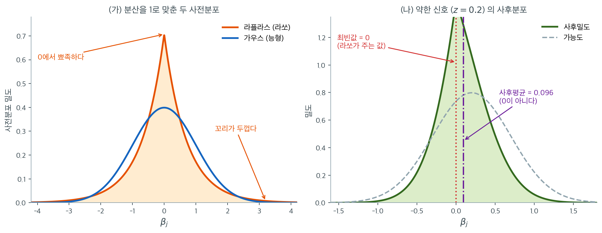
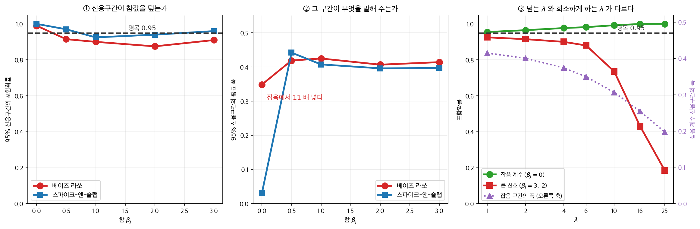

# 베이즈 해석 (라플라스 사전분포)

분산을 똑같이 $1$ 로 맞춘 라플라스와 가우스 사전분포를 겹쳐 보면, $0$ 에서의 밀도는 라플라스가 $0.707$ 로 가우스의 $0.399$ 보다 $1.8$ 배 높고 $\beta_j = 4$ 에서는 **$18.6$ 배** 높다. 「대부분의 계수는 $0$ 근처일 것이다, 그러나 몇 개는 아주 클 수도 있다」는 믿음이 한 분포 안에 들어 있는 것이다. 자료가 약한 증거를 줄 때 이 사전분포 아래의 MAP 추정값은 정확히 $0$ 인데, **같은 사후분포의 평균은 $0.096$ 으로 $0$ 이 아니다.** 라쏘의 희소성은 둘 가운데 어느 쪽의 성질인가.

능형회귀가 계수에 대한 가우스 사전분포에서 나오듯, 라쏘는 라플라스(이중지수) 사전분포에서 나온다. 0에서 뾰족하고 가우스보다 꼬리가 두꺼운 라플라스 밀도의 모양이 희소성의 베이즈적 기제를 제공한다. 이 사전분포는 0 근처에 상당한 확률질량을 몰아넣으면서도, 자료가 강한 증거를 줄 때는 큰 계수를 허용한다.

---

## 1. 라플라스 분포

위치 0, 척도 $b > 0$인 라플라스 분포의 밀도는

$$
p(\beta_j) = \frac{1}{2b}\exp\left(-\frac{|\beta_j|}{b}\right)
$$

이다. 가우스와 비교한 주요 성질은 다음과 같다.

- **0에서의 뾰족점.** 매끄러운 가우스 봉우리와 달리 $\beta_j = 0$에서 미분 불가능한 봉우리를 갖는다. 이 뾰족점이 0 근처에 더 많은 확률질량을 모은다.
- **두꺼운 꼬리.** 라플라스 밀도는 지수적으로 감소하고(로그 척도에서 선형) 가우스는 $\exp(-\beta_j^2)$로 감소한다(로그 척도에서 이차). 따라서 라플라스가 큰 $|\beta_j|$에 더 많은 확률을 준다.
- **분산.** Laplace$(0, b)$의 분산은 $2b^2$이다.

---

## 2. MAP 유도

각 계수에 독립인 라플라스 사전분포 $\beta_j \overset{\text{iid}}{\sim} \text{Laplace}(0, b)$를 둔다. 결합 사전분포는

$$
p(\boldsymbol{\beta}) = \frac{1}{(2b)^p}\exp\left(-\frac{\|\boldsymbol{\beta}\|_1}{b}\right)
$$

이고, 가우스 가능도와 결합한 음의 로그사후는

$$
-\log p(\boldsymbol{\beta} \mid \mathbf{y}) = \frac{1}{2\sigma^2}\|\mathbf{y} - \mathbf{X}\boldsymbol{\beta}\|^2 + \frac{1}{b}\|\boldsymbol{\beta}\|_1 + \text{상수}
$$

이다. 이를 최소화하는 것은

$$
\lambda = \frac{\sigma^2}{nb}
$$

인 라쏘 문제를 푸는 것과 동등하다($n$은 라쏘 목적함수의 $1/(2n)$ 규약에서 온다). 즉 **라플라스 사전분포 아래의 MAP 추정값이 라쏘 추정량이다.**

---

## 3. 라플라스 사전분포가 희소성을 낳는 이유

MAP 추정은 사후분포의 최빈값을 찾는 것이다. 0에서의 라플라스 뾰족점이 좌표초평면 $\beta_j = 0$을 따라 사후분포에 "능선"을 만든다. 자료의 지지가 약한 계수에서는, 가능도가 다른 방향으로 충분히 강하게 당기지 않는 한 사전분포의 뾰족점이 최빈값을 $\beta_j = 0$으로 끌어당긴다.



왼쪽은 **분산을 둘 다 1로 맞춘** 두 사전분포다. 공평한 비교를 위해 라플라스의 척도를 $b = 1/\sqrt{2}$로 두었다($2b^2 = 1$). 같은 분산인데도 모양이 전혀 다르다. 0에서의 밀도는 라플라스가 $0.707$, 가우스가 $0.399$로 라플라스가 $1.8$배 높다. 0 근처에 확률질량을 더 쌓아 두었다는 뜻이다.

동시에 꼬리도 더 두껍다. $\beta_j = 2$에서는 아직 가우스가 조금 높지만($0.054$ 대 $0.042$), $\beta_j = 3$에서 라플라스가 $2.3$배, $\beta_j = 4$에서 **$18.6$배** 높아진다. 두 성질이 한 분포 안에 공존한다는 점이 핵심이다. 라플라스 사전분포는 "대부분의 계수는 0 근처일 것이다, 그러나 몇 개는 아주 클 수도 있다"는 믿음을 부호화한다. 이것이 바로 희소한 신호에 대한 우리의 통상적 기대다.

오른쪽은 계수 하나에 대해 이 사전분포가 무슨 일을 하는지 본 것이다. 자료가 $z = 0.2$라는 약한 증거를 주고($\sigma = 0.5$, $b = 0.5$), 회색 점선이 그 가능도다. 사전분포를 곱한 사후밀도(초록)는 $\beta_j = 0$에서 **뾰족한 봉우리**를 갖는다. 문턱 $\sigma^2/b = 0.5$보다 $|z| = 0.2$가 작기 때문이다. 그래서 MAP 추정값, 곧 라쏘가 주는 값은 정확히 $0$이다.

그런데 같은 사후분포의 **평균은 $0.096$으로 0이 아니다.** 밀도가 $z = 0.2$ 쪽으로 기울어져 있으니 당연한 일이다. 연속인 사후밀도의 평균이 정확히 0이 되려면 분포가 0에 대해 완벽히 대칭이어야 하는데, 자료가 조금이라도 한쪽을 지지하면 그 대칭이 깨진다. **희소성은 최빈값의 성질이지 사후분포의 성질이 아니다.** 베이즈 라쏘를 MCMC로 돌려 사후평균을 뽑았는데 계수가 0이 나오지 않는다는 흔한 당혹감의 정체가 이 한 장에 들어 있다.

!!! note "MAP와 사후평균은 다르다"
    라쏘의 희소성은 MAP 추정값(사후최빈값)의 성질이지 사후분포 전체의 성질이 아니다. 라플라스 사전분포 아래의 **사후평균은 일반적으로 희소하지 않다.** 완전한 사후추론(신용구간 등)이 필요하면, 라플라스 사전분포는 가우스 가능도와 켤레가 아니므로 MCMC가 필요하다.

---

## 4. 가우스와 라플라스 사전분포의 비교

| 성질 | 가우스 $N(0, \tau^2)$ | 라플라스 $(0, b)$ |
|---|---|---|
| 0에서의 밀도 | 매끄럽고 유한 | 뾰족하고 유한 |
| 꼬리 거동 | 가벼움(준가우스) | 무거움(지수적 감소) |
| 결과 추정량 | 능형 | 라쏘 |
| 벌점 | $\lambda\|\boldsymbol{\beta}\|_2^2$ | $\lambda\|\boldsymbol{\beta}\|_1$ |
| MAP의 희소성 | 없음 | 있음 |
| 켤레성 | 있음(사후가 가우스) | 없음 |
| 사후 계산 | 닫힌 형태 | MCMC 필요 |
| 정칙화 모수 | $\lambda = \sigma^2/\tau^2$ | $\lambda = \sigma^2/(nb)$ |

가우스 사전분포는 큰 계수를 이차적으로 벌하여 매끄러운 비례 축소를 낳는다. 라플라스 사전분포는 선형으로 벌하여 정확한 0을 만드는 연성 문턱 거동을 낳는다.

---

## 5. 베이즈 라쏘

Park과 Casella(2008)는 라쏘의 완전한 베이즈 처리인 **베이즈 라쏘**를 개발했다. 핵심 착상은 라플라스 사전분포를 정규분포의 척도혼합으로 표현하는 것이다.

$$
\text{Laplace}(0, b) = \int_0^\infty N(0, s^2)\,\frac{1}{2b^2}\exp\left(-\frac{s^2}{2b^2}\right)\, ds^2
$$

이 표현은 계수마다 잠재 분산모수 $s_j^2$을 도입하여 다음을 번갈아 하는 깁스 표집을 가능하게 한다.

1. 가우스 조건부에서 $\boldsymbol{\beta} \mid s_1^2, \ldots, s_p^2, \mathbf{y}$를 표집.
2. 역가우스 분포에서 각 $s_j^2 \mid \beta_j$를 표집.

!!! tip "베이즈 라쏘를 언제 쓰는가"
    희소 모형에 대한 불확실성 정량화(신용구간)가 필요할 때 쓴다. 빈도주의 라쏘는 점추정과 변수선택을 제공하지만, 선택된 계수에 대한 타당한 신뢰구간은 직접 제공하지 않는다.

---

## 6. 스파이크–앤–슬랩 사전분포

더 강한 희소성을 강제하려면 **스파이크–앤–슬랩** 사전분포가 0에 점질량("스파이크")을, 0이 아닌 값에 산만한 분포("슬랩")를 둔다.

$$
p(\beta_j) = (1 - \pi)\,\delta_0(\beta_j) + \pi\, g(\beta_j)
$$

이 사전분포 아래의 MAP 추정은 벌점 $\lambda\|\boldsymbol{\beta}\|_0$(0이 아닌 계수의 개수)을 갖는 최량 부분집합 선택에 대응한다. 라플라스 사전분포는 스파이크–앤–슬랩의 연속적 완화로 볼 수 있으며, 가우스(희소성 없음)와 스파이크–앤–슬랩(가장 강한 희소성) 사이에 놓인다.

<div class="storybox" markdown>

**그림으로 보는 통계학 1.** 최빈값은 빠져나가고 사후분포는 못 빠져나간다

$\S 5$ 의 쪽지가 베이즈 라쏘를 **신용구간이 필요할 때** 쓰라고 권한다. 그 권고를
재어 보자. $\S 5$ 의 깁스 표집기와 $\S 6$ 의 스파이크–앤–슬랩을 그대로 구현해서,
$95\%$ 신용구간이 참값을 덮는 비율을 센다. $n = 100$, $p = 20$ 이고 $0$ 이 아닌
계수가 넷($3,\ 2,\ 1,\ 0.5$), 나머지 열여섯은 $0$ 이다. 깁스 $1{,}500$ 번 가운데 앞
$500$ 을 버리고 $200$ 번 되풀이했다.



**① 덮기는 덮는다, 좀 모자라게.** $\lambda = 6$ 에서

| 참 $\beta_j$ | $0$ (잡음 $16$ 개) | $0.5$ | $1$ | $2$ | $3$ |
|---|---|---|---|---|---|
| 베이즈 라쏘 | $0.990$ | $0.915$ | $0.900$ | $0.875$ | $0.910$ |
| 스파이크–앤–슬랩 | $1.000$ | $0.970$ | $0.925$ | $0.940$ | $0.960$ |

$0$ 이 아닌 쪽에서 베이즈 라쏘가 명목 $0.95$ 에 못 미친다. 축소가 사후분포를
$0$ 쪽으로 당겨 놓았으니 당연한 일이다.

**② 그런데 진짜 문제는 폭이다.** 잡음 계수에서 두 방법의 신용구간 평균 폭은

$$
\text{베이즈 라쏘 } 0.349, \qquad \text{스파이크–앤–슬랩 } 0.031
$$

로 **$11$ 배 차이가 난다.** 베이즈 라쏘의 잡음 구간은 $0$ 을 거의 언제나 덮지만
($0.990$), 덮는 방식이 「$0$ 일 수도 있고 $\pm 0.17$ 일 수도 있다」다. 스파이크–앤-
슬랩은 사후질량의 $0.973$ 을 **정확히 $\beta_j = 0$ 에** 올려 둔다. 라플라스
밀도에는 $0$ 에 원자가 없으니 베이즈 라쏘는 아무리 해도 그렇게 못 한다 —
$\S 3$ 의 그림이 보인 뾰족점은 밀도가 솟은 것이지 질량이 앉은 것이 아니다.

**③ $\lambda$ 를 움직여도 빠져나갈 데가 없다.**

| $\lambda$ | $1$ | $4$ | $10$ | $25$ |
|---|---|---|---|---|
| 잡음 구간의 폭 | $0.415$ | $0.374$ | $0.306$ | $0.197$ |
| 잡음 포함확률 | $0.955$ | $0.977$ | $0.993$ | $1.000$ |
| 큰 신호 포함확률 | $0.925$ | $0.900$ | $0.735$ | $\mathbf{0.185}$ |

$\lambda = 1$ 에서는 포함확률이 둘 다 명목에 가깝다. 그런데 그때 잡음 구간의 폭이
$0.415$ 다 — **아무것도 $0$ 쪽으로 밀지 않고 있다.** 희소하게 만들려고 $\lambda$ 를
키워 그 폭을 $0.197$ 까지 좁히면, 큰 신호의 포함확률이 $0.185$ 로 무너진다.
그러고도 $0.197$ 은 스파이크–앤–슬랩의 $0.031$ 보다 여전히 여섯 배 넓다.

이 어긋남을 카스티요·슈미트히버·판데르파르트가 한 문단으로 적어 두었다.
라플라스 사전분포의 $\lambda$ 는 「계수를 $0$ 으로 축소하려면 **커야** 하는데,
동시에 $0$ 이 아닌 좌표들을 모형화할 수 있으려면 **적당해야** 한다」. 그리고

> 이 상충하는 요구가 라쏘 **추정량**의 좋은 행동을 해치지 않는 것은, 사후최빈값이
> 갖는 특유의 기하학적·희소성 유도적 형태 덕분이지 베이즈적 연결 덕분이 아니다.

라쏘가 멀쩡한 것은 $L_1$ 공의 뾰족한 모서리 덕이지 사전분포가 좋아서가 아니라는
말이다. 같은 논문이 $\S 3$ 에서 내리는 판정은 더 거칠다 — 「라쏘는 본질적으로
비베이즈적이며, 그에 대응하는 **완전한 사후분포는 쓸모없는 대상**이라는 뜻에서
그렇다.」

**두 가지는 분명히 해 둔다.** 여기서 $\sigma^2$ 은 안다고 두었고 $\lambda$ 를 하나로
고정했다. 파크와 카셀라가 권하는 대로 $\lambda^2$ 에 초사전분포를 얹으면 위 표의
열들을 **평균하게** 될 뿐이지 상충 자체를 벗어나지는 못한다. 그리고 스파이크–앤-
슬랩 쪽에는 사전 포함확률을 $\pi = 0.2$ 로 주었는데 참값이 $4/20$ 이라, 이 비교는
그쪽에 다소 유리하다.

그러니 $\S 5$ 의 쪽지는 좁게 읽어야 한다. 베이즈 라쏘를 MCMC 로 돌리면 신용구간이
**나오기는 한다.** 다만 그 구간이 「희소 모형의 불확실성」을 말해 주지는 않는다.
$0$ 에 질량을 두지 않은 사전분포에게 「이 변수는 없다」는 말을 시킬 방법이 없기
때문이고, 그것이 $\S 6$ 이 따로 있는 까닭이다.

_확인한 곳 — Castillo, Schmidt-Hieber, van der Vaart, "Bayesian linear regression
with sparse priors", 『The Annals of Statistics』 $43$ 권 $5$ 호 $1986$–$2018$ 쪽
($2015$); [arXiv:1403.0735](https://arxiv.org/abs/1403.0735) 의 원고로 읽었다 —
「라쏘는 본질적으로 비베이즈적이며, 그에 대응하는 완전한 사후분포는 쓸모없는
대상이라는 뜻에서 그렇다」(서론)와 $\lambda$ 의 상충하는 요구에 대한 문단, 그리고
그것이 「사후최빈값의 특유한 기하학적·희소성 유도적 형태 덕분이지 베이즈적 연결
덕분이 아니다」라는 문장. 그림과 표의 수는 모두 직접 계산한 값이다_

</div>

---

## 연습문제

<div class="drillbox" markdown>

**연습문제 1.** <span class="diff med" title="중간"></span>
"라쏘의 희소성은 MAP의 성질이지 사후분포의 성질이 아니다"라는 주장을 확인하라. 라플라스 사전분포 아래에서 사후평균이 정확히 0이 될 수 있는가?

</div>

??? success "풀이"
    **사후평균은 확률 1로 0이 아니다.**

    이유는 간단하다. 사후분포 $p(\beta_j \mid \mathbf{y})$는 연속분포다(가우스 가능도와 라플라스 사전분포의 곱은 어디서나 양의 밀도를 갖는다). 연속분포의 평균이 정확히 0이 되려면 분포가 0에 대해 완벽히 대칭이어야 하는데, 자료가 $\beta_j$에 대해 어떤 정보든 주면 대칭이 깨진다.

    **최빈값은 다르다.** 라플라스 사전분포의 뾰족점 때문에 사후밀도가 $\beta_j = 0$에서 미분 불가능한 봉우리를 가질 수 있고, 그 봉우리가 전역 최빈값이 되면 MAP 추정값이 정확히 0이 된다.

    ```python
    # 1차원 직관: 사후 log-density ∝ -(b - z)^2/(2v) - |b|/s
    # z(자료가 말하는 값)가 작으면 최빈값은 0, 그러나 평균은 0이 아니다
    ```

    **실무적 함의가 크다.**

    | 원하는 것 | 써야 할 것 |
    |:---|:---|
    | 희소한 점추정 | 라쏘(= MAP) |
    | 사후평균 | 베이즈 라쏘의 MCMC 출력 — 희소하지 않다 |
    | 변수의 포함 확률 | 스파이크–앤–슬랩의 사후 포함확률 |

    "베이즈 라쏘를 돌렸더니 계수가 0이 안 나온다"는 흔한 혼란이 여기서 나온다. MCMC가 주는 것은 사후평균이나 사후중앙값이며, 둘 다 희소하지 않다. 희소성을 원하면 사후분포에서 최빈값을 찾거나 스파이크–앤–슬랩을 써야 한다.

<div class="drillbox" markdown>

**연습문제 2.** <span class="diff med" title="중간"></span>
$\lambda = \sigma^2/(nb)$ 관계를 유도하고, 이것이 $\lambda$의 해석에 무엇을 뜻하는지 설명하라.

</div>

??? success "풀이"
    음의 로그사후를 최소화한다.

    $$
    \frac{1}{2\sigma^2}\|\mathbf{y} - \mathbf{X}\boldsymbol{\beta}\|^2 + \frac{1}{b}\|\boldsymbol{\beta}\|_1
    $$

    양변에 $2\sigma^2$을 곱해도 최소점은 같으므로

    $$
    \|\mathbf{y} - \mathbf{X}\boldsymbol{\beta}\|^2 + \frac{2\sigma^2}{b}\|\boldsymbol{\beta}\|_1
    $$

    이다. 한편 라쏘 목적함수 $\frac{1}{2n}\|\cdot\|^2 + \lambda\|\boldsymbol{\beta}\|_1$에 $2n$을 곱하면

    $$
    \|\mathbf{y} - \mathbf{X}\boldsymbol{\beta}\|^2 + 2n\lambda\|\boldsymbol{\beta}\|_1
    $$

    이다. 두 식의 벌점 계수를 맞추면 $2n\lambda = 2\sigma^2/b$이므로

    $$
    \lambda = \frac{\sigma^2}{nb} \qquad \square
    $$

    **해석.** 능형의 $\lambda = \sigma^2/\tau^2$과 나란히 놓으면 구조가 보인다.

    | | 정칙화 모수 |
    |:---|:---|
    | 능형 | $\lambda = \sigma^2/\tau^2$ — 잡음분산 대 사전분산의 비 |
    | 라쏘 | $\lambda = \sigma^2/(nb)$ — 같은 비에 $1/n$이 붙는다 |

    **$1/n$ 인자가 중요하다.** 라쏘의 $1/(2n)$ 규약 때문에 $\lambda$가 표본크기에 따라 자동으로 조정된다. 즉 같은 사전분포($b$ 고정)를 유지하면서 자료를 늘리면 $\lambda$가 $1/n$로 줄어든다. **자료가 많아질수록 사전분포의 영향이 줄어든다**는 베이즈의 상식과 정확히 부합한다.

    능형의 규약($1/(2n)$이 없다)에서는 이 조정이 자동으로 일어나지 않으므로, 표본크기를 바꿀 때 $\lambda$를 직접 다시 골라야 한다. 이것이 sklearn에서 `Ridge`와 `Lasso`의 `alpha`를 같은 척도로 비교하면 안 되는 이유이기도 하다.

<div class="drillbox" markdown>

**연습문제 3.** <span class="diff med" title="중간"></span>
3 절 그림 왼쪽처럼 분산을 둘 다 $1$ 로 맞춘 두 사전분포 $\text{Laplace}(0, 1/\sqrt{2})$ 와 $N(0, 1)$ 을 비교한다. 두 밀도가 같아지는 $\beta_j > 0$ 을 **모두** 닫힌 꼴로 구하고, 그 값으로 "$\beta_j = 2$ 에서는 가우스가 조금 높지만 $\beta_j = 3$ 에서는 라플라스가 높다"는 쪽의 관찰을 설명하라. 분산이 같은 두 밀도가 **적어도 두 번** 만나야 하는 까닭도 밝히라.

</div>

??? success "풀이"
    $b = 1/\sqrt{2}$ 이면 $1/(2b) = \sqrt{2}/2 = 0.7071$, $1/b = \sqrt{2}$ 이므로

    $$
    p_L(\beta) = \frac{\sqrt{2}}{2}e^{-\sqrt{2}\lvert\beta\rvert}, \qquad p_G(\beta) = \frac{1}{\sqrt{2\pi}}e^{-\beta^2/2}
    $$

    이다. $\beta > 0$ 에서 로그를 취해 같다고 두면

    $$
    \log\frac{\sqrt{2}}{2} - \sqrt{2}\,\beta = \log\frac{1}{\sqrt{2\pi}} - \frac{\beta^2}{2}
    $$

    이다. 두 상수의 비가

    $$
    \frac{\sqrt{2}/2}{1/\sqrt{2\pi}} = \frac{\sqrt{2}}{2}\cdot\sqrt{2\pi} = \sqrt{\pi}
    $$

    이므로(쪽의 $0.707/0.399 = 1.772$ 가 바로 $\sqrt{\pi}$ 다) 식이

    $$
    \frac{\beta^2}{2} - \sqrt{2}\,\beta + \frac{1}{2}\log\pi = 0 \quad\Longleftrightarrow\quad \beta^2 - 2\sqrt{2}\,\beta + \log\pi = 0
    $$

    으로 깔끔해진다. 따라서

    $$
    \beta = \sqrt{2} \pm \sqrt{2 - \log\pi}
    $$

    이고 $\log\pi = 1.1447 < 2$ 이므로 두 근이 모두 실수이며 양수다.

    $$
    \beta_- = 1.4142 - 0.9248 = 0.4894, \qquad \beta_+ = 1.4142 + 0.9248 = 2.3390
    $$

    두 점에서의 공통 밀도값은 각각 $0.3539$ 와 $0.0259$ 다.

    **구간별로 누가 높은가.**

    | 구간 | 더 높은 밀도 | 이유 |
    |:---|:---|:---|
    | $0 \le \beta < 0.4894$ | 라플라스 | 0 에서의 뾰족점 |
    | $0.4894 < \beta < 2.3390$ | 가우스 | — |
    | $\beta > 2.3390$ | 라플라스 | 두꺼운 꼬리 |

    $\beta = 2$ 는 가운데 구간에 있으니 가우스가 높고($0.0540$ 대 $0.0418$), $\beta = 3$ 은 $2.3390$ 을 넘었으니 라플라스가 높다($0.0102$ 대 $0.0044$). 쪽이 본 역전이 일어나는 지점이 정확히 $\beta_+ = 2.3390$ 이다.

    **적어도 두 번 만나야 하는 까닭.** $d(\beta) = p_L(\beta) - p_G(\beta)$ 라 두면 $\int d = 0$ 이고 $\int \beta^2 d = 0$ 이다(둘 다 적분이 1 이고 분산이 1 이므로). $d$ 는 0 근처에서 양수다($0.707 > 0.399$). 만약 $\beta > 0$ 에서 부호가 **딱 한 번만** 바뀌어 어떤 $x_0$ 에서 양에서 음으로 넘어간다고 하자. 그러면 $(\beta^2 - x_0^2)d(\beta)$ 는 $(0, x_0)$ 에서 음(앞 인자가 음, $d$ 가 양)이고 $(x_0, \infty)$ 에서도 음(앞 인자가 양, $d$ 가 음)이므로

    $$
    \int_0^\infty (\beta^2 - x_0^2)\,d(\beta)\,d\beta < 0
    $$

    인데, $\int d = \int \beta^2 d = 0$ 에서 이 적분은 $0$ 이어야 한다. 모순이다. 그러므로 부호가 두 번 이상 바뀌고, 위 계산이 정확히 두 번임을 보여 준다.

    **해석.** 라플라스는 **중앙과 꼬리에서 이득을 보고 중간에서 그만큼을 내준다.** 분산을 같게 묶어 둔 이상 공짜는 없다. "대부분의 계수는 0 근처, 몇 개는 아주 클 수도"라는 유용한 모양의 대가가 바로 $0.4894 < \beta < 2.3390$ 구간이다. 중간 크기의 계수가 많은 문제에서 라쏘가 능형에 지는 이유를 사전분포 쪽에서 본 것이기도 하다.

<div class="drillbox" markdown>

**연습문제 4.** <span class="diff med" title="중간"></span>
$\sigma = 1$, $b = 0.5$ 인 라플라스 사전분포의 MAP 을 sklearn 의 `Lasso` 로 구하려 한다. sklearn 이 최소화하는 것은 $\frac{1}{2n}\lVert\mathbf{y} - \mathbf{X}\boldsymbol{\beta}\rVert^2 + \alpha\lVert\boldsymbol{\beta}\rVert_1$ 이다.
(가) $n = 50$ 과 $n = 200$ 에서 `alpha` 에 넣을 값을 각각 구하라.
(나) 교과서 꼴 $\lVert\mathbf{y} - \mathbf{X}\boldsymbol{\beta}\rVert^2 + \lambda_{\text{tb}}\lVert\boldsymbol{\beta}\rVert_1$ 의 $\lambda_{\text{tb}}$ 를 두 경우에 구하라.
(다) (가)는 $n$ 에 따라 줄고 (나)는 꼼짝도 하지 않는다. "자료가 많아지면 사전분포의 영향이 줄어든다"는 말은 어느 쪽에 들어 있는가?
(라) $\lambda_{\text{tb}}$ 를 `alpha` 자리에 잘못 넣으면 $n = 200$ 에서 벌점이 몇 배 세지는가?

</div>

??? success "풀이"
    **(가)** 쪽의 라쏘 목적함수 규약이 sklearn 과 같으므로 $\alpha$ 는 $\lambda$ 를 그대로 받는다.

    $$
    \alpha = \lambda = \frac{\sigma^2}{nb} = \frac{1}{0.5\,n} = \frac{2}{n}
    $$

    **(나)** 목적함수에 $2n$ 을 곱해도 최소점은 그대로이므로 $\lambda_{\text{tb}} = 2n\alpha = 2\sigma^2/b$ 다. 여기서 $n$ 이 **약분되어 사라진다.**

    | $n$ | `alpha` $= \sigma^2/(nb)$ | $\lambda_{\text{tb}} = 2\sigma^2/b$ |
    |:---|:---|:---|
    | $50$ | $0.04$ | $4$ |
    | $200$ | $0.01$ | $4$ |

    **(다)** 두 줄은 **같은 문제의 다른 표기**이고 해도 똑같다. 따라서 "영향이 줄어든다"가 벌점의 절대적 크기에 들어 있을 수는 없다. 그것은 **자료항과의 비**에 들어 있다.

    - 교과서 척도에서 사전분포가 보태는 양은 $\frac{2\sigma^2}{b}\lVert\boldsymbol{\beta}\rVert_1$ 로 $n$ 과 무관하게 **고정**이다. 반면 자료항 $\lVert\mathbf{y} - \mathbf{X}\boldsymbol{\beta}\rVert^2$ 은 항이 $n$ 개이므로 $n$ 에 비례해 커진다. 자료가 사전분포를 **압도해 가는** 것이지 사전분포가 작아지는 것이 아니다.
    - sklearn 척도는 자료항을 $1/(2n)$ 로 눌러 $O(1)$ 에 고정했으므로, 같은 사실이 "`alpha` 가 $1/n$ 로 줄어든다"로 **보인다.**

    쪽이 말한 $1/n$ 은 후자의 표기에서 읽은 것이다. 비를 보라는 것이 요점이다.

    **(라)** $n = 200$ 의 옳은 값은 $\alpha = 0.01$ 인데 $4$ 를 넣으면 $400$ 배다. 교과서 척도로 보아도 벌점계수가 $2n \times 4 = 1600$ 으로 옳은 $4$ 의 $400$ 배다. 라쏘는 $\alpha \ge \max_j \lvert \mathbf{x}_j^\top\mathbf{y}\rvert / n$ 이면 모든 계수를 0 으로 보내므로, 이 실수의 증상은 "계수가 전부 0 으로 나온다"가 된다. $\alpha$ 와 $\lambda$ 를 섞으면 수가 전부 틀어진다.

<div class="drillbox" markdown>

**연습문제 5.** <span class="diff hard" title="어려움"></span>
$\lambda = \sigma^2/(nb)$ 가 정말로 sklearn 의 `alpha` 자리에 그대로 들어가는지 직교설계에서 확인한다. 먼저 $\mathbf{X}^\top\mathbf{X} = n\mathbf{I}$ 일 때 MAP 이

$$
\hat\beta_j = \operatorname{sign}(z_j)\left(\lvert z_j\rvert - \alpha\right)_+, \qquad z_j = \frac{\mathbf{x}_j^\top\mathbf{y}}{n}
$$

임을 유도하라($z_j$ 가 OLS 추정값과 같음도 보이라). 그 다음 $n = 8$, $p = 4$ 인 아다마르 직교설계에 $\boldsymbol{\beta} = (1.5, -0.8, 0.3, 0)$, $\sigma = 1$ 로 자료를 만들고 $b = 0.5$ 를 두어, 손으로 구한 연성문턱과 `Lasso` 의 해가 같은지 수로 확인하라.

</div>

??? success "풀이"
    **유도.** $z = \mathbf{X}^\top\mathbf{y}/n$ 이라 두고 $\mathbf{X}^\top\mathbf{X} = n\mathbf{I}$ 를 쓰면

    $$
    \frac{1}{2n}\lVert\mathbf{y} - \mathbf{X}\boldsymbol{\beta}\rVert^2 = \frac{\lVert\mathbf{y}\rVert^2}{2n} - \boldsymbol{\beta}^\top z + \frac{1}{2}\lVert\boldsymbol{\beta}\rVert^2
    $$

    이므로 목적함수가 좌표별로 완전히 쪼개진다.

    $$
    f(\boldsymbol{\beta}) = \text{상수} + \sum_{j=1}^p \left(\frac{1}{2}\beta_j^2 - z_j\beta_j + \alpha\lvert\beta_j\rvert\right)
    $$

    한 항 $h(u) = u^2/2 - z u + \alpha\lvert u\rvert$ 를 본다. $u > 0$ 에서 $h'(u) = u - z + \alpha = 0$ 이므로 $u = z - \alpha$ 이고, 이것이 양수일 조건은 $z > \alpha$ 다. $u < 0$ 에서는 $u = z + \alpha$ 이고 조건은 $z < -\alpha$ 다. 둘 다 아니면 최소점은 $u = 0$ 이다. 실제로 $0$ 이 최소점일 조건은 부분미분에 $0$ 이 들어 있는 것, 즉 $0 \in \partial h(0) = [-z-\alpha,\, -z+\alpha]$ 이므로 $\lvert z\rvert \le \alpha$ 다. 세 경우를 합치면 연성문턱이다. $h$ 가 강볼록이므로 최소점은 유일하다.

    또 $\hat{\boldsymbol{\beta}}^{\text{OLS}} = (\mathbf{X}^\top\mathbf{X})^{-1}\mathbf{X}^\top\mathbf{y} = \mathbf{X}^\top\mathbf{y}/n = z$ 이므로 $z_j$ 가 바로 OLS 다. $\square$

    **수치 확인.** $\alpha = \sigma^2/(nb) = 1/(8 \times 0.5) = 0.25$ 다.

    ```python
    import numpy as np
    from sklearn.linear_model import Lasso

    # === 직교설계: 아다마르 행렬의 2~5 열 (열의 합이 0, x_j^T x_j = n) ===
    H = np.array([
        [1,  1,  1,  1,  1,  1,  1,  1],
        [1, -1,  1, -1,  1, -1,  1, -1],
        [1,  1, -1, -1,  1,  1, -1, -1],
        [1, -1, -1,  1,  1, -1, -1,  1],
        [1,  1,  1,  1, -1, -1, -1, -1],
        [1, -1,  1, -1, -1,  1, -1,  1],
        [1,  1, -1, -1, -1, -1,  1,  1],
        [1, -1, -1,  1, -1,  1,  1, -1],
    ], dtype=float)
    X = H[:, 1:5]
    n, p = X.shape

    rng = np.random.default_rng(0)
    beta_true = np.array([1.5, -0.8, 0.3, 0.0])
    sigma = 1.0
    y = X @ beta_true + rng.normal(0.0, sigma, n)

    # === 사전분포가 정해 주는 벌점: alpha = sigma^2 / (n b) ===
    b = 0.5
    alpha = sigma**2 / (n * b)

    # === 직교설계의 닫힌 꼴: z = X^T y / n 이 OLS, MAP 은 연성문턱 ===
    z = X.T @ y / n
    soft = np.sign(z) * np.maximum(np.abs(z) - alpha, 0.0)

    fit = Lasso(alpha=alpha, fit_intercept=False, max_iter=100000, tol=1e-12).fit(X, y)


    def f(x):
        return f"{0.0 if x == 0 else x:>9.4f}"


    print(f"X^T X / n - I 의 최대 절대값 = {np.max(np.abs(X.T @ X / n - np.eye(p))):.4f}")
    print(f"sigma = {sigma:.2f}, b = {b:.2f}, n = {n}  ->  alpha = {alpha:.4f}")
    print("  j    OLS=z_j   연성문턱    sklearn")
    for j in range(p):
        print(f"  {j + 1}{f(z[j])}{f(soft[j])}{f(fit.coef_[j])}")
    print(f"두 해의 최대 절대차 < 1e-10 : {np.max(np.abs(soft - fit.coef_)) < 1e-10}")
    ```

    출력:

    ```text
    X^T X / n - I 의 최대 절대값 = 0.0000
    sigma = 1.00, b = 0.50, n = 8  ->  alpha = 0.2500
      j    OLS=z_j   연성문턱    sklearn
      1   1.5316   1.2816   1.2816
      2  -1.1971  -0.9471  -0.9471
      3   0.1085   0.0000   0.0000
      4  -0.1673   0.0000   0.0000
    두 해의 최대 절대차 < 1e-10 : True
    ```

    **읽기.**

    - 살아남은 두 계수는 OLS 에서 **정확히 $0.25$ 만큼** 0 쪽으로 평행이동했다($1.5316 \to 1.2816$, $-1.1971 \to -0.9471$). 능형이라면 $1/(1+\lambda)$ 배의 비례 축소였을 것이고, 비례 축소는 0 을 만들 수 없다. 평행이동이라야 0 에 닿는다.
    - 참값이 $0.3$ 인 세 번째 계수도 희생되었다. $\lvert z_3\rvert = 0.1085 < 0.25$ 이기 때문이다. $b = 0.5$ 인 사전분포는 "계수의 표준편차가 $\sqrt{2b^2} = 0.707$"이라는 믿음인데, $n = 8$ 짜리 자료는 $0.3$ 짜리 신호를 그 믿음에 맞설 만큼 지지하지 못한다. 벌점은 참값을 보고 봐주지 않는다.
    - `alpha` 자리에 교과서 척도의 $\lambda_{\text{tb}} = 2n\alpha = 4$ 를 넣었다면 문턱이 $4$ 가 되어 네 계수가 모두 0 이었을 것이다. 연습문제 4 의 함정이 이 설계에서는 이렇게 보인다.

<div class="drillbox" markdown>

**연습문제 6.** <span class="diff hard" title="어려움"></span>
3 절 그림 오른쪽은 $z = 0.2$, $\sigma = 0.5$, $b = 0.5$ 에서 MAP 이 정확히 0 이고 사후평균이 $0.096$ 이라고 했다. 음의 로그사후가 $(\beta - z)^2/(2\sigma^2) + \lvert\beta\rvert/b$ 인 1 차원 모형에서
(가) MAP 이 $\operatorname{sign}(z)\left(\lvert z\rvert - \sigma^2/b\right)_+$ 임을 보이고 문턱 $0.5$ 를 확인하라.
(나) $z \ne 0$ 이면 사후평균이 결코 0 이 아니고 그 부호가 $\operatorname{sign}(z)$ 와 같음을 증명하라.
(다) $z = 0$ 이면 어떤가? 연습문제 1 의 결론을 어떻게 다듬어야 하는가?

</div>

??? success "풀이"
    **(가)** $g(\beta) = (\beta - z)^2/(2\sigma^2) + \lvert\beta\rvert/b$ 는 강볼록이므로 최소점이 유일하다. $\beta > 0$ 에서 $g'(\beta) = (\beta - z)/\sigma^2 + 1/b = 0$ 이므로 $\beta = z - \sigma^2/b$ 이고, 양수일 조건은 $z > \sigma^2/b$ 다. $\beta < 0$ 에서는 $\beta = z + \sigma^2/b$, 조건은 $z < -\sigma^2/b$ 다. 그 밖에는 $0 \in \partial g(0) = [-z/\sigma^2 - 1/b,\, -z/\sigma^2 + 1/b]$, 즉 $\lvert z\rvert \le \sigma^2/b$ 이므로 최소점이 $0$ 이다. 합치면

    $$
    \hat\beta^{\text{MAP}} = \operatorname{sign}(z)\left(\lvert z\rvert - \frac{\sigma^2}{b}\right)_+
    $$

    이다. $\sigma = b = 0.5$ 이면 $\sigma^2/b = 0.25/0.5 = 0.5$ 이고 $\lvert z\rvert = 0.2 \le 0.5$ 이므로 MAP 은 정확히 $0$ 이다. 쪽의 문턱 $0.5$ 가 이것이다. $\square$

    **(나)** 사후밀도를 $f(\beta) \propto \exp\!\left(-(\beta - z)^2/(2\sigma^2) - \lvert\beta\rvert/b\right)$ 라 하고 $t > 0$ 에 대해 $f(t)$ 와 $f(-t)$ 를 견준다. $\lvert t\rvert = \lvert -t\rvert$ 이므로 벌점항이 약분되고

    $$
    \log\frac{f(t)}{f(-t)} = \frac{-(t - z)^2 + (t + z)^2}{2\sigma^2} = \frac{2tz}{\sigma^2}
    $$

    이다. 따라서 $z > 0$ 이면 **모든** $t > 0$ 에서 $f(t) > f(-t)$ 다. 사후평균은

    $$
    \mathbb{E}[\beta \mid \mathbf{y}] = \int_0^\infty t\left(f(t) - f(-t)\right)dt
    $$

    이고 피적분함수가 $t > 0$ 에서 모두 양수이므로 적분이 **엄격히 양수**다. $z < 0$ 이면 대칭으로 음수다. 그러므로 $\operatorname{sign}(\mathbb{E}[\beta\mid\mathbf{y}]) = \operatorname{sign}(z)$ 이고 사후평균은 0 이 아니다. $\square$

    **(다)** $z = 0$ 이면 위 비가 $1$ 이므로 사후밀도가 $0$ 에 대해 **완벽히 대칭**이다. 사후평균도, 사후중앙값도, MAP 도 모두 정확히 $0$ 이다. 즉 "라플라스 사전분포의 사후평균은 0 이 되지 않는다"는 말에는 예외가 하나 있다.

    | | 사후평균 | MAP |
    |:---|:---|:---|
    | $z = 0$ | $0$ | $0$ |
    | $0 < \lvert z\rvert \le \sigma^2/b$ | $\ne 0$, 부호는 $z$ 와 같다 | $0$ |
    | $\lvert z\rvert > \sigma^2/b$ | $\ne 0$ | $\ne 0$ |

    **다듬을 말.** 연습문제 1 의 "확률 1 로 0 이 아니다"는 정확한 표현이고, 이를 "항상 0 이 아니다"로 세게 만들 수는 없다. 예외집합은 $z = 0$ 한 점이며, 일반적으로는 $\mathbf{X}^\top\mathbf{y} = \mathbf{0}$ 이다. 오차가 연속분포를 따르면 이 사건의 확률이 $0$ 이므로 "확률 1 로"가 붙는 것이다. 반대로 MAP 이 $0$ 이 되는 $z$ 의 집합은 길이 $2\sigma^2/b$ 짜리 **구간**이다. 한 점과 구간의 차이가 희소성의 전부다 — 이것이 다음 문제의 주제다.

<div class="drillbox" markdown>

**연습문제 7.** <span class="diff hard" title="어려움"></span>
5 절의 척도혼합 표현을 손으로 확인하라. 즉 $s^2$ 의 밀도가 $\frac{1}{2b^2}e^{-s^2/(2b^2)}$ ($s^2 > 0$) 이고 $\beta \mid s^2 \sim N(0, s^2)$ 이면 $\beta$ 의 주변분포가 $\text{Laplace}(0, b)$ 임을 보이라. 다음 적분을 써도 된다.

$$
\int_0^\infty t^{-1/2}\exp\left(-\frac{a}{t} - ct\right)dt = \sqrt{\frac{\pi}{c}}\,e^{-2\sqrt{ac}} \qquad (a > 0,\ c > 0)
$$

이어서 $\text{Var}(\beta)$ 를 조건부기댓값으로 계산해 1 절의 "$\text{Laplace}(0,b)$ 의 분산은 $2b^2$"와 맞는지 확인하고, 이 표현이 왜 깁스 표집을 가능하게 하는지 한 줄로 적으라.

</div>

??? success "풀이"
    **주변밀도.** $t = s^2$ 로 쓰면

    $$
    p(\beta) = \int_0^\infty \frac{1}{\sqrt{2\pi t}}\exp\left(-\frac{\beta^2}{2t}\right)\cdot\frac{1}{2b^2}\exp\left(-\frac{t}{2b^2}\right)dt = \frac{1}{2b^2\sqrt{2\pi}}\int_0^\infty t^{-1/2}\exp\left(-\frac{\beta^2/2}{t} - \frac{t}{2b^2}\right)dt
    $$

    이다. 주어진 적분에 $a = \beta^2/2$, $c = 1/(2b^2)$ 를 넣는다.

    $$
    \sqrt{\frac{\pi}{c}} = \sqrt{2\pi b^2} = b\sqrt{2\pi}, \qquad 2\sqrt{ac} = 2\sqrt{\frac{\beta^2}{2}\cdot\frac{1}{2b^2}} = 2\cdot\frac{\lvert\beta\rvert}{2b} = \frac{\lvert\beta\rvert}{b}
    $$

    이므로

    $$
    p(\beta) = \frac{1}{2b^2\sqrt{2\pi}}\cdot b\sqrt{2\pi}\,e^{-\lvert\beta\rvert/b} = \frac{1}{2b}\exp\left(-\frac{\lvert\beta\rvert}{b}\right)
    $$

    이고 이것이 바로 1 절의 $\text{Laplace}(0, b)$ 밀도다. $\square$

    **분산.** $\mathbb{E}[\beta \mid s^2] = 0$ 이므로 $\mathbb{E}[\beta] = 0$ 이고, 전분산공식에서

    $$
    \text{Var}(\beta) = \mathbb{E}\!\left[\text{Var}(\beta \mid s^2)\right] + \text{Var}\!\left(\mathbb{E}[\beta\mid s^2]\right) = \mathbb{E}[s^2] + 0
    $$

    이다. $s^2$ 의 밀도 $\frac{1}{2b^2}e^{-s^2/(2b^2)}$ 는 평균 $2b^2$ 인 지수분포이므로 $\text{Var}(\beta) = 2b^2$ 다. 1 절과 맞는다.

    **왜 깁스가 되는가.** 라플라스 사전분포는 가우스 가능도와 켤레가 아니지만, $s^2$ 을 **조건으로 걸면** 사전분포가 가우스가 되어 켤레가 살아난다. 그래서 $\boldsymbol{\beta} \mid s_1^2,\ldots,s_p^2, \mathbf{y}$ 가 가우스이고 $s_j^2 \mid \beta_j$ 가 역가우스로, 두 단계 모두 닫힌 꼴에서 뽑을 수 있다. 비켤레성을 없앤 것이 아니라 **잠재변수 한 층에 숨긴 것**이다.

    한 가지 더 눈여겨볼 것이 있다. 혼합이 아주 작은 $s^2$ 까지 포함하기 때문에 0 근처에 질량이 쌓여 뾰족점이 생긴다. 그래도 $t^{-1/2}$ 가 $0$ 근처에서 적분가능하므로 $p(0) = 1/(2b)$ 는 **유한**하다. 4 절 표의 "뾰족하고 유한"이 이 계산의 요약이다.

<div class="drillbox" markdown>

**연습문제 8.** <span class="diff hard" title="어려움"></span>
라플라스 사전분포는 $\beta_j$ 에 걸리고 $\beta_j$ 의 뜻은 $\mathbf{x}_j$ 의 **단위**에 달려 있다. 연습문제 5 의 직교설계에서 $\mathbf{x}_j \to c\,\mathbf{x}_j$ 로 바꿀 때의 닫힌 꼴을 유도하여, 네 번째 열의 단위만 미터에서 센티미터로 바꾸면($c = 100$) 같은 `alpha = 0.25` 아래에서 그 계수가 어떻게 되는지 **먼저 손으로 예측**하라. 그 다음 코드로 확인하고, 표준화가 이 문제를 어떻게 없애는지 보이라.

</div>

??? success "풀이"
    **닫힌 꼴.** $j$ 번째 열만 $c\,\mathbf{x}_j$ 로 바꾸면 직교성은 그대로이고 $(c\mathbf{x}_j)^\top(c\mathbf{x}_j) = c^2 n$ 이다. 연습문제 5 의 쪼개기를 다시 하면 $j$ 번째 항이

    $$
    \frac{c^2}{2}\beta_j^2 - c\,z_j\beta_j + \alpha\lvert\beta_j\rvert, \qquad z_j = \frac{\mathbf{x}_j^\top\mathbf{y}}{n}
    $$

    이므로 최소점은

    $$
    \hat\beta_j = \frac{\operatorname{sign}(z_j)\left(\lvert c\,z_j\rvert - \alpha\right)_+}{c^2}
    $$

    이고, 변수가 0 으로 꺾이는 조건은 $\lvert c\,z_j\rvert \le \alpha$ 다. 원래 단위로 읽은 계수 $\gamma_j = c\,\hat\beta_j$ 로 바꾸면

    $$
    \gamma_j = \operatorname{sign}(z_j)\left(\lvert z_j\rvert - \frac{\alpha}{c}\right)_+
    $$

    이다. **원래 척도에서 본 문턱이 $\alpha/c$ 로 줄어든다.**

    **손으로 한 예측.** 연습문제 5 에서 $z_4 = -0.167257$, $\alpha = 0.25$ 였고 미터 단위에서는 $\lvert z_4\rvert < 0.25$ 라서 $0$ 이었다. $c = 100$ 이면 문턱이 $0.25/100 = 0.0025$ 로 떨어지므로

    $$
    \gamma_4 = -(0.167257 - 0.0025) = -0.164757
    $$

    이다. OLS 값 $-0.167257$ 과 거의 같다. 즉 **같은 $\alpha$ 가 미터에서는 "통째로 죽임"이고 센티미터에서는 "거의 안 건드림"이다.** 센티미터 단위로 적은 계수 자체는 $-0.164757/100 = -0.0016$ 이다.

    ```python
    import numpy as np
    from sklearn.linear_model import Lasso

    # === 연습문제 5 와 같은 직교설계 ===
    H = np.array([
        [1,  1,  1,  1,  1,  1,  1,  1],
        [1, -1,  1, -1,  1, -1,  1, -1],
        [1,  1, -1, -1,  1,  1, -1, -1],
        [1, -1, -1,  1,  1, -1, -1,  1],
        [1,  1,  1,  1, -1, -1, -1, -1],
        [1, -1,  1, -1, -1,  1, -1,  1],
        [1,  1, -1, -1, -1, -1,  1,  1],
        [1, -1, -1,  1, -1,  1,  1, -1],
    ], dtype=float)
    X = H[:, 1:5]
    n, p = X.shape
    rng = np.random.default_rng(0)
    y = X @ np.array([1.5, -0.8, 0.3, 0.0]) + rng.normal(0.0, 1.0, n)
    alpha = 1.0**2 / (n * 0.5)


    def lasso_coef(Z):
        fit = Lasso(alpha=alpha, fit_intercept=False, max_iter=100000, tol=1e-12).fit(Z, y)
        return fit.coef_


    def pad(s, w=16):
        width = sum(2 if ord(ch) > 0x2000 else 1 for ch in s)
        return s + " " * max(w - width, 0)


    def row(name, c):
        cells = "".join(f"{0.0 if v == 0 else v:>10.4f}" for v in c)
        return pad(name) + cells


    # === 4 번 열의 단위만 바꾼다: 미터 -> 센티미터 (값이 100 배) ===
    Xcm = X.copy()
    Xcm[:, 3] *= 100.0

    c_m = lasso_coef(X)
    c_cm = lasso_coef(Xcm)

    # === 표준화한 뒤 맞추고, 계수를 원래 단위로 되돌린다 ===
    s = Xcm.std(axis=0)
    c_std = lasso_coef(Xcm / s) / s

    print(f"alpha = {alpha:.4f}")
    print(pad("") + f"{'beta1':>10}{'beta2':>10}{'beta3':>10}{'beta4':>10}")
    print(row("미터 단위", c_m))
    print(row("센티미터 단위", c_cm))
    print(row("  미터로 환산", c_cm * np.array([1.0, 1.0, 1.0, 100.0])))
    print(row("표준화 후 환산", c_std * np.array([1.0, 1.0, 1.0, 100.0])))
    print(row("OLS", np.linalg.lstsq(X, y, rcond=None)[0]))
    ```

    출력:

    ```text
    alpha = 0.2500
                         beta1     beta2     beta3     beta4
    미터 단위           1.2816   -0.9471    0.0000    0.0000
    센티미터 단위       1.2816   -0.9471    0.0000   -0.0016
      미터로 환산       1.2816   -0.9471    0.0000   -0.1648
    표준화 후 환산      1.2816   -0.9471    0.0000    0.0000
    OLS                 1.5316   -1.1971    0.1085   -0.1673
    ```

    예측한 $-0.0016$ 과 $-0.164757 \to -0.1648$ 이 그대로 나왔고, 나머지 세 열은 손대지 않았으므로 꼼짝도 하지 않았다.

    **베이즈로 읽기.** $b$ 를 고정하는 것은 $\beta_j$ 에 고정된 사전분포를 두는 것인데, 열을 100 배 키우면 같은 효과가 100 배 작은 $\beta_j$ 로 표현된다. 같은 라플라스 사전분포는 그 작은 계수를 "이미 거의 0 이니 벌할 것이 없다"고 보고 그냥 통과시킨다. **같은 $b$ 가 단위에 따라 전혀 다른 믿음을 뜻한다.** 벌점이 척도에 불변이 아니라는 말의 베이즈판이다.

    **고치는 법.** 각 열을 표준편차 1 로 표준화하면 $\beta_j$ 가 "1 표준편차 변화당 효과"가 되어 단위가 사라진다. 위 표의 마지막에서 미터 단위의 답이 정확히 돌아왔다. 두 가지를 덧붙여 기억할 것.

    - **sklearn 의 `Ridge` · `Lasso` 는 표준화를 해 주지 않는다.** 직접 `StandardScaler` 를 붙여야 한다.
    - 교차검증에서는 표준화를 **폴드 안에서** 해야 한다. 전체 자료로 먼저 표준화하면 검증 폴드의 정보가 새 나간다. `Pipeline` 으로 묶으면 자동으로 지켜진다.

<div class="drillbox" markdown>

**연습문제 9.** <span class="diff hard" title="어려움"></span>
쪽은 "0 에서의 뾰족점이 희소성을 낳는다"고 말한다. 그 뾰족점이 **없으면 안 된다**는 것을 보이라. 1 차원 모형 $-\log p(\beta \mid \mathbf{y}) = (\beta - z)^2/(2\sigma^2) - \log p(\beta) + \text{상수}$ 에서 사전밀도 $p$ 가 모든 점에서 양이고 $\beta = 0$ 에서 **미분가능**하면, MAP 이 정확히 $0$ 이 되는 $z$ 가 많아야 한 점임을 보여라. 가우스 사전분포에서 그 한 점이 무엇인지 확인하고, 라플라스에서는 그 집합이 무엇이 되는지 적으라. 또 뾰족점이 있다고 다 되는 것은 아니라는 점도 밝히라(어느 방향의 뾰족점이어야 하는가).

</div>

??? success "풀이"
    **미분가능하면 안 된다.** $g(\beta) = (\beta - z)^2/(2\sigma^2) - \log p(\beta)$ 라 두자. $p > 0$ 이고 $p$ 가 $0$ 에서 미분가능하면 $\log p$ 도 그러하므로 $g$ 가 $\beta = 0$ 에서 미분가능하고

    $$
    g'(0) = -\frac{z}{\sigma^2} - \frac{p'(0)}{p(0)}
    $$

    이다. $0$ 은 정의역의 내부점이고 $g$ 가 거기서 미분가능하므로, $0$ 이 최소점이려면 **반드시** $g'(0) = 0$ 이어야 한다(1 차 필요조건). 즉

    $$
    z = -\sigma^2\,\frac{p'(0)}{p(0)}
    $$

    인데 오른쪽은 사전분포만으로 정해지는 **한 개의 수**다. 그러므로 MAP 이 정확히 $0$ 이 되는 $z$ 의 집합은 많아야 한 점이고, $z$ 가 연속분포를 따르면 그 사건의 확률은 $0$ 이다. $\square$

    **가우스.** $\log p(\beta) = -\beta^2/(2\tau^2) + \text{상수}$ 이므로 $p'(0)/p(0) = 0$ 이고 그 한 점은 $z = 0$ 이다. 실제로 능형의 1 차원 해는

    $$
    \hat\beta = \frac{z}{1 + \sigma^2/\tau^2}
    $$

    이고 $z = 0$ 일 때만 $0$ 이다. 4 절 표의 "MAP 의 희소성: 없음"이 이 한 줄이다. 꼬리를 아무리 두껍게 해도(예: $t$ 사전분포) 밀도가 $0$ 에서 매끄러우면 같은 운명이다. **희소성은 꼬리의 성질이 아니다.**

    **라플라스.** $-\log p(\beta) = \lvert\beta\rvert/b + \text{상수}$ 는 $0$ 에서 미분불가능하다. 부분미분으로 보면

    $$
    \partial g(0) = \left[-\frac{z}{\sigma^2} - \frac{1}{b},\ -\frac{z}{\sigma^2} + \frac{1}{b}\right]
    $$

    이고 $0 \in \partial g(0)$ 일 조건이 $\lvert z\rvert \le \sigma^2/b$ 다. 한 점이던 집합이 **길이 $2\sigma^2/b$ 짜리 구간**으로 부풀었다. 연습문제 6 (가)의 문턱이 바로 이 구간의 반지름이다.

    | 사전분포 | $0$ 에서 | MAP 이 $0$ 이 되는 $z$ 의 집합 |
    |:---|:---|:---|
    | 가우스 | 미분가능 | $\{0\}$ — 한 점 |
    | $t$ 분포 | 미분가능 | 한 점 |
    | 라플라스 | 뾰족점 | $[-\sigma^2/b,\ \sigma^2/b]$ — 구간 |

    **방향이 맞아야 한다.** 뾰족점이기만 하면 되는 것이 아니다. $\partial g(0)$ 이 $0$ 을 품은 **구간**이 되려면 $-\log p$ 의 좌미분계수가 우미분계수보다 **작아야** 한다. 라플라스는 $-\log p$ 의 좌·우 미분계수가 $-1/b$ 와 $+1/b$ 로 그 조건을 만족한다. 즉 $\log$ 사전밀도가 $0$ 에서 **위로 꺾인 봉우리** 모양이어야 한다. 반대로 꺾이면($\lvert\beta\rvert$ 대신 $-\lvert\beta\rvert$ 꼴) $0$ 은 오히려 국소최대가 되어 해가 0 을 피해 달아난다.

    **결론 한 줄.** 희소성은 사전분포의 꼬리나 $0$ 에서의 밀도 높이에서 오지 않고, 오직 $0$ 에서 위로 꺾인 **뾰족점**에서 온다. 스파이크–앤–슬랩이 가장 강한 희소성을 주는 것도 극단적으로 꺾였기 때문이다 — $0$ 에 점질량이 있으니 밀도 꼴로는 적을 수 없고, MAP 이 $\lVert\boldsymbol{\beta}\rVert_0$ 벌점으로 바뀐다.

<div class="drillbox" markdown>

**연습문제 10.** <span class="diff hard" title="어려움"></span>
쪽은 완전한 사후추론에 MCMC 가 필요하다고 했지만, **직교설계에서 $\sigma$ 를 알 때는 사후분포가 좌표별로 쪼개지므로** 1 차원 수치적분으로 정확히 구할 수 있다. 먼저 $\mathbf{X}^\top\mathbf{X} = n\mathbf{I}$ 일 때 사후분포가

$$
p(\beta_j \mid \mathbf{y}) \propto \exp\left(-\frac{n(\beta_j - z_j)^2}{2\sigma^2} - \frac{\lvert\beta_j\rvert}{b}\right)
$$

로 독립하게 쪼개짐을 보이고, 이 1 차원 문제의 문턱이 연습문제 5 의 $\alpha$ 와 같음을 확인하라. 그 다음 연습문제 5 의 설계에서 좌표마다 사후평균 · 사후중앙값 · 95% 신용구간을 구하여 (가) 라쏘가 0 으로 보낸 좌표에서 무엇이 보이는지, (나) 라쏘가 살린 좌표에서 MAP 과 사후평균이 거의 같은 까닭이 무엇인지 적으라.

</div>

??? success "풀이"
    **쪼개짐.** $\mathbf{X}^\top\mathbf{X} = n\mathbf{I}$ 이고 $z = \mathbf{X}^\top\mathbf{y}/n$ 이면

    $$
    \lVert\mathbf{y} - \mathbf{X}\boldsymbol{\beta}\rVert^2 = \lVert\mathbf{y}\rVert^2 - 2n\boldsymbol{\beta}^\top z + n\lVert\boldsymbol{\beta}\rVert^2 = \text{상수} + n\sum_{j=1}^p (\beta_j - z_j)^2
    $$

    이므로 음의 로그사후가

    $$
    -\log p(\boldsymbol{\beta}\mid\mathbf{y}) = \sum_{j=1}^p\left(\frac{n(\beta_j - z_j)^2}{2\sigma^2} + \frac{\lvert\beta_j\rvert}{b}\right) + \text{상수}
    $$

    로 좌표별 합이 된다. 합이 쪼개지므로 사후분포가 곱으로 쪼개지고 좌표들이 **독립**이다. 각 좌표는 연습문제 6 의 1 차원 문제에서 $\sigma^2$ 을 $\sigma^2/n$ 으로 바꾼 것이므로 문턱이

    $$
    \frac{\sigma^2/n}{b} = \frac{\sigma^2}{nb} = \alpha
    $$

    로 연습문제 5 의 $\alpha = 0.25$ 와 정확히 같다. $\square$

    ```python
    import numpy as np

    # === 연습문제 5 와 같은 직교설계 ===
    H = np.array([
        [1,  1,  1,  1,  1,  1,  1,  1],
        [1, -1,  1, -1,  1, -1,  1, -1],
        [1,  1, -1, -1,  1,  1, -1, -1],
        [1, -1, -1,  1,  1, -1, -1,  1],
        [1,  1,  1,  1, -1, -1, -1, -1],
        [1, -1,  1, -1, -1,  1, -1,  1],
        [1,  1, -1, -1, -1, -1,  1,  1],
        [1, -1, -1,  1, -1,  1,  1, -1],
    ], dtype=float)
    X = H[:, 1:5]
    n, p = X.shape
    rng = np.random.default_rng(0)
    sigma, b = 1.0, 0.5
    y = X @ np.array([1.5, -0.8, 0.3, 0.0]) + rng.normal(0.0, sigma, n)

    z = X.T @ y / n
    alpha = sigma**2 / (n * b)
    map_hat = np.sign(z) * np.maximum(np.abs(z) - alpha, 0.0)

    # === 직교설계에서는 사후분포가 좌표별로 쪼개진다 ===
    # -log p(beta_j | y) = n (beta_j - z_j)^2 / (2 sigma^2) + |beta_j| / b + 상수
    grid = np.linspace(-4.0, 4.0, 800001)
    dx = grid[1] - grid[0]

    for j in range(p):
        logd = -n * (grid - z[j]) ** 2 / (2 * sigma**2) - np.abs(grid) / b
        d = np.exp(logd - logd.max())
        d /= d.sum() * dx
        mean = float((grid * d).sum() * dx)
        cdf = np.cumsum(d) * dx
        lo, med, hi = np.interp([0.025, 0.5, 0.975], cdf, grid)
        m = 0.0 if map_hat[j] == 0 else map_hat[j]
        print(
            f"j={j + 1}  MAP={m:>7.4f}  사후평균={mean:>7.4f}  "
            f"사후중앙값={med:>7.4f}  95% 신용구간=({lo:>7.4f}, {hi:>7.4f})"
        )
    ```

    출력:

    ```text
    j=1  MAP= 1.2816  사후평균= 1.2817  사후중앙값= 1.2816  95% 신용구간=( 0.5889,  1.9746)
    j=2  MAP=-0.9471  사후평균=-0.9484  사후중앙값=-0.9476  95% 신용구간=(-1.6402, -0.2607)
    j=3  MAP= 0.0000  사후평균= 0.0637  사후중앙값= 0.0520  95% 신용구간=(-0.4713,  0.6295)
    j=4  MAP= 0.0000  사후평균=-0.0988  사후중앙값=-0.0827  95% 신용구간=(-0.6755,  0.4314)
    ```

    **(가) 라쏘가 죽인 좌표.** $j = 3, 4$ 에서 MAP 은 정확히 $0$ 인데 사후평균은 $0.0637$, $-0.0988$ 이고 사후중앙값도 $0$ 이 아니다. 연습문제 1 과 6 의 결론이 수로 나타난 것이다. 부호는 $z_3 = 0.1085 > 0$, $z_4 = -0.1673 < 0$ 과 같으니 연습문제 6 (나)와도 맞는다. 그리고 두 신용구간이 모두 $0$ 을 품는다. 점추정값 "$0$"이 할 수 없는 말을 신용구간이 해 준다. **"효과가 없다"가 아니라 "자료가 이 변수에 대해 할 말이 없다"**가 정확한 요약이고, $j = 3$ 의 참값 $0.3$ 이 구간 $(-0.4713, 0.6295)$ 안에 넉넉히 들어 있다.

    **(나) 라쏘가 살린 좌표.** $\lvert z_j\rvert$ 가 문턱보다 훨씬 크면 사후질량이 거의 전부 한쪽 반직선에 있다. 그 반직선에서 지수의 내용물은

    $$
    \frac{n}{2\sigma^2}\left(\beta_j - (z_j - \alpha)\right)^2 + \text{상수}
    $$

    로 **정확히 이차식**이므로, 사후분포가 $N(z_j - \alpha,\ \sigma^2/n)$ 을 $\beta_j > 0$ 으로 자른 것이다. 여기서 $\sigma^2/n = 0.125$, 표준편차는 $0.3536$ 이다.

    - $j = 1$: 최빈값 $1.2816$ 이 $0$ 에서 $1.2816/0.3536 = 3.62$ 표준편차 떨어져 있어 잘려 나간 질량이 거의 없다. 사후평균 $1.2817$ 과 MAP 이 넷째 자리에서 갈린다.
    - $j = 2$: $0.9471/0.3536 = 2.68$ 표준편차로 더 가까워 잘림이 조금 더 느껴진다. 차이가 $-0.9471$ 대 $-0.9484$ 로 셋째 자리에서 벌어진다.

    잘림이 없다면 가우스의 평균과 최빈값이 같으므로 둘이 정확히 일치했을 것이다. **$0$ 에서 멀수록 MAP 과 사후평균이 가까워진다.** 신용구간의 폭도 $1.9746 - 0.5889 = 1.3857$ 로 $2 \times 1.96 \times 0.3536 = 1.3861$ 에 거의 같아 정규근사가 잘 듣는다. 반대로 $j = 4$ 의 폭은 $1.1069$ 로 더 좁은데, 사전분포가 양쪽에서 끌어당기고 있기 때문이다.

    **정리.** 희소한 **점추정**이 필요하면 MAP(라쏘)을 쓰고, "이 변수가 정말 쓸 데가 없는가"를 묻고 싶으면 사후분포 전체가 필요하다. 직교설계는 그 둘을 한 장에서 볼 수 있게 해 주는 드문 자리다.

---

## 정리하며

라쏘는 **라플라스 사전분포의 MAP 추정**이다.

- **6장의 결과가 그대로 적용된다.** MAP 는 벌점 최대가능도이며, $\log$ 사전분포가 벌점이 된다. 정규 사전분포면 $L_2$(능형), 라플라스면 $L_1$(라쏘)이다.
- **라플라스 밀도의 모양이 희소성을 만든다.** $0$ 에서 뾰족하고(미분 불가능) 꼬리가 정규보다 두껍다. **뾰족한 꼭짓점이 계수를 정확히 $0$ 으로 보내고**, 두꺼운 꼬리가 큰 계수는 살려 둔다.
- **$\lambda$ 가 사전분포의 척도에 대응한다.** 벌점이 강하다는 것은 사전분포가 $0$ 근처에 더 몰려 있다는 뜻이다.
- **베이즈 라쏘는 MAP 와 다르다.** 사후분포 전체를 쓰면 사후평균은 정확히 $0$ 이 되지 않으며, **희소성은 최빈값의 성질**이다.
- **두 관점이 서로를 설명한다.** 벌점의 모양이 왜 그런 결과를 내는지 사전분포가 말해 준다.

다음 절 **[좌표하강 알고리즘](coordinate_descent.md)**으로 넘어간다. $\ell_1$ 벌점은 미분이 안 되는 자리가 있어 계수를 한꺼번에 풀 수 없고, 하나씩 돌아가며 푼다.
