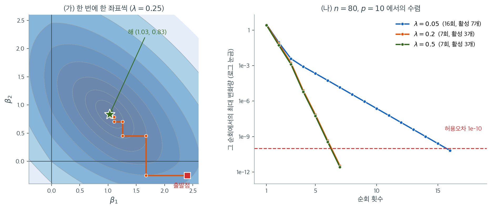

# 좌표하강 알고리즘

라쏘 목적함수는 볼록이지만 L1 벌점 $\lambda\|\boldsymbol{\beta}\|_1$ 때문에 매끄럽지 않다. 표준 경사하강법은 미분 가능한 목적함수를 요구하므로 직접 적용할 수 없다. 좌표하강은 나머지를 고정한 채 계수를 하나씩 최적화하여 이 어려움을 피한다. 각 단일좌표 부분문제가 연성 문턱 연산자로 주어지는 닫힌 형태 해를 가지므로 알고리즘이 단순하면서도 효율적이다.

---

## 1. 좌표하강의 착상

$p$개 계수를 동시에 최적화하는 대신, 좌표하강은 계수를 하나씩 순회한다. 각 단계에서 다른 계수를 현재 값에 고정한 채 $\beta_j$ 하나에 대해 목적함수를 최소화한다.

전체 목적함수는

$$
L(\boldsymbol{\beta}) = \frac{1}{2n}\|\mathbf{y} - \mathbf{X}\boldsymbol{\beta}\|^2 + \lambda\sum_{k=1}^p|\beta_k|
$$

이다. $\beta_j$를 제외한 모든 좌표를 고정하면 $k \neq j$인 항은 상수가 된다. $j$번째 설명변수를 뺀 **부분잔차**를

$$
\mathbf{r}^{(j)} = \mathbf{y} - \sum_{k \neq j}\mathbf{x}_k\hat{\beta}_k
$$

로 정의하면 $\beta_j$에 대한 부분문제는

$$
\min_{\beta_j} \left\{\frac{1}{2n}\|\mathbf{r}^{(j)} - \mathbf{x}_j\beta_j\|^2 + \lambda|\beta_j|\right\}
$$

이 된다.

---

## 2. 단일좌표 갱신

제곱항을 전개하고 상수를 무시하며, 설명변수가 $\|\mathbf{x}_j\|^2 = n$이 되도록 표준화되었다고 가정하자.

$$
z_j = \frac{1}{n}\mathbf{x}_j^\top\mathbf{r}^{(j)}
$$

는 부분잔차를 $j$번째 설명변수에 회귀시킨 단순회귀 계수다. 부분문제는

$$
\min_{\beta_j} \left\{\frac{1}{2}(\beta_j - z_j)^2 + \lambda|\beta_j|\right\}
$$

로 줄어들고, 해는 $z_j$에 연성 문턱을 적용한 값이다.

$$
\hat{\beta}_j \leftarrow S_\lambda(z_j) = \text{sign}(z_j)\,\max(|z_j| - \lambda,\; 0)
$$

<div class="aibox" markdown>

**AI로 보는 통계학 1.** 꺾인 자리가 쓸모가 될 때

절댓값 함수 $\lvert h\rvert$ 는 $h$ 가 $0$ 이 되는 자리에서, 거기서 $h$ 의 그래프가 $x$ 축에 **접할 때만** 미분가능하다. 뚫고 지나가면 접힌 자리가 꺾이고, 꺾인 자리에는 미분계수가 없다.

가장 단순한 경우가 $h(x)=x$ 다. $h'(0)=1\ne0$ 이니 $\lvert x\rvert$ 는 $x=0$ 에서 꺾인다. 미분을 쓰는 기계에게는 반가울 일이 아닌데, 라쏘는 이 꺾임을 **일부러** 만들어 쓴다. 위 부분문제의 $\lambda\lvert\beta_j\rvert$ 가 그것이다.

벌점을 $w^{2}$ 로 주면 매끄럽고, $\lvert w\rvert$ 로 주면 $0$ 에서 꺾인다. 그 차이가 결과를 가른다. 아래에서 $c$ 는 위의 $z_j$ 자리다.

```python
def argmin(g, lo=-3.0, hi=3.0, n=600001):
    """[lo, hi] 를 촘촘히 훑어 g 를 가장 작게 하는 w."""
    step = (hi - lo)/(n - 1)
    return min((lo + step*k for k in range(n)), key=g)

lam = 0.5
print("  c      |w| 벌점 → w*      w² 벌점 → w*")
for c in (1.2, 0.6, 0.4, 0.1, -0.3):
    w1 = argmin(lambda w: 0.5*(w - c)**2 + lam*abs(w))   # |w| — 0 에서 꺾이는 벌점 (라쏘)
    w2 = argmin(lambda w: 0.5*(w - c)**2 + lam*w*w)      # w² — 매끄러운 벌점 (리지)
    print(f"{c:6.2f} {w1:15.6f} {w2:18.6f}")
```

실행하면 다음이 나온다.

```text
  c      |w| 벌점 → w*      w² 벌점 → w*
  1.20        0.700000           0.600000
  0.60        0.100000           0.300000
  0.40        0.000000           0.200000
  0.10        0.000000           0.050000
 -0.30        0.000000          -0.150000
```

첫 칸이 위의 $S_\lambda(c)=\operatorname{sign}(c)\max(\lvert c\rvert-\lambda,\,0)$ 그대로다 — $c=1.2$ 에서 $1.2-0.5=0.7$ 이고, $\lvert c\rvert\le\lambda$ 인 세 줄에서는 **정확히 $0$** 이다. 매끄러운 벌점 쪽은 $\dfrac{c}{1+2\lambda}$ 라서 작아지기는 해도 $c\ne0$ 인 한 결코 $0$ 이 되지 않는다.

까닭이 그 꺾임이다. 매끄러운 바닥은 **기울기가 $0$ 인 한 점**에서만 멈춘다. 그런데 꺾인 자리는 왼쪽 기울기와 오른쪽 기울기가 다르므로, 자료가 $w$ 를 한쪽으로 미는 힘이 그 **기울기 차이보다 작으면 꼼짝도 하지 않는다.** 그렇게 걸려 멈추는 구간이 $\lvert c\rvert\le\lambda$ 다. 접히지 않고 접했더라면 이 구간은 생기지 않는다.

그래서 꺾이는 벌점은 쓸모없는 설명변수를 **정확히 $0$ 으로 만들어 치워 버린다.** 「아주 조금 쓴다」와 「아예 쓰지 않는다」는 다른 말이고, 뒤쪽이어야 그 항을 지워 모형을 줄일 수 있다.

다만 꺾인 자리에 미분계수가 없다는 사실이 사라지는 것은 아니다. 그래서 그 자리에서는 기울기를 그냥 쓸 수 없고, **좌우 기울기 사이의 아무 값**을 대신 쓰는 따로 된 규칙(열미분)을 둔다. $1$ 절이 계수를 통째로 내려보내는 대신 **하나씩 순회**하는 까닭이 그것이다 — 좌표 하나만 놓고 보면 꺾이는 자리가 꼭 한 점이라, 기울기를 더듬는 대신 $S_\lambda$ 라는 **닫힌 꼴**로 그 점을 건너뛸 수 있다. 편리함을 꺾임에서 얻은 만큼 계산 규칙 하나를 더 치르는 셈이다.

</div>

---

## 3. 전체 알고리즘

**입력:** 자료 $(\mathbf{X}, \mathbf{y})$, 정칙화 모수 $\lambda$, 수렴 허용오차 $\epsilon$.

1. **초기화.** $\hat{\boldsymbol{\beta}}^{(0)} = \mathbf{0}$으로 둔다($p < n$이면 OLS 해로 두어도 된다).
2. **순회.** 수렴할 때까지 $t = 1, 2, \ldots$에 대해, 각 $j = 1, \ldots, p$에서 부분잔차와 $z_j$를 계산하고 $\hat{\beta}_j \leftarrow S_\lambda(z_j)$로 갱신한다.
3. **수렴 판정.** $\max_j |\hat{\beta}_j^{(t)} - \hat{\beta}_j^{(t-1)}| < \epsilon$이면 멈춘다.

!!! tip "잔차의 효율적 갱신"
    매 단계에서 $\mathbf{r}^{(j)}$를 처음부터 다시 계산하지 말고, 실행 잔차 $\mathbf{r} = \mathbf{y} - \mathbf{X}\hat{\boldsymbol{\beta}}$를 유지하며 증분 갱신한다. $\beta_j$를 갱신하기 전에 옛 기여를 되돌리고($\mathbf{r} \leftarrow \mathbf{r} + \mathbf{x}_j\hat{\beta}_j^{\text{old}}$), 갱신 후 새 기여를 뺀다($\mathbf{r} \leftarrow \mathbf{r} - \mathbf{x}_j\hat{\beta}_j^{\text{new}}$). 좌표당 비용이 $O(np)$에서 $O(n)$으로 줄어든다.

---

## 4. 수렴 성질

좌표하강은 다음 이유로 라쏘의 전역 최적해로 수렴한다.

1. **볼록성.** 목적함수가 볼록 이차항과 볼록 L1 항의 합이다.
2. **비매끄러운 항의 분리성.** L1 벌점 $\sum_j |\beta_j|$이 좌표별로 분리되므로 $\partial_{\beta_j}\|\boldsymbol{\beta}\|_1 = \partial|\beta_j|$가 다른 좌표에 의존하지 않는다.
3. **블록 좌표하강 정리.** 비매끄러운 부분이 분리 가능한 볼록 목적함수에서 순환 좌표하강은 전역 최소점으로 수렴한다(Tseng, 2001).



왼쪽은 설명변수 두 개짜리 문제에서 알고리즘이 실제로 밟는 경로다. 색이 진할수록 목적함숫값이 작고, 별이 최적해 $(1.03,\ 0.83)$이다. 경로가 **가로와 세로로만 움직인다**는 점을 보라. 한 번에 한 좌표만 갱신하므로 다른 좌표는 그대로 있고, 따라서 모든 이동이 축과 나란하다. 경사하강법이라면 등고선의 수직 방향으로 비스듬히 갔을 자리다.

이 계단 경로가 왜 멈추지 않고 최적해로 가는지도 그림에서 읽을 수 있다. 각 이동은 그 좌표 방향에서 목적함수를 **정확히 최소화**하므로 값이 절대 올라가지 않는다. 목적함수가 볼록이고 아래로 유계이니 값의 수열이 수렴하고, L1 항이 좌표별로 분리되어 있어 "모든 좌표 방향에서 더 내려갈 곳이 없다"가 곧 "전역 최적"이 된다. 분리되지 않는 벌점에서 이 논증이 깨진다는 것이 위 주석의 요지다.

오른쪽은 $n = 80$, $p = 10$인 문제에서 순회마다 계수가 얼마나 움직였는지를 로그 눈금으로 추적한 것이다. 세 곡선 모두 **직선**이다. 로그 눈금에서 직선은 곱셈적 감소, 곧 선형수렴을 뜻한다. 한 순회마다 오차가 일정 비율로 줄어든다.

기울기가 $\lambda$에 따라 다르다는 점이 실무적으로 중요하다. $\lambda = 0.2$와 $\lambda = 0.5$는 일곱 번의 순회로 $10^{-10}$에 닿는데 $\lambda = 0.05$는 열여섯 번이 걸린다. 이유는 범례에 함께 적어 두었다. 벌점이 약하면 활성 변수가 일곱 개로 늘어나 실제로 최적화할 좌표가 많아지고, 벌점이 강하면 세 개뿐이다. **강한 벌점에서 시작해 $\lambda$를 조금씩 낮추며 직전 해를 초기값으로 쓰는 온기 시작**이 유리한 이유가 여기 있다. 매번 이미 거의 맞는 답에서 출발하므로 한두 번의 순회로 끝난다.

!!! note "분리되지 않는 벌점"
    그룹 라쏘 $\sum_g \|\boldsymbol{\beta}_g\|_2$처럼 분리되지 않는 벌점에서는 좌표하강의 수렴이 보장되지 않는다. L2 노름이 그룹 내 계수를 결합시키기 때문이다. 이런 벌점에는 개별 좌표가 아니라 그룹을 갱신하는 블록 좌표하강이 필요하다.

---

## 5. 온기 시작과 해 경로

실무에서 라쏘는 $\lambda_{\max}$에서 그 작은 배수까지 이어지는 격자 위에서 푼다. **온기 시작**은 $\lambda_m$의 해를 $\lambda_{m+1}$의 초기점으로 쓴다. 인접한 $\lambda$가 비슷한 해를 내므로 필요한 반복 횟수가 크게 줄어든다.

온기 시작을 쓴 좌표하강으로 전체 정칙화 경로를 계산하는 비용은 단일 $\lambda$에서 처음부터 푸는 것과 비슷하다. 이 효율성이 좌표하강이 라쏘의 표준 알고리즘이 된 주된 이유다.

---

## 6. 계산 복잡도

| 연산 | 비용 |
|---|---|
| 한 좌표 갱신 | $O(n)$ |
| 한 번의 전체 순회 | $O(np)$ |
| 수렴까지 (보통 10–100회 순회) | $O(np \times \text{반복})$ |
| 전체 경로 ($M$개 $\lambda$, 온기 시작) | $O(Mnp)$, 상수가 작다 |

$p$가 크고 해가 희소하면 활성집합 전략으로 계산을 더 줄일 수 있다. 현재 0이 아니거나 곧 0이 아니게 될 후보만 갱신하는 방식이다.

---

## 7. 엘라스틱넷으로의 확장

좌표하강 틀은 엘라스틱넷으로 자연스럽게 확장된다. 단일좌표 갱신은

$$
\hat{\beta}_j \leftarrow \frac{S_{\alpha\lambda}(z_j)}{1 + (1-\alpha)\lambda}
$$

가 된다. 분모 $1 + (1-\alpha)\lambda$가 L2 벌점을, 분자의 연성 문턱이 L1 벌점을 담당한다. $\alpha$를 바꾸는 것만으로 같은 알고리즘이 능형, 라쏘, 엘라스틱넷을 모두 처리한다.

---

## 연습문제

<div class="drillbox" markdown>

**연습문제 1.** <span class="diff med" title="중간"></span>
좌표하강을 직접 구현하고 `sklearn.linear_model.Lasso`와 일치하는지, 몇 번의 순회로 수렴하는지 확인하라.

</div>

??? success "풀이"
    ```python
    import numpy as np
    from sklearn.linear_model import Lasso

    def soft(z, l):
        return np.sign(z) * np.maximum(np.abs(z) - l, 0)

    def cd_lasso(X, y, lam, tol=1e-10, maxit=10000):
        n, p = X.shape
        b = np.zeros(p); r = y.copy()          # 실행 잔차
        for it in range(maxit):
            mx = 0.0
            for j in range(p):
                r += X[:, j]*b[j]              # 옛 기여를 되돌린다
                z = X[:, j] @ r / n
                nb = soft(z, lam)
                mx = max(mx, abs(nb - b[j])); b[j] = nb
                r -= X[:, j]*b[j]              # 새 기여를 뺀다
            if mx < tol:
                return b, it + 1
        return b, maxit

    rng = np.random.default_rng(4)
    n, p = 80, 10
    X = rng.normal(size=(n, p)); X -= X.mean(0); X /= X.std(0)
    beta = np.zeros(p); beta[:3] = [3, -2, 1.5]
    y = X @ beta + rng.normal(0, 1, n); y -= y.mean()
    ```

    | $\lambda$ | 수렴까지 순회 | $\max_j\lvert\hat\beta_j^{\text{mine}} - \hat\beta_j^{\text{sklearn}}\rvert$ | 0이 아닌 계수 |
    |---:|---:|---:|---:|
    | 0.05 | 16 | $2.2\times10^{-11}$ | 7 |
    | 0.20 | **7** | $2.4\times10^{-14}$ | 3 |
    | 0.50 | **7** | $8.9\times10^{-16}$ | 3 |

    **20줄짜리 구현이 sklearn과 기계 정밀도까지 일치한다.**

    두 가지를 읽어야 한다.

    **첫째, 수렴이 매우 빠르다.** $\lambda = 0.2$에서 7번의 순회면 충분하다. 각 순회가 $O(np) = 800$번의 연산이므로 전체가 $5{,}600$번의 곱셈이다. 이것이 라쏘가 $p$가 수만인 문제에서도 실용적인 이유다.

    **둘째, $\lambda$가 클수록 빨리 수렴한다.** $\lambda = 0.05$에서 16회, $\lambda = 0.5$에서 7회다. 벌점이 강하면 활성집합이 작아 실질적으로 최적화할 좌표가 몇 개뿐이기 때문이다. 온기 시작으로 큰 $\lambda$부터 내려오는 전략이 효과적인 이유가 여기에 있다.

<div class="drillbox" markdown>

**연습문제 2.** <span class="diff med" title="중간"></span>
$\|\mathbf{x}_j\|^2 = n$이라는 표준화 가정을 빼면 갱신식이 어떻게 바뀌는가?

</div>

??? success "풀이"
    표준화하지 않으면 부분문제의 이차항 계수가 $\|\mathbf{x}_j\|^2/n$이 되어

    $$
    \min_{\beta_j}\left\{\frac{\|\mathbf{x}_j\|^2}{2n}\beta_j^2 - \frac{\mathbf{x}_j^\top\mathbf{r}^{(j)}}{n}\beta_j + \lambda|\beta_j|\right\}
    $$

    이고, 해는

    $$
    \hat\beta_j \leftarrow \frac{S_\lambda\!\left(\frac{1}{n}\mathbf{x}_j^\top\mathbf{r}^{(j)}\right)}{\|\mathbf{x}_j\|^2/n}
    $$

    가 된다. 즉 연성 문턱을 적용한 뒤 $\|\mathbf{x}_j\|^2/n$으로 나눈다.

    **이 식이 왜 문제인가.** 분자의 문턱 $\lambda$는 모든 $j$에 대해 같은데 분모는 변수마다 다르다. 척도가 큰 변수($\|\mathbf{x}_j\|$가 큰 변수)는 $z_j$도 커지므로 문턱을 넘기 쉽다.

    구체적으로, 어떤 변수의 단위를 미터에서 킬로미터로 바꾸면 그 열이 $1000$배가 되고 $z_j$도 $1000$배가 되어 **거의 확실히 선택된다.** 벌점이 계수의 크기를 벌하는데, 계수의 크기는 변수의 단위에 의존하기 때문이다.

    **따라서 라쏘(그리고 능형, 엘라스틱넷)에서 표준화는 선택이 아니라 필수다.** sklearn은 이를 자동으로 하지 않으므로 `StandardScaler`를 파이프라인에 넣어야 한다. `glmnet`은 기본적으로 표준화한 뒤 계수를 원래 척도로 되돌려 준다.

<div class="drillbox" markdown>

**연습문제 3.** <span class="diff med" title="중간"></span>
§5는 라쏘를 "$\lambda_{\max}$에서 그 작은 배수까지 이어지는 격자 위에서" 푼다고만 하고 $\lambda_{\max}$가 무엇인지는 적지 않았다. 설명변수가 $\|\mathbf{x}_j\|^2 = n$으로 표준화되어 있다고 할 때 갱신식 $\hat\beta_j \leftarrow S_\lambda(z_j)$만 써서

$$
\hat{\boldsymbol{\beta}} = \mathbf{0} \iff \lambda \ge \lambda_{\max} := \max_{1\le j\le p}\frac{1}{n}\left|\mathbf{x}_j^\top\mathbf{y}\right|
$$

임을 보여라. 또 $\lambda_{\max}$보다 큰 $\lambda$를 격자에 넣는 것이 왜 쓸모없는지 한 줄로 적어라.

</div>

??? success "풀이"
    **($\Leftarrow$) $\lambda \ge \lambda_{\max}$이면 $\mathbf{0}$이 고정점이다.** $\hat{\boldsymbol{\beta}} = \mathbf{0}$에서 출발하자. $j = 1$의 부분잔차는 $\mathbf{r}^{(1)} = \mathbf{y} - \sum_{k\neq 1}\mathbf{x}_k\cdot 0 = \mathbf{y}$이므로

    $$
    z_1 = \frac{1}{n}\mathbf{x}_1^\top\mathbf{y}, \qquad |z_1| \le \lambda_{\max} \le \lambda
    $$

    이고 따라서 $S_\lambda(z_1) = 0$이다. $\beta_1$은 0에 머문다. 그러면 $j = 2$에서도 모든 다른 좌표가 여전히 0이니 $\mathbf{r}^{(2)} = \mathbf{y}$이고 같은 계산이 되풀이된다. 차례로 $j = p$까지 아무 좌표도 움직이지 않으므로 첫 순회에서 $\max_j|\hat\beta_j^{(1)} - \hat\beta_j^{(0)}| = 0 < \epsilon$, 알고리즘은 $\mathbf{0}$에서 멈춘다. §4에 따라 순환 좌표하강은 이 볼록 문제의 전역 최소점으로 수렴하므로 $\mathbf{0}$이 전역 최소점이다.

    **($\Rightarrow$) $\lambda < \lambda_{\max}$이면 $\mathbf{0}$은 최적이 아니다.** 최댓값을 주는 좌표를 $j_0$라 하면 $\mathbf{0}$에서 $|z_{j_0}| = \lambda_{\max} > \lambda$이므로

    $$
    S_\lambda(z_{j_0}) = \operatorname{sign}(z_{j_0})(\lambda_{\max} - \lambda) \neq 0
    $$

    이다. 그런데 이 갱신은 $\beta_{j_0}$ 방향에서 목적함수를 **정확히** 최소화하는 값이고 그 최소점이 0과 다르므로, 옮기면 목적함숫값이 엄격히 줄어든다. 따라서 $\mathbf{0}$은 최소점이 아니다.

    두 방향을 합치면 동치가 나온다. $\lambda > \lambda_{\max}$인 격자점은 모두 같은 해 $\mathbf{0}$(절편만 있는 모형)을 주므로 **격자에 넣어도 새로 얻는 모형이 없다.** 그래서 경로를 정확히 $\lambda_{\max}$에서 시작한다.

    연습문제 1의 자료에서는 $\lambda_{\max} = 3.1058$이다(연습문제 5의 출력 첫 줄). 표의 가장 큰 벌점 $\lambda = 0.5$도 이보다 여섯 배 작으니 계수 세 개가 살아 있는 것이 앞뒤가 맞는다.

    $\lambda_{\max}$는 "가장 강한 주변 상관"이고, 라쏘의 해 경로는 그 변수 하나가 들어오는 순간 시작된다.

<div class="drillbox" markdown>

**연습문제 4.** <span class="diff med" title="중간"></span>
$\frac{1}{n}\mathbf{X}^\top\mathbf{X} = \mathbf{I}_p$인 **직교설계**를 생각한다.

(가) 좌표하강이 $\boldsymbol{\beta}^{(0)} = \mathbf{0}$에서 출발해 단 한 번의 순회로 정확한 라쏘 해에 닿고, 그 해가 $S_\lambda(\hat\beta_j^{\text{OLS}})$임을 보여라.

(나) §7의 엘라스틱넷 갱신식에 $\alpha = 0$을 넣어 같은 설계에서 능형 해가 $\hat\beta_j^{\text{OLS}}/(1+\lambda)$임을 확인하라.

(다) 두 식에서 "변수선택이 L1에서만 일어난다"를 읽어라. $\lambda \to 0$과 $\lambda \to \infty$의 극단도 함께 적어라.

</div>

??? success "풀이"
    **(가)** 직교설계에서는 $j \neq k$일 때 $\mathbf{x}_j^\top\mathbf{x}_k = 0$이다. 그러므로

    $$
    z_j = \frac{1}{n}\mathbf{x}_j^\top\mathbf{r}^{(j)} = \frac{1}{n}\mathbf{x}_j^\top\mathbf{y} - \sum_{k\neq j}\frac{1}{n}\mathbf{x}_j^\top\mathbf{x}_k\,\hat\beta_k = \frac{1}{n}\mathbf{x}_j^\top\mathbf{y}
    $$

    가 되어 $z_j$가 **다른 좌표의 현재 값에 전혀 의존하지 않는다.** 한편 OLS 해는 $\hat{\boldsymbol{\beta}}^{\text{OLS}} = (\mathbf{X}^\top\mathbf{X})^{-1}\mathbf{X}^\top\mathbf{y} = \frac{1}{n}\mathbf{X}^\top\mathbf{y}$이므로 $z_j = \hat\beta_j^{\text{OLS}}$다. 첫 순회가 끝나면

    $$
    \hat\beta_j = S_\lambda\!\left(\hat\beta_j^{\text{OLS}}\right) = \operatorname{sign}\!\left(\hat\beta_j^{\text{OLS}}\right)\left(\left|\hat\beta_j^{\text{OLS}}\right| - \lambda\right)_+
    $$

    이고, 두 번째 순회의 $z_j$도 같은 값이니 어떤 좌표도 더 바뀌지 않는다. 수렴 판정이 두 번째 순회에서 통과한다.

    **(나)** §7의 갱신식에 $\alpha = 0$을 넣으면 분자의 문턱이 $S_0(z_j) = z_j$가 되어

    $$
    \hat\beta_j \leftarrow \frac{z_j}{1+\lambda} = \frac{\hat\beta_j^{\text{OLS}}}{1+\lambda}
    $$

    이다. 직접 풀어도 같다. 벌점 $\frac{\lambda}{2}\|\boldsymbol{\beta}\|_2^2$를 붙인 목적함수의 해는 $(\mathbf{X}^\top\mathbf{X} + n\lambda\mathbf{I})^{-1}\mathbf{X}^\top\mathbf{y} = (n + n\lambda)^{-1}\mathbf{X}^\top\mathbf{y} = \hat{\boldsymbol{\beta}}^{\text{OLS}}/(1+\lambda)$다.

    **(다)** 두 식의 차이가 한눈에 보인다.

    | | 직교설계의 해 | $\hat\beta_j = 0$이 되는 조건 |
    |---|---|---|
    | 능형 | $\hat\beta_j^{\text{OLS}}/(1+\lambda)$ (비례 축소) | $\hat\beta_j^{\text{OLS}} = 0$일 때만 |
    | 라쏘 | $S_\lambda(\hat\beta_j^{\text{OLS}})$ (연성 문턱) | $\lvert\hat\beta_j^{\text{OLS}}\rvert \le \lambda$일 때 |

    능형은 모든 계수를 **같은 비율로** 줄이므로 OLS 계수가 0이 아니면 어떤 유한한 $\lambda$에서도 0이 되지 않는다. 라쏘는 $\lambda$라는 문턱을 넘지 못한 계수를 정확히 0으로 **잘라낸다.** 변수선택이 L1에서만 일어나는 까닭이 이 한 줄에 있다.

    극단을 보면 더 분명하다. $\lambda \to 0$이면 둘 다 OLS로 간다. $\lambda \to \infty$이면 라쏘는 $\lambda \ge \max_j\lvert\hat\beta_j^{\text{OLS}}\rvert = \lambda_{\max}$인 **유한한** 지점에서 이미 전부 0이 되고(직교설계에서는 $\frac{1}{n}\mathbf{x}_j^\top\mathbf{y} = \hat\beta_j^{\text{OLS}}$이므로 연습문제 3의 $\lambda_{\max}$와 같은 값이다), 능형은 0으로 다가가되 결코 닿지 않는다.

    연습문제 1의 자료가 한 순회로 끝나지 않고 일곱 번이 걸린 이유도 여기서 읽힌다. 난수로 만든 열은 직교에 가깝기만 하고 직교가 아니다. 직교성이 깨진 만큼 좌표들이 서로를 되밀며 $z_j$를 바꾼다.

<div class="drillbox" markdown>

**연습문제 5.** <span class="diff med" title="중간"></span>
많은 교과서는 라쏘를 $\|\mathbf{y} - \mathbf{X}\boldsymbol{\beta}\|^2 + \lambda_{\text{tb}}\|\boldsymbol{\beta}\|_1$로 적는다. 이 쪽(그리고 `sklearn`)이 쓰는 꼴과는 벌점 모수의 척도가 다르다.

(가) 교과서 꼴에 대한 단일좌표 갱신의 문턱이 $\lambda_{\text{tb}}/(2\|\mathbf{x}_j\|^2)$, 곧 표준화된 설계에서 $\lambda_{\text{tb}}/(2n)$임을 유도하고 $\lambda = \lambda_{\text{tb}}/(2n)$임을 확인하라.

(나) 연습문제 1의 자료($n = 80$)에서 $\lambda_{\text{tb}} = 24$를 직접 구현한 좌표하강으로 풀고 `Lasso`에 환산한 `alpha`를 넣은 결과와 맞춰 보라.

(다) 환산을 잊고 `alpha=24`를 넣으면 무슨 일이 벌어지는가. 연습문제 3의 $\lambda_{\max}$로 설명하라.

</div>

??? success "풀이"
    **(가)** 교과서 꼴의 부분문제는 $\min_{\beta_j}\{\|\mathbf{r}^{(j)} - \mathbf{x}_j\beta_j\|^2 + \lambda_{\text{tb}}|\beta_j|\}$다. 제곱을 전개하고 상수를 버리면

    $$
    \|\mathbf{x}_j\|^2\beta_j^2 - 2\,\mathbf{x}_j^\top\mathbf{r}^{(j)}\beta_j + \lambda_{\text{tb}}|\beta_j|
    $$

    이고, 양변을 $2\|\mathbf{x}_j\|^2$로 나누면 §2의 표준형이 된다.

    $$
    \frac{1}{2}\beta_j^2 - \frac{\mathbf{x}_j^\top\mathbf{r}^{(j)}}{\|\mathbf{x}_j\|^2}\beta_j + \frac{\lambda_{\text{tb}}}{2\|\mathbf{x}_j\|^2}|\beta_j|
    $$

    따라서

    $$
    \hat\beta_j \leftarrow S_{\lambda_{\text{tb}}/(2\|\mathbf{x}_j\|^2)}\!\left(\frac{\mathbf{x}_j^\top\mathbf{r}^{(j)}}{\|\mathbf{x}_j\|^2}\right)
    $$

    이고 $\|\mathbf{x}_j\|^2 = n$이면 $\hat\beta_j \leftarrow S_{\lambda_{\text{tb}}/(2n)}(z_j)$다. §2의 갱신식과 비교하면 문턱이 곧 $\lambda$이므로

    $$
    \lambda = \frac{\lambda_{\text{tb}}}{2n}, \qquad \lambda_{\text{tb}} = 2n\lambda
    $$

    이다. $n = 80$, $\lambda_{\text{tb}} = 24$에서는 $\lambda = 24/160 = 0.15$.

    **(나), (다)**

    ```python
    def cd_textbook(X, y, lam_tb, tol=1e-12, maxit=100000):
        """목적함수 ||y - X b||^2 + lam_tb * ||b||_1 을 푼다."""
        n, p = X.shape
        b = np.zeros(p); r = y.copy()
        thr = lam_tb / (2 * n)                        # 유도한 문턱
        for _ in range(maxit):
            mx = 0.0
            for j in range(p):
                r += X[:, j]*b[j]
                nb = soft(X[:, j] @ r / n, thr)
                mx = max(mx, abs(nb - b[j])); b[j] = nb
                r -= X[:, j]*b[j]
            if mx < tol:
                return b
        return b

    lam_tb = 24.0
    alpha = lam_tb / (2 * n)
    fits = [("cd(lambda_tb=24)", cd_textbook(X, y, lam_tb)),
            ("Lasso(alpha=0.15)", Lasso(alpha=alpha, fit_intercept=False,
                                        max_iter=100000, tol=1e-12).fit(X, y).coef_),
            ("Lasso(alpha=24)", Lasso(alpha=lam_tb, fit_intercept=False,
                                      max_iter=100000, tol=1e-12).fit(X, y).coef_)]

    print(f"lambda_max = {np.abs(X.T @ y).max() / n:.4f}")
    print(f"lambda_tb = {lam_tb:.1f}  ->  alpha = lambda_tb/(2n) = {alpha:.4f}")
    print(f"{'fit':18s}{'beta0':>9s}{'beta1':>9s}{'beta2':>9s}{'nonzero':>9s}")
    for name, b in fits:
        b = np.where(b == 0, 0.0, b)
        print(f"{name:18s}" + "".join(f"{v:9.4f}" for v in b[:3])
              + f"{int((b != 0).sum()):9d}")
    print(f"first two agree within 1e-8: {np.allclose(fits[0][1], fits[1][1], atol=1e-8)}")
    ```

    출력:

    ```text
    lambda_max = 3.1058
    lambda_tb = 24.0  ->  alpha = lambda_tb/(2n) = 0.1500
    fit                   beta0    beta1    beta2  nonzero
    cd(lambda_tb=24)     3.0316  -1.9225   1.3856        4
    Lasso(alpha=0.15)    3.0316  -1.9225   1.3856        4
    Lasso(alpha=24)      0.0000   0.0000   0.0000        0
    first two agree within 1e-8: True
    ```

    환산한 `alpha=0.15`는 직접 구현한 좌표하강과 소수 넷째 자리까지, 실제로는 $10^{-8}$ 안에서 일치한다.

    환산을 잊은 쪽은 **계수가 전부 0인 모형**을 돌려준다. $24 > \lambda_{\max} = 3.1058$이므로 연습문제 3에 따라 해가 정확히 $\mathbf{0}$이기 때문이다. 벌점을 $160$배 세게 걸었으니 당연한 결과다.

    무서운 것은 그 과정이 **조용하다**는 점이다. 오류도 경고도 없고 `Lasso` 객체는 정상으로 보인다. 예측값이 모두 $\bar y$가 되어 $R^2 = 0$이 나올 뿐이다. 라이브러리를 바꾸거나 논문의 $\lambda$를 그대로 옮길 때 **목적함수의 꼴을 먼저 확인하라.** `glmnet`도 $\frac{1}{2n}$ 꼴을 쓰므로 `sklearn`의 `alpha`와 같은 척도지만, 교과서의 $\lambda_{\text{tb}}$와는 $2n$배 차이가 난다.

<div class="drillbox" markdown>

**연습문제 6.** <span class="diff hard" title="어려움"></span>
$p = 2$인 표준화된 설계에서

$$
\frac{1}{n}\mathbf{X}^\top\mathbf{X} = \begin{pmatrix}1 & \rho\\ \rho & 1\end{pmatrix},\quad \rho = 0.5, \qquad \frac{1}{n}\mathbf{X}^\top\mathbf{y} = \begin{pmatrix}1.0\\ 0.8\end{pmatrix}, \qquad \lambda = 0.2
$$

라 하자.

(가) 갱신식이 $\beta_1 \leftarrow S_\lambda(1.0 - 0.5\beta_2)$, $\beta_2 \leftarrow S_\lambda(0.8 - 0.5\beta_1)$임을 보여라.

(나) $\boldsymbol{\beta}^{(0)} = \mathbf{0}$에서 세 번의 순회를 손으로 계산하라.

(다) 정확한 해를 구하고, 오차가 순회마다 정확히 $\rho^2$배로 줄어듦을 보여라.

(라) 그림 오른쪽의 로그 직선이 이것과 어떻게 맞는지, 오차 $10^{-10}$에 닿기까지 몇 번의 순회가 필요한지, 그리고 $\rho = 0.95$면 어떻게 되는지 적어라.

</div>

??? success "풀이"
    **(가)** 부분잔차의 정의에서

    $$
    z_1 = \frac{1}{n}\mathbf{x}_1^\top(\mathbf{y} - \mathbf{x}_2\beta_2) = \frac{1}{n}\mathbf{x}_1^\top\mathbf{y} - \frac{1}{n}\mathbf{x}_1^\top\mathbf{x}_2\,\beta_2 = 1.0 - 0.5\beta_2
    $$

    이고 $z_2 = 0.8 - 0.5\beta_1$도 마찬가지다. 설계행렬이 아니라 **$\frac{1}{n}\mathbf{X}^\top\mathbf{X}$와 $\frac{1}{n}\mathbf{X}^\top\mathbf{y}$만 있으면 좌표하강을 돌릴 수 있다**는 점도 눈여겨 두라.

    **(나)** $S_{0.2}$를 차례로 적용한다.

    - 순회 1: $\beta_1 = S_{0.2}(1.0 - 0) = 0.8$, 이어서 $\beta_2 = S_{0.2}(0.8 - 0.4) = S_{0.2}(0.4) = 0.2$.
    - 순회 2: $\beta_1 = S_{0.2}(1.0 - 0.1) = S_{0.2}(0.9) = 0.7$, $\beta_2 = S_{0.2}(0.8 - 0.35) = S_{0.2}(0.45) = 0.25$.
    - 순회 3: $\beta_1 = S_{0.2}(1.0 - 0.125) = 0.675$, $\beta_2 = S_{0.2}(0.8 - 0.3375) = 0.2625$.

    **(다)** 두 좌표가 순회 1부터 활성이므로 $S_\lambda$의 절댓값이 벗겨져 고정점 방정식이 선형이 된다.

    $$
    \beta_1 = 1.0 - \lambda - \rho\beta_2 = 0.8 - 0.5\beta_2, \qquad \beta_2 = 0.8 - \lambda - \rho\beta_1 = 0.6 - 0.5\beta_1
    $$

    대입하면 $\beta_1 = 0.8 - 0.3 + 0.25\beta_1$, 곧 $0.75\beta_1 = 0.5$이므로

    $$
    \hat\beta_1 = \frac{2}{3} = 0.6\overline{6}, \qquad \hat\beta_2 = 0.6 - \frac{1}{3} = \frac{4}{15} = 0.26\overline{6}
    $$

    이다. 활성 가정도 확인된다. $z_1 = 1.0 - 0.5\cdot\frac{4}{15} = \frac{13}{15} = 0.8667 > \lambda$, $z_2 = 0.8 - 0.5\cdot\frac{2}{3} = \frac{7}{15} = 0.4667 > \lambda$.

    오차를 $e_j^{(t)} = \beta_j^{(t)} - \hat\beta_j$로 두면 갱신식에서 $\lambda$와 상수가 상쇄되어

    $$
    e_1^{(t)} = -\rho\, e_2^{(t-1)}, \qquad e_2^{(t)} = -\rho\, e_1^{(t)} = \rho^2 e_2^{(t-1)}
    $$

    이다. 한 순회가 오차를 정확히 $\rho^2 = 0.25$배로 줄인다. 손으로 구한 값이 그대로 맞는다.

    | 순회 $t$ | $\beta_1^{(t)}$ | $\beta_2^{(t)}$ | $e_1^{(t)}$ | $e_2^{(t)}$ |
    |---:|---:|---:|---:|---:|
    | 0 | 0 | 0 | $-0.6667$ | $-0.2667$ |
    | 1 | 0.8 | 0.2 | $0.1333$ | $-0.0667$ |
    | 2 | 0.7 | 0.25 | $0.0333$ | $-0.0167$ |
    | 3 | 0.675 | 0.2625 | $0.0083$ | $-0.0042$ |

    **(라)** 오차가 곱셈적으로 줄므로 로그 눈금에서는 직선이고, 기울기가 순회당 $\log_{10}\rho^2 = -0.602$다. 그림 오른쪽의 세 직선이 바로 이것이다.

    큰 쪽 오차 $\lvert e_1^{(t)}\rvert = 0.1333 \times 4^{-(t-1)}$이 $10^{-10}$보다 작아지려면

    $$
    t \ge 1 + \log_4\frac{0.1333}{10^{-10}} = 1 + 15.16 = 16.16
    $$

    곧 **17번**의 순회가 필요하다. 연습문제 1의 표에서 $\lambda = 0.05$가 16번, $\lambda = 0.2$가 7번 걸린 것과 같은 자리의 수다.

    $\rho = 0.95$면 비율이 $\rho^2 = 0.9025$로 올라가 $\log(10^{-10}/0.1333)/\log(0.9025) \approx 205$번이 필요하다. **12배 느려진다.** 좌표하강의 수렴 속도를 정하는 것은 벌점의 세기가 아니라 설계행렬의 상관이다. 다중공선성(13장)이 심하면 $\rho^2 \to 1$이 되어 순회 횟수가 폭발한다. $\lambda$가 작을 때 그림의 기울기가 완만해지는 것도 활성집합이 커지면서 그 안의 상관이 함께 섞여 들기 때문이다.

<div class="drillbox" markdown>

**연습문제 7.** <span class="diff hard" title="어려움"></span>
§4는 "모든 좌표 방향에서 더 내려갈 곳이 없다"가 곧 "전역 최적"이라고 했다. 그 말을 식으로 적어라. 곧 표준화된 설계에서 좌표하강의 고정점 $\hat{\boldsymbol{\beta}}$와 잔차 $\mathbf{r} = \mathbf{y} - \mathbf{X}\hat{\boldsymbol{\beta}}$가

$$
\hat\beta_j \neq 0 \;\Rightarrow\; \frac{1}{n}\mathbf{x}_j^\top\mathbf{r} = \lambda\operatorname{sign}(\hat\beta_j), \qquad \hat\beta_j = 0 \;\Rightarrow\; \left|\frac{1}{n}\mathbf{x}_j^\top\mathbf{r}\right| \le \lambda
$$

를 만족함을 보이고, 연습문제 1의 자료와 $\lambda = 0.2$에서 수치로 확인하라. 덧붙여 **주변 상관** $\frac{1}{n}\mathbf{x}_j^\top\mathbf{y}$를 함께 찍어, 주변 상관이 $\lambda$를 넘는데도 탈락한 변수가 있는지 보라.

</div>

??? success "풀이"
    **유도.** 고정점에서는 모든 $j$에 대해 $\hat\beta_j = S_\lambda(z_j)$다. 실행 잔차와 부분잔차의 관계 $\mathbf{r}^{(j)} = \mathbf{r} + \mathbf{x}_j\hat\beta_j$와 $\|\mathbf{x}_j\|^2 = n$에서

    $$
    z_j = \frac{1}{n}\mathbf{x}_j^\top\mathbf{r}^{(j)} = \frac{1}{n}\mathbf{x}_j^\top\mathbf{r} + \hat\beta_j
    $$

    이다. 이제 두 경우로 나눈다. $\hat\beta_j \neq 0$이면 $\operatorname{sign}(z_j) = \operatorname{sign}(\hat\beta_j)$이고 $S_\lambda(z_j) = z_j - \lambda\operatorname{sign}(\hat\beta_j)$이므로

    $$
    \hat\beta_j = \frac{1}{n}\mathbf{x}_j^\top\mathbf{r} + \hat\beta_j - \lambda\operatorname{sign}(\hat\beta_j) \;\Longrightarrow\; \frac{1}{n}\mathbf{x}_j^\top\mathbf{r} = \lambda\operatorname{sign}(\hat\beta_j)
    $$

    가 된다. $\hat\beta_j = 0$이면 $S_\lambda(z_j) = 0$이므로 $|z_j| \le \lambda$이고, 위 관계에서 $z_j = \frac{1}{n}\mathbf{x}_j^\top\mathbf{r}$이니 $\lvert\frac{1}{n}\mathbf{x}_j^\top\mathbf{r}\rvert \le \lambda$다. 이것이 라쏘 목적함수의 KKT 조건, 곧 $\mathbf{0} \in -\frac{1}{n}\mathbf{X}^\top\mathbf{r} + \lambda\,\partial\|\hat{\boldsymbol{\beta}}\|_1$을 좌표별로 풀어쓴 것이다. $\square$

    **수치 확인.**

    ```python
    lam = 0.2
    b, _ = cd_lasso(X, y, lam, tol=1e-12, maxit=100000)
    b = np.where(b == 0, 0.0, b)
    g = X.T @ (y - X @ b) / n                         # 해에서의 (1/n) x_j' r
    m = X.T @ y / n                                   # 주변 상관 (1/n) x_j' y
    act, zer = np.flatnonzero(b), np.flatnonzero(b == 0)

    print(f"lambda = {lam:.4f}")
    print(f"{'j':>3s}{'beta_j':>10s}{'(1/n)x_j.r':>12s}{'lam*sign':>10s}{'(1/n)x_j.y':>12s}")
    for j in range(len(b)):
        s = f"{lam * np.sign(b[j]):10.4f}" if b[j] != 0 else f"{'.':>10s}"
        print(f"{j:3d}{b[j]:10.4f}{g[j]:12.4f}{s}{m[j]:12.4f}")
    ok = (np.abs(g[act] - lam * np.sign(b[act])).max() < 1e-8
          and np.abs(g[zer]).max() <= lam + 1e-8)
    print(f"KKT 조건이 모두 성립하는가: {ok}")
    print("0 인데 |(1/n)x_j.y| > lambda 인 좌표: "
          + str([int(j) for j in zer if abs(m[j]) > lam]))
    ```

    출력:

    ```text
    lambda = 0.2000
      j    beta_j  (1/n)x_j.r  lam*sign  (1/n)x_j.y
      0    2.9753      0.2000    0.2000      3.1058
      1   -1.8736     -0.2000   -0.2000     -1.9373
      2    1.3364      0.2000    0.2000      1.3756
      3    0.0000     -0.0268         .      0.3667
      4    0.0000     -0.0043         .     -0.1112
      5    0.0000     -0.1829         .     -0.3013
      6    0.0000     -0.0583         .     -0.2289
      7    0.0000     -0.1424         .      0.1822
      8    0.0000      0.0056         .      0.0846
      9    0.0000     -0.0929         .     -0.0561
    KKT 조건이 모두 성립하는가: True
    0 인데 |(1/n)x_j.y| > lambda 인 좌표: [3, 5, 6]
    ```

    **읽을 것이 셋이다.**

    **첫째, 활성 좌표의 상관이 정확히 $\pm\lambda = \pm 0.2$다.** 이것이 라쏘 해의 지문이다. 0이 아닌 변수들은 모두 잔차와 **같은 크기로** 상관되어 있고 그 크기가 벌점과 같다. 0인 좌표는 모두 $0.2$ 미만이며 그중 $j = 5$가 $0.1829$로 가장 가깝다. $\lambda$를 조금만 낮추면 다음에 들어올 변수다. 해 경로에서 변수가 들어오는 순서는 이렇게 정해진다.

    **둘째, 주변 상관과 조건부 상관은 다르다.** $j = 3,\,5,\,6$은 주변 상관이 $0.3667$, $-0.3013$, $-0.2289$로 모두 $\lambda = 0.2$를 넘지만 해에서는 0이다. 참된 계수가 0인 변수들이 처음 세 변수와 우연히 상관되어 $\mathbf{y}$와 닮아 보였을 뿐이고, 처음 세 변수를 넣은 뒤에는 설명할 것이 남지 않았다. 주변 상관만 보고 변수를 고르는 단변량 선별은 이런 변수를 그대로 집어넣는다. 반대 방향도 있다. $j = 9$는 주변 상관이 $-0.0561$로 작은데 잔차와의 상관은 $-0.0929$로 오히려 커졌다.

    **셋째, 이 조건은 쓸 데가 많다.** $\hat{\boldsymbol{\beta}} = \mathbf{0}$에 적용하면 $\mathbf{r} = \mathbf{y}$이니 곧바로 연습문제 3의 $\lambda_{\max}$가 나온다. 또 §6의 활성집합 전략이 근사가 아니라 정확한 방법인 근거다. 비활성 좌표에서 $\lvert\frac{1}{n}\mathbf{x}_j^\top\mathbf{r}\rvert \le \lambda$를 확인하는 전체 순회 한 번이 최적성 증명서가 된다(연습문제 8).

<div class="drillbox" markdown>

**연습문제 8.** <span class="diff hard" title="어려움"></span>
§6의 마지막 문단은 "$p$가 크고 해가 희소하면 활성집합 전략으로 계산을 더 줄일 수 있다"고만 적었다. 그 이득을 수로 재라. 좌표당 비용이 $O(n)$으로 같으므로 **좌표 갱신 횟수**가 곧 비용이다. 전체 순회만 하는 좌표하강과, 전체 순회로 최적성을 확인한 뒤 0이 아닌 좌표만 수렴시키고 다시 전체를 훑는 변형을 같은 자료($n = 200$, $p = 30$, 열 사이 상관 $0.6$)에 돌려 네 개의 $\lambda$에서 갱신 횟수를 비교하라. 이득이 어디서 크고 어디서 사라지는가.

</div>

??? success "풀이"
    ```python
    def cd_count(X, y, lam, tol=1e-8, active=False, maxpass=10000):
        """좌표 갱신 횟수를 세며 라쏘를 푼다. active=True 면 활성집합만 순회한다."""
        n, p = X.shape
        b = np.zeros(p); r = y.copy(); cnt = 0

        def sweep(idx):
            nonlocal cnt
            mx = 0.0
            for j in idx:
                r[:] += X[:, j]*b[j]
                nb = soft(X[:, j] @ r / n, lam)
                mx = max(mx, abs(nb - b[j])); b[j] = nb
                r[:] -= X[:, j]*b[j]
                cnt += 1
            return mx

        allj = np.arange(p)
        for _ in range(maxpass):
            if sweep(allj) < tol:                     # 전체 순회로 KKT 를 확인한다
                return b, cnt
            if active:
                for _ in range(maxpass):              # 활성집합만 수렴시킨다
                    if sweep(np.flatnonzero(b)) < tol:
                        break
        return b, cnt

    rho = 0.6
    rng2 = np.random.default_rng(0)
    nc, pc = 200, 30
    Z = rng2.normal(size=(nc, pc)); u = rng2.normal(size=(nc, 1))
    Xc = np.sqrt(1 - rho)*Z + np.sqrt(rho)*u          # 열 사이 상관이 rho
    Xc -= Xc.mean(0); Xc /= Xc.std(0)
    bt = np.zeros(pc); bt[:5] = [3, -2, 1.5, -1, 0.8]
    yc = Xc @ bt + rng2.normal(0, 1, nc); yc -= yc.mean()

    lmax = np.abs(Xc.T @ yc).max() / nc
    print(f"n = {nc}, p = {pc}, 열 사이 상관 = {rho:.1f}, lambda_max = {lmax:.4f}")
    print(f"{'lambda':>8s}{'nonzero':>8s}{'full':>8s}{'active':>8s}{'ratio':>7s}  same")
    for f in (0.5, 0.2, 0.05, 0.01):
        lam = f * lmax
        b1, c1 = cd_count(Xc, yc, lam)
        b2, c2 = cd_count(Xc, yc, lam, active=True)
        print(f"{lam:8.4f}{int((b1 != 0).sum()):8d}{c1:8d}{c2:8d}{c1/c2:7.2f}"
              f"  {np.allclose(b1, b2, atol=1e-6)}")
    ```

    출력:

    ```text
    n = 200, p = 30, 열 사이 상관 = 0.6, lambda_max = 2.7258
      lambda nonzero    full  active  ratio  same
      1.3629       1      60      61   0.98  True
      0.5452       3     750     132   5.68  True
      0.1363       5    1230     262   4.69  True
      0.0273      20   10260    8060   1.27  True
    ```

    **이득의 상한은 $p/\lvert A\rvert$다.** 활성집합 $A$ 위의 순회는 갱신이 $\lvert A\rvert$번이고 전체 순회는 $p = 30$번이므로, 모든 순회가 활성집합 위에서 이루어진다면 이득이 $30/\lvert A\rvert$배다. 표의 둘째 줄에서 $\lvert A\rvert = 3$이니 상한이 10배인데 실제로는 $5.68$배다. 중간중간 최적성을 확인하는 전체 순회의 비용이 빠지기 때문이다. 셋째 줄은 $\lvert A\rvert = 5$, 상한 6배에 실제 $4.69$배로 역시 상한의 8할쯤이다.

    **양 끝에서 이득이 사라진다.** 첫 줄($\lambda = 1.3629$)에서는 활성 변수가 하나뿐인데도 이득이 없다($0.98$배). 전체 순회 두 번으로 이미 수렴해서 아낄 것이 없기 때문이다. 넷째 줄($\lambda = 0.0273$)에서는 활성집합이 $20$개로 설계의 2/3이라 "줄일 것"이 거의 없고, 게다가 상관된 열 20개를 수렴시키느라 순회 자체가 많이 필요해 이득이 $1.27$배로 떨어진다. §6의 조건 "$p$가 크고 **해가 희소하면**"에서 뒤쪽 조건이 핵심임을 알 수 있다.

    **`same` 열이 모두 `True`인 것도 중요하다.** 활성집합 전략은 근사가 아니다. 멈추기 전에 반드시 전체를 한 번 훑어 비활성 좌표의 KKT 조건(연습문제 7)을 확인하므로, 빠뜨린 변수가 있으면 그 순회에서 되살아난다. 실제 `glmnet`은 여기에 온기 시작(§5)을 결합해 $\lambda$를 내리며 활성집합을 조금씩 넓히므로, 매 $\lambda$에서 표의 둘째·셋째 줄 같은 상태에 머문다.

<div class="drillbox" markdown>

**연습문제 9.** <span class="diff hard" title="어려움"></span>
§7은 엘라스틱넷 갱신식 $\hat\beta_j \leftarrow S_{\alpha\lambda}(z_j)/\{1 + (1-\alpha)\lambda\}$를 유도 없이 적었다. 벌점이

$$
\alpha\lambda\|\boldsymbol{\beta}\|_1 + \frac{(1-\alpha)\lambda}{2}\|\boldsymbol{\beta}\|_2^2
$$

일 때 (가) 이 식을 유도하라. (나) 한 좌표가 0이 되는 **문턱**이 $\alpha$와 $\lambda$의 곱 하나로만 정해지고 분모와는 무관함을 확인하고, 그것이 뜻하는 바를 적어라. (다) $\alpha = 0$과 $\alpha = 1$의 극단, 그리고 $\alpha \in (0,1)$을 고정한 채 $\lambda \to \infty$를 보내면 어떻게 되는지 적어라. (라) 이 벌점에서도 §4의 수렴 보장이 그대로 성립하는가?

</div>

??? success "풀이"
    **(가)** §2와 같은 계산으로 $\beta_j$의 부분문제는 상수를 빼면

    $$
    \min_{\beta}\left\{\frac{1}{2}(\beta - z)^2 + \alpha\lambda|\beta| + \frac{(1-\alpha)\lambda}{2}\beta^2\right\}
    $$

    이다($z = z_j$). 목적함수가 강볼록이므로 최소점이 유일하다. $\beta > 0$ 구간에서 미분하면

    $$
    (\beta - z) + \alpha\lambda + (1-\alpha)\lambda\beta = 0 \;\Longrightarrow\; \beta = \frac{z - \alpha\lambda}{1 + (1-\alpha)\lambda}
    $$

    이고 이 값이 양수인 조건은 $z > \alpha\lambda$다. $\beta < 0$에서는 대칭으로 $\beta = (z + \alpha\lambda)/\{1+(1-\alpha)\lambda\}$이고 조건은 $z < -\alpha\lambda$다. $\beta = 0$에서 목적함수의 부분미분은 $-z + \alpha\lambda[-1,1]$이고 이것이 0을 품는 조건은 $|z| \le \alpha\lambda$다. 세 경우를 합치면

    $$
    \hat\beta_j = \frac{\operatorname{sign}(z_j)(|z_j| - \alpha\lambda)_+}{1 + (1-\alpha)\lambda} = \frac{S_{\alpha\lambda}(z_j)}{1 + (1-\alpha)\lambda}
    $$

    §7의 식 그대로다. L2 항은 이차항의 계수를 $1$에서 $1 + (1-\alpha)\lambda$로 키우므로 **분모**로 들어가고, L1 항은 꺾인 점을 만들므로 **문턱**으로 들어간다. $\square$

    **(나)** 0이 되는 조건은 $|z_j| \le \alpha\lambda$ 하나다. 분모 $1 + (1-\alpha)\lambda$는 조건에 들어오지 않는다. 능형 쪽 벌점은 **살아남은 계수의 크기만 줄이고 자르지는 않는다.**

    다만 수렴한 해의 활성집합은 $(1-\alpha)\lambda$에 **간접적으로** 의존한다. 분모가 다른 좌표의 값을 바꾸면 $z_j = \frac{1}{n}\mathbf{x}_j^\top\mathbf{r}^{(j)}$도 함께 바뀌기 때문이다. 정확히 말하면 "문턱은 $\alpha\lambda$ 하나로 정해지고, 그 문턱에 들이대는 $z_j$가 L2 벌점의 영향을 받는다"가 된다. 이 간접 경로가 바로 엘라스틱넷의 묶음 효과다. 상관된 변수들이 서로의 $z_j$를 끌어올려 함께 살아남는다.

    **(다)** $\alpha = 1$이면 분모가 1이 되어 라쏘 그대로다. $\alpha = 0$이면 문턱이 $0$이라 $\hat\beta_j \leftarrow z_j/(1+\lambda)$이고, $z_j \neq 0$인 좌표는 결코 0이 되지 않는다. 직교설계에서 이것이 능형의 비례 축소임을 연습문제 4에서 보았다.

    $\alpha \in (0,1)$을 고정한 채 $\lambda \to \infty$를 보내면 문턱 $\alpha\lambda$가 무한히 커지므로 유한한 $z_j$는 모두 걸러지고 $\hat{\boldsymbol{\beta}} \to \mathbf{0}$이다. 더 정확히는 연습문제 3의 논증을 그대로 옮겨

    $$
    \hat{\boldsymbol{\beta}} = \mathbf{0} \iff \alpha\lambda \ge \lambda_{\max} \iff \lambda \ge \frac{\lambda_{\max}}{\alpha}
    $$

    이다. 엘라스틱넷의 격자 상한은 라쏘의 것을 $\alpha$로 나눈 값이다. $\alpha$가 작으면 경로가 훨씬 오른쪽에서 시작한다.

    **(라) 성립한다.** 벌점이

    $$
    \sum_{j=1}^p\left\{\alpha\lambda|\beta_j| + \frac{(1-\alpha)\lambda}{2}\beta_j^2\right\}
    $$

    로 좌표별로 완전히 분리되고, 매끄럽지 않은 부분은 $|\beta_j|$뿐이며 그것도 분리된다. §4의 세 조건이 모두 그대로여서 Tseng의 정리가 적용된다. 오히려 사정이 좋아진다. L2 항이 목적함수를 강볼록으로 만들어 $p > n$이어서 라쏘 해가 유일하지 않은 상황에서도 엘라스틱넷 해는 유일하다. 분리성이 깨지는 경우는 §4의 주석에 있는 그룹 라쏘이고, 그때 무슨 일이 벌어지는지는 연습문제 10에서 본다.

<div class="drillbox" markdown>

**연습문제 10.** <span class="diff hard" title="어려움"></span>
§4의 주석은 그룹 라쏘에서 좌표하강의 수렴이 보장되지 않는다고만 했다. 반례를 손으로 만들어라. 두 변수가 한 그룹을 이루는 직교설계 $\frac{1}{n}\mathbf{X}^\top\mathbf{X} = \mathbf{I}_2$에서 $\mathbf{z} = \left(\frac{1}{n}\mathbf{x}_1^\top\mathbf{y},\ \frac{1}{n}\mathbf{x}_2^\top\mathbf{y}\right) = (0.8,\ 0.8)$이고 벌점이 $\lambda\|\boldsymbol{\beta}\|_2$, $\lambda = 1$이라 하자. 목적함수는 상수를 빼면 $\frac{1}{2}\|\boldsymbol{\beta} - \mathbf{z}\|^2 + \lambda\|\boldsymbol{\beta}\|_2$다.

(가) $\boldsymbol{\beta} = \mathbf{0}$에서 좌표하강이 한 좌표도 움직이지 못함을 보여라.

(나) 그런데도 $\mathbf{0}$이 최적이 아님을 더 작은 목적함숫값을 주는 점을 제시해 보여라.

(다) 라쏘에서는 왜 이런 일이 없는지, 그리고 블록 갱신이 왜 필요한지 설명하라.

</div>

??? success "풀이"
    먼저 목적함수의 꼴을 확인하자. 직교설계이므로

    $$
    \frac{1}{2n}\|\mathbf{y} - \mathbf{X}\boldsymbol{\beta}\|^2 = \text{상수} - \boldsymbol{\beta}^\top\mathbf{z} + \frac{1}{2}\|\boldsymbol{\beta}\|^2 = \text{상수} + \frac{1}{2}\|\boldsymbol{\beta} - \mathbf{z}\|^2
    $$

    이다. 그래서 문제가 $f(\boldsymbol{\beta}) = \frac{1}{2}\|\boldsymbol{\beta} - \mathbf{z}\|^2 + \lambda\|\boldsymbol{\beta}\|_2$를 최소화하는 것으로 줄어든다.

    **(가)** $\beta_2 = 0$으로 고정하면 $\|\boldsymbol{\beta}\|_2 = \sqrt{\beta_1^2 + 0} = |\beta_1|$이므로 $\beta_1$의 부분문제는

    $$
    \min_{\beta_1}\left\{\frac{1}{2}(\beta_1 - 0.8)^2 + 1\cdot|\beta_1|\right\}
    $$

    이 되어 **라쏘의 부분문제와 똑같다.** 해는 $S_1(0.8) = \operatorname{sign}(0.8)(0.8-1)_+ = 0$이다. $\beta_1$은 0에 머문다. 대칭으로 $\beta_2$도 그렇다. 어느 좌표도 움직이지 않으니 좌표하강은 $\mathbf{0}$을 고정점으로 보고 멈춘다. 그때 $f(\mathbf{0}) = \frac{1}{2}(0.8^2 + 0.8^2) = 0.64$다.

    **(나)** 대각선 $\boldsymbol{\beta} = t(1,1)$, $t > 0$을 넣어 보자.

    $$
    g(t) = f(t,t) = \frac{1}{2}\cdot 2(t - 0.8)^2 + \lambda\sqrt{2}\,t = (t-0.8)^2 + \sqrt{2}\,t
    $$

    $g'(t) = 2(t - 0.8) + \sqrt{2} = 0$에서

    $$
    t_\star = 0.8 - \frac{1}{\sqrt{2}} = 0.8 - 0.7071068 = 0.0928932
    $$

    이고

    $$
    g(t_\star) = \left(\frac{1}{\sqrt 2}\right)^2 + \sqrt{2}\cdot 0.8 - 1 = 0.5 + 1.1313708 - 1 = 0.6313708
    $$

    이다. $0.6313708 < 0.64$이므로 $\mathbf{0}$은 최소점이 아니다. 좌표하강은 목적함숫값을 $0.0086292$ 남겨 두고 멈춰 버렸다.

    참고로 이 점은 그룹 라쏘의 직교설계 해인 **블록 연성 문턱**이 주는 값과 정확히 같다. $\|\mathbf{z}\|_2 = 0.8\sqrt{2} = 1.1313708$이므로

    $$
    \left(1 - \frac{\lambda}{\|\mathbf{z}\|_2}\right)_+\mathbf{z} = (1 - 0.8838835)\,(0.8,\ 0.8) = (0.0928932,\ 0.0928932)
    $$

    **(다)** 핵심은 벌점의 모양이다. 두 좌표를 **함께** 0에서 $t$만큼 떼면 벌점이 $\lambda\sqrt{\beta_1^2+\beta_2^2} = \lambda\sqrt{2}\,t \approx 1.414t$인데, 하나씩 떼면 두 번 합쳐 $2\lambda t = 2t$를 물어야 한다. 대각선 방향이 축 방향보다 **싸다.** 좌표하강은 축 방향만 보므로 이 싼 길을 영원히 보지 못한다.

    같은 말을 조건으로 적으면 이렇다. $\boldsymbol{\beta} = \mathbf{0}$에서 $\|\boldsymbol{\beta}\|_2$의 부분미분은 단위공 전체이므로 최적성 조건은 $\|\mathbf{z}\|_2 \le \lambda$라는 **블록** 조건이다. 그런데 좌표별 조건은 각 $j$에서 $|z_j| \le \lambda$다. 여기서는 $|z_j| = 0.8 \le 1$이 둘 다 성립하지만 $\|\mathbf{z}\|_2 = 1.1314 > 1$이라 블록 조건이 깨진다. 좌표별 조건을 다 모아도 블록 조건이 되지 않는 이 틈이 바로 좌표하강이 빠지는 함정이다.

    라쏘에서는 벌점이 $\sum_j|\beta_j|$로 분리되므로 어떤 방향으로 움직여도 비용이 좌표별 비용의 합이고, 따라서 좌표별 최적성이 그대로 전역 최적성이 된다(§4의 2번과 3번, 그리고 연습문제 7). **분리성은 편의가 아니라 수렴 증명의 가정이다.** 그룹 라쏘에서는 그룹 하나를 한꺼번에 갱신해야 하고, 그 블록 갱신이 위에서 쓴 블록 연성 문턱이다.

---

## 정리하며

좌표하강은 좌표를 순회하며 각각에 연성 문턱 연산자를 적용해 라쏘를 푼다. 좌표당 $O(n)$으로 효율적이고, 분리 가능한 비매끄러운 벌점에서 전역 최적해로의 수렴이 보장되며, 전체 정칙화 경로 계산을 위한 온기 시작을 자연스럽게 수용한다. 이 단순함과 효율성 덕분에 `glmnet`과 `scikit-learn` 같은 널리 쓰이는 패키지의 표준 알고리즘이 되었다.

다음 쪽 **[변수선택 도구로서의 라쏘](feature_selection.md)**로 넘어간다. 알고리즘이 계수를 하나씩 **정확히 $0$ 으로** 보내는 것을 보았으니, 그것이 곧 변수선택이다 — 전통적인 방법들이 적합과 선택을 두 단계로 나누던 것을 라쏘는 한 번에 한다.
