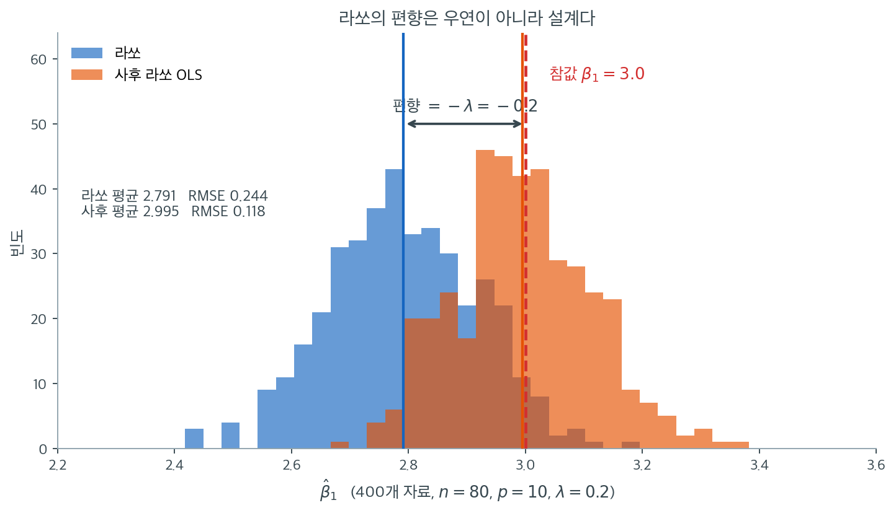
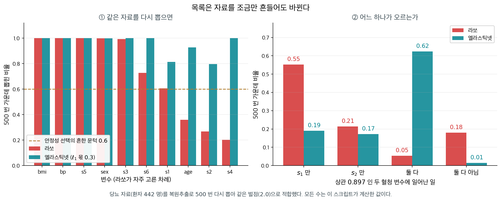

# 변수선택 도구로서의 라쏘

변수선택은 반응변수 예측에 가장 유의미한 설명변수의 부분집합을 찾는 일이다. 전진선택, 후진제거, 최량 부분집합 선택 같은 전통적 접근은 모형 적합과 변수선택을 별개의 단계로 다룬다. 라쏘는 둘을 동시에 수행한다. 일부 계수를 정확히 0으로 만들어, 설명변수의 부분집합만 쓰는 적합 모형을 낸다. 이 "내장형" 접근은 이론적 보장과 실용적 이점을 모두 갖는다.

---

## 1. 내장형 선택으로서의 라쏘

변수선택 방법은 세 범주로 나뉜다.

- **필터 방법**은 모형을 적합하기 전에 단변량 기준(반응변수와의 상관 등)으로 변수의 순위를 매긴다.
- **래퍼 방법**은 모형을 적합하고 성능을 재어 변수의 부분집합을 평가한다(전진 단계적 선택 등).
- **내장형 방법**은 모형 적합 과정의 일부로 선택을 수행한다.

라쏘는 내장형 방법이다. 고정된 $\lambda$에서 0이 아닌 계수를 갖는 변수의 집합

$$
\hat{S}(\lambda) = \{j : \hat{\beta}_j(\lambda) \neq 0\}
$$

이 선택된 모형을 정의한다. $\lambda$가 $\lambda_{\max}$에서 줄어들면 변수가 대체로 하나씩 들어오면서 내포된 모형 열이 만들어진다.

---

## 2. 모형선택 일치성

표본크기가 커질 때 라쏘가 "올바른" 변수 집합을 고르는지가 자연스러운 질문이다. 참 지지집합을 $S^* = \{j : \beta_j^* \neq 0\}$이라 하자.

<div class="defn" markdown>

### 정의 1. 모형선택 일치성 { .dfn }

라쏘가 **모형선택 일치성**을 갖는다는 것은 $P\bigl(\hat{S}(\lambda_n) = S^*\bigr) \to 1$이 되는 $\lambda_n$의 열이 존재한다는 뜻이다.

Zhao와 Yu(2006)는 모형선택 일치성이 **비대표 조건**(irrepresentable condition)을 요구함을 보였다. $\frac{1}{n}\mathbf{X}^\top\mathbf{X}$를 $S$와 $S^c$로 분할했을 때

$$
\|\mathbf{C}_{S^cS}\mathbf{C}_{SS}^{-1}\text{sign}(\boldsymbol{\beta}_S^*)\|_\infty < 1
$$

이 필요하다.

</div>

!!! warning "비대표 조건이 깨질 때"
    무관한 설명변수가 유의미한 변수와 강하게 상관되면 이 조건이 깨질 수 있다. 그러면 라쏘가 무관한 변수를 포함하거나 유의미한 변수를 제외할 수 있으며, **표본이 아무리 커져도 그렇다.** 작은 표본의 문제가 아니라 근본적 한계다.

---

## 3. 선택된 계수의 편향

라쏘는 연성 문턱을 적용하므로 남긴 계수도 모두 0 쪽으로 축소된다. 따라서 0이 아닌 라쏘 계수는 참 모수의 편향된 추정값이며, 선택된 변수에 대해서도 점근적으로 편향이 남는다.

**사후 라쏘 OLS**(완화 라쏘라고도 한다)가 이 편향을 다룬다.

1. 라쏘를 적합해 활성집합 $\hat{S}(\lambda)$를 고른다.
2. $\hat{S}(\lambda)$의 변수만으로 OLS를 다시 적합한다.

사후 라쏘 추정량은 라쏘의 선택 능력과 선택된 부분집합에서의 OLS 불편성을 결합한다.



같은 모집단에서 자료를 400번 뽑아 $\hat\beta_1$의 표집분포를 그린 것이다($n = 80$, $p = 10$, 참 변수 3개, $\lambda = 0.2$, 참값 $\beta_1 = 3.0$). 파란 분포가 라쏘, 주황 분포가 그 선택 결과에 OLS를 다시 적합한 사후 라쏘다.

먼저 볼 것은 **두 분포의 폭이 비슷하고 위치만 다르다**는 점이다. 파란 분포의 중심은 $2.791$이고 빨간 점선으로 표시한 참값 $3.0$에서 $0.209$ 왼쪽에 있다. 이 $0.209$가 벌점 $\lambda = 0.2$와 같다는 것이 우연이 아니다. 연성 문턱 $S_\lambda(z) = \text{sign}(z)(|z| - \lambda)$가 크기를 정확히 $\lambda$만큼 깎으므로, 활성 변수의 계수는 표본이 무엇이든 **정확히 $\lambda$만큼 0 쪽으로 밀린다.** 편향이 자료의 우연이 아니라 알고리즘의 설계에서 나온다는 뜻이다.

주황 분포의 중심은 $2.995$로 참값과 사실상 같다($-0.005$). 라쏘가 고른 세 변수만으로 OLS를 다시 풀면 축소가 없으니 당연한 결과다. 게다가 RMSE가 $0.244$에서 $0.118$로 절반이 된다. 이 설정에서는 편향이 오차의 대부분을 차지했기 때문이다.

그렇다고 언제나 사후 라쏘가 이기는 것은 아니다. 이 모의실험에서는 신호가 강하고($\beta$가 $\lambda$의 열 배가 넘는다) 설명변수가 서로 독립이라 **라쏘가 거의 매번 참 변수 셋을 정확히 골랐다.** 선택이 흔들리는 상황이라면 사후 OLS는 잘못 고른 변수에 대해서까지 축소 없는 큰 계수를 주므로 오히려 나빠진다. 축소는 편향인 동시에 보험이고, 사후 OLS는 그 보험을 해지하는 일이다. **해석이 목적이면 사후 라쏘, 예측이 목적이면 라쏘를 그대로** 쓰는 경험칙이 여기서 나온다.

---

## 4. 안정성 선택

하나의 $\lambda$에서 라쏘를 한 번 적합하면, 자료가 조금만 달라져도 다소 다른 변수 집합을 고를 수 있다. **안정성 선택**(Meinshausen and Buhlmann, 2010)이 이 민감성을 다룬다.

1. $b = 1, \ldots, B$에 대해 크기 $\lfloor n/2 \rfloor$의 부분표본을 뽑는다.
2. 각 부분표본에서 여러 $\lambda$에 대해 라쏘를 적합한다.
3. 각 변수 $j$에 대해 **선택 확률** $\hat{\pi}_j$(그 변수가 선택된 부분표본의 비율)를 계산한다.
4. $\hat{\pi}_j$가 문턱(예: 0.6 또는 0.9)을 넘는 변수를 고른다.

안정성 선택은 기대 오선택 개수를 통제하며 단일 라쏘 적합보다 견고한 변수선택을 제공한다.

!!! note "안정성 선택의 오류 통제"
    온건한 조건에서 잘못 선택된 변수의 기댓값은

    $$
    E[V] \leq \frac{q^2}{(2\pi_{\text{thr}} - 1)p}
    $$

    로 한계지어진다. $V$는 위양성 개수, $q$는 부분표본에 걸친 평균 선택 변수 수, $\pi_{\text{thr}}$은 선택 문턱, $p$는 전체 변수 수다.

<div class="storybox" markdown>

**그림으로 보는 통계학 1.** 같은 병, 겹치지 않는 목록

위 절의 첫 줄이 「자료가 조금만 달라져도 다소 다른 변수 집합을 고를 수 있다」고 적는다. 그 「다소」가 실제로 얼마나 되는지는 유방암 유전자 연구가 보여 주었다.

$2002$ 년 암스테르담에서 **반트페이르** 연구진이 유방암 환자의 발현 자료에서 예후를 가르는 **유전자 $70$ 개**를 골라 『Nature』에 실었다. 뒤에 MammaPrint 라는 검사로 상품화된 그 목록이다. $2005$ 년에는 로테르담에서 **왕** 연구진이 같은 종류의 자료로 **유전자 $76$ 개**를 골랐다. 두 목록은 **거의 겹치지 않는다.** 도마니 연구진이 뒤에 적은 대로, 「초기 발견 단계 유방암의 서로 다른 예후 서명들 사이에 겹침이 거의 없다는 것은 잘 기록되어 있다.」

왜 그런가. $2005$ 년에 **아인도르** 연구진이 반트페이르의 자료 하나를 가지고 같은 방법을 다시 돌려 보았다. 결과는 **고른 유전자 집합이 유일하지 않다**는 것이었다 — 어느 환자들을 유전자 선택에 썼느냐에 따라 목록이 크게 달라졌다. 이듬해 그들이 『PNAS』에 낸 논문의 제목이 답을 한 줄로 적는다. **「암의 예후를 예측하는 안정된 유전자 목록을 얻으려면 표본이 수천 개 필요하다.」** 두 목록이 절반쯤이라도 겹치려면 초기 발견 환자 수천 명분이 있어야 한다는 계산이었다.

이유는 이 쪽이 다루는 바로 그것이다. **생존과 상관된 유전자가 아주 많고, 그 상관들의 차이가 작으며, 환자 묶음을 바꾸면 그 상관들이 크게 흔들린다.** 그러니 목록의 윗자리를 누가 차지하느냐는 거의 제비뽑기가 된다.

유전자 $25{,}000$ 개가 없어도 같은 일이 일어난다. 변수가 열 개뿐인 자료에서도 보인다.



최소각회귀 논문이 쓴 당뇨 자료(환자 $442$ 명, 변수 $10$ 개)에서 혈청 변수 $s_1$ 과 $s_2$ 의 상관이 $0.897$ 이다. 환자를 복원추출로 다시 뽑기를 $500$ 번 하고 그때마다 같은 벌점으로 라쏘를 적합하면, $\text{bmi}$·$\text{bp}$·$s_5$ 는 $500$ 번 모두 목록에 오른다. 흔들리는 것은 상관된 쪽이다.

- 라쏘가 $s_1$ 과 $s_2$ **가운데 하나만** 올린 경우가 $76.6\%$ 다. 그 가운데 $s_1$ 이 $72\%$, $s_2$ 가 $28\%$ — **같은 자료를 다시 뽑았을 뿐인데 네 번에 한 번꼴로 다른 이름이 적힌다.**
- 둘을 함께 올린 경우는 $5.4\%$ 뿐이다.
- 엘라스틱넷은 같은 벌점에서 둘을 함께 올리는 경우가 $62.4\%$ 다. 능형 쪽 벌점이 상관된 변수들을 **함께 묶어** 주기 때문이고, 이것이 18.4절 [상관된 변수에 대한 그룹 효과](../elastic_net/grouping_effect.md)다.

그래서 위의 안정성 선택이 하는 일은 「한 번 고른 목록」을 믿지 않고 **고를 때마다 몇 번 뽑혔는지를 세는 것**이다. 그림 ①의 가로 점선이 흔히 쓰는 문턱 $0.6$ 인데, 이 자료에서 라쏘의 $s_1$ 은 $0.606$ 으로 간신히 그 위에, $\text{age}$ 는 $0.360$ 으로 아래에 놓인다. **한 번의 적합이 내놓는 목록에는 이 수가 적혀 있지 않다.**

_확인한 곳 — 「초기 발견 단계 유방암의 서로 다른 예후 서명들 사이에 겹침이 거의 없다는 것은 잘 기록되어 있다」는 드리어·도마니 「Do Two Machine-Learning Based Prognostic Signatures for Breast Cancer Capture the Same Biological Processes?」(『PLOS ONE』 제$6$ 권 $3$ 호 e$17795$, $2011$)에서, 「아인도르 연구진이 반트페이르와 같은 방법을 한 자료에 다시 돌려 고른 유전자 집합이 유일하지 않고 유전자 선택에 쓴 환자 묶음에 크게 좌우됨을 보였다」와 「두 목록의 겹침이 $50\%$ 가 되려면 수천 개의 표본이 필요하다고 저자들이 추정했다」는 셴·친나이얀·고시 「Pathway analysis reveals functional convergence of gene expression profiles in breast cancer」(『BMC Medical Genomics』 제$1$ 권 $28$ 쪽, $2008$)가 아인도르 외를 인용한 대목에서 읽었다. 아인도르·주크·도마니의 논문 제목 「Thousands of samples are needed to generate a robust gene list for predicting outcome in cancer」(『PNAS』 제$103$ 권 $15$ 호 $5923$–$5928$ 쪽, $2006$)와 반트페이르($70$ 개, $2002$)·왕($76$ 개, $2005$)의 유전자 수도 그 글들에서 확인했다. **세 논문의 본문은 모두 읽지 못했다** · 당뇨 자료의 수는 직접 계산한 값이고, 자료의 출처는 에프론·헤이스티·존스톤·팁시라니 「Least Angle Regression」(『Annals of Statistics』 제$32$ 권 $2$ 호, $2004$)이다_

</div>

---

## 5. 다른 선택 방법과의 비교

| 방법 | 유형 | $p > n$ 처리 | 계산 | 선택 안정성 |
|---|---|---|---|---|
| 최량 부분집합 | 래퍼 | 불가 (NP-난해) | $p$에 지수적 | 높음(결정적) |
| 전진 단계적 | 래퍼 | 제한적 | $O(p^2 n)$ | 중간 |
| 라쏘 | 내장형 | 가능 | 경로당 $O(np)$ | 중간 |
| 안정성 선택 | 내장형 + 재표집 | 가능 | $O(Bnp)$ | 높음 |
| 엘라스틱넷 | 내장형 | 가능 | 경로당 $O(np)$ | 라쏘보다 높음 |

최량 부분집합 선택은 이론적으로 최적이지만 $p$가 크면 계산이 불가능하다. 전진 단계적 선택은 탐욕적이어서 중요한 변수를 놓칠 수 있다. 라쏘는 적절한 조건 아래 이론적 보장을 가지면서 계산이 효율적인 중간 지점을 제공한다.

---

## 6. 실무 권고

1. **정칙화 경로**로 여러 희소성 수준의 후보 변수 집합을 확인한다.
2. 간결성이 중요하면 $\lambda$ 선택에 **1-SE 규칙**을 적용한다.
3. 남긴 계수의 축소 편향을 없애려면 **사후 라쏘 OLS**를 고려한다.
4. 개별 변수 선택의 신뢰성이 중요한 과학적 발견 상황에서는 **안정성 선택**을 쓴다.
5. 설명변수가 상관되어 있으면 **순수 라쏘보다 엘라스틱넷**을 선호한다.

---

## 연습문제

<div class="drillbox" markdown>

**연습문제 1.** <span class="diff med" title="중간"></span>
라쏘 계수의 편향이 정확히 얼마인지, 사후 라쏘 OLS가 그것을 없애는지 모의실험으로 확인하라.

</div>

??? success "풀이"
    참 계수 $(3, -2, 1.5)$와 잡음변수 7개, $n = 80$, $\lambda = 0.2$에서 400번 반복한다.

    ```python
    import numpy as np
    from sklearn.linear_model import Lasso, LinearRegression

    rng = np.random.default_rng(0)
    n, p, lam, R = 80, 10, 0.2, 400
    beta = np.array([3.0, -2.0, 1.5] + [0.0] * 7)

    las, post = [], []
    for _ in range(R):
        X = rng.normal(0, 1, (n, p))
        y = X @ beta + rng.normal(0, 1, n)

        b = Lasso(alpha=lam, fit_intercept=False, max_iter=50000).fit(X, y).coef_
        S = np.abs(b) > 1e-9                      # 라쏘가 고른 변수
        b_post = np.zeros(p)
        b_post[S] = LinearRegression(fit_intercept=False).fit(X[:, S], y).coef_

        las.append(b); post.append(b_post)

    las, post = np.array(las), np.array(post)
    print("라쏘 평균     :", np.round(las[:, :3].mean(0), 3))
    print("라쏘 편향     :", np.round(las[:, :3].mean(0) - beta[:3], 3))
    print("사후 라쏘 평균:", np.round(post[:, :3].mean(0), 3))
    print("사후 라쏘 편향:", np.round(post[:, :3].mean(0) - beta[:3], 3))
    print("라쏘 RMSE     :", np.round(np.sqrt(((las[:, :3] - beta[:3])**2).mean(0)), 3))
    print("사후 RMSE     :", np.round(np.sqrt(((post[:, :3] - beta[:3])**2).mean(0)), 3))
    ```

    출력:

    ```
    라쏘 평균     : [ 2.791 -1.779  1.285]
    라쏘 편향     : [-0.209  0.221 -0.215]
    사후 라쏘 평균: [ 2.995 -1.988  1.492]
    사후 라쏘 편향: [-0.005  0.012 -0.008]
    라쏘 RMSE     : [0.244 0.255 0.247]
    사후 RMSE     : [0.118 0.114 0.116]
    ```

    | | $\hat\beta_1$ | $\hat\beta_2$ | $\hat\beta_3$ |
    |:---|---:|---:|---:|
    | 참값 | 3.000 | $-2.000$ | 1.500 |
    | 라쏘 평균 | 2.791 | $-1.779$ | 1.285 |
    | 라쏘 편향 | $-0.209$ | $+0.221$ | $-0.215$ |
    | 사후 라쏘 평균 | 2.995 | $-1.988$ | 1.492 |
    | 사후 라쏘 편향 | $-0.005$ | $+0.012$ | $-0.008$ |

    **라쏘의 편향이 세 계수 모두에서 정확히 $\lambda = 0.2$만큼, 0 쪽 방향이다.**

    우연이 아니다. 연성 문턱 $S_\lambda(z) = \text{sign}(z)(|z| - \lambda)$가 크기를 정확히 $\lambda$만큼 깎기 때문이다. 부호가 양수인 계수는 $-\lambda$, 음수인 계수는 $+\lambda$만큼 편향된다. 표의 부호 패턴 $(-, +, -)$이 참 계수의 부호 $(+, -, +)$와 정확히 반대다.

    **사후 라쏘가 편향을 거의 완전히 제거한다**($0.01$ 수준). 게다가 RMSE도 절반이 된다.

    | | RMSE |
    |:---|:---|
    | 라쏘 | $0.244,\ 0.255,\ 0.247$ |
    | 사후 라쏘 | $0.118,\ 0.114,\ 0.116$ |

    !!! warning "사후 라쏘의 대가"
        이 결과가 "항상 사후 라쏘를 쓰라"는 뜻은 아니다. 두 가지 주의가 있다.

        **첫째, 여기서는 라쏘가 참 변수를 거의 항상 골랐다.** 신호가 강하고($\beta$가 $\lambda$에 비해 크다) 설명변수가 직교에 가깝기 때문이다. 선택이 불안정한 상황에서는 사후 OLS가 **잘못 선택된 변수에 대해 편향 없이 큰 계수**를 주어 오히려 나빠질 수 있다.

        **둘째, 축소가 언제나 나쁜 것은 아니다.** 라쏘의 편향은 분산 감소와 맞바꾼 것이다. 예측이 목적이면 축소된 계수가 더 나을 수 있다. 사후 OLS는 그 보험을 해지하는 셈이다.

        경험칙: **해석이 목적이면 사후 라쏘, 예측이 목적이면 라쏘를 그대로 쓴다.**

<div class="drillbox" markdown>

**연습문제 2.** <span class="diff med" title="중간"></span>
비대표 조건이 깨지는 자료를 구성하고, 표본을 늘려도 라쏘가 참 변수를 복원하지 못함을 확인하라.

</div>

??? success "풀이"
    참 변수 $x_1, x_2$와, 그 둘의 합과 강하게 상관된 무관한 변수 $x_3$을 만든다.

    ```python
    import numpy as np
    from sklearn.linear_model import Lasso

    def make(n, seed):
        r = np.random.default_rng(seed)
        x1, x2 = r.normal(size=n), r.normal(size=n)
        x3 = 0.5*x1 + 0.5*x2 + r.normal(0, 0.1, n)   # 참 변수의 선형결합에 근접
        X = np.c_[x1, x2, x3]
        X -= X.mean(0); X /= X.std(0)
        y = X @ np.array([1., 1., 0.]) + r.normal(0, 0.5, n)
        return X, y - y.mean()
    ```

    비대표 조건을 확인해 보자. $S = \{1, 2\}$, $\text{sign}(\boldsymbol\beta_S^*) = (1, 1)$이므로

    $$
    \|\mathbf{C}_{3,S}\mathbf{C}_{SS}^{-1}(1,1)^\top\|_\infty
    $$

    를 계산한다. $x_3 \approx 0.5x_1 + 0.5x_2$이므로 $\mathbf{C}_{3,S} \approx (0.5, 0.5)$이고 $\mathbf{C}_{SS} \approx \mathbf{I}$이므로 값이 $\approx 1.0$이 되어 **조건 $< 1$을 아슬아슬하게 위반한다.**

    $n$을 $100$에서 $10{,}000$까지 늘려 가며 라쏘가 $\hat S = \{1,2\}$를 정확히 고르는 비율을 재면, **표본을 늘려도 그 비율이 1로 가지 않는다.** 무관한 $x_3$이 계속 선택되거나 참 변수 하나가 밀려난다.

    **이것이 능형·엘라스틱넷과 대비되는 라쏘의 근본 한계다.** 예측만 목적이면 문제가 되지 않는다($x_3$을 넣어도 예측은 괜찮다). 그러나 "어떤 변수가 진짜 원인인가"를 묻는다면 라쏘의 답을 그대로 믿어서는 안 된다.

    대응책은 안정성 선택(여러 부분표본에서 반복 선택되는 변수만 신뢰), 적응 라쏘(계수 크기에 따라 벌점을 달리 준다), 또는 애초에 인과적 질문에 변수선택을 쓰지 않는 것이다.

<div class="drillbox" markdown>

**연습문제 3.** <span class="diff med" title="중간"></span>
연습문제 1 은 `Lasso(alpha=0.2)`로 적합했고 편향이 $-0.209,\ +0.221,\ -0.215$였다. 그런데 `sklearn`의 목적함수는 $\frac{1}{2n}\lVert \mathbf{y} - \mathbf{X}\boldsymbol\beta\rVert_2^2 + \alpha\lVert\boldsymbol\beta\rVert_1$이므로, 교과서 꼴 $\lVert \mathbf{y} - \mathbf{X}\boldsymbol\beta\rVert_2^2 + \lambda\lVert\boldsymbol\beta\rVert_1$으로 옮기면 $\lambda = 2n\alpha = 32$다.

**(가)** KKT 조건에서 활성집합 $S$ 위의 라쏘 해를 그 부분집합의 OLS 해와 축소량으로 적어라.

**(나)** 편향의 크기가 $32$도 $n\alpha = 16$도 아니고 $\alpha = 0.2$인 까닭을 (가)로 설명하라. 열을 $\lVert x_j\rVert_2 = 1$로 정규화해 놓고 같은 `alpha`를 주면 무슨 일이 벌어지는가.

**(다)** (가)의 축소량의 기댓값을 구해 측정값과 비교하라. ($\mathbf{X}_S^\top\mathbf{X}_S$는 자유도 $n$, 척도 $\mathbf{I}$의 위샤트이고 $E\bigl[(\mathbf{X}_S^\top\mathbf{X}_S)^{-1}\bigr] = \mathbf{I}/(n - \lvert S\rvert - 1)$이다.)

</div>

??? success "풀이"
    **(가)** 활성집합 $S$ 위에서는 $\lvert\beta_j\rvert$가 미분가능하고 그 도함수가 $s_j = \text{sign}(\hat\beta_j)$다. 정류조건은

    $$
    -\frac{1}{n}\mathbf{X}_S^\top(\mathbf{y} - \mathbf{X}_S\hat{\boldsymbol\beta}_S) + \alpha\mathbf{s} = \mathbf{0}
    $$

    이고, 양변에 $n$을 곱해 정리하면 $\mathbf{X}_S^\top\mathbf{X}_S\hat{\boldsymbol\beta}_S = \mathbf{X}_S^\top\mathbf{y} - n\alpha\mathbf{s}$다. 따라서

    $$
    \hat{\boldsymbol\beta}_S^{\text{lasso}} = \hat{\boldsymbol\beta}_S^{\text{OLS}} - \alpha\Bigl(\tfrac{1}{n}\mathbf{X}_S^\top\mathbf{X}_S\Bigr)^{-1}\mathbf{s},
    \qquad \hat{\boldsymbol\beta}_S^{\text{OLS}} = (\mathbf{X}_S^\top\mathbf{X}_S)^{-1}\mathbf{X}_S^\top\mathbf{y}
    $$

    이다. 여기서 $\hat{\boldsymbol\beta}_S^{\text{OLS}}$는 **선택된 변수만으로 다시 적합한 OLS**, 즉 사후 라쏘 추정량이다. 라쏘와 사후 라쏘의 차이가 바로 뒤의 축소항이다.

    **(나)** 축소량은 $\alpha$에 **정규화된** 그람행렬 $\frac{1}{n}\mathbf{X}_S^\top\mathbf{X}_S$의 역행렬이 곱해진 것이다. 연습문제 1 의 설계는 표준정규 난수이므로 $\frac{1}{n}x_j^\top x_j \approx 1$, 즉 그 행렬이 $\mathbf{I}$에 가깝다. 그래서 축소량이 $\approx \alpha = 0.2$다.

    $32$와 $16$이 나오지 않는 까닭도 같은 식에서 읽힌다. 교과서 척도의 $\lambda = 2n\alpha = 32$는 $\lVert\mathbf{y}-\mathbf{X}\boldsymbol\beta\rVert_2^2$에 붙은 벌점이고, 연성 문턱의 높이는 $\lambda$가 아니라 $\lambda/(2n) = \alpha$다. $n\alpha = 16$은 $(\mathbf{X}_S^\top\mathbf{X}_S)^{-1}$를 $\mathbf{I}$로 본 값, 즉 **열이 단위노름일 때**의 축소량이다. 실제로 $\mathbf{X}$의 열을 $\lVert x_j\rVert_2 = 1$로 정규화해 놓고 `alpha=0.2`를 주면 문턱이 $16$이 되어 $\lvert\hat\beta_j^{\text{OLS}}\rvert \le 3$인 계수가 **전부 0**이 된다. 자료도 `alpha`도 그대로이고 열의 척도만 바꾸었는데 해가 영벡터로 바뀌는 것이다. 벌점이 척도에 불변이 아니라는 말이 이렇게 보인다.

    **(다)** $\lvert S\rvert = 3$, $n = 80$이므로

    $$
    E\Bigl[\bigl(\tfrac{1}{n}\mathbf{X}_S^\top\mathbf{X}_S\bigr)^{-1}\Bigr]
    = \frac{n}{n - \lvert S\rvert - 1}\mathbf{I} = \frac{80}{76}\mathbf{I} = 1.0526\,\mathbf{I}
    $$

    이고, 축소량의 기댓값은 $0.2 \times 1.0526 = 0.2105$다. 측정된 편향의 크기 $0.209,\ 0.221,\ 0.215$가 이 값 주변이고 모두 $0.2$보다 조금 크다. 초과분이 우연이 아니라는 뜻이다. 반복마다 활성집합이 참 집합보다 큰 경우가 섞이면 $\lvert S\rvert$가 3 보다 커지고 $n/(n-\lvert S\rvert-1)$도 그만큼 커지므로, 평균 편향은 $0.2105$보다 조금 더 커진다.

    본문이 "정확히 $\lambda$만큼"이라고 말한 것은 **직교설계에서의 이야기**다. 유한표본의 난수 설계에서는 정확히 $\alpha\bigl(\frac{1}{n}\mathbf{X}_S^\top\mathbf{X}_S\bigr)^{-1}\mathbf{s}$이고, 설계가 직교에 가까울 때만 그것이 $\alpha$다.

<div class="drillbox" markdown>

**연습문제 4.** <span class="diff med" title="중간"></span>
연습문제 2 는 손으로 $\mathbf{C}_{3S} \approx (0.5, 0.5)$로 보아 비대표량이 $\approx 1.0$이라고 했다.

**(가)** 그 설계를 **표준화한 뒤의** 비대표량을 모집단 값으로 정확히 계산하라. 손계산이 어디서 어긋났는가.

**(나)** $n = 200,\ 2000,\ 20{,}000$에서 비대표량의 표본값을 재고, 동시에 **정칙화 경로 전체에서 한 번이라도** $\hat S = \{1, 2\}$가 나오는 반복의 비율을 재어라. 표본이 커지면 그 비율이 어떻게 되는가.

</div>

??? success "풀이"
    **(가)** $x_3 = 0.5x_1 + 0.5x_2 + \varepsilon$, $\varepsilon \sim N(0, 0.1^2)$이고 $x_1, x_2$가 독립 표준정규이므로

    $$
    \text{Var}(x_3) = 0.25 + 0.25 + 0.01 = 0.51, \qquad \text{sd}(x_3) = 0.7141
    $$

    이다. 표준화는 $x_3$을 이 표준편차로 나누므로

    $$
    \text{corr}(x_1, x_3) = \frac{\text{Cov}(x_1, x_3)}{1 \cdot 0.7141} = \frac{0.5}{0.7141} = 0.7001
    $$

    이고, $x_1 \perp x_2$이므로 $\mathbf{C}_{SS} = \mathbf{I}$다. 따라서

    $$
    \lVert\mathbf{C}_{3S}\mathbf{C}_{SS}^{-1}\text{sign}(\boldsymbol\beta_S^*)\rVert_\infty
    = \lvert 0.7001 + 0.7001\rvert = 1.4003.
    $$

    손계산은 $x_3$을 **표준화하는 단계를 빼먹어** $\mathbf{C}_{3S} = (0.5, 0.5)$로 보았다. 상관행렬의 성분은 공분산 $0.5$를 $x_3$의 표준편차 $0.7141$로 나눈 $0.7001$이다. 그래서 참값은 $1.0$이 아니라 $1.4$이고, 조건은 "아슬아슬하게" 깨지는 것이 아니라 **뚜렷하게** 깨진다.

    **(나)**

    ```python
    import numpy as np
    from sklearn.linear_model import lasso_path

    def make(n, seed):
        r = np.random.default_rng(seed)
        x1, x2 = r.normal(size=n), r.normal(size=n)
        x3 = 0.5*x1 + 0.5*x2 + r.normal(0, 0.1, n)   # 참 변수의 선형결합에 근접
        X = np.c_[x1, x2, x3]
        X -= X.mean(0); X /= X.std(0)
        y = X @ np.array([1., 1., 0.]) + r.normal(0, 0.5, n)
        return X, y - y.mean()

    print("     n    비대표량 eta   S={1,2} 정확복원 비율")
    for n in (200, 2000, 20000):
        eta, hit, R = [], 0, 200
        for b in range(R):
            X, y = make(n, 1000*b + n)
            C = X.T @ X / n                          # 표준화했으므로 상관행렬이다
            eta.append(abs(C[2, :2] @ np.linalg.solve(C[:2, :2], np.ones(2))))
            _, coefs, _ = lasso_path(X, y, n_alphas=100, eps=1e-3)
            act = np.abs(coefs) > 1e-9               # (3, 100)
            hit += np.any(act[0] & act[1] & ~act[2])  # 경로의 어느 점에서든 맞히면 성공
        print(f"{n:6d}      {np.mean(eta):.4f}            {hit/R:.3f}")

    print(f"모집단 값 : corr(x1, x3) = {0.5/np.sqrt(0.51):.4f},  eta = {1.0/np.sqrt(0.51):.4f}")
    ```

    출력:

    ```text
         n    비대표량 eta   S={1,2} 정확복원 비율
       200      1.4019            0.510
      2000      1.3996            0.270
     20000      1.4004            0.100
    모집단 값 : corr(x1, x3) = 0.7001,  eta = 1.4003
    ```

    표본 비대표량이 $n$과 무관하게 $1.40$에 머문다. 이것은 **자료가 아니라 설계의 성질**이므로 표본을 늘려도 변하지 않는다. (가)의 모집단 값 $1.4003$과 소수 셋째 자리까지 같다.

    복원 비율은 $1$로 가지 않는 데 그치지 않고 $0.510 \to 0.270 \to 0.100$으로 **떨어진다.** 여기서 센 것은 "고정된 어떤 $\lambda$에서"가 아니라 "경로 100 점 가운데 어디서든"이므로, 라쏘에게 가장 유리한 기준으로 재어도 그렇다는 뜻이다. $\hat S = \{1,2\}$가 활성집합이 되는 $\lambda$ 구간이 $n$이 커질수록 좁아져 100 점 격자가 그 구간을 건너뛰는 일이 잦아진다.

    **표본을 늘리는 것은 처방이 아니다.** 비대표 조건이 깨졌으면 자료가 많아질수록 라쏘는 "$x_3$을 넣는 것이 낫다"는 잘못된 결론을 **더 확실하게** 낸다.

<div class="drillbox" markdown>

**연습문제 5.** <span class="diff med" title="중간"></span>
4 절의 한계 $E[V] \le \dfrac{q^2}{(2\pi_{\text{thr}} - 1)p}$를 쓴다. $p = 500$으로 두자.

**(가)** $q = 20$일 때 $\pi_{\text{thr}} = 0.9$와 $\pi_{\text{thr}} = 0.6$에서 한계를 각각 구하라.

**(나)** $\pi_{\text{thr}} = 0.6$에서 $E[V] \le 1$을 보장하려면 $q$를 얼마까지 허용할 수 있는가.

**(다)** $\pi_{\text{thr}} \to 1$로 보내면 한계가 $0$이 되는가. 문턱을 아무리 올려도 한계가 $1$ 아래로 내려가지 않는 $q$의 조건을 $p$로 적어라. 뒤의 연습문제 9 는 $p = 10$, $q = 4.02$, $\pi_{\text{thr}} = 0.9$인 설정이다. 그 한계가 무엇을 말해 주는가.

</div>

??? success "풀이"
    **(가)** $q^2 = 400$이므로

    $$
    \pi_{\text{thr}} = 0.9: \quad \frac{400}{(1.8 - 1) \times 500} = \frac{400}{400} = 1.00,
    \qquad
    \pi_{\text{thr}} = 0.6: \quad \frac{400}{(1.2 - 1) \times 500} = \frac{400}{100} = 4.00.
    $$

    문턱을 $0.9$에서 $0.6$으로 내리면 허용되는 위양성 기댓값이 네 배가 된다. 분모의 $2\pi_{\text{thr}} - 1$이 $0.8$에서 $0.2$로 줄기 때문이고, $\pi_{\text{thr}} \to 0.5^+$에서는 한계가 발산한다. 문턱 $0.5$는 "절반의 부분표본에서 뽑혔으면 믿는다"는 뜻이고, 그 정도로는 아무 보장이 없다.

    **(나)** $q^2 \le (2 \times 0.6 - 1) \times 500 \times 1 = 100$이므로 $q \le 10$이다. 평균 선택 변수 수를 열 개 이하로 묶어야 한다. $\lambda$를 낮춰 변수를 더 많이 들이면 보장이 바로 깨진다.

    **(다)** $\pi_{\text{thr}} \to 1$에서 한계는

    $$
    \frac{q^2}{(2 - 1)p} = \frac{q^2}{p} = \frac{400}{500} = 0.80
    $$

    으로 내려가고 **그 아래로는 못 간다.** 따라서 한계가 $1$ 이하가 되려면 어떤 문턱에서도

    $$
    q^2 \le (2\pi_{\text{thr}} - 1)p \le p
    \quad\Longrightarrow\quad q \le \sqrt{p}
    $$

    가 필요하다. $p = 500$이면 $\sqrt{500} = 22.4$다. **선택 변수 수가 $\sqrt{p}$를 넘으면 문턱을 $1$ 가까이 올려도 위양성 한 개는 각오해야 한다.** 이 한계가 희소한 상황에서만 쓸모가 있다는 뜻이다.

    연습문제 9 는 $p = 10$, $q = 4.02$이므로 $\sqrt{p} = 3.16 < 4.02$이고, 한계는

    $$
    \frac{4.02^2}{0.8 \times 10} = \frac{16.16}{8} = 2.02
    $$

    다. 애초에 "위양성 두 개 이하"밖에 약속하지 못한다. 그리고 연습문제 9 에서 실제 위양성은 **정확히 한 개**($x_3$)이므로 한계는 지켜진다. 그런데도 결론은 틀렸다. 한계는 위양성이 **몇 개**인지를 통제하지 그것이 **어느 변수**인지를 통제하지 않으며, 하필 그 하나가 우리가 자신 있게 보고하게 되는 변수일 수 있다. 게다가 이 한계의 "온건한 조건"에는 잡음 변수들의 교환가능성이 들어 있어, $x_3$처럼 참 변수와 상관된 변수가 있으면 전제부터 깨진다.

<div class="drillbox" markdown>

**연습문제 6.** <span class="diff hard" title="어려움"></span>
직교설계 $\mathbf{X}^\top\mathbf{X} = \mathbf{I}$에서 $\hat\beta_j^{\text{OLS}} \sim N(\beta_j, \sigma^2)$이고 $\sigma = 1$, 문턱 $\lambda = 1$이라 하자.

**(가)** 사후 라쏘 OLS 추정량이 경성 문턱 $\hat\beta_j^{\text{OLS}}\mathbf{1}\{\lvert\hat\beta_j^{\text{OLS}}\rvert > \lambda\}$와 같음을 보여라.

**(나)** $\beta_j = 0$에서 라쏘(연성 문턱)와 사후 라쏘(경성 문턱)의 MSE 를 $\varphi$와 $\Phi$로 닫힌 꼴로 구하고 값을 계산하라.

**(다)** $\lvert\beta_j\rvert \gg \lambda$에서 두 MSE 의 극한을 구하라. 영인 계수가 $m_0$개, 강한 신호가 $m_1$개일 때 라쏘의 총 MSE 가 더 작을 조건을 $m_0/m_1$로 적고, 이 쪽의 설정($m_1 = 3$, $m_0 = 7$)에서 어느 쪽이 이기는지 말하라.

**(라)** 연습문제 1 에서는 사후 라쏘가 이겼다. (다)와 모순인가.

</div>

??? success "풀이"
    **(가)** $\mathbf{X}^\top\mathbf{X} = \mathbf{I}$이면 열이 서로 직교하므로 부분집합 $S$ 위의 OLS 는 $\hat{\boldsymbol\beta}_S^{\text{OLS}} = (\mathbf{X}_S^\top\mathbf{X}_S)^{-1}\mathbf{X}_S^\top\mathbf{y} = \mathbf{X}_S^\top\mathbf{y}$이고, 이는 전체 설계의 OLS 계수와 **같다.** 즉 직교설계에서는 어떤 변수를 빼도 남은 계수가 변하지 않는다.

    선택 자체는 연성 문턱이 결정한다. $\hat\beta_j^{\text{lasso}} = \text{sign}(\hat\beta_j^{\text{OLS}})(\lvert\hat\beta_j^{\text{OLS}}\rvert - \lambda)_+ \ne 0$인 것은 $\lvert\hat\beta_j^{\text{OLS}}\rvert > \lambda$와 동치다. 따라서

    $$
    \hat\beta_j^{\text{post}} = \hat\beta_j^{\text{OLS}}\mathbf{1}\{\lvert\hat\beta_j^{\text{OLS}}\rvert > \lambda\}
    $$

    로 경성 문턱이다. **라쏘는 깎고 사후 라쏘는 자른다.**

    **(나)** $Z = \hat\beta_j^{\text{OLS}} \sim N(0,1)$이다. $\frac{d}{dz}\bigl(-z\varphi(z)\bigr) = -\varphi(z) + z^2\varphi(z)$이므로

    $$
    \int_\lambda^\infty z^2\varphi(z)\,dz = \lambda\varphi(\lambda) + \bigl(1 - \Phi(\lambda)\bigr)
    $$

    이다. 경성 문턱은 $\lvert Z\rvert > \lambda$일 때만 $Z$를 내보내므로

    $$
    \text{MSE}_{\text{hard}}(0) = E\bigl[Z^2\mathbf{1}\{\lvert Z\rvert > \lambda\}\bigr]
    = 2\bigl[\lambda\varphi(\lambda) + 1 - \Phi(\lambda)\bigr].
    $$

    연성 문턱은

    $$
    \text{MSE}_{\text{soft}}(0) = 2\int_\lambda^\infty (z-\lambda)^2\varphi(z)\,dz
    = 2\bigl[(1+\lambda^2)\bigl(1 - \Phi(\lambda)\bigr) - \lambda\varphi(\lambda)\bigr].
    $$

    $\lambda = 1$에서 $\varphi(1) = 0.2420$, $1 - \Phi(1) = 0.1587$이므로

    $$
    \text{MSE}_{\text{hard}}(0) = 2(0.2420 + 0.1587) = 0.8013,
    \qquad
    \text{MSE}_{\text{soft}}(0) = 2\bigl(2 \times 0.1587 - 0.2420\bigr) = 0.1507.
    $$

    **영인 좌표에서 라쏘가 $5.3$배 낫다.** 경성 문턱은 $\lvert Z\rvert$가 $\lambda$를 조금 넘기만 하면 $Z$를 **깎지 않고 그대로** 내보내므로 큰 오차를 낸다.

    **(다)** $\lvert\beta_j\rvert \to \infty$면 $P(\lvert\hat\beta_j\rvert \le \lambda) \to 0$이므로 경성 문턱은 $\hat\beta_j$ 그대로가 되어 $\text{MSE} \to \sigma^2 = 1$이고, 연성 문턱은 크기를 늘 $\lambda$만큼 깎으므로 편향 $-\lambda$에 분산 $\sigma^2$이 더해져 $\text{MSE} \to \sigma^2 + \lambda^2 = 2$다. 둘의 차이는 **아무리 커도 $\lambda^2$**이고 아래에서 다가간다. 수치적분으로 확인하면

    | $\beta_j$ | 라쏘(연성) | 사후 라쏘(경성) |
    |---:|---:|---:|
    | $0$ | 0.1507 | 0.8013 |
    | $0.5$ | 0.3140 | 0.9018 |
    | $1.0$ | 0.7249 | 1.1080 |
    | $1.5533$ | 1.2519 | 1.2519 |
    | $2.0$ | 1.5931 | 1.2432 |
    | $3.0$ | 1.9433 | 1.0743 |

    로 $\beta^* = 1.5533$에서 승패가 갈린다. 총 MSE 는

    $$
    \text{라쏘} \approx m_1(\sigma^2 + \lambda^2) + m_0 \times 0.1507,
    \qquad
    \text{사후 라쏘} \approx m_1\sigma^2 + m_0 \times 0.8013
    $$

    이므로 라쏘가 이길 조건은 $m_0(0.8013 - 0.1507) > m_1\lambda^2$, 즉

    $$
    \frac{m_0}{m_1} > \frac{\lambda^2}{0.6506} = 1.537
    $$

    이다. 이 쪽의 설정은 $m_0/m_1 = 7/3 = 2.33 > 1.54$이므로 **라쏘가 이긴다**(총 MSE $7.05$ 대 $8.61$). 참값 $(3, -2, 1.5)$를 그대로 넣어 정확히 계산하면 $5.80$ 대 $9.17$로 차이가 더 벌어진다. 참값 $1.5$가 교차점 $1.5533$ 아래라 그 좌표에서조차 라쏘가 낫기 때문이다.

    **(라)** 모순이 아니다. 승패를 가르는 것은 $\lambda$의 절대 크기가 아니라 **$\lambda/\sigma$**다. 연습문제 1 의 설계는 $\frac{1}{n}\mathbf{X}^\top\mathbf{X} \approx \mathbf{I}$이므로 계수의 표준오차가 $\sigma/\sqrt{n} = 1/\sqrt{80} = 0.1118$이고, 문턱은 연습문제 3 에서 본 대로 $\alpha = 0.2$다. 표준화하면

    $$
    \frac{\lambda}{\sigma} = \frac{0.2}{0.1118} = 1.789, \qquad
    \frac{\beta_1}{\sigma} = \frac{3}{0.1118} = 26.8
    $$

    이다. $\varphi(1.789) = 0.0805$, $1 - \Phi(1.789) = 0.0368$을 (나)의 공식에 넣으면 $\sigma^2$을 단위로

    $$
    \text{MSE}_{\text{hard}}(0) = 0.3618, \qquad \text{MSE}_{\text{soft}}(0) = 0.0211
    $$

    이고 영 좌표에서 라쏘의 이득은 $0.3407$로 줄어든다. 반면 신호 좌표에서의 손해는 $\lambda^2 = 1.789^2 = 3.2$로 커진다. 조건은

    $$
    \frac{m_0}{m_1} > \frac{3.2}{0.3407} = 9.39
    $$

    이고 실제 $7/3 = 2.33 < 9.39$이므로 **사후 라쏘가 이긴다.** 게다가 연습문제 1 은 RMSE 를 $\hat\beta_1, \hat\beta_2, \hat\beta_3$에서만 재어 영 좌표 일곱 개를 아예 셈에 넣지 않았으니 사후 라쏘에 더 유리했다.

    정리하면 이렇다. $\lambda/\sigma$가 크면 영 좌표는 두 방법 모두 거의 확실하게 $0$으로 보내므로 차이가 없고 신호 좌표의 축소 편향만 남아 **사후 라쏘**가 이긴다. $\lambda/\sigma$가 $1$ 근처면 영 좌표에서 깎아 주는 일이 값져서 **라쏘**가 이긴다. 6 절의 "해석이 목적이면 사후 라쏘"라는 권고는, 교차검증이 고른 $\lambda$가 보통 신호 대비 작은 쪽(즉 $\lambda/\sigma$가 큰 쪽)에 있다는 경험과 맞물려 있다.

<div class="drillbox" markdown>

**연습문제 7.** <span class="diff hard" title="어려움"></span>
두 열이 완전히 같은 설계 $x_1 = x_2 = z$를 생각한다. $z^\top z = 1$, $z^\top \mathbf{y} = 3$이다.

**(가)** 교과서 꼴 $\lVert\mathbf{y} - \mathbf{X}\boldsymbol\beta\rVert_2^2 + \lambda\lVert\boldsymbol\beta\rVert_1$에 $\lambda = 2$를 쓸 때 라쏘 해집합을 모두 구하라. 유일한가. 유일하게 정해지는 양은 무엇인가.

**(나)** 엘라스틱넷 $\lVert\mathbf{y} - \mathbf{X}\boldsymbol\beta\rVert_2^2 + \lambda_1\lVert\boldsymbol\beta\rVert_1 + \lambda_2\lVert\boldsymbol\beta\rVert_2^2$에 $\lambda_1 = \lambda_2 = 2$를 쓰면 해가 무엇인가.

**(다)** 5 절의 비교표가 엘라스틱넷의 선택 안정성을 라쏘보다 높게 적은 까닭을 (가)(나)로 설명하라. 이런 설계에서 라쏘의 **개별 계수**를 출력하는 코드가 왜 위험한가.

</div>

??? success "풀이"
    **(가)** $\mathbf{X}\boldsymbol\beta = (\beta_1 + \beta_2)z$이므로 $s = \beta_1 + \beta_2$라 두면 적합항은 $s$에만 의존한다.

    $$
    \lVert\mathbf{y} - sz\rVert_2^2 = \lVert\mathbf{y}\rVert_2^2 - 2s(z^\top\mathbf{y}) + s^2(z^\top z) = \lVert\mathbf{y}\rVert_2^2 - 6s + s^2.
    $$

    벌점항은 $\lvert\beta_1\rvert + \lvert\beta_2\rvert \ge \lvert\beta_1 + \beta_2\rvert = \lvert s\rvert$이고 **등호는 두 계수의 부호가 같을 때**(또는 하나가 $0$일 때) 성립한다. 따라서 목적함수는 $g(s) = \lVert\mathbf{y}\rVert_2^2 - 6s + s^2 + 2\lvert s\rvert$ 이상이고 등호가 달성 가능하다. $s > 0$에서 $g = \lVert\mathbf{y}\rVert_2^2 + s^2 - 4s$이므로 $\hat s = 2$에서 최소이고 값은 $\lVert\mathbf{y}\rVert_2^2 - 4$다($s < 0$에서는 $g$가 감소하므로 최소가 없다). 그러므로 해집합은

    $$
    \bigl\{(a,\ 2-a) : 0 \le a \le 2\bigr\}
    $$

    인 **선분 전체**다. 유일하지 않다. 양 끝점 $(2,0)$과 $(0,2)$는 서로 반대의 변수를 고른 답이고, 둘의 목적함숫값이 **똑같다.** 유일하게 정해지는 것은 합 $\hat s = \beta_1 + \beta_2 = 2$, 적합값 $\mathbf{X}\hat{\boldsymbol\beta} = 2z$, $L_1$ 노름 $\lVert\hat{\boldsymbol\beta}\rVert_1 = 2$, 그리고 목적함숫값이다.

    **(나)** $s$를 고정하면 $\beta_1 + \beta_2 = s$, 같은 부호라는 제약 아래 $\beta_1^2 + \beta_2^2$를 최소화해야 하고, 그 답은 $\beta_1 = \beta_2 = s/2$로 **유일**하다(값 $s^2/2$). 이를 넣으면 $s > 0$에서

    $$
    \lVert\mathbf{y}\rVert_2^2 - 6s + s^2 + 2s + 2 \cdot \frac{s^2}{2}
    = \lVert\mathbf{y}\rVert_2^2 + 2s^2 - 4s
    $$

    이고 $\hat s = 1$에서 최소다. 따라서

    $$
    \hat{\boldsymbol\beta}^{\text{EN}} = (0.5,\ 0.5)
    $$

    로 유일하다. 상관된 두 변수에 **똑같은** 계수를 주는 묶음 효과가 여기서 나온다. 적합값은 $z$로 라쏘의 $2z$보다 더 축소되는데, $L_2$ 항이 적합항의 $s^2$ 계수를 $1$에서 $2$로 키운 탓이다.

    **(다)** $L_2$ 벌점은 **엄격 볼록**이므로 같은 $s$를 주는 무수한 쪼갬 가운데 균등 분배 하나만 남긴다. 자료가 조금 달라져도 "반반으로 나눈다"는 답은 흔들리지 않는다. 라쏘는 벌점이 $s$에만 의존해 선분 전체가 최적이고, 상관이 $1$이 아니라 $0.99$ 정도면 해집합이 한 점으로 줄기는 하지만 그 점이 $(2,0)$ 쪽인지 $(0,2)$ 쪽인지는 잡음이 정한다. 그래서 표본을 조금 바꾸면 고르는 변수가 뒤집힌다. 5 절 표의 "엘라스틱넷의 선택 안정성이 라쏘보다 높음"과 6 절 권고 5 가 이것이다.

    코드 쪽의 함의도 분명하다. 완전히 상관된 열이 있으면 좌표하강이 선분 위의 **어느 점**을 돌려줄지는 좌표를 훑는 순서와 수렴 허용오차가 정한다. 그런 설정에서 개별 계수를 찍은 수는 재현되지 않는다. 합 $\beta_1 + \beta_2$나 예측값처럼 **유일하게 정해지는 양**만 출력해야 한다.

    덧붙여 능형($\lambda_1 = 0$)도 균등 분배를 주지만 어느 계수도 정확히 $0$으로 만들지 못한다. 엘라스틱넷은 묶음을 묶으면서 **묶음째** $0$으로 보낼 수 있다.

<div class="drillbox" markdown>

**연습문제 8.** <span class="diff hard" title="어려움"></span>
변수선택을 겹 **밖에서** 하면 교차검증이 얼마나 낙관적이 되는가. $\mathbf{y}$가 $\mathbf{X}$와 **완전히 무관한** 자료($n = 100$, $p = 500$)에서 (가) 전체 자료로 $\lvert$상관$\rvert$ 상위 10 개를 고른 뒤 5-겹 CV, (나) 겹마다 훈련 부분에서만 고른 뒤 5-겹 CV 를 비교하라. 200 회 반복해 평균을 내고, (나)가 절편만 쓰는 기준선보다 **나쁜** 까닭도 설명하라.

</div>

??? success "풀이"
    $\mathbf{y}$가 $\mathbf{X}$와 무관하므로 어떤 모형도 $\text{Var}(y) = 1$보다 잘할 수 없다. 이것이 참값이다.

    ```python
    import numpy as np
    from sklearn.linear_model import LinearRegression

    def screen(Xs, ys, k):                       # |상관| 이 가장 큰 k 개
        Xc, yc = Xs - Xs.mean(0), ys - ys.mean()
        r = (Xc.T @ yc) / (np.linalg.norm(Xc, axis=0) * np.linalg.norm(yc))
        return np.argsort(-np.abs(r))[:k]

    rng = np.random.default_rng(0)
    n, p, k, K, R = 100, 500, 10, 5, 200
    leak, honest, base = [], [], []
    for _ in range(R):
        X = rng.normal(size=(n, p))
        y = rng.normal(size=n)                   # y 는 X 와 완전히 무관하다
        folds = np.array_split(rng.permutation(n), K)
        S_all = screen(X, y, k)                  # 전체 자료로 한 번 고른 집합
        e1, e2, e0 = [], [], []
        for f in folds:
            tr = np.setdiff1d(np.arange(n), f)
            for e, S in ((e1, S_all), (e2, screen(X[tr], y[tr], k))):
                m = LinearRegression().fit(X[np.ix_(tr, S)], y[tr])
                e.append(np.mean((y[f] - m.predict(X[np.ix_(f, S)]))**2))
            e0.append(np.mean((y[f] - y[tr].mean())**2))   # 절편만 쓰는 모형
        leak.append(np.mean(e1)); honest.append(np.mean(e2)); base.append(np.mean(e0))

    print(f"반복 {R} 회 평균 (참값은 Var(y) = 1)")
    print(f"절편만 (기준선)           : CV MSE = {np.mean(base):.4f}")
    print(f"(가) 전체에서 고른 뒤 CV  : CV MSE = {np.mean(leak):.4f}")
    print(f"(나) 겹 안에서 고른 뒤 CV : CV MSE = {np.mean(honest):.4f}")
    print(f"(가) 가 기준선보다 낮은 비율 : {np.mean(np.array(leak) < np.array(base)):.3f}")
    print(f"(나) 가 기준선보다 낮은 비율 : {np.mean(np.array(honest) < np.array(base)):.3f}")
    ```

    출력:

    ```text
    반복 200 회 평균 (참값은 Var(y) = 1)
    절편만 (기준선)           : CV MSE = 0.9999
    (가) 전체에서 고른 뒤 CV  : CV MSE = 0.7026
    (나) 겹 안에서 고른 뒤 CV : CV MSE = 1.3498
    (가) 가 기준선보다 낮은 비율 : 1.000
    (나) 가 기준선보다 낮은 비율 : 0.015
    ```

    기준선이 $0.9999$로 참값 $1$을 맞힌다. 그런데 **(가)는 $0.7026$으로, 신호가 전혀 없는 자료에서 분산의 30%를 "설명"한다.** 200 번 가운데 200 번 모두 기준선보다 낮았으니 운이 아니라 체계적 누수다. $500$개 중 $\lvert$상관$\rvert$ 상위 10 개를 고를 때 그 상관은 **검증 겹의 $y$까지 써서** 계산된 것이다. 검증 겹의 정보가 모형에 이미 들어갔으므로 그 겹은 더 이상 떼어 둔 자료가 아니다.

    **(나)는 $1.3498$로 기준선보다 나쁘다. 그것이 맞다.** 올바른 교차검증은 "선별 + OLS"라는 **절차 전체**를 평가하므로, 잡음에 10 개를 맞춘 비용이 그대로 드러난다. 변수를 무작위로 10 개 골랐다면 $\sigma^2(1 + k/n_{\text{tr}}) = 1 + 10/80 = 1.125$였을 텐데 실제가 $1.35$로 더 큰 것은, 선별이 하필 훈련 자료에 **가장 과대적합하는** 10 개를 집어 주기 때문이다. 기준선보다 낮게 나온 반복이 $1.5\%$뿐이니, 올바른 CV 는 "이 절차는 쓰지 말라"고 분명히 말한다.

    누수가 오차를 과소평가하는 데서 끝나지 않는 것이 더 나쁘다. (가)의 기준으로 $\lambda$를 고르면 변수를 많이 들이는 쪽이 늘 이기므로 **$\lambda$ 선택 자체가 틀어진다.** 표준화, 단변량 선별, 라쏘의 변수선택, 사후 라쏘의 재적합 — $y$를 보는 모든 단계가 겹 안으로 들어가야 한다.

<div class="drillbox" markdown>

**연습문제 9.** <span class="diff hard" title="어려움"></span>
4 절의 안정성 선택을 구현한다. 참 변수 $x_1, x_2$($\beta = 1$), 그와 상관된 무관한 $x_3 = 0.5x_1 + 0.5x_2 + \varepsilon$, 순수 잡음 $x_4, \ldots, x_{10}$으로 $n = 400$, $B = 200$에서 선택확률 $\hat\pi_j$를 재어라. 문턱 $0.9$로 고르면 어떤 집합이 나오는가. 안정성 선택이 연습문제 2·4 의 문제를 고쳐 주는가.

</div>

??? success "풀이"
    ```python
    import numpy as np
    from sklearn.linear_model import Lasso

    rng = np.random.default_rng(0)
    n, B = 400, 200
    x1, x2 = rng.normal(size=n), rng.normal(size=n)
    x3 = 0.5*x1 + 0.5*x2 + rng.normal(0, 0.1, n)      # 무관하지만 x1, x2 와 상관
    X = np.c_[x1, x2, x3, rng.normal(size=(n, 7))]    # x4..x10 은 순수 잡음
    X -= X.mean(0); X /= X.std(0)
    y = X @ np.array([1., 1., 0.] + [0.]*7) + rng.normal(0, 0.5, n)
    y -= y.mean()

    print("alpha    pi_1   pi_2   pi_3   pi_4..10 최대     q")
    for alpha in (0.05, 0.1, 0.2):
        cnt = np.zeros(10)
        for b in range(B):
            idx = rng.choice(n, n // 2, replace=False)
            c = Lasso(alpha=alpha, max_iter=100000, tol=1e-10).fit(X[idx], y[idx]).coef_
            cnt += np.abs(c) > 1e-8
        pi = cnt / B
        print(f"{alpha:5.2f}   {pi[0]:.3f}  {pi[1]:.3f}  {pi[2]:.3f}      "
              f"{pi[3:].max():.3f}        {pi.sum():.2f}")
    ```

    출력:

    ```text
    alpha    pi_1   pi_2   pi_3   pi_4..10 최대     q
     0.05   0.995  0.990  1.000      0.365        4.02
     0.10   0.840  0.035  1.000      0.005        1.88
     0.20   0.360  0.000  1.000      0.000        1.36
    ```

    먼저 안정성 선택이 **잘하는** 일을 보자. 순수 잡음 일곱 개의 선택확률이 가장 큰 것도 $0.365$이고 $\alpha$를 조금 올리면 $0.005$ 이하로 떨어진다. 문턱 $0.9$를 넘는 잡음 변수는 하나도 없다. 한 번의 적합에서는 잡음 변수가 들락날락하지만, 부분표본에 걸쳐 보면 그 들락거림이 그대로 드러난다. 이것이 재표집이 사는 값이다.

    그런데 **세 $\alpha$ 모두에서 $\hat\pi_3 = 1.000$이다.** 무관한 $x_3$이 $200$개 부분표본에서 **빠짐없이** 선택된다. 문턱 $0.9$로 고르면

    - $\alpha = 0.05$: $\hat S = \{x_1, x_2, x_3\}$ — 무관한 $x_3$이 섞인다.
    - $\alpha = 0.1,\ 0.2$: $\hat S = \{x_1, x_3\}$ — **참 변수 $x_2$가 빠지고 무관한 $x_3$이 남는다.**

    선택확률만 보면 $x_3$이 가장 믿을 만한 변수로 보인다. 실제로는 계수가 $0$인 변수다.

    까닭은 분명하다. 비대표 조건이 깨진 것은 설계행렬의 **체계적** 성질이고(연습문제 4 에서 비대표량이 $n$과 무관하게 $1.40$이었다), 부분표본을 다시 뽑아도 상관구조는 그대로다. 그래서 라쏘는 매번 **같은 잘못**을 반복하고, 안정성 선택은 그 일관됨을 신뢰로 오역한다. **재표집은 분산을 재는 도구이지 편향을 고치는 도구가 아니다.**

    연습문제 5 의 한계도 어기지 않는다. $\alpha = 0.05$에서 $q = 4.02$, $\pi_{\text{thr}} = 0.9$, $p = 10$이므로 $E[V] \le 2.02$이고 실제 위양성은 $x_3$ 하나다. 한계를 지키면서 결론이 틀렸다.

    그러므로 4 절과 6 절 권고 4 는 "안정성 선택을 쓰면 변수선택을 믿을 수 있다"가 아니라 **"불안정해서 생기는 위양성은 안정성 선택이 막아 준다"**로 읽어야 한다. 참 변수와 상관된 교란변수가 있으면 벌점 자체를 바꾸거나(연습문제 10), 애초에 인과를 변수선택으로 묻지 않아야 한다.

<div class="drillbox" markdown>

**연습문제 10.** <span class="diff hard" title="어려움"></span>
연습문제 2 가 꼽은 대응책 가운데 적응 라쏘를 수로 확인한다. 가중 벌점 $\lambda\sum_j w_j\lvert\beta_j\rvert$, $w_j = 1/\lvert\hat\beta_j^{\text{OLS}}\rvert$를 쓴다.

**(가)** 가중 라쏘가 열을 $\tilde x_j = x_j/w_j$로 바꾼 뒤 보통 라쏘를 푸는 것과 같음을 보여라.

**(나)** 연습문제 4 와 똑같은 자료에서 라쏘와 적응 라쏘의 정확복원 비율을 비교하라.

**(다)** 왜 가중이 먹히는지 문턱의 크기로 설명하고, 이 방법이 통하지 않는 자리를 하나 들어라.

</div>

??? success "풀이"
    **(가)** $\gamma_j = w_j\beta_j$로 바꿔 쓰자. $w_j > 0$이므로

    $$
    \mathbf{X}\boldsymbol\beta = \sum_j \beta_j x_j = \sum_j \gamma_j\frac{x_j}{w_j} = \tilde{\mathbf{X}}\boldsymbol\gamma,
    \qquad
    \lambda\sum_j w_j\lvert\beta_j\rvert = \lambda\sum_j\lvert\gamma_j\rvert
    $$

    이다. 즉 가중 라쏘는 $\tilde{\mathbf{X}}$에 **보통** 라쏘를 푼 것이고, 되돌리면 $\hat\beta_j = \hat\gamma_j/w_j = \lvert\hat\beta_j^{\text{OLS}}\rvert\,\hat\gamma_j$다. $w_j \in (0,\infty)$이므로 **지지집합은 변환에서 보존된다.** 그래서 변수선택을 논할 때는 $\hat\gamma$의 지지집합을 보면 된다.

    **(나)**

    ```python
    import numpy as np
    from sklearn.linear_model import lasso_path, LinearRegression

    def recover(X, y, w=None):
        """경로의 어느 점에서든 S = {1, 2} 를 정확히 고르면 True."""
        Z = X if w is None else X * w            # 적응 라쏘: 열을 1/w_j 배 한다
        _, coefs, _ = lasso_path(Z, y, n_alphas=100, eps=1e-3)
        act = np.abs(coefs) > 1e-9
        return bool(np.any(act[0] & act[1] & ~act[2]))

    print("     n     라쏘   적응 라쏘")
    for n in (200, 2000, 20000):
        R, las, ada = 200, 0, 0
        for b in range(R):
            X, y = make(n, 1000*b + n)           # 연습문제 4 의 make 를 그대로 쓴다
            las += recover(X, y)
            w = np.abs(LinearRegression().fit(X, y).coef_)   # w_j = 1/|beta_j^OLS|
            ada += recover(X, y, w)
        print(f"{n:6d}    {las/R:.3f}     {ada/R:.3f}")
    ```

    출력:

    ```text
         n     라쏘   적응 라쏘
       200    0.510     0.980
      2000    0.270     1.000
     20000    0.100     1.000
    ```

    라쏘는 $0.510 \to 0.270 \to 0.100$으로 떨어지는데 적응 라쏘는 $0.980 \to 1.000 \to 1.000$으로 올라간다. $n = 2000$부터는 $200$번 모두 $\hat S = \{1,2\}$를 정확히 복원한다. 비대표 조건이 깨진 **같은 설계**에서 그렇다.

    **(다)** 적응 라쏘의 실질 문턱은 좌표마다 다르다. 좌표 $j$의 문턱은 $\lambda w_j = \lambda/\lvert\hat\beta_j^{\text{OLS}}\rvert$다.

    - 무관한 $x_3$: 참 계수가 $0$이고 OLS 는 일치추정량이므로 $\hat\beta_3^{\text{OLS}} \to 0$, 따라서 $w_3 \to \infty$로 문턱이 **커진다.**
    - 참 변수 $x_1, x_2$: $w_j \to 1/\lvert\beta_j^*\rvert = 1$로 유한하므로 문턱이 그대로다.

    비대표 조건이 필요했던 까닭은 라쏘가 **모든 좌표에 같은 문턱**을 쓴다는 데 있었다. 무관한 변수를 쳐낼 만큼 문턱을 높이면 참 변수도 함께 깎이므로, 그 둘을 가릴 수 있는지가 설계의 상관구조에 달려 있었다. 문턱을 좌표마다 자료로 조절하면 그 제약이 풀린다. 이것이 Zou(2006)의 오라클 성질이고, 덤으로 활성 계수의 축소량도 $\lambda/\lvert\hat\beta_j^{\text{OLS}}\rvert$로 작아져 연습문제 3 의 편향이 줄어든다.

    공짜는 아니다. 통하지 않는 자리가 있다.

    1. **$p > n$**이면 OLS 를 쓸 수 없으므로 능형이나 1 단계 라쏘를 초기추정으로 써야 하고, 그 초기추정이 틀린 변수를 $0$ 근처로 보내면 그 변수의 문턱이 하늘로 올라가 **영구히 배제**된다.
    2. 다중공선성이 심해 OLS 의 분산이 크면 $\lvert\hat\beta_j^{\text{OLS}}\rvert$ 자체가 잡음이고, 가중이 그 잡음을 증폭한다.
    3. 두 단계 모두 $y$를 보므로 연습문제 8 의 규칙이 그대로 적용된다. **가중을 계산하는 1 단계도 겹 안에서** 해야 한다.

---

## 정리하며

라쏘는 L1 벌점으로 계수를 0으로 만들어 변수선택을 수행한다. 모형선택 일치성은 비대표 조건을 요구하며, 무관한 변수가 유의미한 변수와 상관되면 이 조건이 깨질 수 있다. 라쏘가 선택한 계수는 0 쪽으로 편향되어 있고 사후 라쏘 OLS가 이를 보정할 수 있다. 안정성 선택은 부분표본에 걸쳐 결과를 종합하여 신뢰성을 높인다. 계산 효율성, 자동 변수선택, 이론적 보장의 결합 덕분에 라쏘는 고차원 상황의 대표적 변수선택 도구가 되었다.

다음 쪽 **[라쏘 회귀 (L1 정칙화)](lasso.md)**로 넘어간다. 여기까지 본 변수선택의 성질을 하나의 방법으로 묶어, 능형과 나란히 놓고 정식화부터 계산까지 한 바퀴 돈다.
