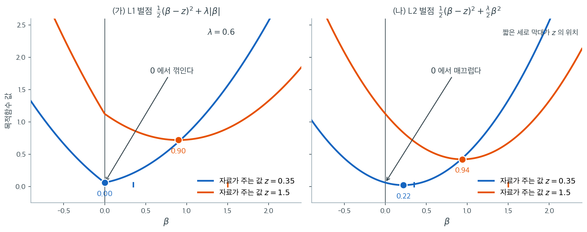

# 라쏘의 정식화와 희소성

능형회귀는 모든 계수를 0 쪽으로 축소하지만 어떤 것도 제거하지 않는다. 많은 응용에서, 특히 $p$가 클 때 우리는 무관한 변수의 계수를 정확히 0으로 만들어 자동으로 식별해 주는 추정량을 원한다. Tibshirani(1996)가 도입한 **라쏘**(Least Absolute Shrinkage and Selection Operator)는 L2 벌점을 L1 벌점으로 바꿈으로써 정칙화와 변수선택을 동시에 달성한다.

---

## 1. 라쏘 목적함수

$$
\hat{\boldsymbol{\beta}}_{\text{lasso}} = \arg\min_{\boldsymbol{\beta}} \left\{\frac{1}{2n}\|\mathbf{y} - \mathbf{X}\boldsymbol{\beta}\|^2 + \lambda\|\boldsymbol{\beta}\|_1\right\}
$$

여기서 $\|\boldsymbol{\beta}\|_1 = \sum_{j=1}^p |\beta_j|$이고 $\lambda \geq 0$이다. 인자 $1/(2n)$은 표본크기가 달라도 $\lambda$를 비교할 수 있게 하는 관례다.

동등한 제약 형태는

$$
\min_{\boldsymbol{\beta}} \|\mathbf{y} - \mathbf{X}\boldsymbol{\beta}\|^2 \quad \text{제약} \quad \sum_{j=1}^p |\beta_j| \leq t
$$

이며 $t$는 KKT 조건을 통해 $\lambda$로 결정된다.

---

## 2. 미분 불가능성과 부분미분

L2 벌점 $\|\boldsymbol{\beta}\|_2^2$과 달리 L1 노름 $\|\boldsymbol{\beta}\|_1$은 $\beta_j = 0$인 모든 점에서 **미분 불가능**하다. 따라서 기울기를 0으로 두는 것만으로는 안 되고, 비매끄러운 볼록함수로 기울기를 일반화한 **부분미분**을 쓴다.

$$
\partial|\beta_j| = \begin{cases} \{+1\} & \beta_j > 0 \\ [-1, +1] & \beta_j = 0 \\ \{-1\} & \beta_j < 0 \end{cases}
$$

$\beta_j = 0$에서 부분미분이 구간 $[-1, +1]$ 전체다. 덕분에 여러 자료 배치에서 $\beta_j = 0$인 채로 최적성 조건이 만족될 수 있으며, 이것이 희소해를 낳는 기제다.



계수가 하나뿐인 가장 단순한 경우로 줄여 보면 희소성의 정체가 한눈에 보인다. 자료가 $\beta$에 대해 $z$라는 값을 말한다고 하자(직교 설계라면 $z$가 곧 OLS 추정값이다). 벌점을 더한 목적함수를 $\lambda = 0.6$에서 그린 것이 위 그림이고, 두 곡선은 자료가 강한 경우($z = 1.5$)와 약한 경우($z = 0.35$)다.

왼쪽 L1 벌점의 두 곡선은 $\beta = 0$에서 **뾰족하게 꺾여 있다.** 절댓값 함수가 그곳에서 미분 불가능하기 때문이다. 이 꺾임이 하는 일은 단순하다. $\beta = 0$의 오른쪽에서 곡선의 기울기는 $-(z - \beta) + \lambda$이고 왼쪽에서는 $-(z-\beta) - \lambda$이므로, $0$에서 양쪽 기울기가 $\lambda - z$와 $-\lambda - z$로 **부호가 다를 수 있다.** 파란 곡선($z = 0.35 < \lambda$)이 정확히 그 경우여서 최솟값이 $0$에 걸린다. 주황 곡선($z = 1.5 > \lambda$)은 0에서 오른쪽 기울기가 여전히 음수라 밖으로 빠져나가 $0.90 = 1.5 - 0.6$에서 멈춘다.

오른쪽 L2 벌점에는 그런 일이 없다. 두 곡선 모두 $\beta = 0$에서 **매끄럽고**, 그 점에서의 기울기는 $-z$ 하나뿐이다. $z \neq 0$이면 이 기울기가 0이 아니므로 $0$은 절대 최솟값이 될 수 없다. 약한 신호 $z = 0.35$조차 $0.22 = 0.35/1.6$으로 축소될 뿐 살아남는다. 강한 신호는 $0.94$가 된다.

두 그림이 말하는 바를 하나로 요약하면 이렇다. **능형은 모든 계수를 같은 비율로 줄이고, 라쏘는 모든 계수에서 같은 양 $\lambda$를 깎은 뒤 음수가 되면 0에서 멈춘다.** 비율로 줄이면 아무리 줄여도 0이 되지 않지만, 같은 양을 깎으면 작은 것부터 바닥에 닿는다. 다음 절의 연성 문턱 공식은 이 그림에 이름을 붙인 것에 지나지 않는다.

---

## 3. 연성 문턱 연산자

**직교 설계**($\mathbf{X}^\top\mathbf{X} = n\mathbf{I}$)라는 특수한 경우에 라쏘는 연성 문턱 연산자로 표현되는 닫힌 형태 해를 갖는다.

$$
\hat{\beta}_j^{\text{lasso}} = S_\lambda(\hat{\beta}_j^{\text{OLS}}) = \text{sign}(\hat{\beta}_j^{\text{OLS}})\,\max\bigl(|\hat{\beta}_j^{\text{OLS}}| - \lambda,\; 0\bigr)
$$

- $|\hat{\beta}_j^{\text{OLS}}| \leq \lambda$이면 계수가 정확히 0이 된다.
- $|\hat{\beta}_j^{\text{OLS}}| > \lambda$이면 계수가 0 쪽으로 $\lambda$만큼 이동한다.

!!! note "연성 문턱과 경성 문턱"
    연성 문턱(라쏘)은 작은 계수를 0으로 만들면서 큰 계수도 축소한다. 경성 문턱(최량 부분집합 선택)은 작은 계수를 0으로 만들되 큰 계수는 그대로 둔다. 능형회귀는 문턱 없이 비례 축소 $\hat{\beta}_j^{\text{ridge}} = \hat{\beta}_j^{\text{OLS}}/(1 + \lambda)$를 적용한다.

---

## 4. 일반적인 경우에는 닫힌 형태 해가 없다

직교가 아닌 설계에서는 라쏘에 닫힌 형태 해가 없다. L1 벌점이 $\mathbf{X}^\top\mathbf{X}$의 교차항을 통해 계수들을 결합시켜 문제를 볼록하지만 비매끄러운 최적화로 만든다. 좌표하강 같은 수치 알고리즘이 필요하며 뒤의 절에서 다룬다.

---

## 5. 희소성

라쏘의 결정적 특징은 **희소** 해를 만든다는 것이다. $\lambda$가 충분히 크면 $\hat{\boldsymbol{\beta}}_{\text{lasso}}$의 많은 성분이 정확히 0이 된다.

- $\lambda = 0$에서 해는 OLS다($p < n$일 때).
- $\lambda_{\max} = \frac{1}{n}\|\mathbf{X}^\top\mathbf{y}\|_\infty = \max_j \left|\frac{1}{n}\sum_i x_{ij}y_i\right|$에서 모든 계수가 0이다.
- 그 사이에서 $\lambda$를 키우면 계수가 차례로 0이 된다.

!!! warning "$p > n$일 때 라쏘의 한계"
    $p > n$이면 라쏘는 0이 아닌 계수를 최대 $n$개까지만 고를 수 있다. 라쏘 해가 최대 $n$차원 부분공간에 놓이기 때문이다. 참으로 유의미한 변수가 $n$개를 넘으면 라쏘는 그것들을 동시에 복원할 수 없다.

---

## 6. 축소 연산자의 비교

| 방법 | 축소 규칙 | 정확한 0 | 유형 |
|---|---|---|---|
| OLS | $\hat{\beta}_j^{\text{OLS}}$ | 없음 | 축소 없음 |
| 능형 | $\hat{\beta}_j^{\text{OLS}} / (1 + \lambda)$ | 없음 | 비례 축소 |
| 라쏘 | $\text{sign}(\hat{\beta}_j^{\text{OLS}})\max(\lvert\hat{\beta}_j^{\text{OLS}}\rvert - \lambda, 0)$ | 있음 | 평행이동 축소 |
| 최량 부분집합 | $\hat{\beta}_j^{\text{OLS}} \cdot \mathbf{1}(\lvert\hat{\beta}_j^{\text{OLS}}\rvert > \lambda)$ | 있음 | 경성 문턱 |

능형은 균일한 비례 축소를, 라쏘는 $\lambda$에서 잘라내는 균일한 평행이동 축소를 적용한다. 최량 부분집합 선택은 경성 문턱을 적용하되 남긴 계수는 축소하지 않는다.

---

## 연습문제

<div class="drillbox" markdown>

**연습문제 1.** <span class="diff med" title="중간"></span>
직교 설계에서 라쏘가 정말 연성 문턱과 일치하는지, 능형이 비례 축소와 일치하는지 수치로 확인하라.

</div>

??? success "풀이"
    $\mathbf{X}^\top\mathbf{X} = n\mathbf{I}$가 되도록 QR 분해로 직교 계획행렬을 만든다.

    ```python
    import numpy as np
    from sklearn.linear_model import Ridge, Lasso
    rng = np.random.default_rng(18)

    n, p = 100, 5
    Q, _ = np.linalg.qr(rng.normal(size=(n, p)))
    X = Q * np.sqrt(n)                       # X'X = nI
    beta = np.array([3.0, -1.5, 0.5, 0.05, 0.0])
    y = X @ beta + rng.normal(0, 1, n)
    b_ols = np.linalg.lstsq(X, y, rcond=None)[0]

    lam = 2.0
    b_ridge = Ridge(alpha=lam, fit_intercept=False).fit(X, y).coef_
    pred_ridge = b_ols * n/(n + lam)

    a = 0.05
    b_lasso = Lasso(alpha=a, fit_intercept=False, max_iter=100000).fit(X, y).coef_
    pred_lasso = np.sign(b_ols) * np.maximum(np.abs(b_ols) - a, 0)
    ```

    | | $\hat\beta_1$ | $\hat\beta_2$ | $\hat\beta_3$ | $\hat\beta_4$ | $\hat\beta_5$ |
    |:---|---:|---:|---:|---:|---:|
    | OLS | 2.8893 | $-1.4653$ | 0.7013 | 0.0863 | $-0.0740$ |
    | 능형 (실측) | 2.8326 | $-1.4365$ | 0.6876 | 0.0846 | $-0.0726$ |
    | 능형 (예측 $\hat\beta_{\text{OLS}}\cdot\frac{n}{n+\lambda}$) | **2.8326** | $-1.4365$ | 0.6876 | 0.0846 | $-0.0726$ |
    | 라쏘 (실측) | 2.8393 | $-1.4153$ | 0.6513 | 0.0363 | $-0.0240$ |
    | 라쏘 (예측 $S_a(\hat\beta_{\text{OLS}})$) | **2.8393** | $-1.4153$ | 0.6513 | 0.0363 | $-0.0240$ |

    **두 공식 모두 소수 넷째 자리까지 정확히 맞는다.**

    두 축소의 성질 차이를 표에서 직접 볼 수 있다.

    - **능형은 비례적이다.** 모든 계수가 같은 비율 $n/(n+\lambda) = 100/102 = 0.980$로 줄어든다. $2.8893 \times 0.980 = 2.8326$.
    - **라쏘는 평행이동이다.** 모든 계수가 같은 **양** $a = 0.05$만큼 줄어든다. $2.8893 - 0.05 = 2.8393$, $0.0863 - 0.05 = 0.0363$.

    **결과적으로 작은 계수에 미치는 상대적 영향이 전혀 다르다.** $\hat\beta_4 = 0.0863$에 대해 능형은 2%를 깎지만 라쏘는 58%를 깎는다. $a$를 $0.0863$ 이상으로 올리면 라쏘는 이 계수를 정확히 0으로 만들고 능형은 결코 그러지 못한다.

<div class="drillbox" markdown>

**연습문제 2.** <span class="diff hard" title="어려움"></span>
$\lambda_{\max} = \frac{1}{n}\|\mathbf{X}^\top\mathbf{y}\|_\infty$에서 모든 계수가 0이 된다는 주장을 확인하라.

</div>

??? success "풀이"
    ```python
    import numpy as np
    from sklearn.linear_model import Lasso
    lmax = np.abs(X.T @ y).max() / n
    for f in (1.0, 0.99, 0.5, 0.1):
        b = Lasso(alpha=lmax*f, fit_intercept=False, max_iter=100000).fit(X, y).coef_
        print(f, (np.abs(b) > 1e-10).sum())
    ```

    출력:

    ```
    1.0 0
    0.99 1
    0.5 1
    0.1 3
    ```

    표준화된 설명변수 15개, $n = 80$인 자료에서 $\lambda_{\max} = 3.5230$이다.

    | $\lambda / \lambda_{\max}$ | $\lambda$ | 0이 아닌 계수의 수 |
    |---:|---:|---:|
    | 1.00 | 3.5230 | **0** |
    | 0.99 | 3.4878 | **1** |
    | 0.50 | 1.7615 | 1 |
    | 0.10 | 0.3523 | 5 |

    **$\lambda_{\max}$에서 정확히 모든 계수가 0이고, 그보다 1%만 작아지면 정확히 하나가 살아난다.**

    **왜 이 공식인가.** $\boldsymbol{\beta} = \mathbf{0}$이 최적이려면 부분미분 최적성 조건

    $$
    \left|\frac{1}{n}\mathbf{x}_j^\top\mathbf{y}\right| \le \lambda \quad \text{모든 } j
    $$

    가 성립해야 한다. 이 조건이 모든 $j$에서 성립하는 가장 작은 $\lambda$가 곧 최댓값 $\frac{1}{n}\|\mathbf{X}^\top\mathbf{y}\|_\infty$이다.

    $\lambda$가 그보다 조금 작아지면 조건을 처음 위반하는 변수, 즉 **반응변수와 상관이 가장 큰 변수**가 먼저 활성화된다. 이것이 정칙화 경로에서 변수가 등장하는 순서를 결정한다.

    **실무적 쓰임:** `sklearn`과 `glmnet`은 $\lambda$ 격자를 $\lambda_{\max}$에서 시작해 로그 간격으로 $0.001\lambda_{\max}$까지 내려가도록 자동 설정한다. $\lambda_{\max}$보다 큰 값은 계산할 이유가 없다.

<div class="drillbox" markdown>

**연습문제 3.** <span class="diff hard" title="어려움"></span>
§3 은 직교 설계 $\mathbf{X}^\top\mathbf{X} = n\mathbf{I}$에서 라쏘 해가 연성 문턱이라고 선언만 하고 유도하지 않았다.

(가) §1 의 목적함수가 직교 설계에서 **좌표마다 따로 떨어진다**는 것을 보여라. 떨어진 한 좌표의 문제를 $\frac{1}{2}(b - z)^2 + \lambda\lvert b\rvert$ 꼴로 적고 $z$가 무엇인지 밝혀라.

(나) 그 1 차원 문제를 §2 의 부분미분으로 풀어 §3 의 공식을 얻어라. 세 경우가 서로 겹치지 않고 모든 $z$를 덮는다는 것까지 확인하라.

(다) 얻은 공식에서 §5 의 두 주장 — $\lambda = 0$이면 OLS, $\lambda_{\max} = \frac{1}{n}\lVert\mathbf{X}^\top\mathbf{y}\rVert_\infty$에서 모든 계수가 0 — 을 각각 한 줄로 읽어내라.

</div>

??? success "풀이"
    **(가) 목적함수의 분리.** $\hat{\boldsymbol\beta} = (\mathbf{X}^\top\mathbf{X})^{-1}\mathbf{X}^\top\mathbf{y} = \frac{1}{n}\mathbf{X}^\top\mathbf{y}$라 두자(직교 설계이므로 역행렬이 $\frac{1}{n}\mathbf{I}$다). 제곱오차 항을 펼치면

    $$
    \frac{1}{2n}\lVert\mathbf{y} - \mathbf{X}\boldsymbol\beta\rVert^2 = \frac{1}{2n}\lVert\mathbf{y}\rVert^2 - \frac{1}{n}\boldsymbol\beta^\top\mathbf{X}^\top\mathbf{y} + \frac{1}{2n}\boldsymbol\beta^\top(n\mathbf{I})\boldsymbol\beta
    $$

    이고, 가운데 항은 $-\boldsymbol\beta^\top\hat{\boldsymbol\beta}$, 마지막 항은 $\frac{1}{2}\lVert\boldsymbol\beta\rVert^2$이다. 상수 $\frac{1}{2n}\lVert\mathbf{y}\rVert^2$와 $\frac{1}{2}\lVert\hat{\boldsymbol\beta}\rVert^2$를 더하고 빼서 완전제곱으로 묶으면

    $$
    \frac{1}{2n}\lVert\mathbf{y} - \mathbf{X}\boldsymbol\beta\rVert^2 = \text{(상수)} + \frac{1}{2}\lVert\boldsymbol\beta - \hat{\boldsymbol\beta}\rVert^2 = \text{(상수)} + \sum_{j=1}^p \frac{1}{2}(\beta_j - \hat\beta_j)^2
    $$

    이다. 벌점 $\lambda\lVert\boldsymbol\beta\rVert_1 = \lambda\sum_j \lvert\beta_j\rvert$도 좌표별 합이므로 목적함수 전체가

    $$
    \text{(상수)} + \sum_{j=1}^p \left[\frac{1}{2}(\beta_j - \hat\beta_j)^2 + \lambda\lvert\beta_j\rvert\right]
    $$

    로 쪼개진다. 각 대괄호가 $\beta_j$ 하나에만 의존하므로 $p$개의 1 차원 문제를 따로 풀면 된다. 따라서 $z = \hat\beta_j^{\text{OLS}}$다.

    **핵심은 교차항이 사라진 자리다.** $\mathbf{X}^\top\mathbf{X}$가 대각이 아니면 $\boldsymbol\beta^\top\mathbf{X}^\top\mathbf{X}\boldsymbol\beta$에 $\beta_i\beta_j$ 항이 남아 분리가 깨진다. 이것이 §4 가 말하는 "닫힌 형태 해가 없다"의 정확한 이유다.

    **(나) 1 차원 문제의 부분미분.** $f(b) = \frac{1}{2}(b-z)^2 + \lambda\lvert b\rvert$는 강볼록이므로 최소점이 유일하고, 최적성 조건은 $0 \in \partial f(b) = (b - z) + \lambda\,\partial\lvert b\rvert$다. §2 의 부분미분을 넣어 세 경우로 나눈다.

    - $b > 0$: $\partial\lvert b\rvert = \{+1\}$이므로 $b - z + \lambda = 0$, 즉 $b = z - \lambda$. 이것이 $b>0$과 모순이 없으려면 $z > \lambda$.
    - $b < 0$: $\partial\lvert b\rvert = \{-1\}$이므로 $b = z + \lambda$. 모순이 없으려면 $z < -\lambda$.
    - $b = 0$: $\partial\lvert 0\rvert = [-1,+1]$이므로 조건은 $0 \in -z + \lambda[-1,+1]$, 즉 $\lvert z\rvert \le \lambda$.

    세 조건 $z > \lambda$, $z < -\lambda$, $\lvert z\rvert \le \lambda$는 **서로 배타적이고 합집합이 $\mathbb{R}$ 전체**다. 따라서 어떤 $z$에도 해가 정확히 하나 있고 그것이

    $$
    b^\star = \operatorname{sign}(z)\max(\lvert z\rvert - \lambda,\ 0) = S_\lambda(z)
    $$

    다. $z = \hat\beta_j^{\text{OLS}}$를 넣으면 §3 의 공식이다. $\square$

    **(다) 두 극단.**

    - $\lambda = 0$이면 $S_0(z) = z$이므로 모든 좌표가 $\hat\beta_j^{\text{OLS}}$ 그대로다. 이것이 §5 의 첫째 항목이다.
    - 모든 계수가 0 이 되는 조건은 모든 $j$에서 $\lvert\hat\beta_j^{\text{OLS}}\rvert \le \lambda$, 즉 $\lambda \ge \max_j\lvert\hat\beta_j^{\text{OLS}}\rvert$다. 그런데 직교 설계에서는 $\hat\beta_j^{\text{OLS}} = \frac{1}{n}\mathbf{x}_j^\top\mathbf{y}$이므로

    $$
    \max_j\lvert\hat\beta_j^{\text{OLS}}\rvert = \frac{1}{n}\lVert\mathbf{X}^\top\mathbf{y}\rVert_\infty = \lambda_{\max}
    $$

    이다. §5 의 둘째 항목은 **연성 문턱의 마지막 꺾임점에 이름을 붙인 것**에 지나지 않는다.

<div class="drillbox" markdown>

**연습문제 4.** <span class="diff hard" title="어려움"></span>
§1 은 제약 형태의 $t$가 "KKT 조건을 통해 $\lambda$로 결정된다"고만 적고 그 대응을 적지 않았다. 직교 설계에서 그 대응을 명시적으로 구하라.

(가) 벌점 형태의 해가 $\lambda$에서 갖는 L1 노름이 $t(\lambda) = \sum_{j=1}^p (\lvert\hat\beta_j^{\text{OLS}}\rvert - \lambda)_+$임을 보이고, 이 함수가 $[0, \lambda_{\max}]$에서 연속이고 조각마다 1 차이며 감소함을 설명하라. 꺾임점은 어디인가.

(나) 연습문제 1 의 표에 적힌 OLS 값 $(2.8893,\ -1.4653,\ 0.7013,\ 0.0863,\ -0.0740)$을 쓴다. $t = 3.0$에 대응하는 $\lambda$와 그때의 라쏘 해를 소수 넷째 자리까지 손으로 구하라.

(다) 해가 0 이 아닌 계수를 정확히 3 개 갖는 $t$의 범위를 구하라.

</div>

??? success "풀이"
    **(가)** 연습문제 3 에서 $\hat\beta_j^{\text{lasso}}(\lambda) = \operatorname{sign}(\hat\beta_j)\,(\lvert\hat\beta_j\rvert - \lambda)_+$이므로 절댓값을 더하면

    $$
    t(\lambda) = \sum_{j=1}^p \lvert\hat\beta_j^{\text{lasso}}(\lambda)\rvert = \sum_{j=1}^p (\lvert\hat\beta_j^{\text{OLS}}\rvert - \lambda)_+
    $$

    이다. 각 항 $(\lvert\hat\beta_j\rvert - \lambda)_+$는 연속이고 조각마다 1 차이며 비증가이므로 합도 그렇다. 활성 집합을 $A(\lambda) = \{j : \lvert\hat\beta_j\rvert > \lambda\}$라 하면

    $$
    t(\lambda) = \sum_{j \in A(\lambda)} \lvert\hat\beta_j\rvert - \lvert A(\lambda)\rvert\,\lambda
    $$

    이므로 **기울기가 $-\lvert A(\lambda)\rvert$**다. 활성 집합이 바뀌는 곳에서만 기울기가 바뀌므로 꺾임점은 정확히 $\lambda = \lvert\hat\beta_j^{\text{OLS}}\rvert$들이다. $A$가 비어 있지 않은 동안 기울기가 음수이므로 $t$는 $[0,\lambda_{\max}]$에서 **엄격히 감소**하고, $t(0) = \lVert\hat{\boldsymbol\beta}^{\text{OLS}}\rVert_1$에서 $t(\lambda_{\max}) = 0$까지 내려간다. 따라서 $[0, \lVert\hat{\boldsymbol\beta}^{\text{OLS}}\rVert_1]$의 모든 $t$에 $\lambda$가 하나씩 대응한다.

    **(나)** 절댓값을 크기 순으로 적으면 $2.8893 > 1.4653 > 0.7013 > 0.0863 > 0.0740$이고 $t(0) = 5.2162$다. 꺾임점에서의 값을 아래쪽부터 적는다.

    | $\lambda$ | 활성 개수 | $t(\lambda)$ |
    |---:|---:|---:|
    | 0 | 5 | 5.2162 |
    | 0.0740 | 4 | 4.8462 |
    | 0.0863 | 3 | 4.7970 |
    | 0.7013 | 2 | 2.9520 |
    | 1.4653 | 1 | 1.4240 |
    | 2.8893 | 0 | 0 |

    $t = 3.0$은 $2.9520$과 $4.7970$ 사이이므로 $\lambda \in [0.0863,\ 0.7013]$ 구간에 있고, 그 구간에서 활성 집합은 큰 셋이므로

    $$
    t(\lambda) = (2.8893 + 1.4653 + 0.7013) - 3\lambda = 5.0559 - 3\lambda
    $$

    이다. $5.0559 - 3\lambda = 3.0$을 풀면

    $$
    \lambda = \frac{2.0559}{3} = 0.6853
    $$

    이고 $0.0863 \le 0.6853 \le 0.7013$이므로 구간 안에 있다. 해는

    $$
    \hat{\boldsymbol\beta}^{\text{lasso}} = (2.8893 - 0.6853,\ -(1.4653-0.6853),\ 0.7013-0.6853,\ 0,\ 0) = (2.2040,\ -0.7800,\ 0.0160,\ 0,\ 0)
    $$

    이고 검산으로 $2.2040 + 0.7800 + 0.0160 = 3.0000$이다.

    **(다)** 0 이 아닌 계수가 정확히 3 개인 것은 $\lambda \in [0.0863,\ 0.7013)$일 때다($\lambda = 0.7013$이면 셋째가 0 이 된다). $t$가 엄격히 감소하므로 이 구간의 상이 곧 답이다.

    $$
    t \in (t(0.7013),\ t(0.0863)] = (2.9520,\ 4.7970]
    $$

    $t = 3.0$이 이 범위에 들어 있어 (나)의 답과 들어맞는다.

    **$\lambda$와 $t$는 서로 뒤집힌 손잡이다.** $\lambda$를 키우면 $t$가 줄고, $t$를 예산처럼 정해 주면 그에 맞는 $\lambda$가 하나로 정해진다. 다만 그 대응은 $\hat{\boldsymbol\beta}^{\text{OLS}}$에 의존하므로 **자료마다 다르다.** 교차검증에서 $\lambda$ 격자를 고정해 쓰는 쪽이 $t$ 격자를 고정해 쓰는 쪽보다 편한 이유가 여기에 있다.

<div class="drillbox" markdown>

**연습문제 5.** <span class="diff hard" title="어려움"></span>
많은 교과서는 라쏘를 $\lVert\mathbf{y}-\mathbf{X}\boldsymbol\beta\rVert^2 + \lambda\lVert\boldsymbol\beta\rVert_1$로 적는데 §1 과 `sklearn` 은 $\frac{1}{2n}\lVert\mathbf{y}-\mathbf{X}\boldsymbol\beta\rVert^2 + \alpha\lVert\boldsymbol\beta\rVert_1$로 적는다.

(가) 두 꼴이 같은 해를 주는 조건이 $\lambda = 2n\alpha$임을 보여라.

(나) 직교 설계에서 교과서 꼴의 연성 문턱이 $\lambda/(2n)$임을 (가)와 연습문제 3 에서 유도하라.

(다) $n = 120$, $p = 6$인 직교 설계에서 교과서 꼴의 $\lambda = 60$에 대해 `alpha=lam/(2*n)` 과 `alpha=lam` 을 각각 넣어 보고, 교과서 목적함수 값으로 두 해를 비교하라. $\alpha$와 $\lambda$를 섞으면 무엇을 잃는가.

</div>

??? success "풀이"
    **(가)** 교과서 꼴의 목적함수를 $2n$으로 나눈다. 양수로 나누는 것은 최소점을 바꾸지 않는다.

    $$
    \frac{1}{2n}\left[\lVert\mathbf{y}-\mathbf{X}\boldsymbol\beta\rVert^2 + \lambda\lVert\boldsymbol\beta\rVert_1\right] = \frac{1}{2n}\lVert\mathbf{y}-\mathbf{X}\boldsymbol\beta\rVert^2 + \frac{\lambda}{2n}\lVert\boldsymbol\beta\rVert_1
    $$

    오른쪽이 `sklearn` 꼴과 같아지는 조건이 $\alpha = \lambda/(2n)$, 즉 $\lambda = 2n\alpha$다. $\square$

    **(나)** 연습문제 3 에서 `sklearn` 꼴의 문턱은 $\alpha$였다. (가)에 의해 교과서 꼴의 $\lambda$는 $\alpha = \lambda/(2n)$에 해당하므로 문턱은 $\lambda/(2n)$이다. $n = 120$, $\lambda = 60$이면 문턱이 $60/240 = 0.25$다.

    ```python
    import numpy as np
    from sklearn.linear_model import Lasso

    rng = np.random.default_rng(518)
    n, p = 120, 6
    Q, _ = np.linalg.qr(rng.normal(size=(n, p)))
    X = Q * np.sqrt(n)                       # X'X = nI
    beta_true = np.array([2.0, -1.0, 0.4, 0.1, 0.0, 0.0])
    y = X @ beta_true + rng.normal(0, 1, n)
    b_ols = X.T @ y / n                      # 직교 설계에서는 이것이 OLS

    lam = 60.0                               # 교과서 꼴의 lambda
    def obj(b):                              # ||y - Xb||^2 + lam ||b||_1
        return float(np.sum((y - X @ b) ** 2) + lam * np.abs(b).sum())

    thr = lam / (2 * n)
    soft = np.sign(b_ols) * np.maximum(np.abs(b_ols) - thr, 0.0)

    L = dict(fit_intercept=False, max_iter=100000, tol=1e-12)
    b_right = Lasso(alpha=lam / (2 * n), **L).fit(X, y).coef_
    b_wrong = Lasso(alpha=lam, **L).fit(X, y).coef_

    print(f"문턱 lam/(2n)       = {thr:.4f}")
    print(f"손으로 S_thr(b_ols) = {np.array2string(soft + 0.0, precision=4, floatmode='fixed')}")
    print(f"alpha=lam/(2n) 해   = {np.array2string(b_right + 0.0, precision=4, floatmode='fixed')}")
    print(f"두 해의 최대 차이    = {np.abs(soft - b_right).max():.8f}")
    print(f"교과서 목적함수  alpha=lam/(2n) : {obj(b_right):.4f}  (0 아닌 계수 {int((b_right != 0).sum())}개)")
    print(f"교과서 목적함수  alpha=lam      : {obj(b_wrong):.4f}  (0 아닌 계수 {int((b_wrong != 0).sum())}개)")
    print(f"교과서 목적함수  OLS            : {obj(b_ols):.4f}")
    ```

    출력:

    ```text
    문턱 lam/(2n)       = 0.2500
    손으로 S_thr(b_ols) = [ 1.8998 -0.7598  0.1862  0.0000  0.0000  0.0000]
    alpha=lam/(2n) 해   = [ 1.8998 -0.7598  0.1862  0.0000  0.0000  0.0000]
    두 해의 최대 차이    = 0.00000000
    교과서 목적함수  alpha=lam/(2n) : 319.2847  (0 아닌 계수 3개)
    교과서 목적함수  alpha=lam      : 825.8478  (0 아닌 계수 0개)
    교과서 목적함수  OLS            : 353.8805
    ```

    **(다) 읽기.** 손으로 구한 연성 문턱과 `alpha=lam/(2*n)` 의 해가 소수 여덟째 자리까지 같다. 이것이 (가)와 (나)가 맞다는 증거다.

    | 넣은 값 | 교과서 목적함수 | 0 이 아닌 계수 |
    |:---|---:|---:|
    | $\alpha = \lambda/(2n) = 0.25$ | **319.2847** | 3 |
    | $\alpha = \lambda = 60$ | 825.8478 | 0 |
    | OLS($\alpha = 0$) | 353.8805 | 6 |

    $\alpha$ 자리에 $\lambda$를 그대로 넣으면 벌점이 $2n = 240$ 배 세진다. $\lambda_{\max}$가 $\max_j\lvert\hat\beta_j\rvert \approx 2$ 정도인데 $60$을 넣었으니 **해가 영벡터가 되고** 교과서 목적함수는 $825.8478$로, 벌점을 아예 안 쓴 OLS($353.8805$)보다도 훨씬 나쁘다. 즉 단위를 섞은 대가는 "조금 부정확한 답"이 아니라 **아무 변수도 안 쓰는 답**이다.

    반대 방향의 실수($\lambda$ 자리에 $\alpha$를 넣기)는 벌점을 $240$분의 1 로 약하게 만들어 사실상 OLS 를 돌린다. 어느 쪽이든 조용히 틀리므로, 수를 옮길 때마다 어느 쪽 관례인지 적어 두는 것이 안전하다.

<div class="drillbox" markdown>

**연습문제 6.** <span class="diff hard" title="어려움"></span>
§6 의 표는 능형을 $\hat\beta_j^{\text{OLS}}/(1+\lambda)$로, 라쏘를 $S_\lambda(\hat\beta_j^{\text{OLS}})$로 적는다. 그런데 연습문제 1 은 능형에서 `alpha=2.0` 에 대해 $n/(n+\lambda) = 100/102$를 쓰고도 맞았고, 라쏘에서는 `alpha=0.05` 를 문턱에 **보정 없이** 그대로 넣고도 맞았다.

(가) §6 의 표 두 줄을 동시에 낳는 목적함수를 적어라(벌점 항까지 정확히).

(나) 그 목적함수의 $\lambda$와 `sklearn` 의 `alpha` 사이 변환을 `Ridge` 와 `Lasso` 각각에 대해 구하고, 연습문제 1 의 수로 확인하라.

(다) 왜 라쏘에만 보정이 필요 없는가. 이 비대칭이 §5 의 $\lambda_{\max}$ 공식을 쓸 때 어떤 실무적 이득을 주는가.

</div>

??? success "풀이"
    **(가)** 직교 설계에서 연습문제 3 의 완전제곱 정리를 쓰면 $\frac{1}{2n}\lVert\mathbf{y}-\mathbf{X}\boldsymbol\beta\rVert^2 = \text{(상수)} + \frac{1}{2}\lVert\boldsymbol\beta-\hat{\boldsymbol\beta}\rVert^2$다. 여기에 벌점을 $\lambda \cdot \text{pen}(\boldsymbol\beta)$로 붙여 본다.

    - $\text{pen} = \lVert\boldsymbol\beta\rVert_1$: 연습문제 3 에서 해가 $S_\lambda(\hat\beta_j)$. 표의 라쏘 줄과 일치.
    - $\text{pen} = \frac{1}{2}\lVert\boldsymbol\beta\rVert_2^2$: 미분하면 $(\beta_j - \hat\beta_j) + \lambda\beta_j = 0$, 즉 $\beta_j = \hat\beta_j/(1+\lambda)$. 표의 능형 줄과 일치.

    따라서 §6 의 표를 낳는 목적함수는

    $$
    \frac{1}{2n}\lVert\mathbf{y}-\mathbf{X}\boldsymbol\beta\rVert^2 + \lambda\lVert\boldsymbol\beta\rVert_1 \quad\text{와}\quad \frac{1}{2n}\lVert\mathbf{y}-\mathbf{X}\boldsymbol\beta\rVert^2 + \frac{\lambda}{2}\lVert\boldsymbol\beta\rVert_2^2
    $$

    다. **L2 쪽에만 $\frac{1}{2}$가 붙는 것**이 표의 $1/(1+\lambda)$를 깔끔하게 만드는 관례다.

    **(나) 변환.** `sklearn` 의 `Lasso` 는 $\frac{1}{2n}\lVert\cdot\rVert^2 + \alpha\lVert\boldsymbol\beta\rVert_1$을 최소화하므로 (가)의 L1 목적함수와 **글자까지 같다.** 따라서

    $$
    \alpha_{\text{Lasso}} = \lambda
    $$

    `sklearn` 의 `Ridge` 는 $\lVert\mathbf{y}-\mathbf{X}\boldsymbol\beta\rVert^2 + \alpha\lVert\boldsymbol\beta\rVert_2^2$을 최소화한다($\frac{1}{2n}$도 $\frac{1}{2}$도 없다). 이것을 $2n$으로 나누면

    $$
    \frac{1}{2n}\lVert\mathbf{y}-\mathbf{X}\boldsymbol\beta\rVert^2 + \frac{\alpha}{2n}\lVert\boldsymbol\beta\rVert_2^2 = \frac{1}{2n}\lVert\mathbf{y}-\mathbf{X}\boldsymbol\beta\rVert^2 + \frac{\alpha/n}{2}\lVert\boldsymbol\beta\rVert_2^2
    $$

    이므로 $\lambda = \alpha/n$, 즉

    $$
    \alpha_{\text{Ridge}} = n\lambda
    $$

    **연습문제 1 의 수로 확인.** `alpha=2.0`, $n = 100$이므로 표의 $\lambda$는 $2.0/100 = 0.02$다.

    | 공식 | 축소 비율 |
    |:---|---:|
    | §6 표: $1/(1+\lambda) = 1/1.02$ | 0.980392 |
    | 연습문제 1: $n/(n+\alpha) = 100/102$ | 0.980392 |

    같은 수다. 두 식 $\dfrac{1}{1+\alpha/n}$과 $\dfrac{n}{n+\alpha}$는 분자분모에 $n$을 곱한 것일 뿐이므로 **어긋난 적이 없다.** 어긋난 것은 $\lambda$라는 기호가 가리키는 대상이었다. 라쏘 쪽은 `alpha=0.05` 를 문턱에 그대로 넣어 맞았는데, 이는 $\alpha_{\text{Lasso}} = \lambda$라서 그렇다.

    **(다) 비대칭의 출처는 두 가지가 겹친 것이다.**

    1. `sklearn` 의 `Lasso` 는 손실에 $\frac{1}{2n}$을 붙이고 `Ridge` 는 붙이지 않는다. 이것이 $n$ 배의 차이를 만든다.
    2. L1 벌점은 $\boldsymbol\beta$에 대해 1 차 동차, L2 벌점은 2 차 동차다. 그래서 L2 에서는 $\frac{1}{2}$ 관례를 쓰고 안 쓰고가 계수 $2$를 바꾸지만, 위 계산에서 `Ridge` 의 $\alpha/(2n)$이 마침 $\frac{(\alpha/n)}{2}$로 떨어져 **그 $2$가 상쇄된다.**

    남는 결론: 라쏘는 변환이 항등이고 능형은 $n$ 배다.

    **실무적 이득.** $\lambda_{\max} = \frac{1}{n}\lVert\mathbf{X}^\top\mathbf{y}\rVert_\infty$가 이미 `sklearn` 의 `alpha` **단위로** 적혀 있다. 그래서 연습문제 2 처럼 `np.abs(X.T @ y).max()/n` 을 계산해 `alpha` 에 바로 넣을 수 있고, 표본크기를 바꿔도 같은 $\lambda/\lambda_{\max}$ 비율이 비슷한 희소성을 준다(§1 이 말한 "표본크기가 달라도 비교할 수 있게 하는 관례"가 바로 이것이다). 능형에서 같은 일을 하려면 매번 $n$을 곱해야 한다.

<div class="drillbox" markdown>

**연습문제 7.** <span class="diff hard" title="어려움"></span>
$\lVert\boldsymbol\beta\rVert_1$은 설명변수의 **단위**에 의존한다. 그래서 라쏘는 척도에 불변이 아니다.

(가) 열 $\mathbf{x}_j$만 $c$배 하고 나머지는 그대로 둘 때, 원래 척도에서 본 그 변수의 유효 벌점이 어떻게 바뀌는지 적어라. 모든 열을 동시에 $c$배 하면 $\alpha$를 어떻게 고쳐야 같은 적합을 얻는가.

(나) 수치로 확인하라. 변수 하나의 단위를 미터에서 밀리미터로 바꾸면 OLS 적합은 그대로이지만 라쏘 해는 달라진다. 그리고 표준화를 먼저 하면 두 단위가 같은 해를 준다. `fit_intercept=False` 를 쓰려면 $\mathbf{X}$와 $\mathbf{y}$를 중심화해 두어라.

</div>

??? success "풀이"
    **(가) 한 열만 $c$배.** $\tilde{\mathbf{x}}_j = c\,\mathbf{x}_j$로 적합하고 그 계수를 $\tilde\beta_j$라 하자. 적합값이 같으려면 $\tilde\beta_j\,\tilde{\mathbf{x}}_j = \beta_j\mathbf{x}_j$, 즉 $\beta_j = c\,\tilde\beta_j$다. 새 좌표로 쓴 목적함수에서 벌점 항만 보면

    $$
    \alpha\lvert\tilde\beta_j\rvert = \alpha\left\lvert\frac{\beta_j}{c}\right\rvert = \frac{\alpha}{c}\lvert\beta_j\rvert
    $$

    이다. 즉 **원래 척도에서 본 그 변수의 유효 벌점은 $\alpha/c$**다. 열을 크게 재면($c>1$) 벌점이 약해져 그 변수가 살아남기 쉬워지고, 작게 재면 쉽게 0 이 된다. 다른 열의 유효 벌점은 그대로이므로 **벌점이 변수들 사이에서 기울어진다.**

    **모든 열을 $c$배.** 모든 좌표가 $\beta = c\tilde\beta$로 같이 바뀌므로 유효 벌점이 모두 $\alpha/c$가 된다. 원래 해를 되찾으려면 $\alpha' /c = \alpha$, 즉 $\alpha' = c\,\alpha$를 써야 한다. 이 경우에는 **$\alpha$ 하나만 고치면 되므로 척도 문제가 아니라 격자 문제**다. 위험한 쪽은 (가)의 앞 절반, 즉 열마다 단위가 다른 경우다.

    ```python
    import numpy as np
    from sklearn.linear_model import Lasso

    rng = np.random.default_rng(718)
    n, c, alpha = 200, 1000.0, 0.1
    Xm = rng.normal(size=(n, 4))                 # 네 설명변수, 모두 미터 단위
    y = Xm @ np.array([1.0, 0.5, 0.25, 0.0]) + rng.normal(0, 1, n)
    Xm, y = Xm - Xm.mean(0), y - y.mean()        # 중심화 — 절편은 벌점에서 뺀다

    Xmm = Xm.copy()
    Xmm[:, 2] *= c                               # 3 번 변수만 밀리미터로
    back = np.array([1.0, 1.0, c, 1.0])          # 밀리미터 계수 -> 미터 계수

    L = dict(fit_intercept=False, max_iter=200000, tol=1e-12)
    show = lambda v: np.array2string(v + 0.0, precision=4, floatmode="fixed")

    for tag, Xd, conv, a in (("미터", Xm, np.ones(4), alpha),
                             ("밀리미터", Xmm, back, alpha)):
        b = Lasso(alpha=a, **L).fit(Xd, y).coef_
        print(f"라쏘  {tag:5s} alpha={a:6.1f}  {show(b * conv)}  "
              f"0 아닌 계수 {int((b != 0).sum())}개  RSS {np.sum((y - Xd @ b) ** 2):.4f}")
    for tag, Xd, conv in (("미터", Xm, np.ones(4)), ("밀리미터", Xmm, back)):
        b = np.linalg.lstsq(Xd, y, rcond=None)[0]
        print(f"OLS   {tag:5s}               {show(b * conv)}  "
              f"0 아닌 계수 {4}개  RSS {np.sum((y - Xd @ b) ** 2):.4f}")

    print()
    Za, Zb = Xm / Xm.std(0), Xmm / Xmm.std(0)    # 폴드 안에서 해야 할 표준화
    for tag, Xd, Z, conv in (("미터", Xm, Za, np.ones(4)), ("밀리미터", Xmm, Zb, back)):
        b = Lasso(alpha=alpha, **L).fit(Z, y).coef_ / Xd.std(0)
        print(f"표준화 뒤 라쏘  {tag:5s}  {show(b * conv)}")

    Xall = c * Xm                                # 네 열을 모두 c 배
    b1 = Lasso(alpha=alpha, **L).fit(Xm, y).coef_
    b2 = Lasso(alpha=c * alpha, **L).fit(Xall, y).coef_ * c
    print(f"\n전체를 c 배 하고 alpha 를 c 배 한 해와 원래 해의 차 {np.abs(b1 - b2).max():.10f}")
    ```

    출력:

    ```text
    라쏘  미터    alpha=   0.1  [1.0460 0.3071 0.0759 0.0000]  0 아닌 계수 3개  RSS 180.0393
    라쏘  밀리미터  alpha=   0.1  [1.0352 0.3157 0.1719 0.0000]  0 아닌 계수 3개  RSS 178.2026
    OLS   미터                  [ 1.1282  0.4232  0.1725 -0.0662]  0 아닌 계수 4개  RSS 173.1333
    OLS   밀리미터                [ 1.1282  0.4232  0.1725 -0.0662]  0 아닌 계수 4개  RSS 173.1333

    표준화 뒤 라쏘  미터     [1.0404 0.3096 0.0739 0.0000]
    표준화 뒤 라쏘  밀리미터   [1.0404 0.3096 0.0739 0.0000]

    전체를 c 배 하고 alpha 를 c 배 한 해와 원래 해의 차 0.0000000000
    ```

    **(나) 읽기.** 모든 계수는 미터 단위로 환산해 적었으므로 같은 양을 비교하고 있다.

    | 적합 | $\beta_3$ (미터 단위) | 잔차제곱합 |
    |:---|---:|---:|
    | OLS (어느 단위든) | 0.1725 | 173.1333 |
    | 라쏘, 미터 | 0.0759 | 180.0393 |
    | 라쏘, 밀리미터 | 0.1719 | 178.2026 |
    | 표준화 뒤 라쏘 (어느 단위든) | 0.0739 | — |

    - **OLS 는 완전히 불변이다.** 두 계획행렬의 열공간이 같으므로 사영도 같고 적합값도 같다. 단위를 바꾸면 계수만 $1/c$배로 되읽히고 환산하면 소수 넷째 자리까지 똑같다. 잔차제곱합도 $173.1333$으로 같다.
    - **라쏘는 바뀐다.** 3 번 변수를 밀리미터로 재면 그 변수의 유효 벌점이 $1000$분의 1 로 약해져 $\beta_3$가 거의 축소되지 않는다($0.1719$는 OLS 값 $0.1725$에 사실상 붙어 있다). 미터로 재면 같은 변수가 $0.1725 \to 0.0759$로 $56\%$ 깎인다. **자료도 모형도 그대로인데 단위만 바꿔 결론이 달라진 것이다.**
    - 벌점을 덜 받은 쪽이 훈련 잔차제곱합도 작다($178.2026 < 180.0393$). 그러나 이것은 그 모형이 더 좋다는 뜻이 아니라 **정칙화가 덜 걸렸다**는 뜻일 뿐이다.
    - **표준화하면 두 단위가 소수 넷째 자리까지 같은 해를 준다.** 각 열을 자기 표준편차로 나누면 단위가 지워지므로 당연하다.
    - 마지막 줄은 (가)의 뒷부분을 확인한다. 모든 열을 $c$배 하고 $\alpha$를 $c$배 하면 원래 해가 **정확히** 돌아온다(차이 $0$).

    **주의할 점 하나.** 위에서는 설명을 단순하게 하려고 전체 자료로 표준화했지만, 교차검증에서는 표준편차를 **훈련 폴드에서만** 계산해야 한다. 전체 자료의 표준편차를 쓰면 검증 폴드의 정보가 새 나가 오차를 과소평가한다. `sklearn` 에서는 `make_pipeline(StandardScaler(), Lasso(...))` 로 묶어 폴드 안에서 표준화가 일어나게 한다.

<div class="drillbox" markdown>

**연습문제 8.** <span class="diff hard" title="어려움"></span>
§5 의 경고 상자는 $p > n$이면 라쏘가 0 이 아닌 계수를 최대 $n$개까지만 고른다고 했다. 가장 작은 경우에서 손으로 확인하라.

$n = 1$, $p = 2$, $\mathbf{X} = \begin{pmatrix} 2 & 1\end{pmatrix}$, $\mathbf{y} = (5)$로 둔다.

(가) 적합값 $f = 2\beta_1 + \beta_2$를 고정했을 때 $\lvert\beta_1\rvert + \lvert\beta_2\rvert$의 최솟값이 $\lvert f\rvert/2$이고 그것을 주는 $\boldsymbol\beta$가 유일함을 보여라.

(나) 이를 써서 모든 $\lambda \ge 0$에 대한 라쏘 해를 닫힌 꼴로 구하라. 0 이 아닌 계수가 몇 개인가. $\lambda = 4$에서의 해와 모든 계수가 0 이 되는 $\lambda$를 적고 후자를 §5 의 $\lambda_{\max}$와 맞춰 보라.

(다) 같은 자료에서 $\mathbf{X} = \begin{pmatrix} 2 & 2\end{pmatrix}$로 바꾸면 무엇이 달라지는가. 이 경우 출력해도 되는 양과 출력하면 안 되는 양은 무엇인가.

</div>

??? success "풀이"
    **(가)** 삼각부등식으로

    $$
    \lvert f\rvert = \lvert 2\beta_1 + \beta_2\rvert \le 2\lvert\beta_1\rvert + \lvert\beta_2\rvert \le 2\bigl(\lvert\beta_1\rvert + \lvert\beta_2\rvert\bigr)
    $$

    이므로 $\lvert\beta_1\rvert + \lvert\beta_2\rvert \ge \lvert f\rvert/2$다. $\boldsymbol\beta = (f/2,\ 0)$에서 $2(f/2) + 0 = f$이고 L1 노름이 $\lvert f\rvert/2$이므로 하한이 달성된다.

    유일성: 두 번째 부등식이 등식이려면 $2\lvert\beta_1\rvert + \lvert\beta_2\rvert = 2\lvert\beta_1\rvert + 2\lvert\beta_2\rvert$, 즉 $\lvert\beta_2\rvert = 0$이어야 한다. $\beta_2 = 0$이면 제약에서 $\beta_1 = f/2$로 정해진다. 따라서 최소점은 $(f/2,\ 0)$ 하나다. $\square$

    **왜 큰 쪽에 다 싣는가.** 1 단위의 적합값을 사는 비용이 변수마다 다르다. $\mathbf{x}_1$은 계수 $1/2$만 써도 적합값 $1$을 만들지만 $\mathbf{x}_2$는 계수 $1$이 필요하다. L1 벌점은 계수의 크기로 값을 매기므로 **적합값 단위당 벌점이 가장 싼 변수**에 전부 싣는 것이 유리하다.

    **(나)** $n = 1$이므로 §1 의 목적함수는 $\frac{1}{2}(5 - f)^2 + \lambda(\lvert\beta_1\rvert+\lvert\beta_2\rvert)$다. (가)에 의해 $f$를 고정하면 벌점의 최솟값이 $\lambda\lvert f\rvert/2$이므로, 먼저 $f$에 대해 최소화하면 된다.

    $$
    g(f) = \frac{1}{2}(5-f)^2 + \frac{\lambda}{2}\lvert f\rvert
    $$

    이것은 연습문제 3 의 1 차원 문제에서 $z = 5$, 벌점계수 $\lambda/2$인 꼴이다. 따라서

    $$
    f^\star = S_{\lambda/2}(5) = \begin{cases} 5 - \lambda/2 & \lambda < 10 \\ 0 & \lambda \ge 10\end{cases}
    $$

    이고 (가)의 유일성으로 해는

    $$
    \hat{\boldsymbol\beta}^{\text{lasso}} = \left(\frac{f^\star}{2},\ 0\right) = \left(\max\left(2.5 - \frac{\lambda}{4},\ 0\right),\ 0\right)
    $$

    다. **0 이 아닌 계수는 $\lambda < 10$에서 정확히 1 개, $\lambda \ge 10$에서 0 개다.** 어느 쪽이든 $n = 1$을 넘지 않는다. 경고 상자의 내용이 이 작은 예에서 그대로 보인다.

    $\lambda = 4$이면 $\hat{\boldsymbol\beta} = (2.5 - 1,\ 0) = (1.5,\ 0)$이고 적합값은 $2 \times 1.5 = 3$이다.

    모든 계수가 0 이 되는 문턱은 $\lambda = 10$이다. §5 의 공식으로 확인하면

    $$
    \lambda_{\max} = \frac{1}{n}\lVert\mathbf{X}^\top\mathbf{y}\rVert_\infty = \max\bigl(\lvert 2\times 5\rvert,\ \lvert 1\times 5\rvert\bigr) = 10
    $$

    로 정확히 맞는다. 처음 활성화되는 변수가 $\mathbf{x}_1^\top\mathbf{y}$의 절댓값이 더 큰 1 번이라는 §5 의 설명도 그대로다.

    **(다) 열이 같아지면 해가 유일하지 않다.** $\mathbf{X} = (2\ \ 2)$이면 $f = 2(\beta_1+\beta_2)$이고

    $$
    \lvert f\rvert = 2\lvert\beta_1+\beta_2\rvert \le 2\bigl(\lvert\beta_1\rvert+\lvert\beta_2\rvert\bigr)
    $$

    에서 등식 조건이 "$\beta_1$과 $\beta_2$가 **같은 부호(또는 하나가 0)**"로 느슨해진다. 그러므로 $\beta_1+\beta_2 = f^\star/2$를 만족하고 부호가 같은 **모든** 쌍이 최적이다. $\lambda = 4$이면 $f^\star = 3$이므로

    $$
    \{(\beta_1,\beta_2) : \beta_1 + \beta_2 = 1.5,\ \beta_1 \ge 0,\ \beta_2 \ge 0\}
    $$

    라는 **선분 전체**가 해집합이다. $(1.5, 0)$, $(0.75, 0.75)$, $(0, 1.5)$가 모두 같은 목적함수 값을 준다.

    | 양 | 유일한가 |
    |:---|:---|
    | 적합값 $\hat{\mathbf{y}}$, 잔차제곱합 | 예 |
    | 계수의 합 $\beta_1+\beta_2$, $\lVert\hat{\boldsymbol\beta}\rVert_1$ | 예 |
    | 목적함수의 최솟값 | 예 |
    | 개별 계수 $\beta_1$, $\beta_2$ | **아니오** |
    | 0 이 아닌 계수의 개수 | **아니오** |

    따라서 출력해도 되는 것은 적합값·잔차제곱합·계수의 합·목적함수 값이고, **개별 계수나 선택된 변수의 이름은 출력하면 안 된다.** 좌표하강이 어느 점에 멈추는지는 초기값·갱신 순서·허용오차에 달려 있어 라이브러리 판올림만으로도 바뀔 수 있다.

    이것이 실무에서 라쏘가 "상관이 높은 변수들 가운데 하나를 임의로 고른다"고 말할 때의 그 임의성이다. 자료를 조금만 흔들어도 고르는 변수가 바뀐다. 엘라스틱넷이 L2 를 조금 섞어 목적함수를 **강볼록**으로 만드는 까닭이 바로 이 비유일성을 없애려는 것이다.

<div class="drillbox" markdown>

**연습문제 9.** <span class="diff hard" title="어려움"></span>
§6 의 표에 있는 세 축소 규칙 — 능형의 비례 축소, 라쏘의 연성 문턱, 최량 부분집합의 경성 문턱 — 가운데 **어느 것이 이기는지는 참값의 모양에 달려 있다.** 직교 설계에서 이를 수로 보여라.

직교 설계에서는 $\hat{\boldsymbol\beta}^{\text{OLS}} \sim N(\boldsymbol\beta,\ \tau^2\mathbf{I})$, $\tau = \sigma/\sqrt{n}$이므로 계획행렬 없이 $\hat{\boldsymbol\beta}^{\text{OLS}}$를 바로 뽑아 세 규칙을 닫힌 꼴로 적용할 수 있다. $p = 5$, $\tau = 1$로 두고 신호의 총량 $\lVert\boldsymbol\beta\rVert^2 = 25$를 고정한 채 두 참값을 비교하라.

- 희소: $\boldsymbol\beta = (5, 0, 0, 0, 0)$
- 조밀: $\boldsymbol\beta = (\sqrt5, \sqrt5, \sqrt5, \sqrt5, \sqrt5)$

각 방법마다 $\lambda$ 격자에서 최적값을 찾아 MSE $= \mathbb{E}\lVert\hat{\boldsymbol\beta}-\boldsymbol\beta\rVert^2$를 비교하고, 두 참값에서 순위가 뒤집히는 것을 설명하라.

</div>

??? success "풀이"
    세 규칙이 $\hat{\boldsymbol\beta}^{\text{OLS}}$의 함수로 닫혀 있으므로 계획행렬을 만들 필요가 없다. 20,000 번 반복한다.

    ```python
    import numpy as np

    rng = np.random.default_rng(918)
    R, p, tau = 20000, 5, 1.0                  # tau = sigma/sqrt(n), 직교 설계
    lams = np.round(np.arange(0, 3.001, 0.05), 2)

    ops = {"능형  (비례)": lambda B, l: B / (1 + l),
           "라쏘  (연성)": lambda B, l: np.sign(B) * np.maximum(np.abs(B) - l, 0),
           "부분집합(경성)": lambda B, l: B * (np.abs(B) > l)}

    for name, bt in (("희소", np.array([5.0, 0, 0, 0, 0])),
                     ("조밀", np.full(p, np.sqrt(5.0)))):
        B = rng.normal(bt, tau, size=(R, p))
        print(f"[{name}] beta = {np.array2string(bt, precision=4, floatmode='fixed')}"
              f"   ||beta||^2 = {bt @ bt:.1f}   OLS 의 MSE = {((B - bt) ** 2).sum(1).mean():.4f}")
        for lab, f in ops.items():
            m = np.array([((f(B, l) - bt) ** 2).sum(1).mean() for l in lams])
            k = int(m.argmin())
            print(f"   {lab}  최적 lambda {lams[k]:4.2f}   MSE {m[k]:.4f}")
    ```

    출력:

    ```text
    [희소] beta = [5.0000 0.0000 0.0000 0.0000 0.0000]   ||beta||^2 = 25.0   OLS 의 MSE = 5.0008
       능형  (비례)  최적 lambda 0.20   MSE 4.1705
       라쏘  (연성)  최적 lambda 0.85   MSE 2.5603
       부분집합(경성)  최적 lambda 2.75   MSE 1.4270
    [조밀] beta = [2.2361 2.2361 2.2361 2.2361 2.2361]   ||beta||^2 = 25.0   OLS 의 MSE = 4.9818
       능형  (비례)  최적 lambda 0.20   MSE 4.1572
       라쏘  (연성)  최적 lambda 0.05   MSE 4.9631
       부분집합(경성)  최적 lambda 0.00   MSE 4.9818
    ```

    | 방법 | 희소 ($\lambda^\star$, MSE) | 조밀 ($\lambda^\star$, MSE) |
    |:---|---:|---:|
    | OLS | —, 5.0008 | —, 4.9818 |
    | 능형 | 0.20, 4.1705 | 0.20, 4.1572 |
    | 라쏘 | 0.85, 2.5603 | 0.05, 4.9631 |
    | 최량 부분집합 | 2.75, **1.4270** | 0.00, 4.9818 |

    **순위가 완전히 뒤집힌다.** 희소에서는 경성 $<$ 연성 $<$ 비례 $<$ OLS 이고, 조밀에서는 비례 $<$ 연성 $<$ OLS $\approx$ 경성이다.

    **희소한 참값에서 문턱이 이기는 까닭.** 참으로 0 인 계수가 4 개 있는데 OLS 는 그 넷에서 각각 $\tau^2 = 1$씩, 합 $4$의 분산을 낸다. 문턱을 세우면 그 네 자리가 대부분 정확히 0 이 되어 분산이 거의 사라진다. 대가는 살아남은 $\beta_1 = 5$에서 치르는 편향인데, 경성 문턱은 **살린 계수를 축소하지 않으므로** 그 대가를 거의 안 낸다. 그래서 $1.4270$까지 내려간다. 연성 문턱은 $\beta_1$에서 $\lambda = 0.85$만큼의 편향을 물어야 하므로 $2.5603$에서 멈춘다.

    **조밀한 참값에서 문턱이 지는 까닭.** 0 인 계수가 하나도 없으니 문턱이 깎을 "공짜 분산"이 없다. $\lambda$를 올리면 다섯 계수 모두에 편향이 쌓일 뿐이다. 경성 문턱의 최적 $\lambda$가 격자의 왼쪽 끝 $0.00$으로 나온 것, 즉 **벌점을 아예 쓰지 않는 쪽이 최선**이라는 결론이 그것이다(참계수 $2.2361$을 $\tau = 1$의 잡음으로 재면서 문턱을 세우면 참신호를 통째로 버리는 사고가 일어나 MSE 가 오히려 커진다). 라쏘도 $\lambda = 0.05$로 거의 손을 놓는다.

    **능형만 참값의 모양에 둔감하다.** 두 설정의 최적 $\lambda$가 둘 다 $0.20$이고 MSE 도 $4.17$ 근처로 같다. 비례 축소의 MSE 가 $\boldsymbol\beta$의 배치가 아니라 $\lVert\boldsymbol\beta\rVert^2$에만 의존하기 때문이다(연습문제 10 에서 공식으로 확인한다). **희소성에 걸지 않는 대신 어디서나 중간 성적을 받는 방법**이 능형이고, 희소성에 거는 대신 참값이 조밀하면 이득이 사라지는 방법이 라쏘와 부분집합 선택이다.

    세 방법 모두 OLS 보다 나쁘지 않은 $\lambda$가 적어도 하나 있다는 점도 눈여겨볼 것($\lambda = 0$이 언제나 선택지에 있으므로 당연하다). 문제는 그 $\lambda$를 모른다는 것이고, 그래서 교차검증이 필요하다.

<div class="drillbox" markdown>

**연습문제 10.** <span class="diff hard" title="어려움"></span>
연습문제 9 에서 능형의 최적 $\lambda$가 희소와 조밀 두 설정에서 똑같이 $0.20$으로 나왔다. 우연이 아니다.

직교 설계에서 $\hat{\boldsymbol\beta}^{\text{OLS}} \sim N(\boldsymbol\beta, \tau^2\mathbf{I})$, $\tau^2 = \sigma^2/n$이고 §6 표의 능형 규칙 $\hat\beta_j/(1+\lambda)$를 쓴다.

(가) $\text{MSE}(\lambda) = \mathbb{E}\lVert\hat{\boldsymbol\beta}^{\text{ridge}} - \boldsymbol\beta\rVert^2$를 편향제곱과 분산으로 나눈 닫힌 꼴을 구하라.

(나) $\text{MSE}'(0) < 0$임을 보여 **OLS 를 이기는 $\lambda > 0$이 반드시 있다**고 결론하라. 최적 $\lambda^\star$를 구하고, 그것이 $\boldsymbol\beta$의 배치가 아니라 $\lVert\boldsymbol\beta\rVert^2$에만 의존함을 확인하라. 연습문제 9 의 수를 넣어 $0.20$이 나오는지 보라.

(다) 연습문제 1 의 설정($\boldsymbol\beta = (3, -1.5, 0.5, 0.05, 0)$, $n = 100$, $\sigma = 1$)에서 $\lambda^\star$와 그때의 MSE 를 구하고 `sklearn` 의 `alpha` 로 환산하라. 개선폭이 왜 이렇게 작은가. $n \to \infty$에서 `alpha` 는 어떻게 되는가.

</div>

??? success "풀이"
    **(가)** 각 좌표가 독립이므로 좌표별로 더하면 된다. $\hat\beta_j^{\text{ridge}} = \hat\beta_j/(1+\lambda)$이고 $\mathbb{E}\hat\beta_j = \beta_j$, $\operatorname{Var}(\hat\beta_j) = \tau^2$이므로

    $$
    \mathbb{E}\hat\beta_j^{\text{ridge}} = \frac{\beta_j}{1+\lambda}, \qquad \text{편향}_j = \frac{\beta_j}{1+\lambda} - \beta_j = -\frac{\lambda\beta_j}{1+\lambda}, \qquad \operatorname{Var} = \frac{\tau^2}{(1+\lambda)^2}
    $$

    다. 5 장의 편향–분산 분해를 좌표마다 적용하고 $j$에 대해 더하면

    $$
    \text{MSE}(\lambda) = \underbrace{\frac{\lambda^2\lVert\boldsymbol\beta\rVert^2}{(1+\lambda)^2}}_{\text{편향}^2} + \underbrace{\frac{p\,\tau^2}{(1+\lambda)^2}}_{\text{분산}} = \frac{\lambda^2\lVert\boldsymbol\beta\rVert^2 + p\,\tau^2}{(1+\lambda)^2}
    $$

    이다. $\lambda = 0$에서 $\text{MSE}(0) = p\tau^2$로 OLS 의 분산이고, $\lambda \to \infty$에서 $\lVert\boldsymbol\beta\rVert^2$(영벡터로 추정한 편향제곱)으로 간다.

    **(나)** 분자를 $u(\lambda) = \lambda^2 B + p\tau^2$($B = \lVert\boldsymbol\beta\rVert^2$), 분모를 $v(\lambda) = (1+\lambda)^2$라 하면

    $$
    \text{MSE}'(\lambda) = \frac{2\lambda B(1+\lambda)^2 - 2(1+\lambda)(\lambda^2 B + p\tau^2)}{(1+\lambda)^4} = \frac{2\bigl[\lambda B - p\tau^2\bigr]}{(1+\lambda)^3}
    $$

    이다(분자를 $2(1+\lambda)$로 묶고 $\lambda B(1+\lambda) - \lambda^2 B - p\tau^2 = \lambda B - p\tau^2$를 쓴다). 그러므로

    $$
    \text{MSE}'(0) = -2p\tau^2 < 0
    $$

    이고, $\tau^2 > 0$이면 **$\lambda = 0$에서 기울기가 반드시 음수**다. 따라서 충분히 작은 $\lambda > 0$에서 $\text{MSE}(\lambda) < \text{MSE}(0)$이다. 즉 어떤 $\boldsymbol\beta$에 대해서도 OLS 를 이기는 능형 모수가 존재한다. $\square$

    도함수의 부호가 $\lambda B - p\tau^2$로 결정되므로 유일한 최소점은

    $$
    \lambda^\star = \frac{p\,\tau^2}{\lVert\boldsymbol\beta\rVert^2}
    $$

    다. 여기에 $\boldsymbol\beta$는 $\lVert\boldsymbol\beta\rVert^2$로만 들어온다. **신호가 어느 좌표에 어떻게 흩어져 있는지는 전혀 관계가 없다.** 연습문제 9 는 $p = 5$, $\tau = 1$, $\lVert\boldsymbol\beta\rVert^2 = 25$였으므로

    $$
    \lambda^\star = \frac{5 \times 1}{25} = 0.20
    $$

    로 두 설정에서 같은 값이 나온다. 모의에서 찾은 $0.20$과 일치한다. 그때의 MSE 도 공식으로

    $$
    \text{MSE}(0.20) = \frac{0.04 \times 25 + 5}{1.2^2} = \frac{6}{1.44} = 4.1667
    $$

    인데 모의값 $4.1705$(희소)와 $4.1572$(조밀)가 모두 이 근처다. 반면 라쏘와 경성 문턱의 최적 $\lambda$는 $0.85$ 대 $0.05$, $2.75$ 대 $0.00$으로 크게 달랐다. **$\lambda$를 참값의 모양에 맞춰 골라야 하는 쪽이 라쏘고, 총량만 보면 되는 쪽이 능형이다.**

    **(다)** 연습문제 1 의 설정을 넣는다.

    ```python
    import numpy as np

    beta = np.array([3.0, -1.5, 0.5, 0.05, 0.0])   # 연습문제 1 의 참계수
    n, sig, p = 100, 1.0, 5
    tau2 = sig ** 2 / n                            # Var(beta_hat_j) = sigma^2/n
    B2 = float(beta @ beta)

    bias2 = lambda l: l ** 2 * B2 / (1 + l) ** 2
    var = lambda l: p * tau2 / (1 + l) ** 2
    mse = lambda l: bias2(l) + var(l)

    lam_star = p * tau2 / B2
    grid = np.linspace(0.0, 0.05, 500001)
    k = int(np.argmin(mse(grid)))

    print(f"||beta||^2 = {B2:.4f}   tau^2 = {tau2:.4f}   p*tau^2 = {p * tau2:.4f}")
    print(f"공식의 lambda* = p*tau^2/||beta||^2 = {lam_star:.6f}")
    print(f"격자에서 찾은 lambda*              = {grid[k]:.6f}")
    print(f"sklearn Ridge 의 alpha = n*lambda* = {n * lam_star:.4f}")
    print()
    print(f"            {'편향^2':>12s} {'분산':>12s} {'MSE':>12s}")
    for lab, l in (("OLS (l=0)", 0.0), ("l=lambda*", lam_star), ("l=10*lambda*", 10 * lam_star)):
        print(f"{lab:12s} {bias2(l):12.6f} {var(l):12.6f} {mse(l):12.6f}")
    print()
    print(f"MSE 감소량 {mse(0.0) - mse(lam_star):.6f}   상대개선 "
          f"{100 * (1 - mse(lam_star) / mse(0.0)):.4f}%")
    h = 1e-6
    print(f"수치 도함수 MSE'(0+) = {(mse(h) - mse(0.0)) / h:.4f}   -2*p*tau^2 = {-2 * p * tau2:.4f}")
    ```

    출력:

    ```text
    ||beta||^2 = 11.5025   tau^2 = 0.0100   p*tau^2 = 0.0500
    공식의 lambda* = p*tau^2/||beta||^2 = 0.004347
    격자에서 찾은 lambda*              = 0.004347
    sklearn Ridge 의 alpha = n*lambda* = 0.4347

                        편향^2           분산          MSE
    OLS (l=0)        0.000000     0.050000     0.050000
    l=lambda*        0.000215     0.049568     0.049784
    l=10*lambda*     0.019961     0.045921     0.065882

    MSE 감소량 0.000216   상대개선 0.4328%
    수치 도함수 MSE'(0+) = -0.1000   -2*p*tau^2 = -0.1000
    ```

    | $\lambda$ | 편향$^2$ | 분산 | MSE |
    |:---|---:|---:|---:|
    | $0$ (OLS) | 0.000000 | 0.050000 | 0.050000 |
    | $\lambda^\star = 0.004347$ | 0.000215 | 0.049568 | **0.049784** |
    | $10\lambda^\star = 0.04347$ | 0.019961 | 0.045921 | 0.065882 |

    - 격자 탐색이 공식과 소수 여섯째 자리까지 일치하고, 수치 도함수 $-0.1000$이 $-2p\tau^2 = -0.1000$과 맞는다. (가)와 (나)가 맞다.
    - 연습문제 1 에서 쓴 `alpha=2.0` 은 $\lambda = 0.02$로, 최적값 $0.004347$의 약 $4.6$배다. 최적은 `alpha=0.4347` 이다.
    - **거래의 내용이 표에 그대로 보인다.** $\lambda^\star$에서 편향제곱 $0.000215$를 사는 대가로 분산을 $0.050000 \to 0.049568$, 즉 $0.000432$만큼 팔았다. 산 것보다 판 것이 많으므로 차액 $0.000216$이 이득이다. 이것이 이 장의 거래를 가장 작은 단위로 적은 것이다.

    **개선폭이 왜 작은가.** $\lambda^\star = p\tau^2/\lVert\boldsymbol\beta\rVert^2 = 0.05/11.5025 = 0.0043$은 매우 작다. 신호 $\lVert\boldsymbol\beta\rVert^2 = 11.5$가 잡음 $p\tau^2 = 0.05$보다 $230$배 크기 때문이다. 팔 분산이 애초에 거의 없으니 살 편향도 거의 없어야 하고, 이득도 $0.43\%$에 그친다. **능형이 크게 이기는 것은 반대 상황, 즉 $p\tau^2 = p\sigma^2/n$이 $\lVert\boldsymbol\beta\rVert^2$에 견줄 만큼 클 때다** — 표본이 작거나 잡음이 크거나 $p$가 큰 경우, 다시 말해 13 장의 다중공선성 상황이다. $10\lambda^\star$만 써도 MSE 가 $0.0659$로 OLS 보다 $32\%$ 나빠지는 것은 $\lambda$를 과하게 주는 위험도 함께 보여 준다.

    **$n \to \infty$.** $\tau^2 = \sigma^2/n$이므로 $\lambda^\star = p\sigma^2/(n\lVert\boldsymbol\beta\rVert^2) \to 0$이다. 표본이 커지면 능형은 OLS 로 수렴한다. 그런데 연습문제 6 의 변환을 쓰면

    $$
    \alpha^\star_{\text{Ridge}} = n\lambda^\star = \frac{p\,\sigma^2}{\lVert\boldsymbol\beta\rVert^2}
    $$

    로 **$n$이 사라진다.** `sklearn` 의 `Ridge` 는 손실에 $1/n$을 붙이지 않으므로 최적 `alpha` 가 표본크기와 무관한 상수가 되는 것이다. $\alpha^\star = 5/11.5025 = 0.4347$은 $n$이 얼마든 그대로다. 두 관례 가운데 어느 쪽에서 "최적 모수가 $n$에 의존하는가"라는 질문의 답이 달라진다는 점이, 기호를 섞으면 안 되는 또 하나의 이유다.

---

## 정리하며

라쏘는 능형회귀의 L2 벌점을 L1 벌점 $\lambda\|\boldsymbol{\beta}\|_1$으로 바꾼다. 절댓값 함수가 0에서 미분 불가능하다는 점이 희소해를 낳는 수학적 기제다. 부분미분 덕분에 여러 배치에서 $\beta_j = 0$으로 최적성 조건이 만족된다. 직교인 경우 라쏘 해는 연성 문턱 연산자로 주어진다. 일반적인 설계에서는 닫힌 형태 해가 없어 반복 알고리즘이 필요하다. 희소성 덕분에 라쏘는 정칙화 방법이면서 동시에 변수선택 방법이 된다.
