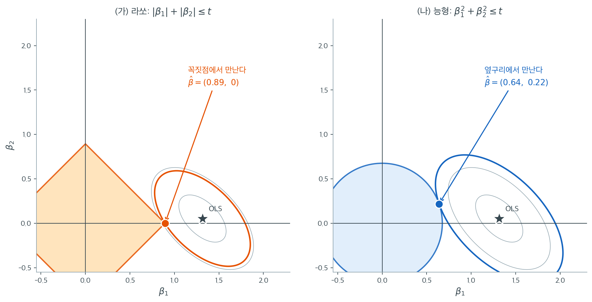

# 기하적 해석 (L1 벌점)

라쏘의 기하적 그림은 L1 벌점이 정확한 0을 만들고 L2 벌점은 그러지 못하는 이유를 드러낸다. 핵심 차이는 제약영역의 모양에 있다. L1 공은 좌표축 위에 꼭짓점을 가지며, 그 꼭짓점이 바로 하나 이상의 계수가 0인 점이다. RSS 등고선이 매끄러운 타원이므로 꼭짓점이 있는 제약집합과의 첫 접촉은 일반적으로 꼭짓점에서 일어난다.

---

## 1. L1 제약영역

$$
\|\boldsymbol{\beta}\|_1 = \sum_{j=1}^p |\beta_j| \leq t
$$

2차원에서 이 영역은 꼭짓점이 $(\pm t, 0)$과 $(0, \pm t)$인 **마름모**(45도 회전한 정사각형)이고, $p$차원에서는 **교차다면체**(초팔면체)다.

L2 공과 구별되는 기하적 성질은 다음과 같다.

- **좌표축 위의 꼭짓점.** 교차다면체의 꼭짓점은 각 좌표방향 $\mathbf{e}_j$에 대해 $\pm t\,\mathbf{e}_j$에 놓인다. 꼭짓점에서는 하나를 뺀 모든 좌표가 정확히 0이다.
- **좌표초평면 위의 모서리와 면.** 2차원 마름모의 모서리는 한 좌표가 0인 직선 위에 놓인다. 고차원의 면도 좌표의 부분집합이 0인 상황에 대응한다.
- **매끄럽지 않은 경계.** 경계에 법선 방향이 유일하지 않은 꼭짓점과 모서리가 있다.

---

## 2. RSS 등고선과 마름모의 만남

능형에서처럼 잔차제곱합은 $\hat{\boldsymbol{\beta}}_{\text{OLS}}$를 중심으로 하는 타원 등고선을 정의한다. 라쏘 해는 L1 공 위 또는 안에서 RSS를 최소화하는 점, 즉 가장 작은 RSS 등고선이 마름모에 닿는 점이다.

2차원에서 $\lambda$가 충분히 크면 $\hat{\boldsymbol{\beta}}_{\text{OLS}}$가 마름모 바깥에 놓인다. 그 중심에서 타원을 줄여 나가다가 마름모에 처음 닿는 점이 라쏘 해다.

---

## 3. 희소성이 일어나는 이유

핵심 관찰은 **매끄러운 타원이 꼭짓점 있는 다면체와 일반적으로 꼭짓점에서 접한다**는 것이다.

L1 공의 경계는 평평한 면들로 이루어져 있다(2차원에서는 마름모의 네 모서리). 각 면은 한 좌표의 부호가 고정된 부분공간에 놓이고, 꼭짓점은 면들의 교차점이다.

평평한 면 위(꼭짓점이 아닌 곳)에서 접하려면 그 점에서 RSS 기울기가 면에 수직해야 한다. 이는 **등식** 조건이다. 반면 꼭짓점에서는 제약의 부분미분이 방향들의 **원뿔**이므로 KKT 조건이 **부등식**으로 완화된다. 부등식으로 정의된 집합은 양의 측도를 가지므로 꼭짓점 접촉이 실제로 자주 일어난다.



같은 자료에 두 제약을 씌운 그림이다. $n = 60$, 표준화된 설명변수 두 개(표본상관 $0.54$), 참 계수 $(1.5,\ 0.35)$이고 OLS 해는 $(1.315,\ 0.054)$다. 회색 타원이 RSS 등고선이고, 색칠한 영역이 제약영역이며, 굵은 색 타원이 제약영역에 처음 닿는 등고선이다.

왼쪽 마름모는 $\beta_1$축 위의 **꼭짓점** $(0.894,\ 0)$에서 타원과 만난다. 해는 $\hat\beta = (0.894,\ 0)$으로 $x_2$가 모형에서 사라졌다. 여기서 중요한 것은 이 접촉이 우연이 아니라는 점이다. 꼭짓점을 조금 지나치는 방향으로 타원을 기울여 보아도 여전히 꼭짓점에서 먼저 만난다. 꼭짓점에는 **법선 방향의 원뿔**이 통째로 붙어 있어서, RSS 기울기가 그 원뿔 안에 들어오기만 하면 되기 때문이다. 조건이 등식이 아니라 부등식이므로 자료가 웬만큼 달라져도 결론이 바뀌지 않는다.

오른쪽 원은 같은 일을 하지 못한다. 접점은 $(0.640,\ 0.218)$로 두 좌표가 모두 살아 있다. 원의 경계에서는 각 점에 법선이 **정확히 하나**뿐이므로, 접점이 $\beta_2 = 0$인 축 위에 놓이려면 RSS 기울기가 그 유일한 방향과 정확히 일치해야 한다. 등식 하나를 자료가 우연히 만족시켜야 한다는 뜻이고, 연속분포에서 그 확률은 0이다. 두 그림의 차이는 벌점의 세기가 아니라 **경계에 모서리가 있느냐**뿐이다.

참 계수가 $\beta_2 = 0.35$로 0이 아니라는 점도 함께 보아야 한다. 라쏘는 참으로 0이 아닌 계수를 0으로 만들어 버렸다. 희소성은 공짜가 아니며, 작은 참 효과를 지우는 대가로 얻는 것이다. $\lambda$를 줄여 마름모를 키우면 접촉점이 꼭짓점에서 모서리로 옮겨가고 $x_2$가 다시 살아난다. **어느 쪽이 옳은지는 기하가 아니라 교차검증이 답한다.**

!!! note "일반적 희소성"
    엄밀한 의미에서, "대부분의" 자료 배치(전체 르베그 측도를 갖는 집합)에 대해 라쏘 해는 L1 공의 꼭짓점이나 저차원 면 위에 놓이며 최소한 하나의 좌표가 0이 된다. 모든 좌표가 0이 아닌 면 내부에 해가 놓이는 것은 측도 0인 자료 배치에서만 일어난다.

---

## 4. 2차원 그림

설명변수가 $p = 2$일 때 $\hat{\boldsymbol{\beta}}_{\text{OLS}}$의 위치에 따라 네 가지 경우가 있다.

**경우 1: 꼭짓점에서의 접촉.** $\hat{\boldsymbol{\beta}}_{\text{OLS}}$가 대체로 한 좌표축을 따라 놓이면 타원이 마름모의 꼭짓점에 닿는다. 한 계수는 0이 아니고 다른 하나는 정확히 0이다. 라쏘가 변수선택을 수행하는 상황이다.

**경우 2: 모서리에서의 접촉.** $\hat{\boldsymbol{\beta}}_{\text{OLS}}$가 좌표축 사이에 놓이면 타원이 마름모의 모서리에 닿을 수 있다. 두 계수가 모두 0이 아니지만 $|\beta_1| + |\beta_2| = t$ 위에 제약되며 OLS 대비 축소된다.

**경우 3: 내부 해.** $\hat{\boldsymbol{\beta}}_{\text{OLS}}$가 마름모 안에 있으면 제약이 활성화되지 않고 라쏘 해가 OLS와 같다.

**경우 4: 두 계수 모두 0.** $t$가 매우 작으면($\lambda$가 크면) 마름모가 원점의 한 점으로 줄어들어 $\hat{\boldsymbol{\beta}}_{\text{lasso}} = \mathbf{0}$이 된다.

---

## 5. L2 기하와의 대조

| 성질 | L1 (라쏘) | L2 (능형) |
|---|---|---|
| 제약 모양 | 마름모 / 교차다면체 | 구 / 초구 |
| 경계의 매끄러움 | 꼭짓점과 모서리 있음 | 어디서나 매끄러움 |
| 일반적 접촉 위치 | 꼭짓점 또는 모서리 | 경계의 내부 |
| 접촉점의 좌표 | 일부가 정확히 0 | 모두 0이 아님 |
| 희소성 | 있음 | 없음 |

---

## 6. 고차원

$p$차원에서 L1 공은 $2p$개의 꼭짓점(좌표축당 한 쌍)과 $2^p$개의 $(p-1)$차원 면, 그리고 풍부한 저차원 면 구조를 갖는다. 꼭짓점에서 접촉할 확률(0이 아닌 계수가 하나)은 타원이 구에 가까울수록(설명변수의 상관이 약할수록) 커지고, 타원이 길게 늘어날수록(상관이 강할수록) 작아진다.

주어진 $\lambda$에서 라쏘 해의 0이 아닌 계수의 개수는 접촉이 일어나는 면의 차원에 대응한다. 이 차원은 최대 $\min(n, p)$이며, $p > n$일 때 라쏘가 최대 $n$개의 변수만 고를 수 있다는 제약을 반영한다.

---

## 7. λ가 변할 때의 해 경로

$\lambda$가 $\lambda_{\max}$에서 0으로 줄어들면 제약영역이 커진다.

- $\lambda = \lambda_{\max}$: 마름모가 아주 작고 $\hat{\boldsymbol{\beta}}_{\text{lasso}} = \mathbf{0}$이다.
- $\lambda$가 줄면: 마름모가 커지고 접촉점이 점점 높은 차원의 면으로 옮겨간다(0이 아닌 계수가 늘어난다).
- $\lambda = 0$: 제약이 비활성화되고 $\hat{\boldsymbol{\beta}}_{\text{lasso}} = \hat{\boldsymbol{\beta}}_{\text{OLS}}$이다.

경로 $\hat{\boldsymbol{\beta}}_{\text{lasso}}(\lambda)$는 $\lambda$에 대해 **조각별 선형**이며, 접촉점이 다른 면으로 옮겨가는 지점에서 꺾인다.

---

## 연습문제

<div class="drillbox" markdown>

**연습문제 1.** <span class="diff med" title="중간"></span>
"경로가 $\lambda$에 대해 조각별 선형"이라는 주장을 수치로 확인하고, 꺾이는 지점이 무엇을 뜻하는지 설명하라.

</div>

??? success "풀이"
    ```python
    import numpy as np
    from sklearn.linear_model import lasso_path
    rng = np.random.default_rng(2)
    n, p = 60, 6
    X = rng.normal(size=(n, p)); X -= X.mean(0); X /= X.std(0)
    beta = np.array([3., -2., 1., 0., 0., 0.])
    y = X @ beta + rng.normal(0, 1, n); y -= y.mean()

    alphas, coefs, _ = lasso_path(X, y, n_alphas=200)
    nz = (np.abs(coefs) > 1e-10).sum(axis=0)      # 각 alpha에서 활성 변수 수
    ```

    $\lambda$를 $\lambda_{\max}$에서 줄여 가며 활성 변수의 수를 보면 **계단 함수**처럼 $0 \to 1 \to 2 \to \cdots$로 증가한다. 계단이 올라가는 지점이 경로의 꺾인점이다.

    **꺾인점의 의미.** 두 꺾인점 사이에서는 활성집합(0이 아닌 계수의 집합)이 고정되어 있고, 그 안에서 해가 $\lambda$의 **선형함수**다. 활성집합이 고정되면 KKT 조건이 선형 연립방정식이 되기 때문이다.

    $$
    \hat{\boldsymbol{\beta}}_A(\lambda) = (\mathbf{X}_A^\top\mathbf{X}_A)^{-1}(\mathbf{X}_A^\top\mathbf{y} - n\lambda\,\mathbf{s}_A)
    $$

    여기서 $\mathbf{s}_A$는 활성 계수들의 부호 벡터다. $\lambda$에 대해 명백히 선형이다.

    **이것이 LARS 알고리즘의 근거다.** 경로가 조각별 선형이므로 꺾인점만 계산하면 전체 경로를 정확히 복원할 수 있다. 격자 위의 여러 $\lambda$를 각각 푸는 것보다 훨씬 효율적이다.

<div class="drillbox" markdown>

**연습문제 2.** <span class="diff med" title="중간"></span>
설명변수의 상관이 강해지면 라쏘가 꼭짓점(변수 하나)에서 접촉할 확률이 낮아진다는 주장을 확인하라.

</div>

??? success "풀이"
    ```python
    import numpy as np
    from sklearn.linear_model import Lasso
    rng = np.random.default_rng(9)

    def active_count(rho, n=60, p=2, alpha=0.4, M=500):
        cnt = []
        for _ in range(M):
            z = rng.normal(size=n)
            X = np.c_[np.sqrt(rho)*z + np.sqrt(1-rho)*rng.normal(size=n),
                      np.sqrt(rho)*z + np.sqrt(1-rho)*rng.normal(size=n)]
            X -= X.mean(0); X /= X.std(0)
            y = X @ np.array([1., 1.]) + rng.normal(0, 1, n)
            b = Lasso(alpha=alpha).fit(X, y).coef_
            cnt.append((np.abs(b) > 1e-10).sum())
        return np.mean(np.array(cnt) == 1)
    ```

    두 설명변수, 참 계수 $(1, 1)$, 고정된 $\lambda$에서 "정확히 하나만 활성"인 비율을 잰다.

    직관은 이렇다. 상관이 **약하면** RSS 등고선이 원에 가깝다. 원이 마름모에 닿으면 가장 가까운 꼭짓점에 닿기 쉽다. 상관이 **강하면** 등고선이 마름모의 모서리와 나란한 방향으로 길게 늘어나, 꼭짓점이 아니라 모서리 전체에 걸쳐 닿는다.

    **모서리 접촉은 두 계수가 모두 0이 아니면서 $|\beta_1|+|\beta_2| = t$ 위에 놓이는 상황**이다. 이때 두 계수를 어떻게 나눌지가 거의 결정되지 않으며, 이것이 [엘라스틱넷의 그룹 효과](../elastic_net/grouping_effect.md)에서 본 라쏘의 불안정성 $[0.486, 2.136, 2.907]$의 기하적 원인이다.

    **요약하면 라쏘의 변수선택은 설명변수가 서로 직교에 가까울 때 가장 잘 작동한다.** 강한 상관 아래에서는 "어느 것을 고를지"가 자료의 사소한 변화에 좌우된다.

<div class="drillbox" markdown>

**연습문제 3.** <span class="diff med" title="중간"></span>
3 절 그림의 두 해는 라쏘 $\hat\beta^{L} = (0.894,\ 0)$, 능형 $\hat\beta^{R} = (0.640,\ 0.218)$이고 $\hat\beta^{\text{OLS}} = (1.315,\ 0.054)$다. 세 점의 $\lVert\cdot\rVert_1$과 $\lVert\cdot\rVert_2$를 계산하고, 그 값으로부터 두 해의 **잔차제곱합의 크기 순서**를 자료를 보지 않고 결정하라. 또 "라쏘는 더 많이 축소했기 때문에 0 이 나왔다"는 설명이 왜 성립하지 않는지 답하라.

</div>

??? success "풀이"
    **노름을 계산한다.**

    $$
    \lVert \hat\beta^{L} \rVert_1 = 0.894 + 0 = 0.894, \qquad
    \lVert \hat\beta^{L} \rVert_2 = \sqrt{0.894^2 + 0^2} = 0.894
    $$

    $$
    \lVert \hat\beta^{R} \rVert_1 = 0.640 + 0.218 = 0.858, \qquad
    \lVert \hat\beta^{R} \rVert_2 = \sqrt{0.640^2 + 0.218^2} = \sqrt{0.457124} = 0.676
    $$

    $$
    \lVert \hat\beta^{\text{OLS}} \rVert_1 = 1.369, \qquad
    \lVert \hat\beta^{\text{OLS}} \rVert_2 = \sqrt{1.315^2 + 0.054^2} = 1.316
    $$

    **잔차제곱합의 순서.** 라쏘 해는 $\{\boldsymbol\beta : \lVert\boldsymbol\beta\rVert_1 \le t\}$ 위에서 RSS 를 최소화하는 점이고, 그림에서 제약영역은 해를 지나므로 $t = \lVert\hat\beta^{L}\rVert_1 = 0.894$다. 그런데

    $$
    \lVert \hat\beta^{R} \rVert_1 = 0.858 < 0.894 = t
    $$

    이므로 **능형 해는 라쏘 문제의 허용집합 안에 들어 있다**. 라쏘 해가 그 집합 위의 최소점이므로

    $$
    \text{RSS}(\hat\beta^{L}) \le \text{RSS}(\hat\beta^{R})
    $$

    이다. 게다가 라쏘 해는 유일하므로(연습문제 6 에서 KKT 부등식이 엄격하게 성립함을 확인한다) $\hat\beta^{R} \ne \hat\beta^{L}$에서 부등호는 **엄격**하다. 자료를 보지 않고 노름 하나만으로 순서가 정해졌다.

    거꾸로 L2 쪽을 보면 그림의 원의 반지름은 $\lVert\hat\beta^{R}\rVert_2 = 0.676$이고

    $$
    \lVert \hat\beta^{L} \rVert_2 = 0.894 > 0.676
    $$

    이므로 **라쏘 해는 능형 문제의 허용집합 바깥**이다. 두 해는 서로의 문제에서 각각 허용되거나 허용되지 않는다.

    **왜 "더 많이 축소해서 0 이 나왔다"가 아닌가.** 세 가지 잣대로 축소의 양을 재 보면 **모두 능형 쪽이 더 많이 축소했다.**

    | 잣대 | 라쏘 | 능형 |
    |---|---|---|
    | $\lVert\hat\beta\rVert_1$ (작을수록 많이 축소) | $0.894$ | $0.858$ |
    | $\lVert\hat\beta\rVert_2$ | $0.894$ | $0.676$ |
    | $\lVert\hat\beta - \hat\beta^{\text{OLS}}\rVert_2$ (클수록 많이 축소) | $0.424$ | $0.695$ |

    그런데 0 이 생긴 쪽은 **덜** 축소한 라쏘다. 능형은 OLS 에서 더 멀리, 원점에 더 가깝게 끌어당겼는데도 두 좌표가 모두 살아 있다. 따라서 희소성은 축소의 **양**이 아니라 제약영역의 **모양**(경계에 모서리가 있느냐)에서 나온다 — 3 절의 마지막 문장과 이 쪽의 결론이 그 뜻이다. 참고로 직교설계의 능형 해 $\hat\beta^{\text{OLS}}/(1+\lambda)$ 는 $\lambda \to \infty$ 에서 0 에 수렴하기만 하고 유한한 $\lambda$ 에서 0 에 **닿지는** 못한다.

<div class="drillbox" markdown>

**연습문제 4.** <span class="diff med" title="중간"></span>
직교설계 $\mathbf{X}^\top\mathbf{X} = \mathbf{I}_p$에서 벌점꼴

$$
Q(\boldsymbol\beta) = \tfrac12 \lVert \mathbf{y} - \mathbf{X}\boldsymbol\beta \rVert^2 + \lambda \lVert \boldsymbol\beta \rVert_1
$$

을 쓰고 $\hat{\boldsymbol\beta}^{\text{OLS}} = (1.2,\ 0.4)$라 하자. 4 절의 네 경우가 각각 어느 $\lambda$ 구간에서 일어나는지 적고, 그때 제약꼴의 $t = \lVert\hat{\boldsymbol\beta}^{\text{lasso}}\rVert_1$가 어떤 범위인지 구하라. 경우 3 이 두 매개화에서 차지하는 크기가 어떻게 다른가?

</div>

??? success "풀이"
    **닫힌 꼴.** $\mathbf{X}^\top\mathbf{X} = \mathbf{I}$이므로 $\lVert\mathbf{y}-\mathbf{X}\boldsymbol\beta\rVert^2 = \lVert\mathbf{y}\rVert^2 - 2\boldsymbol\beta^\top\hat{\boldsymbol\beta} + \lVert\boldsymbol\beta\rVert^2$이고 목적함수가 좌표별로 분리된다.

    $$
    Q(\boldsymbol\beta) = \text{const} + \sum_{j=1}^p \Big[ \tfrac12 \beta_j^2 - \beta_j \hat\beta_j + \lambda \lvert \beta_j \rvert \Big]
    $$

    각 항의 부분미분을 0 으로 놓으면 $\beta_j - \hat\beta_j + \lambda s_j = 0$($\beta_j \ne 0$일 때 $s_j = \operatorname{sign}\beta_j$, $\beta_j = 0$일 때 $s_j \in [-1,1]$)이므로

    $$
    \hat\beta_j^{\text{lasso}} = S(\hat\beta_j, \lambda) = \operatorname{sign}(\hat\beta_j)\,(\lvert \hat\beta_j \rvert - \lambda)_+
    $$

    **네 경우.** $\hat{\boldsymbol\beta}^{\text{lasso}}(\lambda) = \big(S(1.2,\lambda),\ S(0.4,\lambda)\big)$를 구간별로 적는다.

    | $\lambda$ | 해 | $t$ | 4 절의 경우 |
    |---|---|---|---|
    | $\lambda = 0$ | $(1.2,\ 0.4)$ | $1.6$ | 경우 3 (내부 해) |
    | $0 < \lambda < 0.4$ | $(1.2-\lambda,\ 0.4-\lambda)$ | $1.6 - 2\lambda \in (0.8,\ 1.6)$ | 경우 2 (모서리) |
    | $0.4 \le \lambda < 1.2$ | $(1.2-\lambda,\ 0)$ | $1.2 - \lambda \in (0,\ 0.8]$ | 경우 1 (꼭짓점) |
    | $\lambda \ge 1.2$ | $(0,\ 0)$ | $0$ | 경우 4 |

    $\lambda_{\max} = \max_j \lvert \hat\beta_j \rvert = 1.2$이고, 꼭짓점으로 옮겨가는 자리는

    $$
    t^\ast = \lvert \hat\beta_1 \rvert - \lvert \hat\beta_2 \rvert = 1.2 - 0.4 = 0.8
    $$

    이다. 마름모가 $t = 0.8$보다 작아지는 순간 접촉점이 모서리에서 꼭짓점으로 옮겨가고 $x_2$가 모형에서 빠진다.

    **경우 3 의 크기.** 벌점꼴에서 경우 3 은 $\lambda = 0$ **한 점**뿐이다(길이 0). 제약꼴에서는 $t \ge 1.6$인 **반직선 전체**다(길이 $\infty$). 두 매개화는 $0 < t < 1.6 \leftrightarrow \lambda > 0$에서만 일대일로 대응하고, $t \ge 1.6$은 모두 $\lambda = 0$ 한 점으로 모인다. 그래서 "제약이 활성화되지 않는다"는 상황은 $t$ 로 보면 흔하고 $\lambda$ 로 보면 측도 0 이다 — 같은 현상을 어느 눈금으로 보느냐의 문제다.

    덧붙여 $t(\lambda)$는 $\lambda < 0.4$에서 기울기 $-2$, $\lambda > 0.4$에서 기울기 $-1$인 **조각별 선형**함수다. 7 절이 말한 경로의 꺾임이 $t$–$\lambda$ 관계에서도 그대로 보인다.

<div class="drillbox" markdown>

**연습문제 5.** <span class="diff med" title="중간"></span>
열이 서로 직교하지만 길이가 다른 설계, 즉 $\mathbf{x}_i^\top\mathbf{x}_j = 0\ (i \ne j)$이고 $\lVert\mathbf{x}_j\rVert^2$가 열마다 다른 설계에서 라쏘 해의 닫힌 꼴을 구하라. 그 꼴로부터 **단위를 바꾸는 것만으로 변수가 들어오는 순서가 뒤바뀜**을 보이고, `sklearn` 의 `Lasso` 로 수치 확인하라. (`sklearn` 은 $\frac{1}{2n}\lVert\mathbf{y}-\mathbf{X}\boldsymbol\beta\rVert^2 + \alpha\lVert\boldsymbol\beta\rVert_1$을 최소화하므로 연습문제 4 의 $\lambda$ 와는 $\lambda = n\alpha$로 이어진다.)

</div>

??? success "풀이"
    **닫힌 꼴.** 열이 직교하면 목적함수가 다시 좌표별로 분리된다.

    $$
    Q(\boldsymbol\beta) = \text{const} + \sum_j \Big[ \tfrac12 \lVert \mathbf{x}_j \rVert^2 \beta_j^2 - \beta_j\, \mathbf{x}_j^\top \mathbf{y} + \lambda \lvert \beta_j \rvert \Big]
    $$

    부분미분을 0 으로 놓으면 $\lVert\mathbf{x}_j\rVert^2 \beta_j - \mathbf{x}_j^\top\mathbf{y} + \lambda s_j = 0$이므로

    $$
    \hat\beta_j^{\text{lasso}} = \frac{S(\mathbf{x}_j^\top \mathbf{y},\ \lambda)}{\lVert \mathbf{x}_j \rVert^2},
    \qquad \hat\beta_j^{\text{lasso}} = 0 \iff \lvert \mathbf{x}_j^\top \mathbf{y} \rvert \le \lambda
    $$

    **핵심은 들어오는 문턱이 $\lvert\mathbf{x}_j^\top\mathbf{y}\rvert$라는 것이다.** $\mathbf{x}_j \to c\,\mathbf{x}_j$로 단위를 바꾸면 이 문턱이 $\lvert c \rvert$ 배가 된다. 벌점은 $\beta_j$ 에 걸리는데 단위를 키우면 같은 효과를 더 작은 $\beta_j$ 로 표현하게 되니, **큰 단위로 재인 변수는 거의 죽지 않는다**. 표준화하지 않은 설계에서 라쏘의 변수선택은 자료가 아니라 자의 눈금이 결정한다.

    ```python
    import numpy as np
    from sklearn.linear_model import Lasso

    n = 50
    rng = np.random.default_rng(18)
    Z = rng.normal(size=(n, 2)); Z -= Z.mean(0)
    Q, _ = np.linalg.qr(Z)                      # 직교하는 두 열
    Xs = np.sqrt(n) * Q                         # 표준화 척도: 평균 0, 제곱합 n
    e = rng.normal(size=n); e -= e.mean()
    e -= Xs @ np.linalg.lstsq(Xs, e, rcond=None)[0]    # 열공간에 수직인 잡음
    y = Xs @ np.array([0.8, 0.5]) + e           # OLS 가 정확히 (0.8, 0.5)
    Xr = Xs.copy(); Xr[:, 1] = 100 * Xs[:, 1]   # x2 의 단위만 100 배

    def soft(z, t):
        return np.sign(z) * np.maximum(np.abs(z) - t, 0.0)

    def fit(Xd, a):
        return Lasso(alpha=a, fit_intercept=False,
                     max_iter=100000, tol=1e-12).fit(Xd, y).coef_

    for name, Xd in (("표준화", Xs), ("단위변경", Xr)):
        c = Xd.T @ y / n
        print(f"{name} 척도: x1.y/n = {c[0]:.4f}  x2.y/n = {c[1]:.4f}  "
              f"alpha_max = {np.abs(c).max():.4f}")
    print()
    print("alpha      표준화 (b1, b2)      단위변경 (b1, b2)")
    for a in (0.6, 1.0, 10.0):
        bs, br = fit(Xs, a), fit(Xr, a)
        print(f"{a:5.1f}   {bs[0]:8.4f} {bs[1]:8.4f}      {br[0]:8.4f} {br[1]:8.6f}")
    gap = max(np.abs(fit(Xd, a) - soft(Xd.T @ y, n * a) / (Xd ** 2).sum(0)).max()
              for a in (0.6, 1.0, 10.0) for Xd in (Xs, Xr))
    print(f"\n닫힌 꼴과의 최대 차이 = {gap:.2e}")
    ```

    출력:

    ```text
    표준화 척도: x1.y/n = 0.8000  x2.y/n = 0.5000  alpha_max = 0.8000
    단위변경 척도: x1.y/n = 0.8000  x2.y/n = 50.0000  alpha_max = 50.0000

    alpha      표준화 (b1, b2)      단위변경 (b1, b2)
      0.6     0.2000   0.0000        0.2000 0.004940
      1.0     0.0000   0.0000        0.0000 0.004900
     10.0     0.0000   0.0000        0.0000 0.004000

    닫힌 꼴과의 최대 차이 = 2.78e-16
    ```

    **읽는 법.** 닫힌 꼴과 `sklearn` 이 $10^{-16}$까지 일치하므로 아래의 수는 모두 손으로 검산된다.

    - 표준화 척도에서 두 변수의 진입 문턱은 $\alpha = 0.8,\ 0.5$다. $\alpha$ 를 $\alpha_{\max} = 0.8$에서 내리면 **$x_1$ 이 먼저** 들어온다.
    - $x_2$ 의 단위만 $100$ 배 키우면 문턱이 $\alpha = 50$으로 뛴다. 이제 $\alpha_{\max} = 50$이고 **$x_2$ 가 먼저** 들어온다. 진입 순서가 완전히 뒤집혔다.
    - $\alpha = 1.0$에서 표준화 척도의 해는 $(0,0)$ — 모형이 비어 버린다. 같은 $\alpha$, 같은 자료인데 단위변경 척도의 해는 $x_2$ 하나만 살아 있다. 어느 변수를 고를지가 눈금에 좌우된다는 증거다.
    - 단위변경 척도의 $\hat\beta_2 = 0.004940$은 원래 눈금으로 되돌리면 $100 \times 0.004940 = 0.494$로 거의 축소되지 않았다. 반면 $x_1$ 은 $0.8 \to 0.2$로 네 배 가까이 줄었다. 벌점이 사실상 $x_1$ 에만 걸린 셈이다.

    **결론.** L1 벌점은 척도에 불변이 아니다. `sklearn` 의 `Lasso`·`Ridge` 는 표준화를 해 주지 않으므로 반드시 `StandardScaler` 를 앞에 붙여야 한다(그리고 그 표준화는 연습문제 10 처럼 폴드 안에서 해야 한다). 기하로 말하면, 단위를 바꾸는 것은 마름모는 그대로 두고 **RSS 타원만 늘이고 줄이는** 일이어서 첫 접촉점이 어느 꼭짓점인지를 바꾼다.

<div class="drillbox" markdown>

**연습문제 6.** <span class="diff hard" title="어려움"></span>
3 절 그림의 자료는 $n = 60$, 표준화된 두 열($\lVert\mathbf{x}_j\rVert^2 = n$, 표본상관 $\rho = 0.54$), $\hat{\boldsymbol\beta}^{\text{OLS}} = (1.315,\ 0.054)$, 라쏘 해 $(0.894,\ 0)$이다. 이 수만 가지고 (가) 그 해에 대응하는 $u = \lambda / n$ 을 구하고, (나) 꼭짓점 해의 KKT 부등식이 얼마나 여유 있게 성립하는지 계산하고, (다) $x_2$ 가 다시 모형에 들어오는 매듭 $u^\ast$ 와 그 자리의 $\hat\beta_1$ 을 구하라. 끝으로 꼭짓점 접촉이 경로의 몇 퍼센트를 차지하는지 말하라.

</div>

??? success "풀이"
    **준비: 충분통계량.** 열이 표준화되어 있으므로 $\mathbf{X}^\top\mathbf{X} = n\mathbf{R}$, $\mathbf{R} = \begin{pmatrix}1 & \rho\\ \rho & 1\end{pmatrix}$이고 $\mathbf{X}^\top\mathbf{y} = \mathbf{X}^\top\mathbf{X}\hat{\boldsymbol\beta}^{\text{OLS}} = n\mathbf{R}\hat{\boldsymbol\beta}^{\text{OLS}}$다. 따라서

    $$
    \frac{\mathbf{x}_1^\top \mathbf{y}}{n} = 1.315 + 0.54 \times 0.054 = 1.34416,
    \qquad
    \frac{\mathbf{x}_2^\top \mathbf{y}}{n} = 0.54 \times 1.315 + 0.054 = 0.76410
    $$

    **(가) $u = \lambda/n$.** 목적함수 $\frac12\lVert\mathbf{y}-\mathbf{X}\boldsymbol\beta\rVert^2 + \lambda\lVert\boldsymbol\beta\rVert_1$의 해가 $\boldsymbol\beta = (b, 0)$, $b > 0$이면 첫 좌표의 조건은 등식이다.

    $$
    \mathbf{x}_1^\top(\mathbf{y} - b\,\mathbf{x}_1) = \lambda
    \quad\Longrightarrow\quad
    1.34416 - b = u
    $$

    $b = 0.894$를 넣으면 $u = 1.34416 - 0.894 = 0.45016$이다. ($\lambda_{\max}/n = \max_j \lvert \mathbf{x}_j^\top\mathbf{y}\rvert / n = 1.34416$이므로 그림은 경로의 중간쯤이다.)

    **(나) 꼭짓점의 KKT 부등식.** $\beta_2 = 0$이 허용되려면 두 번째 좌표의 부분미분이 0 을 포함해야 하고, 그 조건은 **부등식**이다.

    $$
    \frac{1}{n}\big\lvert \mathbf{x}_2^\top(\mathbf{y} - b\,\mathbf{x}_1) \big\rvert
    = \lvert 0.76410 - 0.54 \times 0.894 \rvert
    = \lvert 0.76410 - 0.48276 \rvert = 0.28134 \;\le\; 0.45016 = u
    $$

    여유가 $0.45016 - 0.28134 = 0.16882$로 꽤 크다. **이 여유가 3 절이 말한 "법선 방향의 원뿔"의 폭이다.** $b$ 는 $\mathbf{x}_2^\top\mathbf{y}$ 에 의존하지 않으므로, 자료가 흔들려 $\mathbf{x}_2^\top\mathbf{y}/n$ 이 $0.16882$ 만큼 커져도(또는 얼마든지 작아져도) 해는 여전히 같은 꼭짓점 $(0.894,\ 0)$에 머문다. 등식 하나를 우연히 맞춰야 하는 L2 와 달리, 부등식에는 두께가 있다.

    **(다) 매듭.** $u$ 를 줄이면 $b(u) = 1.34416 - u$로 커지고 (나)의 좌변은

    $$
    \lvert 0.76410 - 0.54\,(1.34416 - u) \rvert = 0.0382536 + 0.54\,u
    $$

    로 커진다. 이것이 $u$ 와 같아지는 순간 $x_2$ 가 들어온다.

    $$
    0.0382536 + 0.54\,u = u
    \quad\Longrightarrow\quad
    u^\ast = \frac{0.0382536}{0.46} = 0.08316
    $$

    그 자리의 첫 좌표는 $b = 1.34416 - 0.08316 = 1.26100$이고, 제약꼴로는 $t = 1.261$이다.

    **꼭짓점이 차지하는 비율.** 경로는 $u \in [0,\ 1.34416]$이고 그 가운데 $x_2$ 가 0 인 구간은 $[0.08316,\ 1.34416]$이다.

    $$
    \frac{1.34416 - 0.08316}{1.34416} = \frac{1.26100}{1.34416} = 0.938
    $$

    **경로의 94 퍼센트에서 해가 꼭짓점에 있다.** 3 절이 "꼭짓점 접촉은 우연이 아니다"라고 한 말의 정량적 모습이다.

    **기호로 정리하면.** $c_j = \mathbf{x}_j^\top\mathbf{y}/n$ 이라 하면 $c_1 = \hat\beta_1 + \rho\hat\beta_2$, $c_2 = \rho\hat\beta_1 + \hat\beta_2$이므로

    $$
    u^\ast = \frac{c_2 - \rho c_1}{1 - \rho}
    = \frac{\hat\beta_2 (1 - \rho^2)}{1 - \rho}
    = \hat\beta_2 (1 + \rho),
    \qquad
    b(u^\ast) = c_1 - u^\ast = \hat\beta_1 - \hat\beta_2
    $$

    실제로 $0.054 \times 1.54 = 0.08316$, $1.315 - 0.054 = 1.261$로 위의 수와 정확히 맞는다. 매듭이 $\hat\beta_2$ 에 비례하므로 **$x_2$ 의 OLS 효과가 작을수록 $x_2$ 는 더 오래 꼭짓점 밖에 머문다.** 또 매듭에서의 첫 좌표 $b(u^\ast) = \hat\beta_1 - \hat\beta_2$ 는 $\rho$ 에 전혀 의존하지 않으며, $\rho = 0$ 을 넣으면 $u^\ast = \hat\beta_2$ 로 연습문제 4 의 연성문턱 문턱값과 같아진다.

<div class="drillbox" markdown>

**연습문제 7.** <span class="diff hard" title="어려움"></span>
연습문제 6 의 답을 수치로 확인하라. 그림의 충분통계량($n = 60$, $\rho = 0.54$, $\hat{\boldsymbol\beta}^{\text{OLS}} = (1.315, 0.054)$)을 **정확히** 재현하는 설계행렬을 만들고, `sklearn` 의 `Lasso` 로 $\alpha = 0.45016$에서의 해와 $x_2$ 의 진입 매듭을 구해 손으로 구한 $0.894$, $0.28134$, $0.08316$, $1.26100$과 맞춰 보라.

</div>

??? success "풀이"
    **설계 만들기.** 라쏘 해는 $(\mathbf{X}^\top\mathbf{X},\ \mathbf{X}^\top\mathbf{y})$ 에만 의존하므로 그 두 값을 맞추면 된다. 중심화한 난수행렬을 QR 분해해 정규직교열 $\mathbf{Q}$ 를 얻고, $\mathbf{R} = \mathbf{L}\mathbf{L}^\top$(촐레스키)로 $\mathbf{X} = \sqrt{n}\,\mathbf{Q}\mathbf{L}^\top$ 를 쓰면

    $$
    \mathbf{X}^\top\mathbf{X} = n\,\mathbf{L}\mathbf{Q}^\top\mathbf{Q}\mathbf{L}^\top = n\,\mathbf{L}\mathbf{L}^\top = n\mathbf{R}
    $$

    이다. $\mathbf{y} = \mathbf{X}\hat{\boldsymbol\beta}^{\text{OLS}} + \mathbf{e}$에서 $\mathbf{e}$ 를 열공간에 수직으로 잡으면 OLS 가 정확히 $(1.315, 0.054)$가 된다. `sklearn` 의 $\alpha$ 는 연습문제 5 의 관계로 $u = \lambda/n = \alpha$ 와 같다.

    ```python
    import numpy as np
    from sklearn.linear_model import Lasso

    n, rho = 60, 0.54
    rng = np.random.default_rng(54)
    Z = rng.normal(size=(n, 2)); Z -= Z.mean(0)
    Q, _ = np.linalg.qr(Z)
    L = np.linalg.cholesky(np.array([[1.0, rho], [rho, 1.0]]))
    Xg = np.sqrt(n) * Q @ L.T                   # X'X = n R, 열마다 평균 0, 제곱합 n
    e = rng.normal(size=n); e -= e.mean()
    e -= Xg @ np.linalg.lstsq(Xg, e, rcond=None)[0]
    yg = Xg @ np.array([1.315, 0.054]) + e      # OLS 가 정확히 그림의 값

    bo = np.linalg.lstsq(Xg, yg, rcond=None)[0]
    print(f"표본상관 = {np.corrcoef(Xg.T)[0, 1]:.4f}   "
          f"OLS = ({bo[0]:.4f}, {bo[1]:.4f})")
    c = Xg.T @ yg / n
    print(f"X'y/n = ({c[0]:.5f}, {c[1]:.5f})   alpha_max = {np.abs(c).max():.5f}")

    def fitg(a):
        return Lasso(alpha=a, fit_intercept=False,
                     max_iter=100000, tol=1e-12).fit(Xg, yg).coef_

    b = fitg(0.45016)
    r = Xg.T @ (yg - Xg @ b) / n
    print(f"alpha = 0.45016 -> ({b[0]:.4f}, {b[1]:.4f})   "
          f"|x2'r|/n = {abs(r[1]):.5f}")

    lo, hi = 1e-4, 0.45016                      # x2 가 들어오는 매듭을 이분법으로
    for _ in range(60):
        mid = 0.5 * (lo + hi)
        if abs(fitg(mid)[1]) > 1e-10:
            lo = mid
        else:
            hi = mid
    bk = fitg(hi)
    print(f"매듭 alpha* = {hi:.4f}   그 자리의 b1 = {bk[0]:.4f}")
    ```

    출력:

    ```text
    표본상관 = 0.5400   OLS = (1.3150, 0.0540)
    X'y/n = (1.34416, 0.76410)   alpha_max = 1.34416
    alpha = 0.45016 -> (0.8940, 0.0000)   |x2'r|/n = 0.28134
    매듭 alpha* = 0.0832   그 자리의 b1 = 1.2610
    ```

    네 수가 모두 손으로 구한 값과 같다. $\alpha = 0.45016$에서 해가 $(0.8940,\ 0)$ 즉 그림의 꼭짓점이고, KKT 여유 $0.28134$, 매듭 $0.0832$, 매듭에서의 $\hat\beta_1 = 1.2610$이다.

    **덧붙임 — $\alpha$ 와 $\lambda$ 를 섞으면 어떻게 되는가.** $\frac12$ 가 없는 교과서 꼴 $\lVert\mathbf{y}-\mathbf{X}\boldsymbol\beta\rVert^2 + \lambda_{\text{tb}}\lVert\boldsymbol\beta\rVert_1$ 로 같은 해를 적으려면 양변에 $2n$ 을 곱해야 하므로

    $$
    \lambda_{\text{tb}} = 2n\alpha = 2 \times 60 \times 0.45016 = 54.02
    $$

    다. 이 $54.02$ 를 그대로 `Lasso(alpha=...)` 에 넣으면 $\alpha_{\max} = 1.34416$ 을 한참 넘으므로 해가 $(0,\ 0)$ 으로 떨어진다. 수가 조금 틀어지는 것이 아니라 모형이 통째로 사라진다. 세 가지 꼴의 관계를 한 줄로 적어 두면 $\lambda_{\text{tb}} = 2\lambda = 2n\alpha$ 다 — 라이브러리의 목적함수를 먼저 확인하는 습관이 필요한 까닭이다.

<div class="drillbox" markdown>

**연습문제 8.** <span class="diff hard" title="어려움"></span>
3 절 끝의 "일반적 희소성" 노트는 **"대부분의 자료 배치에 대해 최소한 하나의 좌표가 0 이 된다"**고 말한다. 고정된 $\lambda$ 에 대해 이 주장이 틀림을 반례로 보이고, 반례가 측도 0 이 아님을 확인하라. 그리고 노트를 올바른 주장으로 고쳐 쓰라.

</div>

??? success "풀이"
    **반례.** 직교설계 $\mathbf{X}^\top\mathbf{X} = \mathbf{I}_2$, $\hat{\boldsymbol\beta}^{\text{OLS}} = (1.2,\ 0.4)$, $\lambda = 0.2$를 잡으면 연습문제 4 의 닫힌 꼴로

    $$
    \hat{\boldsymbol\beta}^{\text{lasso}} = \big(S(1.2, 0.2),\ S(0.4, 0.2)\big) = (1.0,\ 0.2)
    $$

    이다. **0 인 좌표가 하나도 없다.** 기하로 보면 해가 마름모의 $(p-1)$차원 면(2 차원에서는 모서리) **안쪽**에 놓인 경우 2 이고, 그 면의 상대적 내부에서는 모든 좌표가 0 이 아니다.

    **측도 0 이 아님.** 직교설계에서 좌표가 0 이 되지 않을 조건은

    $$
    \lvert \hat\beta_j \rvert = \lvert \mathbf{x}_j^\top\mathbf{y} \rvert > \lambda \quad (j = 1, 2)
    $$

    인데 이것은 $\mathbf{y}$ 에 대한 **열린 조건**이다. 열린 집합이 공집합이 아니면 르베그 측도가 양이다. 즉 "0 이 없는 해"가 나오는 자료 배치가 양의 측도를 갖는다. 수치로 확인한다.

    ```python
    import numpy as np
    rng = np.random.default_rng(77)
    M, sigma = 20000, 0.03
    bhat = np.array([1.2, 0.4]) + sigma * rng.normal(size=(M, 2))
    bl = np.sign(bhat) * np.maximum(np.abs(bhat) - 0.2, 0.0)
    bh = np.sign(bhat) * np.maximum(np.abs(bhat) - 0.6, 0.0)
    for lam, b in ((0.2, bl), (0.6, bh)):
        print(f"lambda = {lam:.1f}:  0 이 하나 이상 = {np.mean((b == 0).any(1)):.4f}   "
              f"b1 = 0 인 비율 = {np.mean(b[:, 0] == 0):.4f}   "
              f"b2 = 0 인 비율 = {np.mean(b[:, 1] == 0):.4f}")
    ```

    출력:

    ```text
    lambda = 0.2:  0 이 하나 이상 = 0.0000   b1 = 0 인 비율 = 0.0000   b2 = 0 인 비율 = 0.0000
    lambda = 0.6:  0 이 하나 이상 = 1.0000   b1 = 0 인 비율 = 0.0000   b2 = 0 인 비율 = 1.0000
    ```

    직교설계에서 $\hat{\boldsymbol\beta}^{\text{OLS}} = \mathbf{X}^\top\mathbf{y}$ 는 $\mathbf{y}$ 의 선형상이므로 $\hat{\boldsymbol\beta}^{\text{OLS}}$ 를 흔드는 것이 곧 $\mathbf{y}$ 를 흔드는 것이다. $\sigma = 0.03$ 으로 2 만 번 흔들었더니 $\lambda = 0.2$ 에서는 **20000 번 모두** 0 이 없고, $\lambda = 0.6$ 에서는 **20000 번 모두** $\beta_2$ 가 0 이었다. 어느 쪽도 예외적 사건이 아니다 — 두 사건 모두 확률이 사실상 1 이다.

    **무엇이 주장을 결정하는가.** 직교설계에서 0 의 개수는 자료의 "일반성"이 아니라 $\lambda$ 가 정한다.

    $$
    \#\{j : \hat\beta_j^{\text{lasso}} = 0\} = \#\{j : \lvert \mathbf{x}_j^\top\mathbf{y} \rvert \le \lambda\}
    $$

    $\lambda < \min_j \lvert \mathbf{x}_j^\top\mathbf{y}\rvert$ 면 0 이 하나도 없고, $\lambda \ge \max_j \lvert \mathbf{x}_j^\top\mathbf{y}\rvert$ 면 모두 0 이다. 연습문제 4 의 표에서 경우 2 가 차지하는 $0 < \lambda < 0.4$ 구간은 길이가 $0.4$ 로 멀쩡히 양수다.

    **고쳐 쓴 노트.** "대부분의 자료 배치에 대해 **라쏘 해는 유일하고, 그 부호패턴(어느 좌표가 0 인지)은 자료의 작은 변화에 대해 바뀌지 않는다.** 또 $p > n$ 일 때 0 이 아닌 좌표는 많아야 $n$ 개다. 0 의 개수 자체는 $\lambda$ 가 정하며, $\lambda$ 가 작으면 0 이 없을 수도 있다." 측도 0 인 것은 "0 이 없는 해"가 아니라 **KKT 부등식이 등식으로 딱 맞는 경계 상황**이다. 3 절의 논증이 실제로 보인 것도 그것이다 — 꼭짓점 접촉이 부등식으로 정의되어 **두께**를 갖는다는 것이지, 모든 $\lambda$ 에서 좌표가 죽는다는 것이 아니다.

<div class="drillbox" markdown>

**연습문제 9.** <span class="diff hard" title="어려움"></span>
6 절은 라쏘가 많아야 $\min(n, p)$ 개의 변수를 고른다고 했다. $n = 1$, $p = 2$, $\mathbf{X} = (2\ \ 1)$, $y = 3$ 인 극단적인 설계에서 $\frac12(y - \mathbf{X}\boldsymbol\beta)^2 + \lambda\lVert\boldsymbol\beta\rVert_1$ 의 해를 모든 $\lambda > 0$ 에 대해 손으로 구하라. 이 설계에서 RSS 등고선은 어떤 모양인가? 또 $\mathbf{X} = (2\ \ 2)$ 로 바꾸면 무엇이 깨지는가?

</div>

??? success "풀이"
    **KKT 조건.** 잔차를 $r = 3 - 2\beta_1 - \beta_2$ 라 하면

    $$
    \frac{\partial}{\partial \beta_1}: \; -2r + \lambda s_1 = 0, \qquad
    \frac{\partial}{\partial \beta_2}: \; -r + \lambda s_2 = 0
    $$

    여기서 $s_j = \operatorname{sign}\beta_j$($\beta_j \ne 0$), $s_j \in [-1,1]$($\beta_j = 0$)이다.

    **두 좌표가 모두 0 이 아닌 해는 없다.** 그런 해가 있다면 $s_1, s_2 \in \{\pm1\}$이고 두 식에서 $r = \lambda s_1 / 2$와 $r = \lambda s_2$ 를 동시에 얻는데, $\lambda > 0$이므로 $\lvert \lambda s_1/2 \rvert = \lambda/2 \ne \lambda = \lvert \lambda s_2 \rvert$로 모순이다. **$n = 1$ 이므로 0 이 아닌 좌표는 많아야 1 개다** — 6 절의 $\min(n,p)$ 가 그대로 나타났다.

    **$\beta_2 = 0,\ \beta_1 > 0$ 인 경우.** 첫 식에서 $r = \lambda/2$, 곧

    $$
    3 - 2\beta_1 = \frac{\lambda}{2}
    \quad\Longrightarrow\quad
    \beta_1 = \frac{3}{2} - \frac{\lambda}{4}
    $$

    $\beta_2 = 0$ 의 조건은 $\lvert -r \rvert \le \lambda$, 즉 $\lambda/2 \le \lambda$ 로 **모든 $\lambda > 0$ 에서 성립**한다. $\beta_1 > 0$ 이려면 $\lambda < 6$ 이어야 한다.

    **$\beta_1 = 0,\ \beta_2 > 0$ 인 경우.** 둘째 식에서 $r = \lambda$, $\beta_2 = 3 - \lambda$. 그런데 $\beta_1 = 0$ 의 조건 $\lvert -2r \rvert = 2\lambda \le \lambda$ 는 $\lambda > 0$ 에서 **절대 성립하지 않는다**. 탈락이다.

    **답.**

    $$
    \hat{\boldsymbol\beta}^{\text{lasso}}(\lambda) =
    \begin{cases}
    \big(\tfrac32 - \tfrac{\lambda}{4},\ 0\big), & 0 < \lambda < 6 \\
    (0,\ 0), & \lambda \ge 6
    \end{cases}
    $$

    예를 들어 $\lambda = 0.5$ 면 $\hat{\boldsymbol\beta} = (1.375,\ 0)$이고 $\lambda_{\max} = \max_j \lvert \mathbf{x}_j^\top y \rvert = \lvert 2 \times 3 \rvert = 6$이다. **$x_2$ 는 어떤 $\lambda > 0$ 에서도 들어오지 못한다.**

    **등고선의 모양.** $\mathbf{X}^\top\mathbf{X}$ 가 특이행렬(랭크 1)이므로 RSS 등고선은 타원이 아니라 **평행한 직선들** $2\beta_1 + \beta_2 = c$ 다(한 방향으로 무한히 늘어난 퇴화한 타원). 기울기 $-2$ 는 마름모의 모서리 기울기 $\pm 1$ 보다 급하므로, $c = 3$ 에서 직선을 평행이동해 마름모 $\lVert\boldsymbol\beta\rVert_1 \le t$ 에 처음 닿게 하면 언제나 $\beta_1$ 축 위의 **꼭짓점** $(t,\ 0)$ 이다($t < 3/2$ 일 때. $t \ge 3/2$ 면 직선이 마름모를 가로질러 RSS $= 0$ 인 해가 선분을 이루고, 이것이 $\lambda = 0$ 에 대응한다). "급한 기울기의 직선은 긴 쪽 꼭짓점을 찍는다"가 이 설계의 전부다.

    **$\mathbf{X} = (2\ \ 2)$ 로 바꾸면.** 등고선 $2\beta_1 + 2\beta_2 = c$ 의 기울기가 $-1$ 로 마름모의 모서리와 **나란해진다**. 직선이 모서리 전체에 동시에 닿으므로 해가

    $$
    \{(\beta_1, \beta_2) : \beta_1 + \beta_2 = t,\ \beta_1 \ge 0,\ \beta_2 \ge 0\}
    $$

    꼴의 선분 전체가 되어 **유일성이 깨진다**. 두 열이 완전히 상관되어 있으니 라쏘가 둘을 구별할 근거가 없다. 다만 $\mathbf{X}$ 를 아주 조금만 흔들어도 기울기가 $-1$ 에서 벗어나 해가 다시 꼭짓점 하나로 떨어진다. 이것이 바로 3 절의 노트가 말하는 **측도 0 의 예외**이며, 그런 설정에서는 개별 계수가 아니라 $\beta_1 + \beta_2$ 나 예측값처럼 유일하게 정해지는 양만 보고해야 한다.

<div class="drillbox" markdown>

**연습문제 10.** <span class="diff hard" title="어려움"></span>
3 절은 "어느 쪽이 옳은지는 기하가 아니라 교차검증이 답한다"로 끝난다. 그 답이 거짓일 수 있는 경우를 수로 보여라. $\mathbf{y}$ 가 $\mathbf{X}$ 와 **완전히 무관한** 자료($n = 50$, $p = 200$)에서 상관이 큰 변수 10 개를 (가) 전체 자료로 한 번 고른 뒤 교차검증하는 경우와 (나) 폴드마다 훈련부분만으로 고르는 경우의 CV 오차를 비교하라.

</div>

??? success "풀이"
    ```python
    import numpy as np
    rng = np.random.default_rng(1910)
    n, p, K, k = 50, 200, 5, 10
    Xc = rng.normal(size=(n, p))
    yc = rng.normal(size=n)                     # y 는 X 와 전혀 무관하다
    folds = np.array_split(rng.permutation(n), K)

    def top_k(Xt, yt):
        Xd = Xt - Xt.mean(0)
        s = np.abs(Xd.T @ (yt - yt.mean())) / np.linalg.norm(Xd, axis=0)
        return np.sort(np.argsort(-s)[:k])

    sel_all = top_k(Xc, yc)                     # 누수: 전체 자료로 고른다

    def cv_mse(inside):
        tot = 0.0
        for f in folds:
            tr = np.setdiff1d(np.arange(n), f)
            idx = top_k(Xc[tr], yc[tr]) if inside else sel_all
            A = np.c_[np.ones(len(tr)), Xc[np.ix_(tr, idx)]]
            bb = np.linalg.lstsq(A, yc[tr], rcond=None)[0]
            B = np.c_[np.ones(len(f)), Xc[np.ix_(f, idx)]]
            tot += ((yc[f] - B @ bb) ** 2).sum()
        return tot / n

    base = ((yc - yc.mean()) ** 2).mean()
    leak, clean = cv_mse(False), cv_mse(True)
    print(f"y 의 분산                = {base:.4f}")
    print(f"선택을 폴드 밖에서 (누수)  CV MSE = {leak:.4f}   R^2 = {1 - leak / base:+.4f}")
    print(f"선택을 폴드 안에서        CV MSE = {clean:.4f}   R^2 = {1 - clean / base:+.4f}")
    ```

    출력:

    ```text
    y 의 분산                = 1.0869
    선택을 폴드 밖에서 (누수)  CV MSE = 0.9374   R^2 = +0.1375
    선택을 폴드 안에서        CV MSE = 2.2980   R^2 = -1.1143
    ```

    **읽는 법.** 참값은 "$\mathbf{X}$ 에 아무 정보가 없다"이므로 정직한 CV 오차는 $\mathbf{y}$ 의 분산 $1.0869$ 보다 **커야** 한다. 실제로 폴드 안에서 고른 쪽은 $2.2980$($R^2 = -1.11$)로 그렇게 나온다. 변수 10 개를 공짜로 적합한 대가다.

    반면 전체 자료로 한 번 고르고 교차검증한 쪽은 $0.9374$($R^2 = +0.1375$)로 **분산보다 작다**. 설명력이 전혀 없는 자료에서 13.75 퍼센트의 설명력이 나왔다. 두 CV 오차의 비는 $2.2980 / 0.9374 = 2.45$ 로, 누수가 오차를 2.45 배 과소평가했다.

    **왜 그런가.** $p = 200$ 개의 순수한 잡음 변수 가운데 $\mathbf{y}$ 와 상관이 가장 큰 10 개를 고르면, 그 상관은 **검증 폴드에 든 관측까지 써서** 고른 것이다. 검증 폴드는 이미 선택 단계에서 본 자료이므로 더 이상 "본 적 없는 자료"가 아니다. 선택이라는 적합 과정이 교차검증의 바깥으로 빠져나갔다.

    **이 쪽의 주제와의 관계.** 기하는 주어진 $\lambda$ 에서 해가 어느 면에 놓이는지를 말해 주지만 어느 $\lambda$ 가 옳은지는 말해 주지 않는다. 그 판정을 교차검증에 맡기는 순간, **표준화와 변수선택을 비롯한 모든 자료 의존적 처리가 폴드 안으로 들어가야 한다.** 그러지 않으면 CV 가 고르는 $\lambda$ 는 너무 작은 쪽으로 — 변수를 너무 많이 남기는 쪽으로 — 치우친다. `sklearn` 에서는 `Pipeline(StandardScaler(), Lasso())` 을 `cross_val_score` 에 넘겨 폴드마다 전처리가 다시 적합되게 하는 것이 정석이다.

---

## 정리하며

라쏘의 제약영역은 좌표축 위에 꼭짓점을 갖는 마름모(교차다면체)다. RSS 등고선이 매끄러운 타원이므로 마름모와의 첫 접촉이 일반적으로 꼭짓점에서 일어나고, 그곳에서 하나 이상의 좌표가 0이 된다. 이것이 라쏘 희소성의 기하적 기제다. 반면 L2 벌점의 매끄러운 구에는 꼭짓점이 없으므로 능형회귀는 일반적으로 모든 좌표가 0이 아닌 해를 낸다. **추정량이 희소한지를 결정하는 것은 목적함수의 성질이 아니라 제약영역의 모양이다.**
