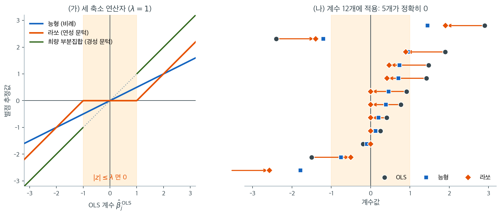

# 라쏘 회귀 (L1 정칙화)

## 1. 동기: 희소성과 변수선택

능형회귀는 계수를 0 쪽으로 축소하지만 결코 정확히 0으로 만들지 않는다. 많은 응용에서, 특히 $p$가 클 때 우리는 무관한 계수를 정확히 0으로 만들어 유의미한 변수를 자동으로 **선택**하는 추정량을 원한다.

Tibshirani(1996)가 도입한 **라쏘**(Least Absolute Shrinkage and Selection Operator)는 L1 벌점을 써서 정칙화와 변수선택을 동시에 달성한다.

---

## 2. 라쏘의 정식화

$$
\hat{\boldsymbol{\beta}}_{\text{lasso}} = \arg\min_{\boldsymbol{\beta}} \left\{ \frac{1}{2n}\|\mathbf{y} - \mathbf{X}\boldsymbol{\beta}\|^2 + \lambda \|\boldsymbol{\beta}\|_1 \right\}
$$

동등한 제약 형태는

$$
\min_{\boldsymbol{\beta}} \|\mathbf{y} - \mathbf{X}\boldsymbol{\beta}\|^2 \quad \text{제약} \quad \sum_{j=1}^p |\beta_j| \leq t
$$

이다.

---

## 3. L1이 희소성을 낳는 이유: 기하적 논증

L1 제약집합은 2차원에서 **마름모**, 고차원에서 교차다면체다. 그 꼭짓점이 좌표축 위에 놓인다. OLS 등고선이 타원이므로 타원과 마름모의 첫 접촉이 대개 꼭짓점에서 일어나고, 그곳에서 하나 이상의 좌표가 정확히 0이다.

반면 L2 제약(구)에는 꼭짓점이 없어 접촉점이 좌표축 위에 놓이는 일이 거의 없다.

| 벌점 | 제약 모양 | 축 위의 꼭짓점 | 정확한 0 |
|---|---|---|---|
| L1 (라쏘) | 마름모 / 교차다면체 | 있음 | 있음 |
| L2 (능형) | 구 / 초구 | 없음 | 없음 |

자세한 논증은 [기하적 해석 (L1 벌점)](geometry.md)을 보라.

---

## 4. 부분미분과 연성 문턱 연산자

L1 노름 $|\beta_j|$는 $\beta_j = 0$에서 **미분 불가능**하므로 **부분미분**을 쓴다.

$$
\partial |\beta_j| = \begin{cases} \{+1\} & \beta_j > 0 \\ [-1, +1] & \beta_j = 0 \\ \{-1\} & \beta_j < 0 \end{cases}
$$

**직교 설계**($\mathbf{X}^\top\mathbf{X} = n\mathbf{I}$)라는 특수한 경우에 라쏘 해는 닫힌 형태를 갖는다.

$$
\hat{\beta}_j^{\text{lasso}} = S_\lambda(\hat{\beta}_j^{\text{OLS}}) = \text{sign}(\hat{\beta}_j^{\text{OLS}})\max(|\hat{\beta}_j^{\text{OLS}}| - \lambda, 0)
$$

이것이 **연성 문턱** 연산자다. $[-\lambda, \lambda]$ 안의 계수는 정확히 0이 되고 그보다 큰 계수는 $\lambda$만큼 축소된다.

능형(직교인 경우)과 비교하면

$$
\hat{\beta}_j^{\text{ridge}} = \frac{\hat{\beta}_j^{\text{OLS}}}{1 + \lambda}
$$

이다. 능형은 비례 축소를, 라쏘는 잘라내기를 동반한 평행이동 축소를 적용한다.

왼쪽은 세 방법이 OLS 계수를 어떤 값으로 바꾸는지를 $\lambda = 1$에서 그린 것이다. 회색 점선이 아무것도 하지 않는 경우($y = x$)이고, 세 곡선이 그 아래로 얼마나 내려오는지가 축소의 양이다. 능형(파랑)은 직선 $z/2$로, 어디서나 절반으로 줄인다. 라쏘(주황)는 주황색 띠 안에서는 완전히 납작하고 밖에서는 $y = x$와 나란한 직선이다. 최량 부분집합(초록)은 띠 밖에서 점선과 겹친다. **문턱을 넘은 계수를 건드리지 않는 유일한 방법**이다.

세 곡선의 차이가 실전에서 어떻게 나타나는지는 오른쪽이 보여준다. OLS 계수 12개를 크기순으로 늘어놓고 라쏘가 어디로 옮기는지 화살표로 표시했다. $2.90 \to 1.90$, $-3.57 \to -2.57$처럼 **모든 화살표의 길이가 정확히 $\lambda = 1$로 같다.** 띠 안에 있던 다섯 개($0.92,\ 0.77,\ 0.41,\ 0.25,\ -0.19$)는 화살표조차 보이지 않는데, 옮겨갈 곳이 0이기 때문이다.

같은 자리의 파란 사각형(능형)을 보면 대조가 분명해진다. $0.25$였던 계수는 능형에서 $0.13$이 되어 여전히 모형 안에 남는다. 큰 계수 $2.90$은 능형에서 $1.45$로 라쏘의 $1.90$보다 **더 많이** 깎였다. 비례 축소는 큰 계수를 더 많이 깎고 작은 계수는 살려 두며, 평행이동 축소는 모두에게 같은 양을 요구해 작은 것부터 쓰러뜨린다.

여기서 라쏘의 두 얼굴이 한꺼번에 드러난다. 0이 된 다섯 개는 **변수선택**이고, 살아남은 일곱 개가 각각 $\lambda$만큼 작아진 것은 **축소 편향**이다. 라쏘라는 이름(Least Absolute Shrinkage and Selection Operator)이 두 단어를 모두 담고 있는 이유이며, 선택된 계수를 효과크기로 읽으면 안 되는 이유이기도 하다.

---

## 5. 좌표하강 알고리즘

일반적인(직교가 아닌) 계획행렬에서는 닫힌 형태 해가 없다. 표준 알고리즘은 **좌표하강**(Friedman et al., 2010)이다.

1. $\hat{\boldsymbol{\beta}} = \mathbf{0}$으로 초기화한다.
2. $j = 1, \ldots, p$를 순회하며 부분잔차를 계산하고 $\hat{\beta}_j \leftarrow S_\lambda\left(\frac{1}{n}\sum_i x_{ij} r_i^{(j)}\right)$로 갱신한다.
3. 수렴할 때까지 반복한다.

각 좌표 갱신이 연성 문턱 형태이므로 알고리즘이 효율적이다. R의 `glmnet`과 파이썬의 `sklearn.linear_model.Lasso`가 이 알고리즘을 쓴다. 자세한 내용은 [좌표하강 알고리즘](coordinate_descent.md)을 보라.

---

## 6. 라쏘 해 경로

$\lambda$가 $\lambda_{\max}$(모든 계수가 0)에서 0(OLS)까지 변하면 계수가 하나씩 모형에 들어온다. 경로 $\hat{\beta}_j(\lambda)$는 $\lambda$에 대해 **조각별 선형**이다(Efron et al., 2004의 LARS 결과).

$$
\lambda_{\max} = \frac{1}{n}\|\mathbf{X}^\top\mathbf{y}\|_\infty
$$

이며 $\lambda \geq \lambda_{\max}$에서 라쏘 해는 $\hat{\boldsymbol{\beta}} = \mathbf{0}$이다.

---

## 7. λ의 선택

능형에서처럼 **교차검증**으로 고른다. 표준 관행은 $\lambda_{\max}$에서 $0.001 \cdot \lambda_{\max}$까지 로그 척도로 100개 정도의 격자를 잡아 전체 해 경로를 계산하고, 각 점에서 CV 오차를 구해 최적 $\lambda$를 고르는 것이다.

---

## 8. 성질

**1. 희소성.** 일부 $\hat{\beta}_j = 0$인 희소해를 만들어 자동 변수선택이 가능하다.

**2. 편향.** 라쏘 계수는 0 쪽으로 편향된다. 선택된 변수에 대해서도 점근적으로 편향이 사라지지 않는다.

**3. 일치성.** **비대표 조건**(Zhao and Yu, 2006) 아래에서 라쏘는 확률 1로 올바른 변수 집합을 고른다. 이 조건이 없으면 모형선택 일치성이 깨질 수 있다.

**4. 예측.** 희소성 가정 아래에서 거의 최적인 예측오차율을 달성한다.

---

## 9. 한계

1. **집단 선택.** 강하게 상관된 설명변수에서 라쏘는 하나만 고르고 나머지를 버리는 경향이 있으며, 그 선택이 임의적이다. 능형은 모두 남기고 계수 질량을 분배한다.
2. **$p > n$ 한계.** $p > n$일 때 라쏘는 최대 $n$개의 변수만 고를 수 있다.
3. **선택된 계수의 편향.** 0이 아닌 계수가 체계적으로 0 쪽으로 편향된다. 사후 라쏘 OLS로 이를 줄일 수 있다.

---

## 10. 베이즈 해석

라쏘는 **라플라스(이중지수) 사전분포** 아래의 MAP 추정량이다.

$$
\beta_j \overset{\text{iid}}{\sim} \text{Laplace}(0, b)
$$

라플라스 분포는 0에서 뾰족하고 가우스보다 꼬리가 두꺼워 MAP 추정에서 정확한 희소성을 촉진한다.

| 정칙화 | 사전분포 | 0에서의 밀도 |
|---|---|---|
| 능형 (L2) | $N(0, \tau^2)$ | 매끄럽고 유한 |
| 라쏘 (L1) | Laplace$(0, b)$ | 뾰족하고 유한 |
| 최량 부분집합 | 스파이크-앤-슬랩 | 0에서 점질량 |

!!! warning "척도모수를 $1/\lambda$로 쓰지 말 것"
    간이 서술에서 흔히 $\beta_j \sim \text{Laplace}(0, 1/\lambda)$라고 쓰지만 이는 정확하지 않다. [베이즈 해석](bayesian.md)에서 유도했듯 올바른 관계는

    $$
    \lambda = \frac{\sigma^2}{nb} \quad\Longleftrightarrow\quad b = \frac{\sigma^2}{n\lambda}
    $$

    이다. 잡음분산 $\sigma^2$과 표본크기 $n$이 모두 들어간다. $\sigma^2 = n = 1$인 특수한 규격화에서만 $b = 1/\lambda$가 된다.

---

## 연습문제

**연습문제 1.** 
직교 설계에서 라쏘와 능형의 축소 규칙이 각각 "평행이동"과 "비례"임을 수치로 확인하고, 작은 계수에 미치는 영향이 왜 크게 다른지 설명하라.

??? success "풀이"
    자세한 검증은 [라쏘의 정식화와 희소성](formulation.md) 연습문제 1에 있다. 요지만 옮기면, $\mathbf{X}^\top\mathbf{X} = n\mathbf{I}$인 자료에서

    | | $\hat\beta = 2.889$ | $\hat\beta = 0.086$ |
    |:---|---:|---:|
    | 능형 ($\times 0.980$) | 2.833 ($-2$%) | 0.085 ($-2$%) |
    | 라쏘 ($-0.05$) | 2.839 ($-2$%) | 0.036 ($-58$%) |

    **큰 계수에는 두 방법의 효과가 같지만 작은 계수에는 전혀 다르다.**

    능형은 모든 계수를 같은 **비율**로 깎으므로 작은 계수의 상대적 크기가 보존된다. 라쏘는 모든 계수에서 같은 **양**을 빼므로, 그 양보다 작은 계수는 0이 되어 사라진다.

    이것이 "능형은 축소만 하고 라쏘는 선택도 한다"는 말의 산술적 내용이다.

**연습문제 2.** 
라쏘의 세 가지 한계(집단 선택, $p > n$, 편향) 중 엘라스틱넷이 해결하는 것과 해결하지 못하는 것을 구분하라.

??? success "풀이"
    | 한계 | 엘라스틱넷이 해결하는가 |
    |:---|:---|
    | 집단 선택 (상관된 변수에서 임의로 하나 선택) | **해결한다.** L2 항이 그룹 효과를 만들어 상관된 변수를 함께 유지한다. |
    | $p > n$일 때 최대 $n$개 제한 | **해결한다.** L2 항이 목적함수를 강볼록으로 만들어 해가 유일해지고, $n$개보다 많은 변수를 선택할 수 있다. |
    | 선택된 계수의 편향 | **해결하지 못한다.** L1 항이 여전히 연성 문턱을 적용하므로 편향이 남는다. 오히려 L2 항이 축소를 더한다. |

    셋째 항목이 중요하다. 엘라스틱넷의 갱신식

    $$
    \hat{\beta}_j \leftarrow \frac{S_{\alpha\lambda}(z_j)}{1 + (1-\alpha)\lambda}
    $$

    을 보면 분자에서 $\alpha\lambda$만큼 깎고 분모에서 또 나눈다. **두 번 축소된다.**

    Zou와 Hastie(2005)는 이 "이중 축소"가 예측을 해칠 수 있다고 보고, 계수에 $(1 + \lambda_2)$를 곱해 되돌리는 **보정 엘라스틱넷**(corrected elastic net)을 제안했다. sklearn의 `ElasticNet`은 이 보정을 하지 **않는다**.

    편향이 문제라면 엘라스틱넷으로 변수를 고른 뒤 그 변수들로 OLS를 다시 적합하는 것이 여전히 최선이다([변수선택 도구로서의 라쏘](feature_selection.md) 연습문제 1 참조).

**연습문제 3.** 
직교 설계 $\mathbf{X}^\top\mathbf{X} = n\mathbf{I}$ 에서 OLS 추정값이 $\hat{\boldsymbol{\beta}}^{\text{OLS}} = (0.9,\ 0.3)$ 이고 $\lambda = 0.5$ 다.
(가) 4 절의 연성 문턱 공식으로 라쏘 해를 구하라.
(나) 이제 둘째 설명변수의 **단위만** 바꾸어 $\tilde{\mathbf{x}}_2 = c\,\mathbf{x}_2$ 로 기록한다(센티미터를 밀리미터로 적으면 $c = 10$). 벌점은 그대로 $\lambda = 0.5$ 를 쓴다. 새 해를 원래 단위로 환산한 값이 $S_{\lambda/c}(\hat\beta_2^{\text{OLS}})$ 임을 보이라.
(다) $c = 10$ 과 $c = 0.1$ 에서 그 값을 구하고, 어느 쪽에서 둘째 변수가 모형에 들어오는지 말하라.
(라) 표준화가 이 문제를 없애는 까닭을 한 줄로 적고, sklearn 의 `Lasso` 를 쓸 때 반드시 해야 할 일을 말하라.

??? success "풀이"
    **(가)** $S_{0.5}(0.9) = 0.9 - 0.5 = 0.4$ 이고 $\lvert 0.3\rvert < 0.5$ 이므로 둘째는 0 이다.

    $$
    \hat{\boldsymbol{\beta}}^{\text{lasso}} = (0.4,\ 0)
    $$

    **(나)** 열을 $c$ 배 해도 직교성은 깨지지 않으므로 목적함수는 여전히 좌표별로 쪼개진다. $z_2 = \mathbf{x}_2^\top\mathbf{y}/n = \hat\beta_2^{\text{OLS}}$ 라 두고 $\mathbf{x}_2^\top\mathbf{x}_2 = n$ 을 쓰면, 새 계수 $\gamma_2$ 에 걸리는 항은

    $$
    \frac{1}{2n}\left(-2c\gamma_2\,\mathbf{x}_2^\top\mathbf{y} + c^2\gamma_2^2\,\mathbf{x}_2^\top\mathbf{x}_2\right) + \lambda\lvert\gamma_2\rvert = -c z_2\gamma_2 + \frac{c^2}{2}\gamma_2^2 + \lambda\lvert\gamma_2\rvert
    $$

    이다. 양변을 $c^2 > 0$ 으로 나누어도 최소점은 같으므로

    $$
    \frac{1}{2}\gamma_2^2 - \frac{z_2}{c}\gamma_2 + \frac{\lambda}{c^2}\lvert\gamma_2\rvert \quad\Longrightarrow\quad \hat\gamma_2 = S_{\lambda/c^2}\!\left(\frac{z_2}{c}\right)
    $$

    이다. 원래 단위로 환산한 계수는 적합값 $\gamma_2\tilde{\mathbf{x}}_2 = (c\gamma_2)\mathbf{x}_2$ 에서 읽듯 $c\hat\gamma_2$ 이고, 연성 문턱의 양차수 성질 $c\,S_t(u) = S_{ct}(cu)$ ($c>0$) 에서

    $$
    c\hat\gamma_2 = c\,S_{\lambda/c^2}(z_2/c) = S_{\lambda/c}(z_2) \qquad \square
    $$

    **단위를 $c$ 배 크게 적으면 그 변수의 유효 문턱이 $\lambda/c$ 로 줄어든다.**

    **(다)**

    | $c$ | 새 단위의 OLS | 유효 문턱 $\lambda/c$ | 원래 단위로 환산한 라쏘 |
    |:---|---:|---:|---:|
    | $1$ | $0.3$ | $0.5$ | $0$ |
    | $10$ | $0.03$ | $0.05$ | $0.25$ |
    | $0.1$ | $3.0$ | $5.0$ | $0$ |

    $c = 10$ 에서 둘째 변수가 **모형에 들어온다.** 자료도 적합도도 바뀐 것이 없고 그 변수를 밀리미터로 적었을 뿐인데 변수선택의 결론이 뒤집힌다. $c = 0.1$ 에서는 여전히 0 이다(문턱이 $5$ 로 커졌다). 첫째 변수는 단위를 건드리지 않았으므로 두 경우 모두 $0.4$ 다.

    **(라)** 표준화는 모든 열의 $\mathbf{x}_j^\top\mathbf{x}_j$ 를 같게 만들어 **모든 변수가 같은 유효 문턱 $\lambda$ 를 받게** 한다. 그래야 $\lambda$ 가 "계수의 크기" 라는 하나의 자로 읽힌다. sklearn 의 `Ridge`·`Lasso` 는 표준화를 해 주지 않으므로 `StandardScaler` 를 **파이프라인에 묶어** 직접 넣어야 한다(그리고 그 표준화는 교차검증 폴드 안에서 일어나야 한다 — 연습문제 9).

    큰 수로 적힌 변수가 벌점을 덜 받는다는 것이 요점이다. 단위가 뒤섞인 자료에 표준화 없이 라쏘를 돌리면 "소득(원)" 이 "나이(년)" 를 밀어내는데, 그것은 통계가 아니라 자가 한 일이다.

**연습문제 4.** 
4 절 그림의 계수 $\hat\beta^{\text{OLS}} = 0.25$ 와 $2.90$ 을 쓴다(직교 설계).
(가) 능형으로 $0.25$ 를 $0.001$ 이하로 줄이려면 $\lambda$ 가 얼마 이상이어야 하는가. 그 $\lambda$ 에서 $2.90$ 은 어떤 값이 되는가.
(나) 라쏘로 $0.25$ 를 정확히 0 으로 만드는 가장 작은 $\lambda$ 를 구하고, 그때 $2.90$ 이 되는 값을 구하라.
(다) 능형이 두 계수의 비를 $\lambda$ 와 무관하게 보존함을 보이고, 이것이 능형으로 변수선택을 할 수 없는 까닭임을 설명하라.

??? success "풀이"
    **(가)** $0.25/(1+\lambda) \le 0.001 \iff 1+\lambda \ge 250 \iff \lambda \ge 249$. 그 $\lambda = 249$ 에서

    $$
    \frac{2.90}{250} = 0.0116
    $$

    이다. 원래 값의 $0.4\%$ 만 남는다. 작은 계수 하나를 사실상 지우는 값을 치르고 **큰 계수의 $99.6\%$ 를 버렸다.**

    **(나)** 연성 문턱은 $\lvert\hat\beta\rvert \le \lambda$ 에서 0 이므로 가장 작은 값은 $\lambda = 0.25$ 다. 그때

    $$
    S_{0.25}(2.90) = 2.90 - 0.25 = 2.65
    $$

    로 큰 계수의 $91.4\%$ 가 남는다.

    | | $0.25$ 를 지우는 데 든 $\lambda$ | 그때 남은 $2.90$ | 남은 비율 |
    |:---|---:|---:|---:|
    | 라쏘 | $0.25$ | $2.65$ | $91.4\%$ |
    | 능형 | $249$ (근사적으로만) | $0.0116$ | $0.4\%$ |

    **(다)** 능형은 모든 좌표에 같은 인자 $1/(1+\lambda)$ 를 곱하므로

    $$
    \frac{\hat\beta_1^{\text{ridge}}}{\hat\beta_2^{\text{ridge}}} = \frac{\hat\beta_1^{\text{OLS}}/(1+\lambda)}{\hat\beta_2^{\text{OLS}}/(1+\lambda)} = \frac{\hat\beta_1^{\text{OLS}}}{\hat\beta_2^{\text{OLS}}} = \frac{2.90}{0.25} = 11.6
    $$

    로 $\lambda$ 가 사라진다. $\lambda \to \infty$ 에서도 비는 $11.6$ 이고, 두 계수는 **함께** 0 으로 간다. 하나만 0 이 되는 $\lambda$ 는 존재하지 않는다.

    라쏘는 같은 양을 빼므로 비가 $\lambda$ 에 따라 바뀐다. $\lambda = 0.25$ 에서 비는 $2.65/0 = \infty$ 로 **발산하고**, 바로 이 발산이 "변수 하나가 모형에서 빠졌다" 는 말의 산술적 내용이다.

    **능형은 선별적으로 지울 수 없다 — 하나를 지우려면 전부를 지워야 한다.** 비례 축소와 평행이동 축소의 차이가 변수선택 능력의 유무로 곧바로 번역되는 자리다.

**연습문제 5.** 
직교 설계 $\mathbf{X}^\top\mathbf{X} = n\mathbf{I}$ 와 $\mathbf{y} = \mathbf{X}\boldsymbol{\beta} + \boldsymbol{\varepsilon}$, $\boldsymbol{\varepsilon} \sim N(\mathbf{0}, \sigma^2\mathbf{I})$ 를 둔다. 능형 추정량 $\hat{\boldsymbol{\beta}}^{\text{ridge}} = \hat{\boldsymbol{\beta}}^{\text{OLS}}/(1+\lambda)$ 의 총 평균제곱오차를 $\text{MSE}(\lambda) = \sum_{j=1}^p E(\hat\beta_j^{\text{ridge}} - \beta_j)^2$ 로 쓴다.
(가) $v = \sigma^2/n$, $S = \lVert\boldsymbol{\beta}\rVert^2$ 라 두고 $\text{MSE}(\lambda)$ 를 닫힌 꼴로 구하라.
(나) $\text{MSE}'(0) < 0$ 임을 보이고, 최적 $\lambda^*$ 와 그때의 MSE 를 구하라.
(다) $p = 10$, $n = 100$, $\sigma^2 = 1$ 에서 $S = 0.5$ 와 $S = 10$ 의 두 경우에 $\lambda^*$ 와 MSE 감소율을 수로 구하고, 능형이 언제 크게 이기는지 말하라.

??? success "풀이"
    **(가)** 직교 설계에서 $\hat{\boldsymbol{\beta}}^{\text{OLS}} = \mathbf{X}^\top\mathbf{y}/n$ 이고

    $$
    \text{Var}(\hat{\boldsymbol{\beta}}^{\text{OLS}}) = \sigma^2(\mathbf{X}^\top\mathbf{X})^{-1} = \frac{\sigma^2}{n}\mathbf{I} = v\mathbf{I}
    $$

    이다. 6 장 정리 1 의 편향–분산 분해를 좌표마다 적용하면 편향이 $\beta_j/(1+\lambda) - \beta_j = -\lambda\beta_j/(1+\lambda)$, 분산이 $v/(1+\lambda)^2$ 이므로

    $$
    \text{MSE}(\lambda) = \sum_{j=1}^p\left[\frac{\lambda^2\beta_j^2}{(1+\lambda)^2} + \frac{v}{(1+\lambda)^2}\right] = \frac{\lambda^2 S + pv}{(1+\lambda)^2}
    $$

    이다. $\text{MSE}(0) = pv$ 가 OLS 의 값이고, $\lambda\to\infty$ 에서 $S$ (모두 0 으로 보낸 추정량의 오차) 로 간다.

    **(나)** 미분하면 분자가 $2\lambda S(1+\lambda)^2 - (\lambda^2 S + pv)\cdot 2(1+\lambda)$ 이므로 $(1+\lambda)$ 를 약분해

    $$
    \text{MSE}'(\lambda) = \frac{2\left[\lambda S(1+\lambda) - \lambda^2 S - pv\right]}{(1+\lambda)^3} = \frac{2(\lambda S - pv)}{(1+\lambda)^3}
    $$

    를 얻는다. 따라서 $\text{MSE}'(0) = -2pv < 0$ 이다. **$\lambda = 0$ 에서 기울기가 음수이므로 OLS 를 이기는 $\lambda > 0$ 이 반드시 존재한다.** 또 도함수의 부호가 $\lambda S - pv$ 의 부호와 같으므로 유일한 최소점은

    $$
    \lambda^* = \frac{pv}{S} = \frac{p\sigma^2}{n\lVert\boldsymbol{\beta}\rVert^2}
    $$

    이고, 대입하면

    $$
    \text{MSE}(\lambda^*) = \frac{(pv)^2/S + pv}{\left((S+pv)/S\right)^2} = \frac{pv\,S}{S + pv} = pv\cdot\frac{S}{S+pv} < pv
    $$

    이다. $\square$

    **(다)** $v = 1/100 = 0.01$, $pv = 0.1$ 이 OLS 의 MSE 다.

    | $S = \lVert\boldsymbol{\beta}\rVert^2$ | $\lambda^* = pv/S$ | $\text{MSE}(\lambda^*)$ | OLS 대비 |
    |---:|---:|---:|---:|
    | $0.5$ | $0.2$ | $0.1 \times \frac{0.5}{0.6} = 0.08333$ | $-16.7\%$ |
    | $10$ | $0.01$ | $0.1 \times \frac{10}{10.1} = 0.09901$ | $-1.0\%$ |

    **참 계수가 작을 때 이득이 크다.** 이득의 크기가 $S/(S+pv)$ 라는 한 덩어리에 들어 있고, 이것은 "신호 $S$ 대 잡음 $pv$" 의 비로 읽힌다. 신호가 잡음에 비해 크면 축소할 것이 없고($\lambda^* \to 0$), 작으면 0 쪽으로 끌어당기는 것이 압도적으로 유리하다.

    이기는 $\lambda$ 가 **반드시 있다**는 것과 그 $\lambda$ 를 **알 수 있다**는 것은 다른 이야기임도 눈여겨볼 만하다. $\lambda^*$ 가 미지의 $S$ 와 $\sigma^2$ 에 의존하므로 실제로는 교차검증으로 더듬어 찾아야 한다.

**연습문제 6.** 
직교 설계, $\sigma = 1$, $n = 100$ 이면 $\hat\beta_j^{\text{OLS}} \sim N(\beta_j,\ 0.01)$ 로 표준편차가 $0.1$ 이다. 연성 문턱 $S_\lambda$ 를 적용한다.
(가) $\lambda = 0.2$ 에서 참값이 $\beta_j = 0$ 인 계수가 정확히 0 으로 추정될 확률을 구하라.
(나) 같은 $\lambda$ 에서 참값이 $\beta_j = 0.5$ 인 계수가 0 으로 추정될 확률을 구하라.
(다) 참값이 0 인 계수가 $100$ 개일 때 그중 **적어도 하나**가 살아남을 확률을 $\lambda = 0.2$ 와 $\lambda = 0.3$ 에서 구하라.
(라) (다)의 확률을 $0.05$ 이하로 만드는 가장 작은 $\lambda$ 를 구하고, 그 $\lambda$ 에서 $\beta_j = 0.5$ 를 잃을 확률을 구하라. 결과를 $\sigma\sqrt{2\log p\,/\,n}$ 과 비교하라.

??? success "풀이"
    $\hat\beta_j$ 의 표준편차를 $s = 0.1$ 로 쓴다. 연성 문턱이 0 을 주는 사건은 $\lvert\hat\beta_j\rvert \le \lambda$ 다.

    **(가)** $\beta_j = 0$ 이면

    $$
    P(\lvert\hat\beta_j\rvert \le 0.2) = 2\Phi\!\left(\frac{0.2}{0.1}\right) - 1 = 2\Phi(2) - 1 = 2(0.97725) - 1 = 0.9545
    $$

    이다.

    **(나)** $\beta_j = 0.5$ 이면

    $$
    P(-0.2 \le \hat\beta_j \le 0.2) = \Phi\!\left(\frac{0.2-0.5}{0.1}\right) - \Phi\!\left(\frac{-0.2-0.5}{0.1}\right) = \Phi(-3) - \Phi(-7) = 0.001350
    $$

    이다($\Phi(-7) \approx 1.3\times 10^{-12}$ 로 무시할 수 있다). **영계수의 $95.4\%$ 를 지우면서 진짜 효과는 $0.14\%$ 만 잃는다** — 이것이 라쏘가 쓸모 있는 이유의 전부다.

    **(다)** 독립이므로 전부 0 이 될 확률은 $(0.9545)^{100}$ 이고

    $$
    P(\text{적어도 하나 살아남음}) = 1 - (0.9545)^{100} = 1 - 0.00951 = 0.9905
    $$

    이다. $\lambda = 0.3$ 이면 한 개가 0 이 될 확률이 $2\Phi(3)-1 = 0.99730$ 이므로

    $$
    1 - (0.99730)^{100} = 1 - 0.7631 = 0.2369
    $$

    다. 변수를 $100$ 개 보면 $3$ 표준편차 문턱으로도 거짓 양성이 네 번에 한 번은 나온다.

    **(라)** $\left(2\Phi(\lambda/s) - 1\right)^{100} \ge 0.95$ 를 풀면

    $$
    2\Phi(\lambda/s) - 1 \ge 0.95^{1/100} = 0.9994872 \quad\Longrightarrow\quad \Phi(\lambda/s) \ge 0.9997436
    $$

    이고 $\lambda/s \ge 3.4740$ 이므로 $\lambda \ge 0.3474$ 다. 그 $\lambda$ 에서

    $$
    P(\beta_j = 0.5 \text{ 를 잃음}) = \Phi\!\left(\frac{0.347-0.5}{0.1}\right) - \Phi\!\left(\frac{-0.347-0.5}{0.1}\right) = \Phi(-1.526) = 0.0635
    $$

    이다. 거짓 양성을 $5\%$ 로 묶는 대가로 **진짜 효과를 놓칠 확률이 $0.14\%$ 에서 $6.4\%$ 로 $47$ 배 커졌다.**

    | $\lambda$ | 영계수 하나를 지울 확률 | $100$ 개 중 거짓 양성 | $\beta = 0.5$ 를 잃을 확률 |
    |---:|---:|---:|---:|
    | $0.2$ | $0.9545$ | $0.9905$ | $0.00135$ |
    | $0.3$ | $0.99730$ | $0.2369$ | $0.02275$ |
    | $0.3474$ | $0.9994872$ | $0.0500$ | $0.0635$ |

    **비교.** $\sigma\sqrt{2\log p / n} = \sqrt{2\log 100}/10 = 3.0349/10 = 0.3035$ 로 우리가 구한 $0.3474$ 와 같은 크기다. 이론이 권하는 $\lambda \asymp \sigma\sqrt{2\log p/n}$ 가 바로 이 다중성 계산의 결과이고, $\log p$ 가 들어가는 까닭도 여기 있다 — 변수 수가 늘면 문턱을 $\sqrt{\log p}$ 로 천천히 올려야 거짓 양성이 묶인다.

    8 절의 "편향" 과 "일치성" 이 한 화면에 같이 있는 셈이다. 희소성은 공짜가 아니라 **중간 크기의 진짜 효과를 버리는 값**으로 산다.

**연습문제 7.** 
능형의 적합값은 $\hat{\mathbf{y}} = \mathbf{H}_\lambda\mathbf{y}$ 로 선형이고, 유효 자유도를 $\operatorname{tr}(\mathbf{H}_\lambda)$ 로 정의한다. 라쏘의 유효 자유도는 0 이 아닌 계수의 개수가 불편추정이 된다(Zou·Hastie·Tibshirani, 2007).
(가) 직교 설계에서 $\operatorname{tr}(\mathbf{H}_\lambda) = p/(1+\lambda)$ 임을 보이고 $\lambda \to 0$, $\lambda \to \infty$ 의 극한을 확인하라.
(나) 4 절 그림의 $p = 12$, $\lambda = 1$ 에서 능형과 라쏘의 유효 자유도를 각각 구하라.
(다) 라쏘는 계수 다섯 개를 0 으로 만들었는데 자유도가 능형보다 **크다.** 이 역설을 풀이하라.
(라) 능형의 자유도를 라쏘와 같게 맞추는 $\lambda$ 를 구하고, 그 $\lambda$ 에서 계수 $0.25$ 와 $2.90$ 이 어떻게 되는지 적으라.

??? success "풀이"
    **(가)** 직교 설계에서 능형 계수가 $\hat{\boldsymbol{\beta}}^{\text{ridge}} = \hat{\boldsymbol{\beta}}^{\text{OLS}}/(1+\lambda)$ 이므로

    $$
    \hat{\mathbf{y}} = \mathbf{X}\hat{\boldsymbol{\beta}}^{\text{ridge}} = \frac{1}{1+\lambda}\mathbf{X}(\mathbf{X}^\top\mathbf{X})^{-1}\mathbf{X}^\top\mathbf{y} = \frac{1}{1+\lambda}\mathbf{P}\mathbf{y}
    $$

    이고 $\mathbf{P}$ 는 $\mathbf{X}$ 의 열공간으로의 사영행렬이다(0 장). 사영행렬의 대각합은 계수(rank)와 같아 $\operatorname{tr}(\mathbf{P}) = p$ 이므로

    $$
    \operatorname{tr}(\mathbf{H}_\lambda) = \frac{p}{1+\lambda} \qquad \square
    $$

    $\lambda \to 0$ 에서 $p$ (OLS 가 모수 $p$ 개를 다 쓴다), $\lambda\to\infty$ 에서 $0$ (상수모형) 이다. 일반 설계의 $\sum_j d_j^2/(d_j^2 + n\lambda)$ 에 $d_j^2 = n$ 을 넣은 것과 같다.

    **(나)** $\lambda = 1$ 에서

    | | 유효 자유도 |
    |:---|---:|
    | 능형 | $12/(1+1) = 6$ |
    | 라쏘 | 0 이 아닌 계수의 개수 $= 7$ |

    그림에서 띠 안의 다섯 개가 0 이 되었으므로 라쏘는 $12 - 5 = 7$ 이다.

    **(다)** 자유도는 "쓰는 변수의 개수" 가 아니라 **적합값이 자료에 반응하는 총량** $\sum_i \partial\hat y_i/\partial y_i$ 다. 두 방법이 그 총량을 전혀 다르게 배분한다.

    - 라쏘는 문턱을 넘은 7 개에 대해서는 $\hat\beta_j = \hat\beta_j^{\text{OLS}} \mp \lambda$ 이므로 $\partial\hat\beta_j/\partial\hat\beta_j^{\text{OLS}} = 1$ 이다. **살아남은 변수는 OLS 와 똑같은 민감도로 자료를 따라간다.** 7 개가 온전히 1 씩 기여하고 나머지 5 개가 0 을 기여해 합이 7 이다.
    - 능형은 12 개 모두를 쓰지만 각각의 민감도가 $1/(1+\lambda) = 0.5$ 로 **반씩만** 자료를 따라간다. $12 \times 0.5 = 6$ 이다.

    변수 다섯 개를 완전히 버린 쪽이 더 복잡한 것은, 남긴 변수를 **아무 제약 없이** 쓰기 때문이다. 자유도를 쓸 때 "변수 개수" 로 바꿔 읽으면 안 되는 이유가 이 한 줄에 있다. 라쏘에서는 그 둘이 우연히 일치하는데, 그것도 연성 문턱의 기울기가 정확히 1 이라는 특수한 사정 때문이다(그림 왼쪽에서 라쏘 곡선이 띠 밖에서 점선과 나란한 것이 바로 그 기울기 1 이다).

    **(라)** $12/(1+\lambda) = 7$ 에서

    $$
    \lambda = \frac{12}{7} - 1 = \frac{5}{7} = 0.7143
    $$

    이고 축소인자는 $1/(1+5/7) = 7/12 = 0.5833$ 이다.

    | 계수 | 라쏘 ($\lambda = 1$) | 능형 ($\lambda = 5/7$) |
    |---:|---:|---:|
    | $2.90$ | $1.90$ | $1.6917$ |
    | $0.25$ | $0$ | $0.1458$ |

    **자유도가 똑같이 7 인데 모형에 든 변수의 개수는 7 대 12 다.** 같은 복잡도 예산을 라쏘는 몇 개에 몰아주고 능형은 전부에 얇게 펴 바른다. 정보기준($\text{AIC} = n\log\hat\sigma^2 + 2\,\mathrm{df}$ 꼴)으로 두 방법을 비교할 때 이 값을 넣어야 하며, 라쏘 쪽에 0 이 아닌 개수를 그대로 넣어도 되는 것은 (다)에서 본 기울기 1 덕분이다.

**연습문제 8.** 
9 절의 "집단 선택" 한계를 $p = 2$ 에서 수로 본다. $\frac{1}{n}\mathbf{X}^\top\mathbf{X} = \begin{pmatrix}1 & \rho\\ \rho & 1\end{pmatrix}$, $\mathbf{z} = \frac{1}{n}\mathbf{X}^\top\mathbf{y} = (z+\delta,\ z-\delta)$ 로 두 설명변수가 거의 대등하다.
(가) 두 계수가 모두 양수인 라쏘 해를 닫힌 꼴로 구하고, 두 계수의 차가 $2\delta/(1-\rho)$ 임을 보이라.
(나) $\rho = 0.99$, $z = 0.5$, $\lambda = 0.1$ 에서 $\delta = 0$ 과 $\delta = 0.003$ 의 해를 각각 구하라($\delta = 0.003$ 에서는 KKT 조건으로 활성집합을 확인하라). 한쪽이 0 이 되기 시작하는 $\delta^*$ 도 구하라.
(다) 엘라스틱넷(L2 벌점 $\frac{\lambda_2}{2}\lVert\boldsymbol{\beta}\rVert^2$ 추가, $\lambda_2 = 0.1$)에서 같은 $\delta = 0.003$ 의 해와 $\delta^*$ 를 구하고, 증폭계수가 어떻게 바뀌는지 적으라.

??? success "풀이"
    $\mathbf{G} = \frac{1}{n}\mathbf{X}^\top\mathbf{X}$ 라 두면 목적함수가

    $$
    \frac{1}{2n}\lVert\mathbf{y}-\mathbf{X}\boldsymbol{\beta}\rVert^2 + \lambda\lVert\boldsymbol{\beta}\rVert_1 = \text{상수} - \boldsymbol{\beta}^\top\mathbf{z} + \frac{1}{2}\boldsymbol{\beta}^\top\mathbf{G}\boldsymbol{\beta} + \lambda\lVert\boldsymbol{\beta}\rVert_1
    $$

    이다.

    **(가)** 두 계수가 모두 양수이면 부분미분이 $+1$ 로 확정되므로 정상조건은 $\mathbf{G}\boldsymbol{\beta} = \mathbf{z} - \lambda\mathbf{1}$ 이다. $\mathbf{G}^{-1} = \frac{1}{1-\rho^2}\begin{pmatrix}1 & -\rho\\ -\rho & 1\end{pmatrix}$ 을 곱하면

    $$
    \hat\beta_1 = \frac{(z+\delta-\lambda) - \rho(z-\delta-\lambda)}{1-\rho^2} = \frac{(1-\rho)(z-\lambda) + (1+\rho)\delta}{(1-\rho)(1+\rho)} = \frac{z-\lambda}{1+\rho} + \frac{\delta}{1-\rho}
    $$

    이고 같은 계산으로 $\hat\beta_2 = \frac{z-\lambda}{1+\rho} - \frac{\delta}{1-\rho}$ 다. 따라서

    $$
    \hat\beta_1 - \hat\beta_2 = \frac{2\delta}{1-\rho} \qquad \square
    $$

    **자료의 비대칭 $\delta$ 가 $1/(1-\rho)$ 배로 증폭된다.** $\rho \to 1$ 에서 증폭계수가 발산한다.

    **(나)** $\rho = 0.99$ 이면 $\frac{z-\lambda}{1+\rho} = \frac{0.4}{1.99} = 0.20101$ 이고 증폭계수는 $1/(1-0.99) = 100$ 이다.

    - $\delta = 0$: $\hat{\boldsymbol{\beta}} = (0.20101,\ 0.20101)$. 완전히 대등하게 나눈다.
    - $\delta = 0.003$: 공식은 $0.20101 \pm 100(0.003) = 0.20101 \pm 0.3$ 이므로 $(0.50101,\ -0.09899)$ 인데 **둘째가 음수**라 "둘 다 양수" 라는 가정이 깨졌다. 그러므로 $\hat\beta_2 = 0$ 인 해를 시험한다. 그때 첫 좌표는 $\hat\beta_1 = z_1 - \lambda = 0.503 - 0.1 = 0.403$ 이고, 비활성 좌표의 KKT 조건은

    $$
    \left\lvert z_2 - (\mathbf{G}\hat{\boldsymbol{\beta}})_2\right\rvert = \lvert 0.497 - 0.99(0.403)\rvert = \lvert -0.09803\rvert = 0.09803 \le 0.1 = \lambda
    $$

    로 만족된다(활성 좌표도 $z_1 - (\mathbf{G}\hat{\boldsymbol{\beta}})_1 = 0.503 - 0.403 = 0.1 = \lambda$ 로 정확히 맞는다). 목적함수가 볼록이고 $\rho<1$ 이라 강볼록이므로 이 해가 유일하다.

    $$
    \hat{\boldsymbol{\beta}} = (0.403,\ 0)
    $$

    - 한쪽이 0 이 되는 경계는 $\frac{z-\lambda}{1+\rho} = \frac{\delta}{1-\rho}$ 에서

    $$
    \delta^* = \frac{(1-\rho)(z-\lambda)}{1+\rho} = \frac{0.01 \times 0.4}{1.99} = 0.002010
    $$

    이다.

    | $\delta$ | $\hat\beta_1$ | $\hat\beta_2$ |
    |---:|---:|---:|
    | $0$ | $0.20101$ | $0.20101$ |
    | $0.002$ | $0.40101$ | $0.00101$ |
    | $0.003$ | $0.403$ | $0$ |

    **자료가 $0.6\%$ 만큼 기울었는데 결론이 "둘 다 $0.20$" 에서 "하나만 $0.40$" 으로 뒤집힌다.** 표본을 다시 뽑으면 $\delta$ 의 부호가 바뀔 수 있고, 그러면 선택되는 변수도 바뀐다. 9 절이 말한 "그 선택이 임의적이다" 가 이 $\delta^* = 0.002$ 라는 작은 수다.

    **(다)** L2 항을 더하면 정상조건의 행렬이 $\mathbf{G} + \lambda_2\mathbf{I}$ 로 바뀌므로 (가)의 계산에서 대각원소 $1$ 이 $1+\lambda_2 = 1.1$ 로 바뀐다.

    $$
    \hat\beta_{1,2} = \frac{z-\lambda}{1+\lambda_2+\rho} \pm \frac{\delta}{1+\lambda_2-\rho} = \frac{0.4}{2.09} \pm \frac{0.003}{0.11} = 0.19139 \pm 0.02727
    $$

    이므로 $\hat{\boldsymbol{\beta}} = (0.21866,\ 0.16411)$ 로 **둘 다 살아남고 거의 같다.** 경계도

    $$
    \delta^* = \frac{(1+\lambda_2-\rho)(z-\lambda)}{1+\lambda_2+\rho} = \frac{0.11\times 0.4}{2.09} = 0.02105
    $$

    로 $10$ 배 커졌다.

    | | 증폭계수 | $\delta^*$ | $\delta = 0.003$ 의 해 |
    |:---|---:|---:|:---|
    | 라쏘 | $1/(1-\rho) = 100$ | $0.00201$ | $(0.403,\ 0)$ |
    | 엘라스틱넷 | $1/(1+\lambda_2-\rho) = 9.09$ | $0.02105$ | $(0.21866,\ 0.16411)$ |

    엘라스틱넷의 묶음 효과가 하는 일이 정확히 **$1-\rho$ 를 $1+\lambda_2-\rho$ 로 바꾸는 것**이다. 상관이 1 에 다가가도 $\lambda_2$ 가 분모의 바닥을 받쳐 주므로 증폭이 발산하지 않는다. 13 장의 다중공선성에서 $\mathbf{X}^\top\mathbf{X}$ 의 역행렬이 폭발하던 것을 능형이 $\lambda_2\mathbf{I}$ 로 막던 것과 같은 산술이며, 여기서는 그 폭발이 **추정값의 분산**이 아니라 **선택의 불안정**으로 나타났을 뿐이다.

**연습문제 9.** 
7 절처럼 교차검증으로 $\lambda$ 를 고르는데, 편의상 격자의 끝 $\lambda \ge \lambda_{\max}$ 를 본다. 거기서 모든 계수가 0 이므로 예측값은 절편뿐이다(절편은 벌점에서 뺀다). 표본 $\mathbf{y}$ 에 하나 빼기 교차검증(LOOCV)을 적용한다.
(가) 정직한 LOOCV 에서 $i$ 번째 잔차가 $\frac{n}{n-1}(y_i - \bar y)$ 임을 보이라.
(나) 흔한 실수대로 **전체 자료의 평균으로 먼저 중심화**한 뒤 LOOCV 를 하면 각 폴드의 예측값이 0 이 된다. 이때의 CV 오차와 (가)의 정직한 CV 오차의 비를 $n$ 의 식으로 구하라.
(다) $n = 5$, $\mathbf{y} = (1, 2, 3, 4, 10)$ 에서 두 값을 모두 구하고 과소평가율을 백분율로 적으라. $n = 10$ 이면 어떻게 되는가.
(라) 이 결과가 "표준화와 변수선택을 폴드 안에서 하라" 는 규칙에 대해 말해 주는 것을 적으라.

??? success "풀이"
    **(가)** $\bar y_{(-i)} = \frac{1}{n-1}\sum_{k\ne i} y_k = \frac{n\bar y - y_i}{n-1}$ 이므로

    $$
    y_i - \bar y_{(-i)} = y_i - \frac{n\bar y - y_i}{n-1} = \frac{(n-1)y_i - n\bar y + y_i}{n-1} = \frac{n(y_i - \bar y)}{n-1} \qquad \square
    $$

    빼낸 관측값이 평균을 자기 쪽으로 끌어당기지 못하므로 잔차가 $\frac{n}{n-1}$ 배 커진다.

    **(나)** 정직한 쪽은

    $$
    \text{CV}_{\text{정직}} = \frac{1}{n}\sum_{i=1}^n\left(\frac{n}{n-1}\right)^2 (y_i-\bar y)^2 = \left(\frac{n}{n-1}\right)^2 \cdot \frac{1}{n}\sum_i (y_i-\bar y)^2
    $$

    이고, 미리 중심화한 쪽은 $\tilde y_i = y_i - \bar y$ 를 0 으로 예측하므로

    $$
    \text{CV}_{\text{누수}} = \frac{1}{n}\sum_{i=1}^n (y_i - \bar y)^2
    $$

    이다. 따라서

    $$
    \frac{\text{CV}_{\text{누수}}}{\text{CV}_{\text{정직}}} = \left(\frac{n-1}{n}\right)^2
    $$

    로 **$n$ 에만 의존하고 자료에는 전혀 의존하지 않는다.**

    **(다)** $\bar y = 20/5 = 4$ 이고 $\sum(y_i-\bar y)^2 = 9+4+1+0+36 = 50$ 이므로 $\text{CV}_{\text{누수}} = 50/5 = 10$ 이다. 정직한 쪽은 잔차를 하나씩 적으면

    | $i$ | $y_i$ | $\bar y_{(-i)}$ | 잔차 | 제곱 |
    |---:|---:|---:|---:|---:|
    | 1 | $1$ | $4.75$ | $-3.75$ | $14.0625$ |
    | 2 | $2$ | $4.50$ | $-2.50$ | $6.2500$ |
    | 3 | $3$ | $4.25$ | $-1.25$ | $1.5625$ |
    | 4 | $4$ | $4.00$ | $0$ | $0$ |
    | 5 | $10$ | $2.50$ | $7.50$ | $56.2500$ |

    합이 $78.125$ 이므로 $\text{CV}_{\text{정직}} = 78.125/5 = 15.625$ 다. 비는 $10/15.625 = 0.64 = (4/5)^2$ 로 공식과 맞고, **오차를 $36\%$ 과소평가**했다. $n = 10$ 이면 $(9/10)^2 = 0.81$ 로 $19\%$ 다.

    **(라)** 여기서 새 나간 정보는 **평균 하나**뿐이고 적합한 모형은 계수가 전부 0 인 **가장 단순한 모형**이다. 그런데도 $n = 5$ 에서 오차가 $36\%$ 깎였다. 표준화(각 열의 평균과 표준편차 $2p$ 개), 변수선택(상관이 큰 변수 고르기), 결측값 대체를 전체 자료로 먼저 해 버리면 새 나가는 양이 이보다 훨씬 크다.

    실용적 결론은 둘이다.

    1. 중심화·표준화·선별은 **훈련 폴드만으로** 추정하고 검증 폴드에는 그 값을 **적용만** 한다. sklearn 이라면 `Pipeline(StandardScaler(), Lasso())` 을 `cross_val_score` 에 넣어야 하고, 스케일러를 먼저 `fit_transform` 해 두면 안 된다.
    2. 누수는 모든 $\lambda$ 에서 오차를 깎지만 그 정도가 같지 않으므로, 피해가 "CV 곡선이 통째로 내려간다" 로 끝나지 않고 **고르는 $\lambda$ 자체가 옮겨간다.** 보고하는 성능이 낙관적인 것보다 이쪽이 더 나쁘다.

**연습문제 10.** 
9 절의 "$p>n$ 일 때 라쏘는 최대 $n$ 개의 변수만 고를 수 있다" 를 따져 본다.
(가) $n = 1$, $p = 2$, $\mathbf{X} = (1\ \ 1)$, $y = 2$, $\lambda = 1$ 인 라쏘의 **해집합 전체**를 구하라.
(나) 일반적으로 어떤 라쏘 해의 활성집합 $A$ 가 $\lvert A\rvert > n$ 이면 0 이 아닌 계수가 더 적은 해가 존재함을 보이라.
(다) 엘라스틱넷($\lambda_1 = \lambda_2 = 1$)에서 (가)의 해를 구하고, 왜 유일해지는지 설명하라.

??? success "풀이"
    **(가)** $n = 1$ 이므로 목적함수는

    $$
    f(\boldsymbol{\beta}) = \frac{1}{2}(2 - \beta_1 - \beta_2)^2 + \lambda\left(\lvert\beta_1\rvert + \lvert\beta_2\rvert\right)
    $$

    이다. 적합값이 $s = \beta_1 + \beta_2$ 에만 의존함을 눈여겨본다. $s$ 를 고정했을 때 $\lVert\boldsymbol{\beta}\rVert_1$ 의 최솟값은 삼각부등식 $\lvert\beta_1\rvert+\lvert\beta_2\rvert \ge \lvert s\rvert$ 에서 $\lvert s\rvert$ 이고, 두 좌표의 부호가 같고(또는 하나가 0 이고) 합이 $s$ 이면 등호가 성립한다. 그러므로

    $$
    \min_{\boldsymbol{\beta}} f = \min_s \left\{\frac{1}{2}(2-s)^2 + \lambda\lvert s\rvert\right\}
    $$

    이고 이 1 차원 문제의 해는 연성 문턱 $s = S_\lambda(2) = 2 - \lambda = 1$ 이다(값은 $\frac12 + 1 = 1.5$). 등호가 성립하는 $\boldsymbol{\beta}$ 를 모두 모으면

    $$
    \text{해집합} = \{(t,\ 1-t) : 0 \le t \le 1\}
    $$

    로 **선분 전체**다. 해가 유일하지 않고, 양 끝점 $(1, 0)$ 과 $(0, 1)$ 은 0 이 아닌 계수가 $1 = n$ 개뿐인 **희소해**다. 두 열이 완전히 같으니 라쏘는 어느 것을 고를 근거가 없고, 실제로 좌표하강은 순회 순서에 따라, LARS 는 수치오차에 따라 다른 끝점을 내놓는다. 연습문제 8 에서 증폭계수 $1/(1-\rho)$ 가 $\rho = 1$ 에서 발산한 것의 극한이 이 선분이다.

    **(나)** $A = \{j : \hat\beta_j \ne 0\}$ 이고 $\lvert A\rvert > n$ 이라 하자. $\mathbf{X}_A$ 는 $n \times \lvert A\rvert$ 행렬이고 열의 개수가 행의 개수보다 많으므로 열이 선형종속이다. 즉 $\mathbf{v} \ne \mathbf{0}$ 이 있어 $\mathbf{X}_A\mathbf{v} = \mathbf{0}$ 이다. $\mathbf{v}$ 를 $A$ 밖에서 0 으로 확장해 $\boldsymbol{\beta}(t) = \hat{\boldsymbol{\beta}} + t\mathbf{v}$ 를 본다.

    적합값은 $\mathbf{X}\boldsymbol{\beta}(t) = \mathbf{X}\hat{\boldsymbol{\beta}}$ 로 $t$ 와 무관하다. 한편 $\lvert t\rvert$ 가 작으면 $A$ 의 좌표들이 부호를 바꾸지 않으므로

    $$
    \lVert\boldsymbol{\beta}(t)\rVert_1 = \lVert\hat{\boldsymbol{\beta}}\rVert_1 + t\sum_{j\in A} v_j\operatorname{sign}(\hat\beta_j) = \lVert\hat{\boldsymbol{\beta}}\rVert_1 + t\,c, \qquad c := \mathbf{v}_A^\top\operatorname{sign}(\hat{\boldsymbol{\beta}}_A)
    $$

    로 $t$ 의 **선형함수**다. $\hat{\boldsymbol{\beta}}$ 가 최적이므로 $t>0$ 과 $t<0$ 양쪽에서 $f$ 가 줄지 않아야 하는데 $f(\boldsymbol{\beta}(t)) = \text{상수} + \lambda t c$ 이니 $c \ge 0$ 과 $-c \ge 0$ 이 동시에 필요하다. 즉 $c = 0$ 이고 **$f$ 는 이 직선 위에서 상수**다.

    그러므로 $t$ 를 (부호가 처음 바뀌는 곳까지) 어느 방향으로든 키워도 모두 최적해다. $t$ 를 $t_0 = \min\{\lvert\hat\beta_j/v_j\rvert : j \in A,\ v_j \ne 0\}$ 까지 (그 최소를 주는 좌표가 0 이 되는 부호로) 움직이면 적어도 한 좌표가 정확히 0 이 되고 다른 좌표는 부호를 유지하므로, 활성집합이 적어도 하나 줄어든 해를 얻는다. $\lvert A\rvert > n$ 인 동안 이 과정을 반복할 수 있으므로 **0 이 아닌 계수가 $n$ 개 이하인 해가 반드시 존재한다.** $\square$

    덧붙여, 위 논증은 $\lvert A\rvert > n$ 인 해가 있으면 해가 **유일하지 않다**는 것도 보여 준다. $p>n$ 에서 라쏘가 $n$ 개를 넘겨 고르는 일이 없는 것은 알고리즘의 사정이 아니라 목적함수의 성질이다.

    **(다)** 엘라스틱넷의 목적함수는

    $$
    g(\boldsymbol{\beta}) = \frac{1}{2}(2-\beta_1-\beta_2)^2 + \lambda_1\left(\lvert\beta_1\rvert+\lvert\beta_2\rvert\right) + \frac{\lambda_2}{2}\left(\beta_1^2+\beta_2^2\right)
    $$

    다. $\frac{\lambda_2}{2}\lVert\boldsymbol{\beta}\rVert^2$ 항 때문에 $g$ 가 **강볼록**이고(헤세행렬이 $\begin{pmatrix}1&1\\1&1\end{pmatrix} + \lambda_2\mathbf{I} \succeq \lambda_2\mathbf{I} \succ 0$) 따라서 최소점이 유일하다. $g$ 가 두 좌표의 교환에 대해 대칭이므로 그 유일한 최소점도 대칭이어야 한다. $\beta_1 = \beta_2 = t \ge 0$ 을 넣으면

    $$
    g = \frac{1}{2}(2-2t)^2 + 2\lambda_1 t + \lambda_2 t^2
    $$

    이고 미분하면 $-4(1-t) + 2\lambda_1 + 2\lambda_2 t = 0$ 에서

    $$
    t = \frac{2-\lambda_1}{2+\lambda_2} = \frac{1}{3}
    $$

    이다. 즉 $\hat{\boldsymbol{\beta}}^{\text{EN}} = (1/3,\ 1/3)$ 로 **유일하고 대칭**이다. 라쏘의 선분 $\{(t, 1-t)\}$ 가 한 점으로 모인 셈이고, 그 점이 선분의 중점 $(0.5, 0.5)$ 가 아니라 안쪽인 것은 연습문제 2 에서 본 **이중 축소** 때문이다($\lVert\hat{\boldsymbol{\beta}}^{\text{EN}}\rVert_1 = 2/3 < 1$).

    세 사실이 한 예에 다 들어 있다. 라쏘는 완전히 상관된 변수에서 **유일하지 않고**, 희소한 해를 **고를 수는 있지만 근거 없이** 고르며, 엘라스틱넷은 유일성과 묶음 효과를 사 오는 대가로 **축소를 더 한다.**

---

## 정리하며

라쏘는 **축소와 변수선택을 동시에** 한다.

$$
\hat{\boldsymbol\beta}_{\text{lasso}}=\arg\min\;\|\mathbf y-\mathbf X\boldsymbol\beta\|^2+\lambda\|\boldsymbol\beta\|_1
$$

- **$L_1$ 벌점이 계수를 정확히 $0$ 으로 만든다.** 제약 영역이 마름모라 꼭짓점에서 해가 잡히며, 그 꼭짓점이 축 위에 있다. **기하가 희소성을 설명한다.**
- **닫힌 형태가 없다.** 절댓값이 미분 불가능하므로 좌표하강이나 LARS 같은 알고리즘을 쓴다.
- **상관된 변수 중 하나만 고르는 경향이 있다.** 나머지는 $0$ 이 되며, **어느 것이 뽑히느냐가 자료의 작은 변화에 민감하다.** 엘라스틱넷이 이 문제를 완화한다.
- **선택한 변수의 계수에 대한 추론은 타당하지 않다.** 13장의 선택 후 추론 문제가 그대로 있으며, 사후선택 추론이라는 별도의 이론이 필요하다.
- **$p>n$ 에서도 최대 $n$ 개까지만 고를 수 있다.** 구조적 한계다.

다음 절 **라쏘 회귀 보기**로 넘어간다.
