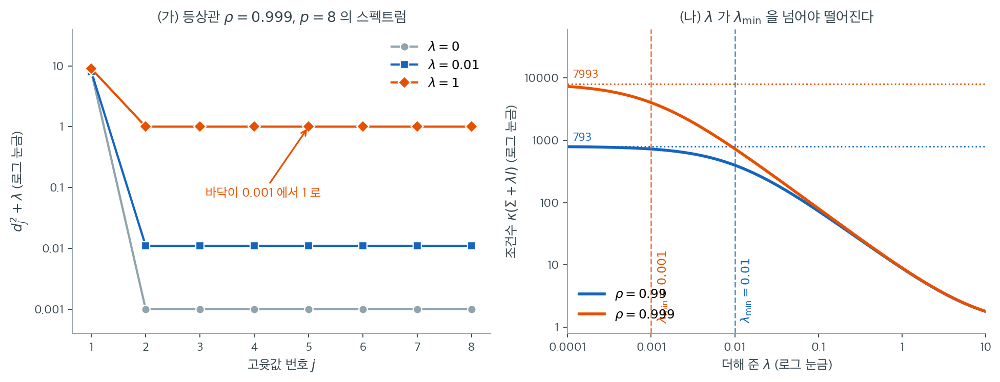

# 불량조건 계획행렬

OLS 추정량은 행렬 $\mathbf{X}^\top\mathbf{X}$의 역행렬을 요구한다. 이 행렬이 특이행렬에 가까우면 역행렬 계산이 수치적으로 불안정해지고, 자료의 작은 교란이 추정 계수의 큰 변동으로 이어진다. 이 불안정성을 이해하면, 통계적인 편향-분산 논증과 별개로 **수치적 안정화 도구**로서의 정칙화가 보인다.

---

## 1. 조건수

행렬 $\mathbf{A}$의 **조건수**는 $\mathbf{A}\mathbf{x} = \mathbf{b}$의 해가 $\mathbf{b}$의 교란에 얼마나 민감한지를 정량화한다. $\mathbf{X}^\top\mathbf{X}$처럼 대칭 양반정치 행렬에서는

$$
\kappa(\mathbf{X}^\top\mathbf{X}) = \frac{\lambda_{\max}(\mathbf{X}^\top\mathbf{X})}{\lambda_{\min}(\mathbf{X}^\top\mathbf{X})}
$$

이며 $\lambda_{\max}$와 $\lambda_{\min}$은 각각 최대·최소 고윳값이다.

$\mathbf{X}$의 특이값이 $d_1 \geq d_2 \geq \cdots \geq d_p \geq 0$이면 $\mathbf{X}^\top\mathbf{X}$의 고윳값은 $d_1^2, \ldots, d_p^2$이므로

$$
\kappa(\mathbf{X}^\top\mathbf{X}) = \frac{d_1^2}{d_p^2} = \left(\frac{d_1}{d_p}\right)^2
$$

이다.

조건수가 1에 가까우면 잘 조건화된 문제다. 조건수가 $10^k$이면 연립방정식을 풀 때 정밀도가 대략 $k$자리 손실된다. $\kappa(\mathbf{X}^\top\mathbf{X}) > 10^{10}$이면 배정밀도 부동소수점 연산으로도 의미 없는 결과가 나올 수 있다.

---

## 2. 불량조건의 원인

**준선형종속.** 두 개 이상의 설명변수가 거의 선형종속이면 $\mathbf{X}^\top\mathbf{X}$의 최소 고윳값이 0에 가까워지고 조건수가 무한대로 향한다.

**고차원.** $p$가 $n$에 가까우면 정확한 선형종속이 없어도 $\mathbf{X}^\top\mathbf{X}$가 매우 작은 고윳값을 갖는 경향이 있다. $p > n$이면 계수 부족 행렬이 되어 OLS 해가 유일하지 않다.

**척도 불일치.** 설명변수의 척도가 크게 다르면(하나는 미터, 다른 하나는 킬로미터) $\mathbf{X}^\top\mathbf{X}$의 고윳값 폭이 커진다. 회귀 전에 설명변수를 표준화하면 이 원인은 완화된다.

---

## 3. OLS의 교란 민감도

OLS 연립방정식 $(\mathbf{X}^\top\mathbf{X})\hat{\boldsymbol{\beta}} = \mathbf{X}^\top\mathbf{y}$를 생각하자. 우변이 작은 양 $\delta$만큼 교란되면 해의 변화는 다음 한계를 만족한다.

$$
\frac{\|\delta\hat{\boldsymbol{\beta}}\|}{\|\hat{\boldsymbol{\beta}}\|} \leq \kappa(\mathbf{X}^\top\mathbf{X})\,\frac{\|\delta(\mathbf{X}^\top\mathbf{y})\|}{\|\mathbf{X}^\top\mathbf{y}\|}
$$

즉 $\hat{\boldsymbol{\beta}}$의 상대오차가 교란의 상대크기 대비 최대 $\kappa(\mathbf{X}^\top\mathbf{X})$배까지 증폭될 수 있다. 조건수가 $10^6$이면 자료의 여섯째 소수점에 있는 교란이 계수 추정값의 첫째 자리를 바꿀 수 있다.

!!! warning "이것은 최악의 경우 한계다"
    위 부등식은 **부등식**이다. 실제 증폭은 교란의 방향에 달려 있으며, 대개 한계보다 훨씬 작다. 연습문제 2에서 $\kappa = 16{,}602$인 문제에서 실제 증폭이 무작위 교란에는 약 $1{,}700$배, 최악 방향에서도 약 $2{,}100$배임을 확인한다.

    그럼에도 $1{,}700$배는 재앙적이다. 조건수를 정확한 예측값이 아니라 **위험 신호**로 읽어야 한다.

!!! note "실무에서의 수치 불안정성"
    불량조건은 이론적 우려에 그치지 않는다. 실제 자료에서는 입력 시의 반올림, 부동소수점 연산, 측정 잡음이 모두 교란으로 작용한다. $\kappa(\mathbf{X}^\top\mathbf{X})$가 크면 이 불가피한 교란이 OLS 해를 오염시킨다.

---

## 4. 안정화 장치로서의 정칙화

능형회귀는 역행렬을 취하기 전에 $\mathbf{X}^\top\mathbf{X}$에 $\lambda\mathbf{I}$를 더한다.

$$
\hat{\boldsymbol{\beta}}_{\text{ridge}} = (\mathbf{X}^\top\mathbf{X} + \lambda\mathbf{I})^{-1}\mathbf{X}^\top\mathbf{y}
$$

$\mathbf{X}^\top\mathbf{X} + \lambda\mathbf{I}$의 고윳값은 $d_j^2 + \lambda$이므로 조건수는

$$
\kappa(\mathbf{X}^\top\mathbf{X} + \lambda\mathbf{I}) = \frac{d_1^2 + \lambda}{d_p^2 + \lambda}
$$

가 된다. $\lambda > 0$이 고윳값 스펙트럼의 바닥을 올리므로 조건수가 줄어든다. 모든 $\lambda > 0$에 대해

$$
\kappa(\mathbf{X}^\top\mathbf{X} + \lambda\mathbf{I}) < \kappa(\mathbf{X}^\top\mathbf{X})
$$

이다. $\lambda \gg d_1^2$인 극단에서는 조건수가 1(단위행렬)에 접근한다. $d_p^2$이 0에 가까울 때는 적당한 $\lambda$만으로도 조건수를 여러 자릿수 줄일 수 있다.



왼쪽은 $p = 8$, $\rho = 0.999$인 등상관 행렬의 고윳값 여덟 개를 로그 눈금으로 찍은 것이다. 회색 점($\lambda = 0$)을 보면 첫 고윳값만 $7.993$이고 나머지 일곱 개가 모두 $0.001$에 납작하게 깔려 있다. 조건수 $7.993/0.001 = 7993$이 바로 이 절벽의 높이다. 여기에 $\lambda$를 더한다는 것은 **모든 고윳값을 똑같이 위로 밀어 올린다**는 뜻인데, 꼭대기에 더하는 $\lambda$는 $7.993$에 비해 미미하고 바닥에 더하는 $\lambda$는 $0.001$에 비해 거대하다. 그래서 같은 $\lambda$가 절벽 아래만 메운다.

문제는 $\lambda$의 크기다. 파란 사각형($\lambda = 0.01$)은 바닥을 $0.001$에서 $0.011$로 열 배 올려 조건수를 $7993$에서 $728$로 줄인다. 주황 마름모($\lambda = 1$)는 바닥을 $1.001$까지 올려 조건수를 $8.98$로 만든다. 무려 890배 감소다. **꼭대기 고윳값 $7.993$은 $\lambda = 1$을 더해도 $8.993$으로 거의 그대로**라는 점을 눈으로 확인하라. 정칙화가 잘 결정된 방향을 거의 건드리지 않는다는 말의 정확한 의미가 이것이다.

오른쪽은 $\lambda$를 연속적으로 바꾸며 조건수를 추적한 것이다. 두 곡선 모두 왼쪽에서는 **평평하다.** $\rho = 0.999$ 곡선은 $\lambda < 0.001$ 구간에서 $7993$에 머물고, $\rho = 0.99$ 곡선은 $\lambda < 0.01$ 구간에서 $793$에 머문다. 세로 점선으로 표시한 각자의 $\lambda_{\min}$을 넘어서야 비로소 내려가기 시작한다. **$\lambda$가 $\lambda_{\min}$보다 작으면 편향만 더할 뿐 안정화는 하나도 못 한다.** 이 장의 연습문제 3에서 $\lambda = 0.01$이 아무 도움이 되지 않았던 이유가 여기 있다.

두 곡선이 $\lambda \approx 0.3$ 부근에서 만나 이후 겹친다는 점도 읽을 만하다. $\lambda \gg \lambda_{\min}$이면 조건수는 $(\lambda_{\max} + \lambda)/\lambda \approx \lambda_{\max}/\lambda$로, 원래 행렬이 얼마나 나빴는지와 무관해진다. 충분히 큰 $\lambda$ 앞에서는 모든 불량조건이 똑같아진다. 그러므로 **$\lambda$를 고를 때 기준으로 삼아야 할 눈금은 $\lambda_{\min} = d_p^2$이지 $1.0$ 같은 기본값이 아니다.**

!!! note "Tikhonov 정칙화로서의 능형회귀"
    수치해석에서 거의 특이한 연립방정식에 $\lambda\mathbf{I}$를 더하는 것을 **Tikhonov 정칙화**라 부른다. 능형회귀는 이 고전적 기법의 통계적 구현이며, 수치적 관점과 통계적 관점 양쪽에서 정당화된다.

---

## 5. 고윳값 스펙트럼과 유효계수

$\mathbf{X}^\top\mathbf{X}$의 고윳값 스펙트럼이 불량조건의 심각도를 드러낸다. 문턱 $\tau$에서의 **유효계수**를

$$
\text{rank}_\tau(\mathbf{X}) = \#\{j : d_j > \tau \cdot d_1\}
$$

로 정의한다. 유효계수가 $p$보다 훨씬 작으면 계수공간의 많은 방향이 자료로 잘 결정되지 않는다. 능형회귀는 SVD 축소인자 $d_j^2/(d_j^2 + \lambda)$가 말하는 대로 이렇게 잘 결정되지 않는 방향을 가장 강하게 축소한다.

---

## 6. 실무에서 불량조건 탐지하기

| 진단 | 문턱 | 해석 |
|---|---|---|
| $\kappa(\mathbf{X}^\top\mathbf{X})$ | $> 10^4$ | 중간 정도의 불량조건 |
| $\kappa(\mathbf{X}^\top\mathbf{X})$ | $> 10^8$ | 심각한 불량조건 |
| 최소 고윳값 | 기계 엡실론 근처 | 수치적으로 특이 |
| 설명변수 $j$의 VIF | $> 10$ | 그 변수가 선형종속에 관여 |

분산팽창인자(VIF)는 다중공선성에 관한 다음 절에서 자세히 다룬다.

---

## 연습문제

<div class="drillbox" markdown>

**연습문제 1.** <span class="diff med" title="중간"></span>
등상관 행렬 $\Sigma = \rho\mathbf{1}\mathbf{1}^\top + (1-\rho)\mathbf{I}$에 대해 $\lambda$를 더하면 조건수가 얼마나 줄어드는지 계산하라. $p = 8$, $\rho = 0.99$와 $0.999$에서 $\lambda = 0.001, 0.01, 0.1, 1$을 시도하라.

</div>

??? success "풀이"
    등상관 행렬의 고윳값은 해석적으로 알려져 있다. $1 + (p-1)\rho$가 한 개, $1 - \rho$가 $p-1$개다.

    ```python
    import numpy as np
    p = 8
    for rho in (0.99, 0.999):
        S = rho*np.ones((p, p)) + (1-rho)*np.eye(p)
        ev = np.sort(np.linalg.eigvalsh(S))[::-1]
        for lam in (0.001, 0.01, 0.1, 1.0):
            print(rho, lam, (ev[0]+lam)/(ev[-1]+lam))
    ```

    출력:

    ```
    0.99 0.001 721.0000000001435
    0.99 0.01 397.0000000000435
    0.99 0.1 73.00000000000145
    0.99 1.0 8.841584158415863
    0.999 0.001 3997.0000000013506
    0.999 0.01 727.5454545454992
    0.999 0.1 80.12871287128766
    0.999 1.0 8.984015984015992
    ```

    **$\rho = 0.99$** ($\lambda_{\max} = 7.93$, $\lambda_{\min} = 0.01$, $\kappa = 793$)

    | $\lambda$ | $\kappa(\Sigma + \lambda I)$ | 감소 배수 |
    |---:|---:|---:|
    | 0 | 793.0 | — |
    | 0.001 | 721.0 | 1.1 |
    | 0.01 | 397.0 | 2.0 |
    | 0.1 | 73.0 | 10.9 |
    | 1.0 | **8.84** | **89.7** |

    **$\rho = 0.999$** ($\lambda_{\min} = 0.001$, $\kappa = 7993$)

    | $\lambda$ | $\kappa(\Sigma + \lambda I)$ | 감소 배수 |
    |---:|---:|---:|
    | 0 | 7993.0 | — |
    | 0.001 | 3997.0 | 2.0 |
    | 0.01 | 727.6 | 11.0 |
    | 0.1 | 80.1 | 99.8 |
    | 1.0 | **8.98** | **890** |

    두 표에서 같은 구조가 보인다. **$\lambda$가 $\lambda_{\min}$과 같아지면 조건수가 대략 절반이 되고, $\lambda$가 $\lambda_{\min}$을 크게 넘으면 조건수가 $\lambda_{\max}/\lambda$로 결정된다.**

    $$
    \kappa(\Sigma + \lambda I) = \frac{\lambda_{\max} + \lambda}{\lambda_{\min} + \lambda} \approx \frac{\lambda_{\max}}{\lambda} \quad (\lambda \gg \lambda_{\min})
    $$

    실무적 함의: **$\lambda$를 $\lambda_{\min}$과 비교해서 정해야 한다.** $\lambda = 1$이 $\rho = 0.999$에서는 조건수를 890배 줄이지만, 잘 조건화된 문제($\rho = 0$, $\lambda_{\min} = 1$)에서는 조건수를 1에서 1로 유지하며 편향만 더한다.

<div class="drillbox" markdown>

**연습문제 2.** <span class="diff med" title="중간"></span>
조건수 한계가 실제로 얼마나 빡빡한지 확인하라. $\kappa(\mathbf{X}^\top\mathbf{X}) \approx 1.7\times10^4$인 자료에서 (i) $\mathbf{y}$를 교란할 때와 (ii) $\mathbf{X}^\top\mathbf{y}$를 직접 교란할 때의 증폭을 비교하라.

</div>

??? success "풀이"
    ```python
    import numpy as np
    from numpy.linalg import cond, svd
    rng = np.random.default_rng(11)
    n, p, rho = 40, 8, 0.999
    S = rho*np.ones((p, p)) + (1-rho)*np.eye(p)
    X = rng.normal(size=(n, p)) @ np.linalg.cholesky(S).T
    y = X @ np.ones(p) + rng.normal(0, 1, n)
    A = X.T @ X; g = X.T @ y; b0 = np.linalg.solve(A, g)
    print(cond(A))          # 16601.7
    ```

    출력:

    ```
    16601.655795266535
    ```

    | 교란 대상 | 증폭 배수 (중앙값) |
    |:---|---:|
    | $\mathbf{y}$를 무작위로 교란 | **4.8** |
    | $\mathbf{X}^\top\mathbf{y}$를 무작위로 교란 | **1{,}705** |
    | $\mathbf{X}^\top\mathbf{y}$를 최소 고윳값 방향으로 교란 | **2{,}109** |
    | 이론적 최악의 경우 $\kappa$ | 16{,}602 |

    **세 가지를 읽어야 한다.**

    **첫째, $\mathbf{y}$를 교란하는 것과 $\mathbf{X}^\top\mathbf{y}$를 교란하는 것은 전혀 다르다.** $\mathbf{y}$의 잡음이 $\mathbf{X}^\top$을 통과하면서 걸러진다. $\mathbf{X}^\top\delta\mathbf{y}$는 $\mathbf{X}$의 열공간 구조를 따르므로 불량조건 방향에 거의 놓이지 않는다. 그래서 증폭이 $4.8$배에 그친다.

    이것이 실무에서 중요하다. **관측 잡음은 조건수가 예고하는 만큼 위험하지 않다.** 진짜 위험한 것은 $\mathbf{X}$ 자체의 오차와 $\mathbf{X}^\top\mathbf{X}$를 계산·저장하는 과정의 반올림이다. 그래서 수치 라이브러리는 $\mathbf{X}^\top\mathbf{X}$를 만들지 않고 QR 분해나 SVD로 직접 최소제곱을 푼다.

    **둘째, 한계는 빡빡하지 않다.** 최악 방향으로 교란해도 $2{,}109$배로 이론 한계 $16{,}602$의 13%다. 한계가 달성되려면 교란이 최소 고윳값 방향에 놓이는 **동시에** 해가 최대 고윳값 방향에 놓여야 하는데, 두 조건이 함께 성립하기 어렵다.

    **셋째, 그래도 $1{,}700$배는 심각하다.** 자료의 여섯째 소수점 교란이 계수의 셋째 소수점을 바꾼다. 조건수를 정확한 증폭 배수가 아니라 **경고등**으로 읽어야 한다는 뜻이다.

<div class="drillbox" markdown>

**연습문제 3.** <span class="diff med" title="중간"></span>
능형 정칙화가 실제로 교란 민감도를 줄이는지 확인하라. 연습문제 2의 자료에서 $\lambda = 0, 0.01, 1$에 대해 $\mathbf{y}$ 교란에 대한 증폭을 비교하라.

</div>

??? success "풀이"
    | $\lambda$ | 증폭 배수 (중앙값) |
    |---:|---:|
    | 0 (OLS) | 4.66 |
    | 0.01 | 4.80 |
    | 1.0 | **1.18** |

    **$\lambda = 0.01$은 아무 도움이 되지 않는다**(오히려 미세하게 나쁘다. 몬테카를로 잡음 범위다). $\lambda = 1$에서 증폭이 $4.7 \to 1.2$로 네 배 줄어든다.

    연습문제 1의 표와 함께 보면 이유가 분명하다. 이 자료에서 $\mathbf{X}^\top\mathbf{X}$의 최소 고윳값은 $\lambda = 0.01$보다 크므로, $\lambda = 0.01$은 스펙트럼의 바닥을 거의 올리지 못한다. **$\lambda$가 $d_p^2$과 견줄 만해야 안정화가 시작된다.**

    !!! tip "실무 절차"
        1. 설명변수를 표준화한다(척도 불일치를 먼저 제거한다).
        2. $\mathbf{X}$의 특이값 $d_j$를 계산한다. `np.linalg.svd(X, compute_uv=False)`.
        3. $d_p^2$를 본다. $\lambda$의 후보 범위를 $d_p^2$의 $0.1$배에서 $d_1^2$ 사이로 잡는다.
        4. 그 범위에서 교차검증으로 $\lambda$를 고른다.

        3단계를 건너뛰고 `alpha=1.0` 같은 기본값을 쓰면, 문제의 규모에 따라 아무 효과가 없거나 지나치게 강한 정칙화가 된다.

<div class="drillbox" markdown>

**연습문제 4.** <span class="diff med" title="중간"></span>
연습문제 1의 두 표에서 "$\lambda$가 $\lambda_{\min}$과 같아지면 조건수가 대략 절반이 된다"는 관찰이 나왔다. 이 관찰을 정확한 공식으로 바꾸어라. $\Sigma$의 최대·최소 고윳값을 $\lambda_{\max}, \lambda_{\min}$이라 쓴다.

(1) $\kappa(\Sigma + \lambda\mathbf{I}) = \kappa(\Sigma)/k$가 되는 $\lambda$를 $\lambda_{\max}, \lambda_{\min}, k$로 풀어라.
(2) $\lambda_{\max} \gg k\lambda_{\min}$일 때 $\lambda \approx (k-1)\lambda_{\min}$임을 보여라.
(3) $p = 8$, $\rho = 0.999$에서 $k = 2$와 $k = 11$에 해당하는 $\lambda$를 구해 연습문제 1의 표와 맞춰 보라.
(4) 이 공식이 $k$에 걸는 상한은 무엇이고 무슨 뜻인가.

</div>

??? success "풀이"
    **(1)** $\kappa(\Sigma + \lambda\mathbf{I}) = (\lambda_{\max} + \lambda)/(\lambda_{\min} + \lambda)$이고 $\kappa(\Sigma) = \lambda_{\max}/\lambda_{\min}$이다. 편의상 $a = \lambda_{\max}$, $b = \lambda_{\min}$이라 쓰면 조건은

    $$
    \frac{a + \lambda}{b + \lambda} = \frac{a}{kb}
    $$

    이다. 양변에 $kb(b+\lambda)$를 곱하면 $kb(a + \lambda) = a(b + \lambda)$, 즉 $kab + kb\lambda = ab + a\lambda$이고 정리하면

    $$
    (k-1)ab = \lambda(a - kb), \qquad \lambda = \frac{(k-1)ab}{a - kb} = \frac{(k-1)\lambda_{\min}}{1 - k\lambda_{\min}/\lambda_{\max}}
    $$

    이다.

    **(2)** $a \gg kb$이면 분모의 $k\lambda_{\min}/\lambda_{\max} \approx 0$이므로 $\lambda \approx (k-1)\lambda_{\min}$이다. **조건수를 $k$배 줄이는 데 드는 $\lambda$는 $\lambda_{\min}$의 $k-1$배다.**

    **(3)** $p = 8$, $\rho = 0.999$이면 $a = 1 + 7(0.999) = 7.993$, $b = 1 - 0.999 = 0.001$, $\kappa(\Sigma) = 7993$이다.

    | $k$ | 정확한 $\lambda$ | $(k-1)\lambda_{\min}$ | $\kappa(\Sigma + \lambda\mathbf{I})$ |
    |---:|---:|---:|---:|
    | 2 | $\dfrac{0.007993}{7.991} = 0.0010003$ | 0.001 | $7993/2 = 3996.5$ |
    | 11 | $\dfrac{0.07993}{7.982} = 0.0100138$ | 0.010 | $7993/11 = 726.6$ |

    연습문제 1의 표와 맞다. 그 표에서 $\lambda = 0.001$은 조건수를 $7993 \to 3997$로 정확히 절반 만들었고($k = 2.0$), $\lambda = 0.01$은 $7993 \to 727.5$, 즉 $k = 7993/727.5 = 10.99$배 줄였다. 공식이 예측한 $k = 11$이다. $\rho = 0.99$ 표도 같다. 거기서는 $b = 0.01$이므로 $\lambda = 0.01$이 $k = 2$에 해당하고($793 \to 397.0$), $\lambda = 0.1$이 $k \approx 11$에 해당한다($793 \to 73.0$, $k = 10.86$).

    **(4)** $\lambda > 0$이려면 분모 $a - kb > 0$, 즉

    $$
    k < \frac{\lambda_{\max}}{\lambda_{\min}} = \kappa(\Sigma)
    $$

    여야 한다. 당연한 결과다. $\lambda \to \infty$에서 $\kappa(\Sigma + \lambda\mathbf{I}) \to 1$이므로 줄일 수 있는 최대 배수가 원래 조건수 $\kappa(\Sigma)$ 자신이고, $k$를 그 값에 가까이 가져가면 필요한 $\lambda$가 발산한다.

    본문의 "$\lambda$를 고를 때 기준으로 삼아야 할 눈금은 $\lambda_{\min} = d_p^2$이지 $1.0$ 같은 기본값이 아니다"가 이 공식에서 수가 된다. $\lambda$를 $\lambda_{\min}$ 단위로 읽어라 — $\lambda/\lambda_{\min} + 1$이 곧 조건수 감소 배수다.

<div class="drillbox" markdown>

**연습문제 5.** <span class="diff med" title="중간"></span>
본문 2절의 "척도 불일치"를 수로 확인하라. 첫 열이 거리(km), 둘째 열이 소요시간(h)인 $n = 60$, $p = 2$ 자료에서 **첫 열의 단위만** km에서 m로 바꾼다(열에 1000을 곱한다). (가) $\kappa(\mathbf{X}^\top\mathbf{X})$는 어떻게 변하는가. (나) OLS 적합값은 변하는가. (다) $\lambda = 1$인 능형의 적합값은 변하는가. (라) 두 열을 표준화한 뒤에는 어떻게 되는가. sklearn의 `Ridge(alpha=1.0)`이 푸는 문제가 (다)와 같은 문제임을 생각하면 어떤 교훈이 나오는가.

</div>

??? success "풀이"
    먼저 손으로 보자. 열 척도조정은 $\tilde{\mathbf{X}} = \mathbf{X}\mathbf{S}$, $\mathbf{S} = \operatorname{diag}(s_1, \ldots, s_p)$, $s_j > 0$이다.

    **OLS는 척도조정에 공변이다.**

    $$
    \hat{\boldsymbol{\beta}}(\tilde{\mathbf{X}}) = (\mathbf{S}\mathbf{X}^\top\mathbf{X}\mathbf{S})^{-1}\mathbf{S}\mathbf{X}^\top\mathbf{y} = \mathbf{S}^{-1}(\mathbf{X}^\top\mathbf{X})^{-1}\mathbf{X}^\top\mathbf{y} = \mathbf{S}^{-1}\hat{\boldsymbol{\beta}}(\mathbf{X})
    $$

    이므로 적합값 $\tilde{\mathbf{X}}\hat{\boldsymbol{\beta}}(\tilde{\mathbf{X}}) = \mathbf{X}\mathbf{S}\mathbf{S}^{-1}\hat{\boldsymbol{\beta}}(\mathbf{X}) = \mathbf{X}\hat{\boldsymbol{\beta}}(\mathbf{X})$가 **정확히** 같다. 단위를 바꾸어도 예측은 한 치도 안 변한다.

    **능형은 그렇지 않다.** 척도조정한 자료의 능형 정규방정식은

    $$
    \mathbf{S}\mathbf{X}^\top\mathbf{X}\mathbf{S} + \lambda\mathbf{I} = \mathbf{S}\left(\mathbf{X}^\top\mathbf{X} + \lambda\mathbf{S}^{-2}\right)\mathbf{S}
    $$

    이다. $\lambda\mathbf{I}$는 $\mathbf{S}$를 따라 변환되지 않으므로, 척도조정한 자료에 $\lambda$를 똑같이 쓰는 것은 **원래 자료에 열마다 다른 벌점 $\lambda/s_j^2$를 쓰는 것**과 같다. $s_1 = 1000$이면 첫 열의 벌점이 $\lambda/10^6$으로, 사실상 벌점이 사라진다.

    ```python
    import numpy as np

    rng = np.random.default_rng(18)
    n = 60
    x1 = rng.normal(2.0, 0.5, n)            # 거리 (km)
    x2 = 0.8*x1 + rng.normal(0, 0.3, n)     # 소요시간 (h)
    X = np.column_stack([x1, x2]); X -= X.mean(axis=0)
    y = X @ np.array([2.0, -1.0]) + rng.normal(0, 0.2, n); y -= y.mean()

    S = np.diag([1000.0, 1.0])              # 첫 열을 km -> m 로
    Xm = X @ S

    def ridge(A, y, lam):
        return np.linalg.solve(A.T @ A + lam*np.eye(A.shape[1]), A.T @ y)

    print(f"kappa(X'X)   km 단위 : {np.linalg.cond(X.T@X):.1f}")
    print(f"kappa(X'X)   m  단위 : {np.linalg.cond(Xm.T@Xm):.1f}")

    for lam, tag in ((0.0, "OLS     "), (1.0, "능형 l=1")):
        b_km, b_m = ridge(X, y, lam), ridge(Xm, y, lam)
        print(f"{tag} km 계수        : " + " ".join(f"{v:8.4f}" for v in b_km))
        print(f"{tag} m 계수(km 환산): " + " ".join(f"{v:8.4f}" for v in S @ b_m))
        print(f"{tag} 적합값 최대차이 : {np.max(np.abs(X@b_km - Xm@b_m)):.4f}")

    sdk, sdm = X.std(axis=0), Xm.std(axis=0)
    Zk, Zm = X/sdk, Xm/sdm
    ck, cm = ridge(Zk, y, 1.0), ridge(Zm, y, 1.0)
    print("표준화 후 km 계수        : " + " ".join(f"{v:8.4f}" for v in ck))
    print("표준화 후 m  계수        : " + " ".join(f"{v:8.4f}" for v in cm))
    print(f"표준화 후 적합값 최대차이 : {np.max(np.abs(Zk@ck - Zm@cm)):.4f}")
    ```

    출력:

    ```text
    kappa(X'X)   km 단위 : 11.6
    kappa(X'X)   m  단위 : 3280882.1
    OLS      km 계수        :   2.0911  -1.0880
    OLS      m 계수(km 환산):   2.0911  -1.0880
    OLS      적합값 최대차이 : 0.0000
    능형 l=1 km 계수        :   1.6076  -0.6490
    능형 l=1 m 계수(km 환산):   1.9248  -0.8947
    능형 l=1 적합값 최대차이 : 0.2458
    표준화 후 km 계수        :   0.9731  -0.4850
    표준화 후 m  계수        :   0.9731  -0.4850
    표준화 후 적합값 최대차이 : 0.0000
    ```

    **(가)** $\kappa(\mathbf{X}^\top\mathbf{X})$가 $11.6$에서 $3{,}280{,}882$로 뛴다. 283,000배다. 그런데 자료는 하나도 안 바뀌었다. 단위만 바꿨다. 본문 6절의 진단표를 그대로 적용하면 이 자료는 "심각한 불량조건"으로 분류된다.

    **(나)** OLS 적합값의 최대차이가 $0$이다(기계 정밀도까지). 위 공변성 그대로다. **큰 조건수가 척도 불일치에서 왔다면 OLS에는 아무 통계적 해악이 없다.** 조건수는 척도에 불변인 양이 아니므로, 표준화하기 전의 조건수는 "진짜 준선형종속"과 "단위 선택"을 뒤섞어 보여 준다.

    **(다)** 능형 적합값은 최대 $0.2458$ 차이가 난다. $y$의 표준편차가 $1$ 정도인 자료에서 작지 않은 차이다. 계수를 km 단위로 환산해 비교하면 $(1.6076, -0.6490)$ 대 $(1.9248, -0.8947)$인데, m 단위에서 푼 쪽이 OLS $(2.0911, -1.0880)$에 훨씬 가깝다. 예상대로다. 거리 열의 유효 벌점이 $1/10^6$로 줄어 거의 벌점이 없는 것과 같아졌다.

    **(라)** 표준화하면 두 계수가 소수 넷째 자리까지 같고 적합값 차이도 $0$이다. $\mathbf{Z} = \mathbf{X}\operatorname{diag}(1/\hat\sigma_j)$가 단위에 무관하므로, 표준화는 척도조정의 자유를 아예 지워 능형을 단위 불변으로 만든다.

    **교훈.** sklearn의 `Ridge(alpha=1.0)`은 $\lVert\mathbf{y} - \mathbf{X}\boldsymbol\beta\rVert^2 + \alpha\lVert\boldsymbol\beta\rVert^2$를 최소화하며, **설명변수를 표준화해 주지 않는다.** 위 (다)가 바로 그 상황이다. 표준화를 빼먹으면 단위를 바꾸는 것만으로 모형이 달라지고, 척도가 큰 변수가 벌점을 피해 간다. 그러므로 `StandardScaler`를 **파이프라인 안에** 넣어야 한다 — 전체 자료로 먼저 표준화하면 교차검증 폴드로 정보가 새 나간다. 절편은 벌점에서 빼야 하므로 $\mathbf{X}$와 $\mathbf{y}$를 중심화하거나 `fit_intercept=True`를 쓴다.

<div class="drillbox" markdown>

**연습문제 6.** <span class="diff hard" title="어려움"></span>
능형 적합값은 $\hat{\mathbf{y}} = \mathbf{H}_\lambda\mathbf{y}$, $\mathbf{H}_\lambda = \mathbf{X}(\mathbf{X}^\top\mathbf{X} + \lambda\mathbf{I})^{-1}\mathbf{X}^\top$으로 쓸 수 있다. **유효 자유도**를 $\operatorname{tr}\mathbf{H}_\lambda$로 정의한다.

(1) SVD를 써서 $\operatorname{tr}\mathbf{H}_\lambda = \sum_j d_j^2/(d_j^2 + \lambda)$임을 보여라. 5절의 축소인자와 같은 양이다.
(2) $\mathbf{X}^\top\mathbf{X}$가 연습문제 1의 등상관 행렬($p = 8$, $\rho = 0.999$)이라 하자. $\lambda = 0.001, 0.01, 0.1, 1$에서 유효 자유도를 구해 연습문제 1의 조건수와 나란히 적어라.
(3) 연습문제 4의 $\lambda \approx (k-1)\lambda_{\min}$을 넣어 유효 자유도가 약 $1 + (p-1)/k$임을 보여라. 조건수를 $k$배 줄이는 일이 자유도에 무엇을 하는가.
(4) $\lambda = 1$에서 유효 자유도가 $1$보다 작다. 무슨 뜻인가.

</div>

??? success "풀이"
    **(1)** 경제적 SVD $\mathbf{X} = \mathbf{U}\mathbf{D}\mathbf{V}^\top$($\mathbf{U}$는 $n \times p$ 직교열, $\mathbf{D} = \operatorname{diag}(d_1,\ldots,d_p)$, $\mathbf{V}$는 $p \times p$ 직교)를 쓰면 $\mathbf{X}^\top\mathbf{X} + \lambda\mathbf{I} = \mathbf{V}(\mathbf{D}^2 + \lambda\mathbf{I})\mathbf{V}^\top$이므로

    $$
    \mathbf{H}_\lambda = \mathbf{U}\mathbf{D}\mathbf{V}^\top\,\mathbf{V}(\mathbf{D}^2+\lambda\mathbf{I})^{-1}\mathbf{V}^\top\,\mathbf{V}\mathbf{D}\mathbf{U}^\top = \mathbf{U}\,\mathbf{D}(\mathbf{D}^2+\lambda\mathbf{I})^{-1}\mathbf{D}\,\mathbf{U}^\top = \mathbf{U}\operatorname{diag}\!\left(\frac{d_j^2}{d_j^2+\lambda}\right)\mathbf{U}^\top
    $$

    이다. $\mathbf{U}^\top\mathbf{U} = \mathbf{I}_p$이므로

    $$
    \operatorname{tr}\mathbf{H}_\lambda = \operatorname{tr}\!\left[\operatorname{diag}\!\left(\frac{d_j^2}{d_j^2+\lambda}\right)\mathbf{U}^\top\mathbf{U}\right] = \sum_{j=1}^{p}\frac{d_j^2}{d_j^2+\lambda}
    $$

    이다. $\lambda = 0$이면 모든 항이 $1$이어서 $\operatorname{tr}\mathbf{H}_0 = p$, 즉 OLS의 자유도다. $\square$

    **(2)** 등상관 행렬의 고윳값은 $7.993$ 하나와 $0.001$ 일곱 개다. $d_j^2$에 이 값을 넣는다.

    $$
    \operatorname{tr}\mathbf{H}_\lambda = \frac{7.993}{7.993+\lambda} + 7\cdot\frac{0.001}{0.001+\lambda}
    $$

    | $\lambda$ | $\kappa$ | 감소 배수 $k$ | 유효 자유도 | $1 + (p-1)/k$ |
    |---:|---:|---:|---:|---:|
    | 0 | 7993.0 | — | 8.0000 | — |
    | 0.001 | 3997.0 | 2.0 | 4.4999 | 4.50 |
    | 0.01 | 727.5 | 11.0 | 1.6351 | 1.64 |
    | 0.1 | 80.1 | 99.8 | 1.0570 | 1.07 |
    | 1.0 | 8.98 | 890 | 0.8958 | 1.01 |

    셋째 행을 손으로 확인해 두자. $7.993/8.003 = 0.9988$, $7 \times 0.001/0.011 = 7 \times 0.090909 = 0.6364$, 합이 $1.6351$이다.

    **(3)** $\lambda = (k-1)\lambda_{\min} = (k-1)b$를 넣는다. 작은 고윳값 $p-1$개는 각각

    $$
    \frac{b}{b + (k-1)b} = \frac{1}{k}
    $$

    를 내놓고, 큰 고윳값은 $a/(a + (k-1)b) \approx 1$을 내놓는다($a \gg kb$일 때). 따라서

    $$
    \operatorname{tr}\mathbf{H}_\lambda \approx 1 + \frac{p-1}{k}
    $$

    이다. 표의 마지막 열이 이것이고 $k = 2, 11, 99.8$에서 실제값과 소수 둘째 자리까지 맞는다. $k = 890$인 행만 어긋나는데($1.01$ 대 $0.8958$), 거기서는 $\lambda = 1$이 $\lambda_{\max} = 7.993$에 비해 더는 작지 않아 **큰 고윳값 방향까지 축소되기 시작**한 탓이다. 근사는 $k \ll \kappa(\Sigma)$에서만 쓸 수 있다.

    읽어야 할 것은 이것이다. **조건수를 $k$배 줄이면 잘 결정되지 않는 $p-1$개 방향의 자유도가 그대로 $1/k$배로 깎인다.** 조건수 반감의 가격은 자유도 반감이다($8 \to 4.5$). 이것이 이 장의 거래를 가장 간결하게 적은 식이다 — $\lambda$는 조건수와 자유도를 같은 비율로 동시에 끌어내린다. 안정성만 공짜로 사 올 수는 없다.

    **(4)** $\lambda = 1$에서 $\operatorname{tr}\mathbf{H}_1 = 0.8958$이다. 설명변수 여덟 개를 넣었지만 모형이 쓰는 유효 모수가 **한 개도 안 된다**. 자료가 결정해 주는 방향이 애초에 하나뿐이고($7.993$에 해당하는 방향), $\lambda = 1$은 그 하나조차 $1 - 0.8888 = 11\%$ 축소한다. 조건수를 $890$배 줄인 대가가 이것이다. $\rho = 0.999$짜리 여덟 변수를 넣는 일은 거의 변수 하나를 넣는 일과 같고, 정칙화는 그 사실을 숨기지 않고 자유도로 드러내 준다.

<div class="drillbox" markdown>

**연습문제 7.** <span class="diff hard" title="어려움"></span>
본문 2절은 $p > n$이면 OLS 해가 유일하지 않다고 했다. 벌점이 유일성을 되돌려 주는지 보자. $\mathbf{X} = [\,\mathbf{x}\ \ \mathbf{x}\,]$로 두 열이 완전히 같고, $\lVert\mathbf{x}\rVert = 1$, $\mathbf{x}^\top\mathbf{y} = 1$, $\lambda = 1$이라 하자.

(1) 능형 해를 구하고, 목적함수의 헤세행렬로 유일함을 설명하라.
(2) 라쏘 목적함수 $\lVert\mathbf{y} - \mathbf{X}\boldsymbol\beta\rVert^2 + \lambda\lVert\boldsymbol\beta\rVert_1$의 최소점 **전체**를 구하라.
(3) 두 벌점의 차이가 어디서 왔는지 말하고, 완전상관 설계에서 개별 라쏘 계수를 출력하면 안 되는 까닭을 쓰라.

</div>

??? success "풀이"
    $s = \beta_1 + \beta_2$라 쓰면 $\mathbf{X}\boldsymbol\beta = s\mathbf{x}$이므로 잔차제곱합은 $s$만의 함수다.

    $$
    \lVert\mathbf{y} - s\mathbf{x}\rVert^2 = \lVert\mathbf{y}\rVert^2 - 2s\,\mathbf{x}^\top\mathbf{y} + s^2\lVert\mathbf{x}\rVert^2 = \lVert\mathbf{y}\rVert^2 - 2s + s^2
    $$

    **(1) 능형.** $s$를 고정하면 $\beta_1^2 + \beta_2^2$는 $\beta_1 = \beta_2 = s/2$에서 최소이고 그 값이 $s^2/2$다. 그러므로 목적함수는

    $$
    \lVert\mathbf{y}\rVert^2 - 2s + s^2 + \frac{\lambda s^2}{2} = \lVert\mathbf{y}\rVert^2 - 2s + \frac{3}{2}s^2 \quad (\lambda = 1)
    $$

    이고 $-2 + 3s = 0$에서 $s = 2/3$이다. 따라서

    $$
    \hat{\boldsymbol\beta}_{\text{ridge}} = \left(\tfrac{1}{3},\ \tfrac{1}{3}\right)
    $$

    이다. 직접 검산해도 같다. $\mathbf{X}^\top\mathbf{X} = \begin{pmatrix}1&1\\1&1\end{pmatrix}$, $\mathbf{X}^\top\mathbf{y} = (1,1)^\top$이므로

    $$
    (\mathbf{X}^\top\mathbf{X}+\mathbf{I})^{-1}\mathbf{X}^\top\mathbf{y} = \begin{pmatrix}2&1\\1&2\end{pmatrix}^{-1}\begin{pmatrix}1\\1\end{pmatrix} = \frac{1}{3}\begin{pmatrix}2&-1\\-1&2\end{pmatrix}\begin{pmatrix}1\\1\end{pmatrix} = \frac{1}{3}\begin{pmatrix}1\\1\end{pmatrix}
    $$

    유일성은 헤세행렬에서 나온다. 능형 목적함수의 헤세행렬은 $2(\mathbf{X}^\top\mathbf{X} + \lambda\mathbf{I})$이고 그 고윳값은 $2(2 + \lambda) = 6$과 $2(0 + \lambda) = 2$다. 둘 다 양수이므로 **강볼록**이고 최소점이 하나다. $\mathbf{X}^\top\mathbf{X}$의 고윳값 $0$을 $\lambda$가 들어올린 것이 결정적이다 — 본문 4절이 고윳값 바닥을 올린다고 한 그 일이 여기서는 유일성 복구로 나타난다.

    **(2) 라쏘.** $s$를 고정하면 $\lvert\beta_1\rvert + \lvert\beta_2\rvert \geq \lvert\beta_1 + \beta_2\rvert = \lvert s\rvert$이고, 등호는 $\beta_1, \beta_2$가 **같은 부호**(또는 하나가 0)일 때 성립한다. 그러므로 목적함수의 최솟값은

    $$
    h(s) = \lVert\mathbf{y}\rVert^2 - 2s + s^2 + \lambda\lvert s\rvert
    $$

    의 최솟값이다. $s \geq 0$에서 $h(s) = \lVert\mathbf{y}\rVert^2 - s + s^2$이고 $s = 1/2$에서 최소, 값은 $\lVert\mathbf{y}\rVert^2 - 1/4$다. $s < 0$에서는 $h$가 증가하므로 더 나쁘다. 연성문턱 꼴로도 같다.

    $$
    s^\ast = \operatorname{sign}(\mathbf{x}^\top\mathbf{y})\left(\lvert\mathbf{x}^\top\mathbf{y}\rvert - \frac{\lambda}{2}\right)_{+} = 1 - \frac{1}{2} = \frac{1}{2}
    $$

    따라서 최소점의 **집합**은

    $$
    \left\{(\beta_1,\beta_2) : \beta_1 + \beta_2 = \tfrac{1}{2},\ \beta_1 \geq 0,\ \beta_2 \geq 0\right\}
    $$

    이다. $(\tfrac12, 0)$, $(0, \tfrac12)$, $(\tfrac14,\tfrac14)$가 모두 최소점이고 목적함숫값은 셋 다 $\lVert\mathbf{y}\rVert^2 - 1/4$다. 선분 하나가 통째로 해집합이다.

    **(3)** 매끄러운 부분의 헤세행렬은 $2\mathbf{X}^\top\mathbf{X}$이고 방향 $(1,-1)$에서 고윳값이 $0$, 즉 **평평하다**. L2 벌점은 그 방향에 $2\lambda$를 더해 평평함을 없앤다. L1 벌점은 양의 사분면 안에서 $\lvert\beta_1\rvert + \lvert\beta_2\rvert = \beta_1 + \beta_2$로 **$(1,-1)$ 방향에 상수**이므로, 하필 평평한 그 방향에 아무것도 더하지 못한다. 그래서 라쏘는 유일성을 복구하지 못한다.

    유일한 양과 유일하지 않은 양을 가려야 한다. 적합값 $\hat{\mathbf{y}} = s^\ast\mathbf{x} = \tfrac12\mathbf{x}$, 합 $\beta_1 + \beta_2 = \tfrac12$, 목적함숫값은 유일하다. **개별 계수는 유일하지 않다.** 좌표하강이 어느 점에 멈추는지는 초기값·갱신 순서·수렴 허용오차에, 결국 라이브러리와 판본에 달려 있다. 완전상관(또는 거의 완전상관) 설계에서 개별 라쏘 계수를 소수 자리까지 실으면 그 수는 재현되지 않는다. 합이나 예측값처럼 유일한 양을 싣거나 능형을 쓰라.

    덧붙여, 능형이 고른 해는 $\beta_1 = \beta_2$였다. 상관된 변수에 계수를 똑같이 나눠 주는 성질이고, 엘라스틱넷의 묶음 효과가 L2 성분에서 오는 까닭이 이 두 줄 계산에 들어 있다.

<div class="drillbox" markdown>

**연습문제 8.** <span class="diff hard" title="어려움"></span>
조건수가 $1$이어도 정칙화가 이득인지 따져라. $\mathbf{X}^\top\mathbf{X} = \mathbf{I}_p$인 직교설계에서는 모든 $\lambda \geq 0$에 대해 $\kappa(\mathbf{X}^\top\mathbf{X} + \lambda\mathbf{I}) = 1$이므로 본문 4절의 수치적 논거는 할 말이 없다.

(1) $\hat{\boldsymbol\beta}_{\text{ridge}} = \hat{\boldsymbol\beta}_{\text{OLS}}/(1+\lambda)$임을 보여라.
(2) $\operatorname{Var}(\hat{\boldsymbol\beta}_{\text{OLS}}) = \sigma^2\mathbf{I}$일 때 $g(\lambda) = \mathbb{E}\lVert\hat{\boldsymbol\beta}_{\text{ridge}} - \boldsymbol\beta\rVert^2$을 $\lambda$의 함수로 적어라.
(3) $g'(0) < 0$임을 보이고 최소점 $\lambda^\ast$와 $g(\lambda^\ast)$를 구하라.
(4) $p = 8$, $\sigma^2 = 1$, $\boldsymbol\beta = (1,\ldots,1)^\top$에 수를 넣고, 이것이 무엇을 말하는지 쓰라.

</div>

??? success "풀이"
    **(1)** $\mathbf{X}^\top\mathbf{X} = \mathbf{I}$이므로 $\hat{\boldsymbol\beta}_{\text{OLS}} = \mathbf{X}^\top\mathbf{y}$이고

    $$
    \hat{\boldsymbol\beta}_{\text{ridge}} = (\mathbf{I} + \lambda\mathbf{I})^{-1}\mathbf{X}^\top\mathbf{y} = \frac{\mathbf{X}^\top\mathbf{y}}{1+\lambda} = \frac{\hat{\boldsymbol\beta}_{\text{OLS}}}{1+\lambda}
    $$

    이다. 모든 좌표를 같은 비율로 줄이는 **비례 축소**이고, $\lambda < \infty$에서는 어떤 좌표도 정확히 $0$이 되지 않는다. $\square$

    **(2)** $\mathbb{E}\hat{\boldsymbol\beta}_{\text{ridge}} = \boldsymbol\beta/(1+\lambda)$이므로 편향은 $-\lambda\boldsymbol\beta/(1+\lambda)$이고 편향제곱합은 $\lambda^2\lVert\boldsymbol\beta\rVert^2/(1+\lambda)^2$다. 분산합은 $p\sigma^2/(1+\lambda)^2$다. 5장 정리 1(편향–분산 분해)에 의해

    $$
    g(\lambda) = \frac{p\sigma^2 + \lambda^2\lVert\boldsymbol\beta\rVert^2}{(1+\lambda)^2}
    $$

    이다.

    **(3)** $c = p\sigma^2$, $B = \lVert\boldsymbol\beta\rVert^2$이라 쓰고 미분한다.

    $$
    g'(\lambda) = \frac{2\lambda B(1+\lambda)^2 - 2(1+\lambda)(c + \lambda^2 B)}{(1+\lambda)^4} = \frac{2\left[\lambda B(1+\lambda) - c - \lambda^2 B\right]}{(1+\lambda)^3} = \frac{2(\lambda B - c)}{(1+\lambda)^3}
    $$

    분자가 $\lambda$의 일차식이라는 것이 핵심이다. $g'(0) = -2c = -2p\sigma^2 < 0$이므로 $\lambda = 0$(OLS)에서 $g$는 **반드시 감소 중**이다. 즉 $g(\lambda) < g(0)$인 $\lambda > 0$이 언제나 존재한다. 유일한 영점은

    $$
    \lambda^\ast = \frac{c}{B} = \frac{p\sigma^2}{\lVert\boldsymbol\beta\rVert^2}
    $$

    이고 그 전에는 $g' < 0$, 그 후에는 $g' > 0$이므로 전역 최소다. 값은

    $$
    g(\lambda^\ast) = \frac{c + (c^2/B^2)B}{(1 + c/B)^2} = \frac{c(1 + c/B)}{\left((B+c)/B\right)^2} = \frac{cB}{B+c} = \frac{p\sigma^2\lVert\boldsymbol\beta\rVert^2}{p\sigma^2 + \lVert\boldsymbol\beta\rVert^2}
    $$

    로 $p\sigma^2$과 $\lVert\boldsymbol\beta\rVert^2$의 조화평균의 절반 꼴이다. $g(0) = p\sigma^2 = c$이므로 감소비는

    $$
    \frac{g(\lambda^\ast)}{g(0)} = \frac{B}{B+c} < 1
    $$

    이다.

    **(4)** $c = p\sigma^2 = 8$, $B = \lVert\boldsymbol\beta\rVert^2 = 8$이므로

    $$
    \lambda^\ast = \frac{8}{8} = 1, \qquad g(0) = 8, \qquad g(1) = \frac{8 \times 8}{16} = 4
    $$

    로 MSE가 정확히 절반이 된다. 그때 유효 자유도는 연습문제 6의 식으로 $\sum_j 1/(1+\lambda) = p/(1+\lambda) = 4$다. 모수 여덟 개 중 네 개를 포기해 오차를 반으로 줄인 셈이다.

    **말하는 것은 두 가지다.** 첫째, 조건수가 완벽히 $1$인 설계에서도 능형이 OLS를 이긴다. **정칙화를 정당화하는 두 논거 — 수치적 안정화와 편향–분산 거래 — 는 서로 독립이다.** 본문 4절은 전자만 다루지만, 실무에서 더 흔한 이득의 원천은 후자다. 불량조건은 능형이 필요한 충분조건도 필요조건도 아니다.

    둘째, $\lambda^\ast = p\sigma^2/\lVert\boldsymbol\beta\rVert^2$는 잡음 대 신호 비다. 잡음이 크거나($\sigma^2 \uparrow$) 변수가 많거나($p \uparrow$) 신호가 약할수록($\lVert\boldsymbol\beta\rVert \downarrow$) 더 세게 축소해야 한다. $\lambda^\ast$가 $\boldsymbol\beta$에 의존하므로 자료 없이 정할 수 없고, 그래서 교차검증이 필요하다.

<div class="drillbox" markdown>

**연습문제 9.** <span class="diff hard" title="어려움"></span>
본문 6절의 표는 $\kappa > 10^4$를 "중간 정도의 불량조건"으로 읽으라고 한다. 조건수를 그 문턱 아래로 내리는 $\lambda$가 통계적으로도 좋은 $\lambda$인지 확인하라. 연습문제 2의 자료($n = 40$, $p = 8$, $\rho = 0.999$, 씨앗 11)에서 $\sigma = 1$, $\boldsymbol\beta = (1,\ldots,1)^\top$로 두고 능형 계수 MSE의 **정확한 값**을 쓴다(모의실험이 아니라 닫힌 꼴이다). $\boldsymbol\theta = \mathbf{V}^\top\boldsymbol\beta$라 할 때

$$
\mathbb{E}\lVert\hat{\boldsymbol\beta}_\lambda - \boldsymbol\beta\rVert^2 = \sum_{j}\frac{\lambda^2\theta_j^2}{(d_j^2+\lambda)^2} + \sigma^2\sum_j\frac{d_j^2}{(d_j^2+\lambda)^2}
$$

임을 먼저 유도하라. 이어서 $\boldsymbol\beta$의 방향을 $\mathbf{v}_1$과 $\mathbf{v}_p$(단위벡터)로 바꾸어 같은 계산을 하고, 왜 조건수만으로는 $\lambda$를 고를 수 없는지 설명하라.

</div>

??? success "풀이"
    **유도.** $\mathbf{X} = \mathbf{U}\mathbf{D}\mathbf{V}^\top$이면

    $$
    \hat{\boldsymbol\beta}_\lambda = (\mathbf{X}^\top\mathbf{X}+\lambda\mathbf{I})^{-1}\mathbf{X}^\top\mathbf{y} = \mathbf{V}\operatorname{diag}\!\left(\frac{d_j}{d_j^2+\lambda}\right)\mathbf{U}^\top\mathbf{y}
    $$

    이고 $\mathbf{y} = \mathbf{X}\boldsymbol\beta + \boldsymbol\varepsilon$을 넣으면

    $$
    \hat{\boldsymbol\beta}_\lambda = \mathbf{V}\operatorname{diag}\!\left(\frac{d_j^2}{d_j^2+\lambda}\right)\boldsymbol\theta + \mathbf{V}\operatorname{diag}\!\left(\frac{d_j}{d_j^2+\lambda}\right)\mathbf{U}^\top\boldsymbol\varepsilon
    $$

    이다($\boldsymbol\theta = \mathbf{V}^\top\boldsymbol\beta$). $\mathbf{V}$가 직교이므로 노름을 고유기저에서 재면 되고, $j$번째 좌표의 편향은

    $$
    \frac{d_j^2}{d_j^2+\lambda}\theta_j - \theta_j = -\frac{\lambda\theta_j}{d_j^2+\lambda}
    $$

    분산은 $\sigma^2 d_j^2/(d_j^2+\lambda)^2$이다. 좌표별로 더하면 문제의 식이다. $\lambda = 0$에서 편향항이 사라지고 $\mathbb{E}\lVert\hat{\boldsymbol\beta}_0 - \boldsymbol\beta\rVert^2 = \sigma^2\sum_j 1/d_j^2$이 되는데, 이 값은 $\boldsymbol\beta$에 전혀 의존하지 않는다. $\square$

    ```python
    import numpy as np

    rng = np.random.default_rng(11)
    n, p, rho, sig = 40, 8, 0.999, 1.0
    S = rho*np.ones((p, p)) + (1-rho)*np.eye(p)
    X = rng.normal(size=(n, p)) @ np.linalg.cholesky(S).T

    # === X 의 SVD 로 능형 계수 MSE 의 정확한 값을 쓴다 (모의실험이 아니다) ===
    U, d, Vt = np.linalg.svd(X, full_matrices=False)
    d2 = d**2
    kappa = lambda lam: (d2[0] + lam)/(d2[-1] + lam)
    dof = lambda lam: np.sum(d2/(d2 + lam))

    def mse(beta, lam):
        th = Vt @ beta                                  # 고유기저에서 본 참계수
        return np.sum((lam*th/(d2 + lam))**2) + sig**2*np.sum(d2/(d2 + lam)**2)

    grid = np.concatenate([[0.0], np.logspace(-4, 4, 80001)])
    one = np.ones(p)
    lam_star = grid[int(np.argmin([mse(one, l) for l in grid]))]
    lam_1e4 = (d2[0] - 1e4*d2[-1])/(1e4 - 1)            # kappa = 10^4 가 되는 lambda

    print(f"kappa(X'X) = {kappa(0.0):.1f}   d_1^2 = {d2[0]:.2f}   d_p^2 = {d2[-1]:.4f}")
    print(f"kappa 를 10^4 로 내리는 lambda = {lam_1e4:.4f}")
    print(f"계수 MSE 를 최소로 하는 lambda* = {lam_star:.4f}")
    print(f"\nbeta = (1,...,1)")
    print(f"{'lambda':>10}{'kappa':>12}{'유효자유도':>12}{'계수 MSE':>12}")
    for lam in (0.0, lam_1e4, 0.1, 1.0, lam_star, 100.0):
        print(f"{lam:10.4f}{kappa(lam):12.2f}{dof(lam):12.4f}{mse(one, lam):12.4f}")

    print(f"\nbeta 의 방향을 바꾼다 (둘 다 단위벡터)")
    print(f"{'lambda':>10}{'beta = v_1':>14}{'beta = v_p':>14}")
    for lam in (0.0, lam_1e4, 1.0, lam_star, 100.0, 10000.0):
        print(f"{lam:10.4f}{mse(Vt[0], lam):14.4f}{mse(Vt[-1], lam):14.4f}")
    ```

    출력:

    ```text
    kappa(X'X) = 16601.7   d_1^2 = 265.27   d_p^2 = 0.0160
    kappa 를 10^4 로 내리는 lambda = 0.0105
    계수 MSE 를 최소로 하는 lambda* = 6.9695

    beta = (1,...,1)
        lambda       kappa       유효자유도      계수 MSE
        0.0000    16601.66      8.0000    232.8516
        0.0105    10000.00      6.2403    120.9866
        0.1000     2288.11      2.7784     12.8852
        1.0000      262.08      1.2346      0.2331
        6.9695       38.97      1.0098      0.0140
      100.0000        3.65      0.7287      0.6017

    beta 의 방향을 바꾼다 (둘 다 단위벡터)
        lambda    beta = v_1    beta = v_p
        0.0000      232.8516      232.8516
        0.0105      120.9866      121.1448
        1.0000        0.2329        1.2017
        6.9695        0.0093        1.0041
      100.0000        0.0770        1.0017
    10000.0000        0.9490        1.0000
    ```

    **조건수 문턱은 처방이 아니다.** 조건수를 $10^4$로 딱 내리는 $\lambda$는 $0.0105$이고 그때 MSE는 $232.85 \to 120.99$로 절반이 된다. 그런데 MSE를 최소로 하는 $\lambda^\ast = 6.9695$에서는 MSE가 $0.0140$, 네 자리 줄어든다. **통계적으로 최적인 $\lambda$가 조건수 문턱이 요구하는 값의 $664$배다.** 본문 6절 표를 "$\lambda$를 여기까지만 올려라"로 읽으면 크게 손해를 본다. 문턱은 경보일 뿐이다. 그리고 $\lambda^\ast$에서도 조건수는 $38.97$까지 내려가 있으니, **MSE를 최적화하면 조건수는 알아서 따라 내려온다.** 거꾸로는 성립하지 않는다.

    유효 자유도 열을 같이 보라. $\lambda^\ast$에서 $1.0098$이다. 여덟 변수 중 사실상 하나만 남기는 것이 최적이고, $\rho = 0.999$짜리 자료에서 그것이 옳다.

    **조건수는 신호가 어디 있는지 모른다.** $\lambda = 0$의 MSE는 $\sigma^2\sum_j 1/d_j^2 = 232.85$로 $\boldsymbol\beta$와 무관하다(유도의 마지막 줄). 그래서 $\boldsymbol\beta = \mathbf{v}_1$과 $\boldsymbol\beta = \mathbf{v}_p$의 첫 행이 같다. 그러나 $\lambda > 0$에서는 완전히 갈린다.

    - $\boldsymbol\beta = \mathbf{v}_1$: 신호가 가장 잘 결정된 방향에 있다. 축소해도 편향이 거의 안 생기므로 MSE가 $0.0093$까지 떨어진다. 정칙화가 거의 공짜다.
    - $\boldsymbol\beta = \mathbf{v}_p$: 신호가 가장 잘 결정되지 않은 방향에 있다. 그 방향의 OLS 표준오차가 $1/d_p = 7.9$인데 신호 크기는 $1$이므로, 어떤 $\lambda$도 MSE를 $1.0$ 아래로 못 내린다. $\lambda \to \infty$의 극한값 $\lVert\boldsymbol\beta\rVert^2 = 1$이 최선이고, 이는 **그 계수를 아예 버리는 것**이다.

    두 경우에서 $\mathbf{X}$가 같으니 조건수도 같다. 그런데 최적 $\lambda$와 얻을 수 있는 이득은 전혀 다르다. 그러므로 조건수는 $\lambda$ 탐색 **범위**를 잡는 데만 쓰고(본문의 실무 절차 3단계), 값 자체는 교차검증으로 골라야 한다.

<div class="drillbox" markdown>

**연습문제 10.** <span class="diff hard" title="어려움"></span>
본문 2절은 $p > n$이면 OLS 해가 유일하지 않다고 했다. 반면 $\lambda > 0$이면 능형 해는 유일하다(연습문제 7). 그렇다면 $\lambda \downarrow 0$에서 능형은 수많은 OLS 해 가운데 **어느 것**으로 가는가.

(1) $(\mathbf{X}^\top\mathbf{X}+\lambda\mathbf{I})^{-1}\mathbf{X}^\top = \mathbf{X}^\top(\mathbf{X}\mathbf{X}^\top+\lambda\mathbf{I})^{-1}$을 증명하라($\lambda > 0$).
(2) SVD로 $\lim_{\lambda\downarrow 0}\hat{\boldsymbol\beta}_\lambda = \mathbf{X}^{+}\mathbf{y}$임을 보이고, 이것이 잔차를 $0$으로 만드는 해들 가운데 $\lVert\boldsymbol\beta\rVert$가 가장 작은 것임을 보여라.
(3) $n = 20$, $p = 30$짜리 난수 자료에서 수치로 확인하고, $\lVert\hat{\boldsymbol\beta}_\lambda - \mathbf{X}^{+}\mathbf{y}\rVert$가 $\lambda$에 **비례**함을 확인하라.

</div>

??? success "풀이"
    **(1)** 양변에 곱해 보면 끝난다.

    $$
    \mathbf{X}^\top(\mathbf{X}\mathbf{X}^\top + \lambda\mathbf{I}) = \mathbf{X}^\top\mathbf{X}\mathbf{X}^\top + \lambda\mathbf{X}^\top = (\mathbf{X}^\top\mathbf{X}+\lambda\mathbf{I})\mathbf{X}^\top
    $$

    $\lambda > 0$이면 $\mathbf{X}^\top\mathbf{X}+\lambda\mathbf{I}$($p\times p$)와 $\mathbf{X}\mathbf{X}^\top+\lambda\mathbf{I}$($n\times n$)가 모두 양정치라 역행렬이 있다. 왼쪽에 $(\mathbf{X}^\top\mathbf{X}+\lambda\mathbf{I})^{-1}$을, 오른쪽에 $(\mathbf{X}\mathbf{X}^\top+\lambda\mathbf{I})^{-1}$을 곱하면 주장한 등식이다. $\square$

    실무적 이득이 둘이다. $p > n$이면 역행렬 크기가 $p \times p$에서 $n \times n$으로 줄고, 더 중요하게는 왼쪽 식이 $\lambda \downarrow 0$에서 $\kappa \to \infty$로 터지는 반면 오른쪽 식의 $\mathbf{X}\mathbf{X}^\top$은 계수 완전 행렬이라 안정하다. 아래 코드가 오른쪽 식을 쓰는 까닭이다.

    **(2)** $\operatorname{rank}(\mathbf{X}) = n$($p > n$)이라 하고 $\mathbf{X} = \mathbf{U}\mathbf{D}\mathbf{V}^\top$, $\mathbf{U}$는 $n\times n$ 직교, $\mathbf{D} = \operatorname{diag}(d_1,\ldots,d_n)$, $\mathbf{V}$는 $p \times n$ 직교열이라 하자. $\mathbf{X}\mathbf{X}^\top = \mathbf{U}\mathbf{D}^2\mathbf{U}^\top$이므로

    $$
    \hat{\boldsymbol\beta}_\lambda = \mathbf{X}^\top(\mathbf{X}\mathbf{X}^\top+\lambda\mathbf{I})^{-1}\mathbf{y} = \mathbf{V}\mathbf{D}\mathbf{U}^\top\,\mathbf{U}(\mathbf{D}^2+\lambda\mathbf{I})^{-1}\mathbf{U}^\top\mathbf{y} = \sum_{j=1}^{n}\frac{d_j}{d_j^2+\lambda}\left(\mathbf{u}_j^\top\mathbf{y}\right)\mathbf{v}_j
    $$

    이고 $\lambda \downarrow 0$에서 각 계수가 $1/d_j$로 수렴하므로

    $$
    \lim_{\lambda \downarrow 0}\hat{\boldsymbol\beta}_\lambda = \sum_{j=1}^{n}\frac{\mathbf{u}_j^\top\mathbf{y}}{d_j}\mathbf{v}_j = \mathbf{X}^{+}\mathbf{y}
    $$

    다. 또 $\mathbf{X}\mathbf{X}^{+}\mathbf{y} = \sum_j(\mathbf{u}_j^\top\mathbf{y})\mathbf{u}_j = \mathbf{y}$($\mathbf{u}_1,\ldots,\mathbf{u}_n$이 $\mathbb{R}^n$의 정규직교기저)이므로 잔차가 $0$, 즉 완전적합이다.

    최소노름임을 보인다. 잔차를 $0$으로 만드는 임의의 해는 $\boldsymbol\beta = \mathbf{X}^{+}\mathbf{y} + \mathbf{z}$, $\mathbf{z} \in \ker\mathbf{X}$ 꼴이다. $\mathbf{X}^{+}\mathbf{y}$는 $\mathbf{v}_j$들의 선형결합이므로 $\mathbf{X}$의 행공간에 있고, 행공간은 $\ker\mathbf{X}$의 직교보공간이므로 $\mathbf{X}^{+}\mathbf{y} \perp \mathbf{z}$다. 따라서

    $$
    \lVert\boldsymbol\beta\rVert^2 = \lVert\mathbf{X}^{+}\mathbf{y}\rVert^2 + \lVert\mathbf{z}\rVert^2 \geq \lVert\mathbf{X}^{+}\mathbf{y}\rVert^2
    $$

    이고 등호는 $\mathbf{z} = \mathbf{0}$에서만 성립한다. $\square$

    **(3)**

    ```python
    import numpy as np

    rng = np.random.default_rng(7)
    n, p = 20, 30
    X = rng.normal(size=(n, p))
    y = X @ np.concatenate([np.ones(5), np.zeros(p-5)]) + rng.normal(0, 0.5, n)

    # === 쌍대 꼴 (X'X + lam I)^{-1} X' = X'(XX' + lam I)^{-1} 로 n x n 만 역행렬 ===
    G = X @ X.T
    ridge = lambda lam: X.T @ np.linalg.solve(G + lam*np.eye(n), y)
    b_min = np.linalg.pinv(X) @ y

    print(f"rank(X) = {np.linalg.matrix_rank(X)}  (p = {p} 이므로 X'X 는 특이행렬)")
    print(f"kappa(XX') = {np.linalg.cond(G):.2f}")
    print(f"||pinv(X)y|| = {np.linalg.norm(b_min):.6f}")

    print(f"\n{'lambda':>8}{'||b(lam)||':>13}{'||b(lam)-pinv(X)y||':>22}{'비율/lambda':>13}{'잔차':>10}")
    for lam in (1e-1, 1e-2, 1e-3, 1e-4, 1e-5, 1e-6):
        b = ridge(lam)
        gap = np.linalg.norm(b - b_min)
        print(f"{lam:8.0e}{np.linalg.norm(b):13.6f}{gap:22.8f}{gap/lam:13.4f}"
              f"{np.linalg.norm(y - X@b):10.4f}")

    # === 완전적합을 주는 다른 해들의 노름 ===
    N = np.linalg.svd(X, full_matrices=True)[2][n:].T    # 영공간 기저, 차원 p-n
    print(f"\nX 의 영공간 차원 = {N.shape[1]}")
    print(f"{'c':>6}{'||beta||':>12}{'잔차':>10}")
    for c in (0.0, 0.5, 1.0, 2.0):
        alt = b_min + N @ (c*np.ones(N.shape[1]))
        print(f"{c:6.1f}{np.linalg.norm(alt):12.6f}{np.linalg.norm(y - X@alt):10.4f}")
    ```

    출력:

    ```text
    rank(X) = 20  (p = 30 이므로 X'X 는 특이행렬)
    kappa(XX') = 79.47
    ||pinv(X)y|| = 2.505100

      lambda   ||b(lam)||   ||b(lam)-pinv(X)y||    비율/lambda        잔차
       1e-01     2.400815            0.13743155       1.3743    0.1570
       1e-02     2.493799            0.01479896       1.4799    0.0168
       1e-03     2.503961            0.00149142       1.4914    0.0017
       1e-04     2.504986            0.00014926       1.4926    0.0002
       1e-05     2.505089            0.00001493       1.4927    0.0000
       1e-06     2.505099            0.00000149       1.4927    0.0000

    X 의 영공간 차원 = 10
         c    ||beta||        잔차
       0.0    2.505100    0.0000
       0.5    2.962352    0.0000
       1.0    4.034294    0.0000
       2.0    6.802612    0.0000
    ```

    세 가지가 확인된다. 첫째, $\lVert\hat{\boldsymbol\beta}_\lambda\rVert$가 $\lVert\mathbf{X}^{+}\mathbf{y}\rVert = 2.505100$으로 **아래에서** 올라가며 수렴한다. 능형은 항상 최소노름해보다도 짧다. 둘째, 차이를 $\lambda$로 나눈 열이 $1.4927$로 수렴한다. 즉 $\lVert\hat{\boldsymbol\beta}_\lambda - \mathbf{X}^{+}\mathbf{y}\rVert = O(\lambda)$다. SVD 식에서 $d_j/(d_j^2+\lambda) - 1/d_j = -\lambda/(d_j(d_j^2+\lambda))$이므로 $\lambda$의 일차항이 나오는 것이 맞다. 셋째, 영공간 방향을 더한 다른 완전적합 해들은 잔차가 똑같이 $0$인데 노름은 $2.5051 \to 2.9624 \to 4.0343 \to 6.8026$으로 커진다. 영공간 기저가 정규직교이므로 $\lVert\boldsymbol\beta\rVert^2 = 2.5051^2 + 10c^2$이고, $c = 0.5$에서 $\sqrt{6.2755 + 2.5} = 2.9624$다. (2)의 직교분해가 수로 보인다.

    **읽을 것.** $p > n$에서 "$\lambda$를 $0$으로 보내 정칙화를 끈" 추정량이란 것은 없다. 끄는 시늉을 하면 수많은 완전적합 해 가운데 **최소노름해를 조용히 고르게 된다.** 정칙화를 끌 수는 없고 어떤 정칙화를 쓸지만 고를 수 있다. 과모수화된 모형이 명시적 벌점 없이도 종종 잘 맞는 현상을 설명할 때 이 사실이 출발점이 된다.

---

## 정리하며

조건수 $\kappa(\mathbf{X}^\top\mathbf{X})$는 OLS 계수가 자료의 작은 교란에 얼마나 민감하게 반응하는지를 잰다. 준선형종속, 고차원, 척도 불일치가 모두 조건수를 부풀려 OLS를 수치적으로 불안정하게 만든다. 능형 정칙화는 $\mathbf{X}^\top\mathbf{X}$에 $\lambda\mathbf{I}$를 더해 모든 고윳값을 $\lambda$만큼 올리고 조건수를 줄인다. 이 안정화 덕분에, 통계적 편향-분산 논증만으로는 정당화되지 않는 상황에서도 정칙화가 값지다.
