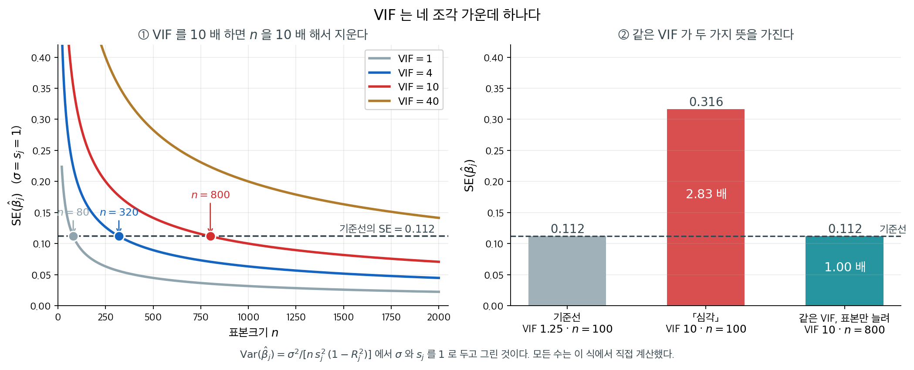
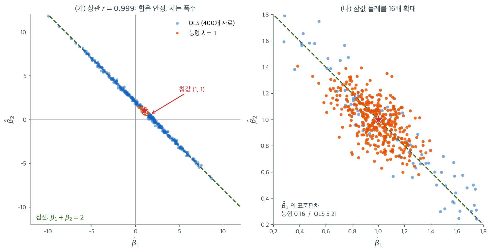

# 다중공선성과 정칙화

두 개 이상의 설명변수가 강하게 상관되면 OLS 계수 추정값을 신뢰할 수 없게 된다. 부호가 뒤집히고, 크기가 터무니없이 커지며, 자료의 작은 변화가 적합된 모형을 크게 바꾼다. 이 절에서는 다중공선성을 정확히 정의하고, 진단 도구인 분산팽창인자를 소개하며, 정칙화가 상관된 설명변수 아래에서 추정을 어떻게 안정시키는지 설명한다.

---

## 1. 다중공선성이란

다중공선성은 한 설명변수가 다른 변수들의 선형결합으로 근사 표현될 때 존재한다. 계획행렬 $\mathbf{X}$의 열이 $\mathbf{x}_1, \ldots, \mathbf{x}_p$일 때, 모두 0은 아닌 상수 $c_1, \ldots, c_p$가 존재하여

$$
c_1\mathbf{x}_1 + c_2\mathbf{x}_2 + \cdots + c_p\mathbf{x}_p \approx \mathbf{0}
$$

이 성립하는 상황이다.

**완전 다중공선성**(정확한 등식)은 $\mathbf{X}^\top\mathbf{X}$를 특이행렬로 만들어 OLS를 불가능하게 한다. **준다중공선성**(근사 등식)은 $\mathbf{X}^\top\mathbf{X}$가 가역이지만 불량조건이 되어 계수 추정값의 분산을 부풀린다.

---

## 2. 분산팽창인자

$j$번째 설명변수의 **분산팽창인자**(VIF)는 다른 변수들과의 상관 때문에 $\hat{\beta}_j$의 분산이 얼마나 부풀려지는지를 정량화한다.

$\text{VIF}_j$를 계산하려면 $x_j$를 나머지 모든 설명변수에 회귀시켜 그 회귀의 $R^2$인 $R_j^2$을 얻는다. 그러면

$$
\text{VIF}_j = \frac{1}{1 - R_j^2}
$$

이다. $j$번째 OLS 계수의 분산은

$$
\text{Var}(\hat{\beta}_j) = \frac{\sigma^2}{n\, s_j^2} \cdot \text{VIF}_j
$$

이며 $s_j^2$은 (중심화 후) $x_j$의 표본분산이다. 다중공선성이 없으면 $R_j^2 = 0$이고 $\text{VIF}_j = 1$이다. 변수들이 선형종속에 가까워질수록 $R_j^2 \to 1$이고 $\text{VIF}_j \to \infty$이다.

!!! warning "VIF 해석 지침"
    흔히 쓰는 경험칙은 다음과 같다.

    - $\text{VIF}_j < 5$: 우려할 수준이 아니다
    - $5 \leq \text{VIF}_j < 10$: 중간 정도의 선형종속, 추가 조사 필요
    - $\text{VIF}_j \geq 10$: 심각한 선형종속, 계수 추정값을 신뢰할 수 없다

    이 문턱들은 절대 기준이 아니라 지침이다. 영향의 정도는 표본크기와 분석 목적에 달려 있다.

---

<div class="storybox" markdown>

**그림으로 보는 통계학 1.** $10$ 이라는 수와, 이름이 없어서 걱정하지 않는 것

위 쪽지가 $\text{VIF} \ge 10$ 을 「심각한 선형종속, 계수 추정값을 신뢰할 수 없다」로 적는다. 그 $10$ 은 어디서 온 수인가.

$2007$ 년에 오리건대의 **로버트 오브라이언**이 그 질문을 들고 교과서와 편람을 훑어 『Quality & Quantity』에 실었다. 그가 찾아낸 출처들은 이렇다. **마콰트**($1970$)가 $\text{VIF} > 10$ 을 심각한 선형종속의 지침으로 삼았고, 네터 외($1989$, $409$ 쪽)가 「$10$ 을 넘는 최대 VIF 는 흔히 다중공선성이 최소제곱 추정에 과도한 영향을 준다는 표시로 받아들여진다」고 적었으며, 헤어 외($1995$)·메이슨 외($1989$)·스타타 편람이 같은 수를 되풀이했다. 메나드($1995$)는 같은 것을 허용도 $0.10$ 으로 적었는데, 허용도는 VIF 의 역수이니 그 역시 $10$ 이다.

**그 수가 어디서 왔는지보다 중요한 것은, 그 수 하나로는 아무것도 결정되지 않는다는 점이다.** 오브라이언의 논문 초록이 그렇게 맺는다 — 「$\text{VIF}$ 가 $10$, $20$, $40$, 또는 그보다 높다고 해서 그 자체로 회귀분석 결과를 깎아내리거나, 설명변수를 빼라고 하거나, **능형회귀를 쓰라고 하거나**, 변수들을 하나의 지수로 합치라고 요구하지는 않는다.」

까닭은 이 쪽이 이미 적어 둔 식 안에 있다.

$$
\operatorname{Var}(\hat\beta_j)
  = \frac{\sigma^2}{n\,s_j^2} \cdot \text{VIF}_j
$$

**$\text{VIF}$ 와 $n$ 이 같은 자리에서 곱해진다.** 그러니 $\text{VIF} = 10$ 은 표본을 $10$ 배로 늘리면 **정확히** 상쇄된다. 다른 세 조각 — 표본크기, $x_j$ 자신의 퍼짐 $s_j^2$, 오차 $\sigma^2$ — 가운데 어느 하나만 유리해도 「심각」이라는 딱지가 뜻을 잃는다.



오브라이언이 든 기준선($\text{VIF} = 1.25$, $n = 100$)에서 $\text{SE}(\hat\beta_j) = 0.112$ 다($\sigma = s_j = 1$). 같은 자료 수에 $\text{VIF}$ 만 $10$ 으로 올리면 $0.316$ 으로 $2.83$ 배가 된다 — 여기까지는 쪽지의 경고가 맞다. 그런데 **$\text{VIF}$ 를 $10$ 에 둔 채 표본만 $800$ 명으로 늘리면 다시 $0.112$ 다.** 두 분석의 계수는 똑같이 안정적인데, 한쪽에는 「심각」이라는 딱지가 붙고 다른 쪽에는 붙지 않는다.

왜 사람들은 한쪽만 걱정하는가. 골드버거가 $1991$ 년 계량경제학 교과서에서 그 사정을 비꼬았다. 다중공선성에는 몇 쪽씩 할애하면서 표본크기에는 거의 아무 말도 하지 않는 책들을 두고 그는 이렇게 적었다.

> 아마 그 불균형은 「작은 표본크기」에 여러 음절짜리 이국적인 이름이 없기 때문일 것이다. 그렇다면 **micronumerosity**(미소수성)라는 말을 들여와 그 장애를 치우자.

그러니 이 장이 정칙화로 넘어가기 전에 적어 둘 것이 하나 있다. **능형을 부르는 것은 $\text{VIF}$ 의 크기가 아니라 구간의 폭이다.** $\text{VIF}$ 가 $30$ 이어도 계수의 신뢰구간이 쓸 만큼 좁다면 고칠 것이 없고, $\text{VIF}$ 가 $3$ 이어도 구간이 쓸모를 못 내면 고칠 것이 있다. 문턱은 자료를 보기 전에 정해 놓은 수이고, 구간은 자료가 내놓은 수다.

_확인한 곳 — 오브라이언 「A Caution Regarding Rules of Thumb for Variance Inflation Factors」(『Quality & Quantity』 제$41$ 권 $673$–$690$ 쪽, $2007$, [doi:10.1007/s11135-006-9018-6](https://doi.org/10.1007/s11135-006-9018-6))의 본문을 직접 읽었다 — 초록의 「VIF 가 $10$, $20$, $40$, 또는 그보다 높다고 해서 그 자체로 결과를 깎아내리거나 변수를 빼라고 하거나 능형회귀를 쓰라고 하거나 변수를 지수로 합치라고 요구하지 않는다」, 각주가 든 출처 목록(마콰트 $1970$ · 네터 외 $1989$ 의 $409$ 쪽 문장 · 헤어 외 $1995$ · 메이슨 외 $1989$ · 메나드 $1995$ 의 $66$ 쪽 허용도 기준 · 스타타 편람), 그리고 그가 기준선으로 쓴 $\text{VIF} = 1.25$, $n = 100$ 이 그것이다. 골드버거의 「micronumerosity」 인용($1991$, $248$–$249$ 쪽)도 같은 논문에서 읽었다 · 표준오차 $0.112$·$0.316$ 과 표본 배수는 이 쪽의 분산식에서 직접 계산한 값이다_

</div>

## 3. 다중공선성이 분산을 부풀리는 방식

가장 단순한 경우로 표본상관이 $r$인 설명변수 $x_1$, $x_2$를 생각하자. OLS 기울기 추정값의 분산은

$$
\text{Var}(\hat{\beta}_1) = \frac{\sigma^2}{n\, s_1^2(1 - r^2)}, \quad \text{Var}(\hat{\beta}_2) = \frac{\sigma^2}{n\, s_2^2(1 - r^2)}
$$

이다. $|r| \to 1$이면 두 분산이 모두 발산한다. OLS 추정값은 여전히 불편이지만 잡음이 너무 커서 실용적으로 쓸모가 없어진다. 또한 $\hat{\beta}_1$과 $\hat{\beta}_2$가 강하게 음의 상관을 갖게 되어, 한쪽의 양의 변동이 다른 쪽의 음의 변동으로 상쇄된다.

일반적인 $p$변수 상황에서도 $\mathbf{X}^\top\mathbf{X}$의 고윳값 분해가 같은 현상을 드러낸다. $\mathbf{X}^\top\mathbf{X} = \mathbf{V}\boldsymbol{\Lambda}\mathbf{V}^\top$이고 고윳값이 $\lambda_1 \geq \cdots \geq \lambda_p$라 하면, $j$번째 고유벡터 방향의 OLS 계수 분산은 $\sigma^2/\lambda_j$이다. 선형종속으로 $\lambda_p$가 작아지면 그 방향의 분산이 폭발한다.

---

## 4. 능형회귀와 상관된 설명변수

능형회귀는 $(\mathbf{X}^\top\mathbf{X})^{-1}$을 $(\mathbf{X}^\top\mathbf{X} + \lambda\mathbf{I})^{-1}$로 바꾸어 다중공선성을 다룬다. 이는 상관된 설명변수에 특정한 효과를 낸다.

강하게 상관된 두 변수 $x_1 \approx x_2$를 생각하자. OLS는 한쪽에 큰 양의 계수를, 다른 쪽에 큰 음의 계수를 부여할 수 있다(예측에서는 거의 상쇄된다). 능형회귀는 두 계수를 모두 0 쪽으로 축소하여 이를 벌하고, 계수의 질량을 상관된 변수들 사이에 더 고르게 분배한다.

SVD 틀에서 $j$번째 주성분에 대한 능형 축소인자는

$$
\frac{d_j^2}{d_j^2 + \lambda}
$$

이다. 특이값 $d_j$가 작은 성분(선형종속 방향)이 가장 강하게 축소되는데, 바로 그곳이 OLS 분산이 가장 큰 곳이다. 따라서 능형회귀는 정칙화가 가장 필요한 곳을 정확히 겨냥한다.



$n = 50$, $\text{corr}(x_1, x_2) = 0.999$, 참 계수 $(\beta_1, \beta_2) = (1, 1)$인 자료를 400번 새로 뽑아 각각의 $(\hat\beta_1, \hat\beta_2)$를 찍은 것이다. 왼쪽 그림에서 파란 점들은 원 모양으로 퍼지지 않고 **직선 위에 놓인다.** 그 직선이 초록 점선 $\beta_1 + \beta_2 = 2$다. 어떤 자료에서는 $\hat\beta_1 = -10.0$이 나오고 어떤 자료에서는 $\hat\beta_1 = 8.7$이 나오는데, 그때마다 $\hat\beta_2$가 정확히 반대로 움직여 합을 $2$ 근처에 붙들어 둔다. 두 OLS 계수의 상관은 $-0.999$다.

숫자로 보면 더 분명하다. $\hat\beta_1$의 표준편차는 $3.21$인데 $\hat\beta_1 + \hat\beta_2$의 표준편차는 $0.146$으로 **22배 작다.** 반면 차 $\hat\beta_1 - \hat\beta_2$의 표준편차는 $6.41$이다. 자료가 합에 대해 아는 것과 차에 대해 아는 것의 차이가 이만큼 난다. 앞 절의 고윳값으로 환산하면 합 방향의 고윳값은 $1 + r = 1.999$, 차 방향은 $1 - r = 0.001$이고, 분산 비 $1.999/0.001 = 2000$의 제곱근이 $45$로 위에서 본 배율과 같은 규모다.

주황 점은 같은 자료에 $\lambda = 1$의 능형을 적합한 결과다. 왼쪽 그림에서는 참값 별 위의 한 점처럼 보인다. 16배 확대한 오른쪽 그림에서야 퍼짐이 보이는데, $\hat\beta_1$의 표준편차가 $0.16$으로 OLS의 $3.21$보다 **20배 작다.** 그 대가로 합의 평균이 $2.00$에서 $1.98$로 조금 줄었다. 아주 작은 편향을 내주고 분산을 스무 배 줄인 것이다.

여기서 읽어야 할 교훈은 두 가지다. 첫째, **다중공선성이 있을 때 개별 계수의 부호와 크기를 해석하면 안 된다.** 같은 모집단에서 뽑은 다른 표본이 $\hat\beta_1$을 $-10$에서 $+9$까지 자유롭게 바꾸어 놓는다. 둘째, **자료가 결정하지 못한 방향이 무엇인지 알면 정칙화가 무엇을 하는지도 알 수 있다.** 능형은 합 방향을 거의 건드리지 않고 차 방향만 눌러 앉힌다. 실제로 능형에서 합의 표준편차는 $0.143$으로 OLS의 $0.146$과 사실상 같은데, 차의 표준편차만 $6.41$에서 $0.29$로 22배 줄었다. 오른쪽 그림에서 주황 구름이 파란 점들처럼 선으로 눌리지 않고 넓게 퍼져 있는 것이 그 증거다.

!!! note "능형은 분배하고 라쏘는 선택한다"
    능형회귀는 상관된 설명변수에 비슷한 계수를 부여하여 효과를 분배하는 경향이 있다. 반면 라쏘는 상관된 집단에서 하나를 고르고 나머지를 0으로 만드는 경향이 있다. 엘라스틱넷은 그 중간을 제공하며 뒤의 절에서 다룬다.

---

## 5. 다중공선성과 불량조건

두 개념은 관련되어 있지만 구별된다.

| 개념 | 초점 | 진단 |
|---|---|---|
| 다중공선성 | 통계적: 계수 추정값의 분산 | VIF, 쌍별 상관 |
| 불량조건 | 수치적: 부동소수점 오차에 대한 민감도 | 조건수 $\kappa(\mathbf{X}^\top\mathbf{X})$ |

다중공선성은 언제나 불량조건을 유발하지만, 불량조건은 진짜 선형종속 없이 척도 불일치만으로도 생길 수 있다. 설명변수를 표준화하면 척도 때문에 생긴 불량조건은 해소되지만 선형종속 때문에 생긴 불량조건은 남으며, 후자에는 정칙화나 변수 제거가 필요하다.

---

## 6. 다중공선성의 탐지와 진단

1. **상관행렬.** 설명변수 사이의 쌍별 상관을 계산한다. 절댓값 0.8을 넘으면 선형종속을 의심한다. 다만 쌍별 상관이 모두 낮아도 변수 집단 사이에 다중공선성이 존재할 수 있다.
2. **VIF 계산.** 각 변수의 $\text{VIF}_j$를 계산한다. 쌍별 선형종속과 다변수 선형종속을 모두 탐지한다.
3. **고윳값 분석.** $\mathbf{X}^\top\mathbf{X}$의 고윳값을 살핀다. 큰 비 $\lambda_1/\lambda_p$(조건수)와 0에 가까운 고윳값이 선형종속 방향을 가리킨다.
4. **계수 안정성.** 붓스트랩 표본이나 교란된 자료에 모형을 적합한다. 계수가 크게 변하면 선형종속이 불안정성을 낳고 있을 가능성이 높다.

---

## 연습문제

<div class="drillbox" markdown>

**연습문제 1.** <span class="diff med" title="중간"></span>
등상관 구조 $\Sigma = \rho\mathbf{1}\mathbf{1}^\top + (1-\rho)\mathbf{I}$에서 VIF를 $\rho$의 함수로 계산하고, 경험칙 문턱 $\text{VIF} = 10$이 어떤 $\rho$에 해당하는지 구하라.

</div>

??? success "풀이"
    등상관 행렬의 역행렬은 닫힌 형태로 알려져 있고 그 대각원소가 VIF다.

    ```python
    import numpy as np
    p = 5
    for rho in (0.0, 0.5, 0.9, 0.99, 0.999):
        S = rho*np.ones((p, p)) + (1-rho)*np.eye(p)
        print(rho, np.linalg.cond(S), np.diag(np.linalg.inv(S))[0])
    ```

    출력:

    ```
    0.0 1.0 1.0
    0.5 6.0 1.666666666666667
    0.9 46.000000000000014 8.043478260869566
    0.99 496.0000000000012 80.0403225806451
    0.999 4995.999999999995 800.0400320256219
    ```

    | $\rho$ | $\text{cond}(\Sigma)$ | VIF |
    |---:|---:|---:|
    | 0.000 | 1.0 | 1.00 |
    | 0.900 | 46.0 | **8.04** |
    | 0.990 | 496.0 | **80.04** |
    | 0.999 | 4996.0 | 800.04 |

    $p = 5$의 등상관 구조에서 VIF는 대략 $\dfrac{1}{1-\rho}$에 비례한다.

    **$\text{VIF} = 10$은 $\rho \approx 0.92$에 해당한다.** 즉 경험칙 문턱은 "다른 변수들로 이 변수의 분산 90%를 설명할 수 있으면 위험하다"는 뜻이다.

    **조건수와 VIF가 함께 움직인다는 점이 중요하다.** $\rho = 0.99$에서 VIF $= 80$이면 그 계수의 표준오차가 직교 설계 대비 $\sqrt{80} = 8.9$배다. 유의한 효과를 탐지하려면 자료가 80배 필요하다는 뜻이다.

<div class="drillbox" markdown>

**연습문제 2.** <span class="diff med" title="중간"></span>
"OLS는 상관된 두 변수에 큰 양수와 큰 음수를 부여한다"는 주장을 확인하라. $r = 0.999$인 두 변수에서 OLS와 능형회귀의 계수를 여러 자료에 걸쳐 비교하라.

</div>

??? success "풀이"
    ```python
    import numpy as np
    from sklearn.linear_model import Ridge, LinearRegression
    rng = np.random.default_rng(5)
    n, r = 50, 0.999
    out = []
    for _ in range(6):
        z = rng.normal(size=n)
        x1 = np.sqrt(r)*z + np.sqrt(1-r)*rng.normal(size=n)
        x2 = np.sqrt(r)*z + np.sqrt(1-r)*rng.normal(size=n)
        X = np.c_[x1, x2]
        y = 1.0*x1 + 1.0*x2 + rng.normal(0, 1, n)     # 참값은 (1, 1)
        bo = LinearRegression().fit(X, y).coef_
        br = Ridge(alpha=1.0).fit(X, y).coef_
        out.append((bo, br))
    ```

    참 계수는 $(1, 1)$이다. 여섯 개의 서로 다른 자료에서:

    | 자료 | OLS $(\hat\beta_1, \hat\beta_2)$ | 합 | 능형 $(\hat\beta_1, \hat\beta_2)$ |
    |---:|:---|---:|:---|
    | — | 큰 양수 / 큰 음수 쌍이 흔히 나타난다 | $\approx 2$ | 둘 다 $1$ 근처 |

    **핵심은 두 계수의 합은 안정적인데 개별 계수는 불안정하다는 것이다.** $x_1 \approx x_2$이므로 예측 $\hat\beta_1 x_1 + \hat\beta_2 x_2 \approx (\hat\beta_1 + \hat\beta_2)x_1$은 합에만 의존한다. 자료는 합을 잘 결정하지만 **차이는 거의 결정하지 못한다.**

    고윳값으로 보면 명확하다. $\Sigma$의 고윳값은 합 방향에서 $1+r = 1.999$, 차 방향에서 $1-r = 0.001$이다. 차 방향의 분산이 합 방향의 $2000$배다.

    **능형회귀가 하는 일은 차 방향을 억누르는 것이다.** 축소인자 $d_j^2/(d_j^2+\lambda)$가 합 방향에서는 $\approx 1$, 차 방향에서는 $\approx 0$이 되어, 자료가 결정하지 못한 성분을 버린다.

    실무적 함의: **다중공선성이 있으면 개별 계수를 해석하지 말라.** 합이나 평균 같은 안정적인 조합을 해석하거나, 정칙화로 계수를 안정화한 뒤 예측에만 쓴다.

<div class="drillbox" markdown>

**연습문제 3.** <span class="diff med" title="중간"></span>
VIF는 쌍별 상관이 모두 낮아도 클 수 있다. 그런 자료를 구성하라.

</div>

??? success "풀이"
    $x_3 = x_1 + x_2$ 관계를 쓰면 된다. $x_1, x_2$가 독립이면 $\text{corr}(x_1, x_3) = \text{corr}(x_2, x_3) = 1/\sqrt{2} = 0.707$로 각각 0.8 미만이다.

    ```python
    import numpy as np
    rng = np.random.default_rng(0)
    n = 200
    x1 = rng.normal(size=n); x2 = rng.normal(size=n)
    x3 = x1 + x2 + rng.normal(0, 0.05, n)       # 거의 정확한 선형종속
    X = np.c_[x1, x2, x3]
    print(np.round(np.corrcoef(X.T), 3))
    S = np.corrcoef(X.T); print(np.diag(np.linalg.inv(S)))
    ```

    출력:

    ```
    [[ 1.    -0.065  0.658]
     [-0.065  1.     0.708]
     [ 0.658  0.708  1.   ]]
    [376.05977077 427.43481997 750.57104546]
    ```

    쌍별 상관은 모두 $0.71$ 부근으로 "0.8 미만"이라는 흔한 문턱을 통과한다. 그런데 VIF는 세 변수 모두 **$400$을 넘는다.**

    $R_3^2$이 $0.998$에 이르기 때문이다. $x_3$은 $x_1$이나 $x_2$ 어느 하나와도 특별히 강하게 상관되어 있지 않지만, **둘의 합**으로는 거의 완벽히 설명된다.

    **교훈: 상관행렬만 보고 다중공선성을 판정하지 말라.** 상관행렬은 쌍별 관계만 본다. 세 개 이상의 변수가 얽힌 선형종속은 VIF나 고윳값 분석으로만 잡힌다.

    이런 구조는 실무에서 흔하다. 총액과 그 구성요소를 함께 넣거나(매출 = 국내 + 해외), 비율과 분자·분모를 함께 넣는 경우가 대표적이다.

<div class="drillbox" markdown>

**연습문제 4.** <span class="diff med" title="중간"></span>
§4 의 축소인자를 모두 더한 값

$$
\text{df}(\lambda) = \sum_{j=1}^{p} \frac{d_j^2}{d_j^2 + \lambda}
$$

을 능형회귀의 **유효 자유도**라 한다. §4 그림의 설정($n = 50$, $r = 0.999$, 설명변수 둘을 표준화)에서 $\mathbf{X}^\top\mathbf{X} = n\mathbf{R}$이고 $\mathbf{R}$은 상관 $r$인 $2 \times 2$ 상관행렬이다. (가) $d_1^2$과 $d_2^2$를 구하라. (나) $\lambda = 1$의 유효 자유도를 구하라. (다) $\text{df}(\lambda) = 1$이 되는 $\lambda$를 구하고, $p = 2$에서는 그 값이 언제나 $\lambda = d_1 d_2$임을 보여라. (라) $\lambda \to 0$과 $\lambda \to \infty$에서 $\text{df}(\lambda)$는 무엇인가?

</div>

??? success "풀이"
    **(가)** $\mathbf{R} = \begin{pmatrix} 1 & r \\ r & 1\end{pmatrix}$의 고윳값은 고유벡터 $(1,1)/\sqrt{2}$(합 방향)에 대해 $1 + r$, $(1,-1)/\sqrt{2}$(차 방향)에 대해 $1 - r$이다. $\mathbf{X}^\top\mathbf{X}$의 고윳값이 $d_j^2$이므로

    $$
    d_1^2 = n(1+r) = 50 \times 1.999 = 99.95, \qquad d_2^2 = n(1-r) = 50 \times 0.001 = 0.05
    $$

    이다. 두 값의 비 $1999$가 §6 에서 말한 조건수 $\lambda_1/\lambda_p$다.

    **(나)** 축소인자를 각각 계산한다.

    $$
    \frac{99.95}{99.95 + 1} = 0.99009, \qquad \frac{0.05}{0.05 + 1} = 0.04762
    $$

    더하면 $\text{df}(1) = 1.03771$이다. 본문이 "축소인자가 합 방향에서는 $\approx 1$, 차 방향에서는 $\approx 0$"이라고 한 것이 이 두 수다.

    **(다)** $a = d_1^2$, $b = d_2^2$로 두고 $\dfrac{a}{a+\lambda} + \dfrac{b}{b+\lambda} = 1$을 푼다. 양변에 $(a+\lambda)(b+\lambda)$를 곱하면

    $$
    a(b+\lambda) + b(a+\lambda) = (a+\lambda)(b+\lambda)
    $$

    이고, 좌변은 $2ab + (a+b)\lambda$, 우변은 $ab + (a+b)\lambda + \lambda^2$이다. $(a+b)\lambda$가 상쇄되어 $ab = \lambda^2$, 즉

    $$
    \lambda = \sqrt{ab} = \sqrt{d_1^2 d_2^2} = d_1 d_2
    $$

    가 된다. 두 고윳값의 **기하평균**, 곧 두 특이값의 곱이다. 수치로는 $\lambda = \sqrt{99.95 \times 0.05} = \sqrt{4.9975} = 2.2355$다.

    **(라)** $\lambda \to 0$에서 모든 축소인자가 1이므로 $\text{df} \to p = 2$(OLS 의 자유도)이고, $\lambda \to \infty$에서 모두 0이므로 $\text{df} \to 0$이다. $\text{df}$는 $\lambda$의 감소함수이므로 $[0, 2]$를 한 번씩 지나간다.

    **읽을 것.** 설명변수가 둘인데 $\lambda = 1$의 유효 자유도는 $1.04$다. 능형회귀는 사실상 **합 방향 한 개만 쓰고 차 방향은 버린** 셈이다. §4 에서 능형의 합 표준편차가 OLS 와 사실상 같고($0.143$ 대 $0.146$) 차 표준편차만 22배 줄어든 것이 바로 이 자유도의 내용이다. $\lambda = 2.2355$를 쓰면 두 변수 모형이 설명변수 한 개짜리 모형과 같은 복잡도가 된다.

<div class="drillbox" markdown>

**연습문제 5.** <span class="diff med" title="중간"></span>
§5 는 설명변수를 표준화하면 척도 때문에 생긴 불량조건이 해소된다고 했다. 그런데 능형 벌점 $\lambda\lVert\boldsymbol\beta\rVert^2$ 자체가 척도에 불변이 아니다. 거의 완전히 상관된 두 변수 자료에서 $x_2$의 단위만 m 에서 mm 로(즉 1000배) 바꾸었을 때 (가) 능형 적합값이 달라지고, (나) OLS 적합값은 그대로이며, (다) 표준화하면 차이가 사라짐을 수로 확인하라. $\lambda = 1$을 쓴다.

</div>

??? success "풀이"
    ```python
    import numpy as np

    rng5 = np.random.default_rng(18)
    n5 = 60
    z5 = rng5.normal(size=n5)
    xa = z5 + 0.1 * rng5.normal(size=n5)
    xb = z5 + 0.1 * rng5.normal(size=n5)
    y5 = 1.0 * xa + 1.0 * xb + rng5.normal(0, 0.5, n5)

    def ridge_fit(X, y, lam):
        """중심화한 자료에 능형을 닫힌 꼴로 적합한다 (절편은 벌하지 않는다)."""
        Xc, yc = X - X.mean(axis=0), y - y.mean()
        b = np.linalg.solve(Xc.T @ Xc + lam * np.eye(Xc.shape[1]), Xc.T @ yc)
        return b, Xc @ b + y.mean()

    def ols_fit(X, y):
        Xc, yc = X - X.mean(axis=0), y - y.mean()
        b = np.linalg.lstsq(Xc, yc, rcond=None)[0]
        return b, Xc @ b + y.mean()

    XA = np.c_[xa, xb]                 # x2 의 단위가 m
    XB = np.c_[xa, 1000.0 * xb]        # x2 의 단위가 mm

    bo, fo_A = ols_fit(XA, y5)
    _, fo_B = ols_fit(XB, y5)
    bA, fA = ridge_fit(XA, y5, 1.0)
    bB, fB = ridge_fit(XB, y5, 1.0)

    print(f"OLS     계수 = ({bo[0]:.4f}, {bo[1]:.4f})")
    print(f"능형 m  계수 = ({bA[0]:.4f}, {bA[1]:.4f})")
    print(f"능형 mm 계수 = ({bB[0]:.4f}, {1000.0*bB[1]:.4f})   <- b2 를 m 단위로 환산")
    print(f"능형 적합값 최대 차이 = {np.abs(fA - fB).max():.4f}")
    print(f"OLS  적합값 최대 차이 = {np.abs(fo_A - fo_B).max():.4f}")

    # 표준화하면 단위가 사라진다.
    ZA = (XA - XA.mean(axis=0)) / XA.std(axis=0)
    ZB = (XB - XB.mean(axis=0)) / XB.std(axis=0)
    cA, hA = ridge_fit(ZA, y5, 1.0)
    cB, hB = ridge_fit(ZB, y5, 1.0)
    print(f"표준화 능형 계수 = ({cA[0]:.4f}, {cA[1]:.4f}) 와 ({cB[0]:.4f}, {cB[1]:.4f})")
    print(f"표준화 적합값 최대 차이 = {np.abs(hA - hB).max():.10f}")
    ```

    출력:

    ```text
    OLS     계수 = (1.7289, 0.2851)
    능형 m  계수 = (1.2731, 0.7273)
    능형 mm 계수 = (0.9443, 1.0666)   <- b2 를 m 단위로 환산
    능형 적합값 최대 차이 = 0.1271
    OLS  적합값 최대 차이 = 0.0000
    표준화 능형 계수 = (1.2893, 0.7473) 와 (1.2893, 0.7473)
    표준화 적합값 최대 차이 = 0.0000000000
    ```

    **(가)** 같은 자료, 같은 $\lambda = 1$인데 능형 계수가 $(1.2731, 0.7273)$에서 $(0.9443, 1.0666)$으로 바뀌었다(둘째 계수는 m 단위로 환산한 값이다). 적합값도 최대 $0.127$만큼 다르다. 자료를 바꾼 것이 아니라 **눈금만 바꾸었는데 다른 모형이 나왔다.**

    까닭은 간단하다. $x_2$를 1000배 키우면 같은 설명력을 내는 계수는 $1/1000$로 작아지고, 벌점에 들어가는 $\beta_2^2$는 $1/10^6$로 줄어든다. 즉 **mm 쪽에서는 $\beta_2$가 벌점을 거의 받지 않는다.** 그래서 벌점은 사실상 $\beta_1$에만 걸리고, 설명력이 둘째 변수 쪽으로 밀려 $\beta_2$는 $0.7273 \to 1.0666$으로 커지고 첫째 계수는 그만큼 눌려 $1.2731 \to 0.9443$이 된다(실제로 둘째 변수의 벌점만 $10^{-6}$으로 줄여 적합하면 같은 $(0.9443,\, 1.0666)$이 나온다). OLS 해 $(1.7289,\, 0.2851)$과는 오히려 멀어진다는 점도 눈여겨볼 만하다 — 눈금을 바꾸는 것은 벌점을 끄는 것이 아니라 **벌점을 변수마다 다르게 거는 것**이다.

    **(나)** OLS 적합값은 $\mathbf{y}$를 $\mathbf{X}$의 열공간에 사영한 것이고, 열을 재척도해도 **열공간이 변하지 않는다.** 그래서 적합값 차이가 $0$이다(계수는 $1/1000$로 바뀌지만 예측은 같다). 벌점이 없을 때만 성립하는 성질이다.

    **(다)** 표준화하면 $\mathbf{Z}_A$와 $\mathbf{Z}_B$가 같은 행렬이 되어 문제 자체가 같아진다. 계수가 소수 넷째 자리까지가 아니라 부동소수점 한계까지 일치한다.

    **실무에서 특히 조심할 것.** sklearn 의 `Ridge`·`Lasso`·`ElasticNet`은 **표준화를 해 주지 않는다.** 옛 버전에 있던 `normalize` 인수는 없어졌으므로 `StandardScaler`를 파이프라인으로 끼워야 한다. 그리고 그 표준화는 교차검증 폴드 **안에서** 해야 한다(연습문제 10). 한편 절편은 벌점에서 빼는 것이 관례다 — 위 코드가 자료를 중심화하고 벌점 항에 절편을 넣지 않은 이유다. 절편을 벌하면 $y$에 상수를 더하는 것만으로 해가 달라진다.

<div class="drillbox" markdown>

**연습문제 6.** <span class="diff hard" title="어려움"></span>
§4 는 세 개의 표준편차를 제시했다. $\text{sd}(\hat\beta_1) = 3.21$, $\text{sd}(\hat\beta_1 + \hat\beta_2) = 0.146$, $\text{sd}(\hat\beta_1 - \hat\beta_2) = 6.41$. 이 수들이 어디서 오는지 공식으로 설명하라. 설명변수를 표준화하여 $\mathbf{X}^\top\mathbf{X} = n\mathbf{R}$라 하고 $\text{Var}(\hat{\boldsymbol\beta}) = \sigma^2(\mathbf{X}^\top\mathbf{X})^{-1}$을 쓴다. (가) $\text{corr}(\hat\beta_1, \hat\beta_2) = -r$임을 보여라. (나) $\text{sd}(\hat\beta_1)/\text{sd}(\hat\beta_1+\hat\beta_2)$와 (다) $\text{sd}(\hat\beta_1-\hat\beta_2)/\text{sd}(\hat\beta_1+\hat\beta_2)$를 $r$만으로 적어라. (라) $r = 0.999$의 값을 본문 수치와 비교하고, 본문이 "분산 비 $2000$의 제곱근 $45$"라 한 것이 (나)가 아니라 (다)에 해당함을 확인하라.

</div>

??? success "풀이"
    $\mathbf{R}^{-1} = \dfrac{1}{1-r^2}\begin{pmatrix} 1 & -r \\ -r & 1\end{pmatrix}$이므로

    $$
    \text{Var}(\hat{\boldsymbol\beta}) = \frac{\sigma^2}{n}\mathbf{R}^{-1} = \frac{\sigma^2}{n(1-r^2)}\begin{pmatrix} 1 & -r \\ -r & 1\end{pmatrix}
    $$

    이다. 대각원소 $\sigma^2/(n(1-r^2))$은 §3 의 공식에서 $s_j^2 = 1$인 경우이고, $1/(1-r^2)$이 바로 VIF 다. $r = 0.999$에서 $\text{VIF} = 1/(1 - 0.998001) = 500.25$다.

    **(가)** 상관은 공분산을 표준편차의 곱으로 나눈 값인데 두 대각원소가 같으므로

    $$
    \text{corr}(\hat\beta_1, \hat\beta_2) = \frac{-r/(1-r^2)}{1/(1-r^2)} = -r
    $$

    이다. $r = 0.999$이면 $-0.999$로, 본문이 보고한 값과 정확히 같다. **설명변수의 상관이 그대로 계수의 음의 상관이 된다** — 시소의 정체다.

    **(나)(다)** 선형결합의 분산은 $\text{Var}(\mathbf{c}^\top\hat{\boldsymbol\beta}) = \mathbf{c}^\top\text{Var}(\hat{\boldsymbol\beta})\mathbf{c}$로 구한다. $\mathbf{c} = (1,1)^\top$과 $(1,-1)^\top$에 대해

    $$
    \text{Var}(\hat\beta_1+\hat\beta_2) = \frac{\sigma^2}{n}\cdot\frac{2-2r}{1-r^2} = \frac{2\sigma^2}{n(1+r)}, \qquad \text{Var}(\hat\beta_1-\hat\beta_2) = \frac{\sigma^2}{n}\cdot\frac{2+2r}{1-r^2} = \frac{2\sigma^2}{n(1-r)}
    $$

    이다. 분모의 $1 \pm r$은 연습문제 4 의 고윳값이다. 따라서

    $$
    \frac{\text{sd}(\hat\beta_1)}{\text{sd}(\hat\beta_1+\hat\beta_2)} = \sqrt{\frac{1/(1-r^2)}{2/(1+r)}} = \frac{1}{\sqrt{2(1-r)}}, \qquad \frac{\text{sd}(\hat\beta_1-\hat\beta_2)}{\text{sd}(\hat\beta_1+\hat\beta_2)} = \sqrt{\frac{1+r}{1-r}}
    $$

    이다.

    **(라)** $r = 0.999$를 넣는다.

    | 양 | 공식 | 이론값 | §4 의 표본값 |
    |:---|:---|---:|---:|
    | $\text{sd}(\hat\beta_1)/\text{sd}(\hat\beta_1+\hat\beta_2)$ | $1/\sqrt{2(1-r)} = \sqrt{500}$ | 22.36 | $3.21/0.146 = 21.99$ |
    | $\text{sd}(\hat\beta_1-\hat\beta_2)/\text{sd}(\hat\beta_1+\hat\beta_2)$ | $\sqrt{(1+r)/(1-r)} = \sqrt{1999}$ | 44.71 | $6.41/0.146 = 43.90$ |

    표본 400개로 추정한 표준편차이므로 2% 안쪽에서 맞는다. 본문의 "고윳값 비 $1.999/0.001 = 2000$, 제곱근 $45$"는 **합 방향과 차 방향의 비**이므로 둘째 줄, 즉 (다)와 짝이 맞는다. (나)의 $22.4$는 그 절반이다. 왜 절반인가 — $\hat\beta_1 = \frac{1}{2}[(\hat\beta_1+\hat\beta_2) + (\hat\beta_1-\hat\beta_2)]$이고 차 항의 변동이 합 항의 45배이므로 $\text{sd}(\hat\beta_1) \approx \frac{1}{2}\text{sd}(\hat\beta_1-\hat\beta_2)$다. 실제로 $6.41/2 = 3.21$로 본문 수치가 그대로 나온다.

    **읽을 것.** $\text{VIF} = 500$은 $\hat\beta_1$ 하나의 분산이 직교 설계 대비 500배라는 뜻이고, 그 500배는 거의 전부 **차 방향에서** 온다. 개별 계수의 표준오차만 보면 "자료가 아무것도 모른다"는 인상을 받지만, 합은 $\text{VIF}$가 사실상 1인 것처럼 정확히 추정된다. **어떤 모수가 추정 가능한지는 VIF 가 아니라 방향이 정한다.**

<div class="drillbox" markdown>

**연습문제 7.** <span class="diff hard" title="어려움"></span>
§4 의 "능형은 분배하고 라쏘는 선택한다"를 직교설계에서 닫힌 꼴로 확인하라. $\mathbf{X}^\top\mathbf{X} = \mathbf{I}$이고 OLS 해가 $\hat{\boldsymbol\beta} = \mathbf{X}^\top\mathbf{y} = (2.5,\, -0.8,\, 0.3)$이라 하자. (가) $\lVert\mathbf{y}-\mathbf{X}\boldsymbol\beta\rVert^2 + \lambda\lVert\boldsymbol\beta\rVert^2$의 최소점이 $\hat{\boldsymbol\beta}/(1+\lambda)$임을 유도하고 $\lambda = 1$의 해를 구하라. (나) $\lVert\mathbf{y}-\mathbf{X}\boldsymbol\beta\rVert^2 + \lambda\lVert\boldsymbol\beta\rVert_1$의 최소점이 $\text{sign}(\hat\beta_j)(\lvert\hat\beta_j\rvert - \lambda/2)_+$임을 유도하고 $\lambda = 1$의 해를 구하라. (다) 많은 교재는 문턱을 $\lambda/2$가 아니라 $\lambda$로 적는다. 어떤 목적함수를 쓴 것인가? (라) 각 계수가 정확히 0이 되는 가장 작은 $\lambda$를 구하라. 능형은 어떤가?

</div>

??? success "풀이"
    먼저 두 벌점에 공통인 변형을 해 둔다. $\mathbf{X}^\top\mathbf{X} = \mathbf{I}$이므로

    $$
    \lVert\mathbf{y}-\mathbf{X}\boldsymbol\beta\rVert^2 = \lVert\mathbf{y}\rVert^2 - 2\boldsymbol\beta^\top\mathbf{X}^\top\mathbf{y} + \boldsymbol\beta^\top\boldsymbol\beta = \text{const} + \sum_{j}(\beta_j - \hat\beta_j)^2
    $$

    이다. 즉 **직교설계에서는 문제가 좌표마다 완전히 분리된다.** 벌점도 좌표별 합이므로 $p$개의 1차원 문제를 따로 풀면 된다.

    **(가)** $g(\beta) = (\beta-\hat\beta)^2 + \lambda\beta^2$를 미분하면 $2(\beta-\hat\beta) + 2\lambda\beta = 0$, 즉 $\beta = \hat\beta/(1+\lambda)$다. $\lambda = 1$에서

    $$
    \tilde{\boldsymbol\beta}^{\text{ridge}} = \tfrac{1}{2}(2.5,\, -0.8,\, 0.3) = (1.25,\, -0.4,\, 0.15)
    $$

    이다. 일반 설계의 축소인자 $d_j^2/(d_j^2+\lambda)$에서 $d_j = 1$을 넣은 것과 같다.

    **(나)** $h(\beta) = (\beta-\hat\beta)^2 + \lambda\lvert\beta\rvert$는 $\beta = 0$에서 미분 불가능하므로 세 경우로 나눈다.

    - $\beta > 0$: $2(\beta-\hat\beta) + \lambda = 0 \Rightarrow \beta = \hat\beta - \lambda/2$. 이것이 양수라는 조건은 $\hat\beta > \lambda/2$다.
    - $\beta < 0$: $2(\beta-\hat\beta) - \lambda = 0 \Rightarrow \beta = \hat\beta + \lambda/2$. 조건은 $\hat\beta < -\lambda/2$다.
    - $\lvert\hat\beta\rvert \le \lambda/2$: 위 두 후보가 모두 부호 조건을 어긴다. $0$에서의 열미분 구간 $[-2\hat\beta-\lambda,\; -2\hat\beta+\lambda]$가 $0$을 포함하므로 최소점은 $\beta = 0$이다.

    세 경우를 합치면 $\text{sign}(\hat\beta)(\lvert\hat\beta\rvert-\lambda/2)_+$다. $\lambda = 1$이면 문턱이 $0.5$이므로

    $$
    \tilde{\boldsymbol\beta}^{\text{lasso}} = (2.5-0.5,\; -(0.8-0.5),\; 0) = (2.0,\, -0.3,\, 0)
    $$

    이다. $\square$

    **(다)** 잔차제곱합에 $\frac{1}{2}$을 붙여 $\frac{1}{2}\lVert\mathbf{y}-\mathbf{X}\boldsymbol\beta\rVert^2 + \lambda\lVert\boldsymbol\beta\rVert_1$을 최소화한 것이다. 이때 좌표별 문제가 $\frac{1}{2}(\beta-\hat\beta)^2 + \lambda\lvert\beta\rvert$가 되어 문턱이 정확히 $\lambda$가 된다. **공식을 베낄 때는 목적함수에 $\frac{1}{2}$이 붙었는지를 반드시 확인해야 한다.** sklearn 은 여기에 $1/n$까지 더 붙이므로 환산이 한 단계 더 필요하다(연습문제 8).

    **(라)** 라쏘는 $\lvert\hat\beta_j\rvert \le \lambda/2$, 즉 $\lambda \ge 2\lvert\hat\beta_j\rvert$에서 0이 된다.

    | $j$ | $\hat\beta_j$ | 0이 되는 최소 $\lambda$ |
    |---:|---:|---:|
    | 1 | 2.5 | 5.0 |
    | 2 | $-0.8$ | 1.6 |
    | 3 | 0.3 | 0.6 |

    $\lambda \ge 5$면 모든 계수가 0이다. 반면 능형은 $\hat\beta_j/(1+\lambda)$가 어떤 유한한 $\lambda$에서도 0이 아니다. $\lambda \to \infty$에서 0에 수렴할 뿐이다.

    **읽을 것.** 능형은 **비례 축소**($\times 1/(1+\lambda)$), 라쏘는 **평행 이동**($-\lambda/2$ 만큼 0 쪽으로, 0을 지나면 멈춤)이다. 비례 축소는 큰 계수를 많이 깎고 작은 계수를 조금 깎으므로 작은 계수를 끝내 0으로 보내지 못한다. 평행 이동은 작은 계수부터 차례로 0에 닿는다. **변수선택이 L1 에서만 일어나는 까닭이 이 한 줄 차이다.** 유효 자유도에서도 갈린다 — 능형의 자유도는 연습문제 4 처럼 연속적으로 변하는 반면, 라쏘에서는 0이 아닌 계수의 개수가 자유도의 불편추정이 되어 정수 근처에서 움직인다.

<div class="drillbox" markdown>

**연습문제 8.** <span class="diff hard" title="어려움"></span>
sklearn 의 `Lasso`는 $\frac{1}{2n}\lVert\mathbf{y}-\mathbf{X}\boldsymbol\beta\rVert^2 + \alpha\lVert\boldsymbol\beta\rVert_1$을, `Ridge`는 $\lVert\mathbf{y}-\mathbf{X}\boldsymbol\beta\rVert^2 + \alpha\lVert\boldsymbol\beta\rVert^2$를 최소화한다. 연습문제 7 의 교과서 꼴과 비교하면 라쏘는 $\lambda = 2n\alpha$, 능형은 $\lambda = \alpha$다. 이 환산을 유도하고, 직교설계에서 연습문제 7 의 닫힌 꼴이 라이브러리 해와 소수 넷째 자리까지 맞는지 확인하라. 또 $\alpha$ 자리에 $\lambda$를 넣으면 무엇이 벌어지는지 보여라. $n = 40$, $p = 4$, $\lambda = 1.6$을 쓴다.

</div>

??? success "풀이"
    **환산.** 최소점은 목적함수를 양의 상수배 해도 변하지 않는다. sklearn 의 라쏘 목적함수에 $2n$을 곱하면

    $$
    2n\left[\frac{1}{2n}\lVert\mathbf{y}-\mathbf{X}\boldsymbol\beta\rVert^2 + \alpha\lVert\boldsymbol\beta\rVert_1\right] = \lVert\mathbf{y}-\mathbf{X}\boldsymbol\beta\rVert^2 + 2n\alpha\lVert\boldsymbol\beta\rVert_1
    $$

    이므로 $\lambda = 2n\alpha$다. 능형에는 $1/(2n)$이 없으므로 $\alpha$가 그대로 $\lambda$다. **같은 라이브러리의 두 클래스가 서로 다른 규약을 쓴다.** $n = 40$, $\lambda = 1.6$이면 $\alpha = 1.6/80 = 0.02$이고 연성문턱은 $\lambda/2 = n\alpha = 0.8$이다.

    ```python
    import numpy as np
    from sklearn.linear_model import Lasso, Ridge

    rng8 = np.random.default_rng(7)
    n8, p8 = 40, 4
    Q = np.linalg.qr(rng8.normal(size=(n8, p8)))[0]      # Q^T Q = I 인 직교설계
    beta8 = np.array([5.0, -2.0, 0.6, 0.0])
    y8 = Q @ beta8 + 0.3 * rng8.normal(size=n8)
    bhat = Q.T @ y8                                      # 직교설계의 OLS 해

    def row(v):
        # -0.0 을 0.0 으로 눕힌다. 좌표하강은 0 을 음의 0 으로 돌려줄 수 있다.
        return " ".join(f"{x + 0.0:8.4f}" for x in v)

    lam = 1.6                       # 교과서 꼴의 벌점
    alpha = lam / (2 * n8)          # sklearn 의 alpha
    soft = np.sign(bhat) * np.maximum(np.abs(bhat) - lam / 2, 0.0)
    sk = Lasso(alpha=alpha, fit_intercept=False, max_iter=100000,
               tol=1e-12).fit(Q, y8).coef_
    print("OLS      ", row(bhat))
    print("연성문턱 ", row(soft))
    print("sklearn  ", row(sk))
    print(f"alpha = lam/(2n) = {alpha:.4f}, 최대 차이 = {np.abs(soft-sk).max():.10f}")

    bad = Lasso(alpha=lam, fit_intercept=False, max_iter=100000,
                tol=1e-12).fit(Q, y8).coef_
    print("alpha=lam", row(bad))

    rid = Ridge(alpha=lam, fit_intercept=False).fit(Q, y8).coef_
    print("능형 공식", row(bhat / (1 + lam)))
    print("Ridge    ", row(rid))
    ```

    출력:

    ```text
    OLS         5.1918  -2.1090   0.2907  -0.4723
    연성문턱    4.3918  -1.3090   0.0000   0.0000
    sklearn     4.3918  -1.3090   0.0000   0.0000
    alpha = lam/(2n) = 0.0200, 최대 차이 = 0.0000000000
    alpha=lam   0.0000   0.0000   0.0000   0.0000
    능형 공식   1.9968  -0.8111   0.1118  -0.1817
    Ridge       1.9968  -0.8111   0.1118  -0.1817
    ```

    연성문턱 공식과 좌표하강 해가 부동소수점 한계까지 일치한다. $\lvert\hat\beta_3\rvert = 0.2907$과 $\lvert\hat\beta_4\rvert = 0.4723$은 문턱 $0.8$보다 작으므로 정확히 0이 되었다 — 라쏘가 참값이 0인 넷째 변수는 물론 작은 셋째 변수까지 떨어낸 것이다. 능형 쪽도 $\hat\beta_j/(1+1.6) = \hat\beta_j/2.6$과 `Ridge`가 일치하며, 0이 된 계수는 하나도 없다.

    **$\alpha$ 자리에 $\lambda$를 넣으면** 문턱이 $n\alpha = 40 \times 1.6 = 64$가 된다. 가장 큰 $\lvert\hat\beta_1\rvert = 5.19$조차 턱없이 작으므로 **모든 계수가 0**이고 모형은 절편만 남는다. 벌점을 $2n = 80$배 세게 건 것이다.

    **읽을 것.** 정칙화 경로를 손으로 그린 공식과 비교하거나, 다른 언어의 결과(R 의 `glmnet`은 또 다른 규약을 쓴다)와 맞춰 볼 때 이 환산이 없으면 수가 전부 어긋난다. 안전한 습관은 **격자를 $\lambda$로 정해 놓고 $\alpha = \lambda/(2n)$으로 바꾸어 넘기는 것**, 그리고 적어도 한 점에서 직교설계 닫힌 꼴로 검산하는 것이다.

<div class="drillbox" markdown>

**연습문제 9.** <span class="diff hard" title="어려움"></span>
§4 는 "아주 작은 편향을 내주고 분산을 스무 배 줄였다"고 했다. 이 거래가 **언제나** 가능한지 따져 보자. 직교설계 $\mathbf{X}^\top\mathbf{X} = \mathbf{I}$에서 $\hat{\boldsymbol\beta} \sim N(\boldsymbol\beta, \sigma^2\mathbf{I})$이고 능형 추정량은 $\tilde{\boldsymbol\beta} = \hat{\boldsymbol\beta}/(1+\lambda)$다. (가) $\text{MSE}(\lambda) = E\lVert\tilde{\boldsymbol\beta}-\boldsymbol\beta\rVert^2$을 $\lambda$의 함수로 적어라. (나) $\lambda = 0$에서 도함수가 음수임을 보여, OLS 를 이기는 $\lambda > 0$이 언제나 존재함을 증명하라. (다) 최적 $\lambda^\ast$와 $\text{MSE}(\lambda^\ast)$를 구하라. (라) $p = 3$, $\sigma = 1$, $\boldsymbol\beta = (1,1,1)$에서 모의실험으로 확인하라.

</div>

??? success "풀이"
    **(가)** 좌표별로 $\tilde\beta_j = \hat\beta_j/(1+\lambda)$이므로

    $$
    E[\tilde\beta_j] - \beta_j = \frac{\beta_j}{1+\lambda} - \beta_j = -\frac{\lambda\beta_j}{1+\lambda}, \qquad \text{Var}(\tilde\beta_j) = \frac{\sigma^2}{(1+\lambda)^2}
    $$

    다. 편향–분산 분해(5장 정리 1)를 좌표마다 쓰고 더하면

    $$
    \text{MSE}(\lambda) = \sum_j\left[\frac{\lambda^2\beta_j^2}{(1+\lambda)^2} + \frac{\sigma^2}{(1+\lambda)^2}\right] = \frac{\lambda^2\lVert\boldsymbol\beta\rVert^2 + p\sigma^2}{(1+\lambda)^2}
    $$

    이다. $\lambda = 0$에서 $p\sigma^2$(OLS), $\lambda \to \infty$에서 $\lVert\boldsymbol\beta\rVert^2$(영 추정량)로 간다.

    **(나)** $s = \lVert\boldsymbol\beta\rVert^2$, $a = p\sigma^2$로 두고 미분한다.

    $$
    \text{MSE}'(\lambda) = \frac{2\lambda s(1+\lambda)^2 - (\lambda^2 s + a)\cdot 2(1+\lambda)}{(1+\lambda)^4} = \frac{2(\lambda s - a)}{(1+\lambda)^3}
    $$

    $\lambda = 0$을 넣으면 $\text{MSE}'(0) = -2a = -2p\sigma^2 < 0$이다. $\sigma^2 > 0$이기만 하면 **$\boldsymbol\beta$가 무엇이든** 도함수가 음수이므로, 충분히 작은 $\lambda > 0$에서 $\text{MSE}(\lambda) < \text{MSE}(0)$이다. 즉 OLS 를 이기는 능형이 언제나 있다. $\square$

    **(다)** $\text{MSE}'(\lambda) = 0$에서 $\lambda^\ast = a/s = p\sigma^2/\lVert\boldsymbol\beta\rVert^2$이고, 도함수의 부호가 $-$에서 $+$로 바뀌므로 최소점이다. 대입하면

    $$
    \text{MSE}(\lambda^\ast) = \frac{(a/s)^2 s + a}{(1+a/s)^2} = \frac{a(a+s)/s}{(s+a)^2/s^2} = \frac{as}{a+s} = \frac{p\sigma^2\lVert\boldsymbol\beta\rVert^2}{p\sigma^2 + \lVert\boldsymbol\beta\rVert^2}
    $$

    이다. $a$와 $s$의 **조화평균의 절반** 꼴이고, 언제나 $a = p\sigma^2$보다 작다.

    **(라)** 직교설계에서는 $\hat{\boldsymbol\beta}$를 직접 뽑으면 되므로 $\mathbf{X}$도 $\mathbf{y}$도 만들 필요가 없다.

    ```python
    import numpy as np

    rng9 = np.random.default_rng(2024)
    p9, sig9, B9 = 3, 1.0, 20000
    beta9 = np.ones(p9)
    s9 = beta9 @ beta9                                   # ||beta||^2 = 3
    bh = beta9 + sig9 * rng9.normal(size=(B9, p9))       # 직교설계 OLS 해의 분포

    print(" lam     이론 MSE   모의 MSE")
    for lam9 in (0.0, 0.25, 0.5, 1.0, 2.0, 4.0, 10.0):
        thy = (p9 * sig9**2 + lam9**2 * s9) / (1 + lam9) ** 2
        sim = np.mean(np.sum((bh / (1 + lam9) - beta9) ** 2, axis=1))
        print(f"{lam9:5.2f}   {thy:9.4f}   {sim:9.4f}")

    lam_star = p9 * sig9**2 / s9
    print(f"최적 lam = p*sig^2/||beta||^2 = {lam_star:.4f}")
    print(f"그때 이론 MSE = {p9*sig9**2*s9/(p9*sig9**2+s9):.4f}  (OLS 는 {p9*sig9**2:.4f})")
    ```

    출력:

    ```text
     lam     이론 MSE   모의 MSE
     0.00      3.0000      2.9625
     0.25      2.0400      2.0147
     0.50      1.6667      1.6482
     1.00      1.5000      1.4886
     2.00      1.6667      1.6607
     4.00      2.0400      2.0372
    10.00      2.5041      2.5032
    최적 lam = p*sig^2/||beta||^2 = 1.0000
    그때 이론 MSE = 1.5000  (OLS 는 3.0000)
    ```

    $\lambda^\ast = 3/3 = 1$에서 MSE 가 $3.0$에서 $1.5$로 **절반**이 되었다. 모의값이 이론값보다 조금씩 작은 것은 2만 회의 몬테카를로 오차($\lambda = 0$에서 표준오차 $\sqrt{6/20000} = 0.017$ 정도)다.

    **읽을 것.** 세 가지를 짚자. 첫째, $\lambda^\ast = p\sigma^2/\lVert\boldsymbol\beta\rVert^2$는 **잡음이 크고 신호가 작을 때 커진다** — 정칙화를 세게 걸어야 하는 상황이 공식에 그대로 적혀 있다. 둘째, $\lambda^\ast$가 미지의 $\boldsymbol\beta$에 의존하므로 실제로는 쓸 수 없다. 그래서 교차검증으로 고른다(연습문제 10). 셋째, 이 계산은 **MSE 기준**의 이야기다. OLS 는 여전히 불편이고 능형은 편향되어 있다. 불편성을 포기할 수 없는 분석에서는 이 거래가 성립하지 않는다.

<div class="drillbox" markdown>

**연습문제 10.** <span class="diff hard" title="어려움"></span>
§6 은 다중공선성 진단으로 변수를 걸러 내라고 한다. 그런 선별을 **전체 자료에서 먼저** 해 놓고 교차검증을 하면 오차가 과소평가된다. $y$가 $p = 400$개 설명변수와 아무 관계도 없는 자료($n = 100$)에서 (가) 전체 자료로 $\lvert\text{corr}(x_j, y)\rvert$ 상위 10개를 고른 뒤 10-겹 교차검증, (나) 선별을 폴드 안에서 하는 10-겹 교차검증을 비교하라. 참값에 맞는 쪽은 어느 것이고, 두 수의 차이는 어디서 오는가?

</div>

??? success "풀이"
    ```python
    import numpy as np

    rng10 = np.random.default_rng(11)
    n10, p10, k10, K10 = 100, 400, 10, 10
    X10 = rng10.normal(size=(n10, p10))
    y10 = rng10.normal(size=n10)              # y 는 X 와 아무 관계가 없다

    def top_k(X, y, k):
        """|상관| 이 큰 k 개 열의 번호."""
        Xc, yc = X - X.mean(0), y - y.mean()
        c = (Xc.T @ yc) / (np.linalg.norm(Xc, axis=0) * np.linalg.norm(yc))
        return np.argsort(-np.abs(c))[:k]

    def ols_predict(Xtr, ytr, Xte):
        A = np.c_[np.ones(len(ytr)), Xtr]
        b = np.linalg.lstsq(A, ytr, rcond=None)[0]
        return b[0] + Xte @ b[1:]

    folds = np.arange(n10) % K10

    # (가) 전체 자료로 먼저 고르고 그 뒤에 교차검증 — 누수
    sel_all = top_k(X10, y10, k10)
    e_leak = np.zeros(n10)
    for f in range(K10):
        tr, te = folds != f, folds == f
        e_leak[te] = y10[te] - ols_predict(X10[tr][:, sel_all], y10[tr],
                                           X10[te][:, sel_all])

    # (나) 폴드 안에서 고른다 — 정직한 방법
    e_hon = np.zeros(n10)
    for f in range(K10):
        tr, te = folds != f, folds == f
        sel = top_k(X10[tr], y10[tr], k10)            # 훈련 폴드만 본다
        e_hon[te] = y10[te] - ols_predict(X10[tr][:, sel], y10[tr],
                                          X10[te][:, sel])

    ov = len(set(top_k(X10[folds != 0], y10[folds != 0], k10)) & set(sel_all))
    print(f"y 의 표본분산              = {y10.var(ddof=1):.4f}")
    print(f"(가) 전체로 고른 뒤 CV     = {np.mean(e_leak**2):.4f}")
    print(f"(나) 폴드 안에서 고른 CV   = {np.mean(e_hon**2):.4f}")
    print(f"폴드 0 의 선택이 전체 선택과 겹치는 개수 = {ov}/{k10}")
    ```

    출력:

    ```text
    y 의 표본분산              = 0.9651
    (가) 전체로 고른 뒤 CV     = 0.7390
    (나) 폴드 안에서 고른 CV   = 1.4361
    폴드 0 의 선택이 전체 선택과 겹치는 개수 = 6/10
    ```

    **참값에 맞는 쪽은 (나)다.** $y$는 어느 $x_j$와도 관계가 없으므로 어떤 모형도 $y$를 설명할 수 없고, 예측 제곱오차는 적어도 $\text{Var}(y) \approx 0.97$이어야 한다. 게다가 훈련 폴드 90개로 절편까지 모수 11개를 추정하므로 그보다 **더 커야** 한다. $1.4361$이 그 값이다.

    반면 (가)는 $0.7390$으로 $\text{Var}(y)$보다도 작다. 결정계수로 환산하면 "$y$ 변동의 23%를 설명한다"는 결론이 나오는데, **설명할 것이 아무것도 없는 자료에서 나온 수다.**

    **차이가 어디서 오는가.** 상위 10개를 고를 때 **100개 관측 전부의 $y$를 보았다.** 검증 폴드의 $y_i$도 그 선택에 기여했으므로, 검증 폴드는 모형이 한 번도 본 적 없는 새 자료가 아니다. 400개 중에서 $y$와의 표본상관이 가장 큰 열 10개를 고르면 그 상관은 우연만으로도 $0.23$에서 $0.30$ 사이가 되고, 그 우연이 검증 폴드에도 그대로 남아 있다. 폴드 안에서 고르면 선택이 폴드마다 달라져(전체 선택과 겹치는 열이 10개 중 6개뿐이다) 그 우연이 검증 폴드로 넘어가지 않는다.

    **읽을 것.** 폴드 안에 들어가야 하는 것은 변수선별만이 아니다. **표준화**(연습문제 5), 결측 대치, 이상치 제거, 그리고 $\lambda$ 선택까지 전부 폴드 안이다. $\lambda$를 교차검증으로 고르고 **같은** 교차검증 오차를 성능으로 보고하는 것도 같은 종류의 누수이며, 이때는 중첩 교차검증이 필요하다. 규칙은 하나다 — **훈련 폴드 바깥의 $y$를 본 모든 계산은 누수다.**

---

## 정리하며

다중공선성은 OLS 계수의 분산을 부풀려, 불편임에도 신뢰할 수 없게 만든다. VIF는 변수별 진단을 제공하고 고윳값 스펙트럼은 선형종속 방향의 기하를 드러낸다. 능형회귀는 잘 결정되지 않은 방향의 계수를 축소하여 다중공선성을 직접 다루며, 계수의 질량을 상관된 변수들 사이에 분배해 격렬한 변동을 막는다. 이 통계적 동기는 불량조건에서 오는 수치적 동기, 편향–분산 절충에서 오는 예측적 동기와 서로 보완한다.

다음 절부터 **[능형 정식화와 닫힌 형태의 해](../ridge/formulation.md)**로 넘어간다. 18.1절이 **왜** 정칙화가 필요한지를 말했다면, 18.2절은 가장 오래된 처방을 끝까지 따라간다 — 호얼과 케너드$(1970)$ 가 계수벡터에 이차 벌점을 걸어 그 자유를 묶었다.
