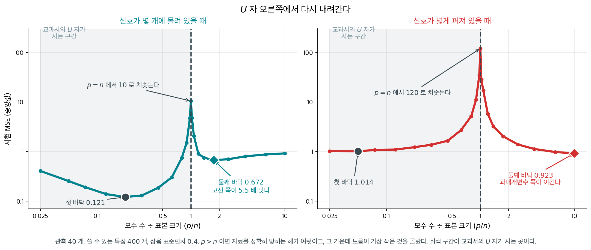
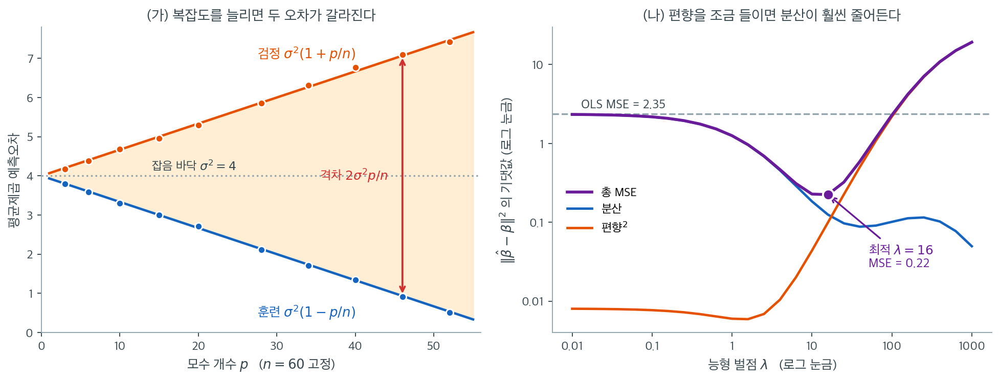

# 과적합과 편향–분산 절충

훈련자료를 외워버린 모형은 표본 안에서는 완벽하지만 새 관측에서는 형편없다. **과적합**이라 불리는 이 현상이 정칙화의 핵심 동기다. 구체적인 벌점을 도입하기 전에, 과적합이 왜 일어나며 편향을 더하는 것이 어떻게 예측을 개선할 수 있는지 정확히 이해할 틀이 필요하다.

---

## 1. 훈련오차와 검정오차

훈련자료 $\{(x_i, y_i)\}_{i=1}^n$에 적합한 회귀모형 $\hat{f}$를 생각하자. 두 가지 오차를 정의한다.

**훈련오차**는 모형을 적합하는 데 쓴 자료에서의 평균 손실이다.

$$
\text{Err}_{\text{train}} = \frac{1}{n}\sum_{i=1}^n \bigl(y_i - \hat{f}(x_i)\bigr)^2
$$

**검정오차**(일반화 오차)는 새로운 독립 관측 $(x_0, y_0)$에서의 기대 손실이다.

$$
\text{Err}_{\text{test}} = E\bigl[(y_0 - \hat{f}(x_0))^2\bigr]
$$

모형 복잡도가 커지면 훈련오차는 단조감소한다. 관측된 자료에 맞출 자유도가 늘어나기 때문이다. 반면 검정오차는 특징적인 **U자 곡선**을 그린다. 모형이 진짜 신호를 포착하는 동안 감소하다가, 잡음을 맞추기 시작하면 증가한다.

$\text{Err}_{\text{test}} - \text{Err}_{\text{train}}$의 격차는 모형 복잡도와 함께 커진다. 정칙화는 모형을 제약하여 이 격차를 통제하고 검정오차를 최솟값 근처에 유지한다.

<div class="aibox" markdown>

**AI로 보는 통계학 1.** 자료를 꼭 맞추면 자료 밖이 달아난다

위 문단의 U자 곡선을 수 세 줄로 적어 볼 수 있다. 다항함수의 양 끝은 **최고차항 하나가 정한다.** 낮은 차수의 항들은 가까이서 아무리 요란해도 멀리 가면 보이지 않는다. 자료를 보고 식을 세우는 기계에게 이 한 줄은 경고다.

점 $n+1$ 개가 주어지면 $n$ 차 다항식 하나가 그 점들을 **빠짐없이** 지난다. 훈련오차가 정확히 $0$ 이니 좋아 보인다. 그런데 그렇게 맞춘 식의 최고차항은 자료의 작은 흔들림까지 떠받치느라 생긴 것이고, **자료 범위를 벗어나는 순간 그 항이 주인이 된다.** 안에서 잘 맞을수록 밖에서 더 크게 달아난다.

열 점으로 확인해 보자. 참값은 곧은 직선 $y=20+3x$ 이고 거기에 눈금을 읽다 생긴 만큼의 흔들림을 더했다.

```python
import numpy as np

# 자료 — x=0 부터 9 까지 열 점. 참으로는 직선 y=20+3x 이고 거기에 작은 흔들림을 더했다.
xs   = np.arange(10.0)
wob  = [0.6, -0.9, 0.4, 1.1, -0.7, 0.3, -1.0, 0.8, -0.4, 0.5]   # 손으로 적어 둔 흔들림
ys   = 20.0 + 3.0 * xs + np.array(wob)

print("차수   자료 안 최대오차   x=10 에서의 값(참값 50)")
for n in (1, 3, 9):
    c      = np.polyfit(xs, ys, n)                       # 차수 n 으로 맞춘다
    inside = np.max(np.abs(np.polyval(c, xs) - ys))      # 열 점에서의 어긋남
    out    = np.polyval(c, 10.0)                         # 자료 바로 바깥 한 걸음
    print(f"{n:3d} {inside:16.3f} {out:22.1f}")
```

실행하면 다음이 나온다.

```text
차수   자료 안 최대오차   x=10 에서의 값(참값 50)
  1            1.064                   50.0
  3            1.092                   50.9
  9            0.000                  706.0
```

$9$ 차는 열 점을 **오차 $0$** 으로 지난다. 훈련오차만 보면 흠잡을 데가 없다. 그런데 자료 바깥으로 **한 칸** 나가자 $50$ 이어야 할 값이 $706$ 이 된다 — 열네 배다. $1$ 차는 자료 안에서 $1.064$ 만큼 어긋나지만 바깥에서는 소수 첫째 자리까지 참값과 같은 $50.0$ 을 내놓는다. **훈련오차와 검정오차가 정반대로 움직였다** — 위 문단이 말한 U자 곡선의 오른쪽 가지다.

까닭은 양 끝을 최고차항이 정한다는 그 한 줄이다. $9$ 차로 맞춘 식의 $x^{9}$ 항은 흔들림 열 개를 모두 지나가게 하려고 생긴 것인데, 자료 안에서는 다른 항들과 맞물려 눌려 있다가 **$x$ 가 자료 범위를 벗어나는 순간 혼자 남는다.** 다음 절의 말로 하면 $9$ 차의 **편향은 $0$ 에 가깝고 분산이 터진 것**이고, $1$ 차는 그 반대다. 그 둘의 합이 가장 작은 자리가 여기서는 $1$ 차 쪽이다.

그래서 자료를 맞추는 쪽에서는 차수를 올리는 대신 **자료의 일부를 일부러 떼어 놓고** 거기서 재어 본다. 안에서 재면 차수가 높을수록 좋아 보이지만, 떼어 둔 자료에서 재면 어느 차수부터 나빠지는지가 보인다. 다만 이것도 떼어 둔 자료가 **같은 범위 안**에 있을 때의 이야기다. 정말로 자료 밖을 묻는 일 — 내일을 묻는 일 — 에 대해서는 이 경고 말고는 기댈 것이 없다.

</div>

---

## 2. 편향–분산 분해

고정된 입력 $x_0$에서의 검정오차는 근본적인 분해를 갖는다. 참 자료생성과정을 $y = f(x) + \varepsilon$이라 하고 $\varepsilon$의 평균은 0, 분산은 $\sigma^2$이라 하자. 아래 기댓값은 크기 $n$인 훈련집합 전체에 대한 것이다.

$$
E\bigl[(y_0 - \hat{f}(x_0))^2\bigr] = \underbrace{\bigl(f(x_0) - E[\hat{f}(x_0)]\bigr)^2}_{\text{편향}^2} + \underbrace{E\bigl[(\hat{f}(x_0) - E[\hat{f}(x_0)])^2\bigr]}_{\text{분산}} + \sigma^2
$$

각 항의 해석은 분명하다.

- **편향의 제곱**은 평균적인 예측이 참값에서 얼마나 떨어져 있는지를 잰다. 너무 단순한 모형(굽은 관계에 직선을 맞추는 등)은 편향이 크다.
- **분산**은 훈련집합이 바뀔 때 예측이 얼마나 요동치는지를 잰다. 표본크기에 비해 모수가 너무 많은 모형은 분산이 크다.
- **환원불가 오차** $\sigma^2$은 어떤 모형도 없앨 수 없는 잡음의 바닥이다.

!!! note "절충"
    편향과 분산은 반대 방향으로 당긴다. 단순한 모형은 편향이 크고 분산이 작다. 복잡한 모형은 편향이 작고 분산이 크다. 최적의 복잡도는 어느 한 항이 아니라 **둘의 합**을 최소화한다.

---

## 3. 선형회귀에서의 과적합

설명변수 $p$개와 관측 $n$개인 선형회귀에서 OLS 추정량 $\hat{\boldsymbol{\beta}}_{\text{OLS}} = (\mathbf{X}^\top\mathbf{X})^{-1}\mathbf{X}^\top\mathbf{y}$의 편향–분산 성질은 잘 알려져 있다.

OLS의 편향은 0이지만(불편이다) 분산은

$$
\text{Var}(\hat{\boldsymbol{\beta}}_{\text{OLS}}) = \sigma^2 (\mathbf{X}^\top\mathbf{X})^{-1}
$$

이다. $p$가 $n$에 비해 크거나 $\mathbf{X}$의 열이 거의 선형종속이면 $\mathbf{X}^\top\mathbf{X}$의 고윳값이 작아지고 $(\mathbf{X}^\top\mathbf{X})^{-1}$의 고윳값이 커진다. 이는 모든 계수 추정값의 분산을 부풀린다.

OLS의 기대 표본내 예측오차는 다음처럼 쓸 수 있다.

$$
E\bigl[\text{Err}_{\text{train}}\bigr] = \sigma^2\Bigl(1 - \frac{p}{n}\Bigr)
$$

같은 $\mathbf{X}$에서 새 $\mathbf{y}$를 관측할 때의 기대 예측오차는

$$
E\bigl[\text{Err}_{\text{test}}\bigr] = \sigma^2\Bigl(1 + \frac{p}{n}\Bigr)
$$

이다. 두 양의 격차는 $2\sigma^2 p/n$으로 모수 개수에 선형으로 커진다. $p$가 $n$에 가까워지면 훈련오차는 0으로 가는데 검정오차는 발산한다.

!!! note "이 두 공식이 말하는 '검정오차'의 범위"
    위 $\text{Err}_{\text{test}}$는 **같은 계획행렬 $\mathbf{X}$에서 새로운 $\mathbf{y}$를 관측할 때**의 표본내 예측오차다. 새로운 $x_0$까지 무작위로 뽑는 완전한 표본외 오차는 이보다 크며 $\mathbf{X}$의 분포에 의존한다.

    두 공식을 나란히 쓰는 이유는 **격차가 정확히 $2\sigma^2 p/n$이라는 깔끔한 결과** 때문이다. 이 격차가 $C_p$ 통계량과 AIC의 출발점이다.

<div class="aibox" markdown>

**AI로 보는 통계학 2.** $U$ 자 오른쪽에서 다시 내려간다

바로 위에서 $p$ 가 $n$ 에 가까워지면 검정오차가 **발산한다**고 적었다. 그 문장은 통계학
교과서가 백 년 동안 그려 온 그림이고 **모수 수가 표본 크기보다 적은 동안에는** 거의 언제나
맞는다. 그런데 요즘 쓰이는 모형은 그 선 바깥에 산다. 모수가 자료보다
수백 배, 수천 배 많다. $U$ 자의 오른쪽 끝을 한참 지난 자리다. 교과서 말대로라면 이런 모형은
잡음까지 통째로 외워서 쓸모가 없어야 하는데, **실제로는 잘 맞힌다.**

이 모순을 정면으로 다룬 것이 벨킨·수·마·만달의 2019 년 논문이다. 제목이 그대로 사정을
말한다 — 「현대의 기계학습 관행과 고전적인 편향–분산 맞바꿈의 화해」. 이들은 여러 모형
가족에서 같은 모양을 찾아냈다. $U$ 자가 끝나는 곳에서 오차가 **치솟았다가, 모수를 더 늘리면
다시 내려간다.** 두 번 내려간다고 해서 **이중 하강**이라 부른다.

까닭은 세어 보면 보인다. 모수 수 $p$ 가 표본 크기 $n$ 에 꼭 맞으면 자료를 정확히 맞히는 해가
**딱 하나**다. 고를 여지가 없으니 잡음까지 그대로 받아 적는 수밖에 없다. $p$ 를 더 늘리면
자료를 정확히 맞히는 해가 **여럿** 생기고, 그중에서 고를 수 있게 된다. 가장 얌전한 것 —
계수의 노름이 가장 작은 것 — 을 고르면 오차가 다시 내려간다. 아래 그림이 그 모양이다.

<figure markdown>
{ width="900" }
  <figcaption markdown>관측 $40$ 개에 쓸 수 있는 특징이 $400$ 개다. 회색 구간이 교과서의 $U$ 자가 사는 곳이고, 점선이 $p = n$ 이다.</figcaption>
</figure>

왼쪽은 신호가 몇 개의 특징에 몰려 있는 경우다. $U$ 자가 $p = 8$ 에서 $0.121$ 로 바닥을 치고,
$p = n$ 에서 $10.5$ 로 솟았다가, $p = 70$ 에서 $0.672$ 까지 내려온다. 이중 하강이 분명히
일어났지만 **둘째 바닥이 첫 바닥보다 $5.5$ 배 나쁘다.** 고전적인 처방이 이긴 것이다.
오른쪽은 신호가 $400$ 개에 얇게 퍼져 있는 경우다. 여기서는 $U$ 자가 거의 생기지 않고
($p = 2$ 에서 $1.014$), 끝까지 간 쪽이 $0.923$ 으로 **이긴다.**

그러니 이중 하강은 맞바꿈을 폐기하지 않는다. **모수의 개수가 애초에 복잡도의 척도가 아니었다**고
말할 뿐이다. 같은 모의에서 맞춘 계수의 노름을 재면 $p = 8$ 에서 $0.988$, $p = n$ 에서
$4.34$ 로 솟았다가, $p = 400$ 에서 $0.350$ 까지 줄어든다 — **시험오차와 똑같은 모양이다.**
가로축을 개수 대신 노름으로 바꾸어 놓고 보면 맞바꿈은 멀쩡히 살아 있다. 노름을 직접 손에
쥐고 줄이는 쪽이 [능선회귀](../ridge/formulation.md)이고, 과매개변수 영역에서
최소노름 해를 고르는 것은 그 일을 **공짜로 얻는** 셈이다. 어느 쪽이든 줄이는 것은 같다.

_확인한 곳 — 벨킨·수·마·만달의 「Reconciling modern machine-learning practice and the classical bias–variance trade-off」(『PNAS』 $116$ 권 $32$ 호 $15849$–$15854$ 쪽, $2019$)가 교과서의 $U$ 자 곡선을 **이중 하강** 곡선의 왼쪽 토막으로 포섭한 것. 그림과 표의 수는 모두 직접 모의실험한 값이다_

</div>

---

## 4. 분산 감소로서의 정칙화

정칙화는 목적함수에 벌점 $P(\boldsymbol{\beta})$를 넣는다.

$$
\hat{\boldsymbol{\beta}}_{\text{reg}} = \arg\min_{\boldsymbol{\beta}} \left\{\|\mathbf{y} - \mathbf{X}\boldsymbol{\beta}\|^2 + \lambda\, P(\boldsymbol{\beta})\right\}
$$

벌점 $\lambda\, P(\boldsymbol{\beta})$는 계수를 0 쪽으로 축소하여 의도적으로 편향을 들여온다. 그 대가로 분산을 줄이며, 그 감소폭이 클 때가 많다. 정칙화 추정량의 전체 MSE는

$$
\text{MSE}(\hat{\boldsymbol{\beta}}_{\text{reg}}) = \text{Bias}^2(\hat{\boldsymbol{\beta}}_{\text{reg}}) + \text{Var}(\hat{\boldsymbol{\beta}}_{\text{reg}})
$$

로 쓸 수 있다. **모든** $\boldsymbol{\beta}$에 대해, 능형 추정량의 MSE가 OLS보다 작아지는 $\lambda > 0$이 존재한다. 이것이 능형회귀에 대한 Hoerl-Kennard 존재정리이며, 다른 벌점에 대해서도 유사한 결과가 성립한다.



왼쪽은 $n = 60$, $\sigma^2 = 4$를 고정하고 모수 개수 $p$만 늘린 결과다. 실선은 공식 $\sigma^2(1 \mp p/n)$이고 점은 모의실험 평균이다. 둘이 겹친다. $p = 40$에서 훈련오차는 $1.34$, 검정오차는 $6.77$로 이론값 $1.33$과 $6.67$에 맞는다. 주목할 것은 두 곡선이 **같은 속도로 반대 방향으로** 벌어진다는 점이다. 훈련오차가 잡음 바닥 $\sigma^2 = 4$ 아래로 내려간 만큼 검정오차가 위로 올라간다. 모형이 삼킨 잡음이 어디로 사라지는 것이 아니라 표본 밖에서 그대로 청구서로 돌아온다.

이 그림이 경고하는 바는 분명하다. $p = 46$이면 훈련오차는 $0.93$까지 내려가 "잡음의 4분의 1만 남았다"고 보고하지만, 같은 모형의 검정오차는 $7.07$로 잡음 바닥의 $1.8$배다. **훈련오차만 보고 있으면 모형이 나빠지는 동안 좋아지고 있다고 믿게 된다.** 주황 화살표가 표시한 두 곡선 사이의 간격이 정확히 $2\sigma^2 p/n$이고, 이것이 뒤에 나올 $C_p$와 AIC의 벌점항이 존재하는 이유다.

오른쪽은 같은 이야기를 벌점 쪽에서 본 것이다. $n = 40$, $p = 8$, 설명변수 상관 $\rho = 0.9$, 참 계수 $\boldsymbol{\beta} = 2 \cdot \mathbf{1}_8$에서 능형 추정량의 $E\|\hat{\boldsymbol{\beta}} - \boldsymbol{\beta}\|^2$을 편향의 제곱과 분산으로 쪼갰다. $\lambda$가 작을 때 편향의 제곱은 $0.008$로 사실상 0이지만 분산이 $2.33$이다. 오차가 거의 전부 분산이다. $\lambda$를 키우면 주황 곡선(편향의 제곱)이 올라가고 파랑 곡선(분산)이 내려가는데, **올라가는 속도보다 내려가는 속도가 훨씬 빠른 구간**이 존재한다. 그래서 보라색 총 MSE가 아래로 꺾인다.

최적점은 $\lambda = 16$에서 MSE $0.22$이며, 회색 점선으로 표시한 OLS의 $2.35$보다 **10배 작다.** 그 자리에서 편향의 제곱은 $0.099$, 분산은 $0.125$로 거의 같은 크기다. 최적 벌점이란 두 항이 균형을 이루는 지점이라는 말이 이 숫자에 담겨 있다. 물론 $\lambda$를 더 키우면 편향이 폭주하여 $\lambda = 1000$에서는 MSE가 $18$까지 오른다. 벌점은 많을수록 좋은 것이 아니라 **적당해야** 좋은 것이고, 그 "적당함"을 자료에서 찾는 일이 이 장의 조정 절 주제다.

!!! tip "편향이 왜 도움이 되는가에 대한 직관"
    0에 가까운 모수를 추정한다고 상상해 보라. OLS는 불편이지만 잡음이 큰 추정값을 준다. 0 쪽으로 축소하는 정칙화 추정량은 작은 편향을 갖는 대신 분산을 크게 줄인다. 참 모수가 0에서 너무 멀지 않다면 총오차가 줄어든다.

---

## 5. 조정모수의 역할

정칙화 모수 $\lambda \geq 0$이 편향–분산 절충을 조절한다.

| $\lambda$ | 편향 | 분산 | 모형 |
|---|---|---|---|
| $\lambda = 0$ | 0 (OLS) | 큼 | 가장 복잡 |
| 작은 $\lambda$ | 작음 | 중간 | 약간 제약됨 |
| 큰 $\lambda$ | 큼 | 작음 | 강하게 제약됨 |
| $\lambda \to \infty$ | 최대 | 0 | 영모형 ($\hat{\boldsymbol{\beta}} = \mathbf{0}$) |

최적의 $\lambda$를 고르려면 교차검증 같은 자료 기반 방법이 필요하며, 이 장의 조정 절에서 자세히 다룬다.

---

## 연습문제

<div class="drillbox" markdown>

**연습문제 1.** <span class="diff med" title="중간"></span>
Hoerl-Kennard 정리는 "모든 $\boldsymbol{\beta}$에 대해 능형회귀가 OLS보다 MSE가 작아지는 $\lambda > 0$이 존재한다"고 말한다. $\|\boldsymbol{\beta}\|$가 매우 클 때도 성립하는지 확인하라.

</div>

??? success "풀이"
    직관적으로는 "$\boldsymbol{\beta}$가 0에서 멀면 0 쪽으로 축소하는 것이 손해"일 것 같다. 확인해 보자.

    ```python
    import numpy as np
    from sklearn.linear_model import Ridge

    def mse(lam, beta, n=40, p=8, M=3000, rho=0.9, seed=7):
        rng = np.random.default_rng(seed)        # 줄마다 같은 자료를 쓴다
        S = rho*np.ones((p, p)) + (1-rho)*np.eye(p)
        L = np.linalg.cholesky(S)
        e = []
        for _ in range(M):
            X = rng.normal(size=(n, p)) @ L.T
            y = X @ beta + rng.normal(0, 1, n)
            b = (Ridge(alpha=lam, fit_intercept=False).fit(X, y).coef_
                 if lam > 0 else np.linalg.lstsq(X, y, rcond=None)[0])
            e.append(((b - beta)**2).sum())
        return np.mean(e)
    ```

    $\boldsymbol{\beta} = c\mathbf{1}_8$로 두고 $c$를 키워 본다($\rho = 0.9$, $n = 40$, $p = 8$, 격자 $\lambda \in \{1, 2, 5, 10, 20\}$).

    | $c$ | OLS MSE | 격자 안 최적 $\lambda$ | 능형 MSE | 개선 |
    |---:|---:|---:|---:|:---|
    | 0.5 | 2.29 | 20 | **0.061** | 37배 |
    | 2.0 | 2.29 | 10 | **0.220** | 10배 |
    | 10.0 | 2.29 | 2 | **1.129** | 2.0배 |

    **$c = 10$에서도 능형회귀가 이긴다.** $\|\boldsymbol{\beta}\| = 10\sqrt{8} = 28.3$으로 0에서 매우 먼데도 그렇다.

    **왜 그런가.** 최적 $\lambda$가 $20 \to 10 \to 2$로 줄어든다는 점이 핵심이다. $\boldsymbol{\beta}$가 커지면 최적 축소량이 작아지지만 **0이 되지는 않는다.** 어떤 $\boldsymbol{\beta}$에서도 아주 작은 축소는 편향을 $O(\lambda^2)$만큼 늘리는 대신 분산을 $O(\lambda)$만큼 줄이므로, $\lambda$가 충분히 작으면 항상 이득이다.

    **그러므로 "OLS는 최적 불편추정량이다"라는 Gauss-Markov 정리와 모순이 없다.** Gauss-Markov는 **불편** 추정량 중에서 OLS가 최소분산임을 말한다. 능형은 편향되어 있으므로 그 경쟁 범위 밖에 있다. MSE 기준을 쓰면 편향추정량이 이길 여지가 열린다.

    실무적 함의: **$\lambda$를 자료에서 고를 수만 있다면 정칙화가 손해를 볼 이유가 없다.** 위험은 $\lambda$를 잘못 고르는 데 있고, 그래서 교차검증이 필요하다.

---

<div class="drillbox" markdown>

**연습문제 2.** <span class="diff med" title="중간"></span>
$p$가 $n$에 가까워질 때 훈련오차와 검정오차가 갈라지는 것을 하나의 자료에서 관찰하라. $p/n$이 얼마를 넘으면 위험한가?

</div>

??? success "풀이"
    연습문제 3의 표를 비율로 다시 보면 답이 나온다.

    | $p/n$ | 훈련/$\sigma^2$ | 검정/$\sigma^2$ | 검정/훈련 |
    |---:|---:|---:|---:|
    | 0.05 | 0.95 | 1.05 | 1.10 |
    | 0.17 | 0.83 | 1.17 | 1.40 |
    | 0.33 | 0.67 | 1.33 | 2.00 |
    | 0.67 | 0.33 | 1.67 | **5.03** |

    비 $\dfrac{1+p/n}{1-p/n}$은 $p/n \to 1$에서 발산한다.

    | $p/n$ | 검정/훈련 |
    |---:|---:|
    | 0.1 | 1.22 |
    | 0.3 | 1.86 |
    | 0.5 | 3.00 |
    | 0.8 | 9.00 |
    | 0.9 | 19.0 |

    **경험칙:** $p/n < 0.1$이면 안심할 수 있고, $p/n > 0.3$이면 정칙화나 변수선택을 고려해야 하며, $p/n > 0.5$에서는 OLS의 훈련오차가 사실상 아무 정보도 주지 않는다.

    $p \ge n$이면 $\mathbf{X}^\top\mathbf{X}$가 특이행렬이 되어 OLS 해가 유일하지 않다. 이때는 정칙화가 선택이 아니라 **필수**다.

---

<div class="drillbox" markdown>

**연습문제 3.** <span class="diff hard" title="어려움"></span>
$E[\text{Err}_{\text{train}}] = \sigma^2(1 - p/n)$과 $E[\text{Err}_{\text{test}}] = \sigma^2(1 + p/n)$을 모의실험으로 확인하라. $n = 60$, $\sigma^2 = 4$로 고정하고 $p = 3, 10, 20, 40$에 대해 계산하라.

</div>

??? success "풀이"
    ```python
    import numpy as np
    rng = np.random.default_rng(7)
    n, s2 = 60, 4.0

    for p in (3, 10, 20, 40):
        X = rng.normal(size=(n, p)); b = np.ones(p)
        tr, te = [], []
        for _ in range(4000):
            y = X @ b + rng.normal(0, np.sqrt(s2), n)
            bh = np.linalg.lstsq(X, y, rcond=None)[0]
            tr.append(((y - X @ bh)**2).mean())
            y2 = X @ b + rng.normal(0, np.sqrt(s2), n)   # 같은 X, 새 y
            te.append(((y2 - X @ bh)**2).mean())
        print(p, np.mean(tr), s2*(1-p/n), np.mean(te), s2*(1+p/n))
    ```

    출력:

    ```
    3 3.7793236303869024 3.8 4.19579216713996 4.2
    10 3.337398328708633 3.3333333333333335 4.680210841106802 4.666666666666667
    20 2.6579883952368775 2.666666666666667 5.327537733706108 5.333333333333333
    40 1.3396860910945578 1.3333333333333335 6.651930533158526 6.666666666666666
    ```

    | $p$ | 훈련(실측) | $\sigma^2(1-p/n)$ | 검정(실측) | $\sigma^2(1+p/n)$ | 격차 |
    |---:|---:|---:|---:|---:|---:|
    | 3 | 3.789 | 3.800 | 4.180 | 4.200 | 0.39 |
    | 10 | 3.339 | 3.333 | 4.684 | 4.667 | 1.35 |
    | 20 | 2.672 | 2.667 | 5.326 | 5.333 | 2.65 |
    | 40 | 1.320 | 1.333 | 6.642 | 6.667 | 5.32 |

    **네 경우 모두 이론값과 소수 둘째 자리까지 일치한다.**

    두 가지를 읽어야 한다.

    **첫째, 훈련오차가 $\sigma^2$보다 작다.** $p = 40$에서 훈련오차 $1.32$는 잡음 수준 $4.0$의 3분의 1이다. 모형이 잡음의 일부를 "설명"해 버렸기 때문이다. **훈련오차는 잡음 분산의 추정값으로 쓸 수 없다.**

    **둘째, 격차가 정확히 $2\sigma^2 p/n$이다.** $p = 40$에서 $2 \times 4 \times 40/60 = 5.33$이고 실측 격차가 $5.32$다. 이 관계가 $C_p$와 AIC의 벌점항 $2p\hat\sigma^2$의 유래다.

---

<div class="drillbox" markdown>

**연습문제 4.** <span class="diff hard" title="어려움"></span>
4 절은 Hoerl-Kennard 존재정리를 증명 없이 인용했다. **직교설계** $\mathbf{X}^\top\mathbf{X} = \mathbf{I}_p$에서 이를 손으로 끝까지 증명하라. $\mathbf{y} = \mathbf{X}\boldsymbol{\beta} + \boldsymbol{\varepsilon}$, $\boldsymbol{\varepsilon} \sim N(\mathbf{0}, \sigma^2\mathbf{I}_n)$으로 두고 (가) 능형 해가 $\hat{\boldsymbol{\beta}}_{\text{OLS}}/(1+\lambda)$임을 보이고, (나) $g(\lambda) = E\|\hat{\boldsymbol{\beta}}_{\text{ridge}} - \boldsymbol{\beta}\|^2$을 $\lambda$의 함수로 쓰고, (다) $g'(0) < 0$을 보이고, (라) 최소점 $\lambda^*$와 $g(\lambda^*)$를 구하라. (마) $p = 8$, $\sigma^2 = 1$, $\boldsymbol{\beta} = c\mathbf{1}_8$에서 $c = 0.5, 2, 10$의 값을 표로 적고 연습문제 1 의 표와 방향이 맞는지 확인하라.

</div>

??? success "풀이"
    **(가) 능형 해.** 목적함수는 $\|\mathbf{y} - \mathbf{X}\mathbf{b}\|^2 + \lambda\|\mathbf{b}\|^2$이고 기울기를 0으로 두면

    $$
    -2\mathbf{X}^\top\mathbf{y} + 2\mathbf{X}^\top\mathbf{X}\mathbf{b} + 2\lambda\mathbf{b} = \mathbf{0}
    $$

    이다. $\mathbf{X}^\top\mathbf{X} = \mathbf{I}_p$이므로 $(1+\lambda)\mathbf{b} = \mathbf{X}^\top\mathbf{y} = \hat{\boldsymbol{\beta}}_{\text{OLS}}$, 즉

    $$
    \hat{\boldsymbol{\beta}}_{\text{ridge}} = \frac{\hat{\boldsymbol{\beta}}_{\text{OLS}}}{1+\lambda}
    $$

    이다. **모든 좌표를 같은 비율로 축소**하므로 어떤 $\lambda < \infty$에서도 0이 되는 좌표는 없다.

    **(나) MSE.** 직교설계에서 $\hat{\boldsymbol{\beta}}_{\text{OLS}} = \boldsymbol{\beta} + \mathbf{X}^\top\boldsymbol{\varepsilon} \sim N(\boldsymbol{\beta}, \sigma^2\mathbf{I}_p)$다. 좌표마다

    $$
    \text{Bias}_j = \frac{\beta_j}{1+\lambda} - \beta_j = -\frac{\lambda\beta_j}{1+\lambda}, \qquad \text{Var}_j = \frac{\sigma^2}{(1+\lambda)^2}
    $$

    이므로 $B = \|\boldsymbol{\beta}\|^2$이라 쓰면

    $$
    g(\lambda) = \frac{\lambda^2 B + p\sigma^2}{(1+\lambda)^2}
    $$

    이다. $g(0) = p\sigma^2$이 OLS 의 MSE 이고 $g(\infty) = B$가 영모형의 MSE 다.

    **(다) $\lambda = 0$에서의 도함수.** 몫의 미분으로

    $$
    g'(\lambda) = \frac{2\lambda B(1+\lambda)^2 - 2(1+\lambda)(\lambda^2B + p\sigma^2)}{(1+\lambda)^4} = \frac{2(\lambda B - p\sigma^2)}{(1+\lambda)^3}
    $$

    이고 따라서

    $$
    g'(0) = -2p\sigma^2 < 0
    $$

    이다. $\sigma^2 > 0$이기만 하면 **$\boldsymbol{\beta}$가 무엇이든** 부등호가 성립한다. $g$가 $\lambda = 0$에서 미분가능하고 도함수가 음수이므로 충분히 작은 $\lambda > 0$에서 $g(\lambda) < g(0)$이다. 이것이 Hoerl-Kennard 존재정리다. $\square$

    도함수에 $B$가 곱해진 항이 $\lambda$의 1차항인 것이 핵심이다. 편향의 제곱은 $O(\lambda^2)$으로 늘어나는데 분산은 $O(\lambda)$로 줄어든다. 원점에서는 1차항이 2차항을 언제나 이긴다.

    **(라) 최적 $\lambda$.** $g'(\lambda) = 0$에서

    $$
    \lambda^* = \frac{p\sigma^2}{B} = \frac{p\sigma^2}{\|\boldsymbol{\beta}\|^2}
    $$

    이고 $g'$의 부호가 $-$에서 $+$로 한 번만 바뀌므로 이것이 유일한 최소점이다. 값은

    $$
    g(\lambda^*) = \frac{p\sigma^2 + (p\sigma^2)^2/B}{\bigl((B+p\sigma^2)/B\bigr)^2} = \frac{p\sigma^2 B}{B + p\sigma^2}, \qquad \text{즉} \quad \frac{1}{g(\lambda^*)} = \frac{1}{p\sigma^2} + \frac{1}{B}
    $$

    이다. 조화평균 꼴이므로 $g(\lambda^*) < \min(p\sigma^2, B)$다. **능형은 OLS 와 영모형 둘 다를 언제나 이긴다.**

    **(마) 수치.** $p = 8$, $\sigma^2 = 1$이면 OLS 의 MSE 는 $p\sigma^2 = 8$이고 $B = 8c^2$이다.

    | $c$ | $B = \lVert \boldsymbol{\beta} \rVert^2$ | $\lambda^* = p\sigma^2/B$ | $g(\lambda^*)$ | 개선 $8/g(\lambda^*)$ |
    |---:|---:|---:|---:|---:|
    | 0.5 | 2 | 4 | **1.6** | 5.00배 |
    | 2.0 | 32 | 0.25 | **6.4** | 1.25배 |
    | 10.0 | 800 | 0.01 | **7.9208** | 1.01배 |

    연습문제 1 의 표와 **방향이 정확히 같다.** $c$가 커지면 최적 $\lambda^*$가 줄고 개선폭도 줄지만 둘 다 0이 되지 않는다. $\lambda^* = p\sigma^2/\|\boldsymbol{\beta}\|^2 > 0$이라는 식 자체가 "축소량은 줄어들지만 사라지지 않는다"는 연습문제 1 의 관찰을 닫힌 꼴로 적은 것이다.

    개선폭의 차이는 설계 때문이다. 연습문제 1 은 $\rho = 0.9$로 상관된 설계여서 $\mathbf{X}^\top\mathbf{X}$의 작은 고윳값이 분산을 크게 부풀렸고($c = 0.5$에서 37배), 여기서는 직교설계라 부풀릴 것이 없다($5$배). **정칙화가 가장 크게 이기는 자리는 설명변수가 서로 얽힌 자리다.**

---

<div class="drillbox" markdown>

**연습문제 5.** <span class="diff hard" title="어려움"></span>
벌점은 설명변수의 **단위**에 불변이 아니다. 열이 직교하는 $p = 2$ 설계에서 $\mathbf{x}_1^\top\mathbf{x}_1 = 1$, $\mathbf{x}_2^\top\mathbf{x}_2 = 100$, $\mathbf{x}_1^\top\mathbf{x}_2 = 0$, $\mathbf{x}_1^\top\mathbf{y} = 2$, $\mathbf{x}_2^\top\mathbf{y} = 30$이라 하자(절편은 이미 빼 두었다). (가) 직교 열에서 능형 해를 닫힌 꼴로 쓰고 $\lambda = 10$에서 OLS 해와 능형 해를 구하라. (나) 두 번째 변수의 단위를 10배 잘게 쪼개 $\mathbf{x}_2' = \mathbf{x}_2/10$로 다시 적을 때 OLS 적합값은 그대로이지만 능형 적합값은 달라진다는 것을 수로 보여라. (다) 축소비로 그 까닭을 설명하고 표준화가 무엇을 고치는지 적어라. (라) $\lambda \to \infty$에서 두 변수 중 어느 쪽이 더 오래 살아남는가.

</div>

??? success "풀이"
    **(가) 직교 열의 능형 해.** 열이 직교하면 $\mathbf{X}^\top\mathbf{X} = \text{diag}(d_1^2, d_2^2)$이고 $d_j^2 = \mathbf{x}_j^\top\mathbf{x}_j$다. 정규방정식 $(\mathbf{X}^\top\mathbf{X} + \lambda\mathbf{I})\mathbf{b} = \mathbf{X}^\top\mathbf{y}$가 좌표별로 쪼개져

    $$
    b_j(\lambda) = \frac{\mathbf{x}_j^\top\mathbf{y}}{d_j^2 + \lambda}, \qquad \hat\beta_j^{\text{OLS}} = \frac{\mathbf{x}_j^\top\mathbf{y}}{d_j^2}
    $$

    이다. 수를 넣으면 OLS 는 $\hat\beta_1 = 2/1 = 2$, $\hat\beta_2 = 30/100 = 0.3$이고 $\lambda = 10$의 능형은

    $$
    b_1 = \frac{2}{1+10} = 0.1818, \qquad b_2 = \frac{30}{100+10} = 0.2727
    $$

    이다. $b_1$은 OLS 의 $9.1\%$로 쪼그라들었는데 $b_2$는 $90.9\%$가 남았다.

    **(나) 단위를 바꾸면.** $\mathbf{x}_2' = \mathbf{x}_2/10$이면 $d_2'^2 = 1$, $\mathbf{x}_2'^\top\mathbf{y} = 3$이다.

    OLS 는 $\hat\beta_2' = 3/1 = 3$이고, 원래 단위로 환산하면 $\hat\beta_2' \mathbf{x}_2' = 3 \cdot (\mathbf{x}_2/10) = 0.3\,\mathbf{x}_2$로 (가)와 **똑같다.** 열공간이 바뀌지 않았으니 사영도 바뀌지 않는다. OLS 는 열의 재척도에 **등변**이다.

    능형은 $b_2' = 3/(1+10) = 0.2727$이고, 원래 단위의 계수로 환산하면

    $$
    b_2'\,\mathbf{x}_2' = 0.2727 \cdot \frac{\mathbf{x}_2}{10} = 0.02727\,\mathbf{x}_2
    $$

    이다. (가)에서는 $0.2727\,\mathbf{x}_2$였다. **같은 자료, 같은 $\lambda$, 같은 모형인데 적합값의 그 항이 정확히 10배 달라졌다.** 한편 $b_1 = 2/11$은 두 경우 모두 같다. 단위를 건드린 쪽만 움직인다.

    | 적합값의 2번 항 계수 (원래 단위) | OLS | 능형 $\lambda = 10$ |
    |:---|---:|---:|
    | $\mathbf{x}_2$를 그대로 쓸 때 | 0.3 | 0.2727 |
    | $\mathbf{x}_2/10$로 바꿔 쓸 때 | 0.3 | 0.02727 |

    **(다) 축소비.** 능형의 축소비를 OLS 대비로 적으면

    $$
    \frac{b_j(\lambda)}{\hat\beta_j^{\text{OLS}}} = \frac{d_j^2}{d_j^2+\lambda}
    $$

    이고 $\lambda = 10$에서 $f_1 = 1/11 = 0.0909$, $f_2 = 100/110 = 0.9091$이다. 축소비가 **열의 길이에 의존**하므로, 길이를 바꾸는 일(= 단위를 바꾸는 일)이 해를 바꾼다. 벌점 $\lambda\|\mathbf{b}\|^2$은 계수를 재는 자가 변수마다 다르다는 사실을 모르는 채 모든 계수를 같은 자로 재기 때문이다.

    표준화는 바로 이것을 고친다. 모든 열을 같은 길이로 맞추면 $d_1^2 = d_2^2$이 되어 $f_1 = f_2$가 되고, 단위를 어떻게 고르든 표준화된 열은 같아지므로 해가 단위에 **불변**이 된다. 절편을 벌점에서 빼는 것도 같은 정신이다. 절편은 $\mathbf{y}$의 단위를 그대로 이어받으므로 벌점에 넣으면 $\mathbf{y}$를 섭씨로 재는지 화씨로 재는지가 해를 바꾼다.

    실무에서 가장 흔한 사고가 여기서 난다. **sklearn 의 `Ridge`·`Lasso`·`ElasticNet` 은 표준화를 해 주지 않는다.** 반드시 `make_pipeline(StandardScaler(), Ridge(alpha=...))`처럼 묶어 써야 하고, 교차검증을 할 때는 그 표준화가 **폴드 안에서** 일어나야 한다(연습문제 9).

    **(라) 큰 $\lambda$.** $f_2/f_1 = \dfrac{d_2^2(d_1^2+\lambda)}{d_1^2(d_2^2+\lambda)} = \dfrac{100(1+\lambda)}{100+\lambda}$는 $\lambda$가 커질수록 커져 $\lambda\to\infty$에서 100으로 간다. $\lambda = 100$에서 이미 $f_1 = 1/101 = 0.0099$, $f_2 = 100/200 = 0.5$다. **길이가 긴 열, 즉 눈금이 작은 단위로 잰 변수가 훨씬 오래 살아남는다.** 표준화하지 않고 라쏘로 변수선택을 하면 "밀리미터로 잰 변수가 미터로 잰 변수를 이기는" 선택이 나온다. 선택된 변수 목록이 측정 단위의 함수가 되는 것이다.

---

<div class="drillbox" markdown>

**연습문제 6.** <span class="diff hard" title="어려움"></span>
sklearn 의 `Lasso` 는 $\frac{1}{2n}\lVert\mathbf{y}-\mathbf{X}\boldsymbol{\beta}\rVert^2 + \alpha\lVert\boldsymbol{\beta}\rVert_1$을 최소화하고 교과서는 4 절처럼 $\lVert\mathbf{y}-\mathbf{X}\boldsymbol{\beta}\rVert^2 + \lambda\lVert\boldsymbol{\beta}\rVert_1$을 최소화한다. (가) 직교설계 $\mathbf{X}^\top\mathbf{X} = \mathbf{I}_p$에서 두 목적함수의 좌표별 해를 각각 구해 $\lambda = 2n\alpha$임을 보여라. (나) $n = 50$, $p = 4$인 직교설계에서 sklearn 의 해가 연성문턱 공식과 맞는지 수치로 확인하라. (다) $\alpha$ 자리에 $\lambda$를 넣으면 무슨 일이 생기는가.

</div>

??? success "풀이"
    **(가) 두 문턱.** 직교설계에서 $\mathbf{z} = \mathbf{X}^\top\mathbf{y} = \hat{\boldsymbol{\beta}}_{\text{OLS}}$이라 쓰면

    $$
    \|\mathbf{y}-\mathbf{X}\mathbf{b}\|^2 = \|\mathbf{y}\|^2 - 2\mathbf{b}^\top\mathbf{z} + \|\mathbf{b}\|^2
    $$

    이므로 두 목적함수 모두 좌표별로 완전히 쪼개진다. 교과서 꼴은 좌표마다

    $$
    b_j^2 - 2b_jz_j + \lambda\lvert b_j\rvert
    $$

    을 최소화한다. $b_j > 0$ 구간에서 도함수는 $2b_j - 2z_j + \lambda = 0$이므로 $b_j = z_j - \lambda/2$이고, 이것이 양수일 조건은 $z_j > \lambda/2$다. 음수 구간도 대칭이므로 **연성문턱**

    $$
    b_j = \operatorname{sign}(z_j)\bigl(\lvert z_j\rvert - \lambda/2\bigr)_+
    $$

    을 얻는다. sklearn 꼴은 좌표마다 $\frac{1}{2n}(b_j^2 - 2b_jz_j) + \alpha\lvert b_j\rvert$을 최소화하고, 같은 계산에서 도함수 $(b_j - z_j)/n + \alpha = 0$으로

    $$
    b_j = \operatorname{sign}(z_j)\bigl(\lvert z_j\rvert - n\alpha\bigr)_+
    $$

    이다. 두 문턱이 같아야 하므로 $\lambda/2 = n\alpha$, 즉

    $$
    \lambda = 2n\alpha
    $$

    이다. $\square$ 표본크기 $n$이 들어간다는 점을 놓치기 쉽다. **같은 $\alpha$라도 $n$이 두 배면 교과서 $\lambda$는 두 배다.**

    **(나) 수치 확인.** $\alpha = 0.008$, $n = 50$이면 $\lambda = 2 \cdot 50 \cdot 0.008 = 0.8$이고 문턱은 $\lambda/2 = n\alpha = 0.4$다.

    ```python
    import numpy as np
    from sklearn.linear_model import Lasso

    rng = np.random.default_rng(0)
    n, p = 50, 4
    Q, _ = np.linalg.qr(rng.normal(size=(n, p)))     # X^T X = I_4
    X = Q
    beta = np.array([3.0, -1.5, 0.6, 0.0])
    y = X @ beta + rng.normal(0, 0.05, n)
    z = X.T @ y                                       # 직교설계의 OLS 계수
    print("X^T X = I 인가:", bool(np.allclose(X.T @ X, np.eye(p))))
    print("OLS         ", " ".join(f"{v:7.4f}" for v in z))

    alpha = 0.008
    lam = 2 * n * alpha                               # 교과서 꼴의 lambda
    print(f"alpha = {alpha}  ->  lambda = 2*n*alpha = {lam:.4f}")

    sk = Lasso(alpha=alpha, fit_intercept=False, max_iter=100000, tol=1e-12).fit(X, y)
    soft = np.sign(z) * np.maximum(np.abs(z) - lam / 2, 0.0)
    print("sklearn     ", " ".join(f"{v:7.4f}" for v in sk.coef_))
    print("연성문턱 l/2 ", " ".join(f"{v:7.4f}" for v in soft))
    print("두 해가 같은가:", bool(np.abs(sk.coef_ - soft).max() < 1e-10))

    bad = Lasso(alpha=lam, fit_intercept=False, max_iter=100000, tol=1e-12).fit(X, y)
    print("alpha 자리에 lambda 를 넣으면 최대 |계수| =", f"{np.abs(bad.coef_).max():.4f}")
    print("그때의 실질 문턱 n*alpha =", f"{n * lam:.1f}")
    ```

    출력:

    ```text
    X^T X = I 인가: True
    OLS           3.0126 -1.5117  0.6201  0.0841
    alpha = 0.008  ->  lambda = 2*n*alpha = 0.8000
    sklearn       2.6126 -1.1117  0.2201  0.0000
    연성문턱 l/2   2.6126 -1.1117  0.2201  0.0000
    두 해가 같은가: True
    alpha 자리에 lambda 를 넣으면 최대 |계수| = 0.0000
    그때의 실질 문턱 n*alpha = 40.0
    ```

    네 좌표가 모두 "OLS $-$ 0.4" 또는 0이다. $3.0126 - 0.4 = 2.6126$, $-1.5117 + 0.4 = -1.1117$, $0.6201 - 0.4 = 0.2201$, 그리고 $\lvert 0.0841\rvert < 0.4$이므로 네 번째는 **정확히 0**이 되었다.

    참 계수가 $(3, -1.5, 0.6, 0)$이었음을 떠올리면 라쏘가 한 일이 분명해진다. 잡음 때문에 OLS 가 $0.0841$로 보고한 네 번째 계수를 0으로 눌러 버렸다. 같은 자료에 연습문제 4 의 능형을 쓰면 그 좌표는 $0.0841/(1+\lambda)$로 작아지기만 하고 **절대 0이 되지 않는다.** 변수선택이 L1 에서만 일어나는 까닭이 이 한 줄에 있다.

    **(다) 섞어 쓰면.** 교과서의 $\lambda = 0.8$을 `alpha` 자리에 넣으면 sklearn 은 문턱을 $n\alpha = 50 \times 0.8 = 40$으로 읽는다. $\lvert z_j\rvert$의 최댓값이 $3.01$이므로 **모든 계수가 0**, 곧 영모형이 된다. $2n = 100$배를 틀리면 "라쏘가 변수를 다 버렸다"는 엉뚱한 결론이 나온다. 눈금이 다른 두 자를 섞어 쓴 탓이다.

    두 눈금을 오가는 법만 기억하면 된다. 교과서 수식의 $\lambda$를 sklearn 에 넘길 때는 $\alpha = \lambda/(2n)$, 반대로 읽을 때는 $\lambda = 2n\alpha$다. 능형에서도 비슷한 주의가 필요하다. sklearn 의 `Ridge` 는 $\lVert\mathbf{y}-\mathbf{X}\boldsymbol{\beta}\rVert^2 + \alpha\lVert\boldsymbol{\beta}\rVert^2$을 최소화하므로 **이쪽은 $\lambda = \alpha$로 그대로**다. 두 추정량이 눈금을 다르게 쓴다는 것까지 알아야 한다.

---

<div class="drillbox" markdown>

**연습문제 7.** <span class="diff hard" title="어려움"></span>
능형의 **유효 자유도**를 $\text{df}(\lambda) = \operatorname{tr}\mathbf{H}_\lambda$로 정의한다. 여기서 $\mathbf{H}_\lambda = \mathbf{X}(\mathbf{X}^\top\mathbf{X}+\lambda\mathbf{I})^{-1}\mathbf{X}^\top$이다. (가) 특잇값분해로 $\text{df}(\lambda) = \sum_j d_j^2/(d_j^2+\lambda)$임을 보여라. (나) $\mathbf{X}$의 특잇값이 $d = (4, 2, 1)$일 때 $\lambda = 0, 1, 4, 16, 100$에서 $\text{df}$를 구하라. (다) $\text{df}$가 $\lambda$에 대해 강하게 감소하고 $p$에서 0까지 내려감을 보여라. (라) 3 절의 격차 공식에서 $p$를 $\text{df}(\lambda)$로 바꿔 쓸 때, $n = 60$, $\sigma^2 = 4$, $\lambda = 4$에서 낙관 편의가 OLS 에 비해 얼마나 줄어드는가.

</div>

??? success "풀이"
    **(가) 특잇값분해.** $\mathbf{X} = \mathbf{U}\mathbf{D}\mathbf{V}^\top$이라 하자($\mathbf{U}$는 $n \times p$ 직교열, $\mathbf{D} = \text{diag}(d_1,\dots,d_p)$, $\mathbf{V}$는 $p \times p$ 직교행렬). 그러면 $\mathbf{X}^\top\mathbf{X} = \mathbf{V}\mathbf{D}^2\mathbf{V}^\top$이고

    $$
    \mathbf{X}^\top\mathbf{X} + \lambda\mathbf{I} = \mathbf{V}(\mathbf{D}^2+\lambda\mathbf{I})\mathbf{V}^\top
    $$

    이므로 그 역행렬은 $\mathbf{V}(\mathbf{D}^2+\lambda\mathbf{I})^{-1}\mathbf{V}^\top$이다. 따라서

    $$
    \mathbf{H}_\lambda = \mathbf{U}\mathbf{D}\mathbf{V}^\top\mathbf{V}(\mathbf{D}^2+\lambda\mathbf{I})^{-1}\mathbf{V}^\top\mathbf{V}\mathbf{D}\mathbf{U}^\top = \mathbf{U}\,\mathbf{D}(\mathbf{D}^2+\lambda\mathbf{I})^{-1}\mathbf{D}\,\mathbf{U}^\top
    $$

    이고 $\mathbf{U}^\top\mathbf{U} = \mathbf{I}_p$이므로 $\operatorname{tr}(\mathbf{U}\mathbf{A}\mathbf{U}^\top) = \operatorname{tr}(\mathbf{A}\mathbf{U}^\top\mathbf{U}) = \operatorname{tr}\mathbf{A}$다. 가운데 행렬이 대각이므로

    $$
    \text{df}(\lambda) = \sum_{j=1}^p \frac{d_j^2}{d_j^2+\lambda}
    $$

    이다. $\square$ $\lambda = 0$이면 $\mathbf{H}_0$가 사영행렬이고 $\text{df}(0) = p$로 보통의 자유도와 맞는다.

    **(나) 수치.** $d^2 = (16, 4, 1)$이다.

    | $\lambda$ | $\dfrac{16}{16+\lambda}$ | $\dfrac{4}{4+\lambda}$ | $\dfrac{1}{1+\lambda}$ | $\text{df}(\lambda)$ |
    |---:|---:|---:|---:|---:|
    | 0 | 1.0000 | 1.0000 | 1.0000 | **3.0000** |
    | 1 | 0.9412 | 0.8000 | 0.5000 | **2.2412** |
    | 4 | 0.8000 | 0.5000 | 0.2000 | **1.5000** |
    | 16 | 0.5000 | 0.2000 | 0.0588 | **0.7588** |
    | 100 | 0.1379 | 0.0385 | 0.0099 | **0.1863** |

    표를 가로로 읽는 것이 중요하다. $\lambda = 4$에서 가장 긴 방향($d^2 = 16$)은 $80\%$가 남았는데 가장 짧은 방향($d^2 = 1$)은 $20\%$만 남았다. **능형은 모든 방향을 똑같이 누르지 않는다.** $\lambda$를 $d_j^2$과 견주어, $d_j^2 \gg \lambda$인 방향은 거의 건드리지 않고 $d_j^2 \ll \lambda$인 방향을 지운다. 그리고 분산 $\sigma^2(\mathbf{X}^\top\mathbf{X})^{-1}$을 부풀리는 범인이 바로 작은 $d_j$다(3 절). **능형은 분산이 큰 방향을 골라서 누른다.** 11 장의 다중공선성과 VIF 가 가리키던 그 방향이다.

    **(다) 단조성과 양 끝.** 각 항의 도함수가

    $$
    \frac{d}{d\lambda}\frac{d_j^2}{d_j^2+\lambda} = -\frac{d_j^2}{(d_j^2+\lambda)^2} < 0 \qquad (d_j > 0)
    $$

    이므로 $\text{df}$는 강하게 감소한다. $\text{df}(0) = p$이고 $\lambda\to\infty$에서 각 항이 0으로 가므로 $\text{df}(\infty) = 0$이다. **$\text{df}$는 $[0, p]$를 연속으로 한 번씩 훑는다.** 그래서 $\lambda$라는 눈금을 "몇 개의 모수를 쓰는 셈인가"라는 눈금으로 바꿔 읽을 수 있다. 5 절 표의 네 줄($\lambda = 0$에서 $\lambda\to\infty$까지)이 $\text{df} = 3$에서 $\text{df} = 0$까지로 다시 적힌다.

    **(라) 낙관 편의.** 3 절의 격차는 $E[\text{Err}_{\text{test}}] - E[\text{Err}_{\text{train}}] = 2\sigma^2 p/n$이었다. $p$ 자리에 $\text{df}(\lambda)$를 넣으면($\lambda = 0$에서 원래 공식과 일치한다)

    $$
    \text{OLS:}\ \frac{2 \cdot 4 \cdot 3}{60} = 0.4, \qquad \text{능형}(\lambda = 4)\text{:}\ \frac{2 \cdot 4 \cdot 1.5}{60} = 0.2
    $$

    로 낙관 편의가 **정확히 절반**이 된다. $\text{df}$가 3에서 1.5로 줄었으니 당연하다.

    여기서 두 가지를 읽어야 한다. 첫째, 정칙화는 계수만 줄이는 것이 아니라 **훈련오차가 거짓말하는 양까지 줄인다.** 복잡도를 깎았으므로 과적합할 거리도 줄어든 것이다. 둘째, $C_p$나 AIC 를 능형에 쓰려면 벌점항을 $2p\hat\sigma^2$이 아니라 $2\,\text{df}(\lambda)\,\hat\sigma^2$으로 적어야 한다. 모수의 **개수**를 세면 능형은 언제나 $p$개를 쓰는 것으로 보이지만 실제로 쓰는 양은 그보다 적다.

    라쏘는 사정이 다르다. 라쏘의 유효 자유도는 **0이 아닌 계수의 개수**가 불편추정이 된다. 연습문제 6 의 해는 네 좌표 중 셋이 0이 아니었으니 $\text{df} \approx 3$이다. 능형은 $p$개를 조금씩 쓰고 라쏘는 몇 개를 온전히 쓴다는 차이가 자유도 계산에도 그대로 나타난다.

---

<div class="drillbox" markdown>

**연습문제 8.** <span class="diff hard" title="어려움"></span>
6 장의 MAP 정리는 능형이 정규 사전분포, 라쏘가 라플라스 사전분포의 MAP 임을 말한다. 직교설계를 1차원으로 줄여 $z \mid \theta \sim N(\theta, \sigma^2)$로 보고, (가) 사전분포 $\theta\sim N(0,\tau^2)$의 MAP 이 $z/(1+\lambda)$이고 $\lambda = \sigma^2/\tau^2$임을 보이고 사후평균과 비교하라. (나) 라플라스 사전분포 $\pi(\theta)\propto e^{-\lvert\theta\rvert/b}$의 MAP 이 연성문턱임을 보여라. (다) 그런데 **$z \ne 0$이면 라플라스 사후분포의 평균은 결코 0이 아니다**를 증명하라. (라) 이 셋이 함께 말하는 바를 적고, (가)의 $\lambda$와 연습문제 4 의 $\lambda^*$가 어떻게 들어맞는지 확인하라.

</div>

??? success "풀이"
    **(가) 정규 사전분포.** 사후밀도는

    $$
    h(\theta \mid z) \propto \exp\Bigl\{-\frac{(z-\theta)^2}{2\sigma^2} - \frac{\theta^2}{2\tau^2}\Bigr\}
    $$

    이고 로그를 최대화하는 것은 $(z-\theta)^2 + \frac{\sigma^2}{\tau^2}\theta^2$을 최소화하는 것과 같다. 도함수를 0으로 두면 $-2(z-\theta) + 2\frac{\sigma^2}{\tau^2}\theta = 0$, 즉

    $$
    \hat\theta_{\text{MAP}} = \frac{z}{1+\sigma^2/\tau^2} = \frac{z}{1+\lambda}, \qquad \lambda = \frac{\sigma^2}{\tau^2}
    $$

    이다. 연습문제 4 의 $\hat{\boldsymbol{\beta}}_{\text{OLS}}/(1+\lambda)$와 정확히 같은 꼴이다.

    지수의 $\theta$에 대한 이차식을 완성하면 사후분포가 $N\bigl(\frac{\tau^2}{\tau^2+\sigma^2}z,\ \frac{\sigma^2\tau^2}{\sigma^2+\tau^2}\bigr)$임을 알 수 있다. 정규분포는 **최빈값과 평균이 같으므로**

    $$
    E[\theta\mid z] = \frac{\tau^2}{\tau^2+\sigma^2}z = \frac{z}{1+\lambda} = \hat\theta_{\text{MAP}}
    $$

    이다. 즉 **능형은 MAP 이면서 동시에 사후평균**이고, 따라서 제곱손실에 대한 베이즈추정량이다.

    **(나) 라플라스 사전분포.** 사후밀도는

    $$
    h(\theta\mid z) \propto \exp\Bigl\{-\frac{(z-\theta)^2}{2\sigma^2} - \frac{\lvert\theta\rvert}{b}\Bigr\}
    $$

    이고 로그를 최대화하는 것은 $(z-\theta)^2 + \frac{2\sigma^2}{b}\lvert\theta\rvert$을 최소화하는 것과 같다. 연습문제 6 의 (가)에서 $(z-\theta)^2 + \lambda\lvert\theta\rvert$의 최소점이 $\operatorname{sign}(z)(\lvert z\rvert - \lambda/2)_+$였으므로 $\lambda = 2\sigma^2/b$를 넣어

    $$
    \hat\theta_{\text{MAP}} = \operatorname{sign}(z)\Bigl(\lvert z\rvert - \frac{\sigma^2}{b}\Bigr)_+
    $$

    이다. $\lvert z\rvert \le \sigma^2/b$이면 **정확히 0**이다. 사전분포가 0에서 뾰족한 꼭짓점을 가지므로 사후밀도도 0에서 꼭짓점을 갖고, 자료가 약하면 그 꼭짓점이 최빈값이 된다.

    **(다) 사후평균은 0이 아니다.** $z > 0$이라 하고 $t > 0$에 대해 사후밀도의 두 점을 견주자. 정규화상수가 약분되므로

    $$
    \frac{h(t\mid z)}{h(-t\mid z)} = \exp\Bigl\{\frac{(z+t)^2 - (z-t)^2}{2\sigma^2} + \frac{\lvert -t\rvert - \lvert t\rvert}{b}\Bigr\} = \exp\Bigl(\frac{2zt}{\sigma^2}\Bigr) > 1
    $$

    이다. 사전분포 쪽 항은 $\lvert t\rvert = \lvert -t\rvert$이므로 깨끗이 사라지고 가능도 쪽만 남는다. 따라서 **모든** $t>0$에서 $h(t\mid z) > h(-t\mid z)$이고

    $$
    E[\theta\mid z] = \int_{-\infty}^{\infty}\theta\,h(\theta\mid z)\,d\theta = \int_0^\infty t\,\bigl[h(t\mid z) - h(-t\mid z)\bigr]dt > 0
    $$

    이다(피적분함수가 $t>0$에서 양수이고 적분가능하다). $z < 0$이면 부호가 뒤집혀 $E[\theta\mid z] < 0$이다. 그러므로 $z \ne 0$인 한 사후평균은 **절대 0이 되지 않는다.** $z = 0$일 때만 대칭에 의해 0이다. $\square$

    **(라) 셋을 함께 읽기.** 라쏘의 희소성은 사후분포의 성질이 **아니다.** 라플라스 사전분포를 쓰면 사후분포는 $\theta = 0$에 양의 확률질량을 전혀 두지 않는다(연속분포다). 0이 나오는 것은 오직 **최빈값**을 점추정값으로 고르기 때문이다. 요약통계량을 바꾸면 희소성이 사라진다.

    여기서 갈림이 생긴다. 정규–정규에서는 최빈값과 평균이 같아 능형이 MAP 이면서 베이즈추정량이지만, 라플라스에서는 최빈값과 평균이 다르므로 **라쏘는 제곱손실의 베이즈추정량이 아니다.** 같은 사전분포에서 사후평균을 쓰는 "베이즈 라쏘"의 추정값은 0이 하나도 없는 빽빽한 벡터가 된다. 변수선택을 원한다면 최빈값을 골라야 하고, 제곱손실 예측을 원한다면 평균이 낫다. **벌점의 모양이 희소성을 주는 것이 아니라, 벌점의 꼭짓점과 "최적화"라는 선택이 함께 희소성을 준다.**

    끝으로 (가)의 $\lambda = \sigma^2/\tau^2$과 연습문제 4 의 $\lambda^* = p\sigma^2/\|\boldsymbol{\beta}\|^2$을 견주자. 참 계수가 사전분포 $N(0,\tau^2)$에서 뽑힌 것이라면 $E\|\boldsymbol{\beta}\|^2 = p\tau^2$이므로

    $$
    \lambda^* = \frac{p\sigma^2}{p\tau^2} = \frac{\sigma^2}{\tau^2} = \lambda
    $$

    이다. **MSE 를 최소화하는 벌점과 사전분포가 지정하는 벌점이 정확히 일치한다.** 두 길이 같은 곳에서 만나는 것은 우연이 아니다. "$\boldsymbol{\beta}$가 0에서 너무 멀지 않다"는 4 절 끝의 직관이 베이즈 쪽에서는 "사전분산 $\tau^2$이 유한하다"로 적히고, 축소량은 신호와 잡음의 비 $\tau^2/\sigma^2$이 정한다.

---

<div class="drillbox" markdown>

**연습문제 9.** <span class="diff hard" title="어려움"></span>
교차검증에서 변수선택을 **폴드 밖에서** 하면 무슨 일이 생기는지 수로 보여라. $n = 50$, $p = 500$이고 $\mathbf{y}$를 $\mathbf{X}$와 **완전히 무관한** 표준정규 잡음으로 만들면 정직한 예측오차는 $\text{Var}(y) = 1$이다. (가) 전체 자료로 $\lvert$상관$\rvert$ 상위 10개 변수를 고른 뒤 5겹 교차검증을 하면 무엇이 보고되는가. (나) 선택을 폴드 안으로 옮기면 어떻게 달라지는가. (다) 정상적인 쪽의 값이 1보다 큰 이유를 3 절의 공식으로 설명하라.

</div>

??? success "풀이"
    ```python
    import numpy as np
    from sklearn.linear_model import Ridge

    rng = np.random.default_rng(0)
    n, p, k, K, R = 50, 500, 10, 5, 60

    def pick(Xs, ys):
        """|상관|이 가장 큰 k 개 열의 번호."""
        c = (Xs - Xs.mean(0)).T @ (ys - ys.mean())
        return np.argsort(np.abs(c))[::-1][:k]

    def cv(X, y, folds, leak):
        sel_all = pick(X, y)                 # 전체 자료로 한 번 (누수)
        err = []
        for f in range(K):
            te = folds == f
            tr = ~te
            sel = sel_all if leak else pick(X[tr], y[tr])
            m = Ridge(alpha=1.0).fit(X[tr][:, sel], y[tr])
            err.append(((y[te] - m.predict(X[te][:, sel])) ** 2).mean())
        return np.mean(err)

    a, b = [], []
    for _ in range(R):
        X = rng.normal(size=(n, p))
        y = rng.normal(size=n)               # y 는 X 와 완전히 무관
        folds = rng.permutation(np.arange(n) % K)
        a.append(cv(X, y, folds, leak=True))
        b.append(cv(X, y, folds, leak=False))

    print(f"반복 {R} 회, n = {n}, p = {p}, 고른 변수 {k} 개, {K} 겹 교차검증")
    print("y 의 분산 (참 예측오차의 바닥)      1.0000")
    print(f"선택을 폴드 밖에서 (누수)   CV MSE = {np.mean(a):.4f}")
    print(f"선택을 폴드 안에서 (정상)   CV MSE = {np.mean(b):.4f}")
    print(f"누수가 오차를 과소평가한 배수        {np.mean(b)/np.mean(a):.2f}")
    ```

    출력:

    ```text
    반복 60 회, n = 50, p = 500, 고른 변수 10 개, 5 겹 교차검증
    y 의 분산 (참 예측오차의 바닥)      1.0000
    선택을 폴드 밖에서 (누수)   CV MSE = 0.6144
    선택을 폴드 안에서 (정상)   CV MSE = 1.3740
    누수가 오차를 과소평가한 배수        2.24
    ```

    **(가) 누수된 교차검증은 0.6144 를 보고한다.** $\mathbf{y}$에는 신호가 **한 조각도** 없는데 "$y$의 분산 중 $39\%$를 설명했다"고 말하는 것이다. 교차검증을 했다는 사실이 아무 보호도 해 주지 못했다.

    까닭은 간단하다. 순수한 잡음 변수 500개 가운데 $\mathbf{y}$와의 표본상관이 우연히 큰 것이 반드시 있다($\lvert r\rvert$의 최댓값이 $n = 50$에서 $0.4$ 근처다). 그 상관을 **검증 폴드의 $y$까지 써서** 계산했으므로, 뽑힌 10개 변수는 검증 폴드의 $y$를 이미 들여다본 변수들이다. 모형이 적합되는 단계만 폴드를 나눴을 뿐, **선택이라는 단계가 검증 폴드의 답을 보고 끝나 있었다.**

    **(나) 선택을 폴드 안으로 옮기면 1.3740 이다.** 이제 각 폴드에서 뽑힌 10개는 그 폴드의 $y$와 아무 관계가 없는 변수들이므로 검증 폴드에서 아무것도 예측하지 못한다. 잡음 바닥 1을 넘어서는 값이 정직하게 보고된다. 누수된 값은 참값을 **2.24배 과소평가**했다.

    **(다) 왜 1보다 큰가.** 정상적인 교차검증의 값이 1이 아니라 1.37인 것도 설명되어야 한다. 3 절의 $E[\text{Err}_{\text{test}}] = \sigma^2(1 + p/n)$을 쓰면 된다. 각 폴드에서 훈련표본은 $n_{\text{tr}} = 40$이고 쓸모없는 설명변수 10개를 적합하므로

    $$
    \sigma^2\Bigl(1 + \frac{10}{40}\Bigr) = 1 \times 1.25 = 1.25
    $$

    이 기대된다. 실측 $1.3740$이 이보다 조금 큰 것은 변수선택 자체가 "그 훈련폴드에서 가장 그럴듯해 보이는" 열을 고르느라 추가 분산을 들여오기 때문이다. **쓸모없는 변수를 넣는 값은 $2\sigma^2 p/n$만큼 반드시 청구된다.**

    실무 규칙은 하나다. **자료를 보는 모든 단계가 폴드 안에 들어가야 한다.** 변수선택, 표준화(연습문제 5), 결측 대체, 이상점 제거, $\lambda$ 격자 고르기가 모두 그렇다. sklearn 에서는 `make_pipeline(StandardScaler(), SelectKBest(...), Ridge(...))`을 만들어 그 **파이프라인 전체**를 `cross_val_score`에 넘기면 된다. 표준화만 밖에서 한 경우의 누수는 이 보기보다 훨씬 작지만 방향은 똑같이 낙관적이다.

---

<div class="drillbox" markdown>

**연습문제 10.** <span class="diff hard" title="어려움"></span>
$\text{corr}(x_1, x_2) = 0.99$인 두 변수에 같은 참 계수 $1.5$를 주고 나머지 네 변수의 계수는 0으로 둔다($n = 60$, $\sigma = 2$). 200개의 자료에서 라쏘와 엘라스틱넷($\ell_1$ 비율 $0.5$)을 적합해 (가) 두 계수의 차 $\lvert b_1 - b_2\rvert$, (나) 합 $b_1 + b_2$, (다) 둘 중 한쪽만 0이 되는 횟수와 그 가운데 $x_1$이 떨어지는 횟수, (라) 검정오차를 비교하라. 라쏘의 불안정성은 **예측**을 해치는가, **해석**을 해치는가. 끝으로 $x_1 = x_2$인 극단에서 엘라스틱넷이 왜 두 계수를 같게 만드는지 종이에서 보여라.

</div>

??? success "풀이"
    ```python
    import numpy as np
    from sklearn.linear_model import Lasso, ElasticNet

    n, p, R, a = 60, 6, 200, 0.1
    rho, sig = 0.99, 2.0
    beta = np.array([1.5, 1.5, 0.0, 0.0, 0.0, 0.0])
    S = np.eye(p); S[0, 1] = S[1, 0] = rho
    L = np.linalg.cholesky(S)
    rng = np.random.default_rng(1)

    def fresh():
        return {"lasso": Lasso(alpha=a, max_iter=100000, tol=1e-12),
                "enet": ElasticNet(alpha=a, l1_ratio=0.5, max_iter=100000, tol=1e-12)}

    C = {"lasso": [], "enet": []}
    E = {"lasso": [], "enet": []}
    for _ in range(R):
        X = rng.normal(size=(n, p)) @ L.T
        y = X @ beta + rng.normal(0, sig, n)
        Xt = rng.normal(size=(2000, p)) @ L.T
        yt = Xt @ beta + rng.normal(0, sig, 2000)
        mu, sd = X.mean(0), X.std(0, ddof=0)          # 표준화는 훈련자료에서만
        Z, Zt = (X - mu) / sd, (Xt - mu) / sd
        for k, m in fresh().items():
            m.fit(Z, y)
            C[k].append(m.coef_)
            E[k].append(((yt - m.predict(Zt)) ** 2).mean())

    print(f"n = {n}, p = {p}, corr(x1, x2) = {rho}, beta = (1.5, 1.5, 0, 0, 0, 0), "
          f"alpha = {a}, 반복 {R} 회")
    print(f"{'':6} {'평균 |b1-b2|':>12} {'평균 b1+b2':>11} {'한쪽만 0':>9} "
          f"{'x1 이 0':>8} {'검정 MSE':>9}")
    for k in ("lasso", "enet"):
        M = np.array(C[k])
        z1, z2 = np.abs(M[:, 0]) < 1e-8, np.abs(M[:, 1]) < 1e-8
        one = int((z1 ^ z2).sum())
        print(f"{k:6} {np.abs(M[:,0]-M[:,1]).mean():12.4f} "
              f"{(M[:,0]+M[:,1]).mean():11.4f} {one:9d} {int(z1.sum()):8d} "
              f"{np.mean(E[k]):9.4f}")
    print(f"잡음 바닥 sigma^2 = {sig**2:.4f}")
    ```

    출력:

    ```text
    n = 60, p = 6, corr(x1, x2) = 0.99, beta = (1.5, 1.5, 0, 0, 0, 0), alpha = 0.1, 반복 200 회
             평균 |b1-b2|    평균 b1+b2     한쪽만 0   x1 이 0    검정 MSE
    lasso        2.0336      2.8366        90       44    4.3222
    enet         0.4786      2.8093         0        0    4.3430
    잡음 바닥 sigma^2 = 4.0000
    ```

    **(가) 차.** 참값은 $b_1 = b_2$니까 차가 0이어야 한다. 라쏘의 평균 차는 $2.0336$으로 계수의 크기와 맞먹는다. 엘라스틱넷은 $0.4786$으로 **4분의 1 이하**다. $\ell_2$ 항이 두 계수를 서로 끌어당긴 결과이고, 이것이 **묶음 효과**다.

    **(나) 합.** 두 방법 모두 $2.8366$과 $2.8093$으로 거의 같고 참값 $1.5+1.5 = 3$에 가깝다(벌점 때문에 조금 작다). 차이는 크게 어긋나는데 합은 맞는다. **자료가 알려 주는 것은 합이고, 그것을 두 변수에 어떻게 나눌지는 자료가 거의 모른다.** $x_1 \approx x_2$이므로 $b_1x_1 + b_2x_2 \approx (b_1+b_2)x_1$이고, 합이 같은 모든 배분이 거의 같은 적합값을 준다.

    **(다) 누가 떨어지는가.** 라쏘는 200개 중 **90개**에서 둘 중 하나를 정확히 0으로 버렸다(나머지 110개에서도 차가 컸다). 그 90개 가운데 $x_1$이 버려진 것이 **44개**, 따라서 $x_2$가 버려진 것이 46개다. 거의 **동전 던지기**다. 두 변수는 참 계수가 같으므로 어느 쪽이 살아남을지는 그 표본의 잡음이 정한다. 엘라스틱넷은 한쪽만 0인 경우가 **0개**였다. 둘을 함께 쓰거나 함께 버린다.

    **(라) 검정오차.** $4.3222$ 대 $4.3430$으로 **사실상 같다**(잡음 바닥은 $\sigma^2 = 4$). 여기서 결론이 나온다.

    **라쏘의 불안정성은 예측을 거의 해치지 않는다. 해석을 해친다.** 예측에 쓰이는 양은 $b_1+b_2$인데 그것은 안정하게 추정되므로 예측오차가 멀쩡하다. 반면 보고서에 "$x_1$이 중요한 변수로 선택되었다"고 쓰면, 자료를 다시 뽑는 절반쯤의 경우에 "$x_2$가 중요하다"로 바뀐다. **라쏘의 변수선택을 과학적 발견으로 읽으면 안 된다.** 상관된 설명변수가 있을 때 선택된 변수 목록은 표본의 잡음에 대한 보고서다. 이것이 이 장의 수치 보기에서 개별 계수 대신 합이나 예측값을 찍는 까닭이기도 하다. 전자는 유일하게 정해지지 않고 후자는 정해진다.

    **극단에서 종이로 보기.** $x_1 = x_2$라 하자(완전상관). $b_1 + b_2 = s$를 고정하면 적합값 $b_1x_1 + b_2x_2 = s\,x_1$이 배분과 무관하게 같다. 벌점만 견주면 되는데, $b_1, b_2$가 모두 $s$와 같은 부호인 배분들에서

    $$
    \lVert \mathbf{b}\rVert_1 = \lvert b_1\rvert + \lvert b_2\rvert = \lvert s\rvert
    $$

    로 **L1 벌점은 배분에 완전히 무차별하다.** $(s, 0)$, $(0, s)$, $(s/2, s/2)$가 모두 같은 목적함숫값을 주므로 라쏘의 해는 유일하지 않고, 좌표하강이 어느 꼭짓점에 멈추는지는 수치적 우연이 정한다. 반면

    $$
    \lVert \mathbf{b}\rVert_2^2 = b_1^2 + b_2^2 = \frac{s^2}{2} + 2\Bigl(b_1 - \frac{s}{2}\Bigr)^2
    $$

    이므로 **L2 벌점은 $b_1 = b_2 = s/2$에서만 최소**다. 엘라스틱넷은 $\ell_2$ 항을 조금이라도 섞으므로 무차별했던 직선 위에서 중점 하나를 골라낸다. 해가 유일해지고, 상관이 $0.99$처럼 완전하지 않은 경우에도 그 중점 쪽으로 끌어당기는 힘이 남아 위의 $0.4786$이 나온다. $\square$

---

## 정리하며

과적합은 모형이 신호가 아니라 잡음을 포착할 때 일어나며 훈련성능과 검정성능 사이의 격차로 나타난다. 편향–분산 분해가 이론적 틀을 제공한다. 전체 예측오차는 편향의 제곱, 분산, 환원불가 잡음의 합이다. OLS는 불편이지만 $p/n$이 크거나 설명변수가 상관되어 있으면 분산이 지나칠 수 있다. 정칙화는 작은 편향을 의도적으로 들여와 훨씬 큰 분산 감소를 얻어 전체 예측오차를 낮춘다. 이 장의 나머지 절들은 벌점 $P(\boldsymbol{\beta})$의 구체적 형태와 $\lambda$를 고르는 방법을 전개한다.
