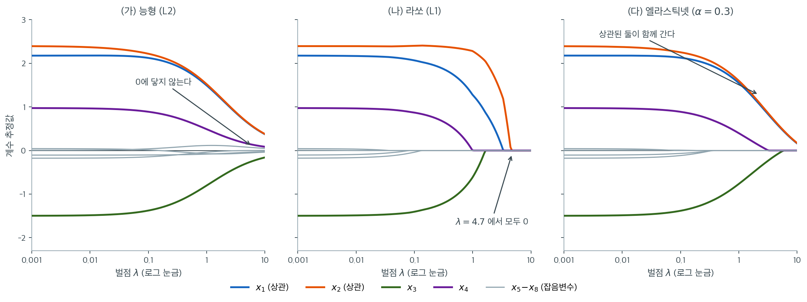

# 능형 대 라쏘 대 엘라스틱넷

이 절은 세 가지 주요 정칙화 방법 — 능형회귀(L2), 라쏘(L1), 엘라스틱넷(L1+L2) — 을 체계적으로 비교한다. 각 방법은 축소, 희소성, 안정성, 계산비용 사이에서 서로 다른 절충을 한다.

---

## 1. 벌점과 목적함수의 비교

세 방법 모두 다음 형태의 벌점최소제곱을 최소화한다.

$$
\hat{\boldsymbol{\beta}} = \arg\min_{\boldsymbol{\beta}} \left\{\frac{1}{2n}\|\mathbf{y} - \mathbf{X}\boldsymbol{\beta}\|^2 + \lambda\, P(\boldsymbol{\beta})\right\}
$$

차이는 벌점 $P(\boldsymbol{\beta})$에 있다.

| 방법 | 벌점 $P(\boldsymbol{\beta})$ | 제약 모양 |
|---|---|---|
| 능형 | $\frac{1}{2}\|\boldsymbol{\beta}\|_2^2$ | 구 (L2 공) |
| 라쏘 | $\|\boldsymbol{\beta}\|_1$ | 마름모 (L1 공) |
| 엘라스틱넷 | $\alpha\|\boldsymbol{\beta}\|_1 + (1-\alpha)\frac{1}{2}\|\boldsymbol{\beta}\|_2^2$ | 둥근 마름모 |

---

## 2. 성질의 종합 비교

| 성질 | 능형 | 라쏘 | 엘라스틱넷 |
|---|---|---|---|
| 변수선택 | 없음 | 있음 | 있음 |
| 정확한 0 | 결코 없음 | 있음 | 있음 |
| 축소 유형 | 비례 | 평행이동(연성 문턱) | 결합 |
| 다중공선성 처리 | 좋음(계수 분배) | 나쁨(하나만 선택) | 좋음(그룹 효과) |
| 해의 유일성 | 언제나 ($\lambda > 0$) | $p > n$이면 아님 | 언제나 ($\alpha < 1$) |
| 닫힌 형태 해 | 있음 | 직교 $\mathbf{X}$에서만 | 없음 |
| 최대 선택 변수 수 ($p > n$) | 전부 $p$개 | 최대 $n$개 | 제한 없음 |
| 베이즈 사전분포 | 가우스 $N(0, \tau^2)$ | Laplace$(0, b)$ | 혼합 |
| 계산 | 행렬 역변환 | 좌표하강 | 좌표하강 |
| 초모수 | $\lambda$ | $\lambda$ | $\lambda, \alpha$ |
| 유효자유도 공식 | $\sum d_j^2/(d_j^2 + \lambda)$ | 0이 아닌 계수의 개수 | 근사 |

---

## 3. 계수 경로의 거동

**능형 경로.** 모든 $\lambda > 0$에서 모든 계수가 0이 아니다. 큰 $\lambda$에서 0 근처에서 출발해 OLS 값으로 연속적으로 커진다. 경로가 매끄러운 곡선이며 어떤 계수도 정확히 0에 닿지 않는다.

**라쏘 경로.** $\lambda$가 줄면서 계수가 하나씩 모형에 들어온다. 경로가 조각별 선형이다. 각 꺾인점에서 새 변수가 활성집합에 들어오거나 (드물게) 빠진다.

**엘라스틱넷 경로.** 계수가 점진적으로 들어온다는 점에서 라쏘와 비슷하지만 L2 성분 때문에 경로가 더 매끄럽다. 상관된 변수가 함께 들어오는 경향이 있고, 자료의 교란에 대해 더 안정적이다.



같은 자료($n = 80$, $p = 8$, 표준화)에 세 벌점을 적용한 경로다. 참 계수는 $x_1$부터 $(2.5,\ 2.0,\ -1.6,\ 0.8)$이고 $x_5$부터 $x_8$까지 넷은 참값이 0인 잡음변수다. $x_1$과 $x_2$는 상관이 $0.95$가 되도록 일부러 묶어 두었다. 세 그림의 왼쪽 끝은 모두 같다. $\lambda \to 0$이면 세 방법 모두 OLS로 수렴하기 때문이다. 차이는 오른쪽으로 가면서 벌어진다.

**능형에서는 여덟 곡선 중 하나도 축과 만나지 않는다.** 모두 0을 향해 매끄럽게 눕지만 닿지 않는다. 격자 오른쪽 끝 $\lambda = 10$에서 가장 작은 계수의 절댓값이 $0.0006$인데, 이는 "작다"일 뿐 "0"이 아니다. 회색 잡음변수 네 개도 끝까지 모형 안에 남아 있다. 능형이 변수선택을 하지 못한다는 말의 그림이 이것이다.

**라쏘 경로는 꺾인 직선들이고 하나씩 축에 달라붙는다.** 잡음변수 넷이 먼저 $\lambda = 0.008$에서 $0.13$ 사이에 죽고, $x_4$가 $\lambda = 0.99$, $x_3$이 $1.57$, $x_1$이 $3.33$, 마지막으로 $x_2$가 $4.44$에서 사라져 $\lambda = 4.7$부터는 모든 계수가 0이다. 사라지는 순서가 대체로 신호의 크기 순서라는 점이 라쏘를 변수선택 도구로 만든다. 그런데 $\lambda$가 $2$를 넘는 구간을 보라. 상관 $0.95$인 두 형제 $x_1$과 $x_2$가 갈라져 파란 곡선만 급히 0으로 떨어지고 주황 곡선이 혼자 살아남는다. **거의 같은 정보를 담은 두 변수 중 하나만 고르는** 라쏘의 습성이 여기 드러난다.

**엘라스틱넷은 둘 사이에 있다.** 잡음변수는 라쏘보다 늦은 $\lambda = 0.08$에서 $0.37$ 사이에 정리되고, 참 변수 넷은 라쏘보다 훨씬 오래 버틴다. 결정적인 차이는 $x_1$과 $x_2$가 오른쪽 끝까지 **겹쳐서 함께 내려간다**는 점이다($\lambda = 10$에서 둘 다 $0.17$ 근처). L2 성분이 계수 제곱합에 벌점을 주므로 같은 총합이라면 둘로 나누는 쪽이 유리하고, 그래서 한쪽만 버리는 일이 일어나지 않는다. 이것이 뒤에 나올 **그룹 효과**의 정체이며, 상관된 설명변수가 있을 때 엘라스틱넷을 권하는 이유다.

---

## 4. 직교 설계에서의 축소 거동

$\mathbf{X}^\top\mathbf{X} = n\mathbf{I}$일 때 세 방법 모두 닫힌 형태 해를 가지며 축소 방식이 드러난다.

$$
\hat{\beta}_j^{\text{ridge}} = \frac{\hat{\beta}_j^{\text{OLS}}}{1 + \lambda}, \qquad
\hat{\beta}_j^{\text{lasso}} = \text{sign}(\hat{\beta}_j^{\text{OLS}})\,\max\bigl(|\hat{\beta}_j^{\text{OLS}}| - \lambda,\; 0\bigr)
$$

$$
\hat{\beta}_j^{\text{EN}} = \frac{\text{sign}(\hat{\beta}_j^{\text{OLS}})\,\max\bigl(|\hat{\beta}_j^{\text{OLS}}| - \alpha\lambda,\; 0\bigr)}{1 + (1-\alpha)\lambda}
$$

능형은 상수로 나누고(비례 축소), 라쏘는 상수를 빼고 0에서 자른다(평행이동 축소). 엘라스틱넷은 $\alpha\lambda$를 뺀 뒤 $1 + (1-\alpha)\lambda$로 나눈다.

---

## 5. 편향-분산 프로파일

**능형.** 모든 계수에 중간 정도의 편향. 분산 감소는 $\mathbf{X}^\top\mathbf{X}$의 작은 고유벡터 방향에서 가장 크다.

**라쏘.** 제거된 계수에는 편향이 없다(참값이 0이면 정확하다). 그러나 남은 계수는 연성 문턱 때문에 편향된다. 분산 감소는 잡음이 큰 계수 추정을 제거하는 데서 온다.

**엘라스틱넷.** 둘의 프로파일을 결합한다. L2 성분이 모든 계수의 분산을 줄이고 L1 성분이 무관한 것을 제거한다.

---

## 6. 상황별 성능

!!! note "보편적으로 최선인 방법은 없다"
    어떤 방법도 모든 상황에서 우월하지 않다. 최선의 선택은 참 자료생성과정, 설명변수의 상관 구조, $p/n$ 비, 분석 목표에 달려 있다.

**상황 1: 작은 효과가 많고 희소성이 없다.** 모든 변수가 조금씩 기여한다. 모든 변수를 남기고 축소를 최적으로 분배하는 **능형**이 가장 좋다.

**상황 2: 큰 효과가 몇 개뿐이고 실제로 희소하다.** 소수의 변수만 유의미하고 강한 상관이 없다. 유의미한 변수를 찾고 나머지를 0으로 만드는 **라쏘**가 가장 좋다.

**상황 3: 집단을 이루는 효과와 희소성.** 상관된 변수 집단 여럿이 유의미하다. 집단을 함께 선택하면서 희소성을 유지하는 **엘라스틱넷**이 가장 좋다.

**상황 4: 고차원, $p \gg n$.** 라쏘의 $n$개 제한이 실제로 작동할 수 있으므로 **엘라스틱넷**이 선호된다.

---

## 7. 계산비용

| 방법 | $\lambda$당 비용 | 경로 ($M$개 $\lambda$) | LOOCV 지름길 |
|---|---|---|---|
| 능형 | $O(p^3)$ 또는 $O(np^2)$ | $O(Mp^3)$ | 있음(닫힌 형태) |
| 라쏘 | $O(np \times \text{반복})$ | 온기 시작으로 $O(Mnp)$ | 없음 |
| 엘라스틱넷 | $O(np \times \text{반복})$ | 온기 시작으로 $O(Mnp)$ | 없음 |

---

## 연습문제

<div class="drillbox" markdown>

**연습문제 1.** <span class="diff med" title="중간"></span>
직교 설계($\mathbf{X}^\top\mathbf{X} = n\mathbf{I}$)에서 능형과 라쏘의 닫힌 형태 해를 유도하라. 라쏘는 정확한 0을 만들고 능형은 만들지 못하는 이유를 기하적으로 설명하라.

</div>

??? success "풀이"
    **유도.** 직교 설계에서 목적함수가 좌표별로 분리된다. $z_j = \frac{1}{n}\mathbf{x}_j^\top\mathbf{y} = \hat\beta_j^{\text{OLS}}$라 두면 각 좌표의 문제는

    $$
    \min_{\beta_j}\left\{\tfrac12(\beta_j - z_j)^2 + \lambda P(\beta_j)\right\}
    $$

    이다.

    **능형** ($P = \frac12\beta_j^2$): 미분하여 $\beta_j - z_j + \lambda\beta_j = 0$이므로 $\hat\beta_j = z_j/(1+\lambda)$.

    **라쏘** ($P = |\beta_j|$): $\beta_j \neq 0$이면 $\beta_j - z_j + \lambda\,\text{sign}(\beta_j) = 0$이므로 $\hat\beta_j = z_j - \lambda\,\text{sign}(\beta_j)$. $\beta_j = 0$이 최적일 조건은 부분미분에서 $|z_j| \le \lambda$. 둘을 합치면 연성 문턱이 된다.

    **기하적 이유.** 핵심은 $\beta_j = 0$에서 벌점의 도함수다.

    | 벌점 | $\beta_j \to 0^+$에서의 도함수 |
    |:---|---:|
    | L2 ($\frac12\beta_j^2$) | $\beta_j \to 0$ |
    | L1 ($\lvert \beta_j\rvert$) | $1$ (0이 아니다) |

    L2 벌점의 도함수가 0에서 사라지므로, $z_j$가 아무리 작아도 0에서 벗어나는 것이 언제나 이득이다. L1 벌점은 0에서도 기울기 $\lambda$를 유지하므로, 자료가 주는 이득 $|z_j|$가 $\lambda$를 넘지 못하면 0에 머무는 것이 최적이다.

    제약 형태로 보면 이는 [기하적 해석](../lasso/geometry.md)에서 본 "꼭짓점" 논증과 같은 이야기다. 매끄러운 구는 접선 조건을 **등식**으로, 뾰족한 마름모는 **부등식**으로 만든다.

<div class="drillbox" markdown>

**연습문제 2.** <span class="diff med" title="중간"></span>
$y = 3x_1 - 2x_2 + 0.5x_3 + \varepsilon$($\varepsilon \sim N(0,1)$)에서 $n = 100$개를 생성하고 잡음변수 17개($x_4, \ldots, x_{20}$)를 더하라.

**(a)** OLS, 능형, 라쏘, 엘라스틱넷을 적합하고 계수 추정값을 비교하라.

**(b)** 어느 방법이 참 변수 3개를 올바르게 식별하는가?

**(c)** 5-겹 교차검증으로 각 방법의 최적 $\lambda$를 고르고 검정 MSE를 보고하라.

</div>

??? success "풀이"
    ```python
    import numpy as np
    from sklearn.linear_model import (LinearRegression, RidgeCV,
                                      LassoCV, ElasticNetCV)
    from sklearn.model_selection import train_test_split

    rng = np.random.default_rng(0)
    n, p = 100, 20
    X = rng.normal(size=(n, p)); X -= X.mean(0); X /= X.std(0)
    beta = np.zeros(p); beta[:3] = [3, -2, 0.5]
    y = X @ beta + rng.normal(0, 1, n)

    Xtr, Xte, ytr, yte = train_test_split(X, y, test_size=0.3, random_state=0)
    models = {
        'OLS':   LinearRegression(),
        'Ridge': RidgeCV(alphas=np.logspace(-3, 3, 100)),
        'Lasso': LassoCV(cv=5, random_state=0, max_iter=50000),
        'ENet':  ElasticNetCV(l1_ratio=[.1,.5,.7,.9,.95,1], cv=5,
                              random_state=0, max_iter=50000),
    }
    for name, m in models.items():
        m.fit(Xtr, ytr)
        mse = ((yte - m.predict(Xte))**2).mean()
        nz = (np.abs(m.coef_) > 1e-8).sum()
        print(f"{name:6s} 검정MSE = {mse:.3f}   0이 아닌 계수 = {nz:2d}")
    ```

    출력:

    ```text
    OLS    검정MSE = 1.792   0이 아닌 계수 = 20
    Ridge  검정MSE = 1.799   0이 아닌 계수 = 20
    Lasso  검정MSE = 1.260   0이 아닌 계수 =  9
    ENet   검정MSE = 1.260   0이 아닌 계수 =  9
    ```

    (라쏘와 엘라스틱넷의 수가 같은 것은 `ElasticNetCV`가 `l1_ratio = 1`, 곧 라쏘를 고른 결과다. 좌표하강의 해는 수렴 허용오차만큼 흔들리므로 소수 셋째 자리까지만 적었다.)

    **(a), (b)** 기대되는 양상은 다음과 같다.

    | 방법 | 0이 아닌 계수 | 참 변수 3개 포함 | $x_3$($\beta = 0.5$) |
    |:---|---:|:---|:---|
    | OLS | 20 | 포함(모두 포함하므로) | 추정값에 잡음이 크다 |
    | 능형 | 20 | 포함 | 축소되어 작다 |
    | 라쏘 | 소수 | 대체로 포함 | **놓칠 수 있다** |
    | 엘라스틱넷 | 라쏘보다 조금 많음 | 대체로 포함 | 라쏘보다 잘 잡는다 |

    **$x_3$의 계수 $0.5$가 관건이다.** 잡음 표준편차가 1이고 $n = 100$이므로 그 계수의 표준오차가 약 $0.1$이다. 신호 대 잡음비가 5로 검출은 가능하지만, 라쏘의 문턱 $\lambda$가 $0.5$에 가까우면 함께 잘려 나간다.

    **(c)** 검정 MSE는 네 방법이 대체로 비슷하며, 잡음변수가 17개뿐이라 OLS도 크게 나쁘지 않다. **차이가 극적으로 벌어지려면 $p$가 $n$에 가까워야 한다.** $p = 20$, $n = 100$은 $p/n = 0.2$로 OLS가 아직 견딜 만한 영역이다([과적합과 편향-분산 절충](../motivation/overfitting.md) 연습문제 2 참조).

    이 실험의 교훈은 **정칙화의 이득이 $p/n$과 신호의 희소성에 강하게 의존한다**는 것이다. 이 설정에서 "정칙화가 별로 도움이 안 된다"는 결과가 나와도 그것이 정칙화의 실패는 아니다.

<div class="drillbox" markdown>

**연습문제 3.** <span class="diff med" title="중간"></span>
**금융 응용.** Fama-French 요인과 거시경제 변수로 월별 주식수익률을 예측하는 상황을 생각하자. 예측변수 $p = 50$개, 월별 관측 $n = 120$개인 자료를 모의생성한다.

**(a)** 이 상황에서 정칙화가 필수적인 이유는 무엇인가?

**(b)** 이동창 교차검증(60개월로 훈련, 다음 달 예측, 한 달씩 이동)으로 OLS, 능형회귀, 라쏘, 엘라스틱넷의 표본외 $R^2$를 비교하라.

**(c)** 라쏘가 고르는 예측변수는 무엇인가? 이동창을 옮겨도 안정적인가?

</div>

<div class="drillbox" markdown>

**연습문제 4.** <span class="diff hard" title="어려움"></span>
**벌점은 척도에 불변이 아니다.** $n = 4$, $p = 2$의 중심화된 설계

$$
\mathbf{x}_1 = (1,\ 1,\ -1,\ -1)^\top, \qquad
\mathbf{x}_2 = (1,\ -1,\ 1,\ -1)^\top, \qquad
\mathbf{y} = (6,\ 2,\ -2,\ -6)^\top
$$

을 생각하자. 세 벡터의 성분합이 모두 0이므로 절편은 적합하지 않는다. 목적함수는 1 절의 것을 쓴다.

**(a)** $\mathbf{X}^\top\mathbf{X} = n\mathbf{I}$임을 확인하고 OLS 해와 $\lambda = 1$에서의 능형·라쏘 해를 4 절의 공식으로 구하라.

**(b)** $\mathbf{x}_1$의 단위만 바꿔 $\tilde{\mathbf{x}}_1 = 10\,\mathbf{x}_1$으로 두고($\mathbf{x}_2$와 $\mathbf{y}$는 그대로) 같은 $\lambda = 1$로 다시 풀어라. 원래 단위로 환산한 기여 $10\,\tilde\beta_1$을 (a)와 비교하고 두 좌표의 축소비를 각각 적어라.

**(c)** 반대로 $\tilde{\mathbf{x}}_1 = 0.1\,\mathbf{x}_1$으로 두면 $\lambda = 1$의 라쏘에서 무슨 일이 일어나는가? 표준화하지 않은 설계행렬을 `sklearn`의 `Ridge`·`Lasso`에 그대로 넣으면 무엇을 잃는지 한 줄로 적어라.

</div>

??? success "풀이"
    **일반 공식.** 열이 서로 직교하면($\mathbf{x}_j^\top\mathbf{x}_k = 0$, $j \neq k$) 1 절의 목적함수가 좌표별로 분리되어

    $$
    \frac{1}{2n}\bigl(\beta_j^2\,\mathbf{x}_j^\top\mathbf{x}_j - 2\beta_j\,\mathbf{x}_j^\top\mathbf{y}\bigr) + \lambda P(\beta_j) + \text{(상수)}
    $$

    가 된다. $c_j = \mathbf{x}_j^\top\mathbf{x}_j/n$, $z_j = \mathbf{x}_j^\top\mathbf{y}/n$라 두고 미분하면

    $$
    \hat\beta_j^{\text{ridge}} = \frac{z_j}{c_j + \lambda}, \qquad
    \hat\beta_j^{\text{lasso}} = \frac{\operatorname{sign}(z_j)\max(\lvert z_j\rvert - \lambda,\ 0)}{c_j}
    $$

    이다. $c_j = 1$(표준화된 열)일 때만 4 절의 공식으로 돌아간다.

    **(a)** $\mathbf{x}_1^\top\mathbf{x}_1 = \mathbf{x}_2^\top\mathbf{x}_2 = 4 = n$이고 $\mathbf{x}_1^\top\mathbf{x}_2 = 1 - 1 - 1 + 1 = 0$이므로 $\mathbf{X}^\top\mathbf{X} = 4\mathbf{I} = n\mathbf{I}$다. 또

    $$
    z_1 = \frac{16}{4} = 4, \qquad z_2 = \frac{8}{4} = 2
    $$

    이므로 $\hat{\boldsymbol\beta}^{\text{OLS}} = (4,\ 2)$, $\hat{\boldsymbol\beta}^{\text{ridge}} = (4/2,\ 2/2) = (2,\ 1)$, $\hat{\boldsymbol\beta}^{\text{lasso}} = (4-1,\ 2-1) = (3,\ 1)$이다.

    **(b)** $\tilde{\mathbf{x}}_1 = 10\mathbf{x}_1$이면 $c_1 = 400/4 = 100$, $z_1 = 160/4 = 40$이다. 따라서

    $$
    \tilde\beta_1^{\text{ridge}} = \frac{40}{100 + 1} = 0.3960, \qquad
    \tilde\beta_1^{\text{lasso}} = \frac{40 - 1}{100} = 0.3900
    $$

    이고 원래 단위로 환산하면 $10\tilde\beta_1 = 3.9604$(능형), $3.9000$(라쏘)이다. $\mathbf{x}_2$는 건드리지 않았으므로 $\tilde\beta_2$는 (a)와 똑같이 $1$이다.

    축소비를 보면 차이가 선명하다. 능형의 축소비는 $c_j/(c_j+\lambda)$이므로

    | 좌표 | $c_j$ | 능형 축소비 |
    |:---|---:|---:|
    | 단위를 바꾼 $\tilde{\mathbf{x}}_1$ | $100$ | $100/101 = 0.9901$ |
    | 그대로인 $\mathbf{x}_2$ | $1$ | $1/2 = 0.5000$ |

    **단위를 10배로 늘린 변수는 벌점을 거의 받지 않는다.** $\lambda$는 그대로인데 자료가 주는 신호 $c_j$가 100배로 커졌으므로 벌점의 상대적 무게가 사라진 것이다.

    **(c)** $\tilde{\mathbf{x}}_1 = 0.1\mathbf{x}_1$이면 $c_1 = 0.04/4 = 0.01$, $z_1 = 1.6/4 = 0.4$다. 라쏘의 0 조건은 $\lvert z_1\rvert \le \lambda$인데 $0.4 \le 1$이므로

    $$
    \tilde\beta_1^{\text{lasso}} = 0.
    $$

    **단위를 미터에서 킬로미터로 바꾼 것만으로 변수가 모형에서 쫓겨났다.** 척도 $c$에 대해 환산된 기여를 일반식으로 적으면 능형은 $4c^2/(c^2+1)$, 라쏘는 $4c > 1$일 때 $(4c-1)/c$이고 그렇지 않으면 $0$이다.

    | $c$ | 능형(환산) | 라쏘(환산) |
    |---:|---:|---:|
    | $0.1$ | $0.0396$ | $0$ |
    | $1$ | $2.0000$ | $3.0000$ |
    | $10$ | $3.9604$ | $3.9000$ |

    $c \to \infty$에서 둘 다 OLS 값 $4$로 가고 $c \to 0$에서 둘 다 $0$으로 간다. 즉 **단위를 고르는 것이 $\lambda$를 고르는 것과 같은 일을 한다.**

    `sklearn`의 `Ridge`와 `Lasso`는 설명변수를 표준화해 주지 않는다. 표준화 없이 넣으면 같은 $\lambda$가 변수마다 다른 세기의 벌점이 되어 **벌점의 의미와 변수 사이의 비교가 함께 무너진다.** 반드시 `StandardScaler`를 앞에 두되([분산과 표준편차](../../ch02/spread/variance_std.md) 정리 2), 뒤의 연습문제 9가 보이듯 그 표준화도 교차검증 폴드 **안에서** 해야 한다.

<div class="drillbox" markdown>

**연습문제 5.** <span class="diff hard" title="어려움"></span>
**$\alpha$와 $\lambda$를 섞으면 수가 전부 틀어진다.** 이 쪽은 1 절의 목적함수 $\frac{1}{2n}\lVert\mathbf{y}-\mathbf{X}\boldsymbol\beta\rVert^2 + \lambda P(\boldsymbol\beta)$를 쓰고 `sklearn`의 `Lasso(alpha=·)`도 같은 꼴을 쓴다. 그런데 많은 교과서는 벌점 없는 꼴 $\lVert\mathbf{y}-\mathbf{X}\boldsymbol\beta\rVert^2 + \lambda_{\text{tb}}\lVert\boldsymbol\beta\rVert_1$을 쓴다.

**(a)** 두 목적함수가 같은 해를 주는 $\lambda$와 $\lambda_{\text{tb}}$의 관계를 구하라.

**(b)** 3 절의 그림은 $n = 80$이고 $x_4$가 $\lambda = 0.99$에서 사라진다. 이를 $\lambda_{\text{tb}}$로 환산하라.

**(c)** $n = 100$, 표준화된 직교 설계에서 $\mathbf{z} = (0.6,\ 0.3,\ 0.1)$이라 하자. $\lambda = 0.25$의 라쏘 해를 구하고, 이를 $\lambda_{\text{tb}}$로 환산한 값을 **그대로** `Lasso(alpha=·)`에 넣으면 어떤 해가 나오는지 구하라.

</div>

??? success "풀이"
    **(a)** 둘째 목적함수를 $2n$으로 나누어도 최소점은 바뀌지 않는다.

    $$
    \frac{1}{2n}\lVert\mathbf{y}-\mathbf{X}\boldsymbol\beta\rVert^2 + \frac{\lambda_{\text{tb}}}{2n}\lVert\boldsymbol\beta\rVert_1
    $$

    이 1 절의 꼴과 일치하므로

    $$
    \lambda = \frac{\lambda_{\text{tb}}}{2n}, \qquad \lambda_{\text{tb}} = 2n\lambda .
    $$

    **(b)** $\lambda_{\text{tb}} = 2 \times 80 \times 0.99 = 158.4$. 같은 적합을 가리키는 두 수가 $0.99$와 $158.4$다. **어느 쪽 규약인지 적어 두지 않은 $\lambda$ 값은 아무 뜻이 없다.**

    **(c)** $\lambda = 0.25$의 연성 문턱은

    $$
    \hat{\boldsymbol\beta} = \bigl(0.6 - 0.25,\ 0.3 - 0.25,\ 0\bigr) = (0.35,\ 0.05,\ 0)
    $$

    이다($\lvert 0.1\rvert \le 0.25$이므로 셋째 좌표는 0). 환산하면 $\lambda_{\text{tb}} = 2 \times 100 \times 0.25 = 50$이다. 이 $50$을 `Lasso(alpha=50)`에 넣으면 그것은 $\lambda = 50$을 뜻하고, 라쏘가 모두 0이 되는 문턱은 $\lambda \ge \max_j\lvert z_j\rvert = 0.6$이므로

    $$
    \hat{\boldsymbol\beta} = (0,\ 0,\ 0).
    $$

    **200배 센 벌점을 걸어 모형을 통째로 비운 것이다.** 규약을 섞은 대가가 "조금 틀린 수"가 아니라 "빈 모형"이라는 점을 기억해 두라. 덧붙여 $\lambda_{\text{tb}}$를 고정한 채 $n$을 키우면 $\lambda = \lambda_{\text{tb}}/(2n) \to 0$이 되어 벌점이 사라진다. 표본이 커질 때 비교 가능한 양은 $\lambda_{\text{tb}}$가 아니라 $\lambda$ 쪽이다.

<div class="drillbox" markdown>

**연습문제 6.** <span class="diff hard" title="어려움"></span>
**능형이 OLS를 이기는 $\lambda$는 반드시 있다.** 표준화된 직교 설계 $\mathbf{X}^\top\mathbf{X} = n\mathbf{I}$에서 $\mathbf{y} = \mathbf{X}\boldsymbol\beta + \boldsymbol\varepsilon$, $\boldsymbol\varepsilon \sim N(\mathbf{0}, \sigma^2\mathbf{I})$라 하자. $z_j = \mathbf{x}_j^\top\mathbf{y}/n$이다.

**(a)** $z_j \sim N(\beta_j, \sigma^2/n)$이고 서로 독립임을 보이고, 총 MSE $\;\text{MSE}(\lambda) = \sum_{j=1}^p \mathbb{E}(\hat\beta_j^{\text{ridge}} - \beta_j)^2$를 $B = \lVert\boldsymbol\beta\rVert_2^2$와 $C = p\sigma^2/n$으로 적어라.

**(b)** $\text{MSE}'(0) < 0$임을 보이고 최소점 $\lambda^\ast$와 $\text{MSE}(\lambda^\ast)/\text{MSE}(0)$을 구하라.

**(c)** 3 절 그림의 참 계수 $(2.5,\ 2.0,\ -1.6,\ 0.8,\ 0,\ 0,\ 0,\ 0)$, $n = 80$, $\sigma^2 = 1$에 넣어 $\lambda^\ast$와 MSE 감소율을 구하라. 같은 $p$, $n$에서 참 계수가 모두 $0.1$이면 어떻게 되는가? 6 절의 "상황 1"과 "상황 2"가 어느 쪽인지 말하라.

</div>

??? success "풀이"
    **(a)** $z_j = \mathbf{x}_j^\top(\mathbf{X}\boldsymbol\beta + \boldsymbol\varepsilon)/n$이고 직교성에서 $\mathbf{x}_j^\top\mathbf{X}\boldsymbol\beta = n\beta_j$이므로 $z_j = \beta_j + \mathbf{x}_j^\top\boldsymbol\varepsilon/n$이다. 따라서 $\mathbb{E}z_j = \beta_j$이고

    $$
    \operatorname{Var}(z_j) = \frac{\sigma^2\,\mathbf{x}_j^\top\mathbf{x}_j}{n^2} = \frac{\sigma^2 n}{n^2} = \frac{\sigma^2}{n},
    \qquad \operatorname{Cov}(z_j, z_k) = \frac{\sigma^2\,\mathbf{x}_j^\top\mathbf{x}_k}{n^2} = 0 .
    $$

    정규벡터의 성분이 무상관이면 독립이다. 이제 $\hat\beta_j^{\text{ridge}} = z_j/(1+\lambda)$이므로 편향과 분산이

    $$
    \mathbb{E}\hat\beta_j^{\text{ridge}} - \beta_j = -\frac{\lambda\beta_j}{1+\lambda}, \qquad
    \operatorname{Var}(\hat\beta_j^{\text{ridge}}) = \frac{\sigma^2/n}{(1+\lambda)^2}
    $$

    이고, 편향-분산 분해([평균제곱오차](../../ch06/estimator_quality/mse.md) 정리 1)를 좌표마다 더하면

    $$
    \text{MSE}(\lambda) = \frac{\lambda^2 B + C}{(1+\lambda)^2}, \qquad B = \lVert\boldsymbol\beta\rVert_2^2, \quad C = \frac{p\sigma^2}{n}.
    $$

    $\lambda = 0$에서 $\text{MSE}(0) = C$로 OLS의 MSE가 된다.

    **(b)** 미분하면

    $$
    \text{MSE}'(\lambda) = \frac{2\lambda B(1+\lambda)^2 - 2(1+\lambda)(\lambda^2 B + C)}{(1+\lambda)^4}
    = \frac{2(\lambda B - C)}{(1+\lambda)^3}
    $$

    이다. 따라서 $\text{MSE}'(0) = -2C < 0$이고($\sigma^2 > 0$이면 $C > 0$), $\lambda < C/B$에서 감소, $\lambda > C/B$에서 증가하므로

    $$
    \lambda^\ast = \frac{C}{B} = \frac{p\sigma^2}{n\lVert\boldsymbol\beta\rVert_2^2}, \qquad
    \text{MSE}(\lambda^\ast) = \frac{(C/B)^2B + C}{(1+C/B)^2} = \frac{BC}{B+C}
    $$

    이고

    $$
    \frac{\text{MSE}(\lambda^\ast)}{\text{MSE}(0)} = \frac{B}{B+C} < 1 .
    $$

    $\lambda = 0$에서 도함수가 **엄격히 음수**라는 것이 "편향을 사서 분산을 판다"는 거래가 언제나 처음 한 걸음은 이득이라는 뜻이다. 처음에는 편향이 $O(\lambda^2)$으로 늘지만 분산은 $O(\lambda)$로 줄기 때문이다. $\boldsymbol\beta = \mathbf{0}$이면 $B = 0$이라 $\lambda^\ast = \infty$이고 극한 MSE가 0이 된다.

    **(c)** $B = 2.5^2 + 2^2 + 1.6^2 + 0.8^2 = 6.25 + 4 + 2.56 + 0.64 = 13.45$, $C = 8 \times 1/80 = 0.1$이므로

    $$
    \lambda^\ast = \frac{0.1}{13.45} = 0.007435, \qquad
    \frac{\text{MSE}(\lambda^\ast)}{\text{MSE}(0)} = \frac{13.45}{13.55} = 0.9926 .
    $$

    **이득이 보장되기는 하지만 0.74 %뿐이다.** 신호가 세고 잡음이 작으니 팔 분산이 거의 없다. 반면 참 계수가 모두 $0.1$이면 $B = 8 \times 0.01 = 0.08$이고 $C = 0.1$은 그대로여서

    $$
    \lambda^\ast = \frac{0.1}{0.08} = 1.25, \qquad
    \frac{\text{MSE}(\lambda^\ast)}{\text{MSE}(0)} = \frac{0.08}{0.18} = 0.4444
    $$

    로 MSE가 **55.6 %** 줄어든다. 앞은 큰 효과 넷과 잡음변수 넷이 섞인 희소한 설정으로 6 절의 **상황 2**(라쏘가 유리)이고, 뒤는 작은 효과가 고르게 퍼진 **상황 1**(능형이 유리)이다. 능형의 이득이 $C/B$, 곧 **잡음 대 신호의 비**로 결정된다는 것이 두 상황을 가르는 한 줄이다.

<div class="drillbox" markdown>

**연습문제 7.** <span class="diff hard" title="어려움"></span>
**두 공식이 어긋나는 자리.** 2 절의 표는 능형의 유효자유도를 $\sum_j d_j^2/(d_j^2 + \lambda)$로 적었다($d_j$는 $\mathbf{X}$의 특잇값).

**(a)** 1 절의 목적함수에서 능형의 정규방정식과 모자행렬 $\mathbf{H}_\lambda$($\hat{\mathbf{y}} = \mathbf{H}_\lambda\mathbf{y}$)를 구하고 $\operatorname{tr}\mathbf{H}_\lambda$를 $d_j$와 $\lambda$로 적어라. 2 절 표의 $\lambda$는 1 절의 $\lambda$와 어떤 관계인가?

**(b)** 표준화된 직교 설계 $\mathbf{X}^\top\mathbf{X} = n\mathbf{I}$에서 (a)의 결과가 $p/(1+\lambda)$로 정리됨을 보이고, 4 절의 축소 공식에서도 같은 값이 나오는지 확인하라.

**(c)** $n = 80$, $p = 8$의 직교 설계에서 $\lambda = 10$일 때 유효자유도를 구하라. 2 절 표의 공식에 1 절의 $\lambda$를 그대로 넣으면 얼마가 나오는가? 3 절에서 라쏘는 $\lambda \ge 4.7$에서 모든 계수가 0이었다. 같은 $\lambda = 10$에서 라쏘의 유효자유도는 얼마인가?

**(d)** 라쏘가 참 변수 넷만 남긴 적합과 유효자유도를 맞추려면 능형의 $\lambda$를 얼마로 해야 하는가?

</div>

??? success "풀이"
    **(a)** 1 절의 목적함수 $\frac{1}{2n}\lVert\mathbf{y}-\mathbf{X}\boldsymbol\beta\rVert^2 + \frac{\lambda}{2}\lVert\boldsymbol\beta\rVert_2^2$를 미분하면

    $$
    -\frac{1}{n}\mathbf{X}^\top(\mathbf{y}-\mathbf{X}\boldsymbol\beta) + \lambda\boldsymbol\beta = \mathbf{0}
    \;\Longrightarrow\;
    (\mathbf{X}^\top\mathbf{X} + n\lambda\mathbf{I})\hat{\boldsymbol\beta} = \mathbf{X}^\top\mathbf{y}
    $$

    이므로 $\mathbf{H}_\lambda = \mathbf{X}(\mathbf{X}^\top\mathbf{X} + n\lambda\mathbf{I})^{-1}\mathbf{X}^\top$이다. 특잇값분해 $\mathbf{X} = \mathbf{U}\mathbf{D}\mathbf{V}^\top$를 넣으면 $\mathbf{H}_\lambda = \mathbf{U}\operatorname{diag}\bigl(d_j^2/(d_j^2+n\lambda)\bigr)\mathbf{U}^\top$이고

    $$
    \operatorname{tr}\mathbf{H}_\lambda = \sum_{j=1}^p \frac{d_j^2}{d_j^2 + n\lambda}.
    $$

    2 절 표의 공식과 비교하면 $\lambda_{\text{표}} = n\lambda$다. 표의 공식은 $\frac{1}{n}$ 없는 목적함수 $\lVert\mathbf{y}-\mathbf{X}\boldsymbol\beta\rVert^2 + \lambda_{\text{표}}\lVert\boldsymbol\beta\rVert_2^2$에 딸린 것이다(연습문제 5와 같은 종류의 어긋남이고, 여기서는 배수가 $2n$이 아니라 $n$이다 — 능형 벌점에 $\frac12$이 붙어 있기 때문이다).

    **(b)** $\mathbf{X}^\top\mathbf{X} = n\mathbf{I}$이면 모든 특잇값이 $d_j^2 = n$이므로

    $$
    \operatorname{tr}\mathbf{H}_\lambda = \sum_{j=1}^p \frac{n}{n + n\lambda} = \frac{p}{1+\lambda}.
    $$

    4 절의 공식으로도 같다. $\hat\beta_j = z_j/(1+\lambda)$이므로 적합값이 각 좌표에서 $1/(1+\lambda)$배로 줄고, 유효자유도는 그 축소비의 합 $p/(1+\lambda)$다.

    **(c)** $\lambda = 10$에서

    $$
    \operatorname{tr}\mathbf{H}_{10} = \frac{8}{11} = 0.7273 .
    $$

    여덟 개의 설명변수로 적합했는데 **유효 모수가 한 개도 못 된다.** 3 절에서 $\lambda = 10$의 가장 작은 능형 계수가 $0.0006$이었던 것과 같은 사실의 다른 표현이다. 반면 표의 공식에 1 절의 $\lambda$를 그대로 넣으면 $d_j^2 = n = 80$이므로

    $$
    \sum_j \frac{80}{80 + 10} = \frac{8 \times 80}{90} = 7.1111
    $$

    로 거의 OLS($\text{df} = 8$)처럼 보인다. **$0.73$과 $7.11$ 사이에 열 배의 간극이 있고, 정보기준으로 모형을 고르면 그 간극이 그대로 선택을 뒤집는다.**

    라쏘는 $\lambda = 10 > 4.7$이므로 계수가 모두 0이고, 2 절 표에 따라 유효자유도가 0이 아닌 계수의 개수이므로

    $$
    \text{df}^{\text{lasso}} = 0 .
    $$

    **능형의 자유도는 0에 닿지 못하고 라쏘는 닿는다.** 2 절 표의 "정확한 0" 행이 자유도의 말로 다시 나타난 것이다.

    **(d)** $p/(1+\lambda) = 4$에서 $8/(1+\lambda) = 4$, 곧 $\lambda = 1$이다. 같은 자유도를 쓰면서 한쪽은 변수 넷을 버리고 다른 쪽은 여덟을 모두 반만큼 쓴다. **유효자유도가 같아도 "어떻게 쓰는가"는 전혀 다르다.**

<div class="drillbox" markdown>

**연습문제 8.** <span class="diff hard" title="어려움"></span>
**닫힌 꼴로 라이브러리를 검산하라.** $\pm 1$로 된 직교 설계($n = 8$, $p = 4$, $\mathbf{X}^\top\mathbf{X} = n\mathbf{I}$)를 만들고 OLS 해가 정확히 $\mathbf{z} = (4,\ 2,\ 0.8,\ 0.1)$이 되도록 $\mathbf{y} = \mathbf{X}\mathbf{z}$로 두자.

**(a)** $\lambda = 1$, $\alpha = 0.5$에서 4 절의 세 닫힌 꼴 값을 손으로 구하라.

**(b)** `sklearn`의 `Ridge`는 $\lVert\mathbf{y}-\mathbf{X}\boldsymbol\beta\rVert^2 + \texttt{alpha}\cdot\lVert\boldsymbol\beta\rVert_2^2$를, `Lasso`·`ElasticNet`은 1 절의 꼴을 최소화한다. 각각 `alpha`를 어떻게 주어야 $\lambda = 1$이 되는지 정하고, 코드로 (a)를 확인하라.

**(c)** `Ridge(alpha=1)`을 그대로 부르면 어떤 $\lambda$의 해가 나오는가? 수로 확인하라.

</div>

??? success "풀이"
    **(a)** $\mathbf{X}^\top\mathbf{X} = n\mathbf{I}$이므로 4 절의 공식이 그대로 쓰인다. $\lambda = 1$, $\alpha = 0.5$에서

    | 방법 | 공식 | $\hat{\boldsymbol\beta}$ |
    |:---|:---|:---|
    | 능형 | $z_j/(1+\lambda)$ | $(2,\ 1,\ 0.4,\ 0.05)$ |
    | 라쏘 | $\operatorname{sign}(z_j)(\lvert z_j\rvert - \lambda)_+$ | $(3,\ 1,\ 0,\ 0)$ |
    | 엘라스틱넷 | $\operatorname{sign}(z_j)(\lvert z_j\rvert - \alpha\lambda)_+/(1+(1-\alpha)\lambda)$ | $(7/3,\ 1,\ 0.2,\ 0)$ |

    엘라스틱넷의 첫 좌표는 $(4-0.5)/1.5 = 2.3333$이고, 셋째 좌표는 $(0.8-0.5)/1.5 = 0.2$로 **라쏘가 죽인 변수를 살려 놓는다.** 넷째는 $\lvert 0.1\rvert \le 0.5$라 0이다.

    **(b)** `Ridge`의 목적함수를 $2n$으로 나누면 $\frac{1}{2n}\lVert\mathbf{y}-\mathbf{X}\boldsymbol\beta\rVert^2 + \frac{\texttt{alpha}}{2n}\lVert\boldsymbol\beta\rVert_2^2$이고 1 절의 능형 벌점은 $\frac{\lambda}{2}\lVert\boldsymbol\beta\rVert_2^2$이므로 $\texttt{alpha} = n\lambda = 8$이다. `Lasso`·`ElasticNet`은 규약이 같으므로 $\texttt{alpha} = \lambda = 1$이고, `ElasticNet`의 `l1_ratio`가 1 절의 $\alpha$다.

    ```python
    import numpy as np
    from sklearn.linear_model import Ridge, Lasso, ElasticNet

    # === 직교 설계: X^T X = n I (n = 8, p = 4) ===
    bits = np.array([[(i >> k) & 1 for k in range(3)] for i in range(8)])
    s = 1.0 - 2.0 * bits                        # +-1 로 된 열 세 개
    X = np.column_stack([s[:, 0], s[:, 1], s[:, 2], s.prod(1)])
    n, p = X.shape
    print("X^T X / n 이 단위행렬인가:", np.allclose(X.T @ X / n, np.eye(p)))

    # === OLS 해가 정확히 z 가 되도록 y 를 만든다 ===
    z = np.array([4.0, 2.0, 0.8, 0.1])
    y = X @ z
    lam, a = 1.0, 0.5

    # === 이 쪽 4 절의 닫힌 꼴 ===
    hand = {
        "ridge": z / (1 + lam),
        "lasso": np.sign(z) * np.maximum(np.abs(z) - lam, 0.0),
        "enet ": np.sign(z) * np.maximum(np.abs(z) - a * lam, 0.0)
                 / (1 + (1 - a) * lam),
    }

    # === sklearn: Ridge 는 alpha = n*lam, Lasso/ElasticNet 은 alpha = lam ===
    fit = {
        "ridge": Ridge(alpha=n * lam, fit_intercept=False),
        "lasso": Lasso(alpha=lam, fit_intercept=False, max_iter=100000, tol=1e-12),
        "enet ": ElasticNet(alpha=lam, l1_ratio=a, fit_intercept=False,
                            max_iter=100000, tol=1e-12),
    }
    for nm in hand:
        c = fit[nm].fit(X, y).coef_
        print(nm, "손:", " ".join(f"{v:.4f}" for v in hand[nm]),
              "| sklearn:", " ".join(f"{v:.4f}" for v in c))

    # === 정규화를 틀리면: Ridge(alpha=1) 은 lam = 1/n 에 해당한다 ===
    bad = Ridge(alpha=1.0, fit_intercept=False).fit(X, y).coef_
    print("Ridge(alpha=1):", " ".join(f"{v:.4f}" for v in bad))
    print("z/(1+1/8)     :", " ".join(f"{v:.4f}" for v in z / (1 + 1 / n)))
    ```

    출력:

    ```text
    X^T X / n 이 단위행렬인가: True
    ridge 손: 2.0000 1.0000 0.4000 0.0500 | sklearn: 2.0000 1.0000 0.4000 0.0500
    lasso 손: 3.0000 1.0000 0.0000 0.0000 | sklearn: 3.0000 1.0000 0.0000 0.0000
    enet  손: 2.3333 1.0000 0.2000 0.0000 | sklearn: 2.3333 1.0000 0.2000 0.0000
    Ridge(alpha=1): 3.5556 1.7778 0.7111 0.0889
    z/(1+1/8)     : 3.5556 1.7778 0.7111 0.0889
    ```

    세 방법 모두 손으로 구한 값과 소수 넷째 자리까지 일치한다. 절편을 적합하지 않은 것(`fit_intercept=False`)은 열의 성분합이 0이고 $\mathbf{y}$도 그렇기 때문이며, 절편을 벌점에서 빼는 일반 규약과도 어긋나지 않는다.

    **(c)** $\texttt{alpha} = n\lambda$에서 $\texttt{alpha} = 1$이면 $\lambda = 1/n = 0.125$다. 따라서 해는 $\mathbf{z}/1.125 = (3.5556,\ 1.7778,\ 0.7111,\ 0.0889)$이고 출력의 마지막 두 줄이 그것을 확인한다. **의도한 $\lambda = 1$보다 8배 약한 벌점을 건 셈이고, $n$이 커질수록 그 오차는 커진다.** 직교 설계처럼 손으로 검산할 수 있는 작은 자료를 하나 들고 있으면 이런 규약 사고를 적합 전에 잡을 수 있다.

<div class="drillbox" markdown>

**연습문제 9.** <span class="diff hard" title="어려움"></span>
**교차검증이 새 나가면 어떤 수가 나오는가.** 참 계수가 **전부 0**인 자료($n = 50$, $p = 200$, $\mathbf{y}$가 $\mathbf{X}$와 무관한 잡음)를 만들고, 반응변수와의 표본상관의 절댓값이 가장 큰 열 10개를 골라 OLS를 적합한 뒤 5-겹 교차검증 MSE를 재자.

**(a)** 변수선택을 **전체 자료로 한 번** 하는 절차와 **폴드마다 훈련부분만으로** 하는 절차를 각각 구현하고, 두 CV MSE와 기준선($\bar y_{\text{훈련}}$으로만 예측) MSE를 비교하라.

**(b)** 참 신호가 0인데도 누수 절차의 표본외 $R^2$가 양수로 나오는 이유를 설명하라. 정직한 절차의 $R^2$가 **음수**인 것은 무엇을 뜻하는가?

**(c)** 이 실험이 라쏘·엘라스틱넷의 $\lambda$를 교차검증으로 고를 때 지켜야 할 규칙으로 무엇을 말해 주는가?

</div>

??? success "풀이"
    ```python
    import numpy as np
    from sklearn.linear_model import LinearRegression
    from sklearn.model_selection import KFold

    # === 신호가 전혀 없는 자료: 참 beta = 0 ===
    rng = np.random.default_rng(1)
    n, p, k = 50, 200, 10
    X = rng.normal(size=(n, p))
    y = rng.normal(size=n)


    # === |상관| 이 큰 k 개 열의 번호 ===
    def top_k(Xa, ya, k):
        Xc, yc = Xa - Xa.mean(0), ya - ya.mean()
        r = np.abs(Xc.T @ yc) / (np.linalg.norm(Xc, axis=0) * np.linalg.norm(yc))
        return np.argsort(-r)[:k], r


    sel_all, r_all = top_k(X, y, k)          # 전체 자료로 한 번 (누수)
    print(f"전체 자료에서 고른 열의 |상관|: "
          f"{r_all[sel_all].max():.4f} ~ {r_all[sel_all].min():.4f}")

    kf = KFold(n_splits=5)
    leak, hon, base = [], [], []
    for tr, te in kf.split(X):
        m = LinearRegression().fit(X[tr][:, sel_all], y[tr])
        leak.append(((y[te] - m.predict(X[te][:, sel_all])) ** 2).mean())

        s, _ = top_k(X[tr], y[tr], k)        # 폴드 안에서 다시 (정직)
        m2 = LinearRegression().fit(X[tr][:, s], y[tr])
        hon.append(((y[te] - m2.predict(X[te][:, s])) ** 2).mean())

        base.append(((y[te] - y[tr].mean()) ** 2).mean())

    L, H, B = np.mean(leak), np.mean(hon), np.mean(base)
    print(f"누수 CV MSE    = {L:.4f}   (R^2 = {1 - L / B:.4f})")
    print(f"정직한 CV MSE  = {H:.4f}   (R^2 = {1 - H / B:.4f})")
    print(f"기준선 MSE     = {B:.4f}")
    ```

    출력:

    ```text
    전체 자료에서 고른 열의 |상관|: 0.3759 ~ 0.2825
    누수 CV MSE    = 0.7049   (R^2 = 0.3708)
    정직한 CV MSE  = 1.8843   (R^2 = -0.6819)
    기준선 MSE     = 1.1203
    ```

    **(a)** 참 계수가 전부 0이므로 어떤 정직한 절차도 기준선 $1.1203$을 이길 수 없다. 그런데 누수 절차는 $0.7049$를 보고한다. **기준선보다 37 %나 좋은 예측력을 없는 신호에서 만들어 낸 것이다.** 폴드 안에서 다시 고르면 $1.8843$으로 기준선보다 **나빠진다.**

    **(b)** $p = 200$개의 무관한 열 가운데 표본상관의 절댓값이 가장 큰 것들을 고르면, $n = 50$에서 그 값이 $0.2825$에서 $0.3759$까지 간다(순수한 잡음인데도!). 이 선택을 **전체 자료**로 했으므로 고른 열들은 검증 폴드에 든 $y$ 값과도 우연히 맞아떨어진다. 검증 폴드는 이미 선택 단계에서 사용되었으므로 "표본외"가 아니다. 이것이 누수다.

    정직한 절차의 $R^2 = -0.6819 < 0$은 **훈련부분에서 고른 열 10개로 적합한 모형이 단순히 평균으로 예측하는 것보다 못하다**는 뜻이다. 신호가 없으니 당연하고, 이 음수가 오히려 올바른 답이다. 교차검증의 임무는 좋은 수를 만드는 것이 아니라 **정직한 수를 만드는 것**이다.

    **(c)** $\lambda$를 교차검증으로 고를 때 **훈련부분을 보고 하는 모든 결정**이 폴드 안에 들어가야 한다. 표준화(연습문제 4의 평균과 표준편차), 변수선택, 결측 대치, 그리고 $\lambda$ 자체의 선택까지다. `sklearn`에서는 `make_pipeline(StandardScaler(), LassoCV(...))`처럼 파이프라인을 만들어 `cross_val_score`에 넘기면 변환이 폴드마다 다시 적합된다. $\lambda$를 고르는 데 쓴 교차검증 오차를 **그 모형의 성능 추정값으로 다시 쓰는 것**도 같은 종류의 누수이므로, 성능이 필요하면 바깥 겹을 하나 더 두어야 한다([람다 선택을 위한 교차검증](../tuning/cross_validation.md)).

<div class="drillbox" markdown>

**연습문제 10.** <span class="diff hard" title="어려움"></span>
**사후평균은 희소하지 않다.** 2 절 표의 마지막 두 줄은 능형이 가우스 사전분포, 라쏘가 Laplace 사전분포의 MAP 임을 말한다([MAP 추정](../../ch06/bayesian/map_estimation.md) 정리 1). $\mathbf{y} \mid \boldsymbol\beta \sim N(\mathbf{X}\boldsymbol\beta,\ \sigma^2\mathbf{I})$라 하자.

**(a)** 사전분포 $\beta_j \overset{\text{iid}}{\sim} N(0, \tau^2)$와 $\pi(\beta_j) \propto e^{-\lvert\beta_j\rvert/b}$에 대해 MAP 추정값이 1 절의 능형·라쏘 해와 같아지는 $\lambda$를 각각 $\sigma^2, n, \tau^2, b$로 적어라.

**(b)** $n = 100$, $\sigma^2 = 1$, $b = 0.5$라 하자. 같은 $\lambda$를 주는 $\tau^2$를 구하고 두 사전분포의 **분산**을 비교하라.

**(c)** $p = 1$, $\lVert\mathbf{x}\rVert^2 = n$인 경우를 보자. Laplace 사전분포의 사후밀도를 적고, $z = \mathbf{x}^\top\mathbf{y}/n \neq 0$이면 사후평균이 **결코 0이 아님**을 보여라. 2 절 표의 "정확한 0" 행을 베이즈 쪽에서 다시 읽으면 무엇이라고 해야 하는가?

</div>

??? success "풀이"
    **(a)** 로그사후를 적는다. 가우스 사전분포에서 MAP은

    $$
    \min_{\boldsymbol\beta}\left\{\frac{1}{2\sigma^2}\lVert\mathbf{y}-\mathbf{X}\boldsymbol\beta\rVert^2 + \frac{1}{2\tau^2}\lVert\boldsymbol\beta\rVert_2^2\right\}
    $$

    의 해다. 목적함수에 $\sigma^2/n$을 곱해도 최소점은 그대로이므로

    $$
    \frac{1}{2n}\lVert\mathbf{y}-\mathbf{X}\boldsymbol\beta\rVert^2 + \frac{\sigma^2}{n\tau^2}\cdot\frac12\lVert\boldsymbol\beta\rVert_2^2
    \;\Longrightarrow\;
    \lambda_{\text{ridge}} = \frac{\sigma^2}{n\tau^2}.
    $$

    Laplace 사전분포에서는 벌점이 $\lVert\boldsymbol\beta\rVert_1/b$이므로 같은 식으로

    $$
    \lambda_{\text{lasso}} = \frac{\sigma^2}{nb}.
    $$

    둘 다 **잡음이 크면 벌점이 커지고 사전분포가 퍼지면($\tau^2$ 또는 $b$가 크면) 벌점이 작아지고 표본이 커지면 벌점이 작아진다.**

    **(b)** $\lambda_{\text{lasso}} = 1/(100 \times 0.5) = 0.02$다. 같은 값을 능형에서 얻으려면

    $$
    \tau^2 = \frac{\sigma^2}{n\lambda} = \frac{1}{100 \times 0.02} = 0.5 .
    $$

    한편 Laplace$(0, b)$의 분산은 $2b^2 = 2 \times 0.25 = 0.5$다. **두 사전분포가 분산까지 같다.** 그런데도 하나는 정확한 0을 만들고 다른 하나는 못 만든다. 차이는 퍼짐이 아니라 **0에서의 모양**(Laplace는 0에서 꼭짓점을 가진다)이며, 이것이 연습문제 1에서 본 "0에서의 도함수" 이야기의 베이즈 판본이다.

    **(c)** $p = 1$, $\lVert\mathbf{x}\rVert^2 = n$이면 $\lVert\mathbf{y}-\mathbf{x}\beta\rVert^2 = n(\beta - z)^2 + \text{(상수)}$이므로 사후밀도가

    $$
    \pi(\beta \mid \mathbf{y}) \propto \exp\left\{-\frac{n}{2\sigma^2}(\beta - z)^2 - \frac{\lvert\beta\rvert}{b}\right\}
    $$

    다. $z > 0$이라 하고 $t > 0$에 대해 $\beta = t$와 $\beta = -t$의 밀도를 비교하면, $\lvert t\rvert = \lvert -t\rvert$라 벌점항이 지워지고

    $$
    (t - z)^2 - (-t - z)^2 = -4tz
    $$

    이므로

    $$
    \frac{\pi(t \mid \mathbf{y})}{\pi(-t \mid \mathbf{y})} = \exp\left\{\frac{2ntz}{\sigma^2}\right\} > 1 .
    $$

    즉 모든 $t > 0$에서 사후밀도가 양수 쪽에 더 많은 질량을 둔다. 따라서

    $$
    \mathbb{E}[\beta \mid \mathbf{y}] = \int_0^\infty t\,\bigl\{\pi(t\mid\mathbf{y}) - \pi(-t\mid\mathbf{y})\bigr\}\,dt > 0
    $$

    이고 ($z < 0$이면 부호를 바꾸어 $< 0$), $z \neq 0$인 한 사후평균은 **결코 0이 아니다.** 사후분포는 연속이므로 $P(\beta = 0 \mid \mathbf{y}) = 0$이기도 하다.

    그러므로 2 절 표의 "정확한 0" 행은 베이즈 쪽에서 이렇게 읽어야 한다. **라쏘의 희소성은 Laplace 사전분포의 성질이 아니라 사후분포를 최빈값으로 요약한 결과다.** 같은 사전분포로 사후평균을 쓰면(이른바 베이즈 라쏘) 계수는 매끄럽게 축소되기만 하고 변수선택은 일어나지 않는다. 희소성이 필요하면 점질량을 0에 둔 사전분포(스파이크-슬랩)가 필요하고, 그것이 라쏘의 MAP 해석이 끝나는 자리다.

---

## 정리하며

능형회귀는 매끄럽고 희소하지 않은 축소로 다중공선성을 잘 다룬다. 라쏘는 L1 벌점으로 희소해를 주지만 상관된 변수에서 불안정하고 $p > n$일 때 $n$개로 제한된다. 엘라스틱넷은 두 벌점을 결합해 희소성, 상관 변수의 집단화, 해의 유일성, 선택 개수 제한 없음을 모두 달성한다.
