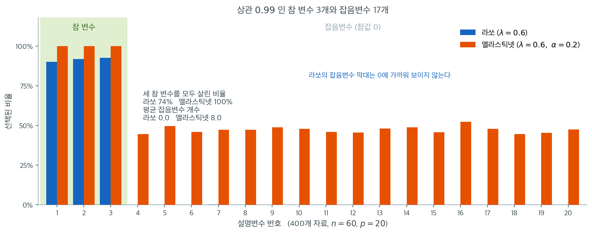

# 방법 선택 지침

능형, 라쏘, 엘라스틱넷 중에서 고르려면 자료의 특성과 분석 목표를 함께 살펴야 한다. 이 절은 선택에 영향을 주는 핵심 요인을 중심으로 결정 틀을 제시한다.

---

## 1. 결정 요인

1. **희소성.** 대부분의 설명변수가 무관하다고(참 계수가 0에 가깝다고) 기대하는가?
2. **상관 구조.** 설명변수가 강하게 상관되어 자연스러운 집단을 이루는가?
3. **차원.** $p$가 $n$에 가깝거나 그보다 큰가?
4. **목표.** 주된 목표가 예측인가, 해석인가, 변수선택인가?
5. **계산 제약.** 모형 적합이 계산적으로 비싼가?

---

## 2. 결정 틀

### 1단계: 기대되는 희소성 평가

**대부분의 변수가 기여할 것으로 기대되면**(조밀한 참 모형) 능형회귀가 최선일 가능성이 높다. 많은 계수가 작지만 0이 아닐 때 모든 변수를 남기고 축소를 최적으로 분배한다.

**소수의 변수만 중요할 것으로 기대되면**(희소한 참 모형) 라쏘나 엘라스틱넷이 낫다.

**희소성이 불확실하면** 중간 정도의 $\alpha$($0.5$ 등)를 쓴 엘라스틱넷이 합리적 절충이다.

### 2단계: 설명변수의 상관 평가

**상관이 약하면**(상관행렬이 대각에 가까우면) 라쏘가 적절하다. 강한 상관이 없으면 라쏘가 안정적으로 변수를 고르고, 상관 집단에서의 한계가 문제되지 않는다.

**상관이 강하면** 능형이나 엘라스틱넷이 낫다.

- 변수선택이 필요 없으면(예측 전용) **능형**
- 상관 처리와 변수선택이 모두 필요하면 **엘라스틱넷**

!!! warning "상관된 변수에 순수 라쏘를 쓰지 말 것"
    설명변수가 강하게 상관되어 있으면 순수 라쏘를 피한다. 집단에서 하나를 고르고 나머지를 제외할 수 있으며, 자료 분할이나 작은 교란에 따라 그 선택이 불규칙하게 바뀐다.



이 경고를 숫자로 확인해 보자. 같은 모집단에서 자료를 400번 새로 뽑아 매번 라쏘와 엘라스틱넷을 적합하고, 각 설명변수가 몇 번이나 선택되었는지 센 결과다. 참 변수는 $x_1, x_2, x_3$ 세 개(참값 모두 $2.0$, 서로 상관 $0.99$)이고 나머지 열일곱 개는 참값이 0인 잡음변수다. $n = 60$, $p = 20$, $\lambda = 0.6$으로 두 방법을 맞췄다.

초록 띠 안을 보면 라쏘의 선택률이 각각 $90\%$, $92\%$, $93\%$다. 변수 하나만 놓고 보면 나쁘지 않아 보인다. 그런데 **세 변수를 모두 살린 자료의 비율은 $74\%$로 떨어진다.** 네 번에 한 번꼴로 참 변수 중 적어도 하나를 놓친다는 뜻이다. 셋이 거의 같은 정보를 담고 있으니 라쏘 입장에서는 어느 하나를 버려도 적합도가 거의 줄지 않고, 그래서 **매번 다른 하나를 버린다.** 논문에 "라쏘가 $x_1$과 $x_3$을 골랐다"고 쓰는 순간, 그 문장은 자료를 다시 뽑으면 바뀔 문장이 된다.

엘라스틱넷은 400번 모두 세 변수를 전부 살렸다(선택률 $100\%$). 대신 값을 치른다. 잡음변수 막대를 보면 열일곱 개가 모두 $44\%$에서 $52\%$ 사이로 서 있다. 자료 하나당 평균 $8.0$개의 잡음변수가 딸려 들어온다는 뜻이다. 라쏘는 잡음변수를 평균 $0.0$개 고른다. 그림에서 잡음변수 구간에 파란 막대가 보이지 않는 이유가 그것이다.

그러므로 이 그림은 "엘라스틱넷이 낫다"가 아니라 **두 가지 오류를 맞바꾼다**는 이야기를 한다. 참 변수를 놓치는 오류(라쏘 $26\%$)를 줄이려면 잡음을 들이는 오류(엘라스틱넷 평균 8개)를 감수해야 한다. 예측이 목적이면 상관된 변수를 함께 남기는 쪽이 대개 유리하고, 어느 변수가 원인인지 **식별**하는 것이 목적이면 두 방법 모두 그 답을 혼자서는 주지 못한다. 상관 집단이 있을 때 선택 결과를 보고하려면 최소한 붓스트랩을 돌려 위 그림 같은 선택빈도를 함께 제시해야 한다.

### 3단계: 차원 확인

**$p < n$이면** 세 방법 모두 가능하며, 선택은 다른 요인에 달려 있다.

**$p \approx n$이거나 $p > n$이면**

- **능형**은 예측에 잘 작동하지만 $p$개 변수를 모두 남긴다.
- **라쏘**는 최대 $n$개만 고를 수 있어 제약이 될 수 있다.
- **엘라스틱넷**은 그런 제한이 없어 고차원에서 일반적으로 선호된다.

### 4단계: 목표의 정의

**예측.** 예측오차 최소화만이 목표라면 세 방법 모두 후보다. 교차검증으로 경험적으로 고른다. 성능 차이가 작은 경우가 많다.

**변수선택.** 어떤 변수가 유의미한지 식별하는 것이 목표라면 라쏘나 엘라스틱넷이 필요하다. 능형은 변수선택을 하지 않는다.

**해석.** 설명변수와 반응변수의 관계 이해가 목표라면, 변수가 상관되어 있을 때 엘라스틱넷의 그룹 효과가 더 해석 가능한 결과를 낸다. 사후 라쏘 OLS로 축소 편향을 제거하면 해석이 더 명확해진다.

---

## 3. 빠른 참고표

| 상황 | 권장 방법 | $\alpha$ | 핵심 이유 |
|---|---|---|---|
| 조밀한 모형, 상관된 변수 | 능형 | 해당 없음 | 계수를 분배하며 변수선택이 불필요 |
| 희소한 모형, 무상관 변수 | 라쏘 | 1.0 | 깔끔한 변수선택 |
| 희소한 모형, 상관된 변수 | 엘라스틱넷 | 0.5 | 그룹 효과 + 희소성 |
| $p > n$, 중간 희소성 | 엘라스틱넷 | 0.5–0.9 | $n$개 제한이 없음 |
| $p > n$, 강한 희소성 | 엘라스틱넷 | 0.9 | 라쏘에 가까운 희소성 + 안정성 |
| 예측만, 구조 무관 | 세 방법 모두 교차검증 | — | 자료가 결정하게 한다 |
| 구조를 모를 때 | 엘라스틱넷 | 0.5 | 안전한 기본값 |

---

## 4. 실무 절차

1. **설명변수를 표준화한다.** 평균 0, 분산 1로 중심화·척도조정하여 벌점이 모든 계수를 동등하게 다루게 한다.
2. **상관 구조를 살핀다.** 상관행렬을 계산하고 상관된 집단을 찾는다. 쌍별 상관 0.7 이상이 흔하면 순수 라쏘를 피한다.
3. **$p/n$ 비를 확인한다.** $p > n$이면 엘라스틱넷이나 능형을 계획한다.
4. **후보 방법을 고른다.** 위 결정 틀에 따라 한둘에서 셋을 고른다.
5. **초모수를 조정한다.** 각 방법에 대해 $K$-겹 교차검증으로 $\lambda$(엘라스틱넷은 $\alpha$도)를 고른다.
6. **방법을 비교한다.** CV 오차가 가장 낮은 방법을 고르거나, 더 간결한 모형을 위해 1-SE 규칙을 쓴다.
7. **검증한다.** 떼어 둔 검정집합에서 최종 모형을 평가한다.

!!! tip "확신이 없으면 엘라스틱넷"
    탐색적 분석이고 자료 구조를 모른다면 $\alpha = 0.5$의 엘라스틱넷이 견고한 기본값이다. 넓은 범위의 상황에서 잘 작동하며, 능형(희소성 없음)과 라쏘(상관에서의 불안정성) 양쪽의 최악 거동을 피한다.

---

## 5. 흔한 함정

**변수를 고른 뒤 능형을 적합하기.** 라쏘로 변수를 고르고 그 부분집합에 능형을 적합하는 것은 합리적 전략이지만, 두 단계를 함께 수행하는 엘라스틱넷과 비교해 보아야 한다.

**절편을 벌점하기.** 절편은 언제나 벌점에서 제외해야 한다. 대부분의 구현이 자동으로 처리하지만 확인이 필요하다.

**표준화를 잊기.** 척도가 다르면 분산이 작은 변수의 계수가 불균형하게 축소된다. 정칙화 전에 반드시 표준화한다.

**조정 과정에 과적합하기.** 광범위한 초모수 탐색은 검증집합에 과적합할 위험을 키운다. 조정에 쓴 자료로 성능을 보고한다면 중첩 교차검증을 써야 한다.

**라쏘 계수를 효과크기로 보고하기.** 라쏘 계수는 0 쪽으로 편향되어 있다. 효과크기 추정에는 사후 라쏘 OLS나 편향제거 라쏘(debiased lasso)의 신뢰구간을 쓴다.

---

## 연습문제

<div class="drillbox" markdown>

**연습문제 1.** <span class="diff med" title="중간"></span>
California Housing 자료를 사용하라.

**(a)** 세 정칙화 모형과 OLS를 모두 적합하고 검정 MSE를 비교하라.

**(b)** 정칙화 경로를 그려라. 라쏘에서 계수가 0이 되는 $\lambda$ 값은 얼마인가?

**(c)** 1-표준오차 규칙으로 모형을 선택하라. 최소 CV 오차 모형과 비교하면 어떤가?

</div>

??? success "풀이"
    ```python
    import numpy as np
    from sklearn.datasets import fetch_california_housing
    from sklearn.preprocessing import StandardScaler
    from sklearn.pipeline import Pipeline
    from sklearn.linear_model import (LinearRegression, RidgeCV,
                                      LassoCV, ElasticNetCV, lasso_path)
    from sklearn.model_selection import train_test_split

    d = fetch_california_housing()
    Xtr, Xte, ytr, yte = train_test_split(d.data, d.target,
                                          test_size=0.3, random_state=0)
    for name, est in [('OLS', LinearRegression()),
                      ('Ridge', RidgeCV(alphas=np.logspace(-3, 3, 100))),
                      ('Lasso', LassoCV(cv=5, random_state=0)),
                      ('ENet', ElasticNetCV(l1_ratio=[.1,.5,.9,1],
                                            cv=5, random_state=0))]:
        pipe = Pipeline([('sc', StandardScaler()), ('m', est)]).fit(Xtr, ytr)
        print(name, ((yte - pipe.predict(Xte))**2).mean())
    ```

    출력:

    ```
    OLS 0.5431489670037236
    Ridge 0.5437505440431417
    Lasso 0.5432914057817635
    ENet 0.5432914057817635
    ```

    !!! warning "이 자료에서는 정칙화의 이득이 거의 없다"
        California Housing은 $n \approx 20{,}600$, $p = 8$로 $p/n \approx 0.0004$이다. [과적합과 편향-분산 절충](../motivation/overfitting.md) 연습문제 2의 표에 따르면 이 영역에서 OLS의 과적합은 무시할 수준이다.

        따라서 네 방법의 검정 MSE가 소수 셋째 자리까지 거의 같게 나올 것이다. **이는 정칙화의 실패가 아니라 정칙화가 필요 없는 문제라는 뜻이다.**

        정칙화의 효과를 보려면 $p$를 인위적으로 늘려야 한다. 다항식 항과 교호작용 항을 추가하면($p$를 44개 이상으로) 차이가 드러나기 시작한다.

    **(b)** `lasso_path`로 경로를 계산하면 표준화된 자료에서 $\lambda_{\max} = \|X^\top y\|_\infty/n$이고, 그보다 큰 $\lambda$에서 모든 계수가 0이다. 변수가 8개뿐이므로 경로가 단순하며, `MedInc`(중위소득)가 가장 먼저 들어온다.

    **(c)** $\lambda_{1\text{SE}}$가 $\lambda_{\min}$보다 큰 $\lambda$를 고르므로 더 적은 변수를 남긴다. 다만 이 자료에서는 변수가 8개뿐이라 차이가 크지 않다. 1-SE 규칙의 효과는 $p$가 클 때 뚜렷하다([$\lambda$ 선택을 위한 교차검증](../tuning/cross_validation.md) 연습문제 1에서 $p = 20$일 때 12개에서 9개로 줄어드는 것을 보았다).

<div class="drillbox" markdown>

**연습문제 2.** <span class="diff med" title="중간"></span>
"흔한 함정" 다섯 가지 중 결과를 가장 심각하게 왜곡하는 것은 무엇인가? 근거를 들어 순위를 매겨라.

</div>

??? success "풀이"
    심각도 순으로 매기면 다음과 같다.

    | 순위 | 함정 | 왜곡의 크기 | 근거 |
    |---:|:---|:---|:---|
    | 1 | 조정 과정에 과적합 (누설) | **결론을 뒤집을 수 있다** | 순수 잡음 자료에서 CV 오차 $1.05$ 대 $2.27$ |
    | 2 | 표준화를 잊음 | 변수 단위에 따라 선택이 결정된다 | 단위를 미터→킬로미터로 바꾸면 그 변수가 반드시 선택된다 |
    | 3 | 라쏘 계수를 효과크기로 보고 | 계수가 정확히 $\lambda$만큼 편향된다 | 편향 $-0.198, +0.211, -0.207$ ($\lambda = 0.2$) |
    | 4 | 절편을 벌점 | 예측이 체계적으로 치우친다 | $y$의 중심이 0이 아니면 심각 |
    | 5 | 변수선택 후 능형 | 대개 무해하나 비교가 필요 | 엘라스틱넷과 성능이 비슷한 경우가 많다 |

    **1위가 압도적으로 위험하다.** [교차검증](../tuning/cross_validation.md) 연습문제 2에서 확인했듯, $y$를 쓰는 전처리를 겹 밖에서 하면 **신호가 전혀 없는 자료에서도 완벽한 성능**이 보고된다. 나머지 함정은 결과를 편향시키지만 이 정도로 뒤집지는 않는다.

    **2위도 조용히 치명적이다.** [좌표하강](../lasso/coordinate_descent.md) 연습문제 2에서 보았듯, 표준화하지 않으면 갱신식의 분모가 변수마다 달라져 척도가 큰 변수가 자동으로 선택된다. 오류 메시지가 나지 않으므로 발견하기 어렵다.

    **3위는 널리 퍼져 있다.** 논문에서 라쏘 계수를 그대로 효과크기로 보고하는 경우를 흔히 본다. 편향의 크기가 정확히 $\lambda$이므로, $\lambda$를 함께 보고하면 최소한 독자가 보정할 수 있다.

<div class="drillbox" markdown>

**연습문제 3.** <span class="diff med" title="중간"></span>
네 자료에 2절의 결정 틀과 3절의 참고표를 적용하라.

**(가)** $n = 2000$, $p = 12$, 모든 쌍별 상관의 절댓값이 $0.1$ 아래다. 열두 개 가운데 셋만 중요하다고 믿으며, 목표는 그 셋을 보고하는 것이다.

**(나)** $n = 80$, $p = 3000$(유전자 발현). 500개쯤이 조금씩 기여하고 발현 블록 안의 상관은 $0.8$쯤이다. 목표는 예측이다.

**(다)** $n = 400$, $p = 9$. 아홉 개가 모두 같은 공정의 센서로 쌍별 상관이 $0.85$–$0.95$이며 전부 조금씩 기여한다. 목표는 예측이다.

**(라)** $n = 150$, $p = 40$. 셋만 중요한데 그 셋이 서로 $\rho = 0.95$로 상관되어 있다.

(라)에서는 1단계와 2단계가 서로 다른 방법을 가리킨다. 어느 쪽을 따라야 하는지 2절 그림의 수를 근거로 답하라. 또 (나)에서는 희소성을 어떻게 가정하든 순수 라쏘가 탈락한다. 그 근거를 3단계에서 찾아라.

</div>

??? success "풀이"
    | 자료 | 1단계(희소성) | 2단계(상관) | 3단계($p/n$) | 4단계(목표) | 표의 행 | 결론 |
    |:---|:---|:---|:---|:---|:---|:---|
    | (가) | 희소 | 약함 | $p \ll n$ | 변수선택 | 2행 | 라쏘, $\alpha = 1.0$ |
    | (나) | 중간 | 강함(블록) | $p \gg n$ | 예측 | 4행 | 엘라스틱넷, $\alpha = 0.5$–$0.9$ |
    | (다) | 조밀 | 강함 | $p \ll n$ | 예측 | 1행 | 능형 |
    | (라) | 강한 희소 | 강함 | $p < n$ | (아래) | 3행 | 엘라스틱넷, $\alpha = 0.5$ |

    **(가)** 네 단계가 모두 같은 쪽을 가리킨다. 희소하고 상관이 약하며 $p \ll n$이고 목표가 변수선택이므로 라쏘다. 상관이 약하다는 것이 결정적이다. 2절 2단계의 경고("상관된 변수에 순수 라쏘를 쓰지 말 것")가 발동하지 않는 유일한 경우가 이것이다.

    **(나)** 3단계가 혼자서 순수 라쏘를 탈락시킨다. 참으로 기여하는 변수가 500개쯤인데 **라쏘는 $p > n$일 때 0이 아닌 계수를 최대 $n = 80$개까지만 고를 수 있다.** 500개를 동시에 복원하는 것이 원리적으로 불가능하므로, "500/3000이니 희소하다"고 보아 $\alpha = 1$을 쓰더라도 그 선택은 자료 구조와 무관하게 틀린다. 블록 상관 $0.8$은 그 위에 2단계의 이유를 하나 더 얹을 뿐이다.

    **(다)** 모든 변수가 기여하므로 희소성이 없고, 변수선택이 필요 없으며, 상관이 강하다. 표 1행이 그대로 적용된다. 센서 아홉 개는 같은 공정의 서로 다른 창(窓)이므로 "어느 센서가 원인인가"라는 질문 자체가 성립하지 않는다. 능형이 계수를 아홉 개에 분배하는 것이 오히려 옳은 답이다.

    **(라)** 1단계는 "강한 희소성 → 라쏘"를, 2단계는 "강한 상관 → 능형이나 엘라스틱넷"을 가리킨다. **2단계를 따라야 한다.** 2절 그림의 수가 근거다. 참 변수 세 개가 강하게 상관된 바로 그 설정에서 라쏘의 개별 선택률은 $90\%$, $92\%$, $93\%$로 멀쩡해 보이지만 **세 변수를 모두 살린 자료는 $74\%$뿐이다.** 1단계가 원한 "희소한 참 모형의 복원"을 네 번에 한 번은 실패하고, 더 나쁜 것은 실패할 때마다 버리는 변수가 달라진다는 점이다. 희소성을 얻으려고 라쏘를 골랐는데 정작 "어느 셋인가"를 못 말하게 되므로, 1단계의 목적 자체가 2단계 때문에 무너진다.

    다만 4단계가 아직 남아 있다. 목표가 순전히 예측이면 능형도 충분하고(표 1행), 세 변수를 **식별**해 보고하는 것이 목표라면 엘라스틱넷 하나로도 끝나지 않는다. 2절 끝의 권고대로 붓스트랩 선택빈도를 함께 실어야 한다.

<div class="drillbox" markdown>

**연습문제 4.** <span class="diff hard" title="어려움"></span>
2절 그림이 준 수만으로 다음을 따져라. 라쏘의 개별 선택률은 $90\%$, $92\%$, $93\%$이고 세 변수를 모두 살린 자료의 비율은 $74\%$다. 엘라스틱넷은 세 변수를 $400$번 모두 살렸고 잡음변수 열일곱 개의 선택률은 $44\%$–$52\%$로 자료당 평균 $8.0$개다.

**(가)** 세 선택사건이 독립이라면 "셋 다" 비율은 얼마인가. 보고된 $74\%$와 비교하라.

**(나)** 독립을 가정하지 않고 세 개별 선택률만으로 "셋 다" 비율의 하한과 상한을 구하라.

**(다)** (나)의 하한과 보고된 $74\%$를 견주면 네 수를 모두 정확한 값으로 읽을 수 없다. 반복수가 $400$임을 이용해 네 수를 모두 반올림으로 설명하는 정수 조합 하나를 제시하라.

**(라)** (나)의 하한이 등호가 되는 조건을 적고, 그것이 본문의 "매번 다른 하나를 버린다"와 같은 말임을 설명하라.

**(마)** 참 변수를 놓치는 것과 잡음변수를 들이는 것의 비용이 같다면 어느 방법이 유리한가. 엘라스틱넷이 유리해지려면 놓침 하나가 잡음 하나보다 몇 배 비싸야 하는가.

</div>

??? success "풀이"
    $A_j$를 "$j$번째 참 변수가 선택되었다"는 사건이라 하자. $P(A_1) = 0.90$, $P(A_2) = 0.92$, $P(A_3) = 0.93$이다.

    **(가)** 독립이면

    $$
    P(A_1 \cap A_2 \cap A_3) = 0.90 \times 0.92 \times 0.93 = 0.7700
    $$

    이다. 보고된 $0.74$보다 **크다.** 독립보다 더 자주 실패한다는 뜻이고, 세 선택이 음의 방향으로 엮여 있다는 신호다.

    **(나)** 여사건을 쓰면 $P(\bigcap A_j) = 1 - P(\bigcup A_j^c)$이고 Boole 부등식 $P(\bigcup A_j^c) \leq \sum_j P(A_j^c)$에서

    $$
    P(A_1 \cap A_2 \cap A_3) \geq 1 - (0.10 + 0.08 + 0.07) = 0.75
    $$

    를 얻는다. 상한은 $P(\bigcap A_j) \leq \min_j P(A_j) = 0.90$이다. 따라서 "셋 다"는 어떤 의존구조에서도 $[0.75,\ 0.90]$ 안에 있어야 한다.

    **(다)** 보고된 $0.74$는 하한 $0.75$보다 작으므로 네 수가 동시에 정확할 수 없다. 모두 백분율로 반올림된 것이다. $400$회라는 반복수를 쓰면 예컨대

    | 양 | 횟수 | 비율 | 반올림 |
    |:---|---:|---:|---:|
    | $A_1$ | $359$ | $0.8975$ | $90\%$ |
    | $A_2$ | $367$ | $0.9175$ | $92\%$ |
    | $A_3$ | $371$ | $0.9275$ | $93\%$ |
    | 셋 다 | $297$ | $0.7425$ | $74\%$ |

    가 네 수를 모두 재현한다. 실제로 놓친 횟수가 $41 + 33 + 29 = 103$이고 $400 - 103 = 297$이므로 **이 조합은 하한을 등호로 만든다.** 본문의 "$26\%$"도 $1 - 0.7425 = 0.2575$의 반올림으로 맞는다.

    **(라)** Boole 부등식이 등호가 되는 것은 $A_1^c, A_2^c, A_3^c$가 **쌍마다 서로 배타적**일 때다. 즉 한 자료에서 놓치는 참 변수가 많아도 하나다. 이것이 본문의 설명과 정확히 같은 말이다. 셋이 거의 같은 정보를 담고 있으니 라쏘는 그중 하나만 버려도 적합도를 지킬 수 있고, 둘을 함께 버릴 이유는 없다. 그래서 놓침이 겹치지 않고, 하한이 거의 등호로 달성된다.

    여기서 쓸모 있는 부산물이 나온다. 놓침이 배타적이면 "적어도 하나를 놓칠 확률"과 "놓치는 개수의 기대값"이 같아진다. 둘 다 $0.2575$다.

    **(마)** 자료 하나당 기대 오류 개수를 세면 다음과 같다.

    | 방법 | 놓친 참 변수 | 들인 잡음변수 | 합 |
    |:---|---:|---:|---:|
    | 라쏘 | $0.2575$ | $0.0$ | $0.2575$ |
    | 엘라스틱넷 | $0.0$ | $8.0$ | $8.0$ |

    비용이 같다면 **라쏘가 약 $31$배 유리하다.** 엘라스틱넷이 이기려면 놓침 하나가 잡음 하나보다

    $$
    \frac{8.0}{0.2575} = 31.1
    $$

    배 이상 비싸야 한다. 본문이 "두 가지 오류를 맞바꾼다"고만 말한 것을 수로 적으면 교환비가 $31$이다.

    그리고 $31$배라는 조건은 생각보다 자주 성립한다. 참 변수를 놓치면 "이 유전자는 무관하다"는 **틀린 결론**이 논문에 실리고, 잡음변수 하나는 예측에 거의 해가 없다. 반대로 후속 실험 비용이 변수당 수천만 원이면 교환비가 뒤집힌다. 결정은 통계가 아니라 비용표가 한다.

    마지막으로 본문의 두 문장이 서로 맞는지도 확인된다. 잡음변수 평균이 $8.0$개이고 열일곱 개이므로 평균 선택률은 $8.0/17 = 0.4706$인데, 이는 본문이 말한 구간 $[0.44,\ 0.52]$ 안에 있다.

<div class="drillbox" markdown>

**연습문제 5.** <span class="diff hard" title="어려움"></span>
4절 1단계와 5절 셋째 함정("표준화를 잊기")을 직교설계에서 끝까지 계산하자. 표준화된 두 열 $\tilde{\mathbf{x}}_1, \tilde{\mathbf{x}}_2$가 서로 직교하고 $\tilde{\mathbf{x}}_j^\top\tilde{\mathbf{x}}_j = n$이며 $\mathbf{y}$는 중심화되어 있다. $c_j = \tilde{\mathbf{x}}_j^\top\mathbf{y}/n$이라 두고 $c_1 = 0.30$, $c_2 = 0.28$을 쓴다. 실제로 쓰는 계획행렬의 열은 단위 선택에 따라 $\mathbf{x}_j = s_j\tilde{\mathbf{x}}_j$ $(s_j > 0)$이다. 라쏘는 이 책의 규약 $\frac{1}{2n}\lVert\mathbf{y} - \mathbf{X}\mathbf{b}\rVert^2 + \lambda\lVert\mathbf{b}\rVert_1$을 쓰고 $\lambda = 0.25$다.

**(가)** $\hat{b}_j$를 $s_j$, $c_j$, $\lambda$의 닫힌 꼴로 구하고 선택 조건을 적어라.

**(나)** $s_1 = s_2 = 1$일 때 두 계수와, 표준화 눈금으로 환산한 기여 $s_j\hat{b}_j$를 구하라.

**(다)** $\mathbf{x}_2$만 $1000$배 큰 단위로 다시 적으면($s_2 = 10^{-3}$) 무슨 일이 일어나는가.

**(라)** 반대로 $s_2 = 10^3$이면 $s_2\hat{b}_2$는 얼마인가. 표준화 눈금에서 깎이는 양을 $\lambda$와 $s_j$로 적어라.

**(마)** (라)의 식으로 $\lambda \to 0$과 $\lambda \to \infty$의 극단을 설명하라. 척도 의존성은 벌점의 성질인가 적합항의 성질인가.

**(바)** 단위를 어느 방향으로 바꾸면 변수가 선택되는가. 연습문제 2의 표에서 2위 함정의 근거 칸을 읽을 때 조심할 점을 한 줄로 적어라.

</div>

??? success "풀이"
    **(가)** 열이 직교하므로 교차항이 사라지고 목적함수가 좌표별로 분리된다.

    $$
    \frac{1}{2n}\lVert\mathbf{y} - \mathbf{X}\mathbf{b}\rVert^2 + \lambda\lVert\mathbf{b}\rVert_1 = \text{상수} + \sum_{j=1}^2\left[\frac{s_j^2 b_j^2}{2} - s_j c_j b_j + \lambda\lvert b_j\rvert\right]
    $$

    각 항의 부분미분을 0으로 두면 $s_j^2 b_j - s_j c_j + \lambda\,\text{sign}(b_j) = 0$이고, 따라서

    $$
    \hat{b}_j = \frac{S_\lambda(s_j c_j)}{s_j^2} = \frac{\text{sign}(s_j c_j)\max(\lvert s_j c_j\rvert - \lambda,\ 0)}{s_j^2}
    $$

    이다. 선택 조건은 $\lvert s_j c_j\rvert > \lambda$다. **자료가 말하는 양 $c_j$와 단위가 말하는 양 $s_j$가 곱으로만 들어온다.**

    **(나)** $s_j = 1$이면 $\hat{b}_1 = 0.30 - 0.25 = 0.05$, $\hat{b}_2 = 0.28 - 0.25 = 0.03$이고 환산 기여도 같은 값이다. 둘 다 선택된다. OLS 값 $0.30$, $0.28$과 견주면 각각 $17\%$, $11\%$만 남았다.

    **(다)** $s_2 = 10^{-3}$이면 $s_2 c_2 = 2.8\times10^{-4}$로 문턱 $0.25$에 한참 못 미친다. 따라서 $\hat{b}_2 = 0$이다. **자료의 숫자는 하나도 바뀌지 않았는데 변수 하나가 사라졌다.** 두 번째 변수를 미터에서 킬로미터로 바꿔 적은 것만으로 모형에서 빠진 것이다.

    **(라)** $s_2 = 10^3$이면 $s_2 c_2 = 280 \gg 0.25$이므로

    $$
    \hat{b}_2 = \frac{280 - 0.25}{10^6} = 2.7975\times10^{-4}, \qquad s_2\hat{b}_2 = 0.27975
    $$

    이다. OLS 값 $0.28$의 $99.9\%$가 남았다. 일반적으로 선택된 변수에 대해

    $$
    s_j\hat{b}_j = \frac{S_\lambda(s_j c_j)}{s_j} = c_j - \frac{\lambda}{s_j}
    $$

    이므로 **표준화 눈금에서 깎이는 양이 정확히 $\lambda/s_j$다.** 척도를 $1000$배 키우면 벌점이 $1/1000$로 줄고, $1/1000$로 줄이면 깎는 양이 $1000\lambda = 250$이 되어 어떤 신호도 살아남지 못한다. $\lambda$는 하나인데 변수마다 다른 벌점이 걸리는 셈이다.

    **(마)** $\lambda/s_j \to 0$이면 $s_j\hat{b}_j \to c_j$로 단위와 무관해진다. $\lambda = 0$의 OLS는 척도에 등변(equivariant)이어서 단위를 바꾸면 계수가 정확히 그 비율로 바뀌고 적합값은 조금도 변하지 않는다. $\lambda \to \infty$면 모든 계수가 0이 되어 이번에도 단위와 무관하다. **척도가 결론을 바꾸는 것은 그 사이뿐이고, 범인은 벌점 하나다.** 적합항 $\frac{1}{2n}\lVert\mathbf{y}-\mathbf{X}\mathbf{b}\rVert^2$은 $b_j \mapsto b_j/s_j$로 다시 쓰면 그대로이므로 단위에 불변이고, 이 불변성을 깨는 것은 $\lVert\mathbf{b}\rVert_1$(또는 $\lVert\boldsymbol\beta\rVert_2^2$)뿐이다.

    **(바)** 선택 조건 $\lvert s_j c_j\rvert > \lambda$가 $s_j$에 대해 증가하므로 **수치가 커지는 방향**, 곧 표준편차가 커지는 방향으로 단위를 바꿀 때 변수가 선택된다. 킬로미터를 미터로 바꾸는 쪽이다. 5절 셋째 함정의 "분산이 작은 변수의 계수가 불균형하게 축소된다"가 같은 말이다.

    조심할 점은 방향이다. 연습문제 2의 표는 2위 함정의 근거로 단위 변환을 들지만, **미터를 킬로미터로 바꾸면 그 변수는 선택되는 것이 아니라 탈락한다.** 살아남는 쪽은 언제나 수치가 큰 쪽이다. 그리고 `Ridge`와 `Lasso`는 표준화를 해 주지 않으므로, 4절 1단계는 선택이 아니라 의무다.

<div class="drillbox" markdown>

**연습문제 6.** <span class="diff hard" title="어려움"></span>
5절 둘째 함정("절편을 벌점하기")의 비용을 정확히 계산하자. 설명변수를 중심화했으므로 $\mathbf{X}^\top\mathbf{1} = \mathbf{0}$이다. 절편까지 벌점하는 능형

$$
\min_{\beta_0,\ \boldsymbol{\beta}}\ \lVert\mathbf{y} - \beta_0\mathbf{1} - \mathbf{X}\boldsymbol{\beta}\rVert^2 + \lambda\bigl(\beta_0^2 + \lVert\boldsymbol{\beta}\rVert_2^2\bigr)
$$

을 생각한다.

**(가)** $\hat{\beta}_0$을 닫힌 꼴로 구하고, $\hat{\boldsymbol{\beta}}$가 절편을 벌점하지 않는 능형의 해와 같음을 보여라.

**(나)** 예측의 치우침 $\hat{\beta}_0 - \bar{y}$를 적어라. 언제 0이 되는가.

**(다)** 연습문제 1의 분할($n = 14448$, $\bar{y} = 2.0682$)에서 $\lambda = 10,\ 1000,\ 14448$의 $\hat{\beta}_0$과 치우침, 그리고 그 치우침이 검정 MSE에 더하는 양을 구하라.

**(라)** $\lambda \to \infty$의 극단에서 검정 MSE는 어디로 가는가. 검정집합에서 $\overline{y^2} = 5.6152$다.

**(마)** 연습문제 2의 표가 이 함정을 4위에 둔 것이 타당한지 (다)의 수로 판정하라.

</div>

??? success "풀이"
    **(가)** $\beta_0$에 대한 미분을 0으로 두면

    $$
    -2\,\mathbf{1}^\top(\mathbf{y} - \beta_0\mathbf{1} - \mathbf{X}\boldsymbol{\beta}) + 2\lambda\beta_0 = 0
    $$

    이다. 괄호를 풀면 $\mathbf{1}^\top\mathbf{y} - n\beta_0 - \mathbf{1}^\top\mathbf{X}\boldsymbol{\beta} = \lambda\beta_0$이고, 중심화 덕분에 $\mathbf{1}^\top\mathbf{X} = \mathbf{0}^\top$이어서 $\boldsymbol{\beta}$가 들어 있는 항이 사라진다. 따라서

    $$
    (n + \lambda)\beta_0 = \mathbf{1}^\top\mathbf{y} = n\bar{y}, \qquad \hat{\beta}_0 = \frac{n\bar{y}}{n + \lambda}
    $$

    를 얻는다. $\boldsymbol{\beta}$에 대한 미분은 $(\mathbf{X}^\top\mathbf{X} + \lambda\mathbf{I})\boldsymbol{\beta} = \mathbf{X}^\top\mathbf{y} - \beta_0\mathbf{X}^\top\mathbf{1} = \mathbf{X}^\top\mathbf{y}$가 되어 $\beta_0$이 사라진다. 따라서 **중심화된 설명변수에서는 두 문제가 완전히 분리되고, 기울기 계수는 전혀 영향을 받지 않는다.** 피해는 절편 하나에 모여 있다.

    **(나)** 치우침은

    $$
    \hat{\beta}_0 - \bar{y} = \frac{n\bar{y}}{n+\lambda} - \bar{y} = -\frac{\lambda\bar{y}}{n+\lambda}
    $$

    이고 $\bar{y} = 0$ 또는 $\lambda = 0$일 때만 0이다. 1절 각주가 "반응변수를 중심화한다"고 못 박은 이유가 이것이다. $\mathbf{y}$를 중심화해 두면 이 함정이 원천에서 사라진다. 모든 예측이 같은 양만큼 아래로 밀리므로, 기울기는 멀쩡한데 예측만 체계적으로 치우친다.

    **(다)** $n = 14448$, $\bar{y} = 2.0682$를 넣는다.

    | $\lambda$ | $\lambda/n$ | $\hat{\beta}_0$ | 치우침 | 치우침$^2$ |
    |---:|---:|---:|---:|---:|
    | $10$ | $0.0007$ | $2.0668$ | $-0.0014$ | $0.0000$ |
    | $1000$ | $0.069$ | $1.9344$ | $-0.1339$ | $0.0179$ |
    | $14448$ | $1$ | $1.0341$ | $-1.0341$ | $1.0694$ |

    기울기가 그대로이므로 검정 MSE는 대략 치우침의 제곱만큼 늘어난다. 실제로 이 분할에서 같은 $\lambda$의 두 적합을 비교하면 차이가 $\lambda = 1000$에서 $0.0162$, $\lambda = n$에서 $1.0655$로 이론값에 거의 맞는다(차이는 검정 잔차의 평균이 정확히 0이 아니어서 생기는 교차항이다).

    눈여겨볼 것은 $\lambda = n$ 행이다. **$\lambda = n$이면 절편이 정확히 반토막 난다.** 치우침의 크기를 지배하는 것은 $\lambda$가 아니라 $\lambda/n$이다. 연습문제 1에서 $\lambda$는 $\log$ 격자 $[10^{-3}, 10^3]$에서 골랐고 $n = 14448$이므로 $\lambda/n \leq 0.069$다. 그 범위에서 이 함정의 비용은 $0.0179$ 이하, 곧 검정 MSE $0.5432$의 $3\%$ 이하다.

    **(라)** $\lambda \to \infty$면 $\hat{\beta}_0 \to 0$이고 $\hat{\boldsymbol{\beta}} \to \mathbf{0}$이므로 예측이 $0$으로 간다. 검정 MSE는 $\overline{y^2} = 5.6152$로 수렴한다. 연습문제 1의 $0.5432$의 $10.3$배다. 절편을 벌점하면 $\lambda$를 키우는 것이 "평균으로 축소"가 아니라 **"0으로 축소"**가 되므로, 벌점이 극단으로 갈 때 모형이 기준선보다도 나빠진다. 절편을 빼 두면 최악의 경우가 "언제나 $\bar{y}$를 답한다"로 막힌다.

    **(마)** 타당하다. 치우침이 $\lambda/(n+\lambda)$에 비례하므로 $\lambda \ll n$인 보통의 상황에서는 (다)의 첫 행처럼 사실상 무해하고, 1위 함정처럼 결론을 뒤집지 않는다. 그러나 조건이 어긋나면 즉시 커진다. $n = 20$, $\bar{y} = 50$, $\lambda = 100$이면 치우침이 $-100 \times 50/120 = -41.7$이다. 4위라는 자리는 "대개 무해하다"가 아니라 **"$\lambda/n$과 $\bar{y}$가 작을 때만 무해하다"**로 읽어야 한다. 표준 구현이 절편을 벌점에서 빼 주므로 사고가 나는 자리는 하나다. `fit_intercept=False`로 두고 1로 채운 열을 직접 붙이는 경우다.

<div class="drillbox" markdown>

**연습문제 7.** <span class="diff hard" title="어려움"></span>
5절은 "조정 과정에 과적합하기"를 1위 함정으로 두었고 연습문제 2는 그 근거로 $1.05$ 대 $2.27$을 들었다. 그 수는 **변수선택**을 겹 밖에서 한 결과다. 누설에는 결이 여럿이니 그것을 가려 보자. $n = 60$, $p = 500$이고 $\mathbf{y}$가 $\mathbf{X}$와 무관한 순수 잡음 자료에서 열마다 척도를 다르게 주고 능형을 적합하며, 다음 세 절차의 10-겹 교차검증 오차를 비교하라.

1. 표준화와 $\lambda$ 선택을 모두 겹 안에서(중첩 교차검증)
2. 표준화만 전체 자료로 미리 하고 $\lambda$ 선택은 겹 안에서
3. $\lambda$ 격자의 교차검증 곡선 최솟값을 그대로 성능으로 보고

세 수를 $\operatorname{Var}(y)$와 견주고, 연습문제 2의 $1.05$ 대 $2.27$과 함께 누설의 크기를 순서대로 매겨라.

</div>

??? success "풀이"
    ```python
    import numpy as np
    from sklearn.model_selection import KFold

    rng = np.random.default_rng(1)
    n, p = 60, 500
    scale = 10.0 ** rng.uniform(-1, 1, p)         # 열마다 척도가 다르다
    X = rng.normal(size=(n, p)) * scale
    y = rng.normal(size=n)                        # y 는 X 와 아무 관계가 없다
    grid = 10.0 ** np.arange(-1, 4.5, 0.5)        # 능형 lambda 격자 11 개
    outer = KFold(10, shuffle=True, random_state=0)


    def err(tr, te, lam, leak):
        """tr 로 적합해 te 에서 잰 평균제곱오차. leak=True 면 표준화에 전체 자료를 쓴다."""
        m, s = (X.mean(0), X.std(0)) if leak else (X[tr].mean(0), X[tr].std(0))
        Ztr, Zte = (X[tr] - m) / s, (X[te] - m) / s
        c = y[tr].mean()
        b = np.linalg.solve(Ztr.T @ Ztr + lam * np.eye(p), Ztr.T @ (y[tr] - c))
        return ((y[te] - c - Zte @ b) ** 2).mean()


    def nested(leak):
        """lambda 를 겹 안에서 고르는 중첩 교차검증."""
        out = []
        for tr, te in outer.split(X):
            inner = list(KFold(5, shuffle=True, random_state=0).split(tr))
            best = min(grid, key=lambda lam: np.mean(
                [err(tr[a], tr[b], lam, leak) for a, b in inner]))
            out.append(err(tr, te, best, leak))
        return np.mean(out)


    curve = [np.mean([err(tr, te, lam, False) for tr, te in outer.split(X)])
             for lam in grid]
    print(f"y 의 분산 (아무것도 하지 않는 기준) : {y.var():.4f}")
    print(f"(1) 표준화와 조정 모두 겹 안        : {nested(False):.4f}")
    print(f"(2) 표준화만 겹 밖 (y 를 쓰지 않음) : {nested(True):.4f}")
    print(f"(3) CV 곡선의 최솟값을 성능으로 보고: {min(curve):.4f}"
          f"  (lambda = {grid[int(np.argmin(curve))]:.0f})")
    ```

    출력:

    ```text
    y 의 분산 (아무것도 하지 않는 기준) : 1.0194
    (1) 표준화와 조정 모두 겹 안        : 1.1386
    (2) 표준화만 겹 밖 (y 를 쓰지 않음) : 1.1335
    (3) CV 곡선의 최솟값을 성능으로 보고: 1.0336  (lambda = 1000)
    ```

    | 절차 | CV 오차 | 정직한 값과의 차 | 겹 밖에서 $\mathbf{y}$를 보는가 |
    |:---|---:|---:|:---|
    | (1) 모두 겹 안 | $1.1386$ | 기준 | 아니다 |
    | (2) 표준화만 겹 밖 | $1.1335$ | $-0.0051$ | 아니다 |
    | (3) 곡선 최솟값 보고 | $1.0336$ | $-0.1050$ | 그렇다($\lambda$ 하나) |
    | 연습문제 2의 변수선택 누설 | $1.053$ | $-1.22$ | 그렇다(500개 중 10개) |

    **누설의 크기가 $0.005 : 0.105 : 1.22$로 한 단계마다 열 배 이상 벌어진다.** 가르는 기준은 하나다. 그 단계가 겹 밖에서 $\mathbf{y}$를 보는가.

    - **표준화는 $\mathbf{y}$를 보지 않는다.** 열의 평균과 표준편차만 쓰므로 검정 겹에서 새는 것은 $\mathbf{X}$의 2차 적률뿐이다. $n = 60$, $p = 500$이라는 극단적 상황에서도 $0.5\%$다.
    - **$\lambda$ 선택은 $\mathbf{y}$를 보지만 고르는 것이 모수 하나다.** 열한 개 격자점 가운데 가장 운이 좋은 하나를 집으므로 $9\%$ 낙관적이 된다.
    - **변수선택은 $\mathbf{y}$를 보면서 $500$개 중 $10$개를 고른다.** 자유도가 비교가 되지 않고, 그래서 결론이 뒤집힌다.

    기준선과의 관계도 보라. $\operatorname{Var}(y) = 1.0194$이고 정직한 절차는 $1.1386$으로 **기준선보다 나쁘다.** 예측할 것이 없는 자료에 모수를 썼으니 그래야 맞다. (3)은 $1.0336$으로 그 선을 거의 지워 버린다. "아무것도 안 하는 것보다 나쁘다"는 정직한 신호가 조정 한 번으로 사라지는 것이다.

    실무적 함의는 두 갈래다. 4절 1단계의 표준화를 `Pipeline` 안에 넣는 것은 지켜야 할 원칙이지만, **이미 겹 밖에서 표준화한 결과를 전부 버릴 필요는 없다.** 버려야 하는 것은 $\mathbf{y}$를 본 단계가 겹 밖에 있는 결과다. [주성분회귀](../pcr_pls/principal_components_regression.md)가 "PCA는 $\mathbf{y}$를 쓰지 않으므로 누설이 변수선택만큼 치명적이지는 않다"고 한 것과 같은 이야기다.

<div class="drillbox" markdown>

**연습문제 8.** <span class="diff hard" title="어려움"></span>
3절 1행("조밀한 모형, 상관된 변수 → 능형")이 기대고 있는 사실, 곧 **능형이 OLS를 이기는 $\lambda$가 반드시 있다**를 직교설계에서 끝까지 계산하자. $\mathbf{X}^\top\mathbf{X} = \mathbf{I}_p$면 $\hat{\boldsymbol{\beta}}_{\text{ridge}} = \hat{\boldsymbol{\beta}}_{\text{OLS}}/(1+\lambda)$이고 $\hat{\boldsymbol{\beta}}_{\text{OLS}} \sim N(\boldsymbol{\beta},\ \sigma^2\mathbf{I}_p)$다.

**(가)** $\text{MSE}(\lambda) = \mathbb{E}\lVert\hat{\boldsymbol{\beta}}_{\text{ridge}} - \boldsymbol{\beta}\rVert^2$을 $B = \lVert\boldsymbol{\beta}\rVert^2$, $p$, $\sigma^2$으로 적어라.

**(나)** 도함수를 구하고 $\lambda = 0$에서의 부호로 주장을 증명하라. 최적 $\lambda^\ast$와 $\text{MSE}(\lambda^\ast)/\text{MSE}(0)$을 구하라.

**(다)** 2절 그림의 설정($p = 20$, 참 계수 셋이 모두 $2.0$, 나머지 열일곱은 $0$, $\sigma^2 = 1$)에서 $\lambda^\ast$와 이득을 수로 구하고, 그림이 쓴 $\lambda = 0.6$에서의 값도 구하라. 잡음변수 열일곱 개를 아예 빼면($p = 3$) 이득이 어떻게 달라지는가.

**(라)** $20000$회 모의로 (가)의 식을 확인하라.

**(마)** 이 계산이 보장하는 것과 보장하지 않는 것을 각각 한 줄로 적어라.

</div>

??? success "풀이"
    **(가)** 성분 $j$의 편향은 $\mathbb{E}[\hat{\beta}_j/(1+\lambda)] - \beta_j = -\lambda\beta_j/(1+\lambda)$이고 분산은 $\sigma^2/(1+\lambda)^2$이다. 더하면

    $$
    \text{MSE}(\lambda) = \frac{\lambda^2 B + p\sigma^2}{(1+\lambda)^2}
    $$

    이다. 첫 항이 산 편향이고 둘째 항이 판 분산이다.

    **(나)** 미분하면

    $$
    \frac{d}{d\lambda}\text{MSE}(\lambda) = \frac{2\lambda B(1+\lambda)^2 - 2(1+\lambda)(\lambda^2 B + p\sigma^2)}{(1+\lambda)^4} = \frac{2(\lambda B - p\sigma^2)}{(1+\lambda)^3}
    $$

    이고 $\lambda = 0$에서 값이 $-2p\sigma^2 < 0$이다. $\sigma^2 > 0$이고 $p \geq 1$이면 **$\boldsymbol{\beta}$가 무엇이든 $\lambda$를 0에서 조금 키우는 것이 MSE를 줄인다.** 왜 그런지는 (가)의 식에 적혀 있다. 분산은 $\lambda$의 1차로 줄고($(1+\lambda)^{-2} \approx 1 - 2\lambda$) 편향제곱은 2차로 늘기 때문이다($\lambda^2 B$). "편향을 사서 분산을 판다"는 거래가 첫걸음에서 반드시 남는 장사인 까닭이 이 차수 차이다.

    도함수가 $\lambda = \lambda^\ast = p\sigma^2/B$에서 부호를 바꾸므로 그것이 유일한 최소점이고

    $$
    \text{MSE}(\lambda^\ast) = \frac{p\sigma^2 B}{B + p\sigma^2}, \qquad \frac{\text{MSE}(\lambda^\ast)}{\text{MSE}(0)} = \frac{B}{B + p\sigma^2}
    $$

    이다($\text{MSE}(0) = p\sigma^2$). 이득의 비가 신호 $B$와 잡음 $p\sigma^2$의 비로만 결정된다.

    **(다)** $B = 3 \times 2^2 = 12$, $\sigma^2 = 1$이다.

    | 설정 | $\lambda^\ast$ | $\text{MSE}(0)$ | $\text{MSE}(\lambda^\ast)$ | 감소 |
    |:---|---:|---:|---:|---:|
    | $p = 20$(잡음변수 포함) | $1.6667$ | $20$ | $7.5$ | $62.5\%$ |
    | $p = 3$(참 변수만) | $0.25$ | $3$ | $2.4$ | $20\%$ |

    그림이 쓴 $\lambda = 0.6$에서는 $p = 20$일 때 $\text{MSE} = (0.36 \times 12 + 20)/2.56 = 9.5$로 여전히 OLS의 절반 아래다.

    두 행의 차이가 이 장의 요지를 그대로 보여준다. **참 계수가 똑같은데도 쓸모없는 변수 열일곱 개를 더 넣으면 능형의 이득이 $20\%$에서 $62.5\%$로 커진다.** 벌점이 하는 일이 "추정할 필요가 없던 모수 열일곱 개"의 분산을 깎는 것이기 때문이다. $\lambda^\ast = p\sigma^2/B$가 $p$에 비례하는 것이 같은 말이다.

    **(라)** $\mathbf{X}^\top\mathbf{X} = \mathbf{I}$인 계획행렬을 QR로 만들고 $\hat{\boldsymbol{\beta}}_{\text{OLS}} = \mathbf{X}^\top\mathbf{y} = \boldsymbol{\beta} + \mathbf{X}^\top\boldsymbol{\varepsilon}$을 $20000$번 뽑는다.

    ```python
    import numpy as np

    rng = np.random.default_rng(0)
    n, p, sig, reps = 100, 20, 1.0, 20000
    Q, _ = np.linalg.qr(rng.normal(size=(n, p)))        # X'X = I
    beta = np.zeros(p); beta[:3] = 2.0
    B = float(beta @ beta)                              # ||beta||^2
    bols = beta + rng.normal(0, sig, size=(reps, n)) @ Q   # OLS 추정값 20000 개

    print(f"||beta||^2 = {B:.1f},  lam* = p sig^2/||beta||^2 = {p*sig**2/B:.4f}")
    print("   lam      이론     모의")
    for lam in (0.0, 0.25, 0.6, p * sig**2 / B, 3.0, 10.0):
        emp = (((bols / (1 + lam)) - beta) ** 2).sum(1).mean()
        th = (lam**2 * B + p * sig**2) / (1 + lam)**2
        print(f"{lam:6.4f}  {th:8.4f}  {emp:8.4f}")
    ```

    출력:

    ```text
    ||beta||^2 = 12.0,  lam* = p sig^2/||beta||^2 = 1.6667
       lam      이론     모의
    0.0000   20.0000   19.9699
    0.2500   13.2800   13.2609
    0.6000    9.5000    9.4885
    1.6667    7.5000    7.4960
    3.0000    8.0000    7.9983
    10.0000   10.0826   10.0825
    ```

    여섯 $\lambda$ 값 모두에서 이론과 모의가 $0.03$ 안에서 맞는다($\lambda$가 클수록 분산이 줄어 더 잘 맞는다). $\lambda = 1.6667$이 실제로 최소이고, $\lambda = 3$과 $\lambda = 10$에서 값이 다시 올라가는 것도 보인다. $\lambda$를 너무 키우면 편향이 이긴다.

    $\lambda \to \infty$의 극단도 식에서 읽을 수 있다. $\text{MSE}(\lambda) \to B = 12$로, 모든 계수를 0으로 두는 추정량의 MSE다. 이 설정에서는 그 값마저 OLS의 $20$보다 작다. **$p\sigma^2$이 $B$보다 크면 아무것도 추정하지 않는 쪽이 OLS보다 낫다**는 뜻이고, $\lambda^\ast$는 그 두 극단 사이에서 가장 좋은 지점을 집는 것이다.

    **(마)** 보장하는 것은 **존재**뿐이다. $\boldsymbol{\beta} \neq \mathbf{0}$인 어떤 참값에서도 OLS보다 나은 $\lambda$가 있다.

    보장하지 않는 것은 둘이다. 첫째, $\lambda^\ast = p\sigma^2/B$는 모르는 양 $\sigma^2$과 $B$로 되어 있어 자료에서 골라야 한다(4절 5단계). 둘째, 이것은 계수 추정의 MSE일 뿐이고 변수선택에 대해서는 아무 말도 하지 않는다. $\lambda = 1.6667$에서도 능형은 $20$개를 모두 남기므로, "참 변수가 셋"이라는 결론은 여기서 나오지 않는다. 3절 1행이 "변수선택이 불필요"라는 조건을 달고 있는 까닭이다.

<div class="drillbox" markdown>

**연습문제 9.** <span class="diff hard" title="어려움"></span>
4절 2단계는 "쌍별 상관 $0.7$ 이상이 흔하면 순수 라쏘를 피한다"는 경험칙을 준다. 이 문턱이 상관 하나만의 함수인지 확인하라. 2절 그림의 설정($n = 60$, $p = 20$, 참 변수 세 개가 서로 등상관 $\rho$, 잡음변수 열일곱 개, $\lambda = 0.6$)에서 참 계수 크기 $b \in \{0.5, 1, 2, 4\}$와 $\rho \in \{0, 0.5, 0.7, 0.9, 0.99\}$의 격자마다 라쏘가 세 변수를 모두 살린 자료의 비율을 $400$회로 재어 표로 적어라. $b = 0.5$ 행이 $\rho$에 대해 단조가 아닌 까닭도 설명하라.

</div>

??? success "풀이"
    ```python
    import numpy as np
    from sklearn.linear_model import Lasso

    n, p, lam, reps = 60, 20, 0.6, 400
    print("  b \\ rho    0.0    0.5    0.7    0.9   0.99")
    for b in (0.5, 1.0, 2.0, 4.0):
        row = []
        for rho in (0.0, 0.5, 0.7, 0.9, 0.99):
            rng = np.random.default_rng(0)
            S = np.full((3, 3), rho); np.fill_diagonal(S, 1.0)
            L = np.linalg.cholesky(S)
            beta = np.zeros(p); beta[:3] = b
            ok = 0
            for _ in range(reps):
                X = rng.normal(size=(n, p))
                X[:, :3] = X[:, :3] @ L.T            # 앞 세 열만 상관시킨다
                X -= X.mean(0); X /= X.std(0)
                y = X @ beta + rng.normal(size=n); y -= y.mean()
                c = Lasso(alpha=lam, fit_intercept=False, max_iter=100000,
                          tol=1e-10).fit(X, y).coef_
                ok += int((np.abs(c[:3]) > 1e-8).all())
            row.append(ok / reps)
        print(f"{b:5.1f}  " + "  ".join(f"{v:.3f}" for v in row))
    ```

    출력:

    ```text
      b \ rho    0.0    0.5    0.7    0.9   0.99
      0.5  0.040  0.665  0.667  0.430  0.080
      1.0  0.960  1.000  0.998  0.950  0.380
      2.0  1.000  1.000  1.000  1.000  0.823
      4.0  1.000  1.000  1.000  1.000  0.998
    ```

    **$0.7$이라는 문턱은 표의 어디에도 나타나지 않는다.** $b \geq 1$이면 $\rho = 0.7$에서 선택률이 $0.998$ 이상이고 $\rho = 0.9$에서도 $0.95$ 이상이다. 무너지는 자리는 한 칸 더 가서 $\rho = 0.99$다($0.380$, $0.823$). 본문 그림이 $\rho = 0.99$를 쓴 것은 그래야 현상이 보이기 때문이다. $b = 2$ 행의 $\rho = 0.99$ 칸이 $0.823$으로 본문의 $74\%$와 같은 자리에 있다.

    따라서 경험칙 $0.7$은 **안전쪽으로 많이 치우친 값**이다. 무너짐을 결정하는 것은 $\rho$ 하나가 아니라 두 양의 비다. 하나는 세 변수가 서로 구별되는 정도($1 - \rho$), 다른 하나는 신호의 세기 대 $\lambda$가 깎는 양이다. 표의 오른쪽 아래($b = 4$, $\rho = 0.99$)가 $0.998$인 것이 그 증거다. 상관이 같아도 신호가 세면 셋이 함께 살아남는다.

    **$b = 0.5$ 행의 비단조성**은 두 힘이 반대로 작동하기 때문이다. 등상관 집단에서 집단 변수 하나와 $\mathbf{y}$의 주변 공분산은

    $$
    \frac{\mathbf{x}_j^\top\mathbf{y}}{n} \approx \sum_k \rho_{jk}\beta_k = b(1 + 2\rho)
    $$

    다(잡음변수는 $\beta_k = 0$이라 기여하지 않는다). 이 값을 $\lambda = 0.6$과 견주면 표가 설명된다.

    | $\rho$ | $b(1+2\rho)$ | $\lambda = 0.6$과 비교 | 선택률 |
    |---:|---:|:---|---:|
    | $0.0$ | $0.50$ | 문턱 아래 | $0.040$ |
    | $0.5$ | $1.00$ | 문턱 위 | $0.665$ |
    | $0.7$ | $1.20$ | 문턱 위 | $0.667$ |
    | $0.9$ | $1.40$ | 문턱 위 | $0.430$ |
    | $0.99$ | $1.49$ | 문턱 위 | $0.080$ |

    $\rho = 0$에서는 신호가 약해 아무것도 **들어오지** 못한다($0.5 < 0.6$). $\rho$를 키우면 주변 공분산이 커져 들어오기가 쉬워진다. 그러나 $\rho$가 1에 가까워지면 세 열이 거의 같은 벡터여서 하나가 들어온 뒤 나머지의 잔차 상관이 사라지고, **함께 살아남기**가 불가능해진다. 상관은 들어오기를 돕고 함께 남기를 방해하며, 두 힘의 균형이 $\rho \approx 0.5$–$0.7$에서 뒤바뀐다.

    실무적 함의는 분명하다. 상관행렬만 보고 방법을 정하지 말라는 것이다. $0.7$은 출발점일 뿐이고, 판정은 자기 자료의 신호 세기에서 직접 해야 한다. 2절 끝의 권고(붓스트랩 선택빈도를 재어 함께 보고하라)가 그 일을 한다.

<div class="drillbox" markdown>

**연습문제 10.** <span class="diff hard" title="어려움"></span>
3절의 참고표에는 PCR·PLS 행이 없다. 왜 넣기 어려운지를 $p = 2$에서 끝까지 계산해 보자. 표준화된 두 설명변수의 상관이 $\rho = 0.99$(2절 그림과 같은 값)이고 $\mathbf{y} = \mathbf{X}\boldsymbol{\beta} + \boldsymbol{\varepsilon}$, $\sigma^2 = 1$, $n = 60$이다.

**(가)** 상관행렬의 고유분해를 구하고, 표본에서 $\mathbf{X}^\top\mathbf{X}$의 고윳값을 적어라.

**(나)** $\boldsymbol{\beta} = (2, 2)^\top$일 때 신호의 분산이 두 주성분에 어떻게 나뉘는가. 성분 하나짜리 PCR은 무엇을 추정하는가.

**(다)** $\boldsymbol{\beta} = (2, -2)^\top$로 바꾸면 (나)의 답이 어떻게 되는가. 성분 하나짜리 PCR이 설명하는 $y$의 분산 비율을 구하라.

**(라)** (다)에서 PLS의 첫 방향을 구하라. PCR과 갈리는 지점을 한 줄로 적어라.

**(마)** (다)에서 $\lambda = 0.6$의 라쏘와 능형은 어떻게 되는가. $\lambda_{\max}$와 능형의 축소인자를 수로 구하고 OLS와 견주어라.

**(바)** 이상의 계산으로 참고표에 PCR 행을 넣기 어려운 까닭을 적어라.

</div>

??? success "풀이"
    **(가)** 상관행렬과 그 고유분해는

    $$
    \mathbf{R} = \begin{pmatrix} 1 & 0.99 \\ 0.99 & 1\end{pmatrix}, \qquad \mathbf{v}_1 = \frac{1}{\sqrt{2}}\begin{pmatrix}1\\1\end{pmatrix}\ (1+\rho = 1.99), \qquad \mathbf{v}_2 = \frac{1}{\sqrt{2}}\begin{pmatrix}1\\-1\end{pmatrix}\ (1-\rho = 0.01)
    $$

    이다. 첫 성분은 "두 변수의 평균" 방향이고 둘째 성분은 "두 변수의 차이" 방향이다. 표준화된 열은 $\lVert\mathbf{x}_j\rVert^2 = n$이므로 $\mathbf{X}^\top\mathbf{X} = n\mathbf{R}$이고 고윳값은 $d_1^2 = 60 \times 1.99 = 119.4$, $d_2^2 = 60 \times 0.01 = 0.6$이다. **$199$배 차이다.**

    **(나)** $\boldsymbol{\beta} = (2,2)^\top = 2\sqrt{2}\,\mathbf{v}_1$이므로 신호가 전부 첫 성분에 있다. 신호의 분산은

    $$
    \boldsymbol{\beta}^\top\mathbf{R}\boldsymbol{\beta} = \lVert\boldsymbol{\beta}\rVert^2(1+\rho) = 8 \times 1.99 = 15.92
    $$

    로 전부 PC1 몫이고 PC2 몫은 $0$이다. $R^2 = 15.92/16.92 = 0.9409$다.

    성분 하나짜리 PCR은 $\mathbf{y}$를 $Z_1 = (x_1 + x_2)/\sqrt{2}$에 회귀한다. $y = 2x_1 + 2x_2 = 2\sqrt{2}Z_1$이므로 계수는 $2\sqrt{2}$이고, 원래 좌표로 되돌리면 $2\sqrt{2}\,\mathbf{v}_1 = (2,2)^\top$으로 **참값을 정확히 복원한다.** 더구나 상관된 두 변수에 같은 계수를 주었다. 2절 2단계가 엘라스틱넷에 기대했던 묶음 효과를 벌점 없이 얻고, 잡음변수를 들이는 값도 치르지 않는다. 여기까지만 보면 표에 PCR 행을 넣어야 할 것 같다.

    **(다)** $\boldsymbol{\beta} = (2,-2)^\top = 2\sqrt{2}\,\mathbf{v}_2$면 신호가 전부 둘째 성분으로 간다. 신호의 분산은 $8 \times 0.01 = 0.08$뿐이다. 그리고 PC1은 $\mathbf{y}$와 **무상관**이다.

    $$
    \operatorname{Cov}(Z_1, y) = \mathbf{v}_1^\top\mathbf{R}\boldsymbol{\beta} = \frac{1}{\sqrt{2}}(1,1)\begin{pmatrix}0.02\\-0.02\end{pmatrix} = 0
    $$

    따라서 성분 하나짜리 PCR의 설명력은 **정확히 0**이다. $\operatorname{Var}(y) = 0.08 + 1 = 1.08$이므로 성분을 둘 다 써도 $R^2$의 상한이 $0.08/1.08 = 0.0741$인데, 그 $7.4\%$가 전부 PCR이 버린 성분에 있다. 설명변수의 분산 $99.5\%$를 담은 첫 성분을 남기고 $0.5\%$를 버렸더니 신호의 $100\%$를 버린 것이다.

    **(라)** PLS의 첫 가중벡터는 $\mathbf{X}^\top\mathbf{y}$ 방향이고, 모집단에서

    $$
    \mathbf{R}\boldsymbol{\beta} = \begin{pmatrix}2 - 1.98\\ 1.98 - 2\end{pmatrix} = \begin{pmatrix}0.02\\-0.02\end{pmatrix} \propto \begin{pmatrix}1\\-1\end{pmatrix} = \sqrt{2}\,\mathbf{v}_2
    $$

    이다. **PLS는 둘째 주성분을 정확히 첫 방향으로 고른다.** 갈리는 지점은 한 줄이다. PCR의 첫 방향은 $\mathbf{X}^\top\mathbf{X}$의 최대 고유벡터여서 $\mathbf{y}$가 식에 들어가지 않고, PLS의 첫 방향은 $\mathbf{X}^\top\mathbf{y}$ 그 자체다. 분산이 $199$배 작아도 신호가 거기 있으면 PLS는 그쪽을 고른다.

    **(마)** 라쏘부터 보자. 라쏘의 문턱은 주변 공분산에 걸리는데 (다)에서 그 값이 모집단 기준 $\pm 0.02$뿐이다. 표본에서는 여기에 $\sigma/\sqrt{n} = 1/\sqrt{60} = 0.129$ 정도의 요동이 얹히므로

    $$
    \lambda_{\max} = \frac{\lVert\mathbf{X}^\top\mathbf{y}\rVert_\infty}{n} \approx 0.1\text{–}0.2 \ \ll\ 0.6 = \lambda
    $$

    이고 **두 계수가 모두 정확히 0이 된다.** 라쏘는 빈 모형을 내놓는다. 참 계수가 $\pm 2$인데도 그렇다. 참 신호가 $(1,-1)$ 방향에 있으면 각 변수의 **주변** 공분산이 $\rho$ 때문에 거의 상쇄되기 때문이다($2 - 2\rho = 0.02$).

    능형의 축소인자는 $d_j^2/(d_j^2+\lambda)$이므로

    | 방향 | $d_j^2$ | 축소인자 | (나)에서 | (다)에서 |
    |:---|---:|---:|:---|:---|
    | $\mathbf{v}_1$(평균) | $119.4$ | $0.995$ | 신호가 여기 있다 | 신호가 없다 |
    | $\mathbf{v}_2$(차이) | $0.6$ | $0.500$ | 신호가 없다 | 신호가 여기 있다 |

    같은 $\lambda = 0.6$이 (나)에서는 신호를 $0.5\%$만 깎고 (다)에서는 **절반을 깎는다.** 한편 OLS는 $\operatorname{Var}(\hat\beta_1) = \sigma^2/[n(1-\rho^2)] = 1/(60 \times 0.0199) = 0.8375$, 곧 표준오차 $0.915$로 $\beta_1 = 2$를 아직 잡아낸다($t \approx 2.2$). 엘라스틱넷도 문턱이 $\alpha\lambda = 0.3$이라 라쏘와 같이 빈 모형을 낸다. **이 설정에서는 정칙화 셋이 모두 OLS보다 나쁘다.**

    **(바)** 세 가지가 함께 답이 된다.

    첫째, (나)와 (다)는 **표의 네 축이 완전히 같다.** 둘 다 조밀한 모형이고, 상관이 강하고, $p \ll n$이고, 목표가 예측이다. 그런데 PCR의 성패가 정반대다. 가른 것은 "신호가 분산이 큰 주성분 방향에 있는가"이고, 그것은 표의 네 축(희소성·상관·$p/n$·목표)이 기록하지 않는 **다른 축**이다. 축이 없으면 행을 쓸 수 없다.

    둘째, PLS는 그 축을 자료에서 추정해 준다. 대신 모든 변수의 선형결합을 쓰므로 계수가 하나도 0이 되지 않아 "변수선택" 칸을 채우지 못한다.

    셋째, (마)가 말해 주듯 **벌점 방법들도 같은 가정에 기대고 있다.** 능형의 축소인자가 작은 특잇값 방향을 가장 세게 깎는다는 사실이 바로 그 가정이고, 라쏘의 문턱이 주변 공분산 $\mathbf{X}^\top\mathbf{y}/n$에 걸린다는 사실도 그렇다. 표 1행의 "조밀한 모형, 상관된 변수 → 능형"은 "신호가 집단의 **평균** 방향에 있을 때"라는 조건을 숨기고 있다. 상관된 집단에서 참 효과가 변수들의 **차이**에 있다면($\rho = 0.99$에서 $x_1 - x_2$가 원인이라면) 이 장의 어떤 방법도 그것을 찾아 주지 않는다. 그런 자료에서는 차이 변수를 손으로 만들어 넣는 것이 정칙화보다 먼저다.

---

## 정리하며

능형, 라쏘, 엘라스틱넷의 선택은 참 모형의 기대 희소성, 설명변수의 상관 구조, 문제의 차원, 분석 목표에 달려 있다. 능형은 상관된 변수를 갖는 조밀한 모형에, 라쏘는 무상관 변수를 갖는 희소 모형에 적합하다. 엘라스틱넷은 자료 구조가 불확실할 때 견고한 기본값으로, 희소성과 상관 변수의 집단화를 결합한다.
