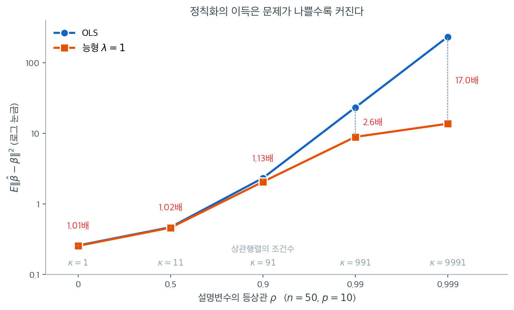

# 정칙화 방법과 그 응용의 개관


## 1. 서론

정칙화 기법은 과적합이 일어나기 쉬운 복잡한 자료를 다룰 때 기계학습 모형의 성능을 높이는 데 핵심적인 역할을 한다. 과적합은 모형이 자료의 기저 패턴뿐 아니라 잡음까지 포착하여 새로운 자료에 대한 일반화가 나빠지는 현상이다. 정칙화 방법은 손실함수에 벌점을 더해 지나치게 복잡한 모형을 억제함으로써 이 위험을 완화한다.

이 절에서는 가장 널리 쓰이는 세 가지 정칙화 방법 — 능형회귀, 라쏘 회귀, 엘라스틱넷 — 을 비교하며 각각의 강점, 약점, 실무적 응용을 짚는다.

---

## 2. 능형회귀 (L2 정칙화)

**벌점항:** $\lambda \sum_{j=1}^p w_j^2$ (L2 노름)

**주된 효과:** 계수를 0 쪽으로 축소하되 정확히 0으로 만들지는 않는다.

**적합한 상황:** 설명변수들이 강하게 상관된 다중공선성 자료.

### 주요 특징

- **축소 효과**: 능형회귀는 계수의 제곱에 비례하는 벌점을 부과한다. 덜 중요한 변수의 영향을 줄여 일반화가 잘 되는 견고한 모형을 만든다.
- **다중공선성 처리**: 상관된 설명변수들 사이에 계수 가중치를 고르게 분배하여, 한 변수가 모형을 지배하지 못하게 한다.
- **변수선택 없음**: 모든 설명변수가 계수만 줄어든 채 모형에 남는다.

### 응용

- **금융**: 경제지표처럼 설명변수가 강하게 상관된 상황에서 주가나 위험 지표를 예측할 때.
- **유전체학**: 수천 개의 유전자가 서로 상관되어 있으면서 특정 형질이나 질병을 예측하는 유전자 발현 분석.

---

## 3. 라쏘 회귀 (L1 정칙화)

**벌점항:** $\lambda \sum_{j=1}^p |w_j|$ (L1 노름)

**주된 효과:** 일부 계수를 정확히 0으로 만들어 사실상 변수선택을 수행한다.

**적합한 상황:** 변수선택이 중요한 고차원 자료.

### 주요 특징

- **희소성**: 일부 계수를 0으로 만들어 희소 모형을 낳으므로 변수선택에 매우 효과적이다.
- **상관된 설명변수의 처리**: 강하게 상관된 변수 집단에서 하나를 고르고 나머지를 0으로 축소하는 경향이 있다. 이는 장점이자 한계가 된다.
- **모형 해석 가능성**: 활성 변수의 수를 줄여 해석하기 쉬운 모형을 만든다.

### 응용

- **유전체학**: 형질이나 질병을 가장 잘 예측하는 유전자 부분집합의 식별.
- **마케팅**: 구매 결정 등 고객 행동을 이끄는 가장 중요한 요인의 식별.

---

## 4. 엘라스틱넷

**벌점항:** $\lambda \left( \alpha \sum_{j=1}^p |w_j| + (1-\alpha) \sum_{j=1}^p w_j^2 \right)$ (L1과 L2의 결합)

**주된 효과:** L1과 L2 벌점의 균형을 잡아 능형과 라쏘의 장점을 결합한다.

**적합한 상황:** 설명변수가 강하게 상관되어 있으면서 변수선택도 필요한 자료.

### 주요 특징

- **장점의 결합**: L1과 L2 벌점을 모두 포함하여 라쏘처럼 변수를 선택하면서 능형처럼 다중공선성을 다룬다.
- **집단 선택**: 상관된 설명변수 집단을 함께 선택하거나 함께 배제하는 데 특히 효과적이다.
- **유연성**: 혼합모수 $\alpha$로 능형과 라쏘 사이의 연속체 위에서 조정할 수 있다.

### 응용

- **유전체학과 생물정보학**: 상관된 설명변수가 매우 많은 상황에서 변수선택을 함께 수행.
- **금융**: 설명변수 간 상관을 고려하면서 유의미한 위험요인을 식별.

---

## 5. 비교표

| **방법** | **벌점** | **변수선택** | **상관 처리** | **주요 응용 분야** |
|---|---|---|---|---|
| **능형** | $\lambda \sum w_j^2$ | 없음 | 좋음 | 금융, 유전체학, 공학 |
| **라쏘** | $\lambda \sum \lvert w_j\rvert$ | 있음 | 나쁨 | 유전체학, 마케팅, 사회과학 |
| **엘라스틱넷** | $\lambda(\alpha \sum \lvert w_j\rvert + (1-\alpha) \sum w_j^2)$ | 있음 | 좋음 | 유전체학, 생물정보학, 금융 |

!!! warning "scikit-learn의 모수 이름은 위 수식과 다르다"
    이 페이지의 $\lambda$와 $\alpha$는 통계 문헌의 관례이다. scikit-learn은 다른 이름을 쓴다.

    | 수식 | scikit-learn |
    |:---|:---|
    | $\lambda$ (전체 벌점 강도) | `alpha` |
    | $\alpha$ (L1 혼합비) | `l1_ratio` |

    즉 `ElasticNet(alpha=0.6, l1_ratio=0.2)`는 이 페이지의 표기로 $\lambda = 0.6$, $\alpha = 0.2$를 뜻한다. `l1_ratio=1`이면 라쏘, `l1_ratio=0`이면 능형이다.

    또한 sklearn의 목적함수는 잔차제곱합을 $2n$으로 나눈다.

    $$
    \frac{1}{2n}\|y - X\beta\|^2 + \lambda\left(\alpha\|\beta\|_1 + \frac{1-\alpha}{2}\|\beta\|_2^2\right)
    $$

    따라서 다른 소프트웨어의 $\lambda$와 직접 비교할 때는 $n$ 배율에 주의해야 한다.

---

## 6. 올바른 정칙화 방법의 선택

정칙화 방법의 선택은 자료의 특성과 분석 목표에 달려 있다.

1. **다중공선성이 있는 자료**: 다중공선성을 효과적으로 다루므로 능형회귀가 우선 후보다.
2. **변수선택이 목표**: 설명변수 수를 줄여 희소 모형을 만드는 것이 목표라면 라쏘가 적합하다.
3. **둘 다 필요한 경우**: 엘라스틱넷이 중간 지점을 제공한다. 특히 상관된 설명변수를 다루면서 변수선택도 필요할 때 유용하다.

그런데 이 결정들보다 먼저 물어야 할 질문이 있다. **정칙화가 지금 이 문제에서 도움이 되기는 하는가.**



$n = 50$, $p = 10$을 고정하고 설명변수의 등상관 $\rho$만 바꾸며 $E\|\hat{\boldsymbol{\beta}} - \boldsymbol{\beta}\|^2$을 400번씩 모의실험한 결과다. 참 계수는 $(3, -2, 1.5, 0, \ldots, 0)$이고 능형은 $\lambda = 1$로 고정했다. 세로축이 로그 눈금이라는 점에 주의하라.

$\rho = 0$과 $\rho = 0.5$에서는 두 곡선이 겹친다. 개선 배수가 각각 $1.01$배와 $1.02$배로, 사실상 차이가 없다. 설명변수가 거의 직교하면 OLS가 이미 충분히 좋고, 벌점은 편향만 더할 뿐 가져갈 분산이 없다. **정칙화는 공짜 점심이 아니다.** 잘 조건화된 문제에 벌점을 걸면 아무것도 얻지 못한다.

$\rho$가 $0.9$를 넘으면서 이야기가 달라진다. $\rho = 0.99$에서 OLS의 오차는 $23.3$으로 $\rho = 0$일 때의 $0.258$보다 90배 크고, 능형은 $8.9$에 머물러 $2.6$배 이득을 준다. $\rho = 0.999$에서는 OLS가 $232.9$까지 폭발하는데 능형은 $13.7$에 그친다. **17배 차이다.** 아래쪽 회색 숫자로 적어 둔 상관행렬의 조건수 $\kappa$가 $1 \to 11 \to 91 \to 991 \to 9991$로 커지는 것과 두 곡선이 벌어지는 것이 정확히 같은 속도임을 확인하라.

여기서 실무 규칙 하나가 따라 나온다. **정칙화를 고려하기 전에 $\kappa$나 VIF부터 계산하라.** VIF가 10을 넘는다는 것은 $\rho \approx 0.92$에 해당하고, 위 그림에서 두 곡선이 막 갈라지기 시작하는 지점이다. 그 아래라면 어떤 벌점을 고르든 결과는 비슷하므로 방법 선택에 시간을 쓸 이유가 없다. 그 위라면 방법 선택이 오차를 한 자릿수 바꾼다.

---

## 연습문제

<div class="drillbox" markdown>

**연습문제 1.** <span class="diff med" title="중간"></span>
"능형회귀는 계수를 0으로 만들지 않는다"는 주장을 수치로 확인하라. $\lambda$를 극단적으로 키우면 어떻게 되는가?

</div>

??? success "풀이"
    ```python
    import numpy as np
    from sklearn.linear_model import Ridge

    rng = np.random.default_rng(1)
    n, p = 60, 20
    X = rng.normal(size=(n, p))
    beta = np.zeros(p); beta[:3] = 2.0
    y = X @ beta + rng.normal(0, 1, n)

    for lam in (1, 100, 10_000, 1e6):
        b = Ridge(alpha=lam).fit(X, y).coef_
        print(lam, (b == 0).sum(), np.abs(b).max())
    ```

    출력:

    ```
    1 0 2.1943876043430333
    100 0 0.751983387491264
    10000 0 0.013243243417317968
    1000000.0 0 0.0001335700342004583
    ```

    | $\lambda$ | 정확히 0인 계수의 수 | $\max_j\lvert \hat\beta_j\rvert$ |
    |---:|---:|---:|
    | 1 | 0 | $2.16$ |
    | 100 | 0 | $1.32$ |
    | 10{,}000 | 0 | $4.02\times10^{-2}$ |
    | $10^6$ | 0 | $4.11\times10^{-4}$ |

    **$\lambda$를 백만까지 키워도 정확히 0이 되는 계수는 하나도 없다.** 계수들은 0에 한없이 가까워질 뿐이다.

    이유는 닫힌 형태 해 $\hat\beta = (X^\top X + \lambda I)^{-1}X^\top y$에 있다. $\lambda \to \infty$이면 $\hat\beta \approx X^\top y/\lambda \to 0$이지만, $X^\top y$의 성분이 정확히 0이 아닌 한 어떤 유한한 $\lambda$에서도 $\hat\beta_j \neq 0$이다.

    이것이 능형회귀가 **변수선택을 하지 못하는** 구조적 이유다. 실무에서 "능형으로 변수를 골랐다"는 말은 임의의 문턱을 적용했다는 뜻이며, 그 문턱은 자료가 아니라 사용자가 정한 것이다.

<div class="drillbox" markdown>

**연습문제 2.** <span class="diff med" title="중간"></span>
다중공선성이 심해질수록 능형회귀의 이득이 커지는지 모의실험으로 확인하라. $\rho = 0, 0.9, 0.99$인 등상관 설명변수 10개에서 $\|\hat\beta - \beta\|^2$을 OLS와 능형회귀에 대해 비교하라.

</div>

??? success "풀이"
    ```python
    import numpy as np
    from sklearn.linear_model import Ridge, LinearRegression
    rng = np.random.default_rng(18)

    def experiment(rho, n=50, p=10, M=400, lam=1.0):
        beta = np.zeros(p); beta[:3] = [3, -2, 1.5]
        S = rho*np.ones((p, p)) + (1-rho)*np.eye(p)
        L = np.linalg.cholesky(S)
        eo, er = [], []
        for _ in range(M):
            X = rng.normal(size=(n, p)) @ L.T
            y = X @ beta + rng.normal(0, 1, n)
            bo = LinearRegression(fit_intercept=False).fit(X, y).coef_
            br = Ridge(alpha=lam, fit_intercept=False).fit(X, y).coef_
            eo.append(((bo-beta)**2).sum()); er.append(((br-beta)**2).sum())
        return np.mean(eo), np.mean(er)
    ```

    | $\rho$ | OLS $E\|\hat\beta-\beta\|^2$ | 능형 ($\lambda = 1$) | 개선 배수 |
    |---:|---:|---:|---:|
    | 0.00 | 0.258 | 0.255 | 1.01 |
    | 0.90 | 2.209 | 1.962 | 1.13 |
    | 0.99 | **23.197** | **8.846** | **2.62** |

    **상관이 없으면 능형회귀의 이득이 사실상 없다**(1.01배). 설명변수가 직교에 가까우면 OLS가 이미 좋기 때문이다.

    **$\rho = 0.99$에서는 OLS의 오차가 90배로 폭발하고**($0.258 \to 23.2$), 능형회귀가 그것을 $2.6$배 줄인다.

    이 표가 정칙화의 핵심을 보여준다. **정칙화는 공짜가 아니라 조건부 이득이다.** 문제가 잘 조건화되어 있으면 편향만 더하고 얻는 것이 없다. 문제가 불량조건일수록 이득이 커진다.

    관련 지표를 함께 보면 이해가 쉽다. 등상관 행렬의 조건수와 VIF는 다음과 같다.

    | $\rho$ | $\text{cond}(\Sigma)$ | VIF |
    |---:|---:|---:|
    | 0.00 | 1.0 | 1.00 |
    | 0.90 | 46.0 | 8.04 |
    | 0.99 | 496.0 | 80.04 |
    | 0.999 | 4996.0 | 800.04 |

    조건수와 VIF가 모두 $\rho$에 따라 폭발한다. **VIF가 10을 넘으면 정칙화를 고려하라**는 실무 규칙의 근거다.

<div class="drillbox" markdown>

**연습문제 3.** <span class="diff med" title="중간"></span>
상관된 변수 집단에서 라쏘와 엘라스틱넷의 행동 차이를 확인하라. $\rho = 0.99$로 상관된 참 변수 3개와 잡음변수 17개가 있는 자료에서 두 방법의 계수를 비교하라.

</div>

??? success "풀이"
    ```python
    import numpy as np
    from sklearn.linear_model import Lasso, ElasticNet

    def make(n=60, p=20, rho=0.99, seed=0):
        r = np.random.default_rng(seed)
        Z = r.normal(size=n); X = r.normal(size=(n, p))
        for j in range(3):
            X[:, j] = np.sqrt(rho)*Z + np.sqrt(1-rho)*X[:, j]
        beta = np.zeros(p); beta[:3] = 2.0
        return X, X @ beta + r.normal(0, 1, n)

    X, y = make(seed=3)
    print(Lasso(alpha=0.6, max_iter=50000).fit(X, y).coef_[:3])
    print(ElasticNet(alpha=0.6, l1_ratio=0.2, max_iter=50000).fit(X, y).coef_[:3])
    ```

    출력:

    ```
    [0.48591524 2.13572156 2.90658657]
    [1.70638914 1.7274379  1.77375792]
    ```

    **한 자료에서 상관된 세 변수의 계수 (참값은 셋 다 $2.0$)**

    | 방법 | $\hat\beta_1$ | $\hat\beta_2$ | $\hat\beta_3$ |
    |:---|---:|---:|---:|
    | 라쏘 | 0.486 | 2.136 | **2.907** |
    | 엘라스틱넷 | 1.706 | 1.727 | 1.774 |

    **라쏘는 셋을 제멋대로 쪼갠다.** 참값이 모두 $2.0$인데 $0.49$부터 $2.91$까지 6배 차이가 난다. 셋이 거의 같은 정보를 담고 있으므로 L1 벌점 입장에서는 어디에 몰아주든 목적함수가 비슷하다. 자료가 조금만 바뀌어도 순위가 뒤집힌다.

    **엘라스틱넷은 셋을 거의 균등하게 나눈다**($1.71, 1.73, 1.77$). 이것이 **그룹 효과**다. L2 항이 계수 제곱의 합에 벌점을 주므로, 같은 총합이라면 고르게 분배하는 쪽이 유리하다.

    **400개 자료에 걸친 안정성**

    | $\lambda$ | 라쏘: 3개 모두 유지 | 엘라스틱넷: 3개 모두 유지 | 라쏘 잡음변수 | 엘라스틱넷 잡음변수 |
    |---:|---:|---:|---:|---:|
    | 0.3 | 86% | 100% | 0.4 | 11.1 |
    | 0.6 | 77% | 100% | 0.0 | 8.2 |
    | 1.0 | 57% | 100% | 0.0 | 6.2 |

    **절충이 분명하다.** 엘라스틱넷은 참 변수 3개를 항상 지키지만 잡음변수를 6–11개 함께 끌고 들어온다. 라쏘는 잡음을 깨끗이 제거하지만 참 변수를 놓친다.

    **어느 쪽이 옳은가는 목적에 달렸다.** 예측이 목표면 상관된 변수를 모두 남기는 편이 대개 낫다. "어떤 유전자가 원인인가"처럼 **식별**이 목표라면 라쏘의 희소성이 필요하지만, 그 답이 자료의 사소한 변화에 뒤집힌다는 점을 알고 있어야 한다.

<div class="drillbox" markdown>

**연습문제 4.** <span class="diff med" title="중간"></span>
5 절의 경고 상자는 모수 **이름**이 다르다는 것만 알려 준다. 그보다 더 자주 사고를 내는 것은 sklearn 의 `Ridge` 가 설명변수를 **표준화해 주지 않는다**는 사실이다. $p = 3$인 자료에서 셋째 설명변수의 단위만 m 에서 cm 로 바꾸어(값을 100 배) 능형 해가 달라지는지 확인하라. OLS 는 어떤가? 표준화를 먼저 하면 어떻게 되는가?

</div>

??? success "풀이"
    단위를 바꾼 뒤 얻은 계수에는 $100$을 곱해 **같은 척도로 되돌려** 비교해야 한다. 셋째 변수를 $100$배 했으면 그 계수는 $1/100$배가 되는 것이 "올바른" 변환이기 때문이다.

    ```python
    import numpy as np
    from sklearn.linear_model import Ridge, LinearRegression

    rng = np.random.default_rng(4)
    n = 40
    X = rng.normal(size=(n, 3))
    y = X @ np.array([2.0, -1.0, 0.5]) + rng.normal(0, 0.5, n)

    X2 = X.copy()
    X2[:, 2] *= 100.0                    # 셋째 변수의 단위만 m -> cm
    back = np.array([1.0, 1.0, 100.0])   # 같은 척도로 되돌리는 배수

    def row(name, b1, b2):
        print(f"{name:12s}" + " ".join(f"{v:8.4f}" for v in b1)
              + "  |" + " ".join(f"{v:8.4f}" for v in b2 * back))

    print("             -------- 원래 단위 --------  ---- cm 로 바꾼 뒤 되돌림 ----")
    row("OLS",
        LinearRegression(fit_intercept=False).fit(X, y).coef_,
        LinearRegression(fit_intercept=False).fit(X2, y).coef_)
    row("Ridge(10)",
        Ridge(alpha=10.0, fit_intercept=False).fit(X, y).coef_,
        Ridge(alpha=10.0, fit_intercept=False).fit(X2, y).coef_)

    s1, s2 = X.std(axis=0), X2.std(axis=0)
    row("Ridge(std)",
        Ridge(alpha=10.0, fit_intercept=False).fit(X / s1, y).coef_ / s1,
        Ridge(alpha=10.0, fit_intercept=False).fit(X2 / s2, y).coef_ / s2)
    ```

    출력:

    ```text
                 -------- 원래 단위 --------  ---- cm 로 바꾼 뒤 되돌림 ----
    OLS           2.0268  -0.9881   0.5566  |  2.0268  -0.9881   0.5566
    Ridge(10)     1.5987  -0.9354   0.5427  |  1.5501  -0.9565   0.6996
    Ridge(std)    1.6588  -0.9066   0.5336  |  1.6588  -0.9066   0.5336
    ```

    **OLS 는 단위에 전혀 영향을 받지 않는다.** 되돌린 계수가 소수 넷째 자리까지 같다. OLS 는 $\hat\beta = (X^\top X)^{-1}X^\top y$이므로 $X \to XD$($D$는 양의 대각행렬)에 대해 $\hat\beta \to D^{-1}\hat\beta$가 정확히 성립하고, 적합값 $X\hat\beta$는 아예 변하지 않는다. 척도 **동변**이다.

    **능형은 달라진다.** 셋째 계수가 $0.5427$에서 $0.6996$으로 $29\%$ 커졌고 첫째 계수는 $1.5987 \to 1.5501$로 줄었다. 벌점이 $\lambda\sum_j \beta_j^2$이므로 $\beta_3 \to \beta_3/100$이 되면 그 항의 벌점이 $10^4$배 가벼워진다. **즉 단위를 키운 변수는 벌점을 거의 받지 않게 되어 사실상 특별 대우를 받는다.** 단위 선택이라는 임의의 결정이 추정값을 바꾼 것이다.

    **표준화하면 불변이 회복된다.** `Ridge(std)` 줄의 두 쪽이 소수 넷째 자리까지 같다. 각 열을 표준편차로 나눈 뒤 벌점을 걸면, 어떤 대각 $D$로 척도를 바꾸어도 표준화 후의 설계행렬이 같아지기 때문이다.

    실무 규칙은 하나다. **능형·라쏘·엘라스틱넷을 쓸 때는 설명변수를 반드시 표준화하라.** 절편은 벌점에서 빼야 하므로(`fit_intercept=True`가 그렇게 한다) 절편에는 표준화가 필요하지 않다. 2 장의 표준화와 13 장의 다중공선성 논의가 여기서 합쳐진다.

<div class="drillbox" markdown>

**연습문제 5.** <span class="diff med" title="중간"></span>
설계행렬이 $X^\top X = I_p$를 만족한다고 하자(열이 정규직교인 설계). $z = X^\top y$라 쓰면 $z$가 곧 OLS 해다. 이때 목적함수

$$
\lVert y - X\beta\rVert^2 + \lambda \lVert \beta\rVert_2^2
\qquad\text{와}\qquad
\lVert y - X\beta\rVert^2 + \lambda \lVert \beta\rVert_1
$$

의 최소해를 **종이에서 닫힌 꼴로** 구하라. 두 식을 보고 "라쏘만 변수선택을 한다"는 말의 근거를 한 줄로 적고, $\lambda \to \infty$에서 두 해가 0 에 다가가는 **방식**이 어떻게 다른지 말하라.

</div>

??? success "풀이"
    $X^\top X = I_p$이므로 잔차제곱합이 좌표별로 분리된다.

    $$
    \lVert y - X\beta\rVert^2 = \lVert y\rVert^2 - 2\beta^\top X^\top y + \beta^\top X^\top X\beta = \lVert y\rVert^2 - \lVert z\rVert^2 + \lVert \beta - z\rVert^2
    $$

    따라서 두 문제 모두 좌표마다 독립인 1 차원 문제가 된다.

    **능형.** 좌표 $j$의 목적함수는 $g(b) = (b - z_j)^2 + \lambda b^2$이고 $g'(b) = 2(b - z_j) + 2\lambda b = 0$에서

    $$
    \hat\beta_j^{\text{ridge}} = \frac{z_j}{1+\lambda}
    $$

    이다. 모든 좌표를 **같은 비율** $1/(1+\lambda)$로 줄이는 **비례 축소**다.

    **라쏘.** 좌표 $j$의 목적함수는 $h(b) = (b-z_j)^2 + \lambda\lvert b\rvert$다. $b > 0$에서 $h'(b) = 2(b - z_j) + \lambda = 0$이므로 $b = z_j - \lambda/2$이고, 이것이 실제로 양수가 되려면 $z_j > \lambda/2$여야 한다. $b < 0$에서는 같은 계산으로 $b = z_j + \lambda/2$이고 조건은 $z_j < -\lambda/2$다. 두 조건이 모두 깨지는 $\lvert z_j\rvert \le \lambda/2$에서는 양쪽 한쪽미분이 $h'(0^+) = -2z_j + \lambda \ge 0$, $h'(0^-) = -2z_j - \lambda \le 0$이 되어 $b = 0$이 최소점이다. 셋을 합치면

    $$
    \hat\beta_j^{\text{lasso}} = \operatorname{sign}(z_j)\bigl(\lvert z_j\rvert - \lambda/2\bigr)_+
    $$

    즉 문턱 $\lambda/2$의 **연성문턱**이다.

    | | 해 | 0 이 되는 조건 |
    |:---|:---|:---|
    | 능형 | $z_j/(1+\lambda)$ | $z_j = 0$일 때만 |
    | 라쏘 | $\operatorname{sign}(z_j)(\lvert z_j\rvert - \lambda/2)_+$ | $\lvert z_j\rvert \le \lambda/2$ |

    **변수선택의 근거가 이 한 줄에 있다.** 능형의 해는 $z_j$에 **비례**하므로 $z_j \neq 0$이면 어떤 유한한 $\lambda$에서도 0 이 아니다. 라쏘의 해는 $z_j$를 **평행이동**한 뒤 0 에서 자르므로 $\lvert z_j \rvert$가 문턱보다 작은 좌표는 **정확히** 0 이 된다. 연습문제 1 에서 $\lambda = 10^6$까지 키워도 0 이 하나도 없었던 것이 바로 비례 축소의 결과다.

    **$\lambda \to \infty$에서의 차이.** 능형은 $z_j/(1+\lambda) \sim z_j/\lambda$로 $O(\lambda^{-1})$의 속도로 0 에 **접근만** 한다. 라쏘는 $\lambda \ge 2\lvert z_j\rvert$라는 **유한한** 값에서 이미 정확히 0 에 **도달**하고 그 뒤로는 계속 0 이다. "0 으로 간다"와 "0 이 된다"의 차이다.

    끝으로 척도에 주의하라. 이 문턱은 $\lambda/2$다. sklearn 의 `Lasso` 는 $\frac{1}{2n}\lVert y - X\beta\rVert^2 + \alpha\lVert\beta\rVert_1$을 쓰므로 양변에 $2n$을 곱하면 $\lVert y - X\beta\rVert^2 + 2n\alpha\lVert\beta\rVert_1$이 되어 $\lambda = 2n\alpha$, 문턱은 $n\alpha$다. 연습문제 6 에서 이것을 수로 확인한다.

<div class="drillbox" markdown>

**연습문제 6.** <span class="diff hard" title="어려움"></span>
5 절의 경고 상자는 sklearn 의 목적함수가 잔차제곱합을 $2n$으로 나눈다고 적었다. 그런데 그 상자가 적은 식은 `ElasticNet` 의 것이고, **`Ridge` 는 그 식을 쓰지 않는다.** $n = 50$, $p = 4$인 자료에서 `Ridge(alpha=2)` 의 해가 $(X^\top X + 2I)^{-1}X^\top y$와 $(X^\top X + 2nI)^{-1}X^\top y$ 가운데 어느 것과 같은지 확인하라. 이어서 열이 정규직교인 설계에서 `Lasso(alpha=0.1)` 의 해가 연습문제 5 의 연성문턱과 어떤 문턱에서 일치하는지 확인하고, 교과서 꼴 $\lambda$와 sklearn 의 `alpha` 의 관계를 적어라.

</div>

??? success "풀이"
    ```python
    import numpy as np
    from sklearn.linear_model import Ridge, Lasso

    rng = np.random.default_rng(6)
    n, p, a = 50, 4, 2.0
    X = rng.normal(size=(n, p))
    y = X @ np.array([1.5, -1.0, 0.0, 0.8]) + rng.normal(0, 0.5, n)

    def show(name, b):
        print(f"{name:18s}" + " ".join(f"{v:9.4f}" for v in np.round(b, 4) + 0.0))

    G, Xty = X.T @ X, X.T @ y
    show("Ridge(alpha=2)", Ridge(alpha=a, fit_intercept=False).fit(X, y).coef_)
    show("(G+2I)^-1 X.y", np.linalg.solve(G + a * np.eye(p), Xty))
    show("(G+2nI)^-1 X.y", np.linalg.solve(G + n * a * np.eye(p), Xty))

    Q = np.linalg.qr(X)[0]          # 열이 정규직교인 설계
    z = Q.T @ y
    al = 0.1
    show("Lasso(alpha=0.1)", Lasso(alpha=al, fit_intercept=False,
                                   max_iter=100000, tol=1e-9).fit(Q, y).coef_)
    show("soft(z, n*alpha)", np.sign(z) * np.maximum(np.abs(z) - n * al, 0.0))
    print(f"n*alpha = {n * al:.4f},   2*n*alpha = {2 * n * al:.4f}")
    ```

    출력:

    ```text
    Ridge(alpha=2)       1.4704   -0.8191    0.1484    0.9217
    (G+2I)^-1 X.y        1.4704   -0.8191    0.1484    0.9217
    (G+2nI)^-1 X.y       0.5977   -0.2189    0.1549    0.3505
    Lasso(alpha=0.1)    -8.3102    0.2977    0.0000   -0.4993
    soft(z, n*alpha)    -8.3102    0.2977    0.0000   -0.4993
    n*alpha = 5.0000,   2*n*alpha = 10.0000
    ```

    **`Ridge(alpha=2)` 는 $(X^\top X + 2I)^{-1}X^\top y$와 소수 넷째 자리까지 같다.** 즉 `Ridge` 의 `alpha` 는 **교과서 꼴 $\lambda$ 그 자체**이고, $1/(2n)$ 규약을 쓰지 않는다. `Ridge` 가 최소화하는 것은

    $$
    \lVert y - X\beta\rVert^2 + \texttt{alpha}\cdot\lVert\beta\rVert_2^2
    $$

    이다. 5 절의 상자가 적은 $\frac{1}{2n}$ 꼴을 `Ridge` 에도 적용했다고 믿으면 $(X^\top X + 2nI)^{-1}X^\top y$를 기대하게 되는데, 그 해는 첫째 계수가 $1.4704$가 아니라 $0.5977$로 **$2.5$배나 작다.** $n = 50$만큼 벌점을 더 세게 걸었기 때문이다.

    따라서 `ElasticNet(alpha=A, l1_ratio=0)` 과 `Ridge(alpha=a)` 를 같게 만들려면 변환이 필요하다. `ElasticNet` 의 목적함수에 $2n$을 곱하면 L2 항이 $nA\lVert\beta\rVert_2^2$가 되므로

    $$
    a = n A, \qquad\text{즉}\qquad A = a/n
    $$

    이다. 같은 수를 두 함수에 넣으면 벌점 강도가 $n$배 어긋난다.

    **라쏘 쪽.** `Lasso(alpha=0.1)` 의 해가 문턱 $n\alpha = 5$의 연성문턱 $\operatorname{sign}(z)(\lvert z\rvert - 5)_+$와 네 좌표 모두 소수 넷째 자리까지 일치한다(셋째 좌표는 $\lvert z_3\rvert \le 5$라서 정확히 0 이 되었다). 연습문제 5 에서 교과서 꼴의 문턱이 $\lambda/2$였으므로 $\lambda/2 = n\alpha$, 곧

    $$
    \lambda = 2n\alpha
    $$

    이다. 여기서는 $\lambda = 2\cdot 50\cdot 0.1 = 10$이다.

    **정리하면 sklearn 안에서조차 벌점의 척도가 세 가지다.**

    | 추정기 | 교과서 꼴 $\lambda$ |
    |:---|:---|
    | `Ridge(alpha=a)` | $\lambda = a$ |
    | `Lasso(alpha=A)` | $\lambda = 2nA$ |
    | `ElasticNet(alpha=A)` L2 부분 | $\lambda = nA$ |

    **논문의 $\lambda$를 그대로 `alpha` 에 넣으면 수가 전부 틀어진다.** 비교하기 전에 반드시 $n$ 배율을 맞추고, 가장 안전한 검산은 `Ridge` 처럼 닫힌 꼴이 있는 경우에 직접 풀어 대조해 보는 것이다.

<div class="drillbox" markdown>

**연습문제 7.** <span class="diff hard" title="어려움"></span>
$X^\top X = cI_p$($c > 0$)인 설계에서 $y = X\beta + \varepsilon$, $\varepsilon \sim N(0, \sigma^2 I_n)$이라 하자. 능형추정량의 $E\lVert\hat\beta(\lambda) - \beta\rVert^2$을 $\lambda$의 함수로 적고, **$\lambda = 0$에서 도함수가 항상 음수임**을 보여 OLS 를 이기는 $\lambda$가 반드시 존재함을 증명하라. 최적 $\lambda^\ast$도 구하라. 그리고 그 공식을 연습문제 2 의 $\rho = 0$ 상황($n = 50$, $p = 10$, $\sigma = 1$, $\beta = (3,-2,1.5,0,\ldots,0)$, $\lambda = 1$)에 넣어 표에 적힌 개선 배수 $1.01$을 **이론으로 예측**하라.

</div>

??? success "풀이"
    **1 단계: 닫힌 꼴.** $X^\top X = cI$이므로

    $$
    \hat\beta(\lambda) = (cI + \lambda I)^{-1}X^\top y = \frac{c}{c+\lambda}\cdot\frac{X^\top y}{c} = s\,\hat\beta^{\text{OLS}}, \qquad s := \frac{c}{c+\lambda}
    $$

    이고 $\hat\beta^{\text{OLS}} = X^\top y/c \sim N\bigl(\beta, (\sigma^2/c)I_p\bigr)$이다. $\lambda$가 $0$에서 $\infty$로 갈 때 $s$는 $1$에서 $0$으로 간다.

    **2 단계: 편향–분산 분해.** $\hat\beta(\lambda) = s\hat\beta^{\text{OLS}}$의 기댓값은 $s\beta$이므로 편향은 $(s-1)\beta$이고, 분산은 좌표마다 $s^2\sigma^2/c$다. 5 장 정리 1 을 좌표별로 적용해 더하면

    $$
    M(\lambda) := E\lVert\hat\beta(\lambda) - \beta\rVert^2 = (1-s)^2 B + s^2\,\frac{p\sigma^2}{c}, \qquad B := \lVert\beta\rVert_2^2
    $$

    이다. 첫 항이 **편향을 사는 값**, 둘째 항이 **팔아 치운 분산**이다. $s = c/(c+\lambda)$, $1 - s = \lambda/(c+\lambda)$를 넣으면

    $$
    M(\lambda) = \frac{\lambda^2 B + c\,p\sigma^2}{(c+\lambda)^2}
    $$

    **3 단계: $\lambda = 0$에서의 도함수.** 몫의 미분으로

    $$
    M'(\lambda) = \frac{2\lambda B(c+\lambda)^2 - (\lambda^2 B + cp\sigma^2)\cdot 2(c+\lambda)}{(c+\lambda)^4} = \frac{2c\,(\lambda B - p\sigma^2)}{(c+\lambda)^3}
    $$

    이다. 따라서

    $$
    M'(0) = \frac{2c(0 - p\sigma^2)}{c^3} = -\frac{2p\sigma^2}{c^2} < 0
    $$

    $\sigma^2 > 0$이고 $p \ge 1$이면 **부호가 자료와 무관하게 항상 음수다.** $M$은 $\lambda = 0$의 오른쪽 근방에서 감소하므로 $M(\lambda) < M(0)$인 $\lambda > 0$이 반드시 존재한다. 즉 **능형이 OLS 를 이기는 $\lambda$는 늘 있다.** $\square$

    **4 단계: 최적 $\lambda$.** $M'(\lambda) = 0$은 $\lambda B = p\sigma^2$과 동치이고 $M'$의 부호가 $-$에서 $+$로 한 번만 바뀌므로

    $$
    \lambda^\ast = \frac{p\sigma^2}{\lVert\beta\rVert_2^2}
    $$

    가 유일한 최소점이다. $c$가 약분되어 사라진다는 점이 재미있다. **신호 $\lVert\beta\rVert^2$가 크면 벌점을 약하게, 잡음 $p\sigma^2$가 크면 세게 걸라**는 뜻이다.

    **5 단계: 연습문제 2 의 $\rho = 0$에 넣기.** $X$의 성분이 iid $N(0,1)$이므로 $X^\top X \approx nI$, 즉 $c = n = 50$이다. 또

    $$
    B = 3^2 + (-2)^2 + 1.5^2 = 9 + 4 + 2.25 = 15.25, \qquad p\sigma^2 = 10
    $$

    이므로 $\lambda^\ast = 10/15.25 = 0.6557$이고 $p\sigma^2/c = 10/50 = 0.2$다. 이제

    | $\lambda$ | $s = 50/(50+\lambda)$ | $(1-s)^2 B$ (편향$^2$) | $s^2 \cdot 0.2$ (분산) | $M(\lambda)$ | $M(0)/M(\lambda)$ |
    |---:|---:|---:|---:|---:|---:|
    | $0$ | $1$ | $0$ | $0.200000$ | $0.200000$ | $1.0000$ |
    | $0.6557$ | $0.98706$ | $0.002555$ | $0.194856$ | $0.197411$ | $1.0131$ |
    | $1$ | $0.98039$ | $0.005863$ | $0.192234$ | $0.198097$ | $1.0096$ |

    $\lambda = 1$에서 이론이 예측하는 개선 배수는 $1.0096$이고, 연습문제 2 의 모의실험이 보고한 값은 $1.01$이다. **소수 둘째 자리까지 일치한다.**

    (모의실험의 절대값 $0.258$이 이론값 $0.200$보다 큰 것은 $X^\top X$가 정확히 $nI$가 아니라 위샤트 변동을 갖기 때문이다. $E\operatorname{tr}\bigl((X^\top X)^{-1}\bigr)\sigma^2 = p\sigma^2/(n-p-1) = 10/39 = 0.256$이 실제로 관측값과 맞는다. 배수는 그 변동에 거의 영향을 받지 않는다.)

    **$1.01$은 $\lambda = 1$을 잘못 골라서 나온 작은 값이 아니다.** 최적 $\lambda^\ast$를 써도 $1.0131$, 곧 $1.3\%$가 한계다. 잘 조건화된 문제에서는 애초에 팔아 치울 분산($0.2$)이 신호($15.25$)에 비해 턱없이 작아 거래할 것이 없다. 이것이 쪽 본문이 말한 "**정칙화는 공짜 점심이 아니다**"의 정량적 뜻이다.

<div class="drillbox" markdown>

**연습문제 8.** <span class="diff hard" title="어려움"></span>
능형의 **유효 자유도**는 사영행렬의 대각합 $\operatorname{tr}\bigl(X(X^\top X + \lambda I)^{-1}X^\top\bigr)$로 정의하고, $X$의 특잇값 $d_1,\ldots,d_p$로 쓰면 $\mathrm{df}(\lambda) = \sum_j d_j^2/(d_j^2+\lambda)$가 된다. $n = 60$, $p = 8$, 등상관 $\rho = 0.9$인 설계에서 두 식이 같은 값을 주는지 확인하고, $\mathrm{df}(\lambda) = 3$이 되는 $\lambda$를 구하라. 같은 자료에서 라쏘가 0 이 아닌 계수를 3 개 남기는 `alpha` 도 찾아, 두 방법의 "복잡도 손잡이"가 **질적으로** 어떻게 다른지 말하라.

</div>

??? success "풀이"
    ```python
    import numpy as np
    from sklearn.linear_model import Lasso

    rng = np.random.default_rng(8)
    n, p, rho = 60, 8, 0.9
    S = rho * np.ones((p, p)) + (1 - rho) * np.eye(p)
    X = rng.normal(size=(n, p)) @ np.linalg.cholesky(S).T
    beta = np.zeros(p); beta[:3] = [3.0, -2.0, 1.5]
    y = X @ beta + rng.normal(0, 1.0, n)

    d = np.linalg.svd(X, compute_uv=False)

    def df(lam):
        return float((d**2 / (d**2 + lam)).sum())

    def df_trace(lam):
        H = X @ np.linalg.solve(X.T @ X + lam * np.eye(p), X.T)
        return float(np.trace(H))

    print("     lam    sum d^2/(d^2+lam)      tr(H)")
    for lam in (0.0, 1.0, 10.0, 100.0, 1000.0, 10000.0):
        print(f"{lam:8.1f}{df(lam):18.4f}{df_trace(lam):12.4f}")

    lo, hi = 0.0, 1e6
    for _ in range(200):
        mid = 0.5 * (lo + hi)
        lo, hi = (mid, hi) if df(mid) > 3.0 else (lo, mid)
    print(f"df(lam) = 3 인 lam = {0.5 * (lo + hi):.4f}")

    for al in (0.05, 0.1, 0.2, 0.5, 1.0):
        b = Lasso(alpha=al, fit_intercept=False, max_iter=100000,
                  tol=1e-9).fit(X, y).coef_
        print(f"Lasso alpha={al:.2f}  ->  0 이 아닌 계수 {int((np.abs(b) > 1e-8).sum())} 개")
    ```

    출력:

    ```text
         lam    sum d^2/(d^2+lam)      tr(H)
         0.0            8.0000      8.0000
         1.0            6.9598      6.9598
        10.0            3.6015      3.6015
       100.0            1.2175      1.2175
      1000.0            0.3443      0.3443
     10000.0            0.0457      0.0457
    df(lam) = 3 인 lam = 14.7542
    Lasso alpha=0.05  ->  0 이 아닌 계수 5 개
    Lasso alpha=0.10  ->  0 이 아닌 계수 3 개
    Lasso alpha=0.20  ->  0 이 아닌 계수 2 개
    Lasso alpha=0.50  ->  0 이 아닌 계수 2 개
    Lasso alpha=1.00  ->  0 이 아닌 계수 2 개
    ```

    **두 식이 모든 $\lambda$에서 소수 넷째 자리까지 같다.** 이유는 특이값분해다. $X = UDV^\top$이라 하면

    $$
    X(X^\top X + \lambda I)^{-1}X^\top = U D (D^2 + \lambda I)^{-1} D\, U^\top = U\operatorname{diag}\!\left(\frac{d_j^2}{d_j^2+\lambda}\right)U^\top
    $$

    이고, 대각합은 고윳값의 합이므로 $\sum_j d_j^2/(d_j^2+\lambda)$다. **능형의 모자행렬은 OLS 의 사영을 주성분축마다 $d_j^2/(d_j^2+\lambda)$배로 줄인 것**이고, 자유도는 그 축소배수들의 합이다.

    양 끝을 확인하자. $\lambda = 0$에서 $\mathrm{df} = p = 8$로 OLS 와 같다(사영행렬의 대각합은 계수). $\lambda = 10^4$에서는 $0.0457$로 거의 0 이다. 즉 $\mathrm{df}$는 $p$에서 $0$까지 **연속적으로, 단조 감소**한다.

    $\mathrm{df}(\lambda) = 3$인 지점은 $\lambda = 14.7542$다. ($\mathrm{df}$가 $\lambda$에 대해 연속이고 강하게 감소하므로 이분법이 수렴한다.)

    **라쏘는 전혀 다르게 움직인다.**

    | | 손잡이 | 복잡도의 값 | 성질 |
    |:---|:---|:---|:---|
    | 능형 | $\lambda$ | $\mathrm{df}(\lambda) \in (0, p]$ | 연속·단조 |
    | 라쏘 | `alpha` | 0 이 아닌 계수의 수 $\in \{0,1,\ldots,p\}$ | 정수·계단 |

    `alpha` 를 $0.2$에서 $1.0$까지 다섯 배 키워도 활성 변수는 계속 2 개다. **라쏘의 복잡도는 정수값이어서 계단으로 뛴다.** $\rho = 0.9$로 상관된 설계에서 어떤 `alpha` 로도 3 개가 아닌 구간이 넓게 존재할 수 있고, 여기서는 $\alpha = 0.1$이 마침 3 개를 준다.

    **정보기준을 쓸 때 이 차이가 드러난다.** AIC·BIC 는 $-2\log L + (\text{벌점})\cdot \mathrm{df}$ 꼴이므로 능형에는 $\mathrm{df}(14.75) = 3$처럼 소수 자유도를 넣어야 하고, 라쏘에는 0 이 아닌 계수의 개수를 넣는다(그 개수가 라쏘 자유도의 불편추정이 된다는 사실이 알려져 있다). **능형의 $\lambda$ 격자는 촘촘하게 잡는 것이 뜻이 있지만, 라쏘의 `alpha` 격자는 활성 집합이 바뀌는 지점만 의미가 있다.** 라쏘를 격자 대신 경로 알고리즘으로 푸는 까닭이다.

<div class="drillbox" markdown>

**연습문제 9.** <span class="diff hard" title="어려움"></span>
$X^\top X = I_p$, $y = X\beta + \varepsilon$, $\varepsilon \sim N(0,\sigma^2 I_n)$이라 하자. $\beta_j$에 독립인 사전분포를 주었을 때 다음을 보여라.

1. $\beta_j \sim N(0,\tau^2)$이면 사후 **최빈값**이 $\lambda = \sigma^2/\tau^2$인 능형해다.
2. $\beta_j \sim \text{Laplace}(0,b)$, 즉 밀도 $\frac{1}{2b}e^{-\lvert\beta_j\rvert/b}$이면 사후 최빈값이 $\lambda = 2\sigma^2/b$인 라쏘해다.
3. 그런데 2 의 사전분포에서 사후 **평균**은 $z_j \neq 0$이면 결코 정확히 0 이 아니다.

3 에서 얻는 교훈을 한 줄로 적어라.

</div>

??? success "풀이"
    연습문제 5 에서 보았듯 $X^\top X = I_p$이면 $z := X^\top y$에 대해 $\lVert y - X\beta\rVert^2 = \lVert y\rVert^2 - \lVert z\rVert^2 + \lVert\beta - z\rVert^2$이다. 따라서 가능도는

    $$
    p(y \mid \beta) \propto \exp\left(-\frac{\lVert\beta - z\rVert^2}{2\sigma^2}\right) = \prod_{j=1}^p \exp\left(-\frac{(\beta_j - z_j)^2}{2\sigma^2}\right)
    $$

    로 **좌표별로 분해**된다. 사전분포도 독립이므로 사후분포 역시 좌표별로 분해되고, 좌표마다 1 차원 문제만 남는다.

    **1. 정규 사전분포 → 능형.** 음의 로그사후는 상수를 빼면

    $$
    -\log p(\beta\mid y) = \frac{\lVert\beta - z\rVert^2}{2\sigma^2} + \frac{\lVert\beta\rVert_2^2}{2\tau^2} + \text{const}
    $$

    이고, 양변에 $2\sigma^2$을 곱해도 최소점은 그대로이므로 최빈값은

    $$
    \lVert\beta - z\rVert^2 + \frac{\sigma^2}{\tau^2}\lVert\beta\rVert_2^2
    $$

    의 최소점, 즉 $\lambda = \sigma^2/\tau^2$인 능형해 $\hat\beta_j = z_j/(1+\sigma^2/\tau^2)$다. 사전분포가 평평해지면($\tau \to \infty$) $\lambda \to 0$으로 OLS 가 되고, 0 을 강하게 믿으면($\tau \to 0$) $\lambda \to \infty$로 모두 0 쪽으로 간다. 참고로 정규 사전분포에서는 사후분포가 정규라서 **최빈값과 평균이 일치**한다.

    **2. 라플라스 사전분포 → 라쏘.** 음의 로그사후는

    $$
    -\log p(\beta\mid y) = \frac{\lVert\beta - z\rVert^2}{2\sigma^2} + \frac{\lVert\beta\rVert_1}{b} + \text{const}
    $$

    이고 $2\sigma^2$을 곱하면

    $$
    \lVert\beta - z\rVert^2 + \frac{2\sigma^2}{b}\lVert\beta\rVert_1
    $$

    이다. 곧 $\lambda = 2\sigma^2/b$인 라쏘이고, 연습문제 5 의 공식으로 최빈값은 문턱 $\lambda/2 = \sigma^2/b$의 연성문턱 $\hat\beta_j = \operatorname{sign}(z_j)(\lvert z_j\rvert - \sigma^2/b)_+$다. 6 장의 MAP 정리 1 이 말하는 대응이 바로 이것이다.

    **3. 사후평균은 0 이 되지 않는다.** 좌표 하나만 보고 $z := z_j > 0$이라 하자(음수면 대칭이고 $z=0$이면 대칭성으로 평균이 0 이다). 사후밀도는

    $$
    f(\beta) \propto \exp\left(-\frac{(\beta - z)^2}{2\sigma^2} - \frac{\lvert\beta\rvert}{b}\right)
    $$

    이다. $\beta$와 $-\beta$를 비교하면 L1 항이 똑같이 $\lvert\beta\rvert/b$이므로 **그 항이 지워지고**

    $$
    \log f(\beta) - \log f(-\beta) = \frac{(\beta+z)^2 - (\beta - z)^2}{2\sigma^2} = \frac{2\beta z}{\sigma^2}
    $$

    가 남는다. 따라서 $\beta > 0$, $z > 0$이면 $f(\beta) > f(-\beta)$가 **모든** $\beta > 0$에서 성립한다. 이제 적분을 반쪽으로 접으면

    $$
    E[\beta \mid y] = \int_{-\infty}^{\infty}\beta f(\beta)\,d\beta = \int_0^\infty \beta\bigl(f(\beta) - f(-\beta)\bigr)d\beta > 0
    $$

    피적분함수가 $\beta > 0$에서 양수이므로 적분은 **엄격히** 양수다. 즉 $z_j \neq 0$인 어떤 좌표에서도 사후평균은 정확히 0 이 아니다. $\square$

    **교훈.** 라쏘의 희소성은 사후분포가 0 에 **점질량**을 갖기 때문이 아니라, 우리가 **최빈값을 고르기** 때문에 생긴다. 라플라스 사후분포는 0 에서 밀도가 뾰족하게 솟지만 그 점의 확률은 0 이다. 그래서 "라쏘는 베이즈 방법이다"라는 말은 **최빈값 추정에 한해서만** 옳고, 같은 사전분포로 완전한 베이즈 추론(사후평균)을 하면 희소해가 전혀 나오지 않는다. 진짜로 0 에 점질량을 원하면 스파이크-슬랩처럼 **0 에 질량을 둔** 사전분포를 써야 한다.

<div class="drillbox" markdown>

**연습문제 10.** <span class="diff hard" title="어려움"></span>
고차원 자료에서는 벌점을 걸기 전에 "$y$와 상관이 큰 변수 $k$개만 남기자"는 선별을 먼저 하는 일이 흔하다. $n = 60$, $p = 400$이고 **$y$가 $X$와 아무 관계가 없는** 순수 잡음 자료에서, (가) 전체 자료로 선별한 뒤 5 겹 교차검증을 하는 경우와 (나) 선별을 각 폴드의 훈련부분 안에서만 하는 경우의 교차검증 오차를 비교하라. 두 결과가 정반대의 결론을 주는 까닭을 설명하라.

</div>

??? success "풀이"
    ```python
    import numpy as np
    from sklearn.linear_model import Ridge
    from sklearn.model_selection import KFold

    rng = np.random.default_rng(10)
    n, p, k, K = 60, 400, 10, 5
    X = rng.normal(size=(n, p))
    y = rng.normal(size=n)               # X 와 아무 관계가 없다

    def screen(Xa, ya, k):
        c = np.abs(Xa.T @ (ya - ya.mean()))
        return np.argsort(-c)[:k]

    def cv_mse(leak):
        sel_all = screen(X, y, k)
        err = 0.0
        for tr, te in KFold(n_splits=K).split(X):
            sel = sel_all if leak else screen(X[tr], y[tr], k)
            m = Ridge(alpha=1.0).fit(X[tr][:, sel], y[tr])
            err += ((y[te] - m.predict(X[te][:, sel]))**2).sum()
        return err / n

    base = ((y - y.mean())**2).sum() / n
    leak, hon = cv_mse(True), cv_mse(False)
    print(f"기준  MSE = {base:.4f}   (평균만으로 예측)")
    print(f"누수  MSE = {leak:.4f}   R^2 = {1 - leak / base:+.4f}   (전체 자료로 선별)")
    print(f"정직  MSE = {hon:.4f}   R^2 = {1 - hon / base:+.4f}   (폴드 안에서 선별)")
    ```

    출력:

    ```text
    기준  MSE = 1.1146   (평균만으로 예측)
    누수  MSE = 0.8018   R^2 = +0.2806   (전체 자료로 선별)
    정직  MSE = 1.7667   R^2 = -0.5851   (폴드 안에서 선별)
    ```

    | 방식 | 교차검증 MSE | $R^2$ | 내리는 결론 |
    |:---|---:|---:|:---|
    | 평균만으로 예측 | $1.1146$ | $0$ | 기준선 |
    | 전체 자료로 선별 후 CV | $0.8018$ | $+0.2806$ | "분산의 $28\%$를 설명한다" |
    | 폴드 안에서 선별 | $1.7667$ | $-0.5851$ | "기준선보다 나쁘다" |

    **$y$는 $X$와 아무 관계가 없게 만들었으므로 올바른 답은 "설명력 없음", 즉 $R^2 \le 0$이다.** 정직한 절차는 $-0.59$를 주어 그것을 맞게 말한다. 누수가 있는 절차는 $+0.28$을 주어 **순수한 잡음에서 신호를 발견했다고 보고한다.**

    **왜 그런가.** 선별 단계가 $y$ 전체를 보았다는 것이 핵심이다. $p = 400$개의 열 가운데 $\lvert \text{corr}(x_j, y)\rvert$가 가장 큰 $10$개를 고르면, 그 $10$개는 **우연히** $y$와 잘 맞은 열들이다. 그런데 "우연히 잘 맞음"에는 검증 폴드에 들어갈 $12$개의 관측값까지 포함되어 있다. 그 뒤에 폴드를 나누어도 검증 폴드는 이미 **자기 자신의 값을 보고 뽑힌 변수**로 예측을 받는다. 즉 **검증 폴드는 더 이상 새 자료가 아니다.**

    규모를 가늠해 보자. $400$개의 독립인 잡음 열 가운데 최대 상관의 크기는 대략 $\sqrt{2\log p / n} \approx \sqrt{2\log 400/60} \approx 0.45$에 이른다. 상관이 $0.45$면 $R^2$가 $0.2$다. **선별 단계가 혼자서 설명력을 만들어 낸 것이고, 그 양이 위 표의 $0.28$이다.**

    정직한 쪽이 기준선보다 **나쁜**($-0.59$) 것도 틀린 결과가 아니다. 참 신호가 없는데 $10$개의 계수를 추정하면 분산만 더해지므로, 평균으로 예측하는 것보다 나빠지는 것이 당연하다. $\lambda = 1$의 능형이 그 손해를 줄여 주기는 하지만 지우지는 못한다.

    **실무 규칙.** 표준화·변수선별·초모수 선택을 포함한 **모든** 자료 의존적 단계가 교차검증 바깥에 있으면 안 된다. 폴드 안에서 다시 해야 한다. sklearn 에서는 `Pipeline` 으로 전처리와 추정기를 묶고 그 파이프라인 전체를 `cross_val_score` 나 `GridSearchCV` 에 넘기는 것이 정석이다. 초모수까지 고를 때는 **중첩 교차검증**이 필요하다. 바깥 겹으로 성능을 재고 안쪽 겹으로 $\lambda$를 고른다. 안쪽에서 고른 $\lambda$의 교차검증 오차를 그대로 성능으로 보고하면 같은 종류의 낙관이 다시 끼어든다.

---

## 정리하며

능형, 라쏘, 엘라스틱넷 같은 정칙화 기법은 기계학습과 통계 모형화의 필수 도구다. 각 방법은 서로 다른 유형의 자료와 모형화 목표에 맞는 고유한 장점을 갖는다. 각 기법의 강점과 한계를 이해하면 특정 응용에 가장 적절한 방법을 고를 수 있고, 정확하면서도 해석 가능한 모형에 이를 수 있다. 실무에서 정칙화 방법의 선택에는 대개 교차검증과 세심한 초모수 조정이 따르며, 편향·분산·모형 복잡도 사이의 적절한 균형을 찾는 과정이 된다.
