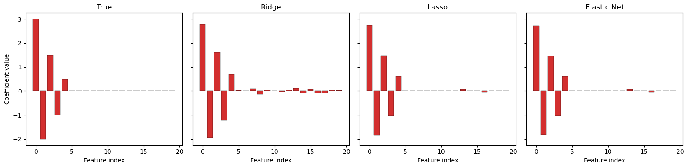
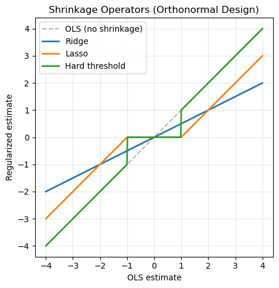

# 능형회귀·라쏘·엘라스틱넷 비교

## 개요

이 절에서는 능형회귀, 라쏘, 엘라스틱넷을 한자리에 놓고 비교한다. 상관된 설명변수를 갖는
인공자료에 세 방법을 모두 적합하되 조율모수는 교차검증으로 고르고, 계수 추정치와 정칙화 경로,
편향-분산 행동을 살펴본다. 목표는 어떤 상황에서 어느 방법이 나은지에 대한 감각을 기르는 것이다.

---

## 1. 통합된 정식화

세 방법은 모두

$$
\hat{\beta} = \arg\min_{\beta} \left\{ \frac{1}{2n}\|y - X\beta\|_2^2 + \lambda \left[\alpha \|\beta\|_1 + \frac{1-\alpha}{2}\|\beta\|_2^2\right] \right\}
$$

의 특수한 경우로 표현된다.

| 방법 | $\alpha$ | 벌점 | 희소성 |
|---|---|---|---|
| 능형회귀 | 0 | $\frac{\lambda}{2}\|\beta\|_2^2$ | 없음 |
| 라쏘 | 1 | $\lambda\|\beta\|_1$ | 있음 |
| 엘라스틱넷 | $(0,1)$ | $\lambda[\alpha\|\beta\|_1 + \frac{1-\alpha}{2}\|\beta\|_2^2]$ | 있음 |

---

## 2. 코드: 다중공선성이 있는 자료 생성

다음 스크립트는 $\rho = 0.8$인 퇴플리츠 상관구조 $\Sigma_{ij} = \rho^{|i-j|}$를 갖는 설명변수
$p = 20$개와 관측치 $n = 200$개를 생성한다.

<div class="exbox" markdown>

**보기 1.** <span class="diff easy" title="쉬움"></span> 상관된 설명변수 자료 만들기. 독립인 표준정규 행벡터 $z$에 퇴플리츠 행렬 $\Sigma_{ij} = \rho^{\lvert i-j\rvert}$의 콜레스키 인수 $L$($\Sigma = LL^\top$)을 붙여 $x = Lz$로 설명변수를 만든다. $p = 20$, $\rho = 0.8$이고 참 계수는 $\beta = (3, -2, 1.5, -1, 0.5, 0, \dots, 0)$, 잡음은 $N(0,1)$이다.

**(1)** 이렇게 만든 $x$의 공분산이 정말 $\Sigma$임을 보이고, 신호의 분산 $\beta^\top\Sigma\beta$와 모형이 설명할 수 있는 최대 비율(이론적 $R^2$)을 구하시오.

**(2)** $n = 200$으로 한 번 뽑은 자료에서 표본상관과 $\operatorname{Var}(y)$가 (1)의 값과 맞는지 확인하시오.

</div>

??? success "풀이"

    **(1) 해석적으로.** $z$의 성분이 독립이고 분산이 1이므로 $E[zz^\top] = I_p$다. 따라서

    $$
    \operatorname{Cov}(x) = E[Lz(Lz)^\top] = L\,E[zz^\top]\,L^\top = LL^\top = \Sigma
    $$

    이다. 콜레스키 인수가 하는 일은 이것뿐이다. **독립인 잡음에 원하는 상관을 입힌다.** 이웃한 변수의 상관은 $\rho = 0.8$, 두 칸 떨어지면 $\rho^2 = 0.64$, 세 칸이면 $\rho^3 = 0.512$로 지수적으로 줄어든다.

    신호의 분산은 이차형식이다. $\beta$가 앞 다섯 자리에만 값을 가지므로 $5 \times 5$ 블록만 계산하면 된다.

    $$
    \beta^\top\Sigma\beta = \sum_i \beta_i^2 + 2\sum_{i<j} \beta_i\beta_j\,\rho^{\,j-i}
    $$

    첫 항은 $9 + 4 + 2.25 + 1 + 0.25 = 16.5$다. 둘째 항은 간격별로 묶는다.

    | 간격 | $\sum \beta_i\beta_j$ | $\rho^{\,\text{간격}}$ | 곱 |
    |---:|---:|---:|---:|
    | 1 | $-6-3-1.5-0.5 = -11$ | $0.8$ | $-8.8$ |
    | 2 | $4.5+2+0.75 = 7.25$ | $0.64$ | $4.64$ |
    | 3 | $-3-1 = -4$ | $0.512$ | $-2.048$ |
    | 4 | $1.5$ | $0.4096$ | $0.6144$ |

    합이 $-5.5936$이고 두 배 하면 $-11.1872$이므로

    $$
    \beta^\top\Sigma\beta = 16.5 - 11.1872 = 5.3128
    $$

    이다. **부호가 번갈아 가는 계수와 양의 상관이 만나 신호가 깎였다.** 계수제곱합이 $16.5$인데 실제 신호분산은 그 3분의 1에 못 미친다. 잡음분산이 1이므로

    $$
    \operatorname{Var}(y) = 5.3128 + 1 = 6.3128,
    \qquad
    R^2_{\max} = \frac{5.3128}{6.3128} = 0.8416
    $$

    이다. 어떤 방법을 쓰더라도 이 자료에서 설명할 수 있는 몫은 $84\%$가 한계다.

    **(2) 수치적으로.**

    ```python
    import numpy as np
    from sklearn.preprocessing import StandardScaler

    def generate_data(n=200, p=20, s=5, rho=0.8, noise=1.0):
        """서로 상관된 설명변수를 갖는 회귀자료를 만든다.

        이웃한 변수끼리 rho, 두 칸 떨어지면 rho^2 로 상관이 줄어드는 구조다.
        콜레스키 분해로 독립 정규에 이 상관을 입힌다. 세 벌점회귀가 갈리는
        곳이 바로 이런 상관 구조에서다.

        n: 관측 수, p: 변수 수, s: 참으로 0 이 아닌 계수의 수
        rho: 이웃한 변수 사이의 상관
        """
        Sigma = np.array([[rho**abs(i-j) for j in range(p)] for i in range(p)])
        L = np.linalg.cholesky(Sigma)
        X = np.random.randn(n, p) @ L.T

        beta_true = np.zeros(p)
        beta_true[:s] = np.array([3, -2, 1.5, -1, 0.5])

        y = X @ beta_true + noise * np.random.randn(n)
        return X, y, beta_true

    np.random.seed(42)
    X, y, beta_true = generate_data()
    scaler = StandardScaler()
    X_scaled = scaler.fit_transform(X)

    # --- 유도한 값이 맞는지 확인한다 ---
    rho, p = 0.8, 20
    Sigma = np.array([[rho**abs(i-j) for j in range(p)] for i in range(p)])

    R = np.corrcoef(X, rowvar=False)
    for lag in (1, 2, 3):
        emp = np.mean([R[i, i+lag] for i in range(p - lag)])
        print(f"상관 lag {lag}:  이론 {rho**lag:.4f}   표본평균 {emp:.4f}")

    sig2 = beta_true @ Sigma @ beta_true
    print(f"신호분산 b'Sb = {sig2:.4f},   Var(y) 이론 = {sig2 + 1:.4f},  표본 = {y.var(ddof=1):.4f}")
    print(f"이론 R^2 = {sig2 / (sig2 + 1):.4f}")
    ```

    출력:

    ```
    상관 lag 1:  이론 0.8000   표본평균 0.7943
    상관 lag 2:  이론 0.6400   표본평균 0.6348
    상관 lag 3:  이론 0.5120   표본평균 0.5093
    신호분산 b'Sb = 5.3128,   Var(y) 이론 = 6.3128,  표본 = 6.1189
    이론 R^2 = 0.8416
    ```

    세 간격의 표본상관 $0.7943$, $0.6348$, $0.5093$이 이론값 $0.8$, $0.64$, $0.512$와 맞는다. 상관계수 하나의 표준오차가 대략 $(1-\rho^2)/\sqrt n = 0.36/\sqrt{200} = 0.025$이므로 어긋남 $0.006$은 몬테카를로 오차 안이다.

    $\beta^\top\Sigma\beta$가 코드에서도 정확히 $5.3128$로 나와 손계산과 맞는다. 표본분산은 $6.1189$로 이론값 $6.3128$보다 조금 작은데, $n = 200$에서 분산의 표준오차가 $\operatorname{Var}(y)\sqrt{2/(n-1)} = 0.63$이므로 $0.19$의 차이는 역시 설명된다.

20개 계수 중 5개만 0이 아니므로 참 구조는 희소하다.

---

## 3. 코드: 교차검증 적합

각 방법은 scikit-learn에 내장된 교차검증으로 최적 $\lambda$(엘라스틱넷은 $\alpha$까지)를 고른다.

<div class="exbox" markdown>

**보기 2.** <span class="diff easy" title="쉬움"></span> 세 방법을 교차검증으로 적합. 보기 1의 자료에 능형·라쏘·엘라스틱넷을 적합하되 벌점은 모두 $5$-겹 교차검증으로 고른다.

**(1)** 능형 해 $\hat\beta = (X^\top X + \lambda I)^{-1}X^\top y$를 쓰면 유효자유도가 $\operatorname{df}(\lambda) = \sum_j d_j^2/(d_j^2+\lambda)$임을 보이고, 이 값이 $\lambda = 0$과 $\lambda \to \infty$에서 각각 얼마가 되는지 말하시오.

**(2)** 세 방법이 고른 벌점과 살아남은 계수의 개수를 구하고, 능형이 고른 `alpha` 를 라쏘의 `alpha` 와 **직접 견주어서는 안 되는** 까닭을 수로 보이시오.

</div>

??? success "풀이"

    **(1) 해석적으로.** $X$의 특이값분해를 $X = UDV^\top$($D = \operatorname{diag}(d_1,\dots,d_p)$)라 하면

    $$
    X(X^\top X + \lambda I)^{-1}X^\top
    = UD(D^2+\lambda I)^{-1}DU^\top
    = U\operatorname{diag}\!\left(\frac{d_j^2}{d_j^2+\lambda}\right)U^\top
    $$

    이다. 적합값을 만드는 이 행렬이 능형의 모자행렬이고, 그 대각합이 유효자유도다.

    $$
    \operatorname{df}(\lambda) = \operatorname{tr}\!\left[X(X^\top X+\lambda I)^{-1}X^\top\right]
    = \sum_{j=1}^p \frac{d_j^2}{d_j^2+\lambda}
    $$

    $\lambda = 0$이면 항마다 1이 되어 $\operatorname{df}(0) = p$로 최소제곱과 같고, $\lambda \to \infty$이면 모든 항이 0으로 가서 $\operatorname{df} \to 0$이다. **벌점이 모수의 개수를 연속적으로 줄인다.** 능형은 계수를 하나도 버리지 않지만 자유도는 확실히 줄어든다는 것이 요점이고, 이 식은 부록 A 모자행렬의 대각합과 같은 구조다.

    **(2) 수치적으로.** 배율 문제가 먼저다. scikit-learn의 `Ridge` 는 $\|y-X\beta\|_2^2 + \alpha\|\beta\|_2^2$를, `Lasso` 는 $\frac{1}{2n}\|y-X\beta\|_2^2 + \alpha\|\beta\|_1$을 최소화한다. 잔차항의 배율이 $2n$배 다르므로 능형의 `alpha` 를 라쏘 척도로 옮기려면 $2n = 400$으로 나누어야 한다.

    ```python
    from sklearn.linear_model import RidgeCV, LassoCV, ElasticNetCV

    # 세 방법 모두 교차검증으로 벌점을 고른다. 엘라스틱넷은 벌점의 세기와
    # 배합비(l1_ratio) 둘을 함께 골라야 하므로 격자가 2차원이 된다.
    alphas = np.logspace(-4, 2, 100)

    ridge_cv = RidgeCV(alphas=alphas, cv=5)
    ridge_cv.fit(X_scaled, y)

    lasso_cv = LassoCV(n_alphas=100, cv=5, max_iter=10000)
    lasso_cv.fit(X_scaled, y)

    enet_cv = ElasticNetCV(
        l1_ratio=[0.1, 0.5, 0.7, 0.9, 0.95],
        n_alphas=100, cv=5, max_iter=10000
    )
    enet_cv.fit(X_scaled, y)

    for name, m in [("Ridge", ridge_cv), ("Lasso", lasso_cv), ("ElasticNet", enet_cv)]:
        nz = np.sum(np.abs(m.coef_) > 1e-6)
        err = np.sum((m.coef_ - beta_true) ** 2)
        print(f"{name:11s} alpha={m.alpha_:.4f}  0이 아닌 계수 {nz:2d}개  "
              f"||b-b_true||^2 = {err:.4f}")
    print(f"엘라스틱넷이 고른 l1_ratio = {enet_cv.l1_ratio_}")
    print(f"능형의 alpha 를 라쏘 척도로 = {ridge_cv.alpha_ / (2 * len(y)):.6f}")

    # 능형은 닫힌 꼴이 있다. 직접 풀어 sklearn 과 맞춰 본다.
    beta_cf = np.linalg.solve(X_scaled.T @ X_scaled + ridge_cv.alpha_ * np.eye(20),
                              X_scaled.T @ (y - y.mean()))
    print(f"닫힌 꼴과 sklearn 능형 계수의 최대 차이 = {np.abs(beta_cf - ridge_cv.coef_).max():.2e}")
    d = np.linalg.svd(X_scaled, compute_uv=False)
    print(f"유효자유도 df(lambda) = {np.sum(d**2 / (d**2 + ridge_cv.alpha_)):.4f}  (p = 20)")
    ```

    출력:

    ```
    Ridge       alpha=0.7565  0이 아닌 계수 20개  ||b-b_true||^2 = 0.2300
    Lasso       alpha=0.0240  0이 아닌 계수  8개  ||b-b_true||^2 = 0.1178
    ElasticNet  alpha=0.0253  0이 아닌 계수  8개  ||b-b_true||^2 = 0.1323
    엘라스틱넷이 고른 l1_ratio = 0.95
    능형의 alpha 를 라쏘 척도로 = 0.001891
    닫힌 꼴과 sklearn 능형 계수의 최대 차이 = 2.66e-15
    유효자유도 df(lambda) = 19.6479  (p = 20)
    ```

    **닫힌 꼴이 소수점 열다섯째 자리까지 맞는다.** 능형에는 반복 알고리즘이 필요 없다는 것이 이 한 줄로 확인된다.

    유효자유도는 $19.6479$다. 계수가 20개 모두 살아 있지만 자유도로 세면 $20$이 아니라 $19.65$이고, 교차검증이 고른 벌점이 이만큼 약하다는 뜻이다. 상관이 강해 작은 특이값이 있었다면 같은 $\lambda$에서도 자유도가 훨씬 많이 깎였을 것이다.

    `alpha` 비교의 함정이 수로 드러난다. 겉보기에는 능형 $0.7565$가 라쏘 $0.0240$의 서른 배처럼 보이지만, 라쏘 척도로 환산한 능형의 벌점은 $0.0019$로 오히려 라쏘의 $8$분의 1이다. **두 숫자는 애초에 같은 단위가 아니다.** 비교해야 할 것은 벌점값이 아니라 교차검증 오차이고, 여기서는 계수추정 오차 $\|\hat\beta - \beta\|^2$가 라쏘 $0.1178$, 엘라스틱넷 $0.1323$, 능형 $0.2300$으로 희소한 참 구조를 반영한다.

!!! warning "`alpha`라는 이름의 두 가지 의미"
    scikit-learn에서 `Ridge`/`Lasso`/`ElasticNet`의 `alpha`는 이 절의 $\lambda$에 해당하고,
    `ElasticNetCV`의 `l1_ratio`가 이 절의 $\alpha$에 해당한다. 게다가 `Ridge`의 목적함수는
    $\|y - X\beta\|_2^2 + \alpha\|\beta\|_2^2$로 $1/(2n)$ 배율이 없는 반면 `Lasso`는
    $\frac{1}{2n}\|y - X\beta\|_2^2 + \alpha\|\beta\|_1$을 쓴다. 따라서 **두 방법의 `alpha`
    값을 직접 비교하면 안 된다.** 비교해야 하는 것은 교차검증 오차이지 $\lambda$ 값 자체가
    아니다.

---

## 4. 계수 비교

참 계수와 세 추정치를 나란히 그린 막대그림에서 다음을 볼 수 있다.

- **능형회귀**는 20개 계수를 모두 0이 아닌 값으로 유지하며, 무관한 계수를 축소하되 0으로 만들지는
  않는다.
- **라쏘**는 많은 계수를 정확히 0으로 만들어 참 희소 구조를 상당히 잘 되찾는다.
- **엘라스틱넷**은 라쏘와 비슷하게 행동하지만 상관된 설명변수를 몇 개 더 남기는 경향이 있다.

<div class="exbox" markdown>

**보기 3.** <span class="diff easy" title="쉬움"></span> 계수를 나란히 그리기. 참 계수와 세 추정치를 네 칸에 나란히 그리시오. 그림에서 세 방법의 성격 차이로 무엇을 읽어 낼 수 있는가. 또 이 그림이 **보여 주지 못하는 것**은 무엇인가.

</div>

??? success "풀이"

    **유도할 답은 없다.** 그려서 읽는 것이 전부인 보기이므로, 그림에서 실제로 읽히는 것을 수와 함께 적는다.

    ```python
    import matplotlib.pyplot as plt

    plt.rcParams["font.sans-serif"] = ["NanumGothic", "Apple SD Gothic Neo", "Malgun Gothic"]
    plt.rcParams["font.family"] = "sans-serif"
    plt.rcParams["axes.unicode_minus"] = False

    # 참 계수와 세 방법의 계수를 나란히 그린다. 0 이 아닌 계수를 붉게 칠해
    # 어느 방법이 몇 개를 살렸는지 한눈에 보이게 한다. 능형은 회색 막대가
    # 하나도 없을 것이다 — 정확히 0 이 되지 못하기 때문이다.
    fig, axes = plt.subplots(1, 4, figsize=(16, 4), sharey=True)
    p = X_scaled.shape[1]

    for ax, name, coefs in [
        (axes[0], "True", beta_true),
        (axes[1], "Ridge", ridge_cv.coef_),
        (axes[2], "Lasso", lasso_cv.coef_),
        (axes[3], "Elastic Net", enet_cv.coef_),
    ]:
        colors = ['#d32f2f' if abs(c) > 1e-6 else '#90a4ae' for c in coefs]
        ax.bar(range(p), coefs, color=colors, edgecolor='black', linewidth=0.3)
        ax.set_title(name)
        ax.set_xlabel("Feature index")
        ax.axhline(0, color='black', linewidth=0.5)

    axes[0].set_ylabel("Coefficient value")
    plt.tight_layout()
    plt.show()

    for name, coefs in [("True", beta_true), ("Ridge", ridge_cv.coef_),
                        ("Lasso", lasso_cv.coef_), ("ElasticNet", enet_cv.coef_)]:
        nz = np.where(np.abs(coefs) > 1e-6)[0]
        print(f"{name:11s} 0이 아닌 자리 {list(nz)}")
        print(f"{'':11s}  앞 다섯 계수 {np.round(coefs[:5], 3)}")
    ```

    출력:

    ```
    True        0이 아닌 자리 [0, 1, 2, 3, 4]
                 앞 다섯 계수 [ 3.  -2.   1.5 -1.   0.5]
    Ridge       0이 아닌 자리 [0, 1, 2, 3, 4, 5, 6, 7, 8, 9, 10, 11, 12, 13, 14, 15, 16, 17, 18, 19]
                 앞 다섯 계수 [ 2.791 -1.942  1.628 -1.21   0.705]
    Lasso       0이 아닌 자리 [0, 1, 2, 3, 4, 6, 13, 16]
                 앞 다섯 계수 [ 2.737 -1.849  1.486 -1.038  0.626]
    ElasticNet  0이 아닌 자리 [0, 1, 2, 3, 4, 6, 13, 16]
                 앞 다섯 계수 [ 2.722 -1.827  1.468 -1.026  0.621]
    ```

    

    **읽을 것 셋.**

    첫째, **능형 칸만 오른쪽 절반에 잔물결이 남아 있다.** 자리 5번부터 19번까지 참값이 모두 0인데 능형은 $-0.136$에서 $0.123$ 사이의 작은 값을 열다섯 개 모두 붙여 놓았다. 라쏘와 엘라스틱넷 칸의 같은 구간은 바닥이 평평하다. 이것이 $L_2$와 $L_1$의 차이를 눈으로 보는 가장 짧은 방법이다.

    둘째, **라쏘가 남긴 세 개의 거짓 양성**이 자리 6, 13, 16에 있다. 계수는 각각 $0.010$, $0.080$, $-0.042$로 참 신호 중 가장 작은 $0.5$에 견주어도 한참 작다. 참 변수의 이웃이 상관 $\rho = 0.8$로 끌려 들어온 것이고, 이 자료의 희소성 회복은 완벽하지 않다.

    셋째, **라쏘는 살아남은 계수도 참값보다 작게 준다.** $3 \to 2.737$, $-2 \to -1.849$로 모두 0 쪽으로 밀려 있다. 연성 문턱화가 크기와 무관하게 $\lambda$만큼 깎기 때문이고, 능형의 $2.791$보다도 작다. **변수를 고르는 대가로 남은 계수에 편향이 생긴다.**

    **이 그림이 가리는 것.** 막대그림은 계수 하나하나의 **불확실성**을 전혀 보이지 않는다. 자리 13의 $0.080$이 자료를 다시 뽑아도 살아남을지 이 그림만으로는 알 수 없다. 또 이것은 **표본 하나의 결과**이므로 "라쏘가 8개를 고른다"가 아니라 "이 표본에서 8개를 골랐다"로 읽어야 한다.

    !!! note "엘라스틱넷이 라쏘와 같은 집합을 골랐다"
        본문은 엘라스틱넷이 상관된 설명변수를 몇 개 더 남기는 경향이 있다고 적었으나, 이 표본에서는 **둘이 똑같은 8개**를 골랐다. 교차검증이 `l1_ratio = 0.95` 를 택해 벌점의 95%가 $L_1$이었기 때문이다. 그룹 효과는 $\alpha$가 작을 때 뚜렷해지며, 연습문제 1의 $\rho = 0.9$ 자료에서는 엘라스틱넷이 하나를 더 남긴다.

---

## 5. 정칙화 경로

계수 크기를 $\log_{10}(\lambda)$의 함수로 그리면 축소 행동이 뚜렷이 드러난다.

- **능형 경로:** 계수가 매끄럽고 연속적으로 0을 향해 축소되며 정확히 0에 도달하는 계수는 없다.
- **라쏘 경로:** 계수가 축소되다가 서로 다른 $\lambda$ 문턱에서 정확히 0이 되며, 경로가 조각별
  선형이다.

<div class="exbox" markdown>

**보기 4.** <span class="diff easy" title="쉬움"></span> 능형과 라쏘의 경로. 벌점을 넓은 구간에서 훑으며 계수가 어떻게 변하는지 기록한다.

**(1)** 라쏘의 모든 계수가 정확히 0이 되는 가장 작은 벌점 $\lambda_{\max}$를 하위기울기 조건에서 유도하시오. 능형에는 그런 $\lambda$가 있는가.

**(2)** 격자로 훑은 경로와 LARS가 준 정확한 꺾임점에서 (1)의 $\lambda_{\max}$를 확인하시오.

</div>

??? success "풀이"

    **(1) 해석적으로.** 라쏘의 목적함수 $\frac{1}{2n}\|y-X\beta\|_2^2 + \lambda\|\beta\|_1$가 $\beta = 0$에서 최솟값을 가질 조건을 쓴다. $\lvert\beta_j\rvert$는 0에서 미분할 수 없으므로 하위기울기를 쓰며, $\partial\lvert\beta_j\rvert\big|_{\beta_j=0} = [-1, 1]$이다. 최적성 조건은

    $$
    -\frac{1}{n}x_j^\top(y - X\cdot 0) + \lambda s_j = 0,
    \qquad s_j \in [-1, 1]
    $$

    이고, 이는 모든 $j$에 대해 $\lvert x_j^\top y\rvert / n \le \lambda$라는 뜻이다. 따라서

    $$
    \lambda_{\max} = \max_j \frac{\lvert x_j^\top y\rvert}{n}
    $$

    이고, $\lambda \ge \lambda_{\max}$이면 해가 정확히 영벡터다. **처음 들어오는 변수는 반응과 상관이 가장 큰 변수**이며, 그 변수가 들어오는 자리가 바로 $\lambda_{\max}$다.

    능형에는 그런 문턱이 없다. 해가 $(X^\top X + \lambda I)^{-1}X^\top y$로 $\lambda$의 유리함수여서 $X^\top y \ne 0$인 한 어떤 유한한 $\lambda$에서도 0이 되지 않는다. $\lambda \to \infty$에서 0으로 **다가갈** 뿐이다.

    **(2) 수치적으로.**

    ```python
    from sklearn.linear_model import Ridge, Lasso

    alphas_path = np.logspace(-3, 3, 200)

    # 능형 경로: 계수가 부드럽게 0 으로 다가가되 닿지는 않는다.
    ridge_coefs = []
    for a in alphas_path:
        model = Ridge(alpha=a).fit(X_scaled, y)
        ridge_coefs.append(model.coef_.copy())
    ridge_coefs = np.array(ridge_coefs)

    # 라쏘 경로: 계수가 하나씩 0 에 닿아 그대로 머문다. 두 그림의 이 차이가
    # 곧 변수 선택을 하느냐 못 하느냐의 차이다.
    lasso_coefs = []
    alphas_lasso = np.logspace(-4, 1, 200)
    for a in alphas_lasso:
        model = Lasso(alpha=a, max_iter=10000).fit(X_scaled, y)
        lasso_coefs.append(model.coef_.copy())
    lasso_coefs = np.array(lasso_coefs)

    print(f"능형 경로에서 계수가 정확히 0 인 횟수 = {(ridge_coefs == 0).sum()}")
    print(f"능형 경로의 |계수| 최솟값 = {np.abs(ridge_coefs).min():.3e}  (0 이 아니다)")

    n_nz = (np.abs(lasso_coefs) > 1e-8).sum(axis=1)
    print(f"라쏘 경로의 0 아닌 계수 개수: {n_nz[0]} (alpha=1e-4) -> {n_nz[-1]} (alpha=10)")

    lam_max = np.abs(X_scaled.T @ (y - y.mean())).max() / len(y)
    print(f"이론 lambda_max = max_j |x_j'y|/n = {lam_max:.4f}")
    print(f"격자에서 모든 계수가 0 이 된 가장 작은 alpha = "
          f"{alphas_lasso[np.where(n_nz == 0)[0][0]]:.4f}")

    # LARS 는 꺾임점을 격자 없이 정확히 찾아 준다.
    from sklearn.linear_model import lars_path
    knots, _, _ = lars_path(X_scaled, y - y.mean(), method='lasso')
    print(f"LARS 가 찾은 꺾임점 {len(knots)}개, 가장 큰 것 = {knots[0]:.4f}")
    ```

    출력:

    ```
    능형 경로에서 계수가 정확히 0 인 횟수 = 0
    능형 경로의 |계수| 최솟값 = 9.924e-05  (0 이 아니다)
    라쏘 경로의 0 아닌 계수 개수: 20 (alpha=1e-4) -> 0 (alpha=10)
    이론 lambda_max = max_j |x_j'y|/n = 1.9458
    격자에서 모든 계수가 0 이 된 가장 작은 alpha = 1.9792
    LARS 가 찾은 꺾임점 23개, 가장 큰 것 = 1.9458
    ```

    **LARS가 준 가장 큰 꺾임점 $1.9458$이 유도한 $\lambda_{\max} = \max_j\lvert x_j^\top y\rvert/n$과 소수 넷째 자리까지 같다.** 격자가 준 $1.9792$는 조금 크지만, 이는 유도가 틀려서가 아니라 로그 격자 200점의 간격이 $10^{5/199} = 1.059$배여서 $1.9458$ 바로 위 격자점이 $1.9792$이기 때문이다. **해석적으로 푼 답은 정확하고, 격자는 격자만큼만 정확하다.**

    능형 쪽은 $\alpha = 10^3$까지 밀어붙여도 정확히 0이 된 계수가 하나도 없다. 가장 작은 절댓값이 $9.9\times10^{-5}$로 0에 가깝지만 0은 아니다. **이 한 줄이 "능형은 변수선택을 못 한다"는 말의 전부다.**

    꺾임점이 23개라는 것도 읽어 둘 만하다. 변수가 20개뿐이니 한 번에 하나씩 들어오기만 했다면 $\lambda_{\max}$와 $0$을 포함해 21개여야 한다. 실제 활성집합의 크기를 세어 보면 $0,1,2,\dots,19,19,19,20$으로 **19에서 세 번 머문다.** 변수가 하나 들어오는 동안 다른 하나가 빠졌다는 뜻이고, 라쏘 경로가 단조로운 전진선택이 아니라는 증거다.

---

## 6. 축소 연산자

정규직교 계획($X^\top X = I$)에서는 세 방법이 OLS 추정치 $\hat{\beta}^{\text{OLS}}$에 적용되는
서로 다른 축소 연산자에 대응한다.

$$
\hat{\beta}_j^{\text{Ridge}} = \frac{\hat{\beta}_j^{\text{OLS}}}{1 + \lambda}, \qquad
\hat{\beta}_j^{\text{Lasso}} = S(\hat{\beta}_j^{\text{OLS}}, \lambda), \qquad
\hat{\beta}_j^{\text{Hard}} = \hat{\beta}_j^{\text{OLS}} \cdot \mathbf{1}(|\hat{\beta}_j^{\text{OLS}}| > \lambda).
$$

<div class="exbox" markdown>

**보기 5.** <span class="diff easy" title="쉬움"></span> 축소 연산자 그리기. 위 세 식을 $\lambda = 1$에서 한 그림에 그린다.

**(1)** 최소제곱 추정값이 $2.5$, $0.6$, $-3.0$일 때 세 연산자가 각각 무엇을 돌려주는지 손으로 계산하시오.

**(2)** 그림을 그려 (1)을 확인하고, 세 곡선의 모양에서 각 방법의 편향이 어떻게 다른지 읽으시오.

</div>

??? success "풀이"

    **(1) 해석적으로.** $\lambda = 1$을 세 식에 그대로 넣는다.

    능형은 $z/(1+\lambda) = z/2$이므로 $2.5 \mapsto 1.25$, $0.6 \mapsto 0.3$, $-3 \mapsto -1.5$다. **크기와 무관하게 절반으로 줄인다.**

    라쏘는 연성 문턱화 $\operatorname{sign}(z)(\lvert z\rvert - 1)_+$다. $2.5 \mapsto 1.5$, $-3 \mapsto -2$로 $1$씩 깎이고, $0.6$은 $\lvert z\rvert < \lambda$이므로 $0$이 된다.

    경성 문턱은 $z\cdot\mathbf 1(\lvert z\rvert > 1)$이므로 $2.5 \mapsto 2.5$, $-3 \mapsto -3$으로 **그대로 두거나** $0.6 \mapsto 0$으로 **통째로 버린다.**

    여기서 세 방법의 편향이 갈린다. $\lvert z\rvert$가 클 때 능형의 편향은 $z/2$로 **$z$에 비례해 커지고**, 라쏘의 편향은 $1$로 **일정하며**, 경성 문턱의 편향은 $0$이다. 큰 계수를 다치지 않게 하는 순서는 경성 문턱, 라쏘, 능형이다. 대신 경성 문턱은 $z = \pm 1$에서 $1$만큼 **뛴다.** 불연속이라는 대가를 치르는 것이며, 자료가 조금만 흔들려도 추정값이 널뛴다.

    **(2) 수치적으로.**

    ```python
    plt.rcParams["font.sans-serif"] = ["NanumGothic", "Apple SD Gothic Neo", "Malgun Gothic"]
    plt.rcParams["font.family"] = "sans-serif"
    plt.rcParams["axes.unicode_minus"] = False

    def plot_shrinkage_operators(lam=1.0):
        """정규직교 설계에서 세 축소 연산자가 최소제곱 추정값을 어떻게 바꾸는지 그린다.

        설계행렬이 정규직교이면 세 방법의 해가 최소제곱 추정값의 간단한 함수로
        나온다. 능형은 일정 비율로 줄이고(직선), 라쏘는 일정 크기만큼 깎아
        작은 값은 0 으로 보내며(꺾인 직선), 경성 문턱은 문턱 아래를 통째로
        0 으로 만든다(계단).
        """
        z = np.linspace(-4, 4, 500)
        ridge = z / (1 + lam)
        lasso = np.sign(z) * np.maximum(np.abs(z) - lam, 0)
        hard = z * (np.abs(z) > lam)

        fig, ax = plt.subplots(figsize=(7, 5))
        ax.plot(z, z, 'k--', alpha=0.3, label="OLS (no shrinkage)")
        ax.plot(z, ridge, linewidth=2, label=f"Ridge")
        ax.plot(z, lasso, linewidth=2, label=f"Lasso")
        ax.plot(z, hard, linewidth=2, label=f"Hard threshold")
        ax.set_xlabel("OLS estimate")
        ax.set_ylabel("Regularized estimate")
        ax.set_title("Shrinkage Operators (Orthonormal Design)")
        ax.legend()
        ax.set_aspect('equal')
        ax.grid(True, alpha=0.3)
        plt.tight_layout()
        plt.show()

    plot_shrinkage_operators()

    # (1) 에서 손으로 계산한 세 값을 그대로 확인한다.
    def shrink(z, lam=1.0):
        return (z / (1 + lam),
                np.sign(z) * np.maximum(np.abs(z) - lam, 0),
                z * (np.abs(z) > lam))

    for z0 in (2.5, 0.6, -3.0):
        r, l, h = shrink(np.array(z0))
        print(f"OLS {z0:+.1f}  ->  능형 {r:+.3f}   라쏘 {l:+.3f}   경성 {h:+.3f}")
    ```

    출력:

    ```
    OLS +2.5  ->  능형 +1.250   라쏘 +1.500   경성 +2.500
    OLS +0.6  ->  능형 +0.300   라쏘 +0.000   경성 +0.000
    OLS -3.0  ->  능형 -1.500   라쏘 -2.000   경성 -3.000
    ```

    

    아홉 개 값이 (1)의 손계산과 모두 맞는다.

    그림에서 읽을 것은 **세 곡선이 대각선(축소 없음)에서 떨어지는 방식**이다. 능형은 기울기 $1/2$인 직선이라 오른쪽으로 갈수록 대각선에서 **점점 멀어진다.** 라쏘는 대각선과 평행한 직선이라 벌어진 폭이 어디서나 $1$로 **일정하다.** 경성 문턱은 $\lvert z\rvert > 1$에서 대각선과 **포개진다.**

    **능형만 $0.6$을 살려 둔다.** 세 곡선 중 원점 근처에서 0이 아닌 것은 능형뿐이고, 이것이 능형이 희소해를 주지 못하는 이유를 한 점에서 보여 준다.

    여기서 경성 문턱은 문턱값을 $\lambda$로 두고 그린 것이다. 연습문제 5에서 보듯이, 벌점 $\lambda\cdot\mathbf{1}(\beta_j \ne 0)$에서 유도되는 경성 문턱의 문턱값은 $\sqrt{2\lambda}$다. 두 그림은 문턱 위치만 다를 뿐 모양은 같다.

---

## 7. 편향-분산 절충

500회 반복 모의실험에서 다음을 확인할 수 있다.

- **능형회귀**의 MSE 곡선은 매끄러운 U자다. 작지만 0이 아닌 계수가 많을 때 가장 잘 작동한다.
- **라쏘**는 진짜로 희소한 상황에서 더 낮은 MSE를 달성할 수 있다. 변수선택이 잡음 차원을
  제거하기 때문이다.
- 각 방법의 최적 $\lambda$는 편향(과도한 축소로 인한 과소적합)과 분산(불충분한 축소로 인한
  과적합)의 균형을 맞춘다.

---

## 8. 해석

| 기준 | 능형회귀 | 라쏘 | 엘라스틱넷 |
|---|---|---|---|
| 희소성 | 없음 | 있음 | 있음 |
| 해의 유일성 | 항상 | $X$가 완전계수일 때만 | 항상($\alpha < 1$) |
| 상관된 집단 | 모두 유지 | 하나만 선택 | 집단 선택 |
| 계산 | 닫힌 형태 | 좌표하강 | 좌표하강 |
| 유리한 상황 | 조밀한 신호 | 희소한 신호 | 희소 + 상관 |

---

## 연습문제

<div class="drillbox" markdown>

**연습문제 1.** <span class="diff med" title="중간"></span> $p = 20$, $\rho = 0.9$이고 참 계수 5개가 0이 아닌 자료를 생성하라. 세 방법을
모두 교차검증으로 적합하고 각각 선택한 0이 아닌 계수의 개수를 비교하라.

</div>

??? success "풀이"

    ```python
    import numpy as np
    from sklearn.linear_model import RidgeCV, LassoCV, ElasticNetCV
    from sklearn.preprocessing import StandardScaler

    np.random.seed(42)
    X, y, beta_true = generate_data(n=200, p=20, s=5, rho=0.9)
    X_s = StandardScaler().fit_transform(X)

    ridge = RidgeCV(alphas=np.logspace(-4, 2, 100), cv=5).fit(X_s, y)
    lasso = LassoCV(n_alphas=100, cv=5, max_iter=10000).fit(X_s, y)
    enet = ElasticNetCV(
        l1_ratio=[0.1, 0.5, 0.7, 0.9], n_alphas=100, cv=5
    ).fit(X_s, y)

    for name, m in [("Ridge", ridge), ("Lasso", lasso), ("Elastic Net", enet)]:
        nz = np.sum(np.abs(m.coef_) > 1e-6)
        print(f"{name}: {nz} nonzero coefficients")
    ```

    출력:

    ```
    Ridge: 20 nonzero coefficients
    Lasso: 9 nonzero coefficients
    Elastic Net: 10 nonzero coefficients
    ```

    실행 결과는 능형회귀 20개, 라쏘 9개, 엘라스틱넷 10개다(라쏘의 $\lambda = 0.0178$,
    엘라스틱넷은 $\alpha = 0.9$, $\lambda = 0.0161$). 참 신호는 5개인데 라쏘가 9개를 고른 것은
    $\rho = 0.9$로 인접 변수들이 강하게 상관되어 있어, 참 변수의 이웃들이 대리변수로 함께
    들어왔기 때문이다. 엘라스틱넷이 하나 더 많은 것은 $L_2$ 성분이 상관된 짝을 함께 남기는
    그룹 효과를 보여준다. 세 방법의 차이는 희소성의 정도이지 예측력이 아니다. $\square$

---

<div class="drillbox" markdown>

**연습문제 2.** <span class="diff med" title="중간"></span> 정칙화를 적용하기 전에 설명변수를 표준화하는 것이 왜 중요한지 설명하라.
표준화하지 않으면 오도된 결과가 나오는 구체적인 수치 예를 들어라.

</div>

??? success "풀이"

    벌점 $\|\beta\|_1$과 $\|\beta\|_2^2$는 모든 계수를 동등하게 취급하지만, OLS 추정치
    $\hat{\beta}_j$는 $x_j$의 척도에 의존한다. $x_1$을 미터로, $x_2$를 밀리미터로 측정했다면
    같은 물리적 효과라도 $\hat{\beta}_1$이 $\hat{\beta}_2$보다 1000배 크다. 그러면 벌점은
    $\hat{\beta}_1$을 훨씬 강하게 축소하게 되어, 설명변수의 중요도가 아니라 단위 선택을 벌하는
    셈이 된다.

    **예:** $x_1 \in [0, 1]$, $x_2 \in [0, 1000]$이고
    $y = x_1 + x_2/1000 + \varepsilon$이라 하자. 표준화하지 않으면
    $\hat{\beta}_1 \approx 1$, $\hat{\beta}_2 \approx 0.001$이 된다. 중간 정도의 $\lambda$를
    쓴 라쏘는 두 설명변수가 똑같이 중요한데도 $\hat{\beta}_2$를 0으로 만들고 $\hat{\beta}_1$은
    남긴다. 표준화 후에는 두 계수의 크기가 비슷해져 라쏘가 둘을 대칭적으로 다룬다. $\square$

---

<div class="drillbox" markdown>

**연습문제 3.** <span class="diff med" title="중간"></span> 위 코드의 편향-분산 모의실험 틀을 이용해 능형회귀와 라쏘의 MSE가 각각 어느
$\lambda$에서 최소가 되는지 구하라. 이 (희소하고 상관된) 상황에서 어느 방법이 더 낮은 최소
MSE를 달성하는가?

</div>

??? success "풀이"

    ```python
    import numpy as np
    from sklearn.linear_model import Ridge, Lasso
    from sklearn.preprocessing import StandardScaler

    np.random.seed(0)
    alphas_test = np.logspace(-3, 2, 30)
    n_sim = 200
    _, _, beta_true_bv = generate_data(n=2, p=20, s=5)

    ridge_mse = {a: [] for a in alphas_test}
    lasso_mse = {a: [] for a in alphas_test}

    for _ in range(n_sim):
        X_sim, y_sim, _ = generate_data(n=100, p=20, s=5)
        X_sim = StandardScaler().fit_transform(X_sim)
        for a in alphas_test:
            r = Ridge(alpha=a).fit(X_sim, y_sim)
            l = Lasso(alpha=a, max_iter=5000).fit(X_sim, y_sim)
            ridge_mse[a].append(np.sum((r.coef_ - beta_true_bv)**2))
            lasso_mse[a].append(np.sum((l.coef_ - beta_true_bv)**2))

    ridge_avg = {a: np.mean(v) for a, v in ridge_mse.items()}
    lasso_avg = {a: np.mean(v) for a, v in lasso_mse.items()}

    best_ridge = min(ridge_avg, key=ridge_avg.get)
    best_lasso = min(lasso_avg, key=lasso_avg.get)
    print(f"Ridge best lambda: {best_ridge:.4f}, MSE: {ridge_avg[best_ridge]:.4f}")
    print(f"Lasso best lambda: {best_lasso:.4f}, MSE: {lasso_avg[best_lasso]:.4f}")
    ```

    출력:

    ```
    Ridge best lambda: 0.8532, MSE: 1.1883
    Lasso best lambda: 0.0161, MSE: 0.8138
    ```

    실행 결과는 능형회귀가 $\lambda = 0.8532$에서 최소 MSE $1.1883$, 라쏘가
    $\lambda = 0.0161$에서 최소 MSE $0.8138$이다. 참 계수 20개 중 15개가 정확히 0인 희소한
    상황이므로, 잡음 차원을 완전히 제거하는 라쏘가 능형회귀보다 32% 낮은 계수추정 MSE를 낸다.

    !!! warning "두 $\lambda$를 직접 비교하지 말 것"
        위에서 능형회귀와 라쏘의 최적 `alpha`가 크게 다른 것은 방법의 성질이 아니라 목적함수
        배율의 차이 때문이다. `Ridge`는 $\|y-X\beta\|_2^2 + \alpha\|\beta\|_2^2$를,
        `Lasso`는 $\frac{1}{2n}\|y-X\beta\|_2^2 + \alpha\|\beta\|_1$을 최소화한다. $n = 100$
        이므로 능형회귀의 `alpha`는 라쏘 척도로 환산할 때 $2n = 200$으로 나누어야 한다.
        비교의 근거로 삼을 것은 최소 MSE 값이다. $\square$

---

<div class="drillbox" markdown>

**연습문제 4.** <span class="diff med" title="중간"></span> 제약형 문제
$\min \|y - X\beta\|_2^2$ subject to $\alpha\|\beta\|_1 + (1-\alpha)\|\beta\|_2^2 \le t$
에서 제약영역이 모든 $\alpha \in [0,1]$에 대해 볼록임을 증명하라.

</div>

??? success "풀이"

    $C = \{\beta : \alpha\|\beta\|_1 + (1-\alpha)\|\beta\|_2^2 \le t\}$라 하자. 임의의
    $\beta_1, \beta_2 \in C$와 $\theta \in [0,1]$에 대해
    $\beta_\theta = \theta\beta_1 + (1-\theta)\beta_2 \in C$임을 보이면 된다.

    함수 $f(\beta) = \alpha\|\beta\|_1 + (1-\alpha)\|\beta\|_2^2$는 두 볼록함수의 음이 아닌
    결합이다.

    - $\|\beta\|_1$은 노름이므로 볼록이다.
    - $\|\beta\|_2^2$는 헤세행렬이 $2I$로 양반정치이므로 볼록이다.

    따라서 $f$는 볼록이고, 볼록성에 의해

    $$
    f(\beta_\theta) \le \theta f(\beta_1) + (1-\theta)f(\beta_2) \le \theta t + (1-\theta)t = t
    $$

    이다. 그러므로 $\beta_\theta \in C$이고 $C$는 볼록집합이다. $\square$

---

<div class="drillbox" markdown>

**연습문제 5.** <span class="diff hard" title="어려움"></span> 정규직교 계획($X^\top X = I_p$)에서 세 축소 공식(능형, 라쏘, 경성 문턱)을
유도하고 하나의 그림에 함께 그려라.

</div>

??? success "풀이"

    $X^\top X = I_p$이면 OLS 추정량은 $\hat{\beta}^{\text{OLS}} = X^\top y$이고, 각 벌점은
    독립된 일변량 문제로 분리된다.

    **능형회귀:**
    $\min_{\beta_j} \frac{1}{2}(\hat{\beta}_j^{\text{OLS}} - \beta_j)^2 + \frac{\lambda}{2}\beta_j^2$
    를 미분하면 $(1+\lambda)\beta_j = \hat{\beta}_j^{\text{OLS}}$이므로
    $\hat{\beta}_j^{\text{Ridge}} = \hat{\beta}_j^{\text{OLS}} / (1+\lambda)$이다.

    **라쏘:**
    $\min_{\beta_j} \frac{1}{2}(\hat{\beta}_j^{\text{OLS}} - \beta_j)^2 + \lambda|\beta_j|$의
    해는 근접 연산자에 의해
    $\hat{\beta}_j^{\text{Lasso}} = S(\hat{\beta}_j^{\text{OLS}}, \lambda)$이다.

    **경성 문턱:**
    $\min_{\beta_j} \frac{1}{2}(\hat{\beta}_j^{\text{OLS}} - \beta_j)^2 + \lambda \cdot \mathbf{1}(\beta_j \ne 0)$
    의 해는 OLS 값을 그대로 두거나(비용 $\lambda$) 0으로 두는(비용
    $\frac{1}{2}(\hat{\beta}_j^{\text{OLS}})^2$) 것 중 더 싼 쪽이므로
    $\hat{\beta}_j^{\text{Hard}} = \hat{\beta}_j^{\text{OLS}} \cdot \mathbf{1}(|\hat{\beta}_j^{\text{OLS}}| > \sqrt{2\lambda})$
    이다.

    그림에서 능형회귀는 원점을 지나고 기울기가 $1/(1+\lambda)$인 직선, 라쏘는
    $[-\lambda, \lambda]$가 사각지대인 조각별 선형함수, 경성 문턱은
    $[-\sqrt{2\lambda}, \sqrt{2\lambda}]$ 밖에서는 항등함수이고 안에서는 0인 불연속함수로
    나타난다. $\square$

---

<div class="drillbox" markdown>

**연습문제 6.** <span class="diff hard" title="어려움"></span> 정규직교 계획 $X^\top X = I_p$에서 $y = X\beta + \varepsilon$, $\varepsilon \sim N(0, \sigma^2 I_n)$이라 하자. 절 6의 축소 연산자에 따라 능형 추정량은 $\hat\beta^{\text{R}}(\lambda) = \hat\beta^{\text{OLS}}/(1+\lambda)$이다.

**(1)** $\operatorname{MSE}(\lambda) = E\lVert \hat\beta^{\text{R}}(\lambda) - \beta\rVert_2^2$를 $\lambda$, $\lVert\beta\rVert_2^2$, $p\sigma^2$만으로 적으시오. 그리고 $\lambda = 0$에서 도함수가 음수임을 보여 **OLS보다 나은 $\lambda$가 반드시 있음**을 증명하시오.

**(2)** MSE를 최소로 하는 $\lambda^*$와 그때의 MSE를 구하시오.

**(3)** 능형이 OLS를 이기는 $\lambda$의 범위를 구하고, 보기 1의 설정($p = 20$, $\sigma^2 = 1$, $\beta = (3,-2,1.5,-1,0.5,0,\dots,0)$)에서 그 범위와 $\lambda^*$를 수로 구하시오.

</div>

??? success "풀이"

    **(1)** $X^\top X = I_p$이면 $\hat\beta^{\text{OLS}} = X^\top y$이고 $\operatorname{Cov}(\hat\beta^{\text{OLS}}) = \sigma^2(X^\top X)^{-1} = \sigma^2 I_p$다. 좌표마다 독립이므로 MSE는 좌표별 편향제곱과 분산의 합으로 갈라진다. 좌표 $j$에서

    $$
    E\!\left[\frac{\hat\beta_j^{\text{OLS}}}{1+\lambda}\right] - \beta_j = -\frac{\lambda\beta_j}{1+\lambda},
    \qquad
    \operatorname{Var}\!\left(\frac{\hat\beta_j^{\text{OLS}}}{1+\lambda}\right) = \frac{\sigma^2}{(1+\lambda)^2}
    $$

    이므로 6장 정리 1(편향-분산 분해)을 좌표마다 적용해 더하면

    $$
    \operatorname{MSE}(\lambda)
    = \sum_{j=1}^p \left[\frac{\lambda^2\beta_j^2}{(1+\lambda)^2} + \frac{\sigma^2}{(1+\lambda)^2}\right]
    = \frac{\lambda^2\lVert\beta\rVert_2^2 + p\sigma^2}{(1+\lambda)^2}
    $$

    이다. 미분한다. 분자를 $N(\lambda) = \lambda^2 B + p\sigma^2$($B = \lVert\beta\rVert_2^2$)로 줄여 쓰면

    $$
    \operatorname{MSE}'(\lambda)
    = \frac{2\lambda B(1+\lambda)^2 - 2(1+\lambda)(\lambda^2 B + p\sigma^2)}{(1+\lambda)^4}
    = \frac{2\left(\lambda B - p\sigma^2\right)}{(1+\lambda)^3}
    $$

    이다. 괄호 안에서 $\lambda^2 B$가 서로 지워지는 것이 요점이다. 따라서

    $$
    \operatorname{MSE}'(0) = -2p\sigma^2 < 0
    $$

    이다. **$\lambda = 0$에서 MSE가 감소하므로 충분히 작은 $\lambda > 0$에서는 반드시 $\operatorname{MSE}(\lambda) < \operatorname{MSE}(0) = p\sigma^2$다.** 분산을 줄이는 이득이 처음에는 $\lambda$의 1차로 들어오고 편향이 늘어나는 손해는 $\lambda^2$으로 들어오기 때문이다. 벌점을 **조금** 걸면 거래는 언제나 남는 장사다.

    **(2)** $\operatorname{MSE}'(\lambda) = 0$은 $\lambda B = p\sigma^2$이므로

    $$
    \lambda^* = \frac{p\sigma^2}{\lVert\beta\rVert_2^2}
    $$

    이고, 도함수의 부호가 $\lambda < \lambda^*$에서 음, $\lambda > \lambda^*$에서 양이므로 이것이 유일한 최솟점이다. $1 + \lambda^* = (B + p\sigma^2)/B$를 넣으면

    $$
    \operatorname{MSE}(\lambda^*)
    = \frac{p^2\sigma^4/B + p\sigma^2}{\left(\frac{B+p\sigma^2}{B}\right)^2}
    = \frac{p\sigma^2(p\sigma^2+B)}{B}\cdot\frac{B^2}{(B+p\sigma^2)^2}
    = \frac{p\sigma^2\lVert\beta\rVert_2^2}{\lVert\beta\rVert_2^2 + p\sigma^2}
    $$

    이다. OLS의 MSE가 $p\sigma^2$이므로 비율은

    $$
    \frac{\operatorname{MSE}(\lambda^*)}{\operatorname{MSE}(0)} = \frac{\lVert\beta\rVert_2^2}{\lVert\beta\rVert_2^2 + p\sigma^2} < 1
    $$

    로 **항상** 1보다 작다. $\lambda^*$는 잡음 총량 $p\sigma^2$을 신호 총량 $\lVert\beta\rVert_2^2$로 나눈 값이다. 신호가 약하거나 차원이 높으면 더 센 벌점을 걸어야 한다.

    **(3)** $\operatorname{MSE}(\lambda) < p\sigma^2$을 풀면

    $$
    \lambda^2 B + p\sigma^2 < p\sigma^2(1 + 2\lambda + \lambda^2)
    \iff
    \lambda^2 B < p\sigma^2(2\lambda + \lambda^2)
    $$

    이고, $\lambda > 0$으로 나누면 $\lambda B < p\sigma^2(2+\lambda)$, 곧

    $$
    \lambda\left(\lVert\beta\rVert_2^2 - p\sigma^2\right) < 2p\sigma^2
    $$

    이다. 경우가 갈린다. $\lVert\beta\rVert_2^2 \le p\sigma^2$이면 왼쪽이 0 이하이므로 **모든** $\lambda > 0$에서 능형이 이긴다. $\lVert\beta\rVert_2^2 > p\sigma^2$이면

    $$
    0 < \lambda < \frac{2p\sigma^2}{\lVert\beta\rVert_2^2 - p\sigma^2}
    $$

    이다. 벌점이 너무 세면 편향이 이겨 OLS보다 나빠진다.

    보기 1의 수를 넣는다. $\lVert\beta\rVert_2^2 = 9 + 4 + 2.25 + 1 + 0.25 = 16.5$이고 $p\sigma^2 = 20$이다.

    | 양 | 값 |
    |---|---:|
    | $\lVert\beta\rVert_2^2$ | $16.5$ |
    | $p\sigma^2$ | $20$ |
    | $\lambda^* = 20/16.5$ | $1.2121$ |
    | $\operatorname{MSE}(0) = p\sigma^2$ | $20$ |
    | $\operatorname{MSE}(\lambda^*) = 20\cdot 16.5/36.5$ | $9.0411$ |

    최적 벌점에서 MSE가 $20 \to 9.0411$로 $54.8\%$ 줄어든다. 그리고 $\lVert\beta\rVert_2^2 = 16.5 < 20 = p\sigma^2$이므로 **이 설정에서는 어떤 $\lambda > 0$을 써도 능형이 OLS를 이긴다.** $\lambda \to \infty$의 극한 MSE는 $\lVert\beta\rVert_2^2 = 16.5$인데 이것조차 $20$보다 작다. 곧 **계수를 전부 0으로 보내 버리는 추정량도 OLS보다 낫다.** 신호의 크기가 차원당 잡음에 못 미치면 OLS는 잡음을 20차원에서 다 받아 적는 셈이고, 그 손해가 $\beta$를 통째로 버리는 손해보다 크다.

    주의할 것은 이 유도가 $\beta$를 아는 척하고 얻은 것이라는 점이다. $\lambda^*$는 쓸 수 없는 값이고, 보기 2에서 교차검증이 하는 일은 자료만 가지고 이 $\lambda^*$를 더듬어 찾는 것이다. $\square$

---

<div class="drillbox" markdown>

**연습문제 7.** <span class="diff hard" title="어려움"></span> 설명변수 두 개가 **완전히 같은** 자료 $x_1 = x_2 = x$를 생각하자. $\lVert x\rVert_2^2 = 1$이고 $z = x^\top y = 1$이다. 벌점은 교과서 꼴로 쓰고 $\lambda = 1$로 둔다. 곧 라쏘는 $\lVert y - X\beta\rVert_2^2 + \lVert\beta\rVert_1$, 엘라스틱넷은 $\lVert y - X\beta\rVert_2^2 + \alpha\lVert\beta\rVert_1 + \frac{1-\alpha}{2}\lVert\beta\rVert_2^2$를 최소화한다.

**(1)** 라쏘의 해집합을 모두 구하시오. 해가 여럿일 때 그래도 **유일하게 정해지는 양**은 무엇인가.

**(2)** $\alpha = 0.5$인 엘라스틱넷의 해를 구하고, 왜 유일하며 왜 두 계수가 **같은 값**이 되는지 설명하시오.

**(3)** 좌표하강이 (1)의 해집합 가운데 한 점을 돌려줄 때, 그 점을 "라쏘가 고른 변수"로 보고해서는 안 되는 까닭을 말하시오.

</div>

??? success "풀이"

    **(1)** 두 열이 같으므로 $X\beta = (\beta_1+\beta_2)x$다. $s = \beta_1 + \beta_2$로 두면 적합 항은 $s$에만 의존한다. $\lVert x\rVert_2^2 = 1$, $z = x^\top y = 1$이므로

    $$
    \lVert y - X\beta\rVert_2^2 = \lVert y\rVert_2^2 - 2sz + s^2 = \lVert y\rVert_2^2 - 2s + s^2
    $$

    이다. 벌점은 $\lvert\beta_1\rvert + \lvert\beta_2\rvert$인데 삼각부등식으로 $\lvert\beta_1\rvert + \lvert\beta_2\rvert \ge \lvert s\rvert$이고, 등호는 $\beta_1\beta_2 \ge 0$(둘이 같은 부호이거나 하나가 0)일 때 성립한다. 그러므로 **$s$를 고정한 뒤 벌점을 최소로 하는 분배는 등호를 주는 모든 분배이고, 거기서 목적함수가 똑같다.** 남은 일은 한 변수 문제

    $$
    \min_s \;\; s^2 - 2s + \lvert s\rvert
    $$

    를 푸는 것이다. $s > 0$에서는 $s^2 - s$로 $s = 1/2$에서 $-1/4$, $s < 0$에서는 $s^2 - 3s$로 $s \to 0^-$에서 상한 $0$에 다가가며 음수가 되지 못한다. 따라서 $s^* = 1/2$이고, 이는 일반식 $s^* = S(z, \lambda/2) = S(1, 0.5) = 0.5$와 맞는다. 해집합은

    $$
    \left\{(t,\; 0.5 - t) \;:\; 0 \le t \le 0.5\right\}
    $$

    로 길이 $0.5\sqrt 2$인 **선분 전체**다. $(0.5, 0)$, $(0, 0.5)$, $(0.25, 0.25)$가 모두 해이고 목적함수값이 $\lVert y\rVert_2^2 - 0.25$로 똑같다.

    해가 여럿이어도 유일하게 정해지는 양은 셋이다. **계수의 합** $\beta_1 + \beta_2 = 0.5$, **적합값** $X\hat\beta = 0.5\,x$, 그리고 **벌점값과 목적함수값**이다. 유일하지 않은 것은 개별 계수와 영이 아닌 계수의 개수($1$개일 수도 $2$개일 수도 있다)다.

    **(2)** 적합 항은 (1)과 같이 $s$에만 의존하고 $L_1$ 항도 같은 부호 쪽에서는 $\alpha\lvert s\rvert$로 고정이다. 달라지는 것은 $L_2$ 항이다. $s$를 고정했을 때

    $$
    \beta_1^2 + \beta_2^2 = \frac{s^2}{2} + \frac{(\beta_1-\beta_2)^2}{2}
    $$

    이므로 $\beta_1 = \beta_2 = s/2$에서만 최소다. **$L_2$ 벌점이 분배를 한 점으로 묶는다** — 이것이 묶음 효과의 알맹이다. 그러므로 벌점은 $\alpha\lvert s\rvert + \frac{1-\alpha}{2}\cdot\frac{s^2}{2}$이고 $s$에 대한 문제는

    $$
    \min_s \;\; s^2 - 2zs + \alpha\lvert s\rvert + \frac{1-\alpha}{4}s^2
    $$

    가 된다. $s > 0$에서 미분하면 $2s - 2z + \alpha + \frac{1-\alpha}{2}s = 0$이므로

    $$
    s^* = \frac{2z - \alpha}{2 + \frac{1-\alpha}{2}}
    = \frac{2 - 0.5}{2 + 0.25}
    = \frac{1.5}{2.25}
    = \frac{2}{3}
    $$

    이고 따라서 유일해는

    $$
    \hat\beta = \left(\tfrac13,\; \tfrac13\right)
    $$

    이다. 유일한 까닭은 목적함수가 **강볼록**이기 때문이다. 적합 항의 헤세행렬 $2X^\top X$는 $\beta_1 - \beta_2$ 방향으로 평평하지만($X^\top X$가 특이하다), $L_2$ 벌점이 헤세행렬에 $\frac{1-\alpha}{2}\cdot 2I = (1-\alpha)I$를 더해 그 방향을 메운다. 강볼록 함수에 볼록인 $L_1$을 더해도 강볼록이므로 최소점이 하나다(연습문제 10이 이 논증의 일반형이다).

    라쏘 해 중 $L_2$ 노름이 가장 작은 점도 $(0.25, 0.25)$로 균등 분배인데, 엘라스틱넷의 합 $2/3$은 라쏘의 합 $0.5$보다 크다. $L_1$ 몫이 $\alpha = 0.5$로 줄어 **문턱이 $\lambda/2 = 0.5$에서 $\lambda\alpha/2 = 0.25$로 낮아졌기 때문**이고, 대신 $L_2$ 항이 $1/(1 + \frac{1-\alpha}{4}) $배로 다시 눌러 $0.75/1.125 = 2/3$이 된 것이다.

    **(3)** (1)의 선분 위 모든 점이 목적함수를 똑같이 최소화하므로, 좌표하강이 돌려주는 한 점은 **초기값과 좌표를 훑는 순서가 정한 결과**일 뿐 자료가 정한 결과가 아니다. 실제로 $(0.5, 0)$에서 시작하면 그 점에, $(0, 0.5)$에서 시작하면 그 점에, $(0.25,0.25)$에서 시작하면 그 점에 머문다. "라쏘가 $x_1$을 골랐다"는 보고는 알고리즘의 구현 사항을 자료의 발견으로 바꿔치기한 것이다.

    보고해도 되는 것은 모든 해가 공유하는 양, 곧 합·적합값·목적함수값이다. **그래서 완전히 상관된 설계에서는 개별 계수를 출력하지 않는다.** $\rho = 1$은 극단이지만 $\rho = 0.99$라면 골짜기가 거의 평평해 자료를 조금만 흔들어도 어느 변수가 살아남는지가 바뀐다. 보기 3의 거짓 양성 자리 6, 13, 16을 "이 표본에서 골랐다"로만 읽어야 한다는 경고가 바로 이 이야기이고, 표 8의 "해의 유일성" 행과 "상관된 집단" 행이 이 한 계산에서 나온다. $\square$

---

<div class="drillbox" markdown>

**연습문제 8.** <span class="diff hard" title="어려움"></span> 정규직교 계획의 한 좌표만 본다. $b = \hat\beta_j^{\text{OLS}}$라 하면 $b \mid \beta_j \sim N(\beta_j, \sigma^2)$이고, 사전분포는 라플라스 $\pi(\beta) = \frac{1}{2s}e^{-\lvert\beta\rvert/s}$라 하자.

**(1)** 사후최빈값이 연성 문턱화 $S(b, \sigma^2/s)$임을 보이시오. 이것이 "라쏘는 라플라스 사전분포의 MAP"이라는 말의 내용이다.

**(2)** 사후평균을 닫힌 꼴로 구하시오. $\sigma = 1$, $s = 1$(곧 $\lambda = 1$)에서 $b = 0.6$과 $b = 2.5$의 사후평균을 소수 넷째 자리까지 구하시오.

**(3)** 사후평균이 정확히 0이 되는 $b$는 $b = 0$ 하나뿐임을 보이시오. 힌트로 사후분포가 자연모수 $b/\sigma^2$를 갖는 지수가족임을 쓰면 $\frac{d}{db}E[\beta \mid b] = \operatorname{Var}(\beta \mid b)/\sigma^2$이다. 이 사실이 라쏘의 희소성을 어떻게 다시 보게 하는가.

</div>

??? success "풀이"

    **(1)** 사후밀도는 가능도와 사전분포의 곱이므로

    $$
    p(\beta \mid b) \propto \exp\!\left[-\frac{(b-\beta)^2}{2\sigma^2}\right]\exp\!\left[-\frac{\lvert\beta\rvert}{s}\right]
    $$

    이고, 음의 로그를 취해 $\sigma^2$을 곱하면 최빈값은

    $$
    \arg\min_\beta \;\; \frac{1}{2}(b - \beta)^2 + \frac{\sigma^2}{s}\lvert\beta\rvert
    $$

    의 해다. 이것이 바로 연습문제 5에서 푼 일변량 라쏘 문제이므로 해는 $S(b, \sigma^2/s)$이고 $\lambda = \sigma^2/s$다. **사전분포가 넓어질수록($s$가 클수록) 벌점이 약해진다.** 6장 MAP 정리 1과 같은 대응이며, 라쏘가 희소한 답을 주는 까닭은 라플라스 밀도가 0에서 뾰족해 그 자리에 최빈값이 걸릴 수 있기 때문이다.

    **(2)** $\lambda = \sigma^2/s$로 쓰면 $\lvert\beta\rvert/s = \lambda\lvert\beta\rvert/\sigma^2$다. 지수를 반쪽씩 완전제곱으로 고친다. $\beta > 0$에서

    $$
    -\frac{(\beta-b)^2}{2\sigma^2} - \frac{\lambda\beta}{\sigma^2}
    = -\frac{\left(\beta - m_+\right)^2}{2\sigma^2} + \frac{m_+^2 - b^2}{2\sigma^2},
    \qquad m_+ = b - \lambda
    $$

    이고, $\beta < 0$에서는 같은 계산으로 중심이 $m_- = b + \lambda$가 된다. 그러므로 **사후분포는 절단정규 두 개의 혼합**이다. $N(m_+, \sigma^2)$을 $(0,\infty)$로 자른 것과 $N(m_-,\sigma^2)$을 $(-\infty,0)$으로 자른 것이며, 무게는 각 조각의 적분

    $$
    A_+ = e^{(m_+^2-b^2)/(2\sigma^2)}\,\Phi\!\left(\frac{m_+}{\sigma}\right),
    \qquad
    A_- = e^{(m_-^2-b^2)/(2\sigma^2)}\,\Phi\!\left(-\frac{m_-}{\sigma}\right)
    $$

    에 비례한다. 절단정규의 평균 공식을 쓰면

    $$
    E_+ = m_+ + \sigma\frac{\phi(m_+/\sigma)}{\Phi(m_+/\sigma)},
    \qquad
    E_- = m_- - \sigma\frac{\phi(m_-/\sigma)}{\Phi(-m_-/\sigma)}
    $$

    이고 따라서

    $$
    E[\beta \mid b] = \frac{A_+E_+ + A_-E_-}{A_+ + A_-}
    $$

    이다. $\sigma = 1$, $\lambda = 1$에서 두 값을 넣는다.

    $b = 0.6$이면 $m_+ = -0.4$, $m_- = 1.6$이다. $\Phi(-0.4) = 0.344578$, $\phi(0.4) = 0.368270$, $\Phi(-1.6) = 0.054799$, $\phi(1.6) = 0.110921$이므로

    $$
    A_+ = e^{-0.1}(0.344578) = 0.311787,
    \qquad
    A_- = e^{1.1}(0.054799) = 0.164626
    $$

    이고 $E_+ = -0.4 + 0.368270/0.344578 = 0.668756$, $E_- = 1.6 - 0.110921/0.054799 = -0.424129$다. 무게를 섞으면

    $$
    E[\beta \mid b=0.6] = \frac{(0.311787)(0.668756) + (0.164626)(-0.424129)}{0.311787 + 0.164626} = 0.2911
    $$

    이다. 같은 자리에서 **MAP은 $S(0.6, 1) = 0$**이다.

    $b = 2.5$이면 $m_+ = 1.5$, $m_- = 3.5$이고 $A_+ = 0.126294$, $A_- = 0.004672$, $E_+ = 1.638790$, $E_- = -0.251391$이므로

    $$
    E[\beta \mid b=2.5] = 1.5714,
    \qquad \text{MAP} = S(2.5, 1) = 1.5
    $$

    다. 큰 신호에서는 음의 조각 무게가 $A_-/(A_++A_-) = 0.0357$로 작아져 사후평균이 $m_+ = 1.5$ 근처에 놓이지만, 그래도 연성 문턱값보다 $0.0714$ 크다. **사후평균은 라쏘보다 덜 깎는다.**

    **(3)** 사후밀도를 $b$가 들어간 자리만 남기고 쓰면

    $$
    p(\beta \mid b) \propto \exp\!\left(\frac{b\beta}{\sigma^2}\right)h(\beta),
    \qquad
    h(\beta) = \exp\!\left(-\frac{\beta^2}{2\sigma^2}\right)\pi(\beta)
    $$

    로 자연모수 $\theta = b/\sigma^2$, 충분통계량 $\beta$인 지수가족이다. 지수가족의 로그분할함수 $\psi(\theta) = \log\int e^{\theta\beta}h(\beta)\,d\beta$는 $\psi'(\theta) = E[\beta\mid b]$, $\psi''(\theta) = \operatorname{Var}(\beta\mid b)$를 만족하므로 연쇄법칙으로

    $$
    \frac{d}{db}E[\beta \mid b] = \frac{1}{\sigma^2}\operatorname{Var}(\beta \mid b) > 0
    $$

    이다. 사후분포가 한 점에 몰린 분포가 아니므로 분산이 양이고, 따라서 $b \mapsto E[\beta\mid b]$는 **순증가 함수**다. 한편 $b = 0$이면 사후밀도가 $\beta \mapsto -\beta$ 아래 대칭이므로 사후평균은 0이다. 순증가 함수가 값 0을 두 번 가질 수 없으므로 $E[\beta\mid b] = 0$인 $b$는 $b = 0$뿐이다. $\square$

    **다시 보게 하는 것.** 제곱손실에서 최적인 베이즈 추정량은 사후평균이고, 그것은 **라플라스 사전분포 아래에서도 희소하지 않다.** 라쏘의 0은 사후분포의 성질이 아니라 **최빈값이라는 특정 요약을 골랐기 때문에** 생긴다. $b = 0.6$에서 라쏘는 "이 변수는 없다"고 말하지만 같은 사전분포 아래 베이즈 평균은 $0.2911$이고, 이는 같은 $\lambda = 1$의 능형이 주는 $0.6/2 = 0.3$에 오히려 가깝다. 변수선택이 필요하면 라쏘를, 예측이 필요하면 축소를 택하라는 말이 베이즈 쪽에서도 같은 모양으로 나온다.

---

<div class="drillbox" markdown>

**연습문제 9.** <span class="diff hard" title="어려움"></span> 신호가 **전혀 없는** 자료를 만든다. $n = 60$, $p = 500$이고 $y$는 $X$와 독립인 표준정규다. 어떤 모형도 $\operatorname{Var}(y)$보다 작은 예측오차를 낼 수 없는 자료다.

**(1)** $y$와의 상관이 큰 $10$개를 **전체 자료로 한 번에** 고른 뒤 그 $10$개로 $10$-겹 교차검증 오차를 재는 경우와, **폴드마다 훈련 부분에서만** 고르는 경우를 각각 계산하시오. 두 값을 $\operatorname{Var}(y)$와 견주어 어느 쪽이 거짓말인지 말하시오.

**(2)** 같은 자료에 `LassoCV` 를 그대로 쓰면 몇 개를 고르는가. 이 결과가 (1)과 어떻게 이어지는지 설명하시오.

</div>

??? success "풀이"

    **(1) 왜 누수가 생기는가.** 전체 자료로 변수를 고르는 순간 **검증 폴드의 $y$가 선택에 쓰인다.** $p = 500$개 가운데 $n = 60$짜리 표본에서 가장 상관이 큰 열을 뽑으면, 그 열은 60개 관측 **전부**에 대해 우연히 잘 맞는 열이다. 그 60개 중 6개를 뒤에 검증용으로 떼어 놓아도 이미 선택 단계에서 그 6개를 보고 고른 것이므로 검증이 독립이 아니다. 교차검증이 재는 것은 "새 자료에서의 오차"가 아니라 "이미 본 자료에서의 오차"가 된다.

    ```python
    import numpy as np
    from sklearn.model_selection import KFold
    from sklearn.linear_model import LassoCV

    # 신호가 전혀 없는 자료다. y 가 X 와 독립이므로 어떤 모형도 Var(y) 보다
    # 작은 예측오차를 낼 수 없다. 그런데도 전체 자료로 변수를 먼저 솎아 내면
    # 교차검증 오차가 그 한계 아래로 내려간다 — 그것이 누수다.
    rng = np.random.default_rng(0)
    n, p, k = 60, 500, 10
    X = rng.standard_normal((n, p))
    y = rng.standard_normal(n)

    def top_k(Xa, ya, k):
        """ya 와의 표본상관이 절댓값으로 가장 큰 열 k 개의 번호를 돌려준다."""
        Xc = Xa - Xa.mean(axis=0)
        yc = ya - ya.mean()
        num = Xc.T @ yc
        den = np.sqrt((Xc**2).sum(axis=0) * (yc**2).sum())
        return np.argsort(-np.abs(num / den))[:k]

    def cv_mse(cols_fn):
        """10-겹 교차검증 예측오차. cols_fn 이 폴드마다 쓸 열 번호를 준다."""
        kf = KFold(n_splits=10, shuffle=True, random_state=0)
        total = 0.0
        for tr, te in kf.split(X):
            cols = cols_fn(tr)
            A = np.hstack([np.ones((len(tr), 1)), X[np.ix_(tr, cols)]])
            b = np.linalg.lstsq(A, y[tr], rcond=None)[0]
            B = np.hstack([np.ones((len(te), 1)), X[np.ix_(te, cols)]])
            total += ((y[te] - B @ b) ** 2).sum()
        return total / n

    sel_all = top_k(X, y, k)                              # 폴드 밖에서 한 번에 고른다
    leak = cv_mse(lambda tr: sel_all)                     # 누수가 있는 교차검증
    honest = cv_mse(lambda tr: top_k(X[tr], y[tr], k))    # 폴드 안에서 고른다

    v = y.var()
    print(f"y 의 분산 (아무것도 안 한 기준)  = {v:.4f}")
    print(f"(가) 전체 자료로 변수 선택  CV MSE = {leak:.4f}   CV R^2 = {1 - leak/v:+.4f}")
    print(f"(나) 폴드 안에서 변수 선택  CV MSE = {honest:.4f}   CV R^2 = {1 - honest/v:+.4f}")

    lcv = LassoCV(cv=10, max_iter=100000, tol=1e-6, random_state=0).fit(X, y)
    nz = int(np.sum(np.abs(lcv.coef_) > 1e-8))
    print(f"(다) LassoCV: alpha={lcv.alpha_:.4f}   0 이 아닌 계수 {nz} 개")
    ```

    출력:

    ```text
    y 의 분산 (아무것도 안 한 기준)  = 1.2775
    (가) 전체 자료로 변수 선택  CV MSE = 0.7481   CV R^2 = +0.4144
    (나) 폴드 안에서 변수 선택  CV MSE = 2.2627   CV R^2 = -0.7712
    (다) LassoCV: alpha=0.4476   0 이 아닌 계수 0 개
    ```

    **거짓말하는 쪽은 (가)다.** 신호가 하나도 없는 자료인데 교차검증 $R^2$이 $+0.4144$로 나왔다. "설명변수가 $y$의 변동의 $41\%$를 설명한다"는 보고가 그대로 쓰여 나갈 수 있는 수이고, 전부 누수다. 선택 단계에서 $500$개를 훑어 60개 관측에 가장 잘 맞는 10개를 뽑았으니, 그 10개는 검증 폴드에서도 잘 맞을 수밖에 없다.

    (나)는 $2.2627$로 $\operatorname{Var}(y) = 1.2775$보다 **크고** $R^2$이 $-0.7712$다. 음수가 바른 답이다. 폴드 안에서 고른 10개는 그 폴드의 훈련 부분에만 맞춘 열이라 검증 폴드에서는 아무 쓸모가 없고, 거기에 $54$개 관측으로 절편까지 11개 모수를 적합했으니 과적합 손해만 남는다. **아무것도 안 하고 $\bar y$로 예측하는 것보다 나쁘다**는 결론이 정직한 결론이며, 자료에 신호가 없다는 사실을 정확히 알려 준다.

    두 수의 간격이 $0.7481$ 대 $2.2627$로 세 배다. 누수는 "조금 낙관적인 오차"가 아니라 **부호를 뒤집는 오차**다.

    **(2)** `LassoCV` 는 $0$개를 골랐다. 교차검증이 고른 $\alpha = 0.4476$에서 모든 계수가 정확히 0이고, 곧 예측이 상수 $\bar y$다. 보기 4의 $\lambda_{\max} = \max_j \lvert x_j^\top y\rvert/n$보다 큰 벌점을 골랐다는 뜻이다.

    이것이 (1)과 이어지는 자리가 핵심이다. **라쏘는 벌점의 세기를 교차검증으로 고르면서 변수선택까지 같은 폴드 안에서 한다.** `LassoCV` 는 폴드마다 그 폴드의 훈련 부분으로만 적합하므로 (나)의 바른 절차를 저절로 밟고, 그래서 "고를 것이 없다"는 바른 답을 낸다. 반면 (가)처럼 라쏘 **앞에** 상관 솎아내기를 끼워 넣으면, 라쏘가 아무리 보수적으로 벌점을 걸어도 이미 솎아낸 10개가 누수된 열이므로 손쓸 수 없다.

    규칙은 하나다. **$y$를 쓰는 모든 단계가 폴드 안에 들어가야 한다.** 표준화($x$만 쓰므로 누수가 약하다)보다 변수선택($y$를 쓴다)이 훨씬 위험하고, 13장 교차검증에서 "전처리를 파이프라인에 넣으라"고 한 까닭이 이 세 배의 간격이다. $\square$

---

<div class="drillbox" markdown>

**연습문제 10.** <span class="diff hard" title="어려움"></span> 교과서 꼴 엘라스틱넷 $\lVert y - X\beta\rVert_2^2 + \lambda_2\lVert\beta\rVert_2^2 + \lambda_1\lVert\beta\rVert_1$을 생각하고, 자료를 다음처럼 늘린다($\lambda_2 > 0$).

$$
X^* = \begin{pmatrix} X \\ \sqrt{\lambda_2}\,I_p \end{pmatrix} \in \mathbb{R}^{(n+p)\times p},
\qquad
y^* = \begin{pmatrix} y \\ 0_p \end{pmatrix}
$$

**(1)** 엘라스틱넷 문제가 $(X^*, y^*)$에 대한 **라쏘 문제와 같음**을 보이시오.

**(2)** 이로부터 $\lambda_2 > 0$이면 $p > n$이어도 해가 유일함을 증명하시오(표 8의 "항상($\alpha<1$)" 행). 라쏘에서는 같은 논증이 어디서 막히는가.

**(3)** 증강자료에서 $x_j^{*\top}y^*$를 계산하여 **$L_2$ 벌점이 "모든 계수가 0이 되는 문턱"을 바꾸지 않음**을 보이시오. 절 1의 척도로 그 문턱을 쓰고, 보기 4의 $\lambda_{\max} = 1.9458$과 보기 2가 고른 `l1_ratio` $= 0.95$에서 수로 구하시오.

</div>

??? success "풀이"

    **(1)** 증강된 잔차제곱합을 쪼개 쓴다. 위 $n$개 행과 아래 $p$개 행이 분리되므로

    $$
    \lVert y^* - X^*\beta\rVert_2^2
    = \lVert y - X\beta\rVert_2^2 + \lVert 0_p - \sqrt{\lambda_2}\,\beta\rVert_2^2
    = \lVert y - X\beta\rVert_2^2 + \lambda_2\lVert\beta\rVert_2^2
    $$

    이다. $L_1$ 항은 $\beta$만의 함수라 자료를 늘려도 그대로다. 따라서

    $$
    \lVert y^* - X^*\beta\rVert_2^2 + \lambda_1\lVert\beta\rVert_1
    = \lVert y - X\beta\rVert_2^2 + \lambda_2\lVert\beta\rVert_2^2 + \lambda_1\lVert\beta\rVert_1
    $$

    로 두 목적함수가 **항마다** 같다. 같은 함수를 최소화하므로 해집합도 같다. $\square$

    **읽을 것.** $L_2$ 벌점은 **"$x_j$ 하나만 값 $\sqrt{\lambda_2}$를 갖고 반응이 0인 가짜 관측" $p$개**와 정확히 같은 일을 한다. 모든 계수를 0 쪽으로 끌어당기는 증거를 $p$줄 보태는 셈이고, $\lambda_2$가 그 증거의 세기다. 그래서 $p > n$이어도 증강 설계는 행이 $n + p \ge p$개가 되어 계수를 다 식별할 수 있다.

    **(2)** $X^{*\top}X^* = X^\top X + \lambda_2 I_p$다. 임의의 $v \ne 0$에 대해

    $$
    v^\top X^{*\top}X^* v = \lVert Xv\rVert_2^2 + \lambda_2\lVert v\rVert_2^2 \ge \lambda_2\lVert v\rVert_2^2 > 0
    $$

    이므로 $X^{*\top}X^*$는 **양정치**다. 그러면 $\beta \mapsto \lVert y^* - X^*\beta\rVert_2^2$의 헤세행렬이 $2(X^\top X + \lambda_2 I) \succeq 2\lambda_2 I \succ 0$으로 상수이고 양정치이므로 이 함수는 계수 $2\lambda_2$의 강볼록 함수다. 강볼록 함수에 볼록함수 $\lambda_1\lVert\beta\rVert_1$을 더하면 여전히 강볼록이고, **강볼록 함수의 최소점은 유일하다**(두 최소점 $\beta_a \ne \beta_b$가 있으면 중점에서 값이 엄격히 작아져 모순이다). 차원 $p$가 $n$보다 커도 이 논증에 $n$이 전혀 들어가지 않는다.

    라쏘는 $\lambda_2 = 0$이므로 위 부등식의 받침대가 사라진다. $p > n$이면 $\operatorname{rank}(X) \le n < p$라 $Xv = 0$인 $v \ne 0$이 있고, 그 방향으로 적합 항이 **완전히 평평하다.** $L_1$ 항이 그 방향에서도 엄격히 볼록하면 유일성을 건질 수 있지만, $\lVert\beta\rVert_1$은 조각별 선형이라 엄격히 볼록한 적이 없다. 실제로 연습문제 7이 그 반례다. $v = (1,-1)$ 방향에서 $Xv = 0$이고 $\lVert\beta\rVert_1$조차 $\beta_1\beta_2 \ge 0$인 구간에서 평평해, 해가 선분 전체가 되었다.

    **(3)** 증강 설계의 $j$번째 열은 $x_j^* = (x_j^\top, \sqrt{\lambda_2}\,e_j^\top)^\top$이고 증강된 반응은 아래쪽이 0이다. 그러므로

    $$
    x_j^{*\top}y^* = x_j^\top y + \sqrt{\lambda_2}\,e_j^\top 0_p = x_j^\top y
    $$

    로 **$\lambda_2$가 들어오지 않는다.** 보기 4에서 본 대로 $\hat\beta = 0$이 해가 될 조건은 모든 $j$에서 $\lvert x_j^{*\top}y^*\rvert$가 $L_1$ 벌점 세기 이하라는 것뿐이므로, 그 문턱은 $L_2$ 벌점과 **무관**하다. $L_2$는 영벡터를 벗어나는 문턱을 옮기지 않고, 벗어난 뒤의 **분배**만 바꾼다. 연습문제 7의 $(1/3, 1/3)$이 그 분배였다.

    절 1의 척도로 다시 쓰면 선명해진다. 목적함수가 $\frac{1}{2n}\lVert y - X\beta\rVert_2^2 + \lambda[\alpha\lVert\beta\rVert_1 + \frac{1-\alpha}{2}\lVert\beta\rVert_2^2]$이므로 $\beta = 0$에서의 하위기울기 조건은 매끄러운 두 항의 기울기

    $$
    -\frac{1}{n}x_j^\top y + \lambda(1-\alpha)\cdot 0
    $$

    가 $\lambda\alpha[-1,1]$ 안에 들어가는 것, 곧 모든 $j$에서 $\lvert x_j^\top y\rvert/n \le \lambda\alpha$다. **$L_2$ 항의 기울기가 $\beta = 0$에서 0이라 조건에 아무 기여를 못 한다.** 따라서

    $$
    \lambda_{\max}^{\text{enet}}(\alpha) = \frac{1}{\alpha}\max_j\frac{\lvert x_j^\top y\rvert}{n} = \frac{\lambda_{\max}^{\text{lasso}}}{\alpha}
    $$

    이고 보기 4의 $\lambda_{\max}^{\text{lasso}} = 1.9458$, 보기 2의 `l1_ratio` $\alpha = 0.95$를 넣으면

    $$
    \lambda_{\max}^{\text{enet}} = \frac{1.9458}{0.95} = 2.0482
    $$

    다. $\alpha$로 나누는 것이 전부이고, $\alpha \to 0$(순수 능형)에서 이 값이 무한으로 발산하는 것이 "능형에는 그런 문턱이 없다"는 보기 4의 결론과 맞아떨어진다.

    끝으로 보기 2가 고른 엘라스틱넷의 벌점은 $0.0253$이었다. 문턱 $2.0482$에 견주면 $0.0253/2.0482 = 0.0124$로 **$1.2\%$**에 지나지 않는다. 교차검증은 이 자료에서 벌점을 아주 약하게 걸기로 결정한 것이고, 그래서 계수 20개 중 8개가 살아남았다. 문턱을 알고 나면 교차검증이 고른 벌점이 경로의 어느 구석에 놓였는지 비율로 읽을 수 있다. $\square$

---

## 정리하며

세 정칙화를 **같은 자료에서** 견주었다.

| | 계수 | 변수선택 | 상관 집단 |
|---|---|---|---|
| 능형 | 축소, $0$ 아님 | 없음 | 고르게 나눠 가짐 |
| 라쏘 | 일부 정확히 $0$ | 있음 | 하나만 선택 |
| 엘라스틱넷 | 일부 $0$ | 있음 | **함께 선택** |

- **상관된 설명변수가 차이를 드러낸다.** 그런 자료를 일부러 만들어 비교하면 세 방법의 성격이 선명하게 갈린다.
- **예측 성능은 대체로 비슷하다.** 큰 차이는 **어떤 계수 구조를 주느냐**에 있으며, 해석과 후속 사용이 선택을 정한다.
- **조율 모수를 모두 교차검증으로 고른다.** 공정한 비교의 전제이며, 고정된 $\lambda$ 로 비교하면 의미가 없다.
- **정칙화 경로를 나란히 그리는 것이 이해를 돕는다.** 능형의 매끄러운 수축, 라쏘의 꺾임, 엘라스틱넷의 중간 모양이 한눈에 보인다.
- **선택 기준은 목적이다.** 희소한 모형이 필요하면 라쏘·엘라스틱넷, 모든 변수를 유지하되 안정성을 원하면 능형이다.

**이것으로 18장이 끝난다.** OLS 의 한계에서 시작해 능형·라쏘·엘라스틱넷의 세 벌점과 그 기하·베이즈 해석, 교차검증을 통한 조율, 그리고 차원축소 접근까지 보았다.

다음 장 **로지스틱 회귀**로 넘어간다. 반응이 이진일 때의 회귀이며, 여기서 익힌 정칙화가 거기서도 그대로 쓰인다.
