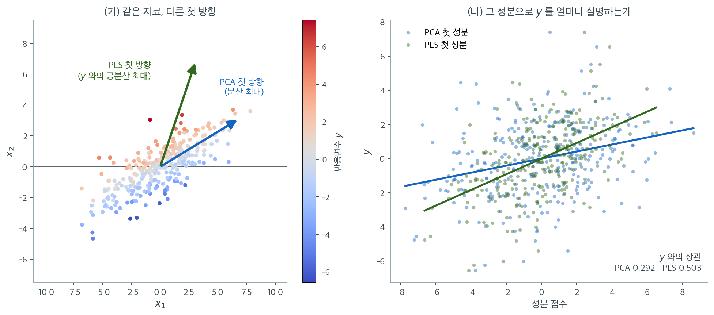
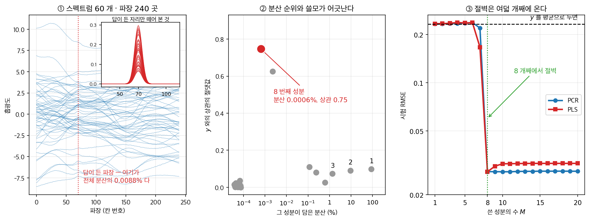

# 부분최소제곱 (PLS)


## 개요

**부분최소제곱**(PLS)은 지도 차원축소 방법이다. PCR이 설명변수의 분산만 보고 성분을 만드는 것과 달리, PLS는 설명변수와 반응변수의 **공분산**을 최대화하는 성분을 만든다.

### PCR과의 결정적 차이

| | PCR | PLS |
|---|---|---|
| **성분 구성** | 비지도: $X$의 분산 최대화 | 지도: $X$와 $y$의 공분산 최대화 |

---

## 1. PLS 알고리즘

### 1단계: 설명변수와 반응변수의 표준화

$$X_{\text{scaled}} = \frac{X - \mu_X}{\sigma_X}, \quad y_{\text{centered}} = y - \bar{y}$$

### 2단계: 잠재성분의 반복적 구성

주성분을 한꺼번에 뽑는 PCR과 달리, PLS는 $X$와 $y$의 공분산을 최대화하며 성분을 순차적으로 만든다.

$$T_1 = X_{\text{scaled}} w_1, \qquad
w_1 = \arg\max_{\|w\|=1} \text{Cov}(X_{\text{scaled}} w,\; y_{\text{centered}})$$

실제로 $w_1$은 $X_{\text{scaled}}^\top y_{\text{centered}}$에 비례한다. 즉 **각 설명변수와 반응변수의 상관에 비례하는 가중치**다.



설명변수가 둘뿐인 자료로 두 방향을 한 그림에 그렸다. 점의 색이 반응변수 $y$의 값이다. 자료는 오른쪽 위로 길게 늘어져 있고, 그 긴 방향이 **분산이 가장 큰 방향**이다. PCA는 그 방향 $(0.911,\ 0.413)$을 첫 성분으로 고른다(파란 화살표).

그런데 색의 배치를 보라. 빨간 점과 파란 점은 긴 방향을 따라 섞여 있고, 오히려 **그 방향을 가로지르는 쪽으로 색이 갈린다.** $y$의 신호가 분산이 작은 방향에 숨어 있는 것이다. PLS가 고르는 방향 $(0.411,\ 0.912)$(초록 화살표)이 바로 색이 변하는 쪽을 가리킨다. 두 방향의 각도는 $41.3^\circ$나 된다.

오른쪽은 그 결과다. PCA 성분의 분산은 $9.14$로 PLS 성분의 $5.47$보다 $1.7$배 크지만, $y$와의 상관은 $0.292$로 PLS의 $0.503$보다 훨씬 작다. **분산이 크다는 것과 예측에 쓸모 있다는 것은 다른 이야기다.** 회귀선의 기울기 차이가 그대로 설명력의 차이다.

이것이 PCR의 근본적 약점이며 PLS의 존재 이유다. PCA의 첫 방향은 $\mathbf{X}^\top\mathbf{X}$의 최대 고유벡터로 $\mathbf{y}$가 식에 들어가지 않는다. PLS의 첫 방향은 $\mathbf{X}^\top\mathbf{y}$ 그 자체다. 다만 $\mathbf{X}^\top\mathbf{y}$는 각 변수와 $y$의 **주변** 관계만 보므로, 다른 변수를 조건으로 할 때만 드러나는 구조는 첫 성분에서 놓친다. 성분을 여럿 쓰는 이유가 거기에 있다.

이후 성분은 잔차에 대해 같은 과정을 반복한다.

1. $T_m$으로 $X$를 설명한 부분을 제거한다(수축, deflation)
2. $T_m$으로 $y$를 설명한 부분을 제거한다
3. 잔차 $X^{(m)}$과 $y^{(m)}$의 공분산을 최대화하는 $w_m$을 구성한다

이 반복적 수축이 각 성분으로 하여금 이전 성분이 설명하지 못한 $y$의 변동을 담게 한다.

### 3단계: PLS 성분에 회귀

$$y = \beta_0 + \beta_1 T_1 + \cdots + \beta_M T_M + \epsilon$$

### 4단계: 교차검증으로 성분 수 선택

---

## 2. NIPALS 알고리즘

**비선형 반복 부분최소제곱**(NIPALS)이 표준 계산 방법이다.

```
X̃ = X_scaled,  ỹ = y_centered
m = 1..M 에 대해:
   a. w_m = X̃' ỹ / ||X̃' ỹ||        (가중벡터)
   b. t_m = X̃ w_m                   (성분 점수)
   c. β_m = t_m' ỹ / (t_m' t_m)     (회귀계수)
   d. ỹ = ỹ - β_m t_m               (y 잔차 수축)
   e. p_m = X̃' t_m / (t_m' t_m)     (적재)
   f. X̃ = X̃ - t_m p_m'             (X 잔차 수축)
```

각 반복이 행렬–벡터 곱만 쓰므로 성분당 $O(np)$로 효율적이다.

<div class="storybox" markdown>

**그림으로 보는 통계학 1.** 회귀법 하나가 행렬다발 학회에서 발표되었다

위의 NIPALS 는 통계학자가 통계학 문제를 풀려고 만든 것이 아니다. 만든 사람은 **헤르만 올레 안드레아스 볼드**, 그 자체로 이름난 통계학자였지만 **경제학 쪽에서 일한** 사람이다. 그는 $1966$ 년에 결측값이 있는 자료에서도 주성분을 뽑아내려고 이 반복법을 내놓았고, 뒤에 자기 방법들을 **「무른 모형화」**(soft modelling)라 불렀다.

그 방법을 화학으로 들고 간 사람은 그의 **아들 스반테 볼드**$(1941$–$2022)$다. 집안을 한 줄 더 적으면 이렇다 — 어머니는 수학자 안나리사 아레니우스 볼드였고, 그 아버지가 물리화학으로 세계에 이름을 남긴 **스반테 아레니우스**다. 아들은 외할아버지의 이름을 받았고, 결국 외할아버지의 분야로 갔다. 그가 **「화학계량학」이라는 말을 처음 쓴 것은 $1971$ 년의 연구비 신청서**에서였다.

그리고 $1983$ 년, PLS 회귀를 처음으로 적어 내놓은 논문의 저자는 이렇게 적혀 있다 — **볼드(아들)·마르텐스·볼드(아버지), 「화학에서의 다변량 보정 문제를 PLS 방법으로 풀다」.** 실린 곳은 통계학회지가 아니었다. **『행렬다발 학회 논문집』**, 그러니까 수치선형대수 학회의 강의노트 총서 $286$–$293$ 쪽이다.

왜 화학이었을까. 화학이 갖고 있던 문제의 모양이 당시 통계학의 표준 문제와 전혀 달랐기 때문이다.



분광 보정 문제를 흉내 내 보았다. 파장 $240$ 곳에서 잰 스펙트럼 $60$ 개로 어떤 화합물의 농도를 맞혀야 한다. **변수가 표본의 네 배다** — 최소제곱은 애초에 성립하지 않는다. 게다가 스펙트럼을 지배하는 것은 바탕선 흔들림과 산란과 다른 화합물이고, 정작 **찾는 봉우리는 전체 분산의 $0.0088\%$** 다(그림 ①). 눈금을 열 배 키운 작은 창을 따로 내야 보인다.

그러면 「분산이 큰 쪽부터 쓰자」는 주성분의 처방은 어떻게 되는가. 그림 ②가 주성분마다 담은 분산과 $y$ 와의 상관을 함께 찍은 것이다.

| 성분 | 담은 분산 | $y$ 와의 상관 |
|---|---|---|
| $1$ | $88.30\%$ | $0.098$ |
| $2$ | $9.35\%$ | $0.090$ |
| $3$ | $1.37\%$ | $0.073$ |
| $\vdots$ | | |
| $8$ | $\mathbf{0.0006\%}$ | $\mathbf{0.747}$ |

**분산을 $99.9975\%$ 쓸어 가는 앞의 일곱 성분은 $y$ 에 대해 할 말이 거의 없고, 분산을 만분의 육 밖에 갖지 않은 여덟째 성분이 답을 쥐고 있다.** 두 순위가 아예 어긋나 있다. 변수를 고르는 기준이 $X$ 안에만 있으면 안 된다는 것 — 그것이 NIPALS 의 `a` 단계에서 가중벡터를 $w_m \propto \tilde X^\top \tilde y$ 로 잡는 이유다. $y$ 를 보고 방향을 고른다.

다만 이 자료에서 PLS 가 PCR 을 크게 이기지는 않는다(그림 ③). 둘 다 여덟 개째에서 절벽처럼 떨어진다. $M = 7$ 에서 PLS 가 $0.167$, PCR 이 $0.220$ 으로 한 걸음 앞설 뿐이다. 까닭은 PLS 가 **상관이 아니라 공분산**을 최대로 하기 때문이다. 공분산은 상관에 $\lVert \tilde X w \rVert$ 를 곱한 것이라, 분산이 압도적인 방향은 상관이 보잘것없어도 먼저 뽑힌다. PLS 는 주성분과 정준상관 사이 어딘가에 있지, 정준상관이 아니다. 여기처럼 신호의 분산 몫이 극단적으로 작으면 PLS 도 똑같이 끌려간다.

그래도 이 문제를 푼 것은 화학이었다. 변수가 표본보다 많고 신호가 만분의 일인 자료를 $1980$ 년대에 날마다 다루던 쪽이 거기였기 때문이다. 방법은 그 현장에서 이십 년을 더 다듬어진 뒤에야 통계학 쪽으로 되돌아왔다.

_확인한 곳 — 둘이다. 트네누스의 $1999$ 년 『응용통계지』 논문(「PLS 접근법」, $47$권 $2$호 $5$–$40$쪽) 원문에서 NIPALS 가 볼드 $(1966)$ 의 것이라는 것, PLS 회귀가 볼드·마르텐스·볼드 $(1983)$ 의 것이라는 것, 그 논문이 루에·코그스트룀이 엮은 『행렬다발 학회 논문집』($1982$ 년 $3$ 월, 슈프링거 수학강의노트) $286$–$293$ 쪽에 실렸다는 것, 헤르만 볼드가 자기 접근을 「무른 모형화」라 불렀다는 것을 확인했다. 『스펙트로스코피 유럽』에 실린 스반테 볼드$(1941$–$2022)$ 추도문에서 그가 헤르만 올레 안드레아스 볼드의 아들이라는 것, 아버지가 경제학 분야에서 일한 통계학자였다는 것, 어머니가 수학자 안나리사 아레니우스 볼드이고 그 아버지가 스반테 아레니우스라는 것, 「화학계량학」이라는 이름이 $1971$ 년 연구비 신청서에서 처음 쓰였다는 것을 확인했다. 그림과 표의 수는 모두 직접 모의실험해 계산한 값이고, 스펙트럼은 실제 측정이 아니라 흉내 낸 것이다_

</div>

---

## 3. 장점과 단점

### 장점

1. **지도학습** — 성분이 반응변수를 예측하도록 선택된다
2. **적은 성분** — PCR보다 적은 성분으로 같은 성능에 도달하는 경우가 많다
3. **고차원에 강함** — $p \gg n$에서도 잘 작동한다
4. **$X$–$y$ 공분산 구조 반영**
5. **실무 검증** — 화학계량학에서 수십 년간 검증되었다
6. **계산 효율** — NIPALS가 반복적이고 효율적이다

### 단점

1. **해석 가능성** — 성분이 여전히 원 변수의 선형결합이다
2. **이론의 미비** — OLS보다 점근 결과가 적다
3. **표준화 의존** — 표준화가 필요하고 결과에 영향을 준다
4. **성분 수 조정 필요**
5. **과적합이 빠르다** — $y$를 이미 썼으므로 성분을 늘릴 때 PCR보다 빨리 나빠진다

---

## 4. PLS, PCR, 능형, 라쏘의 비교

| 방법 | 접근 | $y$ 사용 | 희소성 | 주 용도 |
|---|---|---|---|---|
| 능형 | 계수 축소 | 아니오(벌점에서) | 없음 | 다중공선성 |
| 라쏘 | 계수 축소 + 선택 | 아니오(벌점에서) | 있음 | 변수선택 |
| PCR | 차원축소 | **아니오** | 없음 | $p \gg n$ |
| PLS | 차원축소 | **예** | 없음 | $p \gg n$, 예측 |

---

## 5. 언제 PLS를 쓰는가

- 설명변수가 매우 많고 강하게 상관되어 있다(분광 자료, 센서 배열, 유전자 발현)
- 예측 정확도가 개별 계수 해석보다 중요하다
- $p > n$이다
- 신호가 $X$의 주된 분산 방향에 있지 **않을** 수 있다

---

## 6. 실무적 고려

**전처리.** 설명변수와 반응변수를 모두 표준화한다. `sklearn.cross_decomposition.PLSRegression`은 기본적으로 `scale=True`이다.

**초모수 조정.** 성분 수를 교차검증으로 고른다. 대개 1부터 $\min(n, p)$까지 훑는다.

**모형 검증.** 성분 수를 CV로 골랐다면 그 CV 오차를 최종 성능으로 보고하지 말고 별도의 검정집합을 써야 한다.

---

## 연습문제

<div class="drillbox" markdown>

**연습문제 1.** <span class="diff med" title="중간"></span>
PLS의 첫 가중벡터가 $X^\top y$에 비례한다는 사실을 확인하고, 그것이 무엇을 뜻하는지 설명하라.

</div>

??? success "풀이"
    제약 $\|w\| = 1$ 아래에서 $\text{Cov}(Xw, y) \propto w^\top X^\top y$를 최대화하는 문제다. 코시–슈바르츠 부등식에 의해 최대는 $w$가 $X^\top y$와 같은 방향일 때 달성되므로

    $$
    w_1 = \frac{X^\top y}{\|X^\top y\|}
    $$

    이다.

    ```python
    import numpy as np
    from sklearn.cross_decomposition import PLSRegression

    rng = np.random.default_rng(0)
    n, p = 100, 8
    X = rng.normal(0, 1, (n, p))
    y = X @ np.array([2., -1., 0.5, 0, 0, 0, 0, 0]) + rng.normal(0, 1, n)

    Xc = X - X.mean(0); yc = y - y.mean()
    pls = PLSRegression(1, scale=False).fit(Xc, yc)
    w = (Xc.T @ yc); w /= np.linalg.norm(w)
    print(f"{np.abs(np.abs(pls.x_weights_[:, 0] @ w) - 1):.2e}")   # 0 에 가깝다
    ```

    출력:

    ```
    6.66e-16
    ```

    **해석.** $X^\top y$의 $j$번째 성분은 $\mathbf{x}_j^\top\mathbf{y}$, 즉 변수 $j$와 반응변수의 (중심화된) 내적이다. 따라서 첫 PLS 성분은 **각 변수를 $y$와의 상관 크기에 비례하는 가중치로 더한 것**이다.

    이것이 PCR과의 차이를 가장 선명하게 보여준다. PCA의 첫 성분은 $X^\top X$의 최대 고유벡터로 $y$가 전혀 들어가지 않는다. PLS의 첫 성분은 $X^\top y$로 $y$가 직접 들어간다.

    **주의할 점:** 이 가중치는 **주변** 상관에 기반하므로, 다른 변수를 조건부로 한 부분상관은 반영하지 않는다. 그래서 PLS도 억제변수(suppressor) 같은 구조는 첫 성분에서 놓칠 수 있고, 그것이 성분을 여럿 쓰는 이유다.

<div class="drillbox" markdown>

**연습문제 2.** <span class="diff med" title="중간"></span>
PLS의 성분 수를 늘릴 때 PCR보다 빨리 과적합하는 현상을 확인하고 그 이유를 설명하라.

</div>

??? success "풀이"
    [PCR과 PLS 개관](index.md) 연습문제 1의 표를 성분 수에 따라 다시 읽으면 된다.

    | 성분 수 | PCR $R^2$ | PLS $R^2$ |
    |---:|---:|---:|
    | 1 | 0.428 | 0.806 |
    | 2 | 0.548 | **0.844** (정점) |
    | 3 | **0.849** (정점) | 0.837 |
    | 5 | 0.845 | 0.794 |
    | 7 | 0.837 | **0.746** |

    **PLS는 정점 이후 $0.844 \to 0.746$으로 9.8%p 떨어지고, PCR은 $0.849 \to 0.837$로 1.2%p만 떨어진다.**

    **이유.** PLS의 성분은 $y$를 써서 만들어진다. 성분을 하나 추가할 때마다 $y$의 잔차와 $X$의 잔차의 공분산을 최대화하는데, 신호가 이미 소진되면 그 공분산은 **잡음에서 오는 우연한 상관**이다. 성분이 잡음에 맞춰지므로 표본외 성능이 빠르게 나빠진다.

    PCR의 성분은 $y$를 보지 않으므로 이런 방식으로 잡음에 적합되지 않는다. 성분을 추가하면 단지 잡음 방향을 회귀에 넣는 것이고, 그 효과는 자유도 하나를 쓰는 정도로 완만하다.

    **실무적 함의:** PLS에서 성분 수 선택은 PCR에서보다 **더 중요하다.** 그리고 그 선택에 쓴 CV 오차를 최종 성능으로 보고하면 낙관적으로 편향된다. 별도의 검정집합이나 중첩 교차검증이 필요하다.

<div class="drillbox" markdown>

**연습문제 3.** <span class="diff med" title="중간"></span>
다음은 $n = 4$, $p = 2$ 인 자료다. 두 설명변수와 반응변수가 모두 표본평균 0 이다.

| $i$ | $x_{i1}$ | $x_{i2}$ | $y_i$ |
|---:|---:|---:|---:|
| 1 | $-1$ | $-1$ | $-3$ |
| 2 | $-1$ | $1$ | $0$ |
| 3 | $1$ | $-1$ | $-1$ |
| 4 | $1$ | $1$ | $4$ |

2 절 NIPALS 의 a–f 단계를 $M = 1$ 로 손으로 한 바퀴 돌려 $w_1$, $t_1$, $\beta_1$, 수축된 $\tilde y$, 적재 $p_1$, 수축된 $\tilde X$ 를 모두 구하라. 그리고 1 성분 PLS 의 적합값을 OLS 적합값과 견주어라.

</div>

??? success "풀이"
    **a 단계(가중벡터).** 두 열과 $y$ 의 내적을 계산한다.

    $$
    X^\top y = \begin{pmatrix} 3 + 0 - 1 + 4 \\ 3 + 0 + 1 + 4 \end{pmatrix} = \begin{pmatrix} 6 \\ 8 \end{pmatrix}, \qquad \lVert X^\top y \rVert = 10, \qquad w_1 = \begin{pmatrix} 0.6 \\ 0.8 \end{pmatrix}
    $$

    **b 단계(성분 점수).** $t_1 = X w_1$ 의 각 성분은 $\pm 0.6 \pm 0.8$ 이다.

    $$
    t_1 = (-1.4,\ 0.2,\ -0.2,\ 1.4)^\top
    $$

    **c 단계(회귀계수).** $t_1^\top t_1 = 2(1.96) + 2(0.04) = 4$ 이고 $t_1^\top y = 4.2 + 0 + 0.2 + 5.6 = 10$ 이므로

    $$
    \beta_1 = \frac{10}{4} = 2.5
    $$

    **d 단계($y$ 수축).** $\tilde y = y - 2.5\,t_1 = (-3 + 3.5,\ 0 - 0.5,\ -1 + 0.5,\ 4 - 3.5)^\top$ 이므로

    $$
    \tilde y = (0.5,\ -0.5,\ -0.5,\ 0.5)^\top
    $$

    **e 단계(적재).** $X^\top t_1 = (2.4,\ 3.2)^\top$ 이고 $t_1^\top t_1 = 4$ 이므로 $p_1 = (0.6,\ 0.8)^\top = w_1$ 이다.

    **f 단계($X$ 수축).** $\tilde X = X - t_1 p_1^\top$ 의 $i$ 행은 $(x_{i1} - 0.6\,t_{i1},\ x_{i2} - 0.8\,t_{i1})$ 이다.

    $$
    \tilde X = \begin{pmatrix} -0.16 & 0.12 \\ -1.12 & 0.84 \\ 1.12 & -0.84 \\ 0.16 & -0.12 \end{pmatrix}
    $$

    **OLS 와의 비교.** 이 설계는 $X^\top X = 4I$ 인 직교설계다. 따라서

    $$
    \hat\beta^{\text{OLS}} = (X^\top X)^{-1} X^\top y = \frac{1}{4}\begin{pmatrix} 6 \\ 8 \end{pmatrix} = \begin{pmatrix} 1.5 \\ 2 \end{pmatrix}
    $$

    이고 $\hat y^{\text{OLS}} = 1.5\,x_1 + 2\,x_2 = (-3.5,\ 0.5,\ -0.5,\ 3.5)^\top$ 이다. 한편 1 성분 PLS 의 적합값은 $\beta_1 t_1 = 2.5\,t_1 = (-3.5,\ 0.5,\ -0.5,\ 3.5)^\top$ 으로 **완전히 같다.** 둘 다 $\mathrm{RSS} = 4(0.25) = 1$, $\mathrm{TSS} = 26$, $R^2 = 25/26 = 0.9615$ 다.

    **해석.** 성분 하나가 벌써 OLS 를 그대로 재현했다. 까닭은 $X^\top X = 4I$ 라 $\hat\beta^{\text{OLS}} = X^\top y / 4$ 가 $w_1 \propto X^\top y$ 와 같은 방향이어서, $t_1$ 방향이 곧 OLS 적합 방향이기 때문이다. 남은 $\tilde y = 0.5(1, -1, -1, 1)^\top$ 은 $x_1$ 과 $x_2$ 에 모두 직교하므로 $X$ 로는 더 설명할 것이 없다. 즉 이 자료에서 PLS 는 차원을 줄여 주면서도 **아무것도 잃지 않았지만, 아무것도 정칙화하지도 않았다.** 연습문제 6 에서 이것이 직교설계의 일반 현상임을 본다.

<div class="drillbox" markdown>

**연습문제 4.** <span class="diff med" title="중간"></span>
1 절 그림에서 PCA 의 첫 방향은 $(0.911,\ 0.413)$, 성분의 분산은 $9.14$, $y$ 와의 상관은 $0.292$ 였다. PLS 의 첫 방향은 $(0.411,\ 0.912)$, 분산 $5.47$, 상관 $0.503$ 이었다. 설명변수는 둘뿐이다.

(가) 각 성분 하나에 $y$ 를 단순회귀했을 때의 $R^2$ 를 구하라.
(나) $\mathrm{sd}(y)$ 를 단위로 하여 두 성분의 $y$ 와의 공분산을 구하고, PLS 가 정말 더 큰지 확인하라.
(다) PCA 성분의 분산이 $1.67$ 배 크다는 사실이 (가) 의 $R^2$ 에 전혀 기여하지 못하는 까닭을 말하라.
(라) 이 자료에서 성분을 **둘 다** 쓰면 두 방법의 $R^2$ 는 어떻게 되는가.

</div>

??? success "풀이"
    **(가)** 설명변수가 하나이고 절편이 있는 회귀의 결정계수는 상관의 제곱이다.

    $$
    R^2_{\text{PCA}} = 0.292^2 = 0.0853, \qquad R^2_{\text{PLS}} = 0.503^2 = 0.2530
    $$

    PLS 쪽이 $2.97$ 배다. 분산으로는 지는 방향이 설명력으로는 세 배 가까이 이긴다.

    **(나)** $\mathrm{Cov}(t, y) = r \cdot \mathrm{sd}(t) \cdot \mathrm{sd}(y)$ 이고 $\mathrm{sd}(t)$ 는 분산의 제곱근이다. $\sqrt{9.14} = 3.023$, $\sqrt{5.47} = 2.339$ 이므로

    $$
    \frac{\mathrm{Cov}(t_{\text{PCA}}, y)}{\mathrm{sd}(y)} = 0.292 \times 3.023 = 0.883, \qquad \frac{\mathrm{Cov}(t_{\text{PLS}}, y)}{\mathrm{sd}(y)} = 0.503 \times 2.339 = 1.176
    $$

    PLS 가 $1.33$ 배 크다. PLS 의 첫 방향은 정의상 이 양을 최대화하므로 **반드시** 더 커야 하고, 수가 그것을 확인해 준다. 두 방향이 서로 다른 것도 확인된다. 내적이 $0.911(0.411) + 0.413(0.912) = 0.751$ 이므로 각도는 $\arccos 0.751 = 41.3^\circ$ 로 본문의 값과 맞는다.

    **(다)** $R^2 = r^2$ 에는 성분의 척도가 **들어가지 않는다.** 성분을 $t \to ct$ 로 바꾸면 분산은 $c^2$ 배가 되지만 상관은 그대로이고 회귀계수만 $1/c$ 배가 되어 적합값이 똑같다. 회귀는 설명변수의 선형 재척도에 불변이기 때문이다. 따라서 "분산이 큰 방향" 이라는 PCA 의 선택 기준은 1 성분 회귀의 설명력과 **직접적 관련이 전혀 없는** 양을 최대화하고 있다. 그 둘이 대개 같이 움직이기에 PCR 이 그럭저럭 작동하는 것일 뿐, 보장은 없다.

    한 가지는 덧붙여야 한다. PLS 가 최대화하는 것은 공분산이고 공분산에는 분산이 섞여 있으므로, PLS 도 상관을 최대화하지는 않는다(그 일은 정준상관의 몫이다). 이 자료에서 PLS 가 상관으로도 이긴 것은 결과이지 정의가 아니다.

    **(라)** $p = 2$ 이고 $X$ 의 계수가 $2$ 이므로, 성분 두 개는 PCA 든 PLS 든 $X$ 의 열공간 전체를 생성한다. 적합값은 $y$ 를 그 공간에 사영한 것이므로 **두 방법 모두 OLS 와 같아지고 $R^2$ 도 같다.** 즉 PCR 과 PLS 의 차이는 $M < \operatorname{rank}(X)$ 로 **실제로 차원을 줄일 때만** 나타난다. 차원축소를 하지 않는 PLS 는 OLS 의 복잡한 다른 이름일 뿐이다.

<div class="drillbox" markdown>

**연습문제 5.** <span class="diff med" title="중간"></span>
연습문제 3 의 자료에서 $x_1$ 의 단위만 바꾸어 $x_1' = 2 x_1$ 로 쓴다고 하자($x_2$ 와 $y$ 는 그대로다). 1 성분 PLS 를 손으로 다시 구해 적합값과 $R^2$ 를 얻고, 같은 변환에서 OLS 적합값은 어떻게 되는지 견주어라. 표준화를 먼저 하면 무엇이 회복되는가.

</div>

??? success "풀이"
    새 설계행렬의 첫 열은 $x_1' = (-2, -2, 2, 2)^\top$ 이다.

    **a–c 단계.**

    $$
    X^\top y = \begin{pmatrix} 12 \\ 8 \end{pmatrix}, \qquad w_1 = \frac{1}{\sqrt{13}}\begin{pmatrix} 3 \\ 2 \end{pmatrix} = \begin{pmatrix} 0.8321 \\ 0.5547 \end{pmatrix}
    $$

    $$
    t_1 = \frac{1}{\sqrt{13}}(-8,\ -4,\ 4,\ 8)^\top, \qquad t_1^\top t_1 = \frac{160}{13} = 12.3077, \qquad t_1^\top y = \frac{52}{\sqrt{13}} = 14.4222
    $$

    $$
    \beta_1 = \frac{14.4222}{12.3077} = 1.1718
    $$

    원 변수로 환산한 계수는 $\beta_1 w_1 = \frac{13}{40}(3, 2)^\top = (0.975,\ 0.65)^\top$ 이고 적합값은

    $$
    \hat y = 0.975\,x_1' + 0.65\,x_2 = (-2.6,\ -1.3,\ 1.3,\ 2.6)^\top
    $$

    이다. 잔차는 $(-0.4,\ 1.3,\ -2.3,\ 1.4)^\top$ 이므로 $\mathrm{RSS} = 0.16 + 1.69 + 5.29 + 1.96 = 9.1$ 이고

    $$
    R^2 = 1 - \frac{9.1}{26} = 0.65
    $$

    이다. 연습문제 3 에서는 같은 자료, 같은 방법으로 $R^2 = 0.9615$ 였다.

    **OLS 는 어떤가.** 새 계수는 $\hat\beta^{\text{OLS}} = (0.75,\ 2)^\top$ 으로 바뀌지만($0.75 = 1.5/2$) 적합값은 $(-3.5,\ 0.5,\ -0.5,\ 3.5)^\top$ 으로 **변하지 않고** $R^2 = 0.9615$ 도 그대로다. 열을 상수배해도 열공간이 변하지 않으므로 사영이 같기 때문이다.

    **표준화.** $x_1'$ 의 표본표준편차는 원래의 두 배이므로 표준화는 그 열을 다시 $2$ 로 나눈다. 그러면 연습문제 3 의 설계가 상수배로 되돌아오고, $w_1 = (0.6, 0.8)^\top$ 과 $R^2 = 0.9615$ 가 회복된다.

    **해석.** 1 성분 PLS 의 방향 $w_1 \propto X^\top y$ 는 **좌표계에 의존하는** 양이다. 단위를 cm 에서 mm 로 바꾸는 것만으로 그 변수의 내적이 커져 방향이 그쪽으로 끌려가고, 여기서는 설명력이 $0.9615$ 에서 $0.65$ 로 주저앉았다. 이것은 능형과 라쏘에서 벌점이 척도에 불변이 아닌 것과 **정확히 같은 종류의 문제**다. 다만 6 절에서 보았듯 `PLSRegression` 은 `scale=True` 가 기본값이어서 알아서 표준화해 주는 반면, sklearn 의 `Ridge` 와 `Lasso` 는 해 주지 않는다. 라이브러리의 기본값이 다르다는 사실 자체가 함정이다.

<div class="drillbox" markdown>

**연습문제 6.** <span class="diff hard" title="어려움"></span>
$X$ 는 열이 중심화되어 있고 어떤 $c > 0$ 에 대해 $X^\top X = cI$ 라 하자(직교설계).

(가) 1 성분 PLS 의 원 변수 계수벡터가 $\hat\beta^{\text{OLS}}$ 와 **정확히** 같음을 증명하라.
(나) 첫 수축 뒤 $\tilde X^\top \tilde y = 0$ 임을 보여, NIPALS 가 둘째 성분을 아예 만들 수 없음을 보여라.
(다) 같은 설계에서 능형은 무엇을 하는가. 세 결과를 묶어, PLS 의 정칙화 효과가 어디서 오는지 한 문장으로 말하라.

</div>

??? success "풀이"
    $s = X^\top y$ 로 적는다. 표기는 2 절의 유사코드를 따른다.

    **(가)** $w_1 = s / \lVert s \rVert$, $t_1 = X w_1$ 이므로

    $$
    t_1^\top t_1 = w_1^\top X^\top X w_1 = c\, w_1^\top w_1 = c, \qquad t_1^\top y = w_1^\top X^\top y = w_1^\top s = \lVert s \rVert
    $$

    이고 따라서 $\beta_1 = \lVert s \rVert / c$ 다. 적합값은 $\beta_1 t_1 = X(\beta_1 w_1)$ 이므로 원 변수의 계수벡터는

    $$
    \beta_1 w_1 = \frac{\lVert s \rVert}{c}\cdot\frac{s}{\lVert s \rVert} = \frac{s}{c}
    $$

    이다. 한편 $\hat\beta^{\text{OLS}} = (X^\top X)^{-1}X^\top y = s/c$ 다. 두 벡터가 같다. $\square$

    **(나)** 적재는 $p_1 = X^\top t_1/(t_1^\top t_1) = X^\top X w_1 / c = w_1$ 이다. 그러므로

    $$
    \tilde X^\top y = (X - t_1 p_1^\top)^\top y = s - w_1 (t_1^\top y) = s - \frac{s}{\lVert s \rVert}\lVert s \rVert = 0
    $$

    이고, 또 $\tilde X^\top t_1 = X^\top t_1 - p_1 (t_1^\top t_1) = c\,w_1 - c\,w_1 = 0$ 이므로

    $$
    \tilde X^\top \tilde y = \tilde X^\top (y - \beta_1 t_1) = \tilde X^\top y - \beta_1 \tilde X^\top t_1 = 0
    $$

    이다. a 단계의 $w_2 = \tilde X^\top \tilde y / \lVert \tilde X^\top \tilde y \rVert$ 가 $0/0$ 이 되어 정의되지 않는다. 즉 직교설계에서 PLS 의 성분은 **하나뿐**이고, 그 하나가 OLS 다. 연습문제 3 이 $c = 4$, $p = 2$ 인 그 사례다. $\square$

    **(다)** 능형은 같은 설계에서

    $$
    \hat\beta^{\text{ridge}} = (cI + \lambda I)^{-1}s = \frac{s}{c + \lambda} = \frac{\hat\beta^{\text{OLS}}}{1 + \lambda/c}
    $$

    로 모든 좌표를 같은 비율로 축소하고, 라쏘는 연성문턱으로 작은 좌표를 0 으로 만든다. $\lambda > 0$ 이면 둘 다 OLS 와 다른 추정값을 내놓는다. 그러나 PLS 는 $M = 1$ 에서 이미 OLS 를 그대로 돌려주고 더 뽑을 성분도 없다.

    **한 문장.** 능형과 라쏘의 정칙화는 직교설계에서도 살아 있지만, **PLS 의 정칙화 효과는 전적으로 설명변수 사이의 상관(비직교성)에서 나온다.** 그래서 5 절의 "설명변수가 강하게 상관되어 있다" 는 조건은 장식이 아니라 PLS 를 쓸 이유 그 자체다. 상관이 없는 자료에서 성분 수를 줄여 분산을 벌려는 시도는 헛수고다.

<div class="drillbox" markdown>

**연습문제 7.** <span class="diff hard" title="어려움"></span>
2 절 NIPALS 의 d 단계($\tilde y \leftarrow \tilde y - \beta_m t_m$)를 지워도 이후의 $w_m$ 과 $\beta_m$ 이 하나도 바뀌지 않음을 보여라. $m$ 번 수축한 설계행렬을 $X^{(m)}$ 이라 쓴다.

(가) $X^{(m+1)\top} t_m = 0$ 임을 보여라.
(나) 귀납법으로 모든 $j < m$ 에 대해 $t_m^\top t_j = 0$ 임을 보여라.
(다) 그러면 d 단계는 무엇에 쓰는가.

</div>

??? success "풀이"
    **(가)** e 단계의 정의 $p_m = X^{(m)\top} t_m / (t_m^\top t_m)$ 를 f 단계에 넣으면

    $$
    X^{(m+1)\top} t_m = \left(X^{(m)} - t_m p_m^\top\right)^\top t_m = X^{(m)\top} t_m - p_m (t_m^\top t_m) = X^{(m)\top} t_m - X^{(m)\top} t_m = 0
    $$

    이다. 적재를 저렇게 정하는 까닭이 바로 이것이다. $p_m$ 은 $t_m$ 에 대한 $X^{(m)}$ 각 열의 **단순회귀 계수**이고, f 단계는 그 잔차만 남긴다. $\square$

    **(나)** 귀납 가정: 모든 $j < m$ 에 대해 $X^{(m)\top} t_j = 0$. ($m = 1$ 일 때는 조건이 공집합이라 참이다.)

    먼저 $t_m = X^{(m)} w_m$ 이므로 $j < m$ 에 대해

    $$
    t_m^\top t_j = w_m^\top X^{(m)\top} t_j = 0
    $$

    이다. 다음으로 $j < m$ 에 대해

    $$
    X^{(m+1)\top} t_j = X^{(m)\top} t_j - p_m (t_m^\top t_j) = 0 - 0 = 0
    $$

    이고 $j = m$ 인 경우는 (가) 가 준다. 따라서 귀납이 한 단계 진행되고, 결론으로 **모든 성분이 서로 직교하며** 수축된 설계행렬의 열은 앞선 모든 성분에 직교한다. $\square$

    **$w$ 가 바뀌지 않는다.** d 단계를 $m$ 번까지 거친 잔차는 $\tilde y^{(m+1)} = y - \sum_{j \le m}\beta_j t_j$ 다. (가) 와 (나) 로 $X^{(m+1)\top} t_j = 0$ 이 모든 $j \le m$ 에 성립하므로

    $$
    X^{(m+1)\top}\tilde y^{(m+1)} = X^{(m+1)\top} y - \sum_{j \le m}\beta_j X^{(m+1)\top} t_j = X^{(m+1)\top} y
    $$

    이다. 즉 a 단계는 $y$ 를 수축했든 안 했든 같은 방향을 준다.

    **$\beta$ 도 바뀌지 않는다.** 성분이 서로 직교하므로

    $$
    \beta_m = \frac{t_m^\top \tilde y^{(m)}}{t_m^\top t_m} = \frac{t_m^\top\left(y - \sum_{j < m}\beta_j t_j\right)}{t_m^\top t_m} = \frac{t_m^\top y}{t_m^\top t_m}
    $$

    이다. 결국 PLS 의 회귀는 **직교하는 성분마다 따로 한 단순회귀를 더한 것**이며, d 단계의 축차적 수축은 그 결과를 다른 순서로 계산한 것에 지나지 않는다.

    **(다)** 그래도 d 단계를 두는 까닭은 계산이 아니라 읽기에 있다.

    1. **정지 규칙.** $\lVert \tilde y \rVert$ 는 아직 설명되지 않은 반응변수의 변동이다. 성분을 하나 더해도 이 값이 거의 줄지 않으면 거기서 멈춘다.
    2. **성분별 기여.** 성분이 직교하므로 $\beta_m^2\, t_m^\top t_m$ 이 성분 $m$ 이 설명한 $y$ 의 제곱합이고, 이 값들의 합이 곧 훈련 $R^2 \cdot \mathrm{TSS}$ 다. 연습문제 9 의 출력이 바로 그 분해다.

    **한 걸음 더.** $y$ 수축이 불필요한 것은 반응변수가 **하나**일 때의 이야기다. 성분 직교성 (나) 가 그 결론을 떠받치고 있으므로, 직교성이 깨지는 변형(예컨대 수축을 다른 방식으로 하는 알고리즘)에서는 같은 말을 할 수 없다.

<div class="drillbox" markdown>

**연습문제 8.** <span class="diff hard" title="어려움"></span>
$x_1 = (-4, -2, 2, 4)^\top$, $x_2 = (-2, -4, 4, 2)^\top$, $y = x_1$ 인 자료를 생각한다(잡음이 전혀 없다).

(가) $X^\top X$ 를 구해 두 열의 상관이 $0.8$ 임을 확인하라.
(나) 1 성분 PLS 의 원 변수 계수를 닫힌 꼴로 유도하고 이 자료에서 수를 구하라.
(다) 그 적합의 $R^2$ 를 구하라.
(라) 참값은 $\beta = (1, 0)^\top$ 이다. PLS 가 $\hat\beta_2 = 0$ 을 내놓지 못하는 까닭을 말하고, 4 절 표의 "희소성: 없음" 이 뜻하는 바를 설명하라. 코드로 확인하라.

</div>

??? success "풀이"
    **(가)** $x_1^\top x_1 = x_2^\top x_2 = 16 + 4 + 4 + 16 = 40$ 이고 $x_1^\top x_2 = 8 + 8 + 8 + 8 = 32$ 다.

    $$
    X^\top X = \begin{pmatrix} 40 & 32 \\ 32 & 40 \end{pmatrix}, \qquad \operatorname{Corr}(x_1, x_2) = \frac{32}{40} = 0.8
    $$

    **(나)** $s = X^\top y$ 라 하면 $w_1 = s/\lVert s \rVert$, $t_1 = Xw_1$ 이고

    $$
    t_1^\top y = w_1^\top s = \lVert s \rVert, \qquad t_1^\top t_1 = w_1^\top X^\top X w_1 = \frac{s^\top X^\top X s}{\lVert s \rVert^2}
    $$

    이므로 $\beta_1 = \lVert s \rVert^3 / (s^\top X^\top X s)$ 이고, 원 변수의 계수는

    $$
    \hat\beta^{\text{PLS}(1)} = \beta_1 w_1 = \frac{\lVert s \rVert^2}{s^\top X^\top X s}\, s
    $$

    이다. **1 성분 PLS 는 $X^\top y$ 방향을 그대로 쓰고 길이만 조절한다.** 이 자료에서 $y = x_1$ 이므로

    $$
    s = \begin{pmatrix} 40 \\ 32 \end{pmatrix}, \qquad \lVert s \rVert^2 = 2624, \qquad X^\top X s = \begin{pmatrix} 2624 \\ 2560 \end{pmatrix}, \qquad s^\top X^\top X s = 186880
    $$

    $$
    \hat\beta^{\text{PLS}(1)} = \frac{2624}{186880}\begin{pmatrix} 40 \\ 32 \end{pmatrix} = \frac{41}{2920}\begin{pmatrix} 40 \\ 32 \end{pmatrix} = \begin{pmatrix} 41/73 \\ 164/365 \end{pmatrix} = \begin{pmatrix} 0.5616 \\ 0.4493 \end{pmatrix}
    $$

    **(다)** 적합값은 $\hat y = (-3.1452,\ -2.9205,\ 2.9205,\ 3.1452)^\top$, 잔차는 $(-0.8548,\ 0.9205,\ -0.9205,\ 0.8548)^\top$ 이다.

    $$
    \mathrm{RSS} = 3.1562, \qquad \mathrm{TSS} = 40, \qquad R^2 = 1 - \frac{3.1562}{40} = 0.9211
    $$

    잡음이 하나도 없는 자료인데 1 성분 PLS 는 $R^2 = 1$ 에 못 미친다. 성분을 둘 다 쓰면 OLS 와 같아져 $(1, 0)^\top$ 과 $R^2 = 1$ 을 정확히 회복한다.

    **(라)** 참값은 $\beta_2 = 0$ 인데 PLS 는 $\hat\beta_2 = 0.4493$ 을 준다. $\hat\beta_1 = 0.5616$ 과 거의 같은 크기다. 까닭은 $w_1 \propto X^\top y$ 가 각 변수와 $y$ 의 **주변** 내적만 본다는 데 있다. $x_2$ 는 $y$ 를 만드는 데 전혀 쓰이지 않았지만 $x_1$ 과 $0.8$ 로 상관되어 있어 $x_2^\top y = 32$ 가 $x_1^\top y = 40$ 에 육박한다. 1 절 본문이 "$X^\top y$ 는 주변 관계만 본다" 고 적은 것이 이 현상이다.

    라쏘라면 $\lambda$ 를 적당히 키워 $\hat\beta_2$ 를 정확히 0 으로 보낼 수 있다. PLS 로는 안 된다. PLS 의 계수는 $\sum_m \beta_m r_m$ 꼴의 선형결합이고 $w_m$ 과 $r_m$ 은 빽빽한 벡터이므로, 어떤 좌표가 정확히 0 이 되는 일은 우연이 아니면 일어나지 않는다. 4 절 표의 "희소성: 없음" 이 그 뜻이다. **PLS 는 차원을 줄이지만 변수를 줄이지 않는다** — 성분 하나만 쓰더라도 그 성분은 모든 설명변수를 다 쓴다.

    ```python
    import numpy as np
    from sklearn.cross_decomposition import PLSRegression

    x1 = np.array([-4., -2., 2., 4.])
    x2 = np.array([-2., -4., 4., 2.])
    X = np.column_stack([x1, x2])
    y = x1.copy()                       # beta = (1, 0), 잔차 0

    G = X.T @ X
    s = X.T @ y
    beta_cf = s * (s @ s) / (s @ (G @ s))          # 닫힌 꼴
    beta_sk = PLSRegression(1, scale=False).fit(X, y).coef_.ravel()
    yhat = X @ beta_cf
    rss = float(((y - yhat) ** 2).sum())
    beta2 = PLSRegression(2, scale=False).fit(X, y).coef_.ravel()
    beta2[np.abs(beta2) < 1e-9] = 0.0            # 부호 있는 0 을 피한다

    print(f"두 열의 상관      {G[0, 1] / G[0, 0]:.4f}")
    print(f"X'y               {s[0]:.0f} {s[1]:.0f}")
    print(f"닫힌 꼴 계수      {beta_cf[0]:.4f} {beta_cf[1]:.4f}")
    print(f"sklearn 계수      {beta_sk[0]:.4f} {beta_sk[1]:.4f}")
    print(f"적합값            " + " ".join(f"{v:.4f}" for v in yhat))
    print(f"RSS / TSS / R^2   {rss:.4f} {(y ** 2).sum():.4f} {1 - rss / (y ** 2).sum():.4f}")
    print(f"2 성분 계수       {beta2[0]:.4f} {beta2[1]:.4f}")
    ```

    출력:

    ```text
    두 열의 상관      0.8000
    X'y               40 32
    닫힌 꼴 계수      0.5616 0.4493
    sklearn 계수      0.5616 0.4493
    적합값            -3.1452 -2.9205 2.9205 3.1452
    RSS / TSS / R^2   3.1562 40.0000 0.9211
    2 성분 계수       1.0000 0.0000
    ```

    닫힌 꼴과 `PLSRegression` 이 소수 넷째 자리까지 일치한다.

<div class="drillbox" markdown>

**연습문제 9.** <span class="diff hard" title="어려움"></span>
2 절의 NIPALS 유사코드를 그대로 구현해 `PLSRegression` 과 예측값·계수가 일치함을 확인하라. 원 변수의 계수를 얻으려면 $W(P^\top W)^{-1}$ 이라는 변환이 왜 필요한지 설명하고, 성분별로 $y$ 의 변동이 어떻게 쪼개지는지 읽어라.

</div>

??? success "풀이"
    유사코드가 내놓는 $w_m$ 은 **수축된** $X^{(m)}$ 에 대한 가중치이므로 원래의 $X$ 에 바로 곱할 수 없다. $t_m = X^{(m)} w_m$ 이고 $X^{(m)} = X - \sum_{j<m} t_j p_j^\top$ 이기 때문이다. 원 변수에 대한 가중치 $r_m$, 즉 $T = XR$ 을 만족하는 $R$ 은

    $$
    R = W(P^\top W)^{-1}
    $$

    로 주어진다. 역행렬이 존재하는 것은 $P^\top W$ 가 대각원소가 모두 1 인 상삼각행렬이기 때문이다. 대각원소는

    $$
    p_m^\top w_m = \frac{t_m^\top X^{(m)} w_m}{t_m^\top t_m} = \frac{t_m^\top t_m}{t_m^\top t_m} = 1
    $$

    이고, 아래쪽이 0 인 것은 연습문제 7 의 직교성에서 온다. 최종 계수는 $\hat\beta = R\,b$ 이며, 아래 코드가 이 모든 것을 수치로 확인한다.

    ```python
    import numpy as np
    from sklearn.cross_decomposition import PLSRegression

    rng = np.random.default_rng(7)
    n, p, M = 50, 6, 3
    Z = rng.normal(size=(n, 3))
    A = rng.normal(size=(3, p))
    X = Z @ A + rng.normal(0, 0.4, (n, p))
    y = Z[:, 0] * 1.5 - Z[:, 2] + rng.normal(0, 0.8, n)
    Xc, yc = X - X.mean(0), y - y.mean()

    # === 2 절의 유사코드 그대로 ===
    Xt, yt = Xc.copy(), yc.copy()
    W = np.zeros((p, M)); T = np.zeros((n, M)); P = np.zeros((p, M)); b = np.zeros(M)
    for m in range(M):
        w = Xt.T @ yt; w /= np.linalg.norm(w)   # a
        t = Xt @ w                              # b
        bm = (t @ yt) / (t @ t)                 # c
        yt = yt - bm * t                        # d
        pm = Xt.T @ t / (t @ t)                 # e
        Xt = Xt - np.outer(t, pm)               # f
        W[:, m], T[:, m], P[:, m], b[m] = w, t, pm, bm

    R = W @ np.linalg.inv(P.T @ W)              # 원 변수의 가중치
    coef = R @ b
    sk = PLSRegression(M, scale=False).fit(Xc, yc)

    G = T.T @ T
    print("예측값이 sklearn 과 일치 ", bool(np.allclose(T @ b, sk.predict(Xc).ravel())))
    print("계수가 sklearn 과 일치   ", bool(np.allclose(coef, sk.coef_.ravel())))
    print("성분들이 서로 직교       ", bool(np.allclose(G - np.diag(np.diag(G)), 0)))
    print("T = XR 이 성립           ", bool(np.allclose(T, Xc @ R)))
    print("P'W 가 상삼각            ", bool(np.allclose(np.tril(P.T @ W, -1), 0)))
    print("beta_m                   ", " ".join(f"{v:.4f}" for v in b))
    print("성분별 y 설명 비율       ", " ".join(f"{b[i] ** 2 * G[i, i] / (yc @ yc):.4f}" for i in range(M)))
    print("원 변수 계수             ", " ".join(f"{v:.4f}" for v in coef))
    share = sum(b[i] ** 2 * G[i, i] for i in range(M)) / (yc @ yc)
    r2tr = 1 - ((yc - T @ b) ** 2).sum() / (yc @ yc)
    print(f"비율의 합 / 훈련 R^2      {share:.4f} {r2tr:.4f}")
    ```

    출력:

    ```text
    예측값이 sklearn 과 일치  True
    계수가 sklearn 과 일치    True
    성분들이 서로 직교        True
    T = XR 이 성립            True
    P'W 가 상삼각             True
    beta_m                    0.3738 0.7307 0.0765
    성분별 y 설명 비율        0.3093 0.2571 0.0025
    원 변수 계수              -0.7559 -0.1024 -0.6212 -0.0698 -0.0195 -0.2228
    비율의 합 / 훈련 R^2      0.5688 0.5688
    ```

    **읽는 법.** 성분이 직교하므로 설명된 변동이 성분별로 **더해진다.** 세 비율의 합 $0.3093 + 0.2571 + 0.0025 = 0.5688$ 이 훈련 $R^2$ 와 정확히 같다. 그리고 셋째 성분의 기여는 $0.0025$, 즉 $0.25\%$ 에 그친다. 자료를 만들 때 쓴 잠재요인 셋 가운데 $y$ 에 관여한 것이 **둘**이었음이 이 분해에 그대로 드러난다. 연습문제 7 (다) 에서 말한 정지 규칙이 여기서 "둘에서 멈추라" 고 말하는 것이다.

    주의할 것은 이 비율이 **훈련** 자료에서 계산된 양이라는 점이다. 성분을 늘리면 이 합은 결코 줄지 않으므로, 멈출 자리를 이 수만으로 정할 수는 없다. 최종 판단은 교차검증이 한다.

<div class="drillbox" markdown>

**연습문제 10.** <span class="diff hard" title="어려움"></span>
6 절은 "성분 수를 CV 로 골랐다면 그 CV 오차를 최종 성능으로 보고하지 말라" 고 적었다. 이 경고를 수로 재라. 모의실험에서 (ㄱ) 고른 $M$ 의 CV $R^2$, (ㄴ) **같은 크기의 독립 자료**에서 같은 $M$ 으로 다시 잰 CV $R^2$, (ㄷ) 떼어 둔 검정집합의 $R^2$ 를 모두 구해, 선택이 부풀린 양을 분리해 내라. 그리고 "CV 는 항상 낙관적" 이라는 요약이 왜 거친지 설명하라.

</div>

??? success "풀이"
    (ㄱ) 과 (ㄴ) 은 둘 다 $n = 60$ 에서 5 겹 CV 로 잰 같은 종류의 수인데, 차이는 $M$ 을 그 자료에서 골랐는지 아닌지뿐이다. 그래서 둘의 차이가 **선택 때문에 생긴 편향**만 떼어 낸다. (ㄷ) 은 참값이다.

    ```python
    import numpy as np
    from sklearn.cross_decomposition import PLSRegression
    from sklearn.model_selection import KFold

    def r2(yt, yp):
        return 1 - ((yt - yp) ** 2).sum() / ((yt - yt.mean()) ** 2).sum()

    def cv_curve(X, y, mmax, seed):
        """성분 수 1..mmax 의 5 겹 교차검증 R^2 곡선. 표준화는 겹 안에서 일어난다."""
        kf = KFold(5, shuffle=True, random_state=seed)
        out = np.empty(mmax)
        for m in range(1, mmax + 1):
            pred = np.empty(len(y))
            for tr, va in kf.split(X):
                pred[va] = PLSRegression(m, scale=True).fit(X[tr], y[tr]).predict(X[va]).ravel()
            out[m - 1] = r2(y, pred)
        return out

    REP, NTR, NTE, MMAX = 200, 60, 4000, 8
    rng = np.random.default_rng(0)
    cv_sel, cv_indep, te, chosen = [], [], [], []
    for r in range(REP):
        A = rng.normal(size=(3, 20))
        def gen(n):
            Z = rng.normal(size=(n, 3))
            return (Z @ A + rng.normal(0, 0.5, (n, 20)),
                    Z[:, 0] * 2 - Z[:, 2] * 1.5 + rng.normal(0, 1, n))
        X1, y1 = gen(NTR)          # 모형을 고르고 적합하는 자료
        X2, y2 = gen(NTR)          # 같은 크기의 독립 자료
        Xte, yte = gen(NTE)        # 떼어 둔 검정집합
        c1 = cv_curve(X1, y1, MMAX, r)
        mb = int(c1.argmax()) + 1                      # CV 로 고른 성분 수
        c2 = cv_curve(X2, y2, MMAX, r + 1000)
        chosen.append(mb)
        cv_sel.append(c1[mb - 1])                      # 흔히 보고되는 수
        cv_indep.append(c2[mb - 1])                    # 같은 M, 선택과 무관한 CV
        te.append(r2(yte, PLSRegression(mb, scale=True).fit(X1, y1).predict(Xte).ravel()))

    print("고른 성분 수의 분포 (M=1..8)", np.bincount(chosen, minlength=MMAX + 1)[1:])
    print(f"고른 M 의 CV R^2            {np.mean(cv_sel):.4f}")
    print(f"같은 M, 독립자료의 CV R^2   {np.mean(cv_indep):.4f}")
    print(f"선택이 부풀린 양            {np.mean(cv_sel) - np.mean(cv_indep):+.4f}")
    print(f"검정집합 R^2 (참값)         {np.mean(te):.4f}")
    print(f"보고값 - 참값 (순 편향)     {np.mean(cv_sel) - np.mean(te):+.4f}")
    ```

    출력:

    ```text
    고른 성분 수의 분포 (M=1..8) [ 11 101  62  17   6   1   1   1]
    고른 M 의 CV R^2            0.8267
    같은 M, 독립자료의 CV R^2   0.8032
    선택이 부풀린 양            +0.0235
    검정집합 R^2 (참값)         0.8233
    보고값 - 참값 (순 편향)     +0.0033
    ```

    **선택 편향은 실재한다.** $M = 1, \dots, 8$ 의 CV 값 여덟 개 가운데 **최대**를 집으므로, 그 최대값은 잡음의 윗쪽을 골라낸 수다. 같은 $M$ 을 독립 자료에서 다시 재면 $0.8267$ 이 $0.8032$ 로 내려간다. 차이 $+0.0235$ 가 순수하게 선택이 부풀린 양이다. 참값인 $M = 2$ 가 $200$ 번 중 $101$ 번만 뽑히고 나머지는 흩어졌다는 것도 같은 잡음의 증거다.

    **그런데 순 편향은 $+0.0033$ 뿐이다.** CV 에는 반대 방향의 편향이 하나 더 있다. 각 겹의 모형은 $n = 48$ 로 적합되지만 최종 모형은 $n = 60$ 전부로 적합된다. 훈련 표본이 적으면 성능이 나쁘므로 CV 는 그 자체로 **비관적**이다. 그 크기가 여기서는 $0.8032$ 대 $0.8233$, 즉 $-0.0201$ 이다. 선택의 $+0.0235$ 와 훈련 축소의 $-0.0201$ 이 거의 상쇄되어 보고값이 우연히 참값에 가까워진 것이다.

    **그러므로 "CV 는 항상 낙관적" 은 거친 요약이다.** 낙관적인 것은 **선택 단계**이고, 순 편향의 부호는 두 효과의 크기 싸움으로 결정되어 미리 알 수 없다. 그리고 상쇄에 기대는 것은 위험하다. 격자를 $M = 1, \dots, 30$ 으로 넓히면 최대를 고르는 편향이 커지고, 반대로 $n$ 이 커지면 비관 편향이 사라져 낙관 쪽만 남는다. 어느 쪽이든 믿을 수 있는 수는 떼어 둔 검정집합이나 중첩 교차검증에서만 나온다. 6 절의 지침이 그 말이다.

---

## 정리하며

PLS는 설명변수와 반응변수의 공분산을 최대화하는 성분을 구성하는 지도 차원축소 방법이다. 성분을 만들 때 $y$를 쓰므로 PCR보다 적은 성분으로 같은 예측 성능에 도달하는 경우가 많다. NIPALS 알고리즘이 효율적인 계산을 제공한다. 대가는 과적합이 더 빠르다는 것이며, 성분 수를 반드시 교차검증으로 정해야 한다.
