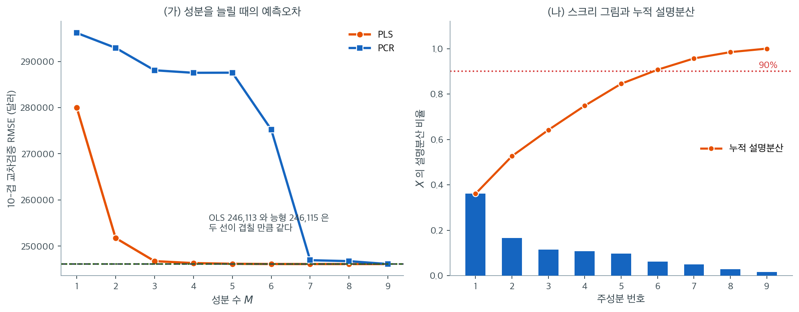
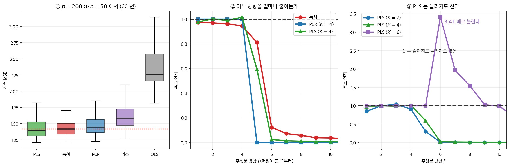

# 주성분회귀와 부분최소제곱 보기

## 개요

주성분회귀(PCR)와 부분최소제곱(PLS)은 회귀에 대한 차원축소 접근법이다. PCR은 먼저
PCA(비지도 방법)로 설명변수 공간을 축소한 뒤 선행 주성분에 반응변수를 회귀시킨다. PLS는
반응변수와의 공분산이 큰 방향을 설명변수 공간에서 찾는다(지도 방법). 이 절에서는 두 방법을
주택 자료에 적용하고 OLS 및 능형회귀와 비교한다.

---

## 1. 주성분회귀(PCR)

### 착상

PCR은 두 단계로 진행된다.

1. **차원축소.** $X$의 주성분 $Z_1, \dots, Z_M$을 계산한다. 여기서 $Z_m = X v_m$이고
   $v_m$은 $X^\top X$의 $m$번째 고유벡터다.
2. **회귀.** $Z_1, \dots, Z_M$ 위에 $y$를 OLS로 회귀시킨다.

성분의 개수 $M \le p$는 교차검증으로 고르는 조율모수다.

### 수학적 정식화

$X = U D V^\top$를 SVD라 하자. 주성분은 $Z = XV = UD$다. $M$개 성분을 쓰는 PCR은

$$
\hat{y}^{\text{PCR}} = Z_M (Z_M^\top Z_M)^{-1} Z_M^\top y = \sum_{m=1}^{M} z_m \frac{z_m^\top y}{\|z_m\|^2}
$$

를 적합한다. 여기서 $Z_M = [z_1 \mid \cdots \mid z_M]$은 처음 $M$개 주성분을 담는다.

### 능형회귀와의 관계

PCR과 능형회귀는 모두 주성분 방향을 따라 축소하지만 방식이 다르다.

- **능형회귀**는 $m$번째 성분을 $d_m^2/(d_m^2 + \lambda)$배로 축소하며, 이 인자는 연속이다.
- **PCR**은 성분을 살리거나(인자 1) 버리거나(인자 0) 둘 중 하나이며, 이는 이산적이다.

따라서 능형회귀는 PCR의 "매끄러운" 판본이라 할 수 있다.

---

## 2. 부분최소제곱(PLS)

### 착상

PCA가 $X$만의 분산이 최대인 방향을 찾는 것과 달리, PLS는 $X$ 공간에서 $y$와 가장 상관이 큰
방향을 찾는다. PLS 성분 $T_1, \dots, T_M$은 반복적으로 구성된다.

1. 가중벡터 $w_m = X^\top y / \|X^\top y\|$를 계산한다($y$와의 공분산이 최대인 방향).
2. 성분 $t_m = X w_m$을 만든다.
3. 축소(deflate): $X$와 $y$를 $t_m$에 회귀시킨 잔차로 각각 대체한다.
4. 반복한다.

### PLS가 PCR보다 나은 경우

PLS는 다음과 같은 상황에서 PCR을 능가하는 경향이 있다.

- $X$에서 분산이 가장 큰 방향이 반응변수와 정렬되어 있지 않을 때.
- 적은 수의 지도 성분만으로 $X$--$y$ 관계를 충분히 포착할 수 있을 때.

---

## 3. 코드: 자료 적재와 OLS 기준선

<div class="exbox" markdown>

**보기 1.** <span class="diff easy" title="쉬움"></span> 주택 자료와 최소제곱 기준선. King County 주택 자료에서 수치형 변수 아홉 개만 골라 표준화하고 최소제곱을 적합한다.

**(1)** 표준화한 $X$의 주성분 고윳값의 합이 얼마인지 말하시오.

**(2)** 주성분을 **전부** 써서 PCR을 하면 OLS와 무엇이 달라지는가. 근거를 들고 코드로 확인하시오.

</div>

??? success "풀이"

    **(1) 해석적으로.** 열을 표준화했으므로 $X^\top X/(n-1)$은 상관행렬이고 대각원소가 모두 1이다. 고윳값의 합은 대각합과 같으므로

    $$
    \sum_{m=1}^{p}\lambda_m = \operatorname{tr}(R) = p = 9
    $$

    다. **고윳값 하나가 1이면 그 성분이 "변수 하나만큼"의 분산을 설명한다**는 뜻이고, 성분을 몇 개 남길지 고를 때 흔히 쓰는 눈금이 여기서 나온다.

    **(2) 해석적으로.** $X = UDV^\top$에서 주성분은 $Z = XV$다. $V$는 직교행렬이므로 **$Z$의 열이 뻗는 공간과 $X$의 열이 뻗는 공간이 같다.** 최소제곱 적합값은 $y$를 그 공간 위로 사영한 것이고 사영은 좌표계에 의존하지 않으므로

    $$
    \hat y^{\text{PCR}}_{M=p} = \hat y^{\text{OLS}}
    $$

    가 **정확히** 성립한다. 근사가 아니라 항등식이다.

    그러므로 PCR이 하는 일은 새로운 모형을 만드는 것이 아니라 **좌표계를 분산 순서로 돌려 놓고 뒤쪽을 잘라 내는 것**이다. 자르지 않으면 OLS와 같다.

    **(1)(2) 수치적으로.**

    ```python
    import numpy as np
    import pandas as pd
    from sklearn.preprocessing import StandardScaler
    from sklearn.linear_model import LinearRegression
    from sklearn.metrics import mean_squared_error, r2_score

    url = ("https://raw.githubusercontent.com/gedeck/"
           "practical-statistics-for-data-scientists/8a6d3bb6468e979c861d4b37215e1413702dfdfa/data/house_sales.csv")
    house = pd.read_csv(url, sep='\t')

    # 수치형 변수만 쓴다. 주성분은 분산을 기준으로 방향을 찾으므로
    # 범주형 가변수를 섞으면 뜻이 흐려진다.
    numeric_features = [
        'SqFtTotLiving', 'SqFtLot', 'Bathrooms', 'Bedrooms',
        'BldgGrade', 'NbrLivingUnits', 'SqFtFinBasement', 'YrBuilt', 'YrRenovated'
    ]
    X = house[numeric_features].values
    y = house['AdjSalePrice'].values

    scaler = StandardScaler()
    X_scaled = scaler.fit_transform(X)

    ols_model = LinearRegression().fit(X_scaled, y)
    ols_r2 = r2_score(y, ols_model.predict(X_scaled))
    ols_rmse = np.sqrt(mean_squared_error(y, ols_model.predict(X_scaled)))

    print(f"n = {len(y)}, p = {X_scaled.shape[1]}")
    print(f"OLS: R^2 = {ols_r2:.6f},  RMSE = {ols_rmse:,.1f}")
    d = np.linalg.svd(X_scaled, compute_uv=False)
    lam = d ** 2 / (len(y) - 1)
    print(f"상관행렬 고윳값의 합 = {lam.sum():.6f}  (p = {X_scaled.shape[1]})")
    print(f"고윳값: {np.round(lam, 4)}")
    ```

    출력:

    ```
    n = 22687, p = 9
    OLS: R^2 = 0.593225,  RMSE = 245,800.5
    상관행렬 고윳값의 합 = 9.000397  (p = 9)
    고윳값: [3.2464 1.4904 1.0379 0.9616 0.87   0.5566 0.4485 0.25   0.1388]
    ```

    **고윳값의 합이 $9.0004$로 $p = 9$와 맞는다.** $10^{-4}$의 어긋남은 `StandardScaler` 가 $n$으로 나누는 반면 여기서 $n-1$로 나누었기 때문이며, $n = 22{,}687$에서 그 비는 $1.000044$다.

    고윳값이 $3.25$에서 $0.14$까지 퍼져 있다. 가장 큰 성분이 변수 세 개 몫의 분산을 담고 가장 작은 성분은 변수 하나의 $7$분의 1에 지나지 않는다. **설명변수들이 서로 상관되어 있다는 뜻**이며, 차원축소를 시도해 볼 만한 자료라는 신호다.

    OLS의 표본 내 $R^2$는 $0.5932$, RMSE는 $245{,}801$달러다.

---

## 4. 코드: 교차검증을 곁들인 PCR

<div class="exbox" markdown>

**보기 2.** <span class="diff easy" title="쉬움"></span> 주성분회귀. 성분 수 $M$을 $1$에서 $9$까지 늘리며 $10$-겹 교차검증 RMSE를 잰다.

**(1)** 능형회귀와 PCR이 주성분 방향을 축소하는 방식을 각각 식으로 적고, PCA가 **반응변수를 보지 않는다**는 사실에서 어떤 위험이 따라오는지 말하시오.

**(2)** CV 곡선을 구해 그 위험이 이 자료에서 실제로 일어나는지 확인하시오.

</div>

??? success "풀이"

    **(1) 해석적으로.** $X = UDV^\top$에서 $m$번째 주성분 방향의 기여에 붙는 인자를 적으면

    $$
    \text{능형: } \frac{d_m^2}{d_m^2+\lambda} \in (0,1),
    \qquad
    \text{PCR: } \mathbf 1(m \le M) \in \{0, 1\}
    $$

    이다. **능형은 연속적으로 깎고 PCR은 켜거나 끈다.** 능형이 PCR의 매끄러운 판본이라 불리는 까닭이다.

    위험은 $M$을 **무엇으로 고르느냐**에서 온다. PCA는 $X$의 분산만 보고 성분을 정렬하므로, 분산이 작은 성분이 $y$를 잘 설명하더라도 뒤쪽으로 밀린다. 그 성분을 쓰려면 앞의 쓸모없는 성분을 **모두 먼저 넣어야 한다.** "누적 설명분산 $90\%$에서 끊는다" 같은 경험칙은 $y$를 한 번도 보지 않은 기준이므로 그런 성분을 통째로 버릴 수 있다.

    **(2) 수치적으로.**

    ```python
    from sklearn.decomposition import PCA
    from sklearn.model_selection import cross_val_score, KFold

    # 주성분회귀(PCR): 먼저 주성분을 뽑고 그중 앞의 M 개로 회귀한다.
    # 주성분은 반응 y 를 전혀 보지 않고 X 의 분산만 보고 정해진다는 점이
    # 아래 PLS 와 갈리는 지점이다.
    pca = PCA()
    X_pca = pca.fit_transform(X_scaled)

    explained_var = pca.explained_variance_ratio_
    cumsum_var = np.cumsum(explained_var)

    kfold = KFold(n_splits=10, shuffle=True, random_state=42)
    pcr_mse_scores = []

    # 몇 개의 성분을 쓸지는 교차검증으로 고른다.
    for M in range(1, X_scaled.shape[1] + 1):
        reg = LinearRegression()
        cv_scores = cross_val_score(
            reg, X_pca[:, :M], y,
            cv=kfold, scoring='neg_mean_squared_error'
        )
        pcr_mse_scores.append(-cv_scores.mean())

    M_opt_pcr = np.argmin(pcr_mse_scores) + 1
    pcr_cv_rmse = np.sqrt(pcr_mse_scores[M_opt_pcr - 1])

    print("성분별 설명분산:", np.round(explained_var, 4))
    print("누적 설명분산:  ", np.round(cumsum_var, 4))
    print("PCR CV RMSE:", [f"{np.sqrt(m):,.0f}" for m in pcr_mse_scores])
    print(f"M_opt(PCR) = {M_opt_pcr},  CV RMSE = {pcr_cv_rmse:,.1f}")

    # 모든 성분을 쓰면 OLS 와 같아야 한다 (보기 1 의 (2))
    r2_full = r2_score(y, LinearRegression().fit(X_pca, y).predict(X_pca))
    print(f"모든 성분을 쓴 PCR 의 R^2 = {r2_full:.10f},  OLS = {ols_r2:.10f},  "
          f"차이 {abs(r2_full - ols_r2):.2e}")
    ```

    출력:

    ```
    성분별 설명분산: [0.3607 0.1656 0.1153 0.1068 0.0967 0.0618 0.0498 0.0278 0.0154]
    누적 설명분산:   [0.3607 0.5263 0.6416 0.7485 0.8451 0.907  0.9568 0.9846 1.    ]
    PCR CV RMSE: ['296,154', '292,911', '287,749', '287,519', '287,529', '275,200', '246,949', '246,740', '246,113']
    M_opt(PCR) = 9,  CV RMSE = 246,113.3
    모든 성분을 쓴 PCR 의 R^2 = 0.5932245909,  OLS = 0.5932245909,  차이 1.11e-16
    ```

    **보기 1의 (2)가 소수 열째 자리까지 확인된다.** 모든 성분을 쓴 PCR과 OLS의 $R^2$가 $0.5932245909$로 같고 차이가 $1.1\times10^{-16}$, 곧 부동소수점의 바닥이다. 사영은 좌표계에 의존하지 않는다는 항등식 그대로다.

    **(1)에서 말한 위험이 이 자료에서 그대로 일어난다.** CV RMSE가 $M = 1$부터 $6$까지 $296{,}154$에서 $275{,}200$으로 거의 내려오지 않다가, **$M = 7$에서 $246{,}949$로 한 번에 떨어진다.** 그런데 $7$번 성분이 설명하는 분산은 $4.98\%$뿐이다. 분산으로는 일곱째로 큰 성분이 집값 예측에는 결정적인 것이다.

    경험칙의 위험도 수로 드러난다. 누적 설명분산이 $M = 6$에서 $90.7\%$라 "$90\%$에서 끊는다"는 규칙을 따르면 $M = 6$에서 멈추게 되고, 그 자리의 RMSE $275{,}200$은 최적 $246{,}113$보다 **$12\%$ 나쁘다.** $X$만 보고 고른 기준이 $y$에 대해 아무것도 보장하지 않는다는 말의 값이 이 $12\%$다.

    결국 교차검증이 고른 것은 $M = 9$, 곧 **아무것도 버리지 않는 것**이다. 이 자료에서 PCR은 할 일이 없다.

    설명분산의 스크리 그림을 보면 $X$의 변동 대부분을 몇 개의 성분이 포착하는지 가늠할 수 있다.

    !!! warning "이 코드의 자료 누설"
        위 코드는 `PCA()`를 전체 자료에 한 번 적합한 뒤 그 성분으로 교차검증한다. 주성분이 검증
        겹의 정보를 이미 반영하므로 CV 오차가 낙관적으로 편향된다. 엄밀하게 하려면 표준화와 PCA를
        모두 `Pipeline` 안에 넣어 각 겹의 훈련자료에서만 적합해야 한다.

---

## 5. 코드: 교차검증을 곁들인 PLS

<div class="exbox" markdown>

**보기 3.** <span class="diff easy" title="쉬움"></span> 부분최소제곱. 같은 자료에 PLS를 성분 수를 늘려 가며 적합한다.

**(1)** PLS의 **첫** 성분 가중벡터 $w_1 \propto X^\top y$를 직접 계산해, 어느 변수가 그 방향을 지배하는지 말하시오. 이것이 PCA의 첫 성분과 어떻게 다른가.

**(2)** PLS의 CV 곡선을 PCR의 것과 견주시오.

</div>

??? success "풀이"

    **(1) 해석적으로.** $w_1 = X^\top y/\lVert X^\top y\rVert$이고 $X$가 표준화되어 있으므로 $X^\top y$의 $j$번째 성분은 $x_j$와 $y$의 **표본공분산에 $n-1$을 곱한 것**, 곧 $\operatorname{corr}(x_j, y)$에 비례한다. 따라서

    $$
    w_{1j} \propto \operatorname{corr}(x_j,\, y)
    $$

    로 **$y$와 상관이 큰 변수가 그대로 큰 가중을 받는다.** PCA의 첫 성분은 이 자리에 $y$ 대신 $X$ 자신의 분산구조가 들어간다. 바로 이 한 글자 차이가 지도 차원축소와 비지도 차원축소를 가른다.

    집값과 가장 상관이 큰 변수는 거주면적과 건물등급일 것이므로, $w_1$이 그 둘에 쏠릴 것으로 기대된다.

    **(2) 수치적으로.**

    ```python
    from sklearn.cross_decomposition import PLSRegression

    # 부분최소제곱(PLS): 성분을 찾을 때 y 와의 공분산까지 함께 본다.
    # 그래서 같은 성분 수라면 대개 PCR 보다 낫지만, y 를 보고 방향을 정한
    # 만큼 과적합의 여지도 생긴다.
    pls_mse_scores = []
    for M in range(1, X_scaled.shape[1] + 1):
        pls = PLSRegression(n_components=M)
        cv_scores = cross_val_score(
            pls, X_scaled, y,
            cv=kfold, scoring='neg_mean_squared_error'
        )
        pls_mse_scores.append(-cv_scores.mean())

    M_opt_pls = np.argmin(pls_mse_scores) + 1
    pls_cv_rmse = np.sqrt(pls_mse_scores[M_opt_pls - 1])

    # (1) 의 첫 가중벡터를 직접 계산해 본다
    w1 = X_scaled.T @ (y - y.mean())
    w1 = w1 / np.linalg.norm(w1)
    print("PLS 첫 성분의 가중 w1:")
    for nm, v in sorted(zip(numeric_features, w1), key=lambda t: -abs(t[1])):
        print(f"  {nm:16s} {v:+.4f}")
    print("PLS CV RMSE:", [f"{np.sqrt(m):,.0f}" for m in pls_mse_scores])
    print(f"M_opt(PLS) = {M_opt_pls},  CV RMSE = {pls_cv_rmse:,.1f}")
    ```

    출력:

    ```
    PLS 첫 성분의 가중 w1:
      SqFtTotLiving    +0.5786
      BldgGrade        +0.5623
      Bathrooms        +0.4404
      Bedrooms         +0.2598
      SqFtFinBasement  +0.2478
      SqFtLot          +0.1142
      YrRenovated      +0.0897
      YrBuilt          +0.0684
      NbrLivingUnits   +0.0188
    PLS CV RMSE: ['280,028', '251,752', '246,747', '246,317', '246,167', '246,123', '246,116', '246,113', '246,113']
    M_opt(PLS) = 8,  CV RMSE = 246,113.2
    ```

    **예상대로 거주면적($+0.579$)과 건물등급($+0.562$)이 첫 성분을 지배한다.** 두 변수만으로 가중벡터 길이의 제곱을 $65\%$ 채우고, 가장 작은 `NbrLivingUnits` 는 $+0.019$로 사실상 0이다. PLS의 첫 성분은 **"집이 얼마나 크고 좋은가"**라는 한 축이며, 그것을 사람이 정해 준 것이 아니라 $X^\top y$가 정했다.

    **PLS는 성분 셋으로 사실상 끝난다.** RMSE가 $280{,}028 \to 251{,}752 \to 246{,}747$로 떨어지고, 그 $246{,}747$은 변수 아홉 개를 다 쓴 $246{,}113$보다 **$0.26\%$ 높을 뿐**이다. 같은 성분 셋으로 PCR은 $287{,}749$에 머물렀으니 **$17\%$ 차이**다.

    차이의 출처는 (1)의 한 줄이다. PLS의 첫 성분은 $y$와의 상관을 보고 만들어지고, PCR의 첫 성분은 $X$의 분산만 보고 만들어진다. 이 자료에서 $X$의 분산이 가장 큰 방향이 집값과 잘 정렬되어 있지 않았고, 그 어긋남이 네 성분어치의 손해로 나타났다.

---

## 6. 코드: 비교용 능형회귀

<div class="exbox" markdown>

**보기 4.** <span class="diff easy" title="쉬움"></span> 능형회귀와 견주기. 같은 자료에 능형회귀를 적합해 네 방법을 한자리에 놓는다.

**(1)** 능형이 고른 $\lambda$에서 유효자유도 $\operatorname{df}(\lambda) = \sum_m d_m^2/(d_m^2+\lambda)$가 $p = 9$에서 얼마나 줄지 어림하시오.

**(2)** 네 방법의 성적이 서로 구별되는가. 구별되지 않는다면 그 까닭을 $p/n$으로 설명하시오.

</div>

??? success "풀이"

    **(1) 해석적으로.** 표준화한 $X$에서 $\sum_m d_m^2 = \operatorname{tr}(X^\top X) = np = 22{,}687 \times 9 \approx 2 \times 10^5$이고, 보기 1에서 본 상관행렬 고윳값이 $3.25$에서 $0.14$ 사이이므로 $d_m^2 = (n-1)\lambda_m$은 $3{,}100$에서 $73{,}600$ 사이다. 능형이 고르는 $\lambda$가 수백 수준이라면 가장 작은 성분조차 $d_m^2/(d_m^2+\lambda) \approx 0.9$이므로 **자유도는 $9$에서 한 자리 미만만 줄어든다.**

    **(2) 해석적으로.** $n = 22{,}687$에 $p = 9$라 $p/n = 0.0004$다. 최소제곱 계수의 분산이 $\sigma^2/n$ 규모이므로 **추정 잡음이 애초에 거의 없고, 정칙화가 깎아 줄 분산 자체가 없다.** 편향을 조금이라도 사면 손해다. 따라서 네 방법이 같은 자리에 모이는 것이 정상이다.

    **(1)(2) 수치적으로.**

    ```python
    from sklearn.linear_model import RidgeCV

    # 능형회귀와도 견준다. 셋 다 상관된 변수를 다루는 방법이지만, 능형은
    # 변수를 그대로 두고 계수만 줄이는 반면 PCR·PLS 는 변수를 적은 수의
    # 성분으로 갈아 끼운다.
    ridge_cv = RidgeCV(alphas=np.logspace(-2, 5, 100), cv=10)
    ridge_cv.fit(X_scaled, y)
    ridge_r2 = r2_score(y, ridge_cv.predict(X_scaled))
    ridge_rmse = np.sqrt(mean_squared_error(y, ridge_cv.predict(X_scaled)))

    print(f"능형: alpha = {ridge_cv.alpha_:,.2f},  R^2 = {ridge_r2:.6f},  RMSE = {ridge_rmse:,.1f}")
    print(f"유효자유도 = {np.sum(d**2 / (d**2 + ridge_cv.alpha_)):.4f}  (p = 9)")
    print(f"OLS RMSE {ols_rmse:,.1f} / 능형 {ridge_rmse:,.1f}  -> 차이 {ridge_rmse - ols_rmse:,.1f}")
    ```

    출력:

    ```
    능형: alpha = 335.16,  R^2 = 0.593056,  RMSE = 245,851.5
    유효자유도 = 8.7301  (p = 9)
    OLS RMSE 245,800.5 / 능형 245,851.5  -> 차이 51.0
    ```

    **어림이 맞았다.** 능형이 고른 $\lambda = 335$에서 유효자유도가 $8.73$으로 $9$에서 $0.27$만 줄었다. 계수 아홉 개가 모두 살아 있고 자유도로 세어도 거의 그대로다.

    네 방법의 성적은 **구별되지 않는다.** 교차검증 RMSE로 보면 OLS와 모든 성분을 쓴 PCR이 $246{,}113$, PLS의 최적도 $246{,}113$이고, 표본 내 RMSE로 보면 OLS $245{,}801$에 능형 $245{,}852$로 차이가 **$51$달러**다. 집값이 수십만 달러인 자료에서 $51$달러면 아무 일도 하지 않은 것과 같다.

    (2)에서 말한 그대로다. $p/n = 9/22{,}687 = 0.0004$이므로 최소제곱이 이미 충분히 안정적이고, 정칙화나 차원축소가 깎아 줄 분산 자체가 없다. **이 자료에서 네 방법을 견주는 일의 쓸모는 "차이가 없다"를 확인하는 데 있다.** 차원축소의 값어치는 $p$가 $n$에 가까워질 때, 곧 화학계량학이나 분광학처럼 $p \gg n$인 자리에서 나타난다.

---

## 7. 모형 비교

| 모형 | 초모수 | 핵심 성질 |
|---|---|---|
| OLS | 없음 | 불편이지만 분산이 가장 큼 |
| 능형회귀 | $\lambda$ | 연속적 축소, 모든 특성 유지 |
| PCR | $M$(성분 수) | 비지도 차원축소 |
| PLS | $M$(성분 수) | 지도 차원축소 |

주택 자료에서 PCR과 PLS는 더 적은 유효모수로 OLS에 근접한 $R^2$를 낸다. PLS는 반응변수와
관련된 방향을 직접 겨냥하므로 대개 PCR보다 적은 성분을 필요로 한다.



수치형 변수 9개, $n = 22{,}687$인 주택 자료에서 성분 수를 1부터 9까지 늘리며 10-겹 교차검증 RMSE를 잰 것이다(PCA를 겹 안에서 다시 적합하는 파이프라인을 썼다). 가로 점선이 OLS와 능형회귀의 수준이다.

**PLS는 성분 3개로 사실상 끝난다.** RMSE가 $280{,}028 \to 251{,}752 \to 246{,}747$로 떨어지고, 그 $246{,}747$은 변수 아홉 개를 모두 쓰는 OLS의 $246{,}113$보다 겨우 $0.3\%$ 높다. 반면 PCR은 6개까지도 $275{,}237$에 머물다가 **7번째 성분에서 $246{,}949$로 급락한다.** 성분 여섯 개를 쓴 PCR이 성분 두 개를 쓴 PLS($251{,}752$)보다도 나쁘다.

오른쪽이 그 급락의 이유를 설명한다. 7번 주성분은 $X$의 분산을 $5\%$밖에 설명하지 못하는 작은 성분인데, 집값 예측에는 결정적이다. PCA는 분산 순서로 성분을 내놓으므로 그 성분을 쓰려면 앞의 여섯 개를 먼저 다 넣어야 한다. **누적 설명분산이 $90\%$를 넘는 지점(6번 성분)에서 끊는 흔한 경험칙을 따랐다면 가장 중요한 성분을 통째로 버렸을 것이다.**

마지막으로 OLS와 능형회귀가 $246{,}113$과 $246{,}115$로 구별되지 않는다는 점도 읽어야 한다. $n$이 $2$만이 넘고 $p$가 9개뿐이라 $p/n \approx 0.0004$인 이 자료에서는 정칙화든 차원축소든 얻을 것이 없다. 네 방법이 모두 같은 자리에 모이는 것이 정상이며, **차원축소의 값어치는 $p$가 $n$에 가까워질 때 나타난다.**

---

## 8. 해석

- **PCR**은 $X$의 분산을 거의 설명하지 못하는 주성분을 버리는데, 그 성분이 $y$와 관련이
  있을 수도 없을 수도 있다. 분산이 작은 성분이 반응변수를 잘 예측하는 경우도 가능하며, 그때
  PCR은 그 성분을 놓친다.
- **PLS**는 $y$와의 공분산을 직접 겨냥하므로 대개 더 적은 성분으로 충분하다. 그래서 $p \gg n$인
  화학계량학이나 분광학에서 특히 유용하다.
- **능형회귀**는 이산적인 성분 선택 대신 연속적 축소로 비슷한 결과를 얻는다. 닫힌 형태의 해가
  있어 계산도 더 싸다.
- **방법의 선택**은 목적에 달려 있다. 잠재성분 관점의 해석이 중요하면 PCR이나 PLS를, 원래
  특성 전부를 쓰는 예측이 좋다면 능형회귀를 쓴다.

<div class="storybox" markdown>

**그림으로 보는 통계학 1.** $1993$ 년에 통계학자 둘이 매긴 차례

$\S 7$ 이 「차원축소의 값어치는 $p$ 가 $n$ 에 가까워질 때 나타난다」로 닫고,
$\S 8$ 이 PLS 를 $p \gg n$ 에서 특히 쓸모 있다고 적는다. 그 자리로 가 보자.

$1993$ 년 『Technometrics』 $5$ 월호에 **일디코 프랭크**와 **제롬 프리드먼**이
논문을 하나 실었다. 제목이 「몇몇 화학계량학 회귀 도구에 대한 통계학적 조망」이다.
화학 쪽에서 자라난 PCR 과 PLS 를, 통계 쪽의 능형회귀·변수부분집합선택·최소제곱과
한자리에 놓고 견준 글이다. 요약이 차례를 이렇게 적는다.

> 연구한 모든 상황에서 **능형회귀가 다른 방법들을 압도했고, PLS 와 PCR 이 그 차례로
> 바짝 뒤따랐다.** 변수부분집합선택은 이들보다 뚜렷이 못했지만 그래도 최소제곱보다는
> 상당히 나았는데, 최소제곱은 대개 아주 나빴다.

맨 앞이 **능형**이다. 이 절이 권하는 둘이 아니다.

$p = 200$, $n = 50$ 으로 분광학을 흉내 내어 재어 보았다. 잠재요인 넷이 매끈한
봉우리로 $200$ 개 채널을 만들고, 그 가운데 하나는 $y$ 와 무관하다. 모든 조율모수는
교차검증으로 고르고 $60$ 번 되풀이했다.



| | PLS | 능형 | PCR | 라쏘 | OLS |
|---|---|---|---|---|---|
| 시험 MSE 중앙값 | $1.3995$ | $1.4175$ | $1.4507$ | $1.5879$ | $2.2559$ |
| 능형 대비 | $0.99$ | $1.00$ | $1.02$ | $1.12$ | $1.59$ |

**그들의 차례는 재현되지 않았다.** 여기서는 PLS 가 능형을 $1\%$ 앞선다. 대신
재현된 것은 같은 요약이 바로 다음에 적은 쪽이다 — 세 방법은 「대부분의 상황에서
꽤 비슷하게 행동하는데, 공선성이 심해 편향보다 분산이 지배하는 문제에 적용되기
때문」이라는 대목이다. 실제로 위 셋은 서로 $4\%$ 안에 모여 있고, 라쏘가 $12\%$,
최소제곱이 $59\%$ 뒤에 있다. **셋 가운데 무엇을 고르느냐보다 정칙화를 하느냐가
훨씬 크게 갈린다.**

**어떻게 줄이는가.** 논문의 $\S 3.2$ 가 셋의 「축소 구조」를 견준다. 주성분 방향
$j$ 마다 최소제곱 성분을 몇 배로 바꾸는지 재면($n = 120$, $p = 20$)

| $j$ | $1$ | $2$ | $3$ | $4$ | $5$ | $6$ | $8$ |
|---|---|---|---|---|---|---|---|
| 특잇값 $d_j$ | $27.91$ | $25.60$ | $22.73$ | $18.78$ | $9.29$ | $1.68$ | $1.11$ |
| 능형 | $0.975$ | $0.970$ | $0.963$ | $0.946$ | $0.812$ | $0.123$ | $0.058$ |
| PCR ($K = 4$) | $1.000$ | $1.000$ | $1.000$ | $1.000$ | $0.000$ | $0.000$ | $0.000$ |
| PLS ($K = 4$) | $0.977$ | $1.003$ | $0.990$ | $1.017$ | $0.596$ | $0.025$ | $0.011$ |

능형은 매끄럽게 기울고 PCR 은 $1$ 과 $0$ 으로 끊는다. 논문의 말로는, PCR 과 PLS 가
「퍼짐이 작은 방향에서 능형보다 **더 세게** 줄이며, 능형은 모든 방향이 똑같이
그럴듯하다는 사전분포 아래에서 (선형 추정량 가운데) **최적의** 축소를 준다.」

**그런데 PLS 의 칸에 $1$ 보다 큰 수가 있다.** $K = 4$ 에서 넷째 방향이 $1.017$ 이고,
성분을 $6$ 개로 늘리면 여섯째 방향이 $\mathbf{3.411}$ 이 된다. 줄이는 것이 아니라
세 배 넘게 **늘린다.** 논문이 「다소 놀라운 결과」라며 적어 둔 것이 이것이다 —
PLS 는 참 계수벡터가 $K$ 번째 주성분 방향에 놓일 확률질량을 키우며, 「사실 그
방향으로는 최소제곱 해를 **확장한다**」. 그래서 그들은 능형이 PCR 을 압도한다는
것은 증명했지만 PLS 에 대해서는 그러지 못했다. 「PLS 는 선형 축소 추정량이 아니므로
이 논증으로는 능형이 PLS 를 압도한다고 보일 수 없다.」

$\S 8$ 의 마지막 줄은 목적에 따라 고르라고 한다. 재어 본 바로는, **예측만 놓고
보면 셋이 거의 바꿔 쓸 수 있다.** 갈리는 것은 축소의 *모양*이고, 그 가운데 $1$ 을
넘을 수 있는 것은 PLS 뿐이다. 그 자유가 PLS 를 종종 조금 앞세우는 까닭이면서,
동시에 PLS 에만 깔끔한 최적성 진술이 없는 까닭이기도 하다.

한 가지는 분명히 해 둔다. 위 표는 **설계 하나, 잡음 하나**의 결과다. 프랭크와
프리드먼은 여러 상황을 훑고 차례를 매겼다. 여기서 말할 수 있는 것은 「이 자리에서는
셋이 거의 붙어 있다」까지이지 그들의 차례가 틀렸다는 것이 아니다.

_확인한 곳 — Frank and Friedman, "A Statistical View of Some Chemometrics
Regression Tools", 『Technometrics』 $35$ 권 $2$ 호($1993$ 년 $5$ 월) $109$–$135$ 쪽;
JSTOR 스캔본으로 읽었다 — 요약의 차례 문장(「연구한 모든 상황에서 능형회귀가 …
최소제곱은 대개 아주 나빴다」), 「셋의 성능이 대부분의 상황에서 꽤 비슷하다」는
대목과 그 까닭, 「PCR 과 PLS 가 퍼짐이 작은 방향에서 능형보다 더 세게 줄이며
능형이 등방 사전분포 아래 최적의 축소를 준다」, PLS 가 $K$ 번째 주성분 방향으로
최소제곱 해를 확장한다는 「다소 놀라운 결과」, 그리고 「PLS 는 선형 축소 추정량이
아니므로 이 논증으로는 능형이 PLS 를 압도한다고 보일 수 없다」. 그림과 표의 수는
모두 직접 계산한 값이다_

</div>

---

## 연습문제

<div class="drillbox" markdown>

**연습문제 1.** <span class="diff med" title="중간"></span> $M = p$개 성분을 쓰는 PCR이 OLS와 동치임을 보여라.

</div>

??? success "풀이"

    주성분은 $Z = XV$이고, 여기서 $V$는 $X^\top X$의 고유벡터로 이루어진 $p \times p$
    직교행렬이다. $M = p$이면 PCR은 $Z$의 모든 열에 $y$를 회귀시킨다.

    $$
    \hat{\beta}^{\text{PCR}} = V (Z^\top Z)^{-1} Z^\top y.
    $$

    $Z = XV$이고 $V$가 직교($V^\top V = I$)이므로

    $$
    Z^\top Z = V^\top X^\top X V = D^2
    $$

    이며, $D^2 = \text{diag}(d_1^2, \dots, d_p^2)$는 고유값을 담는다. 또한
    $Z^\top y = V^\top X^\top y$이므로

    $$
    \hat{\beta}^{\text{PCR}} = V D^{-2} V^\top X^\top y = (V D^2 V^\top)^{-1} X^\top y = (X^\top X)^{-1} X^\top y = \hat{\beta}^{\text{OLS}}
    $$

    이다. 성분을 모두 남기면 버려지는 정보가 없다. $\square$

<div class="drillbox" markdown>

**연습문제 2.** <span class="diff med" title="중간"></span> 설명변수의 표준화가 PCR에는 필수적이지만 OLS에는 반드시 필요하지 않은 이유를
설명하라. 표준화하지 않으면 PCR에서 무엇이 잘못되는가?

</div>

??? success "풀이"

    PCA는 분산이 최대인 방향을 찾는다. 설명변수의 척도가 서로 다르면(예: 면적은 수천 단위,
    침실 수는 한 자릿수) 선행 주성분은 예측력과 무관하게 분산이 큰(척도가 큰) 변수에 지배된다.

    **예:** `SqFtLot`이 1,000에서 500,000까지, `Bedrooms`가 1에서 6까지 변한다면, 첫 주성분은
    단지 수치적 분산이 크다는 이유만으로 거의 전적으로 `SqFtLot`과 정렬된다. 그러면 PCR은
    침실 수가 더 예측력이 높더라도 대지면적에 근거해 회귀하게 된다.

    OLS에는 이런 문제가 없다. 중간에 분산 최대화 단계를 거치지 않고 잔차제곱합을 직접
    최소화하기 때문이다. OLS 계수는 각 설명변수의 척도에 맞추어 자동으로 조정된다. (수치
    안정성을 위해 표준화는 여전히 좋은 습관이지만, OLS의 적합값 자체는 바뀌지 않는다.)
    $\square$

<div class="drillbox" markdown>

**연습문제 3.** <span class="diff med" title="중간"></span> 주택 보기에서 최적 PCR이 $p = 9$개 중 $M = 7$개 성분을 쓴다고 하자. 이는 자료에
대해 무엇을 말해 주는가? PLS는 더 많은 성분을 필요로 할까, 더 적은 성분을 필요로 할까?

</div>

??? success "풀이"

    PCR이 9개 중 7개 성분을 필요로 한다면, 마지막 두 주성분이 $X$의 분산은 거의 설명하지
    못하면서도 $y$를 예측하는 데 유용한 정보를 담고 있다는 뜻이다. 이를 버리면 예측이 조금
    나빠진다. 즉 자료의 신호가 저차원 부분공간에 몰려 있지 않고 설명변수 공간의 여러 방향에
    퍼져 있음을 시사한다.

    PLS는 **더 적은** 성분을 필요로 할 가능성이 크다. $X$만의 분산이 아니라 $y$와의 공분산을
    최대화하는 방향을 만들기 때문이다. 어떤 방향이 $X$의 분산을 거의 설명하지 못하더라도
    $y$와 강하게 연관되어 있으면 PLS는 그 방향을 일찍 집어낸다. 경험적으로 PLS는 2--5개
    성분만으로 7개 성분을 쓴 PCR과 비슷하거나 더 나은 성능을 내는 경우가 많다. $\square$

<div class="drillbox" markdown>

**연습문제 4.** <span class="diff med" title="중간"></span> scikit-learn의 PCA를 쓰지 않고, 중심화·척도화한 계획행렬의 SVD를 이용해 PCR을
직접 구현하라. 작은 시험자료에서 구현 결과가 scikit-learn과 일치함을 확인하라.

</div>

??? success "풀이"

    ```python
    import numpy as np
    from sklearn.preprocessing import StandardScaler
    from sklearn.decomposition import PCA
    from sklearn.linear_model import LinearRegression

    np.random.seed(42)
    n, p = 50, 5
    X = np.random.randn(n, p)
    beta_true = np.array([3, -1, 2, 0, 0])
    y = X @ beta_true + np.random.randn(n) * 0.5

    # 표준화. 벌점회귀에서는 필수다
    X_s = StandardScaler().fit_transform(X)

    # 특이값분해로 직접 구현한 주성분회귀
    U, D, Vt = np.linalg.svd(X_s, full_matrices=False)
    M = 3  # number of components
    Z = U[:, :M] * D[:M]  # first M principal components
    y_bar = y.mean()                                  # intercept
    gamma = np.linalg.lstsq(Z, y - y_bar, rcond=None)[0]
    beta_pcr_manual = Vt[:M].T @ gamma
    y_pred_manual = X_s @ beta_pcr_manual + y_bar

    # sklearn 으로 같은 일 하기
    pca = PCA(n_components=M)
    Z_sk = pca.fit_transform(X_s)
    reg = LinearRegression().fit(Z_sk, y)
    y_pred_sk = reg.predict(Z_sk)

    print(f"Max prediction difference: {np.max(np.abs(y_pred_manual - y_pred_sk)):.2e}")
    ```

    출력:

    ```
    Max prediction difference: 9.77e-15
    ```

    실행하면 최대 예측 차이는 $9.8 \times 10^{-15}$로 기계 엡실론 수준이며, 두 구현이 동치임을
    확인해 준다.

    !!! warning "절편을 빠뜨리면"
        `np.linalg.lstsq(Z, y)`처럼 $y$를 중심화하지 않고 그대로 회귀시키면 절편이 빠진다.
        반면 scikit-learn의 `LinearRegression`은 기본적으로 절편을 적합하므로, 두 예측값은
        정확히 $\bar{y}$만큼 어긋난다. 위 자료에서는 $\bar{y} = 0.3189$이고 실제로 최대 차이가
        $0.319$로 나온다. $Z$의 열은 중심화되어 있지만 $y$는 그렇지 않다는 점을 놓치기 쉽다.

    !!! note "부호 규약"
        `np.linalg.svd`와 `PCA`는 특이벡터의 부호 규약이 다를 수 있어 $v_m$과 $\gamma_m$의
        부호가 뒤집혀 나올 수 있다. 그러나 곱 $z_m \gamma_m$은 부호에 불변이므로 **예측값**은
        정확히 일치한다. 성분별 계수를 직접 비교할 때는 부호를 맞춰 주어야 한다.
    $\square$

<div class="drillbox" markdown>

**연습문제 5.** <span class="diff hard" title="어려움"></span> 첫 PLS 방향 $w_1$이 $\|w\| = 1$ 아래에서 $\text{Cov}(Xw, y)^2$을 최대화함을
증명하고, 이것이 $w_1 \propto X^\top y$와 동치임을 보여라.

</div>

??? success "풀이"

    구하고자 하는 것은

    $$
    w_1 = \arg\max_{\|w\|=1} \left[\text{Cov}(Xw, y)\right]^2
    $$

    이다. $X$와 $y$가 중심화되어 있다고 하면
    $\text{Cov}(Xw, y) = \frac{1}{n-1}(Xw)^\top y = \frac{1}{n-1}w^\top X^\top y$이다.
    $\|w\| = 1$ 아래에서 $[w^\top X^\top y]^2$을 최대화하는 것은 $|w^\top X^\top y|$를
    최대화하는 것과 같다.

    코시–슈바르츠 부등식에 의해

    $$
    |w^\top (X^\top y)| \le \|w\| \cdot \|X^\top y\| = \|X^\top y\|
    $$

    이고, 등호는 $w \propto X^\top y$일 때 성립한다. 따라서

    $$
    w_1 = \frac{X^\top y}{\|X^\top y\|}
    $$

    이다. 즉 첫 PLS 방향은 각 설명변수와 반응변수의 주변공분산을 모은 벡터를 정규화한 것에
    지나지 않는다. $\square$

<div class="drillbox" markdown>

**연습문제 6.** <span class="diff hard" title="어려움"></span> 보기 4 는 능형이 고른 $\lambda = 335.16$ 에서 유효자유도가 $\operatorname{df}(\lambda) = \sum_{m} d_m^2/(d_m^2+\lambda) = 8.7301$ 이라 했다. 이제 **능형을 PCR 과 같은 자유도에 세워 보자.**

**(1)** $\operatorname{df}$ 가 $[0,\infty)$ 에서 연속이고 순강감소이며 $\operatorname{df}(0) = p$, $\lim_{\lambda\to\infty}\operatorname{df}(\lambda) = 0$ 임을 보여라. 따라서 $0 < M < p$ 인 임의의 $M$ 에 대해 $\operatorname{df}(\lambda) = M$ 인 $\lambda$ 가 **단 하나**임을 결론하라.

**(2)** 보기 1 이 찍은 상관행렬 고윳값과 $d_m^2 = (n-1)\lambda_m$, $n = 22{,}687$ 을 써서 $\operatorname{df}(\lambda) = 7$ 인 $\lambda_\star$ 를 이분법으로 구하라. 그 $\lambda_\star$ 에서 능형의 축소 인자 아홉 개를 PCR$(M=7)$ 의 $(1,1,1,1,1,1,1,0,0)$ 과 견주고, **"같은 자유도"가 "같은 모형"을 뜻하지 않는다**는 것을 수로 말하라.

</div>

??? success "풀이"

    **(1)** 항별로 $g_m(\lambda) = d_m^2/(d_m^2+\lambda)$ 라 두면 $X$ 가 계수 $p$ 이므로 모든 $d_m^2 > 0$ 이고

    $$
    g_m'(\lambda) = -\frac{d_m^2}{(d_m^2+\lambda)^2} < 0
    $$

    이다. 따라서

    $$
    \operatorname{df}'(\lambda) = -\sum_{m=1}^{p}\frac{d_m^2}{(d_m^2+\lambda)^2} < 0
    $$

    으로 $\operatorname{df}$ 는 순강감소다. $\lambda = 0$ 에서 $g_m(0) = 1$ 이므로 $\operatorname{df}(0) = p$ 이고, $\lambda \to \infty$ 에서 $g_m(\lambda) \to 0$ 이므로 $\operatorname{df}(\lambda) \to 0$ 이다. 유리함수의 합이므로 $[0,\infty)$ 에서 연속이다.

    연속이고 끝값이 $p$ 와 $0$ 이므로 중간값정리로 $\operatorname{df}(\lambda) = M$ 인 $\lambda$ 가 **존재**하고, 순강감소이므로 단사라서 그 $\lambda$ 가 **유일**하다. 그러므로 "능형의 자유도를 $M$ 에 맞춘다"는 말이 잘 정의된다. $\square$

    **(2) 수치적으로.**

    ```python
    import numpy as np

    # 보기 1 이 찍은 상관행렬 고윳값과 표본크기. 자료를 다시 읽지 않는다.
    lam_corr = np.array([3.2464, 1.4904, 1.0379, 0.9616, 0.87,
                         0.5566, 0.4485, 0.25, 0.1388])
    n = 22687
    d2 = (n - 1) * lam_corr          # d_m^2 = (n-1) x (상관행렬 고윳값)

    def df(lmbda):
        return float(np.sum(d2 / (d2 + lmbda)))

    print("d_m^2 =", np.round(d2, 1))
    print(f"df(0)      = {df(0.0):.4f}")
    print(f"df(335.16) = {df(335.16):.4f}   <- 보기 4 는 8.7301")

    # df 는 lambda 에 대해 순강감소이므로 이분법이 쓸 수 있다
    lo, hi = 0.0, 1.0e6
    for _ in range(200):
        mid = 0.5 * (lo + hi)
        if df(mid) > 7.0:
            lo = mid
        else:
            hi = mid
    lam_star = 0.5 * (lo + hi)

    print(f"df(lambda) = 7 인 lambda* = {lam_star:,.2f}  (df = {df(lam_star):.6f})")
    s = d2 / (d2 + lam_star)
    print("lambda* 에서 능형의 성분별 축소 인자:")
    print("  ", np.round(s, 4))
    print("같은 자유도를 쓰는 PCR(M=7) 의 축소 인자:")
    print("  ", np.array([1.0] * 7 + [0.0] * 2))
    print(f"가장 작은 성분에 남는 몫: 능형 {s[-1]:.4f},  PCR 0.0000")
    print(f"가장 큰 성분에서 깎인 몫: 능형 {1 - s[0]:.4f},  PCR 0.0000")
    ```

    출력:

    ```text
    d_m^2 = [73647.8 33811.2 23545.8 21814.9 19736.8 12627.  10174.7  5671.5  3148.8]
    df(0)      = 9.0000
    df(335.16) = 8.7300   <- 보기 4 는 8.7301
    df(lambda) = 7 인 lambda* = 3,663.55  (df = 7.000000)
    lambda* 에서 능형의 성분별 축소 인자:
       [0.9526 0.9022 0.8654 0.8562 0.8434 0.7751 0.7353 0.6075 0.4622]
    같은 자유도를 쓰는 PCR(M=7) 의 축소 인자:
       [1. 1. 1. 1. 1. 1. 1. 0. 0.]
    가장 작은 성분에 남는 몫: 능형 0.4622,  PCR 0.0000
    가장 큰 성분에서 깎인 몫: 능형 0.0474,  PCR 0.0000
    ```

    $\operatorname{df}(335.16) = 8.7300$ 으로 보기 4 의 $8.7301$ 과 소수 넷째 자리에서 $1$ 만큼 어긋난다. 고윳값을 소수 넷째 자리로 반올림해 썼기 때문이며, 어긋남의 크기가 반올림 오차 그대로다. 이것으로 $d_m^2 = (n-1)\lambda_m$ 이라는 환산이 맞음을 확인한다.

    **자유도 $7$ 을 쓰는 두 방식.** $\lambda_\star = 3{,}663.55$ 다. 같은 복잡도 예산 $7$ 을 능형은 **아홉 성분에서 조금씩 떼어** 쓴다. 가장 큰 성분에서도 $4.74\%$ 를 깎고, 가장 작은 성분은 $46.22\%$ 만 남긴다. PCR$(M=7)$ 은 **일곱 성분을 전혀 건드리지 않고 두 성분을 통째로 버린다.** 축소 인자 벡터를 나란히 놓으면

    $$
    (0.9526, \ldots, 0.7353,\ 0.6075,\ 0.4622)
    \quad \text{대} \quad
    (1, \ldots, 1,\ 0,\ 0)
    $$

    으로, 아홉 자리 가운데 **한 자리도 같지 않다.** 두 모형은 예측도 다르고 계수도 다르다.

    **어느 쪽이 나은지는 자료가 정한다.** 보기 2 에서 $7$ 번 성분이 $X$ 의 분산을 $4.98\%$ 밖에 설명하지 않으면서 CV RMSE 를 $275{,}200$ 에서 $246{,}949$ 로 떨어뜨렸다. 작은 성분에도 신호가 있다는 뜻이고, 그렇다면 $8$, $9$ 번 성분을 $0.6075$, $0.4622$ 로 **남겨 쓰는** 능형 쪽이 통째로 버리는 PCR 보다 안전하다. 유효자유도는 모형이 아니라 **복잡도 예산의 총액**이며, 그 예산을 어디에 쓰는지가 방법을 가른다.

<div class="drillbox" markdown>

**연습문제 7.** <span class="diff hard" title="어려움"></span> 연습문제 1 은 $M = p$ 에서 PCR 이 OLS 와 같음을 보였다. 이제 $M < p$ 에서 PCR 이 OLS **계수벡터**에 무슨 일을 하는지 적는다.

**(1)** $V_M = [v_1 \mid \cdots \mid v_M]$ 이라 할 때

$$
\hat\beta^{\text{PCR}}_M = V_M V_M^\top \hat\beta^{\text{OLS}}
$$

임을 보이고, 이로부터 $\lVert \hat\beta^{\text{PCR}}_M \rVert \le \lVert \hat\beta^{\text{OLS}} \rVert$ 임을 보여라.

**(2)** 그런데도 PCR 은 **좌표별 축소가 아니다.** $p = 2$ 와

$$
X^\top X = \begin{pmatrix} 10 & 8 \\ 8 & 10 \end{pmatrix},
\qquad
X^\top y = \begin{pmatrix} 34 \\ 38 \end{pmatrix}
$$

에서 $\hat\beta^{\text{OLS}}$ 와 $\hat\beta^{\text{PCR}}_{M=1}$ 을 손으로 구해 $\lvert \hat\beta^{\text{PCR}}_1 \rvert > \lvert \hat\beta^{\text{OLS}}_1 \rvert$ 인 반례를 만들어라. 능형에서도 같은 일이 일어날 수 있는가? $\lambda = 2$ 에서 확인하라.

</div>

??? success "풀이"

    **(1)** $X = UDV^\top$ 에서 $Z_M = XV_M$ 이고 $Z_M^\top Z_M = V_M^\top X^\top X V_M = D_M^2 = \operatorname{diag}(d_1^2,\dots,d_M^2)$ 이다. PCR 계수는 성분 좌표의 해를 $V_M$ 으로 되돌린 것이므로

    $$
    \hat\beta^{\text{PCR}}_M = V_M (Z_M^\top Z_M)^{-1} Z_M^\top y = V_M D_M^{-2} V_M^\top X^\top y
    $$

    다. 한편 $\hat\beta^{\text{OLS}} = (X^\top X)^{-1}X^\top y = V D^{-2} V^\top X^\top y$ 이므로

    $$
    V_M V_M^\top \hat\beta^{\text{OLS}} = V_M V_M^\top V D^{-2} V^\top X^\top y = V_M D_M^{-2} V_M^\top X^\top y = \hat\beta^{\text{PCR}}_M
    $$

    이다. 가운데 등호는 $V_M^\top V = [\,I_M \mid 0\,]$ 라서 $D^{-2}$ 의 앞 $M$ 개 대각원소만 살아남기 때문이다.

    $P_M = V_M V_M^\top$ 은 $\operatorname{span}(v_1,\dots,v_M)$ 위로의 **직교사영**이다($P_M^2 = P_M = P_M^\top$). 사영은 노름을 늘리지 않으므로

    $$
    \lVert \hat\beta^{\text{PCR}}_M \rVert = \lVert P_M \hat\beta^{\text{OLS}} \rVert \le \lVert \hat\beta^{\text{OLS}} \rVert
    $$

    이다. 곧 PCR 은 **회전된 좌표 $\gamma = V^\top\beta$ 에서** 뒤쪽 $p-M$ 개를 $0$ 으로 눌러 버리는 일이고, 그 결과 전체 길이가 줄어든다. $\square$

    **(2) 손으로.** $X^\top X$ 의 고유분해부터. 행렬이 $\begin{pmatrix} a & b \\ b & a\end{pmatrix}$ 꼴이므로 고유벡터가 $v_1 = (1,1)^\top/\sqrt2$, $v_2 = (1,-1)^\top/\sqrt2$ 이고 고윳값은 $d_1^2 = 10+8 = 18$, $d_2^2 = 10-8 = 2$ 다.

    OLS 는 $\det(X^\top X) = 100 - 64 = 36$ 이므로

    $$
    \hat\beta^{\text{OLS}} = \frac{1}{36}\begin{pmatrix} 10 & -8 \\ -8 & 10\end{pmatrix}\begin{pmatrix}34\\38\end{pmatrix} = \frac{1}{36}\begin{pmatrix}340-304\\-272+380\end{pmatrix} = \frac{1}{36}\begin{pmatrix}36\\108\end{pmatrix} = \begin{pmatrix}1\\3\end{pmatrix}
    $$

    다. (1) 을 쓰면 $M = 1$ 의 PCR 은

    $$
    \hat\beta^{\text{PCR}}_{M=1} = v_1 v_1^\top \begin{pmatrix}1\\3\end{pmatrix} = \frac{1+3}{2}\begin{pmatrix}1\\1\end{pmatrix} = \begin{pmatrix}2\\2\end{pmatrix}
    $$

    이다. **첫 좌표가 $1$ 에서 $2$ 로 두 배 커졌다.** 그런데 길이는

    $$
    \lVert \hat\beta^{\text{PCR}} \rVert = \sqrt{8} = 2.8284 \;\le\; \sqrt{10} = 3.1623 = \lVert \hat\beta^{\text{OLS}} \rVert
    $$

    로 (1) 그대로 줄었다. 모순이 아니다. 사영은 **벡터의 길이**를 줄이지만 **각 좌표**를 줄인다는 보장은 없다. 여기서는 $\hat\beta^{\text{OLS}}$ 가 $v_2$ 쪽 성분 $\hat\gamma_2 = v_2^\top(1,3)^\top = -2/\sqrt2 = -1.4142$ 를 가지고 있고, 그것을 버리면서 첫 좌표에 실려 있던 음의 기여가 함께 사라진 것이다.

    **능형도 같다.** $\hat\gamma = V^\top(1,3)^\top = (4/\sqrt2,\, -2/\sqrt2)^\top = (2.8284,\, -1.4142)^\top$ 이고 $\lambda = 2$ 에서 축소 인자는

    $$
    s_1 = \frac{18}{18+2} = 0.9, \qquad s_2 = \frac{2}{2+2} = 0.5
    $$

    다. 되돌리면

    $$
    \hat\beta^{\text{ridge}}(2) = v_1 s_1 \hat\gamma_1 + v_2 s_2 \hat\gamma_2 = 2(0.9)\begin{pmatrix}1\\1\end{pmatrix} + (-1)(0.5)\begin{pmatrix}1\\-1\end{pmatrix} = \begin{pmatrix}1.3\\2.3\end{pmatrix}
    $$

    이다. 첫 좌표가 $1 \to 1.3$ 으로 **커졌다.** 길이는 $\lVert(1.3, 2.3)\rVert = 2.6420 < 3.1623$ 로 줄었다.

    까닭이 같다. 능형과 PCR 은 모두 $V$ 로 회전한 좌표에서만 축소이고, 원래 좌표로 되돌릴 때 성분들이 섞인다. $s_1 \ne s_2$ 이면 섞이는 비율이 달라져 좌표가 커질 수 있다. **"능형은 계수를 줄인다"는 말은 $\lVert\beta\rVert$ 에 대한 진술이지 $\beta_j$ 하나하나에 대한 진술이 아니다.** 좌표별 축소가 보장되는 것은 $X$ 가 직교설계여서 $V = I$ 일 때뿐이고, 그때 능형은 $\hat\beta_j^{\text{OLS}}/(1+\lambda/d_j^2)$ 로 비례축소가 된다.

<div class="drillbox" markdown>

**연습문제 8.** <span class="diff hard" title="어려움"></span> 연습문제 7 과 **같은 설계**에 반응만 바꾼다. $x_1 = (2,1,-1,-2)^\top$, $x_2 = (1,2,-2,-1)^\top$, $y = (1,-1,1,-1)^\top$ 이라 하면 세 벡터 모두 중심화되어 있고

$$
X^\top X = \begin{pmatrix} 10 & 8 \\ 8 & 10 \end{pmatrix},
\qquad
X^\top y = \begin{pmatrix} 2 \\ -2 \end{pmatrix},
\qquad
y^\top y = 4
$$

이다. 두 열의 노름이 같으므로 표준화해도 주성분 방향이 바뀌지 않는다.

**(1)** $\hat\beta^{\text{OLS}}$ 와 OLS 의 $R^2$ 를 구하라.

**(2)** PCR$(M=1)$ 의 $R^2$ 를 구하고 그 값이 나오는 까닭을 말하라.

**(3)** PLS 의 첫 가중 $w_1$ 과 PLS$(M=1)$ 의 $R^2$ 를 구하라.

**(4)** 능형의 성분별 축소 인자를 적고, 능형이 PCR 과 **같은 병**에 걸리는지 판정하라. $\lambda = 2$ 와 $\lambda = 18$ 에서 $R^2$ 를 구하라.

</div>

??? success "풀이"

    연습문제 7 에서 이미 $v_1 = (1,1)^\top/\sqrt2$, $d_1^2 = 18$, $v_2 = (1,-1)^\top/\sqrt2$, $d_2^2 = 2$ 를 얻었다.

    **(1)** $\det(X^\top X) = 36$ 이므로

    $$
    \hat\beta^{\text{OLS}} = \frac{1}{36}\begin{pmatrix}10 & -8\\ -8 & 10\end{pmatrix}\begin{pmatrix}2\\-2\end{pmatrix} = \frac{1}{36}\begin{pmatrix}20+16\\-16-20\end{pmatrix} = \begin{pmatrix}1\\-1\end{pmatrix}
    $$

    다. 적합값은 $\hat y = x_1 - x_2 = (1,-1,1,-1)^\top = y$ 로 $y$ 와 **정확히** 같다. 따라서 $\text{RSS} = 0$, $R^2 = 1$ 이다.

    **(2)** 첫 주성분의 점수는 $z_1 = Xv_1 = (x_1+x_2)/\sqrt2 = (3,3,-3,-3)^\top/\sqrt2$ 다. 그런데

    $$
    z_1^\top y = v_1^\top X^\top y = \frac{1}{\sqrt2}(2 + (-2)) = 0
    $$

    이다. **첫 주성분이 $y$ 와 직교한다.** 그러므로 $\hat\gamma_1 = 0$, $\hat\beta^{\text{PCR}}_{M=1} = \mathbf 0$, $\hat y = \mathbf 0$ 이고

    $$
    R^2_{\text{PCR}(M=1)} = 1 - \frac{4}{4} = 0
    $$

    이다. $X$ 의 분산을 $18/20 = 90\%$ 설명하는 성분 하나를 쓰고도 **설명력이 전혀 없다.** 신호가 전부 분산이 작은 둘째 방향 $v_2$ 에 들어 있기 때문이다. 실제로 $\hat\gamma_2 = v_2^\top\hat\beta^{\text{OLS}} = (1+1)/\sqrt2 = \sqrt2 \ne 0$ 이다.

    **(3)** $w_1 \propto X^\top y = (2,-2)^\top$ 이므로

    $$
    w_1 = \frac{(2,-2)^\top}{\lVert (2,-2)^\top \rVert} = \frac{1}{\sqrt2}\begin{pmatrix}1\\-1\end{pmatrix} = v_2
    $$

    다. PLS 의 첫 가중이 **둘째 주성분 방향을 정확히 집어낸다.** 성분은 $t_1 = Xw_1 = (x_1-x_2)/\sqrt2 = y/\sqrt2$ 이고

    $$
    t_1^\top y = \frac{1}{\sqrt2}(2+2) = 2\sqrt2,
    \qquad
    \lVert t_1 \rVert^2 = w_1^\top X^\top X w_1 = \frac{1}{2}\,(1,-1)\begin{pmatrix}2\\-2\end{pmatrix} = 2
    $$

    이므로 회귀계수는 $2\sqrt2/2 = \sqrt2$ 이고 적합값은 $\hat y = \sqrt2\, t_1 = y$ 다. $\text{RSS} = 0$, 곧

    $$
    R^2_{\text{PLS}(M=1)} = 1
    $$

    이다. **성분 하나로 끝난다.** PLS 는 $X^\top y$ 를 보고 방향을 정하므로 분산이 작든 크든 상관하지 않는다.

    **(4)** 축소 인자는 $s_1 = 18/(18+\lambda)$, $s_2 = 2/(2+\lambda)$ 다. $\hat\gamma_1 = 0$ 이므로 적합값에는 둘째 성분만 남고

    $$
    \hat y^{\text{ridge}}(\lambda) = s_2 \, z_2 \hat\gamma_2 = \frac{2}{2+\lambda}\, y,
    \qquad
    R^2 = 1 - \left(\frac{\lambda}{2+\lambda}\right)^2
    $$

    이다. $\lambda = 2$ 에서 $s_1 = 0.9$, $s_2 = 0.5$ 이고 $R^2 = 1 - 0.25 = 0.75$ 다. $\lambda = 18$ 에서 $s_1 = 0.5$, $s_2 = 0.1$ 이고 $R^2 = 1 - 0.81 = 0.19$ 다.

    **능형은 같은 병에 걸린다. 다만 정도가 다르다.** 어느 $\lambda$ 에서도 $s_2 < s_1$ 이므로 능형은 **신호가 들어 있는 방향을 가장 세게 깎는다.** $\lambda = 18$ 에서 분산이 큰 쪽은 절반을 남기는데 정작 쓸모 있는 쪽은 $10\%$ 만 남는다. 다만 $s_2 > 0$ 이므로 $R^2$ 가 $0$ 으로 떨어지지는 않는다. PCR$(M=1)$ 은 $s_2 = 0$ 이라 $R^2 = 0$ 까지 간다.

    세 방법을 한 줄에 놓으면 이 쪽의 요지가 수로 드러난다.

    - PCR$(M=1)$: $R^2 = 0$. 성분을 $X$ 의 분산으로만 고르므로 신호를 통째로 버렸다.
    - 능형: $R^2 = 1 - (\lambda/(2+\lambda))^2$. 버리지는 않지만 신호 방향을 가장 많이 깎는다.
    - PLS$(M=1)$: $R^2 = 1$. $y$ 를 보았으므로 첫 성분에서 신호를 잡았다.

    보기 2 에서 $7$ 번 주성분이 분산 $4.98\%$ 로 CV RMSE 를 통째로 바꿔 놓은 일이 이 설계의 **완화된 판본**이다. 여기서는 그 어긋남을 극단으로 밀어 $R^2$ 가 $0$ 과 $1$ 로 갈라지게 했다.

<div class="drillbox" markdown>

**연습문제 9.** <span class="diff hard" title="어려움"></span> 연습문제 2 는 PCR 에 표준화가 필요하다고 **정성적으로** 말했다. 그 대가를 수로 재자. 중심화만 하고 척도화는 하지 않은 설계에서

$$
X^\top X = \begin{pmatrix} 6 & 2 \\ 2 & 9 \end{pmatrix},
\qquad
X^\top y = \begin{pmatrix} 12 \\ 6 \end{pmatrix},
\qquad
y^\top y = 40
$$

이라 하자($y$ 는 중심화되어 있다).

**(1)** 척도화하지 않은 $X$ 의 주성분 방향과 고윳값을 구하고, PCR$(M=1)$ 의 계수와 $R^2$ 를 구하라.

**(2)** 각 열을 $\tilde x_j = x_j/\lVert x_j \rVert$ 로 바꾼 뒤 같은 일을 하라. 모든 열에 **같은** 상수를 곱하는 것은 주성분 방향도 열공간도 바꾸지 않으므로, 이 결과는 분산 $1$ 로 맞추는 통상의 표준화와 같다.

**(3)** OLS 의 $R^2$ 를 구하고, (1) 과 (2) 에서 OLS 의 적합값이 왜 바뀌지 않는지 보여라.

</div>

??? success "풀이"

    적합값이 사영이므로 어느 경우든 $\text{RSS} = y^\top y - \hat\beta^\top X^\top y$ 로 계산된다(PCR 도 성분 공간 위로의 사영이다). 이 식을 반복해 쓴다.

    **(1) 척도화하지 않은 PCR.** $\begin{pmatrix}6&2\\2&9\end{pmatrix}$ 의 고유벡터를 찾자. $(1,2)^\top$ 을 넣으면 $(6+4,\, 2+18)^\top = (10, 20)^\top = 10\,(1,2)^\top$ 이므로

    $$
    v_1 = \frac{1}{\sqrt5}\begin{pmatrix}1\\2\end{pmatrix},\quad d_1^2 = 10,
    \qquad
    v_2 = \frac{1}{\sqrt5}\begin{pmatrix}2\\-1\end{pmatrix},\quad d_2^2 = 5
    $$

    다(대각합 $15 = 10+5$ 로 검산된다). **$x_2$ 의 노름이 더 커서 첫 주성분이 $x_2$ 쪽으로 기울었다.**

    $v_1^\top X^\top y = (12 + 12)/\sqrt5 = 24/\sqrt5$ 이므로 $\hat\gamma_1 = (24/\sqrt5)/10$ 이고

    $$
    \hat\beta^{\text{PCR}} = v_1 \hat\gamma_1 = \frac{24}{50}\begin{pmatrix}1\\2\end{pmatrix} = \begin{pmatrix}0.48\\0.96\end{pmatrix}
    $$

    다. 적합제곱합은 $\hat\beta^\top X^\top y = 0.48(12) + 0.96(6) = 5.76 + 5.76 = 11.52$ 이므로

    $$
    R^2 = \frac{11.52}{40} = 0.2880
    $$

    이다.

    **(2) 척도화한 PCR.** $\lVert x_1 \rVert = \sqrt6$, $\lVert x_2 \rVert = 3$ 이므로 $S = \operatorname{diag}(1/\sqrt6,\, 1/3)$, $\tilde X = XS$ 다. 그러면

    $$
    \tilde X^\top \tilde X = S X^\top X S = \begin{pmatrix} 1 & \rho \\ \rho & 1 \end{pmatrix},
    \qquad
    \rho = \frac{2}{3\sqrt6} = 0.2722
    $$

    이고 $\tilde X^\top y = SX^\top y = (12/\sqrt6,\, 2)^\top = (4.8990,\, 2)^\top$ 이다. 상관행렬 꼴이므로 고유벡터는

    $$
    \tilde v_1 = \frac{1}{\sqrt2}\begin{pmatrix}1\\1\end{pmatrix},\ \tilde d_1^2 = 1+\rho = 1.2722,
    \qquad
    \tilde v_2 = \frac{1}{\sqrt2}\begin{pmatrix}1\\-1\end{pmatrix},\ \tilde d_2^2 = 1-\rho = 0.7278
    $$

    다. **방향이 $(1,2)/\sqrt5$ 에서 $(1,1)/\sqrt2$ 로 바뀌었다.**

    $\tilde v_1^\top \tilde X^\top y = (4.8990+2)/\sqrt2 = 4.8783$ 이므로 $\hat{\tilde\gamma}_1 = 4.8783/1.2722 = 3.8347$ 이고

    $$
    \hat{\tilde\beta}^{\text{PCR}} = \tilde v_1 \hat{\tilde\gamma}_1 = \frac{3.8347}{\sqrt2}\begin{pmatrix}1\\1\end{pmatrix} = \begin{pmatrix}2.7115\\2.7115\end{pmatrix}
    $$

    다. 원래 단위로 되돌리면 $\hat\beta = S\hat{\tilde\beta} = (2.7115/\sqrt6,\ 2.7115/3)^\top = (1.1070,\, 0.9038)^\top$ 이고 적합제곱합은

    $$
    \hat\beta^\top X^\top y = 1.1070(12) + 0.9038(6) = 13.2836 + 5.4230 = 18.7066
    $$

    이므로

    $$
    R^2 = \frac{18.7066}{40} = 0.4677
    $$

    이다.

    **(3) OLS.** $\det(X^\top X) = 54 - 4 = 50$ 이므로

    $$
    \hat\beta^{\text{OLS}} = \frac{1}{50}\begin{pmatrix}9 & -2\\ -2 & 6\end{pmatrix}\begin{pmatrix}12\\6\end{pmatrix} = \frac{1}{50}\begin{pmatrix}108-12\\-24+36\end{pmatrix} = \begin{pmatrix}1.92\\0.24\end{pmatrix}
    $$

    이고 적합제곱합이 $1.92(12)+0.24(6) = 23.04+1.44 = 24.48$ 이라 $R^2 = 24.48/40 = 0.6120$ 이다.

    척도를 바꾸어도 OLS 가 바뀌지 않는 까닭은 **열공간이 그대로**이기 때문이다. $\tilde X = XS$ 에서 $S$ 가 가역이므로 $\operatorname{col}(\tilde X) = \operatorname{col}(X)$ 이고, OLS 적합값은 그 공간 위로의 사영이므로 좌표계와 무관하다. 계수만 $\hat{\tilde\beta} = S^{-1}\hat\beta^{\text{OLS}}$ 로 환산된다. $\square$

    **정리.** 세 $R^2$ 를 나란히 놓으면

    $$
    0.2880 \;(\text{척도화 없는 PCR})
    \;<\; 0.4677 \;(\text{척도화한 PCR})
    \;<\; 0.6120 \;(\text{OLS})
    $$

    다. **표준화를 빠뜨린 것만으로 PCR 이 설명력의 $38\%$ 를 잃었다**($1 - 0.2880/0.4677 = 0.384$). 까닭은 $\hat\beta^{\text{OLS}} = (1.92, 0.24)^\top$ 이 말해 준다. $y$ 는 $x_1$ 쪽에 쏠려 있는데, $\lVert x_2\rVert^2 = 9 > 6 = \lVert x_1 \rVert^2$ 이라 척도화하지 않은 첫 주성분은 $x_2$ 쪽으로 기울어 $(1,2)/\sqrt5$ 가 된다. **$x_2$ 의 단위가 큰 것이 "중요하다"로 번역된 것이다.**

    그러므로 PCR 에서 표준화는 중립적 전처리가 아니라 **모형 가정**이다. $x_2$ 의 단위를 바꾸면 $\rho$ 는 그대로여도 척도화하지 않은 PCR 의 해는 달라진다. OLS 가 척도에 불변인 것과 대조하면, PCR·PLS·능형이 모두 "어떤 단위에서 분산을 재는가"라는 선택을 안고 있다는 것이 보인다. 표준화는 그 선택을 "모든 변수를 같은 무게로"로 고정하는 것이고, 그것 역시 하나의 선택이다.

<div class="drillbox" markdown>

**연습문제 10.** <span class="diff hard" title="어려움"></span> $y = X\beta + \varepsilon$, $\varepsilon \sim N(0, \sigma^2 I_n)$ 이고 $X = UDV^\top$ 는 계수 $p$ 로 고정되어 있다고 하자. $\gamma = V^\top \beta$, $\hat\gamma(\lambda) = V^\top \hat\beta^{\text{ridge}}(\lambda)$ 라 쓴다.

**(1)** $\hat\gamma_m(\lambda) = s_m \hat\gamma_m^{\text{OLS}}$ 이고 $s_m = d_m^2/(d_m^2+\lambda)$ 이며, $\hat\gamma_m^{\text{OLS}} \sim N(\gamma_m,\ \sigma^2/d_m^2)$ 이 서로 독립임을 보여라.

**(2)** 다음을 유도하라.

$$
\operatorname{MSE}(\lambda) = \mathbb E \lVert \hat\beta^{\text{ridge}}(\lambda) - \beta \rVert^2 = \sum_{m=1}^{p} \frac{\lambda^2\gamma_m^2 + \sigma^2 d_m^2}{(d_m^2+\lambda)^2}
$$

**(3)** $\operatorname{MSE}'(0) = -2\sigma^2 \sum_m d_m^{-4} < 0$ 임을 보이고, 따라서 **OLS 보다 나은 $\lambda > 0$ 이 반드시 있음**을 결론하라.

**(4)** 성분 하나만 떼어 보면 최적 벌점이 $\lambda_m^\star = \sigma^2/\gamma_m^2$ 으로 $d_m$ 에 **의존하지 않음**을 보여라. 그런데 (3) 의 이득은 $d_m$ 이 가장 작은 방향에서 나온다. 이 둘을 함께 읽어 PCR 이 작은 성분을 **통째로 버리는** 것이 언제 옳은지 말하라.

</div>

??? success "풀이"

    **(1)** 능형해는 $\hat\beta(\lambda) = (X^\top X+\lambda I)^{-1}X^\top y$ 이고 $X^\top X = VD^2V^\top$ 이므로

    $$
    \hat\beta(\lambda) = V(D^2+\lambda I)^{-1}D\,U^\top y,
    \qquad
    \hat\gamma_m(\lambda) = \frac{d_m}{d_m^2+\lambda}\,u_m^\top y
    $$

    다. $\lambda = 0$ 을 넣으면 $\hat\gamma_m^{\text{OLS}} = u_m^\top y / d_m$ 이므로

    $$
    \hat\gamma_m(\lambda) = \frac{d_m^2}{d_m^2+\lambda}\cdot\frac{u_m^\top y}{d_m} = s_m \hat\gamma_m^{\text{OLS}}
    $$

    이다. 분포를 보자. $u_m^\top y \sim N(u_m^\top X\beta,\ \sigma^2)$ 이고 $u_m^\top X = u_m^\top UDV^\top = d_m v_m^\top$ 이므로 $u_m^\top X\beta = d_m \gamma_m$ 이다. 따라서

    $$
    \hat\gamma_m^{\text{OLS}} = \frac{u_m^\top y}{d_m} \sim N\!\left(\gamma_m,\ \frac{\sigma^2}{d_m^2}\right)
    $$

    다. $u_1,\dots,u_p$ 가 정규직교이므로 $\operatorname{Cov}(u_m^\top y, u_k^\top y) = \sigma^2 u_m^\top u_k = 0$ $(m\ne k)$ 이고, 정규라서 무상관이 독립이다. $\square$

    **(2)** $V$ 가 직교이므로 노름이 보존된다.

    $$
    \lVert \hat\beta(\lambda)-\beta \rVert^2 = \lVert V^\top(\hat\beta(\lambda)-\beta) \rVert^2 = \sum_{m=1}^{p}\left(\hat\gamma_m(\lambda)-\gamma_m\right)^2
    $$

    항마다 편향–분산 분해(5 장 정리 1)를 쓴다. $\mathbb E[\hat\gamma_m(\lambda)] = s_m\gamma_m$ 이고 $\operatorname{Var}(\hat\gamma_m(\lambda)) = s_m^2\sigma^2/d_m^2$ 이므로

    $$
    \mathbb E(\hat\gamma_m(\lambda)-\gamma_m)^2 = (s_m-1)^2\gamma_m^2 + s_m^2\frac{\sigma^2}{d_m^2}
    $$

    다. 여기서

    $$
    s_m - 1 = -\frac{\lambda}{d_m^2+\lambda},
    \qquad
    \frac{s_m^2}{d_m^2} = \frac{d_m^4}{(d_m^2+\lambda)^2 d_m^2} = \frac{d_m^2}{(d_m^2+\lambda)^2}
    $$

    이므로 두 항을 합하면

    $$
    \mathbb E(\hat\gamma_m(\lambda)-\gamma_m)^2 = \frac{\lambda^2\gamma_m^2}{(d_m^2+\lambda)^2} + \frac{\sigma^2 d_m^2}{(d_m^2+\lambda)^2} = \frac{\lambda^2\gamma_m^2+\sigma^2 d_m^2}{(d_m^2+\lambda)^2}
    $$

    다. $m$ 에 대해 더하면 구하는 식이다. $\square$

    **(3)** $f_m(\lambda) = (\lambda^2\gamma_m^2+\sigma^2 d_m^2)/(d_m^2+\lambda)^2$ 라 두고 미분한다. 분자를 $N$, 분모를 $(d_m^2+\lambda)^2$ 이라 하면

    $$
    f_m'(\lambda) = \frac{2\lambda\gamma_m^2(d_m^2+\lambda)^2 - N\cdot 2(d_m^2+\lambda)}{(d_m^2+\lambda)^4} = \frac{2\left[\lambda\gamma_m^2(d_m^2+\lambda) - \lambda^2\gamma_m^2 - \sigma^2 d_m^2\right]}{(d_m^2+\lambda)^3}
    $$

    이고 대괄호 안이 $\lambda\gamma_m^2 d_m^2 - \sigma^2 d_m^2 = d_m^2(\lambda\gamma_m^2 - \sigma^2)$ 로 정리되므로

    $$
    f_m'(\lambda) = \frac{2 d_m^2\left(\lambda\gamma_m^2 - \sigma^2\right)}{(d_m^2+\lambda)^3}
    $$

    다. $\lambda = 0$ 을 넣으면

    $$
    f_m'(0) = \frac{2d_m^2(-\sigma^2)}{d_m^6} = -\frac{2\sigma^2}{d_m^4},
    \qquad
    \operatorname{MSE}'(0) = -2\sigma^2\sum_{m=1}^{p}\frac{1}{d_m^4} < 0
    $$

    이다. $\operatorname{MSE}$ 가 $\lambda = 0$ 에서 미분가능하고 도함수가 **엄격히 음수**이므로, 충분히 작은 $\lambda > 0$ 에서 $\operatorname{MSE}(\lambda) < \operatorname{MSE}(0) = \operatorname{MSE}_{\text{OLS}}$ 다. 곧 **어떤 $\beta$, 어떤 $X$ 에서도 OLS 를 이기는 능형이 존재한다.** $\square$

    왜 그런지는 도함수의 출처를 보면 된다. $\lambda = 0$ 근방에서 편향은 $\lambda^2$ 으로 자라고 분산은 $\lambda$ 의 **일차**로 줄어든다. 처음 한 걸음은 분산이 이기게 되어 있다. 이것이 "편향을 사서 분산을 판다"는 거래가 $\lambda = 0$ 에서 반드시 이득인 까닭이다.

    **(4)** $f_m'(\lambda) = 0$ 은 $\lambda\gamma_m^2 = \sigma^2$, 곧

    $$
    \lambda_m^\star = \frac{\sigma^2}{\gamma_m^2}
    $$

    이다. $\lambda < \lambda_m^\star$ 에서 $f_m' < 0$, $\lambda > \lambda_m^\star$ 에서 $f_m' > 0$ 이므로 이 점이 유일한 최소다. **$d_m$ 이 식에 전혀 들어 있지 않다.** 그 자리의 최적 벌점은 특잇값이 아니라 **신호 대 잡음비** $\gamma_m^2/\sigma^2$ 가 정한다. 거기서의 축소 인자는

    $$
    s_m^\star = \frac{d_m^2}{d_m^2 + \sigma^2/\gamma_m^2} \in (0,1)
    $$

    이다.

    반면 **이득의 크기**는 $d_m$ 이 정한다. $f_m(0) = \sigma^2/d_m^2$ 이고 $f_m'(0) = -2\sigma^2/d_m^4$ 이므로, $d_m$ 이 작은 방향은 손실도 크고 깎을 때 줄어드는 속도도 빠르다. $\sum_m d_m^{-4}$ 는 가장 작은 $d_m$ 이 지배한다. **어느 $\lambda$ 가 좋은지는 신호가 정하고, 얼마나 얻을 수 있는지는 특잇값이 정한다.**

    이제 PCR 을 이 틀에 넣어 보자. PCR$(M)$ 은 $s_m \in \{0,1\}$ 만 쓴다. $s_m^\star$ 가 $0$ 이 되는 것은 $\lambda_m^\star = \infty$ 일 때, 곧 $\gamma_m = 0$ 일 때뿐이고 $s_m^\star = 1$ 이 되는 것은 $\sigma^2 = 0$ 일 때뿐이다. 따라서

    - **버리는 성분의 $\gamma_m$ 이 정확히 $0$ 이면** PCR 의 $s_m = 0$ 이 최적이고, 그때 PCR 은 옳다.
    - **$\gamma_m \ne 0$ 인 성분을 버리면** 최적값 $s_m^\star > 0$ 을 $0$ 으로 바꾼 것이므로 손해다. 그 성분의 $d_m$ 이 작을수록 $f_m$ 의 곡면이 가파르므로 손해가 크다.
    - **남기는 성분에 $s_m = 1$ 을 쓰는 것도** $\sigma^2 > 0$ 인 한 최적이 아니다. 앞쪽 성분조차 조금은 깎아야 한다.

    그러므로 PCR 은 "$\gamma_m$ 이 앞쪽 $M$ 개에서만 $0$ 이 아니다"라는 **강한 가정**을 깔고 있다. 그 가정이 맞으면 깔끔하고, 틀리면 연습문제 8 처럼 $R^2$ 가 $0$ 까지 떨어진다. 능형은 같은 자리에서 $s_m$ 을 $(0,1)$ 안의 값으로 두어 가정을 피하는 대신, 하나의 $\lambda$ 로 모든 성분을 다루므로 $\lambda = \lambda_m^\star$ 를 성분마다 맞추지는 못한다(모든 $\lvert\gamma_m\rvert$ 가 같을 때만 가능하다). **연속적 축소는 이산적 선택보다 덜 틀리지만, 하나의 손잡이로 $p$ 개의 최적을 맞출 수는 없다** — 이것이 성분 수 $M$ 과 벌점 $\lambda$ 를 모두 교차검증으로 고를 수밖에 없는 까닭이다.

---

## 정리하며

PCR 과 PLS 의 **결정적 차이**는 $\mathbf y$ 를 보느냐다.

| | 성분을 고르는 기준 |
|---|---|
| PCR | $\mathbf X$ 의 분산만 (**비지도**) |
| PLS | $\mathbf X$ 와 $\mathbf y$ 의 공분산 (**지도**) |

- **PLS 는 반응과의 관련성을 함께 본다.** 그래서 대개 **더 적은 성분으로 같은 예측 성능**을 낸다.
- **PCR 이 뒤처지는 전형적 상황.** 분산이 큰 방향이 $\mathbf y$ 와 무관할 때이며, 인공자료로 그런 경우를 만들어 보면 차이가 뚜렷하다.
- **PLS 는 과적합 위험이 조금 더 크다.** $\mathbf y$ 를 쓰므로 성분 선택 자체가 자료에 적응하며, 교차검증이 더 중요하다.
- **둘 다 해석이 어렵다.** 성분에 실질적 의미를 붙이기 힘든 것은 마찬가지다.
- **능형·라쏘와 목적이 겹친다.** 실무에서는 정칙화 쪽이 더 널리 쓰이지만, 화학계량학처럼 $p\gg n$ 이 극단적인 분야에서는 PLS 가 표준이다.

다음 절 **[능형회귀 대 라쏘 대 엘라스틱넷](../overview/comparison.md)**으로 18장을 마무리한다. 세 벌점을 한 자리에 놓고 목적함수부터 다시 견준다.
