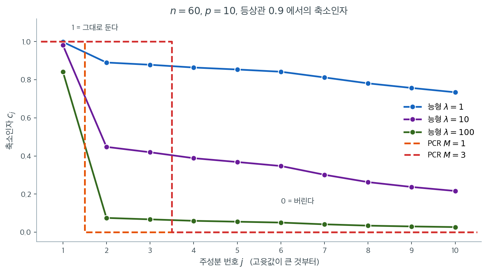

# 주성분회귀 (PCR)


## 개요

**주성분회귀**(PCR)는 차원축소와 회귀를 결합한다. 반응변수를 모든 설명변수에 직접 회귀시키는 대신, 먼저 주성분(분산의 대부분을 담는 설명변수의 선형결합)을 뽑고 그 성분에 반응변수를 회귀한다.

PCR이 특히 값진 경우는 다중공선성이 심할 때, $p$가 $n$에 비해 클 때, 그리고 해석 가능성보다 예측 정확도가 중요할 때다.

---

## 1. PCR 알고리즘

### 1단계: 설명변수 표준화

$$X_{\text{scaled}} = \frac{X - \mu}{\sigma}$$

PCA가 척도에 민감하므로 필수적이다. 표준화하지 않으면 분산이 큰 변수가 성분을 지배한다.

### 2단계: 주성분 계산

표준화된 설명변수에 PCA를 적용한다.

$$Z_k = X_{\text{scaled}} V_k$$

- $V_k$는 공분산행렬의 고유벡터(적재) 행렬이다
- $Z_k$는 처음 $k$개 주성분의 행렬이다
- 각 주성분은 선형결합 $Z_j = \sum_{i=1}^p v_{ij} X_i$이다

성분은 설명하는 분산 크기 순으로 정렬된다.

$$\text{Var}(Z_1) \geq \text{Var}(Z_2) \geq \cdots \geq \text{Var}(Z_p)$$

### 3단계: 주성분에 회귀

처음 $M$개 주성분을 설명변수로 하는 표준 선형회귀를 수행한다.

$$y = \beta_0 + \beta_1 Z_1 + \cdots + \beta_M Z_M + \epsilon$$

### 4단계: 교차검증으로 M 선택

성분 수 $M$은 조정모수다.

- **너무 적으면**($M$이 작으면) 과소적합. 제외된 변수의 정보를 잃는다
- **너무 많으면**($M$이 $p$에 가까우면) 과적합. 잡음 성분이 분산을 키운다
- **최적 $M^*$**는 교차검증 오차를 최소화한다

!!! danger "PCA는 겹 안에서 적합해야 한다"
    교차검증 절차에서 PCA를 **전체 자료에 한 번** 적합한 뒤 겹을 나누면 자료 누설이 된다. 주성분이 검정 겹의 정보를 이미 담고 있기 때문이다.

    올바른 절차는 겹마다 훈련 자료로 PCA를 다시 적합하고 그 적재로 검정 겹을 변환하는 것이다. scikit-learn에서는 `Pipeline([('pca', PCA(k)), ('lr', LinearRegression())])`을 만들어 파이프라인 전체를 `cross_val_score`에 넘기면 자동으로 지켜진다.

    다행히 PCA는 $y$를 쓰지 않으므로 누설의 크기가 변수선택만큼 치명적이지는 않다([교차검증](../tuning/cross_validation.md) 연습문제 2 참조). 그래도 원칙을 지키는 편이 안전하다.

---

## 2. 장점과 단점

### 장점

1. **다중공선성 처리** — 성분이 무상관이므로 다중공선성 문제가 사라진다
2. **$p > n$에서 작동** — 차원축소로 회귀가 가능해진다
3. **자동 변수 결합** — 성분이 모든 설명변수의 자료 기반 선형결합이다
4. **계산 효율** — $M < p$개 변수의 최소제곱이 더 빠르다
5. **과적합 감소** — 성분을 적게 쓰는 것이 암묵적 정칙화로 작용한다

### 단점

1. **비지도 차원축소** — PCA가 $y$를 무시하므로 성분이 $y$ 예측과 정렬되지 않을 수 있다. PLS는 반응변수로 성분 구성을 안내한다
2. **해석 가능성 상실** — 성분이 원 변수의 선형결합이라 해석이 어렵다
3. **표준화 필요** — 척도 선택에 예측이 민감할 수 있다
4. **모형 복잡도** — 새 자료에 적용하려면 적재행렬 $V$를 보관해야 한다
5. **변수선택이 아니다** — 소수만 중요하더라도 모든 원 변수가 쓰인다

---

## 3. PCR과 능형회귀

| 측면 | PCR | 능형 |
|---|---|---|
| **접근** | 비지도 차원축소(PCA) | 모든 계수의 축소 |
| **유지하는 것** | 처음 $M$개 성분만 | 모든 변수, 축소된 채 |
| **모수** | 성분 수 $M$ | 정칙화 강도 $\lambda$ |
| **편향-분산** | 성분을 버림(이산) | 모든 계수를 축소(연속) |
| **언제 쓰는가** | $p$가 크고 다중공선성이 심하며 $p > n$ | 중간 정도의 다중공선성과 $p$ |

**핵심 통찰:** 능형은 연속적 축소를, PCR은 이산적 선택을 쓴다.

SVD로 보면 둘의 관계가 명확해진다. 능형은 $j$번째 성분에 인자 $d_j^2/(d_j^2+\lambda)$를 곱하고, PCR은 처음 $M$개에 $1$을, 나머지에 $0$을 곱한다. **PCR은 능형의 축소인자를 계단함수로 근사한 것**이라 볼 수 있다.



$n = 60$, $p = 10$, 등상관 $0.9$인 자료의 축소인자를 성분 번호에 대해 그렸다. $\mathbf{X}^\top\mathbf{X}$의 고윳값은 $533.9,\ 8.1,\ 7.2,\ \ldots,\ 2.8$로 첫 성분이 압도적으로 크다. 실선 세 개가 능형, 점선 계단 두 개가 PCR이다.

먼저 둘의 공통점을 보라. **모든 곡선이 왼쪽에서 높고 오른쪽에서 낮다.** 두 방법 모두 자료가 잘 결정한 방향은 살리고 그렇지 못한 방향은 버린다. 차이는 그 전환을 어떻게 하느냐다. PCR은 $M$과 $M+1$ 사이에서 $1$에서 $0$으로 **수직으로 떨어지고**, 능형은 열 성분에 걸쳐 완만하게 내려온다.

이 차이가 실제로 얼마나 다른지는 $\lambda = 100$(초록)과 $M = 1$(주황)을 견주면 보인다. 둘 다 유효자유도가 비슷하다($1.28$ 대 $1$). 그런데 능형은 2번부터 10번 성분에 $0.075$에서 $0.024$ 사이의 작은 가중치를 **남겨 둔다.** PCR은 정확히 0으로 지운다. 남은 아홉 성분에 신호가 조금이라도 있으면 능형이 그것을 건지고, 순수 잡음이라면 PCR이 더 깨끗하다.

$\lambda = 10$(보라)과 $M = 3$(빨강)의 비교는 더 미묘하다. 유효자유도는 $3.97$과 $3$으로 비슷한데, 능형은 첫 성분을 $0.982$로 거의 그대로 두고 나머지 아홉을 $0.45$ 언저리로 눌러 놓는다. PCR은 세 성분을 온전히 쓰고 일곱을 버린다. **같은 "복잡도"를 전혀 다르게 배분하는 것이다.**

일반적으로 능형이 더 안전하다. 성분 경계에서 갑자기 0으로 떨어지지 않으므로 $M$을 하나 잘못 고르는 손해가 $\lambda$를 조금 잘못 고르는 손해보다 크기 때문이다. 다만 성분 사이에 뚜렷한 절벽이 있을 때는 — 이 자료의 1번과 2번 사이처럼 고윳값이 $533.9$에서 $8.1$로 66배 떨어질 때는 — PCR의 이산적 결정이 오히려 자연스럽다.

---

## 4. PCR과 부분최소제곱

| 측면 | PCR | PLS |
|---|---|---|
| **성분 구성** | 비지도: $X$의 분산 최대화 | 지도: $X$와 $y$의 공분산 최대화 |
| **성분이 정렬되는 대상** | 설명변수의 분산 설명 | 반응변수의 예측 |
| **전형적 성능** | PCA가 $y$와 정렬되는지에 의존 | 대개 더 낫다 |

실무에서 PLS가 PCR보다 나은 경우가 많은데, 성분을 만들 때 $y$의 정보를 쓰기 때문이다. 구체적 수치 비교는 [PCR과 PLS 개관](index.md) 연습문제 1에 있다.

---

## 5. 수학적 세부

### 설명된 분산

처음 $k$개 주성분이 설명하는 분산의 비율은

$$\frac{\sum_{j=1}^{k} \lambda_j}{\sum_{j=1}^{p} \lambda_j}$$

이며 $\lambda_j$는 $\text{Cov}(X_{\text{scaled}})$의 고윳값을 큰 것부터 정렬한 것이다. 스크리 그림은 고윳값(또는 누적 설명분산)을 성분 번호에 대해 그리며, "팔꿈치"가 대부분의 변동을 담는 성분 수를 시사한다.

### 원 척도의 회귀계수

PCR은 주성분에 대한 계수를 추정하므로, 원 변수의 계수로 되돌리려면

$$\hat{\beta}_{\text{PCR}} = V_M \hat{\gamma}$$

를 계산한다. $V_M$은 처음 $M$개 적재, $\hat\gamma$는 성분에 대한 회귀계수다.

---

## 연습문제

<div class="drillbox" markdown>

**연습문제 1.** <span class="diff med" title="중간"></span>
"PCR은 능형의 축소인자를 계단함수로 근사한 것"이라는 관점을 확인하라. 두 방법의 SVD 축소인자를 비교하라.

</div>

??? success "풀이"
    SVD $\mathbf{X} = \mathbf{U}\mathbf{D}\mathbf{V}^\top$에서 두 방법의 해를 성분별로 쓰면

    $$
    \hat{\boldsymbol\beta} = \sum_{j=1}^p c_j \cdot \frac{\mathbf{u}_j^\top\mathbf{y}}{d_j}\,\mathbf{v}_j
    $$

    형태이고 축소인자 $c_j$만 다르다.

    | 방법 | $c_j$ |
    |:---|:---|
    | OLS | $1$ (모든 $j$) |
    | 능형 | $\dfrac{d_j^2}{d_j^2+\lambda}$ (연속, 0과 1 사이) |
    | PCR | $\mathbf{1}(j \le M)$ (계단, 0 또는 1) |

    [기하적 해석](../ridge/geometry.md) 연습문제 1의 자료($\rho = 0.95$, $p = 4$, 고윳값 $186.1,\ 2.01,\ 1.74,\ 1.52$)에서 비교하면

    | 성분 | 능형 $\lambda = 10$ | PCR $M = 1$ |
    |---:|---:|---:|
    | 1 | 0.949 | 1 |
    | 2 | 0.167 | 0 |
    | 3 | 0.148 | 0 |
    | 4 | 0.132 | 0 |

    **능형은 작은 성분을 $0.13$–$0.17$만큼 남기고 PCR은 완전히 버린다.**

    어느 쪽이 나은가는 그 성분에 신호가 있느냐에 달렸다. 신호가 조금이라도 있으면 능형의 부분적 보존이 유리하고, 순수 잡음이면 PCR의 완전 제거가 유리하다.

    **일반적으로는 능형이 더 안전하다.** 성분 경계에서 갑자기 0으로 떨어지지 않으므로, $M$을 하나 잘못 고르는 데서 오는 손해가 $\lambda$를 조금 잘못 고르는 손해보다 크기 때문이다.

<div class="drillbox" markdown>

**연습문제 2.** <span class="diff med" title="중간"></span>
PCA를 전체 자료에 적합한 뒤 교차검증하는 것과, 겹 안에서 적합하는 것의 차이를 확인하라.

</div>

??? success "풀이"
    ```python
    import numpy as np
    from sklearn.decomposition import PCA
    from sklearn.linear_model import LinearRegression
    from sklearn.pipeline import Pipeline
    from sklearn.model_selection import KFold, cross_val_score

    rng = np.random.default_rng(0)
    n, p = 100, 8
    X = rng.normal(0, 1, (n, p))
    y = X @ np.array([2., -1., 0.5, 0, 0, 0, 0, 0]) + rng.normal(0, 1, n)

    # 올바름: 파이프라인이 겹마다 PCA를 다시 적합한다
    pipe = Pipeline([('pca', PCA(3)), ('lr', LinearRegression())])
    proper = -cross_val_score(pipe, X, y, cv=KFold(5, shuffle=True, random_state=0),
                              scoring='neg_mean_squared_error').mean()

    # 누설: PCA를 전체 자료에 한 번 적합한다
    Z = PCA(3).fit_transform(X)
    leaked = -cross_val_score(LinearRegression(), Z, y,
                              cv=KFold(5, shuffle=True, random_state=0),
                              scoring='neg_mean_squared_error').mean()

    print(f"파이프라인(올바름): {proper:.4f}")
    print(f"전체 적합(누설)   : {leaked:.4f}")
    ```

    출력:

    ```
    파이프라인(올바름): 3.8218
    전체 적합(누설)   : 3.8103
    ```

    **차이가 크지 않다.** PCA가 $y$를 전혀 쓰지 않기 때문이다. 검정 겹의 $X$ 정보가 성분 방향에 반영되기는 하지만, $y$와의 관계는 여전히 훈련 겹에서만 학습된다.

    이것이 [교차검증](../tuning/cross_validation.md) 연습문제 2의 변수선택 누설(CV 오차 $1.05$ 대 $2.27$)과 결정적으로 다른 점이다. **$y$를 사용하는 전처리만이 재앙적 누설을 일으킨다.**

    그럼에도 파이프라인을 쓰는 것이 옳다. 두 가지 이유가 있다. 첫째, $p \gg n$이면 PCA의 누설도 무시할 수 없게 된다. 둘째, 나중에 파이프라인에 $y$를 쓰는 단계(변수선택 등)를 추가할 때 구조가 이미 안전하게 잡혀 있다.

<div class="drillbox" markdown>

**연습문제 3.** <span class="diff med" title="중간"></span>
절 5 는 PCR 계수를 $\hat{\boldsymbol\beta}_{\text{PCR}} = \mathbf V_M\hat{\boldsymbol\gamma}$ 로 적는다. $\mathbf X$ 가 표준화되고 열계수가 완전하며 SVD 가 $\mathbf X = \mathbf U\mathbf D\mathbf V^\top$ 일 때

$$
\hat{\boldsymbol\beta}_{\text{PCR}} = \mathbf V_M\mathbf V_M^\top\hat{\boldsymbol\beta}_{\text{OLS}}
$$

임을 보이라. 이 한 줄로 "정리하며" 의 주장 "$M = p$ 면 OLS 와 같아진다" 와 단점 5 "변수선택이 아니다" 를 각각 설명하라.

</div>

??? success "풀이"
    **1단계: 성분행렬.** $\mathbf V = [\,\mathbf V_M\ \ \mathbf V_{-M}\,]$ 로 쪼개면 $\mathbf V^\top\mathbf V_M$ 은 위쪽이 $\mathbf I_M$, 아래쪽이 $\mathbf 0$ 인 행렬이므로

    $$
    \mathbf Z_M = \mathbf X\mathbf V_M = \mathbf U\mathbf D\mathbf V^\top\mathbf V_M = \mathbf U_M\mathbf D_M
    $$

    이다. 여기서 $\mathbf U_M$ 은 $\mathbf U$ 의 처음 $M$ 개 열, $\mathbf D_M = \operatorname{diag}(d_1,\ldots,d_M)$ 이다. **주성분행렬의 SVD 는 $\mathbf X$ 의 SVD 를 앞에서 잘라낸 것뿐이다.**

    **2단계: 성분에 대한 최소제곱.** $\mathbf U_M^\top\mathbf U_M = \mathbf I_M$ 이므로 $\mathbf Z_M^\top\mathbf Z_M = \mathbf D_M^2$ 이고 $\mathbf Z_M^\top\mathbf y = \mathbf D_M\mathbf U_M^\top\mathbf y$ 다. 따라서

    $$
    \hat{\boldsymbol\gamma} = (\mathbf D_M^2)^{-1}\mathbf D_M\mathbf U_M^\top\mathbf y = \mathbf D_M^{-1}\mathbf U_M^\top\mathbf y,
    \qquad \hat\gamma_j = \frac{\mathbf u_j^\top\mathbf y}{d_j}
    $$

    이다. 성분들이 직교하므로 $M$ 을 늘려도 **이미 구한 $\hat\gamma_j$ 는 변하지 않는다.** 이것이 PCR 의 계산이 싼 이유다.

    **3단계: 원 척도로 되돌리기.**

    $$
    \hat{\boldsymbol\beta}_{\text{PCR}} = \mathbf V_M\hat{\boldsymbol\gamma} = \sum_{j=1}^{M}\frac{\mathbf u_j^\top\mathbf y}{d_j}\,\mathbf v_j
    $$

    한편 $\hat{\boldsymbol\beta}_{\text{OLS}} = \mathbf V\mathbf D^{-1}\mathbf U^\top\mathbf y = \sum_{j=1}^{p}(\mathbf u_j^\top\mathbf y/d_j)\,\mathbf v_j$ 이고 $\mathbf v_j$ 들이 직교정규이므로 $\mathbf v_j^\top\hat{\boldsymbol\beta}_{\text{OLS}} = \mathbf u_j^\top\mathbf y/d_j$ 다. 그러므로

    $$
    \mathbf V_M\mathbf V_M^\top\hat{\boldsymbol\beta}_{\text{OLS}}
    = \sum_{j=1}^{M}\bigl(\mathbf v_j^\top\hat{\boldsymbol\beta}_{\text{OLS}}\bigr)\mathbf v_j
    = \sum_{j=1}^{M}\frac{\mathbf u_j^\top\mathbf y}{d_j}\,\mathbf v_j
    = \hat{\boldsymbol\beta}_{\text{PCR}}
    $$

    $\square$

    연습문제 1 의 표에 적은 축소인자 $c_j = \mathbf 1(j \le M)$ 가 바로 이 식이다.

    **(가) $M = p$ 면 OLS 다.** $\mathbf V_p = \mathbf V$ 는 직교행렬이므로 $\mathbf V\mathbf V^\top = \mathbf I_p$ 이고 $\hat{\boldsymbol\beta}_{\text{PCR}} = \hat{\boldsymbol\beta}_{\text{OLS}}$ 다. 성분을 하나도 버리지 않는다면 좌표를 회전했다가 되돌린 것뿐이고 최소제곱은 회전에 불변이다. **PCR 의 정칙화는 전부 "버린다" 는 행위에서 온다.**

    **(나) 변수선택이 아니다.** $\mathbf P_M = \mathbf V_M\mathbf V_M^\top$ 는 적재 $\mathbf v_1,\ldots,\mathbf v_M$ 이 치는 부분공간으로의 **정사영**이다. 사영은 좌표축이 아니라 그 부분공간에 수직인 방향을 지운다. $k$ 번째 계수가 정확히 0 이려면

    $$
    \mathbf e_k^\top\mathbf P_M\hat{\boldsymbol\beta}_{\text{OLS}} = 0
    $$

    이어야 하는데, 이는 $\hat{\boldsymbol\beta}_{\text{OLS}}$ 에 걸린 등식 제약 한 개이므로 연속분포에서 확률 0 으로만 일어난다. **PCR 은 거의 확실하게 $p$ 개 계수를 모두 0 이 아니게 둔다.** 라쏘가 0 을 만드는 것은 제약영역의 꼭짓점이 **좌표축 위**에 놓여 있기 때문이고, PCR 이 지우는 방향은 좌표축과 아무 상관이 없다.

    덤으로 사영은 노름을 줄이므로 $\lVert\hat{\boldsymbol\beta}_{\text{PCR}}\rVert \le \lVert\hat{\boldsymbol\beta}_{\text{OLS}}\rVert$ 다. 장점 5 의 "암묵적 정칙화" 가 정확히 이 부등식이다.

<div class="drillbox" markdown>

**연습문제 4.** <span class="diff med" title="중간"></span>
연습문제 1 의 자료($\rho = 0.95$, $p = 4$, $n = 50$)에서 능형의 유효자유도 $\sum_j d_j^2/(d_j^2+\lambda)$ 가 정확히 $2$ 가 되는 $\lambda^\star$ 를 이분법으로 구하라. 그 $\lambda^\star$ 의 축소인자를 PCR $M = 2$ 의 축소인자와 견주고, 절 3 의 "같은 복잡도를 전혀 다르게 배분하는 것이다" 를 수로 다시 적으라. 이 자료에서 더 자연스러운 PCR 은 $M = 2$ 인가?

</div>

??? success "풀이"
    유효자유도는 $\lambda$ 에 대해 연속이고 단조감소하며 $\lambda = 0$ 에서 $p = 4$, $\lambda \to \infty$ 에서 $0$ 이므로 $\text{df}(\lambda) = 2$ 인 $\lambda^\star$ 가 유일하게 존재한다. 이분법으로 찾는다.

    ```python
    import numpy as np

    rng = np.random.default_rng(21)
    n, p, rho = 50, 4, 0.95
    S = rho*np.ones((p, p)) + (1-rho)*np.eye(p)
    X = rng.normal(size=(n, p)) @ np.linalg.cholesky(S).T
    X -= X.mean(0)
    d2 = np.linalg.eigvalsh(X.T @ X)[::-1]
    print("고윳값        :", " ".join(f"{v:.4f}" for v in d2))

    def df(lam):
        return float((d2/(d2 + lam)).sum())

    lo, hi = 0.0, 1e4                          # df 는 lam 에 대해 감소한다
    for _ in range(200):
        mid = 0.5*(lo + hi)
        if df(mid) > 2.0:
            lo = mid
        else:
            hi = mid
    lam = 0.5*(lo + hi)
    print(f"lambda*       : {lam:.4f}   df = {df(lam):.4f}")

    c_ridge = d2/(d2 + lam)
    c_pcr = (np.arange(p) < 2).astype(float)
    print("능형 축소인자 :", " ".join(f"{v:.4f}" for v in c_ridge))
    print("PCR  축소인자 :", " ".join(f"{v:.4f}" for v in c_pcr))
    print(f"약한 세 방향의 가중치 합 : 능형 {c_ridge[1:].sum():.4f}   PCR {c_pcr[1:].sum():.4f}")
    ```

    출력:

    ```text
    고윳값        : 186.1492 2.0060 1.7409 1.5181
    lambda*       : 3.4022   df = 2.0000
    능형 축소인자 : 0.9821 0.3709 0.3385 0.3085
    PCR  축소인자 : 1.0000 1.0000 0.0000 0.0000
    약한 세 방향의 가중치 합 : 능형 1.0179   PCR 1.0000
    ```

    $\lambda^\star = 3.4022$ 다. 축소인자를 나란히 놓으면

    | 성분 | $d_j^2$ | 능형 $\lambda^\star = 3.4022$ | PCR $M = 2$ |
    |---:|---:|---:|---:|
    | 1 | 186.149 | 0.9821 | 1 |
    | 2 | 2.006 | 0.3709 | 1 |
    | 3 | 1.741 | 0.3385 | 0 |
    | 4 | 1.518 | 0.3085 | 0 |
    | **합(유효자유도)** | | **2.0000** | **2** |

    **첫 성분에는 둘 다 거의 1 을 준다**($0.9821$ 대 $1$). 고윳값이 $186$ 이라 유효자유도 $2$ 짜리 벌점으로는 이 방향을 꺾을 수 없다. 갈리는 것은 남은 예산 $1.0$ 의 배분이다.

    - PCR 은 2번 성분 **하나에 전부** 몰아주고($1$) 3·4번을 0 으로 지운다.
    - 능형은 2·3·4번에 $0.3709,\ 0.3385,\ 0.3085$ 로 **거의 똑같이** 나눈다(합 $1.0179$).

    이것이 "같은 복잡도를 전혀 다르게 배분한다" 의 뜻이다. **유효자유도 2 라는 같은 예산으로 PCR 은 방향 하나를 온전히 사고 능형은 방향 셋을 3분의 1 씩 산다.**

    어느 쪽이 자료에 맞는가. 고윳값 $2.006,\ 1.741,\ 1.518$ 은 서로 거의 같다. 자료가 이 세 방향을 **똑같은 정도로 모른다**는 뜻이므로, 2번만 전부 믿고 3·4번을 전부 버릴 근거가 없다. 능형의 균등 배분이 더 자연스럽다.

    마지막 물음의 답도 여기서 나온다. 이 자료의 절벽은 1번과 2번 사이($186.1$ 대 $2.0$, **93배**)에 있고 2–4번 사이에는 없다. 그러므로 자연스러운 PCR 은 $M = 2$ 가 아니라 $M = 1$ 이다. **유효자유도를 맞춘 비교가 늘 공정한 비교는 아니다** — $\text{df} = 2$ 를 맞추려고 PCR 을 그 방법이 잘하지 못하는 자리에 세운 셈이다.

<div class="drillbox" markdown>

**연습문제 5.** <span class="diff hard" title="어려움"></span>
$\mathbf X$ 를 고정하고 $\mathbf y = \mathbf X\boldsymbol\beta + \boldsymbol\varepsilon$, $\mathrm E[\boldsymbol\varepsilon] = \mathbf 0$, $\operatorname{Cov}(\boldsymbol\varepsilon) = \sigma^2\mathbf I_n$ 이라 하자. $\theta_j = d_j\,\mathbf v_j^\top\boldsymbol\beta$ 로 두면

$$
\mathrm E\bigl[\lVert\mathbf X\hat{\boldsymbol\beta}_{\text{PCR}(M)} - \mathbf X\boldsymbol\beta\rVert^2\bigr]
= M\sigma^2 + \sum_{j>M}\theta_j^2
$$

임을 보이라. 이로부터 PCR 이 OLS 를 이기는 필요충분조건을 적고, $\sigma = 1$, $(\theta_1,\theta_2,\theta_3,\theta_4) = (10,\ 1.5,\ 0.5,\ 0.2)$ 일 때 위험을 최소화하는 $M$ 을 구하라.

</div>

??? success "풀이"
    **적합값.** 연습문제 3 의 2단계에서

    $$
    \mathbf X\hat{\boldsymbol\beta}_{\text{PCR}(M)} = \mathbf Z_M\hat{\boldsymbol\gamma}
    = \mathbf U_M\mathbf D_M\mathbf D_M^{-1}\mathbf U_M^\top\mathbf y
    = \sum_{j=1}^{M}\mathbf u_j\mathbf u_j^\top\mathbf y
    $$

    즉 PCR 의 적합값은 **$\mathbf y$ 를 처음 $M$ 개 좌특이벡터가 치는 공간으로 사영한 것**이다.

    **참 평균.** $\mathbf X\boldsymbol\beta = \mathbf U\mathbf D\mathbf V^\top\boldsymbol\beta = \sum_{j=1}^{p} d_j(\mathbf v_j^\top\boldsymbol\beta)\,\mathbf u_j = \sum_{j=1}^{p}\theta_j\mathbf u_j$ 이다. 즉 $\theta_j$ 는 **참 평균벡터를 $\mathbf u_j$ 좌표로 적은 것**이다.

    **오차.** $e_j = \mathbf u_j^\top\boldsymbol\varepsilon$ 로 두면 $\mathbf u_j^\top\mathbf y = \theta_j + e_j$ 이고

    $$
    \mathrm E[e_j] = 0,\qquad
    \operatorname{Cov}(e_j, e_k) = \sigma^2\,\mathbf u_j^\top\mathbf u_k = \sigma^2\delta_{jk}
    $$

    이다(좌특이벡터가 직교정규이므로 **$e_j$ 들은 무상관이고 분산이 모두 $\sigma^2$** 다). 그러므로

    $$
    \mathbf X\hat{\boldsymbol\beta}_{\text{PCR}(M)} - \mathbf X\boldsymbol\beta
    = \sum_{j\le M} e_j\mathbf u_j \;-\; \sum_{j>M}\theta_j\mathbf u_j
    $$

    이고, $\mathbf u_j$ 들이 직교정규라 제곱노름이 좌표의 제곱합으로 쪼개진다.

    $$
    \lVert\cdot\rVert^2 = \sum_{j\le M} e_j^2 + \sum_{j>M}\theta_j^2
    \;\Longrightarrow\;
    \mathrm E\lVert\cdot\rVert^2 = M\sigma^2 + \sum_{j>M}\theta_j^2
    $$

    $\square$

    첫 항이 **분산**(쓴 성분 하나당 $\sigma^2$ — 모수 하나당 $\sigma^2$ 라는 익숙한 꼴이다), 둘째 항이 **제곱편향**이다. $M$ 을 키우면 분산이 선형으로 늘고 편향이 줄어든다. 5장 정리 1 의 편향–분산 분해가 성분별로 완전히 분리되어 있다.

    **OLS 와의 비교.** OLS 는 $M = p$ 이므로 위험이 $p\sigma^2$ 다. 따라서

    $$
    \text{PCR}(M) \text{ 이 OLS 보다 낫다}
    \iff \sum_{j>M}\theta_j^2 < (p-M)\sigma^2
    \iff \frac{1}{p-M}\sum_{j>M}\theta_j^2 < \sigma^2
    $$

    **버린 방향들의 평균 신호제곱이 잡음분산보다 작으면 이득이다.** 절 3 의 "남은 아홉 성분에 신호가 조금이라도 있으면 능형이 그것을 건지고, 순수 잡음이라면 PCR 이 더 깨끗하다" 가 이 부등식의 말풀이다.

    **수치.** $\sigma = 1$, $\theta = (10,\ 1.5,\ 0.5,\ 0.2)$ 에서

    | $M$ | 분산 $M\sigma^2$ | 제곱편향 $\sum_{j>M}\theta_j^2$ | 위험 |
    |---:|---:|---:|---:|
    | 0 | 0 | $102.54$ | 102.54 |
    | 1 | 1 | $2.25+0.25+0.04 = 2.54$ | 3.54 |
    | 2 | 2 | $0.25+0.04 = 0.29$ | **2.29** |
    | 3 | 3 | $0.04$ | 3.04 |
    | 4 (OLS) | 4 | $0$ | 4.00 |

    **최적은 $M = 2$ 이고 위험 $2.29$ 로 OLS 의 $4.00$ 보다 43% 작다.** 성분 3·4번을 버려서 분산 $2\sigma^2$ 를 아끼고 제곱편향 $0.29$ 만 샀다.

    눈여겨볼 것이 둘 있다.

    첫째, $\theta_1 = 10$ 이 압도적이라 1번 성분은 반드시 써야 한다($M = 0$ 의 위험 $102.54$). $\lambda \to \infty$ 또는 $M \to 0$ 이 늘 좋을 수 없는 까닭이다.

    둘째, **$\theta_j = d_j\,\mathbf v_j^\top\boldsymbol\beta$ 는 고윳값과 신호의 정렬을 함께 담는다.** $d_j$ 가 아무리 커도 $\boldsymbol\beta$ 가 $\mathbf v_j$ 에 수직이면 $\theta_j = 0$ 이고 그 성분은 버리는 것이 무조건 이득이다. 그런데 PCA 는 $d_j$ 만 보고 성분을 줄 세우고 위험을 정하는 것은 $\theta_j$ 다. **단점 1(비지도 차원축소)이 이 어긋남 한 줄로 요약된다.**

<div class="drillbox" markdown>

**연습문제 6.** <span class="diff hard" title="어려움"></span>
연습문제 5 의 위험 공식을 모의로 확인하라. $n = 100$, $p = 4$, $\sigma = 1$, $\theta = (10,\ 1.5,\ 0.5,\ 0.2)$ 로 $20{,}000$ 번 되풀이하여 $M = 1,2,3,4$ 의 위험을 재고 이론값과 견주라. 모의오차의 크기도 함께 적으라. 설계행렬 $\mathbf X$ 를 명시하지 않고도 모의가 가능한 까닭은 무엇인가?

</div>

??? success "풀이"
    마지막 물음이 설계의 핵심이다. 연습문제 5 의 위험은 $\mathbf X$ 와 $\boldsymbol\beta$ 에 **$\theta_j$ 를 통해서만** 의존한다. 그러므로 직교정규 열을 갖는 $\mathbf U$ 하나와 $\theta$ 만 정하면 되고, 참 평균을 $\boldsymbol\mu = \mathbf U\boldsymbol\theta$ 로 직접 만들면 된다. $\mathbf V$ 와 $\boldsymbol\beta$ 는 끝까지 필요하지 않다 — **위험이 $\theta$ 만의 함수라는 사실 자체가 공식의 내용이다.**

    ```python
    import numpy as np

    rng = np.random.default_rng(7)
    n, p, reps = 100, 4, 20000

    A = rng.normal(size=(n, p))
    A -= A.mean(0)
    U, _ = np.linalg.qr(A)                     # 열이 직교정규인 n x p 행렬
    theta = np.array([10.0, 1.5, 0.5, 0.2])
    mu = U @ theta                             # 참 평균 X beta = sum_j theta_j u_j

    Eps = rng.normal(0.0, 1.0, (n, reps))      # sigma = 1
    Y = mu[:, None] + Eps
    coef = U.T @ Y                             # j 번째 줄 = theta_j + u_j' eps

    print("  M    모의 위험    이론 위험")
    for M in range(1, p + 1):
        fit = U[:, :M] @ coef[:M]              # PCR 적합값 = sum_{j<=M} u_j u_j' y
        mc = float(((fit - mu[:, None])**2).sum(0).mean())
        th = M*1.0 + float((theta[M:]**2).sum())
        print(f"  {M}    {mc:9.4f}    {th:9.4f}")
    ```

    출력:

    ```text
      M    모의 위험    이론 위험
      1       3.5330       3.5400
      2       2.2852       2.2900
      3       3.0405       3.0400
      4       3.9961       4.0000
    ```

    | $M$ | 모의 | 이론 | 차 | 모의 표준오차 |
    |---:|---:|---:|---:|---:|
    | 1 | 3.5330 | 3.5400 | $-0.0070$ | 0.0100 |
    | 2 | 2.2852 | 2.2900 | $-0.0048$ | 0.0141 |
    | 3 | 3.0405 | 3.0400 | $+0.0005$ | 0.0173 |
    | 4 | 3.9961 | 4.0000 | $-0.0039$ | 0.0200 |

    **모의오차의 크기.** 되풀이 한 번의 오차제곱은 $\sum_{j\le M} e_j^2 + \sum_{j>M}\theta_j^2$ 이고 뒤쪽은 상수다. $\sigma = 1$ 이면 $\sum_{j\le M}e_j^2 \sim \chi^2_M$ 이라 분산이 $2M$ 이므로 표준오차는 $\sqrt{2M/20000}$ — $M = 1$ 에서 $0.0100$, $M = 4$ 에서 $0.0200$ 이다. 위 표의 차가 모두 1 표준오차 안에 들어 있으므로 공식이 확인되었다.

    모의가 재현한 것은 세 가지다. $M$ 을 하나 늘릴 때 분산이 정확히 $\sigma^2 = 1$ 만큼 는다는 것, 위험이 $M = 2$ 에서 최소가 된다는 것, 그리고 **$M = 4$ 의 위험 $4.00$ 이 OLS 의 $p\sigma^2$ 와 같다는 것**이다(연습문제 3 의 (가)).

    실무에서 이 계산을 할 수 없는 까닭도 분명하다. 위험을 최소화하려면 $\theta_j$ 를 알아야 하는데 $\theta_j$ 는 모르는 $\boldsymbol\beta$ 의 함수다. **그래서 4단계가 교차검증을 쓴다.**

<div class="drillbox" markdown>

**연습문제 7.** <span class="diff hard" title="어려움"></span>
1단계는 표준화를 "필수적" 이라 적는다. 그 말의 뜻을 정확히 하라. $\operatorname{Var}(Z_1) = \operatorname{Var}(Z_2) = 1$, $\operatorname{Corr}(Z_1, Z_2) = 0.9$ 인 두 변수로 $X_1 = 10Z_1$, $X_2 = Z_2$ 를 만들고 반응을 $y = Z_2 - Z_1$ 로 두자(잡음 없음). (가) 표준화하지 않은 $(X_1, X_2)$ 의 첫 주성분과 $M = 1$ 인 PCR 의 $R^2$ 를 손으로 구하라. (나) 표준화한 뒤 같은 것을 구하라. (다) 두 답과 OLS 의 $R^2$ 를 견주어 "표준화가 필수다" 가 무엇을 보장하고 무엇을 보장하지 않는지 적으라.

</div>

??? success "풀이"
    **(가) 표준화하지 않은 경우.** $\operatorname{Var}(X_1) = 100$, $\operatorname{Var}(X_2) = 1$, $\operatorname{Cov}(X_1, X_2) = 10 \times 0.9 = 9$ 이므로

    $$
    \boldsymbol\Sigma_X = \begin{pmatrix} 100 & 9 \\ 9 & 1\end{pmatrix}
    $$

    이다. 대각합 $101$, 행렬식 $100 - 81 = 19$ 이므로 고윳값은 $\lambda^2 - 101\lambda + 19 = 0$ 의 근

    $$
    \lambda = \frac{101 \pm \sqrt{101^2 - 76}}{2} = \frac{101 \pm \sqrt{10125}}{2}
    = \frac{101 \pm 100.62306}{2}
    $$

    즉 $\lambda_1 = 100.81153$, $\lambda_2 = 0.18847$ 다. $\lambda_1$ 의 고유벡터는 $(9,\ \lambda_1 - 100) = (9,\ 0.81153)$ 방향이고, $\sqrt{81 + 0.65858} = 9.03651$ 로 정규화하면

    $$
    \mathbf v_1 = (0.99596,\ 0.08981)
    $$

    이다. **첫 주성분이 거의 $X_1$ 그 자체다** — 분산이 100 배 큰 변수가 성분을 지배한다. 성분을 $Z$ 로 쓰면

    $$
    \text{PC}_1 = 0.99596\,X_1 + 0.08981\,X_2 = 9.95960\,Z_1 + 0.08981\,Z_2
    $$

    이고, $\operatorname{Cov}(Z_1, y) = 0.9 - 1 = -0.1$, $\operatorname{Cov}(Z_2, y) = 1 - 0.9 = 0.1$ 이므로

    $$
    \operatorname{Cov}(\text{PC}_1, y) = 9.95960 \times (-0.1) + 0.08981 \times 0.1 = -0.98698
    $$

    이다. $\operatorname{Var}(\text{PC}_1) = \lambda_1 = 100.81153$ 이고 $\operatorname{Var}(y) = 1 + 1 - 2(0.9) = 0.2$ 이므로

    $$
    R^2 = \frac{0.98698^2}{100.81153 \times 0.2} = \frac{0.97413}{20.16231} = 0.04831
    $$

    **(나) 표준화한 경우.** 공분산행렬이 상관행렬 $\begin{pmatrix}1 & 0.9\\ 0.9 & 1\end{pmatrix}$ 이 되고, 등상관 $2 \times 2$ 행렬의 고윳값·고유벡터는 $1.9$ 와 $(1,1)/\sqrt2$, $0.1$ 과 $(1,-1)/\sqrt2$ 다. 첫 성분은 "합" 방향이다.

    $$
    \operatorname{Cov}\Bigl(\tfrac{Z_1+Z_2}{\sqrt2},\; Z_2 - Z_1\Bigr)
    = \tfrac{1}{\sqrt2}\bigl(0.9 - 1 + 1 - 0.9\bigr) = 0
    $$

    **$R^2 = 0$ 이다. 정확히 0 이다.** 반면 둘째 성분은 "차" 방향 $(Z_2-Z_1)/\sqrt2$ 로 $y$ 와 상관 $1$ 이므로 $M = 2$ 로 하면 $R^2 = 1$ 이다.

    **(다) 세 수를 나란히.**

    | 방법 | $R^2$ |
    |:---|---:|
    | 표준화 없는 PCR, $M = 1$ | 0.0483 |
    | 표준화한 PCR, $M = 1$ | 0.0000 |
    | PCR, $M = 2$ (표준화 여부 무관) | 1.0000 |
    | OLS | 1.0000 |

    **표준화가 보장하는 것은 답의 유일성이다.** 자료의 내용을 하나도 바꾸지 않고 $X_1$ 의 **단위만** 바꿨는데 PCR 의 해가 달라졌다. OLS 는 이 변환에 완전히 불변이다($X_1 \to 10X_1$ 이면 $\hat\beta_1 \to \hat\beta_1/10$ 이고 적합값은 그대로다). 그러나 PCA 의 고유벡터는 $\boldsymbol\Sigma_X$ 의 함수이고 $\boldsymbol\Sigma_X$ 는 눈금에 의존한다. **PCR 의 "성분" 은 모형의 성질이 아니라 눈금의 함수다.** 표준화는 그 모호함을 없애기 위한 규약이다 — 척도가 모두 같은 단위(같은 센서, 같은 분광 파장)라면 표준화하지 않는 것이 오히려 옳을 수도 있다.

    **표준화가 보장하지 않는 것은 예측 성능이다.** 표준화한 쪽의 $R^2$ 가 $0.0483$ 에서 $0$ 으로 **더 나빠졌다.** 표준화 뒤 첫 성분이 분산의 $1.9/2 = 95\%$ 를 설명하면서 $y$ 와는 상관이 0 이고, 분산 5% 짜리 둘째 성분이 $y$ 를 완전히 설명한다. 표준화하지 않은 쪽의 $0.0483$ 은 성분이 우연히 $X_1$ 에 치우쳐 얻은 것일 뿐 "더 나은 방법" 의 증거가 아니다.

    **잃은 것은 전부 $M = 1$ 에서 왔다.** $M = 2$ 면 $R^2 = 1$ 로 OLS 와 같다. 이것이 단점 1 의 가장 깨끗한 반례이고 PLS 가 존재하는 이유다. 표준화한 설계에서 PLS 의 첫 방향은 $\mathbf X^\top\mathbf y$ 쪽, 즉 $(-0.1,\ 0.1) \propto (-1,\ 1)$ 로 **차 방향을 정확히 가리킨다.** PLS 는 성분 하나로 $R^2 = 1$ 에 닿는다.

<div class="drillbox" markdown>

**연습문제 8.** <span class="diff hard" title="어려움"></span>
[PLS](partial_least_squares.md) 절은 첫 PLS 가중벡터가 $\mathbf w_1 \propto \mathbf X^\top\mathbf y$ 라고 적는다. $d_1 > d_2$ 를 가정하고, 이것이 PCA 의 첫 방향 $\mathbf v_1$ 과 (부호를 빼고) 일치할 필요충분조건을 SVD 로 구하라. 그리고 모형 $\mathbf y = \mathbf X\boldsymbol\beta + \boldsymbol\varepsilon$ 에서 그 조건이 $\boldsymbol\beta$ 에 대해 무엇을 뜻하는지 적고, 그때 PCR 이 PLS 에 뒤지지 않는 까닭을 연습문제 5 의 $\theta_j$ 로 설명하라.

</div>

??? success "풀이"
    **조건.** $\mathbf X = \mathbf U\mathbf D\mathbf V^\top$ 이므로

    $$
    \mathbf X^\top\mathbf y = \mathbf V\mathbf D\mathbf U^\top\mathbf y
    = \sum_{j=1}^{p} d_j(\mathbf u_j^\top\mathbf y)\,\mathbf v_j
    $$

    이다. $\mathbf v_1,\ldots,\mathbf v_p$ 가 직교기저이므로 이 벡터가 $\mathbf v_1$ 에 평행할 필요충분조건은 나머지 좌표가 모두 0 인 것, 즉 $j \ge 2$ 에 대해 $d_j(\mathbf u_j^\top\mathbf y) = 0$ 인 것이다. $d_j > 0$ 인 방향에서는

    $$
    \mathbf u_j^\top\mathbf y = 0 \quad (j = 2,\ldots,p)
    $$

    이고, 방향이 정의되려면 $\mathbf u_1^\top\mathbf y \ne 0$ 이어야 한다.

    기하적으로 이것은 **$\mathbf y$ 의 열공간 사영이 전부 $\mathbf u_1$ 에 놓인다**는 뜻이다($\hat{\mathbf y}_{\text{OLS}} = \mathbf u_1\mathbf u_1^\top\mathbf y$). 연습문제 3 의 기호로는 $\hat\gamma_2 = \cdots = \hat\gamma_p = 0$, 즉 **PCR 이 $M = 1$ 에서 이미 OLS 와 같아진다.** 두 방법이 같은 방향을 고르는 것은 "PCA 가 운이 좋은" 경우가 아니라 "둘 다 할 일이 하나뿐인" 경우다.

    **모형에서의 뜻.** $\mathbf u_j^\top\mathbf y = \theta_j + \mathbf u_j^\top\boldsymbol\varepsilon$ 이고 잡음 항이 연속분포이므로, 유한표본에서 위 조건이 **정확히** 성립할 확률은 0 이다. 신호 쪽만 보면 $j \ge 2$ 에 대해 $\theta_j = d_j\,\mathbf v_j^\top\boldsymbol\beta = 0$, 즉 $\mathbf v_j^\top\boldsymbol\beta = 0$ 이고 이는

    $$
    \boldsymbol\beta \parallel \mathbf v_1
    $$

    — **참 계수벡터가 첫 적재 방향에 놓여 있을 때**다. 그때 $\mathrm E[\mathbf X^\top\mathbf y] = \mathbf X^\top\mathbf X\boldsymbol\beta = \mathbf V\mathbf D^2\mathbf V^\top\boldsymbol\beta = d_1^2\boldsymbol\beta$ 로 평균적으로도 $\mathbf v_1$ 방향이다.

    **왜 그때 PCR 이 지지 않는가.** 연습문제 5 의 위험이 $M\sigma^2 + \sum_{j>M}\theta_j^2$ 이고 이 조건에서 $\theta_2 = \cdots = \theta_p = 0$ 이므로

    $$
    \text{위험}(M) = M\sigma^2 \quad (M \ge 1)
    $$

    이다. $M = 1$ 의 위험 $\sigma^2$ 가 **가능한 최솟값**이다. 성분 하나로 편향이 이미 0 인데 분산은 더 줄일 수 없으므로 어떤 방법도 이보다 잘할 수 없고, PLS 도 같은 방향을 고르니 같은 추정량을 준다. [개관](index.md) 연습문제 2 의 "$y$ 가 첫 번째 잠재요인에만 의존하도록 바꾸면 PCR 도 성분 1개로 충분해진다" 가 이 조건의 구체적 예다.

    **거꾸로 읽는 것이 더 중요하다.** $\theta_2,\ldots,\theta_p$ 중 하나라도 크면 PCA 의 줄서기($d_j$ 가 큰 순서)와 쓸모의 줄서기($\lvert\theta_j\rvert$ 가 큰 순서)가 어긋나고, PCR 은 쓸모 있는 성분에 닿기까지 쓸모 없는 성분을 **먼저 지나가야 한다.** [개관](index.md) 연습문제 1 에서 PCR 이 성분 세 개를 써서야 PLS 의 두 개를 따라잡은 것이 그 때문이고, 연습문제 7 은 어긋남이 최대인 극단($\theta_1 = 0$, $\theta_2 \ne 0$)이다.

<div class="drillbox" markdown>

**연습문제 9.** <span class="diff hard" title="어려움"></span>
4단계의 경고 상자는 "$p \gg n$ 이면 PCA 의 누설도 무시할 수 없게 된다" 는 말로 닫힌다. $n = 40$, $M = 10$ 을 고정하고 $p = 10,\ 50,\ 100,\ 200$ 에서 확인하라. $\mathbf y$ 를 $\mathbf X$ 와 **완전히 무관한** 잡음으로 두면 참 예측오차가 $\operatorname{Var}(y)$ 임을 알고 비교할 수 있다. 누설은 교차검증 오차를 낙관적으로 만드는가 비관적으로 만드는가 — 부호까지 설명하라. $p = 10$ 에서는 무슨 일이 일어나는가?

</div>

??? success "풀이"
    ```python
    import numpy as np
    from sklearn.decomposition import PCA
    from sklearn.linear_model import LinearRegression
    from sklearn.pipeline import Pipeline
    from sklearn.model_selection import KFold, cross_val_score

    n, M, reps = 40, 10, 20
    kf = KFold(5, shuffle=True, random_state=0)

    print("     p    올바름      누설   누설/올바름    Var(y)")
    for p in (10, 50, 100, 200):
        proper, leaked, vy = [], [], []
        for s in range(reps):
            rng = np.random.default_rng(s)
            X = rng.normal(0.0, 1.0, (n, p))
            y = rng.normal(0.0, 1.0, n)            # y 는 X 와 완전히 무관하다
            vy.append(float(y.var(ddof=1)))

            pipe = Pipeline([('pca', PCA(M)), ('lr', LinearRegression())])
            proper.append(-cross_val_score(pipe, X, y, cv=kf,
                                           scoring='neg_mean_squared_error').mean())

            Z = PCA(M).fit_transform(X)            # 전체 자료로 한 번 적합 = 누설
            leaked.append(-cross_val_score(LinearRegression(), Z, y, cv=kf,
                                           scoring='neg_mean_squared_error').mean())
        a, b = float(np.mean(proper)), float(np.mean(leaked))
        print(f" {p:5d}   {a:7.4f}   {b:7.4f}      {b/a:7.4f}   {np.mean(vy):7.4f}")
    ```

    출력:

    ```text
         p    올바름      누설   누설/올바름    Var(y)
        10    1.4437    1.4437       1.0000    0.9878
        50    1.1554    1.5452       1.3374    1.0059
       100    1.0444    1.3980       1.3385    0.9883
       200    1.1532    1.6771       1.4543    1.0448
    ```

    **$p = 10$ 에서는 차이가 정확히 0 이다.** $M = p$ 이므로 PCA 가 성분을 하나도 버리지 않고, 그러면 PCA 는 가역 회전일 뿐이며 최소제곱은 회전에 불변이다(연습문제 3 의 (가)). 전체 자료로 회전하든 겹마다 다시 회전하든 적합값이 똑같으므로 **누설이 구조적으로 불가능하다.** 연습문제 2 에서 차이가 $3.8218$ 대 $3.8103$ 으로 작았던 것($p = 8$, $M = 3$)도 $M$ 이 $p$ 에 가까운 데서 온 약한 형태다.

    **$p$ 가 커지면 차이가 33–45% 로 벌어진다.** 경고는 맞다. $p = 200$ 에서 $1.1532$ 대 $1.6771$ 로 비가 $1.45$ 다.

    **그런데 부호가 뒤집혀 있다.** 누설 쪽이 오차를 **더 크게** 만든다. 변수선택 누설이 늘 낙관적인 것과 정반대다.

    까닭은 두 절차가 아예 **다른 추정량**이 되어 버리는 데 있다. 올바른 절차에서 적재벡터는 훈련 겹 32 행이 치는 부분공간 안에 있고, $p \gg n$ 이면 검정 겹의 행은 그 부분공간과 거의 직교한다. 그래서 검정 겹의 성분 점수가 0 쪽으로 쪼그라든다 — $p = 200$ 에서 따로 재어 보면 훈련 겹 점수의 표준편차가 $3.05$ 인데 검정 겹은 $1.00$ 으로 **3분의 1** 이다. 점수가 작으면 예측이 훈련 평균 근처로 눌리는데, $\mathbf y$ 가 순수 잡음인 이 설정에서 그것은 거의 최선의 예측이다. 그래서 오차가 $\widehat{\operatorname{Var}}(y) \approx 1.04$ 근처($1.15$)에 머문다.

    누설 절차에서는 모든 행의 점수가 같은 규모다(같은 측정에서 $2.85$ 대 $2.83$). 32 개 관측에 설명변수 10 개를 맞춘 과적합의 대가가 가려지지 않고 그대로 드러나 오차가 $1.68$ 로 오른다.

    **교훈.** $\mathbf y$ 를 쓰지 않는 전처리의 누설은 **부호가 보장되지 않는다.** $\mathbf y$ 를 쓰는 전처리의 누설만이 반드시 낙관 쪽이다([교차검증](../tuning/cross_validation.md) 연습문제 2). 그러니 연습문제 2 가 든 두 가지 이유에 하나를 더 붙일 수 있다. **누설된 교차검증은 틀린 값일 뿐 아니라 어느 쪽으로 틀렸는지도 알 수 없다.** 어느 쪽이든 교차검증이 재는 대상이 실제로 배치할 모형과 달라지므로, 겹 안에서 적합하는 파이프라인만이 안전하다.

<div class="drillbox" markdown>

**연습문제 10.** <span class="diff hard" title="어려움"></span>
"정리하며" 는 "$M = p$ 면 OLS 와 같아진다" 고 적고 장점 2 는 PCR 이 $p > n$ 에서도 작동한다고 적는다. 두 문장은 $p > n$ 에서 양립할 수 없다. (가) 왜 그런지 밝히고 $M$ 의 상한을 적으라. (나) $r = \operatorname{rank}(\mathbf X)$ 일 때 $\hat{\boldsymbol\beta}_{\text{PCR}(r)}$ 가 최소제곱 해 가운데 $\ell_2$ 노름이 가장 작은 것, 즉 $\mathbf X^{+}\mathbf y$ 임을 보이라. (다) 이것이 능형의 $\lambda \to 0^{+}$ 극한임을 확인하고, $r = n-1$ 일 때 4단계가 왜 교차검증을 쓸 수밖에 없는지 적으라.

</div>

??? success "풀이"
    **(가) 양립하지 않는 까닭.** 1단계대로 $\mathbf X$ 를 중심화하면 열들이 $\mathbf 1$ 에 수직이므로

    $$
    r = \operatorname{rank}(\mathbf X) \le \min(n-1,\ p)
    $$

    이다. $p > n$ 이면 $r < p$ 이므로 분산이 0 이 아닌 주성분은 $r$ 개뿐이고 $M \le r$ 이다. **$M = p$ 라는 선택은 애초에 존재하지 않는다.** 동시에 $\mathbf X^\top\mathbf X$ 가 특이이므로 OLS 해가 유일하지 않다. 영공간 $\mathcal N(\mathbf X)$ 의 차원이 $p - r \ge 1$ 이고, $\mathbf h \in \mathcal N(\mathbf X)$ 에 대해 $\hat{\boldsymbol\beta} + \mathbf h$ 가 모두 같은 적합값과 같은 잔차를 준다. 그러므로 "OLS 와 같아진다" 는 **어느 OLS 와 같아지는가**를 말하지 않으면 뜻이 없는 문장이다. 연습문제 3 이 "열계수가 완전하며" 를 가정한 이유다.

    **(나) 최소노름 해.** 축소 SVD $\mathbf X = \sum_{j=1}^{r} d_j\mathbf u_j\mathbf v_j^\top$ ($d_1 \ge \cdots \ge d_r > 0$)을 쓰자. 연습문제 3 의 3단계가 $M \le r$ 에 그대로 적용되므로

    $$
    \hat{\boldsymbol\beta}_{\text{PCR}(r)} = \sum_{j=1}^{r}\frac{\mathbf u_j^\top\mathbf y}{d_j}\,\mathbf v_j
    $$

    이고 이것이 유사역행렬의 정의 $\mathbf X^{+} = \sum_{j\le r} d_j^{-1}\mathbf v_j\mathbf u_j^\top$ 에 의해 $\mathbf X^{+}\mathbf y$ 다. 두 가지를 보이면 된다.

    **① 최소제곱 해다.** 적합값이 $\sum_{j\le r}\mathbf u_j\mathbf u_j^\top\mathbf y = \mathbf U_r\mathbf U_r^\top\mathbf y$ 이고 $\mathbf U_r\mathbf U_r^\top$ 는 열공간 $\mathcal C(\mathbf X)$ 로의 정사영이다(열공간의 직교정규기저가 $\mathbf u_1,\ldots,\mathbf u_r$ 이므로). 따라서 잔차 $(\mathbf I - \mathbf U_r\mathbf U_r^\top)\mathbf y$ 가 $\mathcal C(\mathbf X)$ 에 수직이고 정규방정식 $\mathbf X^\top(\mathbf y - \mathbf X\hat{\boldsymbol\beta}) = \mathbf 0$ 이 성립한다.

    **② 노름이 최소다.** $\hat{\boldsymbol\beta}_{\text{PCR}(r)} \in \operatorname{span}\{\mathbf v_1,\ldots,\mathbf v_r\} = \mathcal C(\mathbf X^\top) = \mathcal N(\mathbf X)^{\perp}$ 다. 다른 최소제곱 해는 모두 $\hat{\boldsymbol\beta}_{\text{PCR}(r)} + \mathbf h$, $\mathbf h \in \mathcal N(\mathbf X)$ 꼴이고 두 벡터가 직교하므로

    $$
    \lVert\hat{\boldsymbol\beta}_{\text{PCR}(r)} + \mathbf h\rVert^2
    = \lVert\hat{\boldsymbol\beta}_{\text{PCR}(r)}\rVert^2 + \lVert\mathbf h\rVert^2
    \ge \lVert\hat{\boldsymbol\beta}_{\text{PCR}(r)}\rVert^2
    $$

    이고 등호는 $\mathbf h = \mathbf 0$ 일 때만 성립한다. $\square$

    **(다) 능형의 극한.** 능형의 성분별 해는 연습문제 1 의 꼴로

    $$
    \hat{\boldsymbol\beta}_{\text{ridge}}(\lambda) = \sum_{j=1}^{r}\frac{d_j}{d_j^2+\lambda}(\mathbf u_j^\top\mathbf y)\,\mathbf v_j
    $$

    이고 $\lambda \to 0^{+}$ 에서 $d_j/(d_j^2+\lambda) \to 1/d_j$ 이므로 $\mathbf X^{+}\mathbf y$ 로 간다. **$p > n$ 에서 "벌점 없는 능형" 은 OLS 가 아니라 최소노름 해다.** 축소인자로 보면 두 방법이 같은 일을 한다. 능형의 $d_j^2/(d_j^2+\lambda)$ 는 $d_j = 0$ 인 방향에 언제나 0 을 주고 PCR 도 그 방향을 쓸 수 없다. **$p > n$ 에서 능형과 PCR 은 같은 방식으로 영공간을 포기한다** — 그리고 영공간의 $p - r$ 개 차원에 대해서는 자료가 아무 말도 하지 않으므로, 두 방법 모두 "노름을 작게" 라는 벌점의 취향으로 그 자리를 메운다.

    **$r = n-1$ 이면 교차검증 말고는 길이 없다.** 중심화한 $\mathbf X$ 의 열공간은 $\mathbf 1^{\perp}$ 안에 있고 $\dim\mathbf 1^{\perp} = n-1$ 이므로, $r = n-1$ 이면 $\mathcal C(\mathbf X) = \mathbf 1^{\perp}$ 다. 중심화한 $\mathbf y$ 도 $\mathbf 1^{\perp}$ 에 있으니 $M = r$ 에서 잔차가 정확히 $\mathbf 0$ 이고 훈련 $R^2 = 1$ 이다. 게다가 훈련 잔차제곱합 $\lVert(\mathbf I - \mathbf U_M\mathbf U_M^\top)\mathbf y\rVert^2 = \sum_{j>M}(\mathbf u_j^\top\mathbf y)^2$ 는 $M$ 에 대해 **단조감소**해서 0 까지 내려간다. 즉 훈련오차는 $M$ 에 대해 **아무 정보도 주지 않는다.** 정보기준을 쓰려 해도 모수 개수가 $n$ 에 닿아 벌점이 무너진다. **4단계가 교차검증을 쓰는 것은 취향이 아니라 $p > n$ 에서 남은 유일한 길이다.**

---

## 정리하며

PCR 은 **차원축소 후 회귀**한다.

- **두 단계다.** 주성분을 뽑고(PCA), 선행 $M$ 개 성분에 반응을 회귀한다.
- **PCA 가 비지도라는 점이 핵심 약점이다.** 성분은 $\mathbf X$ 의 분산만 보고 정해지므로 **$\mathbf y$ 와 무관한 방향이 뽑힐 수 있다.** 분산이 큰 방향이 예측에 유용하다는 보장이 없다.
- **다중공선성을 근본적으로 해결한다.** 성분들이 직교하므로 회귀가 안정적이며, $p>n$ 에서도 작동한다.
- **$M$ 을 교차검증으로 고른다.** $M=p$ 면 OLS 와 같아지므로, $M$ 이 정칙화의 강도 구실을 한다.
- **해석이 어려워진다.** 성분은 원래 변수들의 선형결합이라 실질적 의미를 붙이기 힘들다.
- **표준화가 필수다.** PCA 가 척도에 의존하기 때문이다.

다음 절 **부분최소제곱**으로 넘어간다. 주성분회귀가 설명변수의 분산만 보고 성분을 만드는 데 비해, 반응변수와의 **공분산**을 최대화하는 성분을 만든다.
