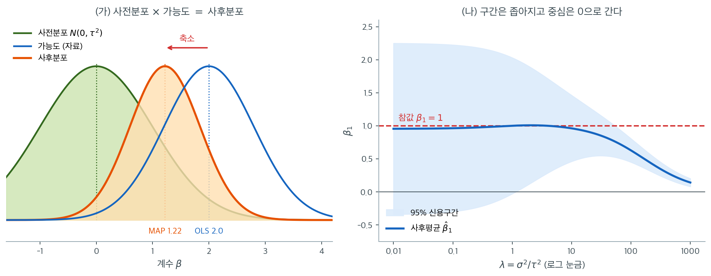
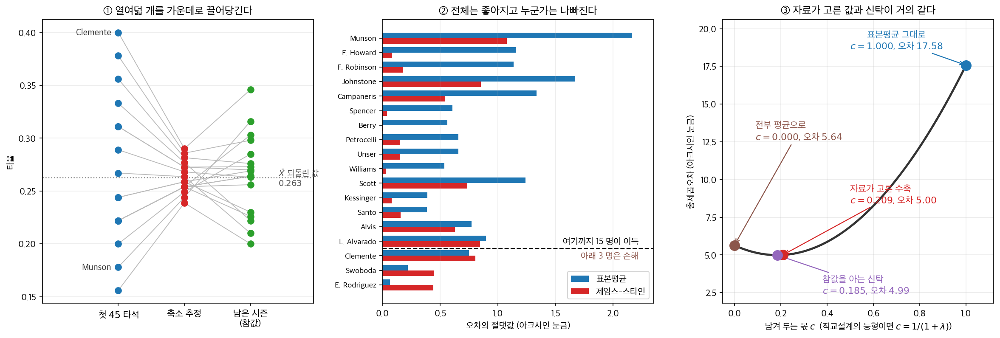

# 베이즈 해석 (가우스 사전분포)

능형회귀는 순전히 벌점최적화의 관점에서 유도할 수 있지만, 계수에 가우스 사전분포를 둔 베이즈 선형모형에서 사후최빈값(MAP) 추정으로도 자연스럽게 나온다. 이 연결은 정칙화 모수 $\lambda$에 원리적인 해석을 주고, 신용구간을 통한 불확실성 정량화를 포함한 완전한 사후추론으로 가는 길을 연다.

---

## 1. 베이즈 선형모형

가우스 오차를 갖는 표준 선형모형을 가정한다.

$$
\mathbf{y} \mid \boldsymbol{\beta} \sim N(\mathbf{X}\boldsymbol{\beta},\; \sigma^2\mathbf{I}_n)
$$

계수가 작을 가능성이 높다는 믿음을 표현하는 가우스 사전분포를 둔다.

$$
\boldsymbol{\beta} \sim N(\mathbf{0},\; \tau^2\mathbf{I}_p)
$$

모수 $\tau^2$이 사전분산을 조절한다. $\tau^2$이 작으면 계수가 0 근처라는 강한 믿음을, 크면 제약이 거의 없는 산만한 사전분포를 뜻한다.

---

## 2. MAP 추정값의 유도

사후분포는 가능도와 사전분포의 곱에 비례한다. 음의 로그사후를 취하면

$$
-\log p(\boldsymbol{\beta} \mid \mathbf{y}) = \frac{1}{2\sigma^2}\|\mathbf{y} - \mathbf{X}\boldsymbol{\beta}\|^2 + \frac{1}{2\tau^2}\|\boldsymbol{\beta}\|^2 + \text{상수}
$$

이며, 이를 최소화하는 것은

$$
\|\mathbf{y} - \mathbf{X}\boldsymbol{\beta}\|^2 + \frac{\sigma^2}{\tau^2}\|\boldsymbol{\beta}\|^2
$$

의 최소화와 동등하다. 이것이 바로 능형회귀 목적함수이며

$$
\lambda = \frac{\sigma^2}{\tau^2}
$$

이다. 따라서 MAP 추정값(사후분포의 최빈값)은 능형 추정값이다.

$$
\hat{\boldsymbol{\beta}}_{\text{MAP}} = (\mathbf{X}^\top\mathbf{X} + \lambda\mathbf{I})^{-1}\mathbf{X}^\top\mathbf{y}
$$

!!! note "정칙화 모수의 해석"
    관계식 $\lambda = \sigma^2/\tau^2$은 정칙화 강도가 사전분포의 **신호 대 잡음비**를 반영함을 보여준다. 사전분산 $\tau^2$이 잡음분산 $\sigma^2$에 비해 작으면 $\lambda$가 커져 강한 정칙화가 된다. 사전분포가 산만해지면($\tau^2 \to \infty$) $\lambda \to 0$이 되어 MAP 추정값이 OLS에 접근한다.

---

## 3. 완전한 사후분포

가능도와 사전분포가 모두 가우스이므로 사후분포도 가우스다. 켤레 가우스 모형의 표준 결과를 쓰면

$$
\boldsymbol{\beta} \mid \mathbf{y} \sim N\bigl(\boldsymbol{\mu}_{\text{post}},\; \boldsymbol{\Sigma}_{\text{post}}\bigr)
$$

이며

$$
\boldsymbol{\mu}_{\text{post}} = (\mathbf{X}^\top\mathbf{X} + \lambda\mathbf{I})^{-1}\mathbf{X}^\top\mathbf{y} = \hat{\boldsymbol{\beta}}_{\text{ridge}}, \qquad
\boldsymbol{\Sigma}_{\text{post}} = \sigma^2(\mathbf{X}^\top\mathbf{X} + \lambda\mathbf{I})^{-1}
$$

이다. 사후평균이 능형 추정값과 일치하고, 사후공분산이 자연스러운 불확실성 척도를 제공한다. 각 계수의 $95\%$ 신용구간은

$$
[\boldsymbol{\mu}_{\text{post}}]_j \pm 1.96\,\sqrt{[\boldsymbol{\Sigma}_{\text{post}}]_{jj}}
$$

이다.



왼쪽은 계수 하나짜리 장난감 예다. 자료가 주는 가능도는 $\hat\beta = 2.0$에 봉우리가 있고(파랑), 사전분포는 $0$에 봉우리가 있다(초록). 둘을 곱한 사후분포(주황)의 봉우리는 그 사이 $1.22$에 놓인다. 정확히 말하면 사후평균은 두 봉우리를 정밀도 $1/s^2$과 $1/\tau^2$으로 가중평균한 값이고, 여기서는 $\frac{1/0.64}{1/0.64 + 1} \times 2.0 = 1.22$다. **축소란 이 가중평균 이상도 이하도 아니다.** 자료의 정밀도가 높을수록($s$가 작을수록) 봉우리가 OLS 쪽에 남고, 사전분포가 조밀할수록($\tau$가 작을수록, 곧 $\lambda$가 클수록) 0 쪽으로 끌려간다.

또 하나 눈여겨볼 것은 사후분포가 가능도보다 **좁다**는 점이다. 자료와 사전정보를 합쳤으니 정보가 늘었고, 늘어난 만큼 퍼짐이 줄었다. 이 관찰이 오른쪽 그림의 출발점이다.

오른쪽은 $\rho = 0.95$인 등상관 설명변수 4개, $n = 50$, 참 계수가 모두 $1$인 자료에서 $\beta_1$의 사후평균과 $95\%$ 신용구간을 $\lambda$에 따라 그린 것이다. $\lambda$가 작을 때 구간의 반폭은 $1.96 \times 0.662 = 1.30$으로 $0$을 넉넉히 포함할 만큼 넓다. $\lambda = 1$에서 사후표준편차가 $0.525$, $\lambda = 10$에서 $0.256$으로 줄어 **구간이 OLS의 39%까지 좁아진다.** 숫자만 보면 추정이 네 배 정밀해진 것처럼 보인다.

그러나 같은 그림에서 파란 중심선이 무엇을 하고 있는지 보라. $\lambda$가 $10$을 넘어서면서 사후평균이 참값 $1$을 떠나 아래로 미끄러지고, $\lambda = 1000$ 부근에서는 $0.15$까지 내려간다. 그 자리에서 신용구간은 아주 좁은데 **참값을 아예 포함하지 못한다.** 구간이 좁아진 것은 추정이 정확해져서가 아니라 사전분포가 "$\beta$는 0 근처다"라고 단언했기 때문이다. 사전분포가 틀리면 그 단언이 그대로 틀린 구간으로 나타난다. 능형 계수의 신용구간을 빈도주의 신뢰구간처럼 읽으면 안 되는 이유가 이 한 장에 다 들어 있다.

---

## 4. 사전분포의 강도와 그 효과

사전분포 $\boldsymbol{\beta} \sim N(\mathbf{0}, \tau^2\mathbf{I})$은 다음을 가정한다.

1. **평균 0.** 특정 방향을 선호할 사전정보가 없을 때 합리적이다.
2. **등방 분산.** 모든 계수에 같은 사전분산 $\tau^2$을 준다. 능형회귀 전에 설명변수를 표준화해야 하는 이유가 여기에 있다. 표준화해야 사전분포가 모든 계수를 각자의 자연스러운 척도에서 대칭적으로 다룬다.
3. **독립.** 단위행렬 공분산 구조가 계수들의 사전 독립을 부호화한다.

| 사전분산 $\tau^2$ | $\lambda = \sigma^2/\tau^2$ | 효과 |
|---|---|---|
| 큼 (산만한 사전분포) | 작음 | 약한 정칙화, OLS에 근접 |
| 중간 | 중간 | 균형 잡힌 축소 |
| 작음 (조밀한 사전분포) | 큼 | 0 쪽으로 강한 축소 |
| $\tau^2 \to 0$ | $\lambda \to \infty$ | 모든 계수가 0으로 |

---

## 5. 경험적 베이즈와 초모수 추정

실무에서 $\sigma^2$과 $\tau^2$(따라서 $\lambda$)은 알려져 있지 않다. **경험적 베이즈** 접근은 주변가능도를 최대화하여 이들을 자료에서 추정한다. 가우스 모형에서 이 적분은 다룰 수 있다.

$$
\mathbf{y} \sim N(\mathbf{0},\; \sigma^2\mathbf{I} + \tau^2\mathbf{X}\mathbf{X}^\top)
$$

$p(\mathbf{y})$를 $\sigma^2$과 $\tau^2$에 대해 최대화하면 자료 기반의 정칙화 강도 추정값을 얻으며, 이는 $\lambda$ 선택의 베이즈적 접근과 교차검증 접근을 잇는다.

!!! tip "베이즈 불확실성과 빈도주의 불확실성"
    사후공분산 $\boldsymbol{\Sigma}_{\text{post}}$은 OLS의 빈도주의 공분산 $\sigma^2(\mathbf{X}^\top\mathbf{X})^{-1}$보다 작다. 사전정보를 반영했기 때문이다. 따라서 능형 계수의 베이즈 신용구간은 OLS 신뢰구간보다 좁다.

    **다만 이 비교를 "능형이 더 정확하다"로 읽으면 안 된다.** 신용구간이 좁은 것은 사전분포가 맞다는 **가정 아래에서**의 이야기다. 사전분포가 틀렸다면 구간이 참값을 포함하지 못한다. 빈도주의 관점에서 능형 추정량은 편향되어 있으므로, 사후 신용구간이 참 계수를 명목 확률로 덮는다는 보장이 없다.

<div class="storybox" markdown>

**그림으로 보는 통계학 1.** 십 퍼센트라던 것이 삼백오십 퍼센트였다

스타인이 $1955$ 년에, 제임스와 스타인이 $1961$ 년에 증명한 것은 당시로서 믿기 어려운 명제였다 — 서로 **아무 상관도 없는** 세 개 이상의 평균을 동시에 추정할 때, 표본평균을 그대로 쓰는 것보다 전부 가운데로 조금 끌어당긴 쪽이 **언제나** 총제곱오차가 작다. 그런데 정리가 나온 뒤로 십 년이 넘도록 아무도 쓰지 않았다. 에프론과 모리스는 $1975$ 년 논문 첫머리에서 그 저항을 네 가지로 정리하면서, 넷째에 이런 각주를 달았다. **"튜키는 $1972$ 년 몬트리올 미국통계학회에서 실제 상황에서의 절약이 십 퍼센트를 넘지 않을 것이라고 말했다."**

그래서 그들은 실제 자료를 가져왔다. $1970$ 년 $4$ 월 $26$ 일, 『뉴욕 타임스』가 주마다 싣던 타율표에서 그날까지 정확히 $45$ 타석을 치른 선수를 모두 골랐다. 열여덟 명이었다. 물음은 하나다 — **이 열여덟 개의 숫자만으로 각자가 남은 시즌에 칠 타율을 맞혀라.**



이항분산을 고르게 만드는 아크사인 변환을 거친 뒤 전체 평균 쪽으로 수축한다. 수축의 세기는 자료가 정한다 — 이 쪽 $\S 5$ 의 경험적 베이즈가 바로 그 일이고, 여기서는 $(k-3)/V = 0.791$ 이 나와 **원래 편차의 $20.9\%$ 만 남긴다.** 열여덟 개의 타율 $.400$–$.156$ 이 $.290$–$.239$ 로 오그라든다(그림 ①).

| | 총제곱오차 | 효율 |
|---|---|---|
| 표본평균 그대로 | $17.58$ | $1.00$ |
| 제임스–스타인 | $5.00$ | $3.52$ |

논문이 적은 값은 $17.56$ 과 $5.01$, 효율 $3.50$ 이다. 손실이 $72\%$ 줄었다. 튜키가 말한 십 퍼센트가 아니었다.

그런데 이 상자가 말하려는 것은 그 승리가 아니라 **그 승리의 값**이다. 그림 ②는 선수 하나하나의 오차를 나란히 세운 것이다. 열여덟 중 **열다섯이 좋아졌고 셋은 나빠졌다.** 나빠진 셋 가운데 하나가 클레멘테다. 첫 $45$ 타석을 $.400$ 으로 친 그를 수축은 $.290$ 까지 끌어내렸는데, 그가 남은 시즌에 실제로 친 것은 $.346$ 이었다. 표본평균이 $.054$ 빗나갔고 수축이 $.056$ 빗나갔다.

우연이 아니다. 에프론과 모리스는 자료를 고를 때 이렇게 적었다. **"우리는 또한 유난히 잘 치는 타자(클레멘테)를 넣어, 극단적인 모수가 적어도 하나는 있는 상태에서 방법을 시험해 보고자 했다. 스타인의 추정량에 불리하리라 예상되는 상황이다."** 자기 방법이 가장 나빠 보일 사람을 **일부러 표본에 넣었다.**

그림 ③이 이 쪽의 $\lambda$ 이야기와 닿는 자리다. 남겨 두는 몫 $c$ 를 $0$ 에서 $1$ 까지 움직이며 총제곱오차를 그렸다. 직교설계의 능형이면 $c = 1/(1+\lambda)$ 이므로 이 곡선은 그대로 능형자취다.

- 자료만 보고 고른 $c = 0.209$ 는 오차 $5.00$, **참값을 다 아는 신탁의 최적** $c = 0.185$ 는 오차 $4.99$ 다. 차이가 $0.2\%$ 다. 교차검증도 없이, 닫힌 식 하나로 신탁에 닿았다.
- 능형의 말로 옮기면 자료가 고른 것은 $\lambda = 3.78$, 신탁은 $\lambda = 4.40$ 이다.
- 곡선의 왼쪽 끝 $c = 0$ — 자료를 아예 무시하고 **모두에게 전체 평균 $.263$ 을 주는 것** — 조차 오차 $5.64$ 로 표본평균의 $17.58$ 보다 세 배 낫다. 이 자료에서 개인 타율 $45$ 타석치는 그만큼 쓸모가 없었다.

이 쪽이 유도한 식들, 그러니까 가우스 사전분포와 주변가능도와 $\hat\lambda_{\text{EB}}$ 는 모두 이 표 하나를 설명하는 장치다. 연습문제 9 가 그 추정량이 **양수부 제임스–스타인과 정확히 같은 꼴**임을 보인다. 정칙화는 "과적합을 막는 요령"이 아니라, 여러 개를 한꺼번에 추정하는 한 **공짜로 주어지는 개선**이다. 치러야 할 값은 그림 ②의 아래 세 줄이다.

_확인한 곳 — 에프론과 모리스의 $1975$ 년 『미국통계학회지』 논문($70$권 $350$호 $311$–$319$쪽) 원문. 표 $1$ 의 자료 열여덟 줄, 표 $2$ 의 되돌린 추정값, 총제곱오차 $17.56$ 과 $5.01$, 효율 $3.50$, 최대 개인오차 $2.17$ 과 $1.08$, $(k-3)/V = .791$ 과 $\tau = .514$, 인용한 튜키의 발언과, 스타인 $1955$ 와 제임스–스타인 $1961$ 이라는 연도와, 클레멘테를 고른 까닭, 『뉴욕 타임스』 $4$ 월 $26$ 일 자 타율표를 썼다는 서술을 모두 그 글에서 확인했다. 그림과 표의 수는 모두 그 자료로 직접 다시 계산한 값이다_

</div>

---

## 6. 다른 사전분포와의 연결

가우스 사전분포는 하나의 선택일 뿐이다. 다른 사전분포는 다른 정칙화를 낳는다.

| $\boldsymbol{\beta}$의 사전분포 | 정칙화 | 벌점 |
|---|---|---|
| $N(\mathbf{0}, \tau^2\mathbf{I})$ (가우스) | 능형 | $\lambda\|\boldsymbol{\beta}\|_2^2$ |
| Laplace$(0, b)$ | 라쏘 | $\lambda\|\boldsymbol{\beta}\|_1$ |
| 스파이크–앤–슬랩 | 최량 부분집합 선택 | $\lambda\|\boldsymbol{\beta}\|_0$ |

가우스 사전분포는 0에서 매끄럽고 꼬리가 가벼워, 능형이 정확한 0을 만들지 않고 매끄럽게 축소하는 이유를 설명한다. 라플라스 사전분포는 0에서 뾰족하고 꼬리가 두꺼워 희소성을 촉진하며 라쏘 정칙화에 대응한다.

---

## 연습문제

<div class="drillbox" markdown>

**연습문제 1.** <span class="diff med" title="중간"></span>
사후 표준편차가 OLS 표준오차보다 작다는 주장을 수치로 확인하고, 그것이 무엇을 뜻하는지 논하라.

</div>

??? success "풀이"
    $\rho = 0.95$인 등상관 설명변수 4개, $n = 50$, $\sigma = 1$에서 계산한다.

    ```python
    import numpy as np

    rng = np.random.default_rng(0)
    n, p, rho, sig = 50, 4, 0.95, 1.0
    Sigma = rho * np.ones((p, p)) + (1 - rho) * np.eye(p)   # 등상관
    X = rng.multivariate_normal(np.zeros(p), Sigma, n)
    y = X @ np.array([1.0, 1.0, 1.0, 1.0]) + rng.normal(0, sig, n)

    A = X.T @ X
    for lam in (0, 1, 10):
        C = np.linalg.inv(A + lam*np.eye(p))      # sigma^2 = 1
        print(lam, np.round(np.sqrt(np.diag(C)), 3))
    ```

    출력:

    ```
    0 [0.662 0.652 0.514 0.539]
    1 [0.525 0.518 0.442 0.457]
    10 [0.256 0.252 0.246 0.247]
    ```

    | $\lambda$ | $\text{sd}(\hat\beta_1)$ | $\text{sd}(\hat\beta_2)$ | $\text{sd}(\hat\beta_3)$ | $\text{sd}(\hat\beta_4)$ |
    |---:|---:|---:|---:|---:|
    | 0 (OLS) | 0.662 | 0.652 | 0.514 | 0.539 |
    | 1 | 0.525 | 0.518 | 0.442 | 0.457 |
    | 10 | **0.256** | 0.252 | 0.246 | 0.247 |

    $\lambda = 10$에서 표준편차가 OLS의 **약 39~48%**로 줄어든다.

    **그러나 이것을 "능형이 더 정확하다"로 읽으면 안 된다.** 두 가지를 구별해야 한다.

    - $\boldsymbol{\Sigma}_{\text{post}}$는 **사전분포가 맞다는 가정 아래** $\boldsymbol{\beta}$에 대한 불확실성이다.
    - 빈도주의 관점에서 능형 추정량은 편향되어 있으므로, 참 오차는 분산뿐 아니라 **편향의 제곱**도 포함한다.

    즉 위 표의 값들은 $\sqrt{\text{Var}}$이지 $\sqrt{\text{MSE}}$가 아니다. 좁은 신용구간이 참 계수를 95% 확률로 덮는다는 보장은 **사전분포가 실제로 옳을 때만** 성립한다.

    실무적 함의: **능형 계수의 신용구간을 신뢰구간처럼 보고하지 말라.** 예측구간이 목표라면 붓스트랩(17장)이 더 안전하다.

<div class="drillbox" markdown>

**연습문제 2.** <span class="diff med" title="중간"></span>
경험적 베이즈로 $\lambda$를 추정하고 교차검증이 고른 $\lambda$와 비교하라.

</div>

??? success "풀이"
    주변가능도 $\mathbf{y} \sim N(\mathbf{0}, \sigma^2\mathbf{I} + \tau^2\mathbf{X}\mathbf{X}^\top)$을 $\tau^2$에 대해 최대화한다.

    ```python
    import numpy as np
    from scipy.optimize import minimize_scalar
    from sklearn.linear_model import RidgeCV

    def neg_loglik(log_t2):
        t2 = np.exp(log_t2)
        Sig = sig**2*np.eye(n) + t2*(X @ X.T)
        _, logdet = np.linalg.slogdet(Sig)
        return 0.5*(logdet + y @ np.linalg.solve(Sig, y))

    r = minimize_scalar(neg_loglik, bounds=(-8, 8), method='bounded')
    tau2 = np.exp(r.x)
    # 자리를 정해 찍는다. 그냥 print 하면 마지막 자리가 선형대수 라이브러리의
    # 덧셈 순서에 따라 달라져 재현되지 않는다.
    print(f"tau^2_hat              = {tau2:.4f}")
    print(f"empirical Bayes lambda = {sig**2 / tau2:.4f}")

    rc = RidgeCV(alphas=np.logspace(-3, 4, 200), fit_intercept=False).fit(X, y)
    print(f"RidgeCV (LOOCV) lambda = {rc.alpha_:.4f}")
    ```

    출력:

    ```text
    tau^2_hat              = 1.4374
    empirical Bayes lambda = 0.6957
    RidgeCV (LOOCV) lambda = 5.3536
    ```

    | 방법 | $\lambda$ |
    |:---|---:|
    | 경험적 베이즈 ($\hat\tau^2 = 1.4374$) | **0.6957** |
    | 하나 남기기 교차검증 (`RidgeCV`) | **5.3536** |

    **교차검증이 고른 $\lambda$ 가 경험적 베이즈의 7.7 배다.** 자릿수가 같지도 않다. 두 방법이 **다른 것을 최적화**하기 때문이다.

    | | 최적화 대상 |
    |:---|:---|
    | 경험적 베이즈 | 주변가능도 $p(\mathbf{y})$ — 모형이 자료를 얼마나 잘 설명하는가 |
    | 교차검증 | 표본외 예측오차 — 새 자료를 얼마나 잘 맞히는가 |

    두 목표는 관련되지만 같지 않다. 경험적 베이즈는 가우스 사전분포가 실제로 옳을 때 효율적이고, 교차검증은 사전분포가 틀려도 예측 성능을 직접 겨냥한다.

    **실무 권고: 예측이 목적이면 교차검증을 쓴다.** 경험적 베이즈는 계산이 훨씬 싸므로(닫힌 형태의 주변가능도를 한 번 최적화한다) 자료가 매우 크거나 $\lambda$를 여러 번 다시 골라야 할 때 유용하다.

<div class="drillbox" markdown>

**연습문제 3.** <span class="diff med" title="중간"></span>
3절 그림 왼쪽의 장난감 예(가능도 봉우리 $\hat\beta = 2.0$, 가능도 표준편차 $s = 0.8$, 사전표준편차 $\tau = 1$)를 손으로 끝까지 따라가라.

1. 사후평균이 $1.22$임을 정밀도 가중평균으로 확인하고, 이 축소를 $\hat\beta \big/ \bigl(1 + \lambda/(\mathbf{x}^\top\mathbf{x})\bigr)$ 꼴로 적었을 때 $\lambda/(\mathbf{x}^\top\mathbf{x})$의 값을 구하라.
2. 사후표준편차를 구하고 가능도 표준편차의 몇 배인지 답하라.
3. 사후표준편차를 가능도의 **절반**인 $0.4$까지 줄이려면 $\tau$를 얼마로 해야 하는가. 그때 사후평균은 얼마가 되는가.

</div>

??? success "풀이"
    가우스끼리의 곱이므로 정밀도(분산의 역수)가 더해진다. 가능도 정밀도는 $1/s^2 = 1/0.64 = 1.5625$, 사전 정밀도는 $1/\tau^2 = 1$이다.

    **1.** 사후 정밀도는 $1.5625 + 1 = 2.5625$이고, 사후평균은 두 봉우리를 정밀도로 가중한 평균이다.

    $$
    \mu_{\text{post}} = \frac{1.5625 \times 2.0 + 1 \times 0}{2.5625} = \frac{3.125}{2.5625} = 1.2195
    $$

    설명변수가 하나일 때 $s^2 = \sigma^2/(\mathbf{x}^\top\mathbf{x})$이므로 축소인자는

    $$
    \frac{1/s^2}{1/s^2 + 1/\tau^2} = \frac{\mathbf{x}^\top\mathbf{x}}{\mathbf{x}^\top\mathbf{x} + \sigma^2/\tau^2} = \frac{1}{1 + \lambda/(\mathbf{x}^\top\mathbf{x})}
    $$

    이고, 따라서 $\lambda/(\mathbf{x}^\top\mathbf{x}) = s^2/\tau^2 = 0.64$다. 검산하면 $2.0/1.64 = 1.2195$로 같다. 벌점 $\lambda$ 하나만으로는 축소량이 정해지지 않고, **자료가 그 방향에 대해 가진 정보량 $\mathbf{x}^\top\mathbf{x}$와의 비**가 축소량을 정한다.

    **2.** 사후표준편차는 $1/\sqrt{2.5625} = 0.6247$이다. 가능도 표준편차의 $0.6247/0.8 = 0.7809$배, 곧 약 $78\%$다.

    **3.** 사후표준편차 $0.4$는 사후 정밀도 $1/0.16 = 6.25$를 뜻한다. 가능도 정밀도는 자료가 주는 것이므로 바꿀 수 없고, 사전 정밀도가 $6.25 - 1.5625 = 4.6875$여야 한다. 곧

    $$
    \tau^2 = \frac{1}{4.6875} = 0.2133, \qquad \tau = 0.4619
    $$

    이다. 그때 축소인자는 $1.5625/6.25 = 0.25$이므로 사후평균은 $0.25 \times 2.0 = 0.5$다.

    | | 사전표준편차 $\tau$ | 사후평균 | 사후표준편차 |
    |:---|---:|---:|---:|
    | 원래 | 1.0000 | 1.2195 | 0.6247 |
    | 폭을 절반으로 | 0.4619 | 0.5000 | 0.4000 |

    구간 폭을 절반으로 줄이는 값은 봉우리를 $1.22$에서 $0.5$로 끌어내리는 것이다. 자료는 $\hat\beta = 2.0$을 가리키는데 사후분포는 $0.5$ 근처에 좁게 모인다. 3절 오른쪽 그림이 $\lambda$를 키우며 보여 준 일이 계수 한 개짜리 계산에서도 그대로 나온다. **폭은 사전분포를 조이면 언제든 줄일 수 있고, 줄어든 폭은 정확도의 증거가 아니다.**

<div class="drillbox" markdown>

**연습문제 4.** <span class="diff med" title="중간"></span>
4절의 두 번째 가정("등방 분산")은 능형회귀 전에 설명변수를 표준화해야 하는 이유라고 적혀 있다. 이것이 권고가 아니라 필수임을 수로 보여라. $n = 4$, $p = 2$의 직교설계

$$
\mathbf{x}_1 = \tfrac12(1,1,1,1)^\top, \quad \mathbf{x}_2 = \tfrac12(1,-1,1,-1)^\top, \quad \mathbf{y} = (2,0,2,0)^\top
$$

을 쓴다($\lVert\mathbf{x}_1\rVert = \lVert\mathbf{x}_2\rVert = 1$, 절편 없음).

1. OLS 해와 $\lambda = 1$인 능형 해를 손으로 구하라.
2. 두 번째 변수의 **단위만** 바꾸어 $\tilde{\mathbf{x}}_2 = 10\,\mathbf{x}_2$로 둔다(예: m를 cm로). $\lambda = 1$인 능형 해를 손으로 구하고, 원래 단위로 환산한 기여 $10\,\tilde\beta_2$를 1의 $\hat\beta_2$와 비교하라.
3. 2의 결과를 2절의 베이즈 언어로 다시 말하면 어떤 사전분포를 쓴 셈인가.
4. `sklearn` 의 `Ridge(alpha=1.0, fit_intercept=False)` 로 1과 2를 확인하라.

</div>

??? success "풀이"
    두 열이 직교정규이므로 $\mathbf{X}^\top\mathbf{X} = \mathbf{I}_2$이고

    $$
    \mathbf{x}_1^\top\mathbf{y} = \tfrac12(2+0+2+0) = 2, \qquad \mathbf{x}_2^\top\mathbf{y} = \tfrac12(2-0+2-0) = 2
    $$

    이다.

    **1.** $\hat{\boldsymbol\beta}^{\text{OLS}} = (\mathbf{X}^\top\mathbf{X})^{-1}\mathbf{X}^\top\mathbf{y} = (2, 2)^\top$. 능형은

    $$
    \hat{\boldsymbol\beta}^{\text{ridge}} = (\mathbf{I} + 1\cdot\mathbf{I})^{-1}(2,2)^\top = (1, 1)^\top
    $$

    로 두 계수가 **똑같이 절반으로** 축소된다. 직교설계의 비례 축소 $\hat\beta^{\text{OLS}}/(1+\lambda)$다.

    **2.** $\tilde{\mathbf{X}} = [\mathbf{x}_1, 10\,\mathbf{x}_2]$이면 $\tilde{\mathbf{X}}^\top\tilde{\mathbf{X}} = \operatorname{diag}(1, 100)$, $\tilde{\mathbf{X}}^\top\mathbf{y} = (2, 20)^\top$이다. 대각행렬이므로 좌표별로 풀린다.

    $$
    \tilde\beta_1 = \frac{2}{1+1} = 1, \qquad \tilde\beta_2 = \frac{20}{100+1} = 0.19802
    $$

    원래 단위로 환산한 둘째 변수의 기여는 $10 \times 0.19802 = 1.9802$다.

    | | 둘째 변수의 축소율 | 원래 단위의 계수 |
    |:---|---:|---:|
    | 원래 척도 | $1/2 = 0.5000$ | 1.0000 |
    | $\mathbf{x}_2$를 10배 | $100/101 = 0.9901$ | 1.9802 |

    OLS라면 단위를 바꾸어도 계수가 $\hat\beta_2/10$로 바뀌어 적합값이 똑같이 유지된다. 그러나 능형에서는 축소율 자체가 $0.5$에서 $0.9901$로 달라져 **둘째 변수가 사실상 벌점을 받지 않게 되었다.** 척도를 바꾼 것이 모형을 바꾼 것이다.

    **3.** $\tilde\beta_2 = \beta_2/10$이므로 $\tilde\beta_2 \sim N(0, \tau^2)$이라는 사전분포는 원래 계수에 대해

    $$
    \beta_2 \sim N(0, 100\,\tau^2)
    $$

    을 둔 것과 같다. 사전표준편차가 10배 산만해졌고, 그에 맞게 둘째 좌표의 실효 벌점은 $\sigma^2/(100\tau^2) = \lambda/100$으로 줄어든다. 등방 사전분포 $N(\mathbf{0}, \tau^2\mathbf{I})$은 "모든 계수를 공평히 다룬다"는 뜻을 **계수들의 척도가 서로 견줄 만할 때만** 가진다. 표준화는 그 전제를 만들어 주는 절차다. `sklearn` 의 `Ridge` 와 `Lasso` 는 표준화를 해 주지 않으므로, `StandardScaler` 를 앞에 붙이는 것은 독자의 몫이다.

    **4.** 확인한다.

    ```python
    import numpy as np
    from sklearn.linear_model import Ridge

    x1 = np.array([0.5, 0.5, 0.5, 0.5])
    x2 = np.array([0.5, -0.5, 0.5, -0.5])
    y = np.array([2.0, 0.0, 2.0, 0.0])

    for name, D in (("original", np.column_stack([x1, x2])),
                    ("x2 scaled by 10", np.column_stack([x1, 10.0 * x2]))):
        r = Ridge(alpha=1.0, fit_intercept=False, solver="cholesky").fit(D, y)
        print(f"{name:>15}  b1={r.coef_[0]:.4f}  b2={r.coef_[1]:.4f}")
    print(f"second variable's effect in the original unit: {10 * 20 / 101:.4f}")
    ```

    출력:

    ```text
           original  b1=1.0000  b2=1.0000
    x2 scaled by 10  b1=1.0000  b2=0.1980
    second variable's effect in the original unit: 1.9802
    ```

    손으로 구한 값과 한 자리까지 같다. `Ridge` 는 $\lVert\mathbf{y}-\mathbf{X}\boldsymbol\beta\rVert^2 + \alpha\lVert\boldsymbol\beta\rVert^2$을 최소화하므로 $\alpha$가 그대로 $\lambda$다($\tfrac{1}{2n}$을 붙이는 `Lasso` 와 다르다 — 18.3절 [라쏘 정식화와 희소성](../lasso/formulation.md)을 보라).

<div class="drillbox" markdown>

**연습문제 5.** <span class="diff med" title="중간"></span>
3절은 $\boldsymbol\Sigma_{\text{post}} = \sigma^2(\mathbf{X}^\top\mathbf{X}+\lambda\mathbf{I})^{-1}$을 "자연스러운 불확실성 척도"라고 부른다. 그 수가 추정량의 실제 오차와 얼마나 맞는지 재라. 연습문제 1의 설계($\rho = 0.95$, $n = 50$, $p = 4$, 참 계수 모두 $1$, $\sigma = 1$, 씨앗 0)에서 $\beta_1$에 대해 다음 네 수를 $\lambda = 0, 1, 10, 100, 1000$에 걸쳐 **닫힌 꼴로**(모의실험 없이) 계산하라. $\mathbf{A}_\lambda = (\mathbf{X}^\top\mathbf{X}+\lambda\mathbf{I})^{-1}$이라 쓴다.

- 사후표준편차 $\sqrt{[\boldsymbol\Sigma_{\text{post}}]_{11}}$
- 참 표집표준편차 $\sqrt{\sigma^2[\mathbf{A}_\lambda\mathbf{X}^\top\mathbf{X}\mathbf{A}_\lambda]_{11}}$
- 편향 $[(\mathbf{A}_\lambda\mathbf{X}^\top\mathbf{X}-\mathbf{I})\boldsymbol\beta]_1$
- $\text{RMSE} = \sqrt{\text{편향}^2 + \text{분산}}$

그리고 사후표준편차가 참 오차를 **과대평가하는 구간과 과소평가하는 구간이 모두 있음**을 지적하라.

</div>

??? success "풀이"
    능형 추정량은 $\mathbf{y}$의 선형함수 $\hat{\boldsymbol\beta} = \mathbf{A}_\lambda\mathbf{X}^\top\mathbf{y}$이므로 모의실험이 필요 없다. $\mathbf{y} = \mathbf{X}\boldsymbol\beta + \boldsymbol\varepsilon$을 넣으면

    $$
    E[\hat{\boldsymbol\beta}] = \mathbf{A}_\lambda\mathbf{X}^\top\mathbf{X}\boldsymbol\beta, \qquad
    \operatorname{Var}(\hat{\boldsymbol\beta}) = \sigma^2\mathbf{A}_\lambda\mathbf{X}^\top\mathbf{X}\mathbf{A}_\lambda
    $$

    이다. 사후공분산 $\sigma^2\mathbf{A}_\lambda$와는 가운데 $\mathbf{X}^\top\mathbf{X}$ 하나가 다르다.

    ```python
    import numpy as np

    rng = np.random.default_rng(0)
    n, p, rho, sig = 50, 4, 0.95, 1.0
    Sigma = rho * np.ones((p, p)) + (1 - rho) * np.eye(p)
    X = rng.multivariate_normal(np.zeros(p), Sigma, n)
    beta = np.ones(p)
    A = X.T @ X
    I = np.eye(p)

    def pieces(lam):
        M = np.linalg.inv(A + lam * I)
        sd_post = np.sqrt(sig**2 * M[0, 0])
        sd_true = np.sqrt(sig**2 * (M @ A @ M)[0, 0])
        bias = ((M @ A - I) @ beta)[0]
        return sd_post, sd_true, bias, np.hypot(bias, sd_true)

    print("    lam   sd_post   sd_true      bias      rmse")
    for lam in (0.0, 1.0, 10.0, 100.0, 1000.0):
        sp, st, b, r = pieces(lam)
        print(f"{lam:7.0f}    {sp:.4f}    {st:.4f}   {b:+.4f}    {r:.4f}")

    grid = np.logspace(-2, 3, 2001)
    rm = np.array([pieces(l)[3] for l in grid])
    gap = np.array([pieces(l)[0] - pieces(l)[3] for l in grid])
    k = np.argmax(gap < 0)
    print(f"rmse is smallest at lam={grid[rm.argmin()]:.2f} with rmse={rm.min():.4f}")
    print(f"sd_post = rmse near lam={grid[k]:.2f}")
    ```

    출력:

    ```text
        lam   sd_post   sd_true      bias      rmse
          0    0.6623    0.6623   +0.0000    0.6623
          1    0.5254    0.4178   -0.0095    0.4179
         10    0.2556    0.1043   -0.0616    0.1212
        100    0.0912    0.0267   -0.3793    0.3802
       1000    0.0310    0.0056   -0.8585    0.8586
    rmse is smallest at lam=13.18 with rmse=0.1155
    sd_post = rmse near lam=29.01
    ```

    | $\lambda$ | 사후 sd | 참 sd | 편향 | RMSE | 사후 sd $\div$ RMSE |
    |---:|---:|---:|---:|---:|---:|
    | 0 | 0.6623 | 0.6623 | 0.0000 | 0.6623 | 1.00 |
    | 1 | 0.5254 | 0.4178 | $-0.0095$ | 0.4179 | 1.26 |
    | 10 | 0.2556 | 0.1043 | $-0.0616$ | **0.1212** | **2.11** |
    | 100 | 0.0912 | 0.0267 | $-0.3793$ | 0.3802 | **0.24** |
    | 1000 | 0.0310 | 0.0056 | $-0.8585$ | 0.8586 | 0.04 |

    세 가지를 읽을 수 있다.

    **첫째, 사후표준편차는 참 표집표준편차를 늘 과대평가한다.** $\mathbf{X}^\top\mathbf{X} \preceq \mathbf{X}^\top\mathbf{X}+\lambda\mathbf{I}$이므로 $\mathbf{A}_\lambda\mathbf{X}^\top\mathbf{X}\mathbf{A}_\lambda \preceq \mathbf{A}_\lambda$이고, 등호는 $\lambda = 0$에서만 성립한다. $\lambda = 10$에서 $0.2556$ 대 $0.1043$으로 2.5배 차이가 난다.

    **둘째, 그런데도 사후표준편차는 참 오차를 과소평가할 수 있다.** 분산만 세고 편향을 세지 않기 때문이다. $\lambda = 100$에서 편향 $-0.3793$은 사후표준편차 $0.0912$의 네 배를 넘는다. 두 효과의 크기가 뒤바뀌는 자리가 $\lambda \approx 29$이고, 그 앞에서는 사후 sd가 RMSE보다 크고 뒤에서는 작다.

    **셋째, 그래도 이 설계에서 능형은 OLS를 크게 이긴다.** $\beta_1$의 RMSE는 $\lambda \approx 13.2$에서 $0.1155$로 최소가 되어 OLS의 $0.6623$의 $17\%$다. $\rho = 0.95$의 다중공선성(11장) 때문에 OLS 분산이 워낙 크므로, 작은 편향을 사서 분산을 파는 거래가 압도적으로 이득이다.

    요약하면 $\boldsymbol\Sigma_{\text{post}}$는 **사전분포가 맞다는 전제 아래 $\boldsymbol\beta$의 퍼짐**이고, RMSE는 **참 $\boldsymbol\beta$를 고정했을 때 추정값의 퍼짐**이다. 둘은 다른 양이며 어느 쪽이 큰지도 $\lambda$에 따라 뒤집힌다.

<div class="drillbox" markdown>

**연습문제 6.** <span class="diff hard" title="어려움"></span>
2절의 해석 "$\lambda = \sigma^2/\tau^2$은 신호 대 잡음비를 반영한다"가 MSE의 뜻에서 **정확히** 옳음을 직교설계에서 증명하라. $\mathbf{X}^\top\mathbf{X} = \mathbf{I}_p$라 하면 $\hat{\boldsymbol\beta}^{\text{OLS}} \sim N(\boldsymbol\beta, \sigma^2\mathbf{I}_p)$이고 능형은 $\hat{\boldsymbol\beta}^{\text{ridge}} = \hat{\boldsymbol\beta}^{\text{OLS}}/(1+\lambda)$다.

1. $\mathrm{MSE}(\lambda) = E\lVert\hat{\boldsymbol\beta}^{\text{ridge}} - \boldsymbol\beta\rVert^2$을 $p$, $\sigma^2$, $S = \lVert\boldsymbol\beta\rVert^2$로 적어라.
2. $\mathrm{MSE}'(0) < 0$임을 보여, $\boldsymbol\beta$가 무엇이든 OLS를 이기는 $\lambda > 0$이 **반드시** 있음을 증명하라.
3. 최적 $\lambda^*$와 $\mathrm{MSE}(\lambda^*)$를 구하고, OLS에 대한 비를 적어라.
4. $\lambda^* = \sigma^2/\tau^2$로 읽으면 $\tau^2$은 무엇인가.
5. $p = 4$, $\sigma^2 = 1$, $\boldsymbol\beta = (1,1,1,1)^\top$에 수를 넣어라.

</div>

??? success "풀이"
    **1.** 좌표마다 $\hat\beta_j^{\text{ridge}} = \hat\beta_j^{\text{OLS}}/(1+\lambda)$이므로

    $$
    E[\hat\beta_j^{\text{ridge}}] = \frac{\beta_j}{1+\lambda}, \qquad \operatorname{Var}(\hat\beta_j^{\text{ridge}}) = \frac{\sigma^2}{(1+\lambda)^2}
    $$

    이고 편향은 $\beta_j/(1+\lambda) - \beta_j = -\lambda\beta_j/(1+\lambda)$다. 편향–분산 분해(5장 정리 1)를 좌표마다 적용하고 더하면

    $$
    \mathrm{MSE}(\lambda) = \sum_{j=1}^p\left[\frac{\sigma^2}{(1+\lambda)^2} + \frac{\lambda^2\beta_j^2}{(1+\lambda)^2}\right] = \frac{p\sigma^2 + \lambda^2 S}{(1+\lambda)^2}
    $$

    **2.** 미분한다.

    $$
    \mathrm{MSE}'(\lambda) = \frac{2\lambda S(1+\lambda)^2 - 2(1+\lambda)(p\sigma^2+\lambda^2S)}{(1+\lambda)^4} = \frac{2(\lambda S - p\sigma^2)}{(1+\lambda)^3}
    $$

    따라서 $\mathrm{MSE}'(0) = -2p\sigma^2 < 0$이다($\sigma^2 > 0$이면 언제나). $\mathrm{MSE}$가 $\lambda = 0$에서 감소하므로 충분히 작은 $\lambda > 0$에서 $\mathrm{MSE}(\lambda) < \mathrm{MSE}(0) = p\sigma^2$이다. **$\boldsymbol\beta$가 얼마나 크든 OLS를 이기는 $\lambda$가 존재한다.** $S$가 커지면 $\lambda^*$가 작아질 뿐 0이 되지는 않는다. $\square$

    **3.** $\mathrm{MSE}'$의 부호는 $\lambda S - p\sigma^2$의 부호와 같으므로 유일한 최소점은

    $$
    \lambda^* = \frac{p\sigma^2}{S}
    $$

    이다. 대입하면 $1+\lambda^* = (S+p\sigma^2)/S$이고 분자는 $p\sigma^2 + (p\sigma^2/S)^2 S = p\sigma^2(S+p\sigma^2)/S$이므로

    $$
    \mathrm{MSE}(\lambda^*) = \frac{p\sigma^2(S+p\sigma^2)}{S}\cdot\frac{S^2}{(S+p\sigma^2)^2} = \frac{p\sigma^2 S}{S+p\sigma^2}, \qquad
    \frac{\mathrm{MSE}(\lambda^*)}{\mathrm{MSE}(0)} = \frac{S}{S+p\sigma^2} < 1
    $$

    **4.** $\lambda^* = \sigma^2/\tau^2$과 비교하면

    $$
    \tau^2 = \frac{S}{p} = \frac{1}{p}\sum_{j=1}^p \beta_j^2
    $$

    곧 **참 계수들의 평균제곱**이다. 사전분산을 "계수들이 실제로 얼마나 큰가"에 맞추는 것이 MSE 최적이고, 그때 $\lambda = \sigma^2/\tau^2$은 잡음분산 대 신호의 평균제곱, 즉 신호 대 잡음비의 역수가 된다. 2절의 note가 말한 해석이 직교설계에서는 비유가 아니라 **정확한 등식**이다.

    **5.** $S = 4$, $p\sigma^2 = 4$이므로

    | | 값 |
    |:---|---:|
    | $\lambda^*$ | $4/4 = 1$ |
    | 최적 $\tau^2$ | $4/4 = 1$ |
    | $\mathrm{MSE}(\lambda^*)$ | $4\cdot4/8 = 2$ |
    | $\mathrm{MSE}(0)$ (OLS) | 4 |
    | 비 | 0.5 |

    참 계수가 모두 $1$이고 잡음분산이 $1$이면 $\lambda = 1$이 최적이고 MSE가 정확히 절반으로 줄어든다. 두 극단도 맞춰 보라. $S \to \infty$(큰 계수)면 $\lambda^* \to 0$, 비 $\to 1$로 능형의 이득이 사라지고, $S \to 0$(계수가 모두 0)이면 $\lambda^* \to \infty$, 비 $\to 0$으로 능형이 완벽해진다.

<div class="drillbox" markdown>

**연습문제 7.** <span class="diff hard" title="어려움"></span>
연습문제 1에서 $\lambda = 10$일 때 네 계수의 사후표준편차가 $0.256, 0.252, 0.246, 0.247$로 거의 같아졌다. OLS에서는 $0.662$부터 $0.514$까지 서로 꽤 달랐다. 왜 같아지는가. $\mathbf{X}^\top\mathbf{X}$의 고유분해(부록 A)로 답하라. 고윳값 $d_j^2$, 방향별 축소인자 $d_j^2/(d_j^2+\lambda)$, 유효자유도 $\sum_j d_j^2/(d_j^2+\lambda)$를 $\lambda = 0,1,10,100,1000$에 걸쳐 구하고, 위 현상을 설명하라.

</div>

??? success "풀이"
    $\mathbf{X}^\top\mathbf{X} = \sum_j d_j^2\mathbf{v}_j\mathbf{v}_j^\top$라 쓰면

    $$
    \boldsymbol\Sigma_{\text{post}} = \sigma^2(\mathbf{X}^\top\mathbf{X}+\lambda\mathbf{I})^{-1} = \sigma^2\sum_{j=1}^p \frac{\mathbf{v}_j\mathbf{v}_j^\top}{d_j^2+\lambda}, \qquad
    [\boldsymbol\Sigma_{\text{post}}]_{kk} = \sigma^2\sum_{j=1}^p \frac{v_{kj}^2}{d_j^2+\lambda}
    $$

    이다. 각 좌표의 사후분산은 **고유방향별 분산 $\sigma^2/(d_j^2+\lambda)$를 적재량 $v_{kj}^2$로 가중한 평균**이고, $\sum_j v_{kj}^2 = 1$이다.

    ```python
    import numpy as np

    rng = np.random.default_rng(0)
    n, p, rho, sig = 50, 4, 0.95, 1.0
    Sigma = rho * np.ones((p, p)) + (1 - rho) * np.eye(p)
    X = rng.multivariate_normal(np.zeros(p), Sigma, n)
    A = X.T @ X

    d2, V = np.linalg.eigh(A)
    d2, V = d2[::-1], V[:, ::-1]
    print("d_j^2 :", " ".join(f"{v:9.3f}" for v in d2))
    print("v_1j^2:", " ".join(f"{v:9.3f}" for v in V[:, 0] ** 2))
    print()
    print("    lam      f1     f2     f3     f4      df    sd(b1) .. sd(b4)")
    for lam in (0.0, 1.0, 10.0, 100.0, 1000.0):
        f = d2 / (d2 + lam)
        sd = np.sqrt(sig**2 * np.diag(np.linalg.inv(A + lam * np.eye(p))))
        print(f"{lam:7.0f}  " + " ".join(f"{v:.4f}" for v in f)
              + f"  {f.sum():.4f}   " + " ".join(f"{v:.3f}" for v in sd))
    ```

    출력:

    ```text
    d_j^2 :   165.614     3.233     2.184     1.549
    v_1j^2:     0.248     0.272     0.234     0.246

        lam      f1     f2     f3     f4      df    sd(b1) .. sd(b4)
          0  1.0000 1.0000 1.0000 1.0000  4.0000   0.662 0.652 0.514 0.539
          1  0.9940 0.7638 0.6860 0.6077  3.0514   0.525 0.518 0.442 0.457
         10  0.9431 0.2443 0.1793 0.1341  1.5008   0.256 0.252 0.246 0.247
        100  0.6235 0.0313 0.0214 0.0153  0.6915   0.091 0.090 0.091 0.091
       1000  0.1421 0.0032 0.0022 0.0015  0.1490   0.031 0.031 0.031 0.031
    ```

    고윳값이 $165.6$ 하나와 $3.2, 2.2, 1.5$ 셋으로 극단적으로 갈린다. $\rho = 0.95$의 등상관 설계이므로 첫 고유방향은 거의 "네 변수의 합" 방향이고 거기에 자료의 정보가 거의 다 몰려 있다. 나머지 셋은 변수들 사이의 **대비** 방향으로, 자료가 할 말이 거의 없다.

    축소인자를 보면 $\lambda = 10$에서 합 방향은 $0.943$으로 거의 손대지 않는데 대비 방향 셋은 $0.13$–$0.24$까지 눌린다. 유효자유도가 $4$에서 $1.50$으로 떨어진다. 곧 **네 개짜리 모형이 실질적으로 1.5개짜리 모형이 된다.** 정칙화가 어디에 작용하는지가 이 한 줄에 다 있다.

    이제 묻는 현상이 설명된다. 좌표별 사후분산의 구성요소 $\sigma^2/(d_j^2+\lambda)$는

    | $\lambda$ | 합 방향 | 대비 1 | 대비 2 | 대비 3 |
    |---:|---:|---:|---:|---:|
    | 0 | 0.0060 | 0.3093 | 0.4579 | 0.6456 |
    | 10 | 0.0057 | 0.0756 | 0.0821 | 0.0866 |

    이다. $\lambda = 0$에서는 세 대비 방향의 분산이 $0.31$부터 $0.65$까지 두 배 넘게 벌어져 있어, 어느 좌표가 어느 대비에 많이 적재되어 있느냐에 따라 사후표준편차가 $0.514$부터 $0.662$까지 달라진다. $\lambda = 10$은 작은 고윳값 셋($3.2, 2.2, 1.5$)보다 훨씬 크므로 세 분모가 모두 $\approx\lambda$로 같아지고, 분산은 $0.076$–$0.087$로 거의 구별되지 않는다. 적재량 $v_{kj}^2$이 좌표마다 어떻든 가중평균은 같은 값에 모인다. 실제로 첫 좌표의 적재량이 $0.248, 0.272, 0.234, 0.246$으로 거의 균등하므로

    $$
    [\boldsymbol\Sigma_{\text{post}}]_{11} \approx 0.248(0.0057) + 0.752\times 0.081 = 0.0623, \qquad \sqrt{0.0623} = 0.250
    $$

    으로 출력의 $0.256$에 가깝다. **벌점이 자료가 약한 방향들을 한 덩어리로 눌러 버리면서 좌표들의 차이도 함께 지워진 것이다.** 이것이 "사후표준편차가 줄었다"의 실체이고, 줄어든 자리가 정확히 자료가 말해 주지 않던 대비 방향들이라는 점도 함께 보아야 한다.

<div class="drillbox" markdown>

**연습문제 8.** <span class="diff hard" title="어려움"></span>
6절 표의 둘째 줄(라플라스 사전분포 $\to$ 라쏘)은 **최빈값**에 대한 진술이다. 사후평균에 대해서는 전혀 다른 일이 일어남을 보여라. $p = 1$, $\mathbf{x}^\top\mathbf{x} = 1$이라 두면 $\hat\beta^{\text{OLS}} = m$이고, 오차분산은 $\sigma^2$, 사전분포는 $\text{Laplace}(0, b)$, 곧 밀도가 $\frac{1}{2b}e^{-\lvert\beta\rvert/b}$라 한다.

1. MAP가 연성문턱 $\operatorname{sign}(m)\bigl(\lvert m\rvert - \sigma^2/b\bigr)_+$임을 보여라.
2. 사후밀도의 $\beta$에서의 값과 $-\beta$에서의 값을 비교하여, $m \neq 0$이면 사후평균이 **결코 정확히 0이 아님**을 증명하라.
3. $\sigma = b = 1$, $m = 0.5$에서 MAP와 사후평균을 각각 구하라(사후평균은 절단정규의 평균 공식으로 손으로 끝까지 간다).
4. 이것이 "베이즈 라쏘로 변수선택을 한다"는 말에 대해 무엇을 말해 주는가.

</div>

??? success "풀이"
    음의 로그사후는 상수를 빼면

    $$
    -\log p(\beta\mid\mathbf{y}) = \frac{(\beta-m)^2}{2\sigma^2} + \frac{\lvert\beta\rvert}{b}
    $$

    이다($\mathbf{x}^\top\mathbf{x} = 1$이므로 $\lVert\mathbf{y}-\mathbf{x}\beta\rVert^2 = (\beta-m)^2 + \text{상수}$).

    **1.** 양변에 $\sigma^2$을 곱하고 $\lambda := \sigma^2/b$로 두면 $\tfrac12(\beta-m)^2 + \lambda\lvert\beta\rvert$를 최소화하는 문제다. 볼록이므로 구간별로 푼다.

    - $\beta > 0$: 도함수 $\beta - m + \lambda = 0$에서 $\beta = m-\lambda$. 양수 조건은 $m > \lambda$.
    - $\beta < 0$: 도함수 $\beta - m - \lambda = 0$에서 $\beta = m+\lambda$. 음수 조건은 $m < -\lambda$.
    - 둘 다 아니면, 곧 $\lvert m\rvert \le \lambda$이면 어느 쪽 내부에도 정류점이 없고 최소는 $\beta = 0$이다.

    합치면 $\hat\beta_{\text{MAP}} = \operatorname{sign}(m)(\lvert m\rvert-\lambda)_+$이다. 능형의 $\lambda = \sigma^2/\tau^2$과 나란히 라쏘의 벌점은 $\lambda = \sigma^2/b$로 읽힌다. $\square$

    **2.** 사후밀도의 두 점에서의 비를 지수부끼리 뺀다. $\lvert\beta\rvert = \lvert-\beta\rvert$이므로 벌점항이 지워지고

    $$
    \frac{p(\beta\mid\mathbf{y})}{p(-\beta\mid\mathbf{y})} = \exp\left(-\frac{(\beta-m)^2-(\beta+m)^2}{2\sigma^2}\right) = \exp\left(\frac{2\beta m}{\sigma^2}\right)
    $$

    만 남는다. $m > 0$이면 모든 $\beta > 0$에서 이 비가 $1$보다 **엄격히** 크다. 사후평균을 $\beta > 0$ 쪽으로 접어 적으면

    $$
    E[\beta\mid\mathbf{y}] = \int_0^\infty \beta\bigl[p(\beta\mid\mathbf{y}) - p(-\beta\mid\mathbf{y})\bigr]d\beta > 0
    $$

    이다. $m < 0$이면 대칭으로 음수다. **어떤 $b$를 쓰더라도** 사후평균은 0이 되지 않는다. 가우스 사전분포에서는 평균과 최빈값이 같았지만(3절), 라플라스 사전분포에서는 둘이 갈라지고 희소성은 최빈값 쪽에만 있다. $\square$

    **3.** $\lambda = \sigma^2/b = 1$이고 $\lvert m\rvert = 0.5 \le 1$이므로 **MAP $= 0$**이다.

    사후평균은 지수부를 구간별로 완전제곱해서 구한다. $\beta > 0$에서는

    $$
    -\frac{(\beta-m)^2}{2\sigma^2} - \frac{\beta}{b} = -\frac{(\beta-m_+)^2}{2\sigma^2} + \frac{m_+^2-m^2}{2\sigma^2}, \qquad m_+ = m - \frac{\sigma^2}{b} = -0.5
    $$

    이고 $\beta < 0$에서는 같은 식에서 $m_- = m + \sigma^2/b = 1.5$다. 가중치는

    $$
    c_+ = \exp\frac{m_+^2-m^2}{2\sigma^2} = e^0 = 1, \qquad
    c_- = \exp\frac{m_-^2-m^2}{2\sigma^2} = e^{(2.25-0.25)/2} = e = 2.71828
    $$

    이다. 정규화상수는 두 조각의 꼬리확률을 모은 것이다.

    $$
    Z = c_+\Pr\bigl(N(-0.5,1) > 0\bigr) + c_-\Pr\bigl(N(1.5,1) < 0\bigr)
      = 1(0.30854) + 2.71828(0.066807) = 0.49014
    $$

    1차 적률은 절단정규 공식 $\int_0^\infty \beta\,\phi_{\mu,1}(\beta)\,d\beta = \mu\Phi(\mu)+\varphi(\mu)$와 $\int_{-\infty}^0 \beta\,\phi_{\mu,1}(\beta)\,d\beta = \mu\Phi(-\mu)-\varphi(\mu)$를 쓴다.

    $$
    \begin{aligned}
    \beta>0: &\quad 1\times\bigl[-0.5(0.30854) + 0.352065\bigr] = +0.197797\\
    \beta<0: &\quad 2.71828\times\bigl[1.5(0.066807) - 0.129518\bigr] = 2.71828(-0.029307) = -0.079664
    \end{aligned}
    $$

    더하면 $0.118133$이고

    $$
    E[\beta\mid\mathbf{y}] = \frac{0.118133}{0.49014} = 0.2410
    $$

    이다. 덧붙여 $\Pr(\beta>0\mid\mathbf{y}) = 0.30854/0.49014 = 0.6295$이므로 사후중앙값도 $0$보다 크다.

    | | 값 |
    |:---|---:|
    | $\hat\beta^{\text{OLS}} = m$ | 0.5000 |
    | MAP (라쏘 해) | **0.0000** |
    | 사후평균 | **0.2410** |
    | $\Pr(\beta>0\mid\mathbf{y})$ | 0.6295 |

    **4.** 라플라스 사전분포는 **연속** 밀도이므로 $\Pr(\beta=0) = 0$이고, 자료를 보아도 $\Pr(\beta=0\mid\mathbf{y}) = 0$이다. 그러니 "이 변수가 모형에서 빠질 사후확률"이라는 말 자체가 성립하지 않고, 사후평균도 사후중앙값도 정확한 0을 주지 않는다. 라쏘의 희소성은 사전분포의 성질이 아니라 **점추정값으로 최빈값을 골랐다는 선택**에서 나온다. 0에서 뾰족한 밀도가 최빈값을 0으로 밀어 줄 뿐이다.

    변수선택을 사후확률로 말하고 싶으면 6절 표의 셋째 줄, 곧 0에 **점질량**을 둔 스파이크–앤–슬랩 사전분포를 써야 한다. 그때에만 $\Pr(\beta_j = 0\mid\mathbf{y})$가 양수가 되어 "이 변수가 필요 없을 확률"을 보고할 수 있다.

<div class="drillbox" markdown>

**연습문제 9.** <span class="diff hard" title="어려움"></span>
3절과 5절이 거듭 다는 조건 "사전분포가 맞다는 가정 아래"가 정확히 무엇을 지키는지 모의실험으로 가려라. 연습문제 1의 $\mathbf{X}$를 고정하고 $\sigma = 1$, $\lambda = 1, 10, 100, 1000$에 대해 $\beta_1$의 $95\%$ 신용구간 $[\boldsymbol\mu_{\text{post}}]_1 \pm 1.96\sqrt{[\boldsymbol\Sigma_{\text{post}}]_{11}}$의 **빈도주의 포함률**을 $20{,}000$번 반복으로 재라. 두 설정을 비교한다.

- **(가)** 참 계수를 $\boldsymbol\beta = (1,1,1,1)^\top$에 **고정**한다.
- **(나)** 반복마다 참 계수를 사전분포 $N(\mathbf{0}, \tau^2\mathbf{I})$, $\tau^2 = \sigma^2/\lambda$에서 **새로 뽑는다**.

결과를 보고 "신용구간은 참값을 $95\%$로 덮는가"라는 질문이 왜 그 자체로는 답이 없는 질문인지 설명하라.

</div>

??? success "풀이"
    ```python
    import numpy as np

    rng = np.random.default_rng(0)
    n, p, rho, sig = 50, 4, 0.95, 1.0
    Sigma = rho * np.ones((p, p)) + (1 - rho) * np.eye(p)
    X = rng.multivariate_normal(np.zeros(p), Sigma, n)
    A = X.T @ X

    R = 20000
    sim = np.random.default_rng(7)
    E = sim.normal(0.0, sig, (n, R))

    print("    lam    halfwidth   cover(beta fixed)   cover(beta from prior)")
    for lam in (1.0, 10.0, 100.0, 1000.0):
        M = np.linalg.inv(A + lam * np.eye(p))
        half = 1.96 * np.sqrt(sig**2 * M[0, 0])
        B0 = np.ones((p, R))
        mu0 = M @ (X.T @ (X @ B0 + E))
        c0 = np.mean(np.abs(mu0[0] - 1.0) <= half)
        Bp = sim.normal(0.0, sig / np.sqrt(lam), (p, R))
        mup = M @ (X.T @ (X @ Bp + E))
        cp = np.mean(np.abs(mup[0] - Bp[0]) <= half)
        print(f"{lam:7.0f}     {half:.4f}            {c0:.4f}                  {cp:.4f}")
    ```

    출력:

    ```text
        lam    halfwidth   cover(beta fixed)   cover(beta from prior)
          1     1.0298            0.9853                  0.9476
         10     0.5009            1.0000                  0.9505
        100     0.1788            0.0000                  0.9491
       1000     0.0608            0.0000                  0.9472
    ```

    | $\lambda$ | 반폭 | (가) $\boldsymbol\beta$ 고정 | (나) $\boldsymbol\beta \sim$ 사전분포 |
    |---:|---:|---:|---:|
    | 1 | 1.0298 | 0.9853 | 0.9476 |
    | 10 | 0.5009 | **1.0000** | 0.9505 |
    | 100 | 0.1788 | **0.0000** | 0.9491 |
    | 1000 | 0.0608 | **0.0000** | 0.9472 |

    **(나)는 $\lambda$가 무엇이든 $0.95$다.** 우연이 아니라 정확한 등식이다. 결합모형 $(\boldsymbol\beta, \mathbf{y})$ 아래에서 $\boldsymbol\beta \mid \mathbf{y} \sim N(\boldsymbol\mu_{\text{post}}, \boldsymbol\Sigma_{\text{post}})$이므로

    $$
    \Pr\left(\lvert\beta_1 - [\boldsymbol\mu_{\text{post}}]_1\rvert \le 1.96\sqrt{[\boldsymbol\Sigma_{\text{post}}]_{11}}\right) = 0.95
    $$

    이 모든 $\lambda$에 대해 성립한다. 몬테카를로 표준오차가 $\sqrt{0.95\times0.05/20000} = 0.0015$이므로 $0.9472$–$0.9505$는 모두 $0.95$와 구별되지 않는다.

    **(가)는 $0.95$가 아니다. 그리고 어긋나는 방향이 두 가지다.**

    - $\lambda = 1, 10$에서는 $0.9853$, $1.0000$으로 **과대포함**이다. 원인은 연습문제 5에서 본 것이다. $\boldsymbol\Sigma_{\text{post}} = \sigma^2\mathbf{A}_\lambda$가 참 표집분산 $\sigma^2\mathbf{A}_\lambda\mathbf{X}^\top\mathbf{X}\mathbf{A}_\lambda$보다 크므로($\lambda=10$에서 사후 sd $0.256$ 대 참 sd $0.104$) 구간이 필요 이상으로 넓다. 편향 $-0.0616$은 반폭 $0.5009$에 비해 아직 작아 아무 해도 끼치지 않는다.
    - $\lambda = 100, 1000$에서는 $0.0000$으로 **완전 실패**다. 편향이 $-0.3793$, $-0.8585$인데 반폭이 $0.1788$, $0.0608$이다. 중심이 참값에서 반폭의 두 배, 열네 배 떨어져 있으므로 구간이 참값을 덮는 일이 2만 번 중 한 번도 없다.

    그러므로 "신용구간이 $95\%$를 덮는가"는 **무엇에 대해 평균하는지를 말하지 않으면 답이 없는 질문**이다. 사전분포에 대해 평균하면 정확히 명목수준이고, 특정 $\boldsymbol\beta$를 고정하면 포함률이 $0$과 $1$ 사이 어디든 될 수 있다. 베이즈가 보장하는 것은 앞쪽뿐이다. 특정 $\boldsymbol\beta$에 대한 보장을 원한다면 그것은 빈도주의 질문이고, 편향을 따로 다루어야 한다. 연습문제 1의 마지막 권고 — 능형 계수의 신용구간을 신뢰구간처럼 보고하지 말라 — 가 이 표의 둘째 열이다.

<div class="drillbox" markdown>

**연습문제 10.** <span class="diff hard" title="어려움"></span>
5절의 경험적 베이즈를 직교설계에서 손으로 끝까지 풀어 연습문제 6의 $\lambda^*$와 이어라. $\mathbf{X}^\top\mathbf{X} = \mathbf{I}_p$, $\sigma^2$은 알려져 있고 $\hat{\boldsymbol\beta} = \mathbf{X}^\top\mathbf{y}$라 쓴다.

1. 주변분포 $\mathbf{y} \sim N(\mathbf{0}, \sigma^2\mathbf{I}+\tau^2\mathbf{X}\mathbf{X}^\top)$에서 $\hat\beta_j$들의 주변분포를 구하고, $\tau^2 \ge 0$의 최대가능도추정값 $\hat\tau^2$을 적어라.
2. $\hat\lambda_{\text{EB}}$를 적고, $E\lVert\hat{\boldsymbol\beta}\rVert^2$을 계산하여 이것이 연습문제 6의 $\lambda^* = p\sigma^2/\lVert\boldsymbol\beta\rVert^2$의 꽂아넣기 추정량임을 보여라.
3. 축소인자 $1/(1+\hat\lambda_{\text{EB}})$를 $\lVert\hat{\boldsymbol\beta}\rVert^2$만으로 적어라. 어떤 고전적 추정량과 닮았는가.
4. $\hat\tau^2 = 0$이 되어 모든 계수가 정확히 0으로 찌그러지는 일은 언제 일어나는가. $p = 4$, $\sigma^2 = 1$, $\boldsymbol\beta = \mathbf{0}$일 때 그 확률을 적어라.

</div>

??? success "풀이"
    **1.** $\mathbf{y} = \mathbf{X}\boldsymbol\beta + \boldsymbol\varepsilon$에 $\mathbf{X}^\top$을 곱하면 $\mathbf{X}^\top\mathbf{X} = \mathbf{I}$이므로

    $$
    \hat{\boldsymbol\beta} = \boldsymbol\beta + \mathbf{X}^\top\boldsymbol\varepsilon, \qquad \mathbf{X}^\top\boldsymbol\varepsilon \sim N(\mathbf{0}, \sigma^2\mathbf{X}^\top\mathbf{X}) = N(\mathbf{0}, \sigma^2\mathbf{I}_p)
    $$

    다. 사전분포 $\boldsymbol\beta \sim N(\mathbf{0},\tau^2\mathbf{I})$과 독립이므로 주변적으로

    $$
    \hat\beta_j \stackrel{\text{iid}}{\sim} N(0,\; \sigma^2+\tau^2), \qquad j = 1,\dots,p
    $$

    이다. $\mathbf{y}$를 열공간과 그 직교보공간으로 쪼개면 직교보공간 쪽 $(n-p)$차원은 $N(\mathbf{0},\sigma^2\mathbf{I})$로 $\tau^2$을 포함하지 않으므로, 주변가능도를 $\tau^2$에 대해 최대화하는 일은 위의 $p$개 성분만 보는 것으로 끝난다. $v = \sigma^2+\tau^2$에 대한 로그가능도는

    $$
    \ell(v) = -\frac{p}{2}\log v - \frac{\lVert\hat{\boldsymbol\beta}\rVert^2}{2v} + \text{상수}, \qquad
    \ell'(v) = -\frac{p}{2v} + \frac{\lVert\hat{\boldsymbol\beta}\rVert^2}{2v^2}
    $$

    이므로 $\hat v = \lVert\hat{\boldsymbol\beta}\rVert^2/p$에서 최대다. 제약 $\tau^2 \ge 0$을 넣으면

    $$
    \hat\tau^2 = \left(\frac{\lVert\hat{\boldsymbol\beta}\rVert^2}{p} - \sigma^2\right)_{\!+}
    $$

    **2.** 따라서

    $$
    \hat\lambda_{\text{EB}} = \frac{\sigma^2}{\hat\tau^2} = \frac{p\sigma^2}{\bigl(\lVert\hat{\boldsymbol\beta}\rVert^2 - p\sigma^2\bigr)_+}
    $$

    이다. 한편 $\hat{\boldsymbol\beta} \sim N(\boldsymbol\beta, \sigma^2\mathbf{I}_p)$이므로

    $$
    E\lVert\hat{\boldsymbol\beta}\rVert^2 = \lVert\boldsymbol\beta\rVert^2 + p\sigma^2
    $$

    곧 $\lVert\hat{\boldsymbol\beta}\rVert^2 - p\sigma^2$은 $S = \lVert\boldsymbol\beta\rVert^2$의 **불편추정량**이다. 연습문제 6의 MSE 최적값이 $\lambda^* = p\sigma^2/S$였으므로, $\hat\lambda_{\text{EB}}$는 $S$를 그 불편추정값으로 바꿔 넣은 꽂아넣기 추정량에 정확히 일치한다. 경험적 베이즈가 주변가능도를 최대화했을 뿐인데 **결과적으로 MSE 최적 $\lambda$를 겨냥하고 있었다.**

    **3.** $\hat\tau^2 > 0$인 경우 $\sigma^2 + \hat\tau^2 = \lVert\hat{\boldsymbol\beta}\rVert^2/p$이므로

    $$
    \frac{1}{1+\hat\lambda_{\text{EB}}} = \frac{\hat\tau^2}{\sigma^2+\hat\tau^2} = 1 - \frac{p\sigma^2}{\lVert\hat{\boldsymbol\beta}\rVert^2}
    $$

    이고, 경계까지 합치면

    $$
    \hat{\boldsymbol\beta}_{\text{EB}} = \left(1 - \frac{p\sigma^2}{\lVert\hat{\boldsymbol\beta}\rVert^2}\right)_{\!+}\hat{\boldsymbol\beta}
    $$

    다. **양수부 제임스–스타인 축소추정량과 똑같은 꼴**이고 상수만 $p$ 대 $p-2$로 다르다. 능형·경험적 베이즈·축소추정이 서로 다른 이름의 같은 물건임이 이 한 줄에서 보인다.

    **4.** 경계는 $\hat\tau^2 = 0$, 곧 $\lVert\hat{\boldsymbol\beta}\rVert^2 \le p\sigma^2$일 때이고 그때 $\hat\lambda_{\text{EB}} = \infty$, $\hat{\boldsymbol\beta}_{\text{EB}} = \mathbf{0}$이다. $\lVert\hat{\boldsymbol\beta}\rVert^2/\sigma^2 \sim \chi^2_p\bigl(\lVert\boldsymbol\beta\rVert^2/\sigma^2\bigr)$(비중심카이제곱)이므로 그 확률은

    $$
    \Pr\left(\chi^2_p\bigl(S/\sigma^2\bigr) \le p\right)
    $$

    이다. $p = 4$, $\sigma^2 = 1$, $\boldsymbol\beta = \mathbf{0}$이면 중심카이제곱이고

    $$
    \Pr(\chi^2_4 \le 4) = 0.5940
    $$

    참고로 같은 설정에서 $\boldsymbol\beta = (1,1,1,1)^\top$($S = 4$)이면 $\Pr(\chi^2_4(4)\le 4) = 0.2177$이다.

    | 참 $\boldsymbol\beta$ | $S$ | 모두 0으로 찌그러질 확률 |
    |:---|---:|---:|
    | $\mathbf{0}$ | 0 | 0.5940 |
    | $(1,1,1,1)^\top$ | 4 | 0.2177 |

    두 가지를 배운다. 첫째, 가우스 사전분포에서 능형은 **고정된** $\lambda$에 대해 정확한 0을 만들지 않지만(6절), 초모수를 자료에서 추정하면 추정값이 경계에 붙어 그 일이 일어날 수 있다. 희소성이 벌점의 모양에서가 아니라 **초모수 추정의 경계해**에서 나온 것이다. 둘째, 신호가 잡음과 같은 크기($S = p\sigma^2$)여도 다섯 번에 한 번은 모든 계수를 버린다. 연습문제 2에서 경험적 베이즈와 교차검증이 다른 $\lambda$를 준 까닭도 같은 자리에 있다 — 주변가능도는 경계를 포함한 $\tau^2$ 전체에서 최대를 찾고, 표본외 예측오차는 그런 경계를 좋아할 이유가 없다.

---

## 정리하며

능형회귀는 가우스 사전분포 $\boldsymbol{\beta} \sim N(\mathbf{0}, \tau^2\mathbf{I})$을 둔 베이즈 선형모형의 MAP 추정값이다. 정칙화 모수는 $\lambda = \sigma^2/\tau^2$이며, 계수 크기에 대한 사전 믿음을 벌점 강도와 잇는다. 가우스 켤레성 덕분에 닫힌 형태의 사후분포를 얻어 점추정(능형 해)과 불확실성 정량화(신용구간)를 모두 제공한다. 0에서 매끄러운 가우스 밀도가 능형이 계수를 축소하되 제거하지 않는 이유에 대한 베이즈적 설명이다.

다음 쪽 **[능형 자취와 λ 선택](lambda_selection.md)**로 넘어간다. $\lambda$ 에 뜻이 붙었으니 이제 **값을 고를** 차례다 — 자취를 눈으로 읽는 길, 교차검증, 그리고 해석적 기준 셋을 견준다.
