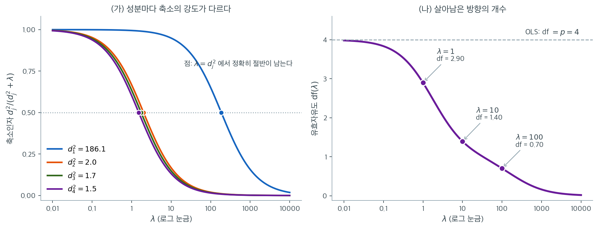
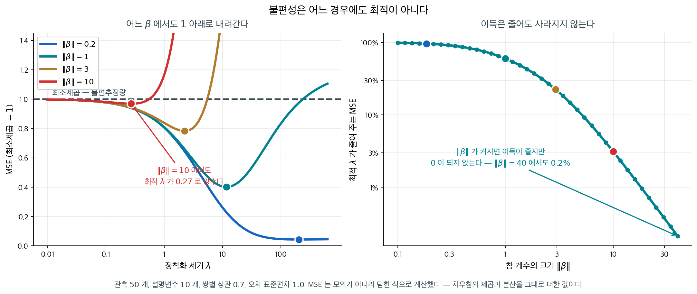

# 능형회귀의 정식화와 닫힌 형태 해

OLS는 계수의 크기에 아무 제약 없이 잔차제곱합을 최소화한다. 설명변수가 상관되어 있거나 표본크기에 비해 변수가 많으면 이 자유 때문에 OLS 계수가 지나치게 커지고 분산이 부풀려진다. Hoerl과 Kennard(1970)가 도입한 능형회귀는 계수벡터에 이차 벌점을 더해 이 문제를 다루며, 언제나 유일한 닫힌 형태 해를 갖는 추정량을 만든다.

---

## 1. 능형 목적함수

능형회귀는 다음 벌점최소제곱 문제를 푼다.

$$
\hat{\boldsymbol{\beta}}_{\text{ridge}} = \arg\min_{\boldsymbol{\beta}} \left\{\|\mathbf{y} - \mathbf{X}\boldsymbol{\beta}\|^2 + \lambda\|\boldsymbol{\beta}\|_2^2\right\}
$$

여기서 $\|\boldsymbol{\beta}\|_2^2 = \sum_{j=1}^p \beta_j^2$은 L2 노름의 제곱이고 $\lambda \geq 0$은 정칙화 모수다. 첫 항은 자료에 대한 적합도를, 둘째 항은 큰 계수를 벌한다.

!!! note "절편에는 벌점을 주지 않는다"
    실무에서는 반응변수 $\mathbf{y}$를 중심화하고 설명변수를 평균 0, 분산 1로 표준화한다. 절편 $\beta_0$은 $\bar{y}$로 따로 추정하며 벌점에 포함하지 않는다. 이렇게 해야 원래 측정 척도와 무관하게 벌점이 모든 기울기 계수를 동등하게 다룬다.

---

## 2. 닫힌 형태 해의 유도

목적함수 $L(\boldsymbol{\beta}) = \|\mathbf{y} - \mathbf{X}\boldsymbol{\beta}\|^2 + \lambda\|\boldsymbol{\beta}\|^2$은 볼록 이차함수다. 기울기를 0으로 두면

$$
\nabla_{\boldsymbol{\beta}} L = -2\mathbf{X}^\top(\mathbf{y} - \mathbf{X}\boldsymbol{\beta}) + 2\lambda\boldsymbol{\beta} = \mathbf{0}
$$

정리하면

$$
(\mathbf{X}^\top\mathbf{X} + \lambda\mathbf{I})\boldsymbol{\beta} = \mathbf{X}^\top\mathbf{y}
$$

$\mathbf{X}^\top\mathbf{X}$가 양반정치이고 $\lambda > 0$에서 $\lambda\mathbf{I}$가 양정치이므로 그 합은 양정치이고 따라서 가역이다. 유일한 해는

$$
\hat{\boldsymbol{\beta}}_{\text{ridge}} = (\mathbf{X}^\top\mathbf{X} + \lambda\mathbf{I})^{-1}\mathbf{X}^\top\mathbf{y}
$$

이다. 이 해는 $\mathbf{X}^\top\mathbf{X}$가 특이행렬일 때($p > n$이거나 정확한 선형종속이 있을 때)에도 모든 $\lambda > 0$에 대해 존재하고 유일하다.

---

## 3. 제약최적화 형태

벌점 형태는 다음 제약최적화 문제와 동등하다.

$$
\min_{\boldsymbol{\beta}} \|\mathbf{y} - \mathbf{X}\boldsymbol{\beta}\|^2 \quad \text{제약} \quad \|\boldsymbol{\beta}\|_2^2 \leq t
$$

여기서 $t = t(\lambda)$는 계수 크기 제곱합의 예산이다. KKT 조건에 의해 $\lambda$와 $t$는 일대일로 대응하며, $\lambda$가 커지면 $t$가 작아져 제약이 조여진다.

---

## 4. SVD 해석

특이값분해 $\mathbf{X} = \mathbf{U}\mathbf{D}\mathbf{V}^\top$은 능형회귀가 OLS를 어떻게 바꾸는지 보여준다. OLS 해는

$$
\hat{\boldsymbol{\beta}}_{\text{OLS}} = \sum_{j=1}^p \frac{\mathbf{u}_j^\top\mathbf{y}}{d_j}\,\mathbf{v}_j
$$

로 쓸 수 있고, 능형 해는 각 항을 축소한 형태다.

$$
\hat{\boldsymbol{\beta}}_{\text{ridge}} = \sum_{j=1}^p \frac{d_j^2}{d_j^2 + \lambda}\cdot\frac{\mathbf{u}_j^\top\mathbf{y}}{d_j}\,\mathbf{v}_j
$$

인자 $d_j^2/(d_j^2 + \lambda)$가 $j$번째 주성분의 **축소인자**다. 0과 1 사이의 값을 가지며, 특이값이 작은 성분(선형종속의 영향을 가장 크게 받는 방향)이 가장 많이 축소된다. 이 선택적 축소가 능형회귀가 가장 불안정한 방향의 분산을 줄이는 기제다.



$\rho = 0.95$인 등상관 설명변수 4개, $n = 50$인 자료에서 실제로 계산한 것이다. $\mathbf{X}^\top\mathbf{X}$의 고윳값은 $186.1,\ 2.01,\ 1.74,\ 1.52$로, **첫 번째가 나머지의 100배 가까이 크다.** 등상관 구조에서 첫 고유벡터는 "네 변수의 평균" 방향이고 나머지 셋은 "변수들 사이의 차이" 방향이다. 자료는 평균을 아주 잘 알고 차이는 거의 모른다.

왼쪽 그림에서 네 곡선은 모양이 같고 위치만 다르다. 축소인자 $d_j^2/(d_j^2+\lambda)$는 $\lambda = d_j^2$에서 정확히 $0.5$가 되므로(그림의 점), 각 곡선은 자기 고윳값에서 반토막이 난다. 따라서 **$\lambda$를 고른다는 것은 $\lambda$보다 작은 고윳값을 가진 방향을 버리겠다고 선언하는 일이다.** $\lambda = 10$을 보라. 첫 성분은 $186.1/196.1 = 0.95$로 95%가 살아남지만, 나머지 세 성분은 $0.17,\ 0.15,\ 0.13$으로 85% 이상 잘려 나간다. 같은 $\lambda$ 하나가 성분마다 전혀 다른 강도로 작동한다.

오른쪽은 이 네 인자를 더한 값, 곧 유효자유도다. $\lambda = 0$에서 $4$로 시작해 $\lambda = 1$에서 $2.90$, $\lambda = 10$에서 $1.40$, $\lambda = 100$에서 $0.70$으로 떨어진다. $\lambda = 10$에서 $\text{df} = 1.40$이라는 말은 "모수를 네 개 썼지만 실질적으로는 한 개 반쯤 추정했다"는 뜻이다. 실제로 그 한 개는 첫 성분, 곧 네 변수의 평균 방향이다.

이 그림이 모형 선택에 쓰이는 방식은 이렇다. 서로 다른 $\lambda$의 모형은 모수 개수가 모두 $p$개로 같아 보이지만 복잡도는 전혀 다르다. $\text{df}(\lambda)$가 그 차이를 하나의 연속적인 눈금으로 환산해 주므로, AIC나 BIC처럼 "모수 개수"를 요구하는 기준을 능형회귀에도 그대로 적용할 수 있다. 다음 절 이후로 $\lambda$ 대신 $\text{df}(\lambda)$를 가로축에 놓는 그림을 자주 보게 되는 이유도 그것이다. $\lambda = 1$과 $\lambda = 10$의 차이는 감이 오지 않지만, $\text{df} = 2.9$와 $\text{df} = 1.4$의 차이는 곧바로 와 닿는다.

---

## 5. 편향과 분산

능형 추정량은 편향되어 있다. 편향과 공분산은 다음과 같다.

$$
\text{Bias}(\hat{\boldsymbol{\beta}}_{\text{ridge}}) = -\lambda(\mathbf{X}^\top\mathbf{X} + \lambda\mathbf{I})^{-1}\boldsymbol{\beta}
$$

$$
\text{Cov}(\hat{\boldsymbol{\beta}}_{\text{ridge}}) = \sigma^2(\mathbf{X}^\top\mathbf{X} + \lambda\mathbf{I})^{-1}\mathbf{X}^\top\mathbf{X}(\mathbf{X}^\top\mathbf{X} + \lambda\mathbf{I})^{-1}
$$

$\lambda$가 커지면 편향은 커지고 분산은 작아진다. Hoerl과 Kennard(1970)의 핵심 결과는 능형 추정량의 전체 MSE가 OLS보다 엄격히 작아지는 $\lambda > 0$이 **언제나 존재한다**는 것이다.

<div class="storybox" markdown>

**그림으로 보는 통계학 1.** 편향을 일부러 들여온 사람들

바로 위의 한 문장을 흘려 읽기 쉽다. 그러나 그것은 백오십 년 된 상식을 뒤집는 말이다.

가우스–마르코프 정리는 최소제곱이 **BLUE** 라고 말한다 — Best Linear **Unbiased** Estimator. 「최선」이 **불편추정량 안에서의** 최선이라는 단서가 붙어 있는데, 그 단서는 오래도록 거의 읽히지 않았다. 불편성은 고를 수 있는 성질이 아니라 **갖추어야 할 조건**으로 여겨졌다. 치우친 추정량을 쓰자는 말은 자를 일부러 휘자는 말처럼 들렸다.

$1970$ 년에 호얼과 케너드가 바로 그것을 제안했다. 그리고 제안만 한 것이 아니라 **증명을 붙였다.**

!!! note "호얼–케너드 정리"
    참 $\boldsymbol\beta$ 가 **무엇이든**, 능형 추정량의 전체 MSE 를 최소제곱보다 엄격히 낮추는 $\lambda > 0$ 이 반드시 존재한다.

곧 **불편성은 어느 경우에도 최적이 아니다.** 「내 계수는 크니까 줄일 필요 없다」는 변명도 통하지 않는다.

<figure markdown>
{ width="900" }
  <figcaption markdown>MSE 는 모의실험이 아니라 닫힌 식으로 계산했다 — 치우침의 제곱과 분산을 그대로 더한 값이다. 왼쪽 가로 파선이 최소제곱이다.</figcaption>
</figure>

관측 $50$ 개, 설명변수 $10$ 개, 쌍별 상관 $0.7$ 에서 재 보면

| $\lVert\boldsymbol\beta\rVert$ | 최적 $\lambda$ | MSE 가 줄어든 몫 |
|---|---|---|
| $0.2$ | $203.9$ | $95.7\%$ |
| $1.0$ | $11.7$ | $59.8\%$ |
| $3.0$ | $2.22$ | $21.7\%$ |
| $10.0$ | $\mathbf{0.27}$ | $\mathbf{3.1\%}$ |

**참 계수가 아무리 커도 최적 $\lambda$ 는 양수로 남는다.** 시험한 $40$ 가지 크기 가운데 최적 $\lambda$ 가 $0$ 인 경우는 **하나도 없었다.** 이득이 $95.7\%$ 에서 $0.2\%$ 까지 줄어들 뿐이다.

왼쪽 그림에서 네 곡선 모두 가로 파선 아래로 내려가는 구간이 있다는 것이 정리의 모습이다. $\lVert\boldsymbol\beta\rVert = 10$ 인 붉은 곡선은 $\lambda$ 를 조금만 키워도 금세 위로 치솟지만, **$\lambda = 0.27$ 근처에서는 분명히 아래에 있다.**

**그러나 정리는 존재만 보장한다.** 오른쪽에서 보듯 최적 $\lambda$ 는 $\lVert\boldsymbol\beta\rVert$ 에 따라 $203$ 에서 $0.27$ 까지 세 자릿수를 오간다. 그런데 $\boldsymbol\beta$ 는 우리가 모르는 것이다. **「좋은 $\lambda$ 가 있다」와 「그 $\lambda$ 를 안다」 사이의 거리가 이 장의 나머지**이고, [교차검증](../tuning/cross_validation.md)이 그 거리를 메우는 일을 한다.

같은 생각이 다른 이름으로도 나타난다. 제임스–스타인 추정량, 경험적 베이즈, 그리고 현대의 거의 모든 기계학습 모형이 쓰는 벌점항이 모두 이 계보에 있다. **편향을 받아들이는 대신 분산을 사 오는 거래**다.

</div>

---

## 6. 유효자유도

OLS는 $p$개의 자유도를 쓴다. 능형 추정량은 그보다 적게 쓰며 그 양은

$$
\text{df}(\lambda) = \text{tr}\bigl[\mathbf{X}(\mathbf{X}^\top\mathbf{X} + \lambda\mathbf{I})^{-1}\mathbf{X}^\top\bigr] = \sum_{j=1}^p \frac{d_j^2}{d_j^2 + \lambda}
$$

로 주어진다. 이 값은 $\lambda = 0$에서 $p$, $\lambda \to \infty$에서 $0$까지 단조감소하며, 서로 다른 $\lambda$를 비교할 수 있게 하는 연속적인 복잡도 척도를 제공한다.

!!! tip "정보기준과의 연결"
    유효자유도 덕분에 능형회귀에도 AIC와 BIC를 쓸 수 있다. 보통의 모수 개수를 $\text{df}(\lambda)$로 바꾸면 된다. 이 연결은 이 장의 조정 절에서 전개한다.

---

## 7. OLS와의 비교

| 성질 | OLS | 능형 ($\lambda > 0$) |
|---|---|---|
| 편향 | 0 | 0이 아니며 $\lambda$와 함께 증가 |
| 분산 | $\sigma^2(\mathbf{X}^\top\mathbf{X})^{-1}$ | 감소, 특히 선형종속 방향에서 |
| 존재성 | $\text{rank}(\mathbf{X}) = p$ 필요 | 언제나 존재 |
| 유일성 | $\mathbf{X}^\top\mathbf{X}$ 가역일 때만 | 언제나 유일 |
| 자유도 | $p$ | $\text{df}(\lambda) < p$ |
| 변수선택 | 없음 | 없음 |

---

## 연습문제

<div class="drillbox" markdown>

**연습문제 1.** <span class="diff med" title="중간"></span>
능형 추정량 $\hat{\boldsymbol{\beta}}_{\text{ridge}} = (\mathbf{X}^\top\mathbf{X} + \lambda\mathbf{I})^{-1}\mathbf{X}^\top\mathbf{y}$를 생각하자.

**(a)** $\lambda \to 0$일 때 $\hat{\boldsymbol{\beta}}_{\text{ridge}} \to \hat{\boldsymbol{\beta}}_{\text{OLS}}$임을 보여라.

**(b)** $\lambda \to \infty$일 때 $\hat{\boldsymbol{\beta}}_{\text{ridge}} \to \mathbf{0}$임을 보여라.

**(c)** $\mathbf{X}^\top\mathbf{X}$가 특이행렬이더라도 모든 $\lambda > 0$에 대해 $\mathbf{X}^\top\mathbf{X} + \lambda\mathbf{I}$가 양정치임을 증명하라.

</div>

??? success "풀이"
    **(a)** $\mathbf{X}^\top\mathbf{X}$가 가역이면 역행렬은 연속함수이므로 $\lambda \to 0$에서

    $$
    (\mathbf{X}^\top\mathbf{X} + \lambda\mathbf{I})^{-1} \to (\mathbf{X}^\top\mathbf{X})^{-1}
    $$

    이고 따라서 $\hat{\boldsymbol{\beta}}_{\text{ridge}} \to \hat{\boldsymbol{\beta}}_{\text{OLS}}$이다.

    $\mathbf{X}^\top\mathbf{X}$가 특이행렬이면 극한은 OLS가 아니라 **최소노름 최소제곱해**(무어-펜로즈 유사역행렬 해)로 간다. SVD로 보면 $d_j = 0$인 성분의 축소인자가 $0/(0+\lambda) = 0$으로 $\lambda$와 무관하게 0이기 때문이다.

    **(b)** SVD 표현에서 각 항의 계수가 $\dfrac{d_j^2}{d_j^2+\lambda}\cdot\dfrac{1}{d_j} = \dfrac{d_j}{d_j^2+\lambda}$이고, $\lambda \to \infty$에서 이 값이 $0$으로 간다. 더 직접적으로는

    $$
    \|\hat{\boldsymbol{\beta}}_{\text{ridge}}\| \le \frac{\|\mathbf{X}^\top\mathbf{y}\|}{\lambda_{\min}(\mathbf{X}^\top\mathbf{X}) + \lambda} \le \frac{\|\mathbf{X}^\top\mathbf{y}\|}{\lambda} \to 0
    $$

    **(c)** 임의의 $\mathbf{v} \neq \mathbf{0}$에 대해

    $$
    \mathbf{v}^\top(\mathbf{X}^\top\mathbf{X} + \lambda\mathbf{I})\mathbf{v} = \|\mathbf{X}\mathbf{v}\|^2 + \lambda\|\mathbf{v}\|^2 \ge \lambda\|\mathbf{v}\|^2 > 0
    $$

    이다. 첫 항은 항상 0 이상이고 둘째 항은 $\lambda > 0$, $\mathbf{v} \neq \mathbf{0}$에서 엄격히 양수다. $\mathbf{X}\mathbf{v} = \mathbf{0}$인 방향($\mathbf{X}^\top\mathbf{X}$의 영공간)이 있어도 $\lambda\|\mathbf{v}\|^2$이 남으므로 양정치성이 보장된다. $\square$

    **이것이 $p > n$에서도 능형회귀가 작동하는 이유다.** $\mathbf{X}^\top\mathbf{X}$의 계수는 최대 $n$이므로 $p > n$이면 반드시 특이행렬이지만, $\lambda\mathbf{I}$가 영공간을 메운다.

---

<div class="drillbox" markdown>

**연습문제 2.** <span class="diff med" title="중간"></span>
능형회귀를 sklearn 없이 **직접 구현**하라.

**(a)** $\mathbf{X}, \mathbf{y}, \lambda$를 받아 닫힌 형태 공식으로 $\hat{\boldsymbol{\beta}}_{\text{ridge}}$를 반환하는 함수를 작성하라.

**(b)** 사영행렬 지름길을 이용해 하나 남기기 교차검증을 구현하라.

**(c)** 구현이 `sklearn.linear_model.Ridge`와 일치하는지 확인하라.

</div>

??? success "풀이"
    ```python
    import numpy as np
    from sklearn.linear_model import Ridge

    def ridge_fit(X, y, lam):
        """중심화된 X, y를 가정한다. 절편은 벌점하지 않는다."""
        p = X.shape[1]
        return np.linalg.solve(X.T @ X + lam*np.eye(p), X.T @ y)

    def ridge_loocv(X, y, lam):
        """모자 행렬 지름길: 재적합 없이 LOOCV 오차를 구한다."""
        n, p = X.shape
        A = np.linalg.inv(X.T @ X + lam*np.eye(p))
        H = X @ A @ X.T                       # 능형 평활행렬
        yhat = H @ y
        h = np.diag(H)
        return np.mean(((y - yhat) / (1 - h))**2)

    rng = np.random.default_rng(0)
    n, p = 60, 8
    X = rng.normal(size=(n, p)); X -= X.mean(0)
    y = X @ np.ones(p) + rng.normal(0, 1, n); y -= y.mean()

    for lam in (0.1, 1.0, 10.0):
        mine = ridge_fit(X, y, lam)
        theirs = Ridge(alpha=lam, fit_intercept=False).fit(X, y).coef_
        assert np.allclose(mine, theirs), lam
    print("일치 확인")

    lams = np.logspace(-2, 3, 60)
    errs = [ridge_loocv(X, y, l) for l in lams]
    print("LOOCV 최적 lambda =", lams[int(np.argmin(errs))])
    ```

    출력:

    ```
    일치 확인
    LOOCV 최적 lambda = 1.0811807510766078
    ```

    **(c) 주의할 점.** sklearn의 `Ridge(alpha=lam)`은 목적함수를

    $$
    \|\mathbf{y}-\mathbf{X}\boldsymbol\beta\|^2 + \alpha\|\boldsymbol\beta\|_2^2
    $$

    로 두므로 이 페이지의 $\lambda$와 **같다**. 반면 `Lasso(alpha=a)`는 $\frac{1}{2n}\|\cdot\|^2 + a\|\boldsymbol\beta\|_1$을 쓰므로 배율이 다르다. 두 클래스의 규약이 다르다는 점에 매번 주의해야 한다.

    또한 `fit_intercept=True`(기본값)이면 sklearn이 내부에서 중심화하므로, 직접 중심화한 자료와 비교할 때는 `fit_intercept=False`로 맞춰야 한다.

    **(b)의 지름길이 왜 성립하는가.** 능형회귀는 선형 평활자다. $\hat{\mathbf{y}} = \mathbf{H}\mathbf{y}$ 형태이므로 13장 연습문제 1의 OLS 항등식이 그대로 확장된다.

    $$
    y_i - \hat{y}_i^{(-i)} = \frac{y_i - \hat{y}_i}{1 - H_{ii}}
    $$

    따라서 $n$번 재적합할 필요 없이 **한 번의 적합**으로 LOOCV 오차 전체를 얻는다. 이것이 `RidgeCV`가 매우 빠른 이유이며, 라쏘에는 이런 지름길이 없다(라쏘는 선형 평활자가 아니다).

---

<div class="drillbox" markdown>

**연습문제 3.** <span class="diff hard" title="어려움"></span>
능형회귀의 유효자유도는 $\text{df}(\lambda) = \sum_{j=1}^p \frac{d_j^2}{d_j^2 + \lambda}$이며 $d_j$는 $\mathbf{X}$의 특이값이다.

**(a)** $\text{df}(0) = p$이고 $\text{df}(\infty) = 0$임을 보여라.

**(b)** $\text{df}(\lambda)$는 $\lambda$에 대해 단조감소하는가?

**(c)** 라쏘에 대응하는 양은 어떻게 정의하겠는가?

</div>

??? success "풀이"
    **(a)** $\lambda = 0$이면 각 항이 $d_j^2/d_j^2 = 1$이므로 합은 $p$이다(모든 $d_j > 0$일 때). $\lambda \to \infty$이면 각 항이 0으로 가므로 합도 0이다.

    **(b)** 그렇다. 각 항을 $\lambda$로 미분하면

    $$
    \frac{d}{d\lambda}\frac{d_j^2}{d_j^2+\lambda} = -\frac{d_j^2}{(d_j^2+\lambda)^2} < 0
    $$

    이므로 모든 항이 감소하고 합도 감소한다. 감소는 **엄격**하다($d_j > 0$인 항이 하나라도 있으면).

    **(c)** 라쏘의 유효자유도는 놀랍도록 단순하다.

    $$
    \widehat{\text{df}}_{\text{lasso}}(\lambda) = \#\{j : \hat\beta_j \neq 0\}
    $$

    즉 **0이 아닌 계수의 개수**다. Zou, Hastie, Tibshirani(2007)가 이것이 불편추정량임을 증명했다.

    !!! note "이 결과가 놀라운 이유"
        라쏘는 변수를 **자료에서** 고른다. 보통 자료 기반 선택을 하면 자유도를 그 이상으로 세야 한다(선택 과정 자체가 자유도를 소모하므로). 단계적 선택에서 이것이 잘 알려진 문제다.

        그런데 라쏘에서는 두 효과가 정확히 상쇄된다. 변수를 고르는 데 쓰는 추가 자유도를, 고른 계수를 0 쪽으로 축소하면서 되돌려주기 때문이다. 결과적으로 활성 변수를 세기만 하면 된다.

        능형과 대조적이다. 능형은 모든 변수를 남기지만 $\text{df}(\lambda) < p$이고, 라쏘는 일부만 남기지만 남긴 개수가 곧 자유도다.

---

<div class="drillbox" markdown>

**연습문제 4.** <span class="diff hard" title="어려움"></span>
1절의 주석은 설명변수를 표준화한다고 말한다. 그 말이 왜 **필수**인지 수로 확인한다. 중심화된 설명변수 두 개가 직교하고

$$
\lVert\mathbf{x}_1\rVert^2 = \lVert\mathbf{x}_2\rVert^2 = 1, \qquad
\mathbf{x}_1^\top\mathbf{y} = \mathbf{x}_2^\top\mathbf{y} = 1
$$

이라고 하자. $\lambda = 1$로 능형회귀를 적합한다.

**(a)** $\hat{\boldsymbol{\beta}}_{\text{ridge}}$를 구하라.

**(b)** 이제 둘째 변수의 **단위만** 바꾸어 $\tilde{\mathbf{x}}_2 = 10\,\mathbf{x}_2$로 다시 적합한다(cm를 mm로 바꾼 셈이다. 자료는 하나도 바뀌지 않았다). 새 해 $\tilde{\boldsymbol{\beta}}$를 구하고 원래 단위의 계수 $10\tilde\beta_2$를 (a)와 비교하라. 같은 일을 OLS로 하면 어떻게 되는가?

**(c)** (b)에서 일어난 일을 "$\tilde\beta_2$에 걸린 **실효 벌점**"으로 설명하라. 또 설명변수 행렬에 직교행렬을 곱하는 변환 $\mathbf{X} \mapsto \mathbf{X}\mathbf{Q}$에서는 같은 일이 일어나지 않음을 보여라.

</div>

??? success "풀이"
    **(a)** 가정에서 $\mathbf{X}^\top\mathbf{X} = \mathbf{I}_2$, $\mathbf{X}^\top\mathbf{y} = (1, 1)^\top$이므로

    $$
    \hat{\boldsymbol{\beta}}_{\text{ridge}} = (\mathbf{I} + 1\cdot\mathbf{I})^{-1}\binom{1}{1} = \binom{0.5}{0.5}
    $$

    두 변수가 완전히 대칭이므로 계수도 같다. OLS 해는 $(1, 1)^\top$이니 둘 다 정확히 절반으로 축소되었다($1/(1+\lambda) = 0.5$).

    **(b)** 새 설계행렬 $\tilde{\mathbf{X}} = [\mathbf{x}_1,\ 10\mathbf{x}_2]$에 대해

    $$
    \tilde{\mathbf{X}}^\top\tilde{\mathbf{X}} = \begin{pmatrix} 1 & 0 \\ 0 & 100\end{pmatrix}, \qquad
    \tilde{\mathbf{X}}^\top\mathbf{y} = \binom{1}{10}
    $$

    이므로 여전히 대각이고

    $$
    \tilde\beta_1 = \frac{1}{1+1} = 0.5, \qquad
    \tilde\beta_2 = \frac{10}{100+1} = \frac{10}{101} = 0.0990
    $$

    이다. 둘째 변수의 **원래 단위 계수**로 환산하면 $10\tilde\beta_2 = 100/101 = 0.9901$이다. (a)에서 $0.5$였던 것이 $0.9901$이 되었다 — 거의 축소되지 않았다. 첫 변수는 그대로 $0.5$이므로 **단위를 바꾼 것만으로 두 변수의 상대적 중요도가 뒤집혔다.**

    OLS는 그렇지 않다. $\mathbf{X} \mapsto \mathbf{X}\mathbf{S}$($\mathbf{S}$는 양의 대각행렬)이면

    $$
    (\mathbf{S}\mathbf{X}^\top\mathbf{X}\mathbf{S})^{-1}\mathbf{S}\mathbf{X}^\top\mathbf{y}
    = \mathbf{S}^{-1}(\mathbf{X}^\top\mathbf{X})^{-1}\mathbf{X}^\top\mathbf{y}
    = \mathbf{S}^{-1}\hat{\boldsymbol{\beta}}_{\text{OLS}}
    $$

    이므로 적합값 $\mathbf{X}\mathbf{S}\mathbf{S}^{-1}\hat{\boldsymbol{\beta}}_{\text{OLS}} = \mathbf{X}\hat{\boldsymbol{\beta}}_{\text{OLS}}$는 전혀 바뀌지 않는다. 여기서는 $\hat{\boldsymbol{\beta}}_{\text{OLS}} = (1,1)^\top$이 $(1, 0.1)^\top$으로 바뀌고 환산하면 $10 \times 0.1 = 1$로 원래대로다. **OLS는 척도에 등변이고 능형은 그렇지 않다.**

    **(c)** 벌점항을 원래 단위로 다시 쓰면 보인다. $\beta_2 = 10\tilde\beta_2$이므로

    $$
    \lambda\tilde\beta_2^2 = \lambda\left(\frac{\beta_2}{10}\right)^2 = \frac{\lambda}{100}\,\beta_2^2
    $$

    곧 둘째 변수에 실제로 걸린 벌점은 $\lambda = 1$이 아니라 $\lambda/100 = 0.01$이다. **큰 수로 측정된 변수는 계수가 작아지므로 L2 벌점이 거의 그냥 지나친다.** 척도가 변수마다 다르면 하나의 $\lambda$가 변수마다 다른 강도로 작동하고, 그 강도는 분석자가 고른 측정 단위가 결정한다. 그래서 표준화가 선택이 아니라 전제다.

    직교변환은 다르다. $\tilde{\mathbf{X}} = \mathbf{X}\mathbf{Q}$, $\mathbf{Q}^\top\mathbf{Q} = \mathbf{I}$이면

    $$
    (\mathbf{Q}^\top\mathbf{X}^\top\mathbf{X}\mathbf{Q} + \lambda\mathbf{I})^{-1}\mathbf{Q}^\top\mathbf{X}^\top\mathbf{y}
    = \mathbf{Q}^\top(\mathbf{X}^\top\mathbf{X} + \lambda\mathbf{I})^{-1}\mathbf{X}^\top\mathbf{y}
    = \mathbf{Q}^\top\hat{\boldsymbol{\beta}}_{\text{ridge}}
    $$

    이고($\mathbf{Q}^\top\mathbf{A}\mathbf{Q} + \lambda\mathbf{I} = \mathbf{Q}^\top(\mathbf{A}+\lambda\mathbf{I})\mathbf{Q}$를 썼다) 적합값은 $\tilde{\mathbf{X}}\mathbf{Q}^\top\hat{\boldsymbol{\beta}}_{\text{ridge}} = \mathbf{X}\hat{\boldsymbol{\beta}}_{\text{ridge}}$로 같다. L2 노름이 회전에 불변($\lVert\mathbf{Q}^\top\boldsymbol{\beta}\rVert = \lVert\boldsymbol{\beta}\rVert$)이기 때문이다. **능형은 회전에는 등변이고 척도에는 아니다.** $\square$

    !!! warning "sklearn 에서의 함정"
        `Ridge`와 `Lasso`는 표준화를 해 주지 않는다(`normalize` 인수는 1.2에서 없어졌다). `fit_intercept=True`로 중심화만 한다. 반드시 `make_pipeline(StandardScaler(), Ridge(alpha=lam))`처럼 묶어야 하고, 교차검증에 넣을 때는 **파이프라인 전체**를 넣어 표준화가 폴드 안에서 일어나게 해야 한다. 전체 자료로 먼저 표준화하면 검증 폴드의 평균과 분산이 새 나간다.

---

<div class="drillbox" markdown>

**연습문제 5.** <span class="diff hard" title="어려움"></span>
5절은 "능형의 전체 MSE가 OLS보다 엄격히 작아지는 $\lambda > 0$이 언제나 존재한다"고만 말했다. 직교설계에서 이것을 직접 증명한다. $\mathbf{X}^\top\mathbf{X} = \mathbf{I}_p$이고 $\mathbf{y} = \mathbf{X}\boldsymbol{\beta} + \boldsymbol{\varepsilon}$, $\text{Cov}(\boldsymbol{\varepsilon}) = \sigma^2\mathbf{I}$라고 하자.

**(a)** $\hat{\boldsymbol{\beta}}_{\text{ridge}} = \hat{\boldsymbol{\beta}}_{\text{OLS}}/(1+\lambda)$임을 보이고, 5절의 두 공식을 써서

$$
\text{MSE}(\lambda) = \mathbb{E}\lVert\hat{\boldsymbol{\beta}}_{\text{ridge}} - \boldsymbol{\beta}\rVert^2
= \frac{p\sigma^2 + \lambda^2\lVert\boldsymbol{\beta}\rVert^2}{(1+\lambda)^2}
$$

임을 유도하라.

**(b)** $\text{MSE}'(0) < 0$임을 보여 Hoerl–Kennard의 주장을 확인하고, 최소점 $\lambda^*$와 $\text{MSE}(\lambda^*)$를 닫힌 꼴로 구하라.

**(c)** $p = 4$, $\sigma^2 = 1$, $\lVert\boldsymbol{\beta}\rVert^2 = 4$에서 수를 넣어라. 실무에서 $\lambda^*$를 그대로 쓸 수 없는 까닭은 무엇인가?

</div>

??? success "풀이"
    **(a)** $\mathbf{X}^\top\mathbf{X} = \mathbf{I}$이므로 $(\mathbf{I} + \lambda\mathbf{I})^{-1} = \frac{1}{1+\lambda}\mathbf{I}$이고

    $$
    \hat{\boldsymbol{\beta}}_{\text{ridge}} = \frac{1}{1+\lambda}\mathbf{X}^\top\mathbf{y} = \frac{\hat{\boldsymbol{\beta}}_{\text{OLS}}}{1+\lambda}
    $$

    이다. 5절의 공식에 $\mathbf{X}^\top\mathbf{X} = \mathbf{I}$를 넣으면

    $$
    \text{Bias} = -\frac{\lambda}{1+\lambda}\boldsymbol{\beta}, \qquad
    \text{Cov} = \frac{\sigma^2}{(1+\lambda)^2}\mathbf{I}
    $$

    MSE는 분산의 대각합과 편향 제곱노름의 합이므로

    $$
    \text{MSE}(\lambda) = \frac{p\sigma^2}{(1+\lambda)^2} + \frac{\lambda^2\lVert\boldsymbol{\beta}\rVert^2}{(1+\lambda)^2}
    = \frac{p\sigma^2 + \lambda^2 B}{(1+\lambda)^2}, \qquad B := \lVert\boldsymbol{\beta}\rVert^2
    $$

    이다. 첫 항은 $\lambda$와 함께 감소하는 **분산**이고 둘째 항은 증가하는 **편향제곱**이다. $\lambda = 0$에서 $\text{MSE}(0) = p\sigma^2$로 OLS 값이다.

    **(b)** 미분하면

    $$
    \text{MSE}'(\lambda) = \frac{2\lambda B(1+\lambda)^2 - 2(1+\lambda)(p\sigma^2 + \lambda^2 B)}{(1+\lambda)^4}
    = \frac{2\bigl[\lambda B - p\sigma^2\bigr]}{(1+\lambda)^3}
    $$

    (분자를 전개하면 $\lambda B + \lambda^2 B - p\sigma^2 - \lambda^2 B = \lambda B - p\sigma^2$이다.) 따라서

    $$
    \text{MSE}'(0) = -2p\sigma^2 < 0
    $$

    이다. $\sigma^2 > 0$이면 **항상** 음수이므로 $\lambda = 0$의 오른쪽에서 MSE가 떨어진다. 곧 $\text{MSE}(\lambda) < \text{MSE}(0)$인 $\lambda > 0$이 존재한다. 이것이 직교설계에서의 Hoerl–Kennard 결과다.

    도함수가 $\lambda < p\sigma^2/B$에서 음, $\lambda > p\sigma^2/B$에서 양이므로 유일한 최소점은

    $$
    \lambda^* = \frac{p\sigma^2}{B} = \frac{p\sigma^2}{\lVert\boldsymbol{\beta}\rVert^2}
    $$

    이다. 대입하면 분자는 $p\sigma^2 + (p\sigma^2/B)^2 B = p\sigma^2(B + p\sigma^2)/B$, 분모는 $\bigl((B+p\sigma^2)/B\bigr)^2$이므로

    $$
    \text{MSE}(\lambda^*) = \frac{p\sigma^2 B}{B + p\sigma^2}, \qquad
    \frac{\text{MSE}(\lambda^*)}{\text{MSE}(0)} = \frac{B}{B + p\sigma^2}
    $$

    이다. 역수로 쓰면 $1/\text{MSE}(\lambda^*) = 1/(p\sigma^2) + 1/B$로, **잡음과 신호의 조화평균 꼴**이다. $\square$

    **(c)** $p = 4$, $\sigma^2 = 1$, $B = 4$이면

    $$
    \lambda^* = \frac{4 \cdot 1}{4} = 1, \qquad
    \text{MSE}(1) = \frac{4 \cdot 4}{4 + 4} = 2, \qquad
    \text{MSE}(0) = 4
    $$

    로 MSE가 정확히 **절반**이 된다($0.5 = B/(B+p\sigma^2) = 4/8$).

    쓸 수 없는 까닭은 $\lambda^*$가 **모르는 양** $\lVert\boldsymbol{\beta}\rVert^2$과 $\sigma^2$에 의존한다는 것이다. 신호가 세면($B$가 크면) $\lambda^*$가 작고, 변수가 많거나 잡음이 크면 $\lambda^*$가 크다 — 방향은 옳지만 값을 알 수 없다. 그래서 $\lambda$를 교차검증으로 고른다. 또 하나 눈여겨볼 것은 $\lambda^*$가 $B$에 의존한다는 사실 자체다. **좋은 $\lambda$는 자료의 성질이 아니라 모르는 참값의 성질에 달려 있다.**

---

<div class="drillbox" markdown>

**연습문제 6.** <span class="diff hard" title="어려움"></span>
7절 표의 마지막 줄은 능형이 변수선택을 하지 **못한다**고 적고 있다. 그 까닭을 라쏘와 나란히 놓고 닫힌 꼴로 확인한다. $\mathbf{X}^\top\mathbf{X} = \mathbf{I}_3$이고 $\hat{\boldsymbol{\beta}}_{\text{OLS}} = \mathbf{X}^\top\mathbf{y} = (2.0,\ 0.6,\ -0.3)^\top$이라고 하자. 두 목적함수를 **같은 규약**으로 쓴다.

$$
\lVert\mathbf{y}-\mathbf{X}\boldsymbol{\beta}\rVert^2 + \lambda\lVert\boldsymbol{\beta}\rVert_2^2
\qquad\text{대}\qquad
\lVert\mathbf{y}-\mathbf{X}\boldsymbol{\beta}\rVert^2 + \lambda\lVert\boldsymbol{\beta}\rVert_1
$$

**(a)** 직교설계에서 라쏘 목적함수가 좌표별로 분리됨을 보이고 해가 연성문턱 $\hat\beta_j^{\text{lasso}} = \operatorname{sign}(\hat\beta_j)\bigl(\lvert\hat\beta_j\rvert - \lambda/2\bigr)_+$임을 유도하라.

**(b)** $\lambda = 1$에서 능형 해와 라쏘 해를 모두 적어라. 각 계수를 정확히 0으로 만드는 가장 작은 $\lambda$는 얼마인가 — 두 벌점에 대해 각각 답하라.

**(c)** 많은 교과서는 연성문턱을 $\operatorname{sign}(\hat\beta_j)(\lvert\hat\beta_j\rvert - \lambda)_+$로 적는다. (a)의 답과 2가 어긋나는 까닭을 밝혀라. 또 $n = 50$일 때 sklearn의 `Lasso(alpha=a)`로 (b)의 라쏘 해를 재현하려면 $a$를 얼마로 두어야 하는가?

</div>

??? success "풀이"
    **(a)** $\mathbf{X}^\top\mathbf{X} = \mathbf{I}$이므로

    $$
    \lVert\mathbf{y}-\mathbf{X}\boldsymbol{\beta}\rVert^2
    = \lVert\mathbf{y}\rVert^2 - 2\boldsymbol{\beta}^\top\mathbf{X}^\top\mathbf{y} + \boldsymbol{\beta}^\top\boldsymbol{\beta}
    = \lVert\mathbf{y}\rVert^2 - \lVert\hat{\boldsymbol{\beta}}\rVert^2 + \sum_{j=1}^p (\beta_j - \hat\beta_j)^2
    $$

    이다($\hat{\boldsymbol{\beta}} = \mathbf{X}^\top\mathbf{y}$). 앞의 두 항은 $\boldsymbol{\beta}$와 무관하므로 목적함수는 상수를 빼면

    $$
    \sum_{j=1}^p \Bigl[(\beta_j - \hat\beta_j)^2 + \lambda\lvert\beta_j\rvert\Bigr]
    $$

    로 **좌표마다 따로** 최소화된다. 한 좌표의 함수 $f(b) = (b-a)^2 + \lambda\lvert b\rvert$를 보자. $b > 0$에서 $f'(b) = 2(b-a) + \lambda = 0$이면 $b = a - \lambda/2$이고, 이것이 양수라는 조건은 $a > \lambda/2$다. 대칭으로 $a < -\lambda/2$이면 $b = a + \lambda/2$다. $\lvert a\rvert \le \lambda/2$이면 양쪽 미분의 부호가 각각 $f'(0^+) = -2a+\lambda \ge 0$, $f'(0^-) = -2a-\lambda \le 0$이므로 $b = 0$이 최소다. 세 경우를 합치면

    $$
    \hat\beta_j^{\text{lasso}} = \operatorname{sign}(\hat\beta_j)\bigl(\lvert\hat\beta_j\rvert - \lambda/2\bigr)_+
    $$

    이다. 같은 계산을 L2 벌점으로 하면 $f(b) = (b-a)^2 + \lambda b^2$에서 $b = a/(1+\lambda)$로 **비례축소**가 나온다. $\square$

    **(b)** $\lambda = 1$이므로 능형은 $1/(1+1) = 0.5$배, 라쏘는 문턱 $\lambda/2 = 0.5$다.

    | $j$ | $\hat\beta_j^{\text{OLS}}$ | 능형 $\hat\beta_j/(1+\lambda)$ | 라쏘 $\operatorname{sign}(\hat\beta_j)(\lvert\hat\beta_j\rvert-0.5)_+$ |
    |---|---|---|---|
    | 1 | $2.0$ | $1.00$ | $1.5$ |
    | 2 | $0.6$ | $0.30$ | $0.1$ |
    | 3 | $-0.3$ | $-0.15$ | $0$ |

    0으로 만드는 가장 작은 $\lambda$는 라쏘에서 $\lambda_j = 2\lvert\hat\beta_j\rvert$이므로 각각 $4.0,\ 1.2,\ 0.6$이다. 능형은 어떤 유한한 $\lambda$에서도 $\hat\beta_j/(1+\lambda) \ne 0$이므로 **그런 $\lambda$가 없다.** 이것이 7절 표의 "변수선택: 없음"이다.

    두 축소의 성질이 다르다는 점도 보라. 능형은 모든 계수를 **같은 비율**로 줄이므로 큰 계수에서 절대적으로 더 많이 깎는다($2.0 \to 1.0$으로 $1.0$ 감소, $0.6 \to 0.3$으로 $0.3$ 감소). 라쏘는 모든 계수를 **같은 양**만큼 줄이고 그 양에 못 미치는 것을 0으로 보낸다($2.0 \to 1.5$, $0.6 \to 0.1$, $-0.3 \to 0$). 작은 계수를 지우는 일은 뒤쪽을 평평하게 깎는 L1에서만 일어난다.

    **(c)** 2는 목적함수 규약에서 온다. 연성문턱을 $(\lvert\hat\beta_j\rvert-\lambda)_+$로 적는 책은 잔차항에 $\tfrac12$을 붙여

    $$
    \tfrac12\lVert\mathbf{y}-\mathbf{X}\boldsymbol{\beta}\rVert^2 + \lambda\lVert\boldsymbol{\beta}\rVert_1
    $$

    을 쓴다. 이때 좌표별 함수는 $\tfrac12(b-a)^2 + \lambda\lvert b\rvert$가 되어 $f'(b) = (b-a)+\lambda$이므로 문턱이 $\lambda$다. **두 규약의 $\lambda$는 2배 차이가 난다.** 수식을 베껴 올 때 잔차항의 계수를 먼저 확인해야 하는 이유다.

    sklearn의 `Lasso(alpha=a)`는 또 다른 규약

    $$
    \frac{1}{2n}\lVert\mathbf{y}-\mathbf{X}\boldsymbol{\beta}\rVert^2 + a\lVert\boldsymbol{\beta}\rVert_1
    = \frac{1}{2n}\Bigl[\lVert\mathbf{y}-\mathbf{X}\boldsymbol{\beta}\rVert^2 + 2na\lVert\boldsymbol{\beta}\rVert_1\Bigr]
    $$

    을 쓴다. 대괄호 안이 이 문제의 목적함수와 같아지는 조건은 $\lambda = 2na$, 곧 $a = \lambda/(2n)$이다. $n = 50$, $\lambda = 1$이면

    $$
    a = \frac{1}{2 \cdot 50} = 0.01
    $$

    이다(문턱은 $na = 0.5$로 (b)와 맞는다). 반면 연습문제 2에서 본 대로 `Ridge(alpha=lam)`은 $\lambda$를 그대로 받는다. **같은 라이브러리의 두 클래스가 규약이 다르므로 $\lambda$와 $\alpha$를 섞으면 수가 전부 틀어진다.**

---

<div class="drillbox" markdown>

**연습문제 7.** <span class="diff hard" title="어려움"></span>
능형회귀는 **자료를 늘린 OLS**로 다시 쓸 수 있다. $\lambda > 0$에 대해

$$
\tilde{\mathbf{X}} = \begin{pmatrix}\mathbf{X}\\ \sqrt{\lambda}\,\mathbf{I}_p\end{pmatrix} \in \mathbb{R}^{(n+p)\times p},
\qquad
\tilde{\mathbf{y}} = \begin{pmatrix}\mathbf{y}\\ \mathbf{0}_p\end{pmatrix}
$$

로 두자.

**(a)** $(\tilde{\mathbf{X}}, \tilde{\mathbf{y}})$에 대한 OLS 해가 $(\mathbf{X}, \mathbf{y})$에 대한 능형 해와 같음을 보이고, 늘린 자료의 잔차제곱합이 능형 목적함수와 같음을 확인하라.

**(b)** 이 표현으로 2절의 존재·유일성 주장을 $\mathbf{X}$의 계수에 대한 가정 없이 다시 설명하라.

**(c)** 늘린 문제의 모자행렬 $\tilde{\mathbf{H}} = \tilde{\mathbf{X}}(\tilde{\mathbf{X}}^\top\tilde{\mathbf{X}})^{-1}\tilde{\mathbf{X}}^\top$은 $p$개의 자유도를 쓴다($\text{tr}\,\tilde{\mathbf{H}} = p$). 그런데 6절은 $\text{df}(\lambda) < p$라고 한다. $\tilde{\mathbf{H}}$를 $n$행과 $p$행으로 나누어 두 주장을 화해시켜라. 4절 그림의 $\lambda = 10$에서는 어떤 수가 되는가?

</div>

??? success "풀이"
    **(a)** 블록 계산으로

    $$
    \tilde{\mathbf{X}}^\top\tilde{\mathbf{X}} = \mathbf{X}^\top\mathbf{X} + \lambda\mathbf{I}, \qquad
    \tilde{\mathbf{X}}^\top\tilde{\mathbf{y}} = \mathbf{X}^\top\mathbf{y} + \sqrt{\lambda}\,\mathbf{I}\cdot\mathbf{0} = \mathbf{X}^\top\mathbf{y}
    $$

    이므로 늘린 자료의 정규방정식 $\tilde{\mathbf{X}}^\top\tilde{\mathbf{X}}\boldsymbol{\beta} = \tilde{\mathbf{X}}^\top\tilde{\mathbf{y}}$는 2절의 $(\mathbf{X}^\top\mathbf{X}+\lambda\mathbf{I})\boldsymbol{\beta} = \mathbf{X}^\top\mathbf{y}$와 **같은 식**이다. 잔차제곱합도

    $$
    \lVert\tilde{\mathbf{y}} - \tilde{\mathbf{X}}\boldsymbol{\beta}\rVert^2
    = \lVert\mathbf{y}-\mathbf{X}\boldsymbol{\beta}\rVert^2 + \lVert\mathbf{0} - \sqrt{\lambda}\boldsymbol{\beta}\rVert^2
    = \lVert\mathbf{y}-\mathbf{X}\boldsymbol{\beta}\rVert^2 + \lambda\lVert\boldsymbol{\beta}\rVert_2^2
    $$

    로 1절의 능형 목적함수 그 자체다. **벌점은 "모든 계수가 0이다"라고 주장하는 $p$개의 가상 관측값이다.** $j$번째 가상 관측값은 설명변수가 $\sqrt{\lambda}\mathbf{e}_j^\top$이고 반응이 0이며, $\lambda$는 그 가상 관측값의 발언권이다.

    **(b)** OLS 해가 존재하고 유일할 조건은 설계행렬의 열이 선형독립, 곧 $\text{rank}(\tilde{\mathbf{X}}) = p$다. $\tilde{\mathbf{X}}\mathbf{v} = \mathbf{0}$이면 아래 블록에서 $\sqrt{\lambda}\mathbf{v} = \mathbf{0}$이므로 $\lambda > 0$에서 $\mathbf{v} = \mathbf{0}$이다. 즉 $\tilde{\mathbf{X}}$의 영공간은 $\mathbf{X}$가 무엇이든 자명하고, **$\mathbf{X}$의 계수와 무관하게** $\text{rank}(\tilde{\mathbf{X}}) = p$다.

    이것이 연습문제 1(c)와 같은 말을 다른 언어로 한 것이다. $\mathbf{X}$가 계수부족이면 $\mathbf{X}\mathbf{v}=\mathbf{0}$인 방향이 있지만, 늘린 자료에서는 그 방향에 대해 "$\mathbf{v}$ 방향의 계수는 0이어야 한다"는 가상 관측값이 답을 결정해 준다. $p > n$이어도 행이 $n + p > p$개이므로 문제가 없다.

    **(c)** $\mathbf{A} = (\mathbf{X}^\top\mathbf{X}+\lambda\mathbf{I})^{-1}$로 두면

    $$
    \tilde{\mathbf{H}} = \begin{pmatrix}\mathbf{X}\\ \sqrt{\lambda}\mathbf{I}\end{pmatrix}\mathbf{A}\begin{pmatrix}\mathbf{X}^\top & \sqrt{\lambda}\mathbf{I}\end{pmatrix}
    = \begin{pmatrix}\mathbf{X}\mathbf{A}\mathbf{X}^\top & \sqrt{\lambda}\,\mathbf{X}\mathbf{A}\\ \sqrt{\lambda}\,\mathbf{A}\mathbf{X}^\top & \lambda\mathbf{A}\end{pmatrix}
    $$

    이다. 왼쪽 위 $n \times n$ 블록이 바로 6절의 능형 평활행렬이고 그 대각합이 $\text{df}(\lambda)$다. 오른쪽 아래 블록의 대각합은 $\lambda\,\text{tr}(\mathbf{A})$다. 둘을 더하면

    $$
    \text{tr}(\mathbf{X}\mathbf{A}\mathbf{X}^\top) + \lambda\,\text{tr}(\mathbf{A})
    = \text{tr}(\mathbf{A}\mathbf{X}^\top\mathbf{X}) + \text{tr}(\lambda\mathbf{A})
    = \text{tr}\bigl[\mathbf{A}(\mathbf{X}^\top\mathbf{X}+\lambda\mathbf{I})\bigr]
    = \text{tr}(\mathbf{I}_p) = p
    $$

    이므로

    $$
    \lambda\,\text{tr}\bigl[(\mathbf{X}^\top\mathbf{X}+\lambda\mathbf{I})^{-1}\bigr] = p - \text{df}(\lambda)
    $$

    이다. 특이값으로 쓰면 왼쪽은 $\sum_j \lambda/(d_j^2+\lambda)$이고 오른쪽은 $\sum_j\bigl[1 - d_j^2/(d_j^2+\lambda)\bigr]$로 항별로 같다.

    **두 주장은 모순이 아니다.** 늘린 문제는 정말로 $p$개의 자유도를 쓰지만, 그 가운데 $\text{df}(\lambda)$만이 **실제 관측값** $n$개를 적합하는 데 쓰이고 나머지 $p - \text{df}(\lambda)$는 가상 관측값 쪽에서 소모된다. $\lambda$가 커지면 가상 관측값의 발언권이 커져 실제 자료에 쓰이는 자유도가 줄어든다.

    4절 그림의 자료는 $p = 4$이고 $\lambda = 10$에서 $\text{df} = 1.40$이었다. 따라서 가상 관측값이 가져가는 몫은

    $$
    p - \text{df}(10) = 4 - 1.40 = 2.60
    $$

    이다. 네 개의 자유도 가운데 $1.40$만 자료를 읽는 데 쓰고 $2.60$은 "계수는 0에 가깝다"는 사전 주장을 지키는 데 쓴 것이다.

---

<div class="drillbox" markdown>

**연습문제 8.** <span class="diff hard" title="어려움"></span>
3절은 벌점 형태와 제약 형태가 "KKT 조건에 의해 일대일로 대응한다"고만 말했다. 이를 엄밀하게 다듬는다. $\mathbf{X}^\top\mathbf{y} \ne \mathbf{0}$이라고 가정하고 $t(\lambda) := \lVert\hat{\boldsymbol{\beta}}_{\text{ridge}}(\lambda)\rVert^2$로 둔다.

**(a)** SVD를 써서 $t(\lambda)$를 특이값으로 적고, $[0,\infty)$에서 **엄격히 감소**하며 $t(0) = \lVert\hat{\boldsymbol{\beta}}_{\text{OLS}}\rVert^2$, $t(\infty) = 0$임을 보여라($\mathbf{X}$는 열계수 $p$라고 하자).

**(b)** (a)로부터 제약 $\lVert\boldsymbol{\beta}\rVert_2^2 \le t$와 벌점 $\lambda$의 대응이 성립하는 $t$의 범위를 정하라. 범위를 벗어난 $t$에서는 무슨 일이 일어나는가?

**(c)** SVD나 미분을 쓰지 않고, 두 $\lambda_1 < \lambda_2$의 해에 대한 최적성 부등식 두 개만으로

$$
\lVert\hat{\boldsymbol{\beta}}(\lambda_1)\rVert^2 \ge \lVert\hat{\boldsymbol{\beta}}(\lambda_2)\rVert^2
\quad\text{이고}\quad
\lVert\mathbf{y}-\mathbf{X}\hat{\boldsymbol{\beta}}(\lambda_1)\rVert^2 \le \lVert\mathbf{y}-\mathbf{X}\hat{\boldsymbol{\beta}}(\lambda_2)\rVert^2
$$

을 증명하라.

</div>

??? success "풀이"
    **(a)** 4절의 SVD 표현에서 $\hat{\boldsymbol{\beta}}_{\text{ridge}} = \sum_j \frac{d_j}{d_j^2+\lambda}(\mathbf{u}_j^\top\mathbf{y})\mathbf{v}_j$이고 $\{\mathbf{v}_j\}$가 정규직교이므로

    $$
    t(\lambda) = \sum_{j=1}^p \frac{d_j^2\,(\mathbf{u}_j^\top\mathbf{y})^2}{(d_j^2+\lambda)^2}
    $$

    이다. 열계수가 $p$이므로 모든 $d_j > 0$이고, $\mathbf{X}^\top\mathbf{y} = \sum_j d_j(\mathbf{u}_j^\top\mathbf{y})\mathbf{v}_j \ne \mathbf{0}$이므로 적어도 하나의 $j$에서 $\mathbf{u}_j^\top\mathbf{y} \ne 0$이다. 각 항은 $\lambda$의 감소함수이고 그런 $j$의 항은 엄격히 감소하므로 $t$는 엄격히 감소한다. 양 끝은

    $$
    t(0) = \sum_j \frac{(\mathbf{u}_j^\top\mathbf{y})^2}{d_j^2} = \lVert\hat{\boldsymbol{\beta}}_{\text{OLS}}\rVert^2, \qquad
    \lim_{\lambda\to\infty} t(\lambda) = 0
    $$

    이다. $t$는 연속이므로 $(0,\ \lVert\hat{\boldsymbol{\beta}}_{\text{OLS}}\rVert^2]$ 위로의 **엄격감소 전단사**다.

    **(b)** 중간값정리와 (a)의 엄격단조성에 의해, $0 < t \le \lVert\hat{\boldsymbol{\beta}}_{\text{OLS}}\rVert^2$인 각 $t$에 대해 $t(\lambda) = t$인 $\lambda \ge 0$이 **유일하게** 존재한다. 이 범위에서만 3절의 일대일 대응이 성립한다.

    $t > \lVert\hat{\boldsymbol{\beta}}_{\text{OLS}}\rVert^2$이면 OLS 해가 이미 제약을 **엄격히** 만족하므로 제약이 작동하지 않고, 제약문제의 해는 그냥 $\hat{\boldsymbol{\beta}}_{\text{OLS}}$다. KKT 승수는 $\lambda = 0$이고, 서로 다른 그런 $t$들이 모두 같은 해에 대응하므로 대응은 일대일이 아니다. 거꾸로 $\lambda = 0$ 하나에 $t$의 반직선 전체가 붙는 셈이다.

    따라서 3절의 문장은 "$t$가 OLS 해의 노름보다 작을 때"라는 조건 아래에서 읽어야 한다. 실무에서는 자연스러운 조건이다 — 축소를 하려고 제약을 걸기 때문이다.

    **(c)** $R(\boldsymbol{\beta}) = \lVert\mathbf{y}-\mathbf{X}\boldsymbol{\beta}\rVert^2$, $P(\boldsymbol{\beta}) = \lVert\boldsymbol{\beta}\rVert_2^2$로 쓰고 $\hat{\boldsymbol{\beta}}_i = \hat{\boldsymbol{\beta}}(\lambda_i)$로 줄이자. 각 $\hat{\boldsymbol{\beta}}_i$가 $R + \lambda_i P$의 최소점이므로

    $$
    R(\hat{\boldsymbol{\beta}}_1) + \lambda_1 P(\hat{\boldsymbol{\beta}}_1) \le R(\hat{\boldsymbol{\beta}}_2) + \lambda_1 P(\hat{\boldsymbol{\beta}}_2)
    $$

    $$
    R(\hat{\boldsymbol{\beta}}_2) + \lambda_2 P(\hat{\boldsymbol{\beta}}_2) \le R(\hat{\boldsymbol{\beta}}_1) + \lambda_2 P(\hat{\boldsymbol{\beta}}_1)
    $$

    이다. 두 식을 더하면 $R$ 항이 모두 상쇄되어

    $$
    (\lambda_1 - \lambda_2)P(\hat{\boldsymbol{\beta}}_1) \le (\lambda_1-\lambda_2)P(\hat{\boldsymbol{\beta}}_2)
    $$

    가 되고, $\lambda_1 - \lambda_2 < 0$이므로 부등호가 뒤집혀 $P(\hat{\boldsymbol{\beta}}_1) \ge P(\hat{\boldsymbol{\beta}}_2)$다. 이제 첫 부등식으로 돌아가면

    $$
    R(\hat{\boldsymbol{\beta}}_1) - R(\hat{\boldsymbol{\beta}}_2) \le \lambda_1\bigl[P(\hat{\boldsymbol{\beta}}_2) - P(\hat{\boldsymbol{\beta}}_1)\bigr] \le 0
    $$

    이다(대괄호가 0 이하이고 $\lambda_1 \ge 0$). 곧 $R(\hat{\boldsymbol{\beta}}_1) \le R(\hat{\boldsymbol{\beta}}_2)$다. $\square$

    이 논증은 $P$가 L2 노름이라는 것을 **전혀 쓰지 않았다.** 볼록성도 미분가능성도 쓰지 않았다. 그래서 라쏘($P = \lVert\cdot\rVert_1$)와 엘라스틱넷에도 그대로 적용된다. **벌점을 키우면 벌점항은 줄고 적합은 반드시 나빠진다** — 정칙화경로를 그릴 때 보는 단조성이 이 두 줄에서 나온다.

---

<div class="drillbox" markdown>

**연습문제 9.** <span class="diff hard" title="어려움"></span>
연습문제 2의 LOOCV 지름길은 $\lambda$를 고르는 데 쓰인다. 그렇게 고른 뒤 **그 최솟값을 예측오차의 추정값으로 보고하면** 어떻게 되는지 모의실험으로 재어 본다. $n = 30$, $p = 10$, $\boldsymbol{\beta} = (1,1,1,1,0,\dots,0)^\top$, $\sigma = 1$, $\mathbf{x}_i \sim N(\mathbf{0}, \mathbf{I}_{10})$인 자료를 1000번 생성한다. $\lambda$ 격자는 `np.logspace(-2, 3, 60)`을 쓰고, 매번 독립 시험표본 4000개로 참 예측오차를 잰다(절편은 없으므로 `fit_intercept=False`에 해당하는 설정이다).

**(a)** $\lambda$를 격자의 한 점에 **고정**했을 때 LOOCV 평균과 시험오차 평균을 비교하라. 어느 쪽이 큰가, 그리고 그 방향이 왜 맞는가?

**(b)** 이제 매 반복에서 LOOCV를 최소화하는 $\lambda$를 고르고, 그때의 **최소 LOOCV 값**과 **같은 $\lambda$에서의 시험오차**를 비교하라.

**(c)** (a)와 (b)의 차이를 설명하고, 정직한 오차 추정을 얻으려면 무엇을 해야 하는지 적어라.

</div>

??? success "풀이"
    ```python
    import numpy as np

    def loocv(X, y, lam):
        """연습문제 2의 지름길. 재적합 없이 LOOCV 오차를 준다."""
        n, p = X.shape
        A = np.linalg.inv(X.T @ X + lam*np.eye(p))
        H = X @ A @ X.T
        h = np.diag(H)
        return np.mean(((y - H @ y) / (1 - h))**2)

    rng = np.random.default_rng(0)
    n, p, sigma = 30, 10, 1.0
    beta = np.array([1.0, 1, 1, 1, 0, 0, 0, 0, 0, 0])
    lams = np.logspace(-2, 3, 60)
    R, n_test = 1000, 4000

    cv_min, test_sel, cv_fix, test_fix, sel_lam = [], [], [], [], []
    j_fix = int(np.argmin(np.abs(lams - 1.0)))          # 격자에서 1 에 가장 가까운 점
    for _ in range(R):
        X = rng.normal(size=(n, p))
        y = X @ beta + rng.normal(0, sigma, n)
        errs = np.array([loocv(X, y, l) for l in lams])
        Xt = rng.normal(size=(n_test, p))
        yt = Xt @ beta + rng.normal(0, sigma, n_test)

        def tst(l):
            b = np.linalg.solve(X.T @ X + l*np.eye(p), X.T @ y)
            return np.mean((yt - Xt @ b)**2)

        k = int(np.argmin(errs))
        cv_min.append(errs[k]); test_sel.append(tst(lams[k])); sel_lam.append(lams[k])
        cv_fix.append(errs[j_fix]); test_fix.append(tst(lams[j_fix]))

    print(f"고정 lambda = {lams[j_fix]:.4f}")
    print(f"  LOOCV 평균 = {np.mean(cv_fix):.4f}   시험오차 평균 = {np.mean(test_fix):.4f}")
    print(f"고른 lambda 중앙값 = {np.median(sel_lam):.4f}")
    print(f"  최소 LOOCV 평균 = {np.mean(cv_min):.4f}   시험오차 평균 = {np.mean(test_sel):.4f}")
    print(f"낙관 편향 = {np.mean(test_sel) - np.mean(cv_min):.4f}")
    ```

    출력:

    ```text
    고정 lambda = 1.0812
      LOOCV 평균 = 1.4736   시험오차 평균 = 1.4561
    고른 lambda 중앙값 = 2.3598
      최소 LOOCV 평균 = 1.4287   시험오차 평균 = 1.4746
    낙관 편향 = 0.0459
    ```

    **(a)** $\lambda = 1.0812$에 고정하면 LOOCV 평균이 $1.4736$, 시험오차 평균이 $1.4561$로 LOOCV가 **조금 크다**. 방향이 맞다. LOOCV는 $n-1 = 29$개로 적합한 모형의 오차를 재는데 실제로 쓰는 모형은 $30$개로 적합한 것이므로, LOOCV는 약간 **보수적**이어야 한다. 차이는 $0.0175$로 작다. $\lambda$를 미리 정해 놓으면 LOOCV는 거의 불편이다.

    **(b)** $\lambda$를 LOOCV로 고르면(고른 값의 중앙값 $2.3598$) 최소 LOOCV 평균이 $1.4287$로 떨어진다. 그러나 **같은 $\lambda$에서 잰 시험오차 평균은 $1.4746$**이다. 최솟값이 참값보다 $0.0459$ 작다 — 부호가 (a)와 반대로 뒤집혔다.

    **(c)** $60$개의 $\lambda$에서 잰 LOOCV 값은 각각 거의 불편이지만 모두 **잡음**을 품고 있다. 그 가운데 **최솟값**을 고르면 참 오차가 작은 $\lambda$와 운 좋게 아래로 흔들린 $\lambda$가 함께 뽑히고, 뽑은 값을 다시 추정값으로 보고하면 그 운까지 실력으로 세는 셈이 된다. 즉 $\mathbb{E}[\min_j \hat{e}_j] \le \min_j \mathbb{E}[\hat{e}_j]$라는 부등식을 그대로 보고 있다. **고르는 데 쓴 수를 재는 데 다시 쓸 수 없다.**

    고치는 길은 분리다. (ㄱ) 시험자료를 따로 떼어 두고 거기서만 오차를 보고한다. (ㄴ) 떼어 둘 자료가 없으면 **중첩 교차검증**을 쓴다 — 안쪽 고리에서 $\lambda$를 고르고 바깥 고리에서 성능을 잰다. 표준화나 변수선택도 똑같이 안쪽 고리에 들어가야 한다. 여기서 편향이 $0.05$ 정도로 작아 보이는 것은 $\lambda$ 하나만 골랐기 때문이다. 고르는 것이 늘어나면(변수 부분집합, 모형 종류, 전처리) 편향은 빠르게 커진다.

---

<div class="drillbox" markdown>

**연습문제 10.** <span class="diff hard" title="어려움"></span>
4절은 $\rho = 0.95$인 등상관 설계에서 고윳값 하나가 나머지의 100배 가까이 크다는 것을 보였다. 그 설계에서 5절의 MSE를 **모의실험 없이 정확히** 계산해, 능형이 얼마나 이득인지가 $\boldsymbol{\beta}$의 **방향**에 달려 있음을 확인한다. $n = 50$, $p = 4$, $\rho = 0.95$, $\sigma^2 = 1$로 두고

$$
\mathbf{X}^\top\mathbf{X} = n\bigl[(1-\rho)\mathbf{I}_4 + \rho\,\mathbf{1}\mathbf{1}^\top\bigr]
$$

을 쓴다(4절 자료의 모집단 형태다). 5절의 편향·공분산 공식에서 $\text{MSE}(\lambda) = \text{tr}\,\text{Cov} + \lVert\text{Bias}\rVert^2$를 만들어, $\lVert\boldsymbol{\beta}\rVert = 1$인 두 방향 — 첫 고유벡터인 "평균 방향" $\boldsymbol{\beta} = (1,1,1,1)^\top/2$와 작은 고윳값 쪽의 "차이 방향" $\boldsymbol{\beta} = (1,-1,0,0)^\top/\sqrt{2}$ — 에 대해 $\text{MSE}(0)$, 최적 $\lambda$, 최소 MSE, 이득 배수를 구하라.

**(a)** $\mathbf{X}^\top\mathbf{X}$의 고윳값을 손으로 구하고 코드의 출력과 맞춰 보라.

**(b)** 두 방향의 $\text{MSE}(0)$이 같은 까닭을 설명하라.

**(c)** 두 방향의 최적 $\lambda$와 이득 배수가 왜 그렇게 다른지 4절의 축소인자로 설명하라.

</div>

??? success "풀이"
    **(a)** $\mathbf{X}^\top\mathbf{X} = n(1-\rho)\mathbf{I} + n\rho\mathbf{1}\mathbf{1}^\top$이다. $\mathbf{1}\mathbf{1}^\top$의 고윳값은 $\mathbf{1}$ 방향에서 $p = 4$, 그에 직교하는 3차원에서 $0$이므로

    $$
    \theta_1 = n(1-\rho) + n\rho p = 50(0.05) + 50(0.95)(4) = 2.5 + 190 = 192.5
    $$

    $$
    \theta_2 = \theta_3 = \theta_4 = n(1-\rho) = 50 \times 0.05 = 2.5
    $$

    이다. 4절 그림의 표본 자료에서 나온 $186.1,\ 2.01,\ 1.74,\ 1.52$와 구조가 같다(표본이라 셋이 조금씩 흩어져 있을 뿐이다). 첫 고유벡터는 $\mathbf{1}/2$, 곧 네 변수의 평균 방향이다.

    ```python
    import numpy as np

    n, p, rho, sigma2 = 50, 4, 0.95, 1.0
    XtX = n*((1 - rho)*np.eye(p) + rho*np.ones((p, p)))
    print("X^T X 의 고윳값:", " ".join(f"{v:.2f}" for v in np.linalg.eigvalsh(XtX)[::-1]))

    def mse(beta, lam):
        """5 절의 공식: tr Cov + ||Bias||^2. 모의실험이 아니라 정확한 값이다."""
        A = np.linalg.inv(XtX + lam*np.eye(p))
        bias = -lam * (A @ beta)
        cov = sigma2 * A @ XtX @ A
        return np.trace(cov) + bias @ bias

    betas = {"평균 방향 (고윳값 192.50)": np.ones(p)/2,
             "차이 방향 (고윳값 2.50)": np.array([1.0, -1, 0, 0])/np.sqrt(2)}
    lams = np.concatenate(([0.0], np.logspace(-2, 3, 5001)))

    for name, b in betas.items():
        vals = np.array([mse(b, l) for l in lams])
        k = int(np.argmin(vals))
        print(f"{name}")
        print(f"  MSE(0) = {vals[0]:.4f}   최적 lambda = {lams[k]:.2f}"
              f"   MSE 최소 = {vals[k]:.4f}   OLS/능형 = {vals[0]/vals[k]:.2f}")
        for l in (1.0, 10.0, 100.0):
            print(f"    MSE({l:5.1f}) = {mse(b, l):.4f}")
    ```

    출력:

    ```text
    X^T X 의 고윳값: 192.50 2.50 2.50 2.50
    평균 방향 (고윳값 192.50)
      MSE(0) = 1.2052   최적 lambda = 23.44   MSE 최소 = 0.0271   OLS/능형 = 44.54
        MSE(  1.0) = 0.6174
        MSE( 10.0) = 0.0551
        MSE(100.0) = 0.1198
    차이 방향 (고윳값 2.50)
      MSE(0) = 1.2052   최적 lambda = 3.00   MSE 최소 = 0.5505   OLS/능형 = 2.19
        MSE(  1.0) = 0.6990
        MSE( 10.0) = 0.6927
        MSE(100.0) = 0.9548
    ```

    고윳값은 손계산과 정확히 같다.

    **(b)** $\lambda = 0$에서는 편향이 $-0\cdot\mathbf{A}\boldsymbol{\beta} = \mathbf{0}$이므로 MSE가 분산뿐이고

    $$
    \text{MSE}(0) = \sigma^2\,\text{tr}\bigl[(\mathbf{X}^\top\mathbf{X})^{-1}\bigr] = \sum_{j=1}^4 \frac{\sigma^2}{\theta_j}
    = \frac{1}{192.5} + \frac{3}{2.5} = 0.005195 + 1.2 = 1.205195
    $$

    다. **$\boldsymbol{\beta}$가 전혀 들어오지 않는다** — OLS는 불편이므로 그 MSE는 설계행렬과 $\sigma^2$만의 함수다. 그래서 두 방향의 $\text{MSE}(0)$이 소수 넷째 자리까지 같은 $1.2052$다. 또 이 $1.2052$의 거의 전부($1.2/1.2052 = 99.6\%$)가 작은 고윳값 셋에서 온다. 등상관 설계에서 OLS를 괴롭히는 것은 "차이" 방향이다.

    **(c)** 고유기저에서 보면 분리된다. $\boldsymbol{\gamma} = \mathbf{V}^\top\boldsymbol{\beta}$로 두면

    $$
    \text{MSE}(\lambda) = \sum_{j=1}^4 \left[\frac{\sigma^2\theta_j}{(\theta_j+\lambda)^2} + \frac{\lambda^2\gamma_j^2}{(\theta_j+\lambda)^2}\right]
    $$

    이다. 분산 항은 $\boldsymbol{\beta}$와 무관하고, 편향 항은 $\boldsymbol{\beta}$가 놓인 방향에만 붙는다.

    **평균 방향**이면 $\gamma = (1,0,0,0)$이므로 편향이 $\theta_1 = 192.5$인 방향에만 생긴다. 그 방향의 축소인자는 $\lambda = 23.44$에서도 $192.5/215.94 = 0.891$로 거의 1이어서 편향 값이 작다. 그러므로 $\lambda$를 꽤 크게 키워 작은 고윳값 셋의 분산($1.2$)을 거의 지우면서도 편향을 거의 사지 않는다. 실제로 $\lambda = 23.44$에서 작은 셋의 분산은 $3 \times 2.5/(25.94)^2 = 0.0111$로 줄고 총 MSE는 $0.0271$, 곧 OLS의 $1/44.5$가 된다. **공짜에 가까운 거래다.**

    **차이 방향**이면 $\gamma = (0,1,0,0)$으로 편향이 $\theta = 2.5$인 방향에 생긴다. 이 방향의 축소인자는 $\lambda = 2.5$에서 벌써 $0.5$이므로, 분산을 줄이려고 $\lambda$를 키우면 **계수 자체를 절반으로 깎는다.** $\lambda$를 조금만 올려도 편향제곱이 금방 분산 감소를 따라잡으므로 최적 $\lambda$가 $3.00$에서 멈추고 이득도 $2.19$배뿐이다. $\lambda = 10$이면 MSE가 $0.6927$로 최적보다 오히려 나빠진다.

    정리하면 **능형이 크게 이기는 것은 참 신호가 자료가 잘 아는 방향(큰 고윳값)에 놓여 있을 때**다. 신호가 자료가 모르는 방향에 숨어 있으면 벌점은 분산과 함께 신호도 깎으므로 이득이 작다. 어느 경우든 $\lambda^* > 0$은 존재한다(연습문제 5) — 다만 그 크기가 자료만으로는 결정되지 않는다는 점에서, 두 방향의 최적 $\lambda$가 $23.44$와 $3.00$으로 여덟 배 가까이 벌어진 것이 바로 교차검증이 필요한 이유다.

---

## 정리하며

능형회귀는 OLS 목적함수에 벌점 $\lambda\|\boldsymbol{\beta}\|_2^2$을 더해 닫힌 형태 해 $\hat{\boldsymbol{\beta}}_{\text{ridge}} = (\mathbf{X}^\top\mathbf{X} + \lambda\mathbf{I})^{-1}\mathbf{X}^\top\mathbf{y}$를 얻는다. 이 해는 $\lambda > 0$에서 언제나 존재하고 유일하다. SVD의 관점에서 능형은 가장 불안정한 계수 방향을 겨냥한 차등 축소를 적용하여, 편향을 들여오는 대가로 분산을 줄인다. 유효자유도는 $\lambda$와 함께 감소하는 연속적 복잡도 척도를 제공한다.
