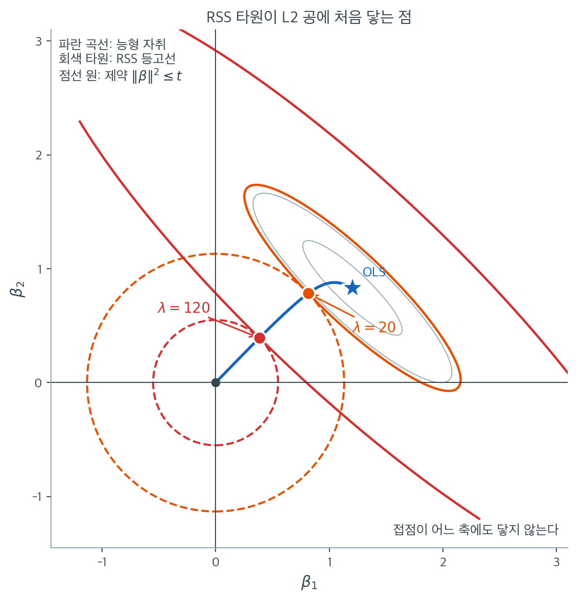

# 기하적 해석 (L2 벌점)

능형회귀의 대수적 정식화는 정확하지만, 왜 계수가 0 쪽으로 고르게 축소되는지, 왜 정확한 0이 나오지 않는지를 곧바로 보여주지는 않는다. 기하적 관점은 두 성질을 시각적으로 명료하게 만든다. 능형 문제를 제약최적화로 보면, 해는 잔차제곱합의 타원형 등고선이 구형 제약영역에 처음 닿는 점이다.

---

## 1. 계수공간에서의 RSS 등고선

시각화를 위해 설명변수가 두 개인 회귀를 생각하자. 잔차제곱합은

$$
\text{RSS}(\boldsymbol{\beta}) = \|\mathbf{y} - \mathbf{X}\boldsymbol{\beta}\|^2
$$

이다. 이는 $\boldsymbol{\beta}$의 볼록 이차함수이며 그 등위집합(RSS가 일정한 등고선)은 OLS 추정값 $\hat{\boldsymbol{\beta}}_{\text{OLS}}$를 중심으로 하는 **타원**이다. 타원의 모양과 방향은 $\mathbf{X}^\top\mathbf{X}$의 고유구조가 결정한다.

- 타원의 축은 $\mathbf{X}^\top\mathbf{X}$의 고유벡터와 정렬된다.
- 축의 길이는 고윳값의 제곱근에 반비례한다.
- 고윳값 차이가 크면(준선형종속) 타원이 길게 늘어난다.

---

## 2. L2 제약영역

능형회귀의 제약 형태는 $\boldsymbol{\beta}$를 L2 공에 가둔다.

$$
\|\boldsymbol{\beta}\|_2^2 = \beta_1^2 + \cdots + \beta_p^2 \leq t
$$

2차원에서 이 제약영역은 원점을 중심으로 반지름 $\sqrt{t}$인 **원판**이고, $p$차원에서는 초구다. 핵심 기하적 성질은 다음과 같다.

- 경계 $\|\boldsymbol{\beta}\|_2^2 = t$는 **어디서나 매끄럽다**(꼭짓점, 모서리가 없다).
- 경계는 **강볼록**이다. 모든 경계점이 유일한 지지초평면을 갖는다.
- 제약영역은 모든 좌표축과 모든 회전에 대해 **대칭**이다.

---

## 3. 접점으로서의 능형 해

능형 추정값은 L2 공 안(또는 경계 위)에서 RSS를 최소화하는 점이다. 기하적으로는 중심 $\hat{\boldsymbol{\beta}}_{\text{OLS}}$에서 RSS 타원을 줄여 나가다가 공에 처음 닿는 점이 $\hat{\boldsymbol{\beta}}_{\text{ridge}}$다.

이 접점에서 KKT 조건은

$$
\nabla \text{RSS}(\hat{\boldsymbol{\beta}}_{\text{ridge}}) = -\lambda\,\nabla\|\boldsymbol{\beta}\|_2^2\big|_{\hat{\boldsymbol{\beta}}_{\text{ridge}}}
$$

를 요구하며, 이는 익숙한 정규방정식으로 정리된다.

$$
-2\mathbf{X}^\top(\mathbf{y} - \mathbf{X}\hat{\boldsymbol{\beta}}_{\text{ridge}}) = -2\lambda\hat{\boldsymbol{\beta}}_{\text{ridge}}
$$

RSS의 기울기(OLS 중심에서 바깥을 향한다)가 제약의 기울기(원점에서 방사상 바깥을 향한다)와 평행해야 한다. 이 평행 조건이 능형 정규방정식을 낳는다.



상관 $0.9$인 설명변수 두 개, $n = 50$인 자료에서 실제로 그린 그림이다. 파란 별이 OLS 해 $(1.204,\ 0.832)$이고, 회색 타원은 그 둘레의 RSS 등고선이다. 등고선이 오른쪽 위에서 왼쪽 아래로 길게 누운 것은 두 설명변수가 상관되어 있기 때문이다. **그 긴 방향이 자료가 결정하지 못한 방향이다.**

예산 $t$를 정하면 점선 원이 하나 그려진다. 주황 원($\sqrt{t} = 1.131$)에서 시작해 보자. OLS 해는 이 원 밖에 있으므로 쓸 수 없고, 원 안에서 RSS를 가장 작게 만드는 점을 찾아야 한다. 그 점이 주황 타원과 주황 원이 만나는 곳, $(0.815,\ 0.784)$다. 이 타원보다 작은 타원은 원과 만나지 못하고, 큰 타원은 원과 두 점에서 만나 최소가 아니다. **딱 한 점에서 스치는 타원**이 정답이라는 것이 접점 조건의 내용이다. 이 $t$에 대응하는 벌점은 $\lambda = 20$이다.

예산을 더 줄이면 어떻게 되는지 빨간 원($\sqrt{t} = 0.550$, $\lambda = 120$)이 보여준다. 접점이 $(0.385,\ 0.392)$로 이동했다. OLS에서 이 점까지 오는 동안 $\beta_1$은 $1.204 \to 0.385$로 68% 줄었는데 $\beta_2$는 $0.832 \to 0.392$로 53% 줄었다. **두 좌표가 같은 비율로 줄지 않는다.** 파란 능형 자취가 직선이 아니라 곡선인 이유가 이것이다. 원점에서 OLS로 곧장 이어지는 직선을 상상해 보면, 실제 자취가 그 직선에서 눈에 띄게 벗어나 있음을 알 수 있다. 축소는 좌표별로 일어나는 것이 아니라 **고유방향별로** 일어난다.

마지막으로 접점의 위치를 보라. 두 접점 모두 어느 좌표축 위에도 있지 않다. 접점이 $\beta_2 = 0$인 축 위에 놓이려면 매끄러운 원의 경계에서 RSS 기울기가 정확히 $\beta_1$축을 향해야 하는데, 이는 자료에 대한 하나의 등식 조건이고 연속분포에서 확률 0인 사건이다. 예산을 아무리 줄여도 접점은 원 위를 미끄러져 원점으로 다가갈 뿐 축에 내려앉지 않는다. 이 그림의 원을 마름모로 바꾸면 이야기가 완전히 달라지는데, 그것이 [라쏘의 기하](../lasso/geometry.md)다.

---

<div class="aibox" markdown>

**AI로 보는 통계학 1.** 예산을 지키며 걸으려면 접선 방향뿐이다

§2 의 제약영역 $\lVert\boldsymbol\beta\rVert_2 \le t$ 와 §3 의 접점은 **정지한 그림**이다.
그런데 실제로 계수를 찾는 일은 움직이는 일이고, 기계학습에서 이 기하가 그대로 쓰이는
자리가 있다 — **예산을 쓴 만큼 지키면서** 한 걸음씩 옮기는 자리다.

경계 위에 있다는 것은 $\lVert\boldsymbol\beta\rVert^2 = t^2$ 이라는 뜻이다. 걸음
$\mathrm d\boldsymbol\beta$ 를 디뎠을 때 이 값이 얼마나 바뀌는지를 $1$ 차까지 적으면

$$
\mathrm d\!\left(\lVert\boldsymbol\beta\rVert^2\right)
= 2\,\boldsymbol\beta^\top \mathrm d\boldsymbol\beta
$$

이다. **예산을 바꾸는 것은 오직 $\boldsymbol\beta$ 와 나란한 성분뿐**이라는 말이다.
그러니 방향 $\mathbf g$ 를 그대로 쓰지 말고, 거기서 지름 방향을 덜어 낸

$$
\mathbf g_{\perp} = \mathbf g - \left(\mathbf g^\top \boldsymbol\beta\right)\boldsymbol\beta
\qquad (\lVert\boldsymbol\beta\rVert = 1 \text{ 로 두었다})
$$

만으로 옮기면 $1$ 차항이 $0$ 이 되어 예산의 어긋남이 걸음 크기의 **$2$ 차부터** 시작한다.
정말 그런지 재어 본다.

```python
import numpy as np

beta = np.array([0.6, 0.8])          # 예산 경계 위의 한 점, |beta| = 1
g = np.array([0.9, -0.4])            # 이번 걸음의 방향


def norm_after(h, project):
    """beta 를 g 방향으로 h 만큼 옮긴 뒤의 |beta| — project 면 접선 성분만 쓴다."""
    step = g - (g @ beta) * beta if project else g
    return np.linalg.norm(beta + h * step)


print("    h        날것 |beta|-1     접선만 |beta|-1")
for h in (0.2, 0.1, 0.05, 0.025):
    print(f"{h:7.4f}     {norm_after(h, False) - 1:+.8f}      {norm_after(h, True) - 1:+.8f}")
```

```text
    h        날것 |beta|-1     접선만 |beta|-1
 0.2000     +0.06150836      +0.01826519
 0.1000     +0.02649890      +0.00459743
 0.0500     +0.01213882      +0.00115134
 0.0250     +0.00578638      +0.00028796
```

걸음을 반으로 줄일 때마다 **날것**의 어긋남은 대략 반이 되는데
($0.0265 \to 0.0121 \to 0.0058$), **접선 성분만** 쓴 쪽은 정확히 $\tfrac14$ 씩 준다
($0.00460 \to 0.00115 \to 0.000288$). $1$ 차항이 사라져 $2$ 차항만 남았다는 뜻이다.

이것이 §7 의 **예산 해석**을 움직이는 그림으로 바꾼 것이다. 능형회귀를 「$\lambda$ 를
주고 푼다」가 아니라 「$t$ 를 정해 두고 그 공 위에서 RSS 를 줄인다」로 읽으면, 허용된
걸음이 접평면 안쪽뿐이고 그래서 §3 의 접점에서 멈추게 된다.

다만 표는 **한 걸음**을 잰 것이다. $2$ 차 어긋남도 걸음마다 쌓이므로 수천 걸음을 가면
결국 경계를 벗어난다 — 그래서 실제로는 접선 걸음을 디딘 뒤 매번 크기로 나누어 $t$ 로
다시 맞춘다.

</div>

## 4. 능형회귀가 정확한 0을 만들지 않는 이유

구의 경계에는 꼭짓점이 없다. 2차원에서 $(t, 0)$ 같은 꼭짓점은 경계의 방향이 급격히 바뀌어 접선이 유일하지 않은 점인데, 구에는 그런 점이 없다.

RSS 등고선이 좌표축 위(가령 $(\beta_1, 0)$)에서 구에 접하려면 그 점에서 RSS의 기울기가 정확히 $\beta_1$축을 향해야 한다. 이는 $\mathbf{X}^\top\mathbf{X}$의 비대각 구조가 측도 0인 조건을 만족해야 함을 뜻한다. 실제로는 접점이 양의 초팔분공간의 면 내부에 놓이므로 모든 좌표가 0이 아니다.

!!! note "L1 기하와의 대조"
    L1 제약집합(마름모 또는 교차다면체)은 좌표축 위에 정확히 꼭짓점을 갖는다. RSS 등고선이 매끄러운 타원이므로 마름모꼴 영역과의 첫 접촉은 일반적으로 꼭짓점에서 일어나고 정확한 0이 만들어진다. 이 기하적 차이가 라쏘는 희소성을 얻고 능형은 얻지 못하는 근본 이유다.

---

## 5. 원점을 향한 축소

기하적 그림은 능형이 **왜** 다른 점이 아니라 원점(영벡터)을 향해 축소하는지도 설명한다. 제약 $\|\boldsymbol{\beta}\|_2^2 \leq t$가 원점을 중심으로 하기 때문이다. 능형 해는 원점에서 $\hat{\boldsymbol{\beta}}_{\text{OLS}}$로 가는 방향 위에서 공의 중심 쪽으로 당겨진 위치에 놓인다.

더 정확히는 SVD 매개화에서 능형이 각 주성분에 축소인자 $d_j^2/(d_j^2 + \lambda)$를 적용한다. 각 인자가 1보다 작으므로 능형 해는 모든 방향에서 $\mathbf{0}$ 쪽으로 이동한 OLS의 축소판이다.

---

## 6. 고윳값 격차의 효과

$\mathbf{X}^\top\mathbf{X}$가 큰 고윳값 하나와 작은 고윳값 하나를 가지면(상관된 설명변수에서 흔하다) RSS 등고선이 심하게 늘어난다. OLS 추정값은 늘어난 방향으로 원점에서 멀리 놓일 수 있다.

능형 제약구는 이 늘어남을 잘라낸다. 접점은 고윳값이 작은 긴 축 방향으로는 원점에 훨씬 가까워지고, 고윳값이 큰 짧은 축 방향으로는 조금만 가까워진다. 이 차등 축소가 불량조건 문제를 안정시키는 능형회귀의 기하적 발현이다.

| $\mathbf{X}^\top\mathbf{X}$의 고윳값 | RSS 등고선 축 | 축소인자 | 효과 |
|---|---|---|---|
| 큼 ($d_j^2 \gg \lambda$) | 짧은 축 | $\approx 1$ | 거의 축소하지 않음 |
| 작음 ($d_j^2 \ll \lambda$) | 긴 축 | $\approx 0$ | 강하게 축소 |

---

## 7. 예산 해석

제약 형태의 모수 $t$는 계수 크기 제곱합의 **예산** 역할을 한다. 예산이 작으면 모형은 계수의 질량을 신중히 배분해야 하며, 잡음이 지배하는 방향보다 자료가 강한 신호를 주는 방향을 선호하게 된다.

$t$가 커지면($\lambda$가 작아지면) 제약이 느슨해지고 가능영역이 커져 능형 해가 OLS에 접근한다. $t$가 작아지면($\lambda$가 커지면) 가능영역이 줄어 능형 해가 원점에 접근한다.

---

## 연습문제

<div class="drillbox" markdown>

**연습문제 1.** <span class="diff med" title="중간"></span>
고윳값 격차가 큰 자료에서 축소인자가 실제로 얼마나 차등적인지 계산하라. $\rho = 0.95$인 등상관 설명변수 4개, $n = 50$에서 $\lambda = 1, 10, 100$의 축소인자와 유효자유도를 구하라.

</div>

??? success "풀이"
    ```python
    import numpy as np
    rng = np.random.default_rng(21)
    n, p, rho = 50, 4, 0.95
    S = rho*np.ones((p, p)) + (1-rho)*np.eye(p)
    X = rng.normal(size=(n, p)) @ np.linalg.cholesky(S).T
    X -= X.mean(0)
    d2 = np.linalg.eigvalsh(X.T @ X)[::-1]
    print(np.round(d2, 3))          # [186.149, 2.006, 1.741, 1.518]
    ```

    출력:

    ```
    [186.149   2.006   1.741   1.518]
    ```

    $\mathbf{X}^\top\mathbf{X}$의 고윳값은 $186.1,\ 2.01,\ 1.74,\ 1.52$다. **첫 성분이 나머지의 100배 가까이 크다.** 등상관 구조에서 첫 고유벡터는 "모든 변수의 평균" 방향이고 나머지는 "변수들 간의 차이" 방향이다.

    | $\lambda$ | $d_1^2$ 축소인자 | $d_2^2$ | $d_3^2$ | $d_4^2$ | $\text{df}(\lambda)$ |
    |---:|---:|---:|---:|---:|---:|
    | 0 | 1.000 | 1.000 | 1.000 | 1.000 | 4.000 |
    | 1 | **0.995** | 0.667 | 0.635 | 0.603 | 2.900 |
    | 10 | **0.949** | 0.167 | 0.148 | 0.132 | 1.396 |
    | 100 | 0.651 | 0.020 | 0.017 | 0.015 | 0.702 |

    **$\lambda = 10$에서 첫 성분은 95% 남지만 나머지 세 성분은 85% 이상 잘려 나간다.** 이것이 차등 축소의 실체다.

    유효자유도가 $4 \to 1.40$으로 떨어지는데, 실질적으로 "평균 방향 하나만 추정하고 차이 방향은 거의 버렸다"는 뜻이다. 다중공선성 절에서 본 "합은 잘 결정되지만 차이는 결정되지 않는다"는 관찰과 정확히 대응한다.

    **능형회귀는 자료가 말해주지 않는 방향을 스스로 포기한다.** $\lambda$를 고른다는 것은 몇 개의 방향을 살릴지 정하는 일이다.

<div class="drillbox" markdown>

**연습문제 2.** <span class="diff med" title="중간"></span>
"구에는 꼭짓점이 없으므로 능형은 0을 만들지 않는다"는 논증을 2차원에서 구체화하라. 접점이 좌표축 위에 놓이려면 어떤 조건이 필요한가?

</div>

??? success "풀이"
    2차원에서 접점이 $(\beta_1, 0)$, $\beta_1 > 0$이라 하자. KKT 조건은

    $$
    \mathbf{X}^\top(\mathbf{y} - \mathbf{X}\hat{\boldsymbol{\beta}}) = \lambda\hat{\boldsymbol{\beta}}
    $$

    이다. 둘째 성분을 보면 $\hat\beta_2 = 0$이므로 우변의 둘째 성분이 0이고, 따라서

    $$
    \mathbf{x}_2^\top(\mathbf{y} - \beta_1\mathbf{x}_1) = 0
    \quad\Longleftrightarrow\quad
    \beta_1 = \frac{\mathbf{x}_2^\top\mathbf{y}}{\mathbf{x}_2^\top\mathbf{x}_1}
    $$

    가 성립해야 한다. 동시에 첫째 성분의 조건도 만족해야 하므로, $\beta_1$이 **서로 다른 두 식을 동시에 만족**해야 한다.

    두 식이 일치하는 것은 자료에 대한 하나의 등식 제약이며, 연속분포에서 이는 **측도 0인 사건**이다. 따라서 확률 1로 접점은 좌표축 위에 놓이지 않는다. $\square$

    **라쏘에서는 왜 다른가.** 마름모의 꼭짓점에서는 접선이 유일하지 않고 **법선의 원뿔**이 존재한다. 기울기가 그 원뿔 안에만 들어오면 되므로, 조건이 등식이 아니라 **부등식**이 된다. 부등식으로 정의된 집합은 양의 측도를 가지므로 꼭짓점에서의 접촉이 실제로 자주 일어난다.

    이것이 두 방법을 가르는 수학적 핵심이다. **매끄러운 경계는 등식 조건을, 뾰족한 경계는 부등식 조건을 낳는다.**

<div class="drillbox" markdown>

**연습문제 3.** <span class="diff med" title="중간"></span>
§3 의 그림에서 OLS 해는 $(1.204,\ 0.832)$, $\lambda = 20$의 접점은 $(0.815,\ 0.784)$, $\lambda = 120$의 접점은 $(0.385,\ 0.392)$다. (가) 세 점에서 $\hat\beta_2/\hat\beta_1$을 계산해 능형 자취가 원점과 OLS 를 잇는 직선이 **아님**을 수로 보여라. (나) 일반적으로 능형 자취가 그 직선 위에 놓일 필요충분조건이 "$\hat{\boldsymbol{\beta}}_{\text{OLS}}$가 $\mathbf{X}^\top\mathbf{X}$의 고유벡터"임을 보여라. (다) 그 조건이 성립할 때 축소인자를 적어라.

</div>

??? success "풀이"
    **(가)** 자취가 원점과 OLS 를 잇는 직선이라면 $\hat\beta_2/\hat\beta_1$이 $\lambda$에 무관하게 일정해야 한다.

    | $\lambda$ | $\hat\beta_1$ | $\hat\beta_2$ | $\hat\beta_2/\hat\beta_1$ | $\beta_1$ 축소율 | $\beta_2$ 축소율 |
    |---:|---:|---:|---:|---:|---:|
    | 0 | 1.204 | 0.832 | 0.6910 | — | — |
    | 20 | 0.815 | 0.784 | 0.9620 | 32.3% | 5.8% |
    | 120 | 0.385 | 0.392 | 1.0182 | 68.0% | 52.9% |

    비가 $0.6910 \to 0.9620 \to 1.0182$로 **커지고 1 을 넘어간다**. 처음에는 $\hat\beta_1$이 더 컸는데 $\lambda = 120$에서는 $\hat\beta_2$가 더 크다. 자취는 직선이 아니다. $\lambda = 20$에서 $\beta_1$은 32.3% 줄었는데 $\beta_2$는 5.8%만 줄었다는 것도 같은 사실의 다른 표현이다.

    **(나)** $\mathbf{A} = \mathbf{X}^\top\mathbf{X}$가 양정의일 때

    $$
    \hat{\boldsymbol{\beta}}(\lambda) = (\mathbf{A} + \lambda\mathbf{I})^{-1}\mathbf{X}^\top\mathbf{y} = (\mathbf{A} + \lambda\mathbf{I})^{-1}\mathbf{A}\,\hat{\boldsymbol{\beta}}_{\text{OLS}}
    $$

    이다. 어떤 $\lambda > 0$에서 $\hat{\boldsymbol{\beta}}(\lambda) = c\,\hat{\boldsymbol{\beta}}_{\text{OLS}}$라 하자. 양변에 $\mathbf{A} + \lambda\mathbf{I}$를 곱하면

    $$
    \mathbf{A}\hat{\boldsymbol{\beta}}_{\text{OLS}} = c(\mathbf{A} + \lambda\mathbf{I})\hat{\boldsymbol{\beta}}_{\text{OLS}}
    \quad\Longleftrightarrow\quad
    (1 - c)\,\mathbf{A}\hat{\boldsymbol{\beta}}_{\text{OLS}} = c\lambda\,\hat{\boldsymbol{\beta}}_{\text{OLS}}
    $$

    이다. $c = 0$이면 $\mathbf{A}\hat{\boldsymbol{\beta}}_{\text{OLS}} = \mathbf{0}$이고 $\mathbf{A}$가 가역이므로 $\hat{\boldsymbol{\beta}}_{\text{OLS}} = \mathbf{0}$이어서 제외된다. $c = 1$이면 우변이 $\lambda\hat{\boldsymbol{\beta}}_{\text{OLS}} = \mathbf{0}$을 요구해 역시 모순이다. 따라서 $1 - c \neq 0$이고

    $$
    \mathbf{A}\hat{\boldsymbol{\beta}}_{\text{OLS}} = \frac{c\lambda}{1-c}\,\hat{\boldsymbol{\beta}}_{\text{OLS}}
    $$

    즉 $\hat{\boldsymbol{\beta}}_{\text{OLS}}$는 $\mathbf{A}$의 고유벡터다. 거꾸로 $\mathbf{A}\hat{\boldsymbol{\beta}}_{\text{OLS}} = d\,\hat{\boldsymbol{\beta}}_{\text{OLS}}$이면 $(\mathbf{A}+\lambda\mathbf{I})\hat{\boldsymbol{\beta}}_{\text{OLS}} = (d+\lambda)\hat{\boldsymbol{\beta}}_{\text{OLS}}$이므로

    $$
    \hat{\boldsymbol{\beta}}(\lambda) = \frac{d}{d+\lambda}\,\hat{\boldsymbol{\beta}}_{\text{OLS}}
    $$

    가 되어 자취는 원점을 향한 직선 선분이다. $\square$

    **(다)** 축소인자는 모든 좌표에 공통인 $d/(d+\lambda)$다. 특히 $\mathbf{X}^\top\mathbf{X} = \mathbf{I}$인 직교설계에서는 어떤 $\hat{\boldsymbol{\beta}}_{\text{OLS}}$든 고유벡터이므로 축소인자가 $1/(1+\lambda)$인 **비례 축소**가 된다.

    직교설계에서 교과서가 말하는 "$\hat{\boldsymbol{\beta}}^{\text{OLS}}/(1+\lambda)$"는 바로 이 특수한 경우다. **상관이 있으면 그 공식이 깨지고 자취가 휜다.** 그림의 자취가 곡선인 것은 $\rho = 0.9$ 때문이고, 고유방향별 축소를 좌표별 축소로 읽으면 안 된다는 경고다.

<div class="drillbox" markdown>

**연습문제 4.** <span class="diff med" title="중간"></span>
제약꼴의 예산 $t$와 벌점 $\lambda$의 대응을 따진다. (가) §3 그림의 두 접점에서 $\lVert\hat{\boldsymbol{\beta}}\rVert$를 계산해 캡션의 $\sqrt{t} = 1.131,\ 0.550$과 맞는지 확인하라. (나) $t(\lambda) = \lVert\hat{\boldsymbol{\beta}}_{\text{ridge}}(\lambda)\rVert^2$이 $\lambda$에 대해 **강하게 감소**함을 SVD 로 보여라. (다) 따라서 $\lambda \leftrightarrow t$ 대응이 일대일인 $t$의 범위를 적고, $t$를 그보다 크게 잡으면 무슨 일이 일어나는지 설명하라. 그림의 자료에서 그 경계값을 구하라.

</div>

??? success "풀이"
    **(가)** $\sqrt{0.815^2 + 0.784^2} = \sqrt{0.664225 + 0.614656} = \sqrt{1.278881} = 1.13088$이고 $\sqrt{0.385^2 + 0.392^2} = \sqrt{0.148225 + 0.153664} = \sqrt{0.301889} = 0.54944$다. 캡션의 $1.131$과 $0.550$에 맞는다. **접점은 반드시 공의 경계 위에 있다**는 것을 확인한 셈이다.

    **(나)** $\mathbf{X} = \mathbf{U}\mathbf{D}\mathbf{V}^\top$라 하면

    $$
    \hat{\boldsymbol{\beta}}(\lambda) = \sum_j \frac{d_j\,(\mathbf{u}_j^\top\mathbf{y})}{d_j^2 + \lambda}\,\mathbf{v}_j,
    \qquad
    t(\lambda) = \sum_j \frac{d_j^2\,(\mathbf{u}_j^\top\mathbf{y})^2}{(d_j^2 + \lambda)^2}
    $$

    이다($\mathbf{v}_j$가 정규직교이므로 교차항이 없다). 따라서

    $$
    t'(\lambda) = -2\sum_j \frac{d_j^2\,(\mathbf{u}_j^\top\mathbf{y})^2}{(d_j^2 + \lambda)^3} < 0
    $$

    이고, $\hat{\boldsymbol{\beta}}_{\text{OLS}} \neq \mathbf{0}$이면 적어도 하나의 $\mathbf{u}_j^\top\mathbf{y}$가 0 이 아니므로 부등호는 엄격하다. $\square$

    **(다)** $t$는 $\lambda = 0$에서 $t(0) = \lVert\hat{\boldsymbol{\beta}}_{\text{OLS}}\rVert^2$에서 출발해 $\lambda \to \infty$에서 0 으로 연속 감소한다. 그러므로

    $$
    \lambda \in [0, \infty)
    \quad\longleftrightarrow\quad
    t \in \bigl(0,\ \lVert\hat{\boldsymbol{\beta}}_{\text{OLS}}\rVert^2\bigr]
    $$

    이 일대일 대응이다. $t \geq \lVert\hat{\boldsymbol{\beta}}_{\text{OLS}}\rVert^2$이면 OLS 점이 이미 공 안에 있으므로 제약이 **활성이 아니고**, 상보여유조건 $\lambda(\lVert\boldsymbol{\beta}\rVert^2 - t) = 0$에서 $\lambda = 0$, 해는 OLS 그대로다. 예산을 더 늘려도 아무 일도 일어나지 않는다.

    그림의 자료에서 경계값은

    $$
    \lVert\hat{\boldsymbol{\beta}}_{\text{OLS}}\rVert^2 = 1.204^2 + 0.832^2 = 1.449616 + 0.692224 = 2.14184,
    \qquad \lVert\hat{\boldsymbol{\beta}}_{\text{OLS}}\rVert = 1.4635
    $$

    이다. 점선 원의 반지름을 $1.4635$보다 크게 그리면 그 원은 OLS 별을 품어 버리고, 접점이 아니라 타원의 중심이 답이 된다.

    **벌점꼴은 $\lambda$를 $0$에서 $\infty$까지 자유롭게 쓸 수 있지만 제약꼴은 $t$를 무한히 키워도 OLS 에서 멈춘다.** 두 꼴이 같은 해의 집합을 그리는 것은 이 유한한 구간 안에서다.

<div class="drillbox" markdown>

**연습문제 5.** <span class="diff hard" title="어려움"></span>
설명변수를 표준화해 $\mathbf{X}^\top\mathbf{X} = \begin{pmatrix} 1 & 0.9 \\ 0.9 & 1\end{pmatrix}$이고 OLS 해가 $\hat{\boldsymbol{\beta}}_{\text{OLS}} = (1,\ 0)^\top$인 자료를 생각하자. (가) $\hat{\boldsymbol{\beta}}_{\text{ridge}}(\lambda)$를 닫힌 꼴로 구하라. (나) $\hat\beta_2(\lambda)$가 $\lambda$에 대해 단조가 **아님**을 보이고, 최대가 되는 $\lambda$와 그때의 $\hat{\boldsymbol{\beta}}$를 정확히 구하라. (다) 그래도 $\lVert\hat{\boldsymbol{\beta}}(\lambda)\rVert$는 감소함을 (나) 의 $\lambda$에서 확인하라. (라) §5 의 "모든 방향에서 $\mathbf{0}$ 쪽으로 이동한 OLS 의 축소판"이라는 서술과 모순이 아닌 까닭을 설명하라.

</div>

??? success "풀이"
    **(가)** $\mathbf{X}^\top\mathbf{y} = \mathbf{A}\hat{\boldsymbol{\beta}}_{\text{OLS}} = (1,\ 0.9)^\top$이고

    $$
    \det(\mathbf{A} + \lambda\mathbf{I}) = (1+\lambda)^2 - 0.81 = \lambda^2 + 2\lambda + 0.19 = (\lambda + 0.1)(\lambda + 1.9)
    $$

    이다. $(\mathbf{A}+\lambda\mathbf{I})^{-1} = \dfrac{1}{(\lambda+0.1)(\lambda+1.9)}\begin{pmatrix} 1+\lambda & -0.9 \\ -0.9 & 1+\lambda\end{pmatrix}$를 곱하면

    $$
    \hat\beta_1(\lambda) = \frac{\lambda + 0.19}{(\lambda+0.1)(\lambda+1.9)},
    \qquad
    \hat\beta_2(\lambda) = \frac{0.9\,\lambda}{(\lambda+0.1)(\lambda+1.9)}
    $$

    를 얻는다. $\lambda = 0$에서 $(1,\ 0)$이고 $\lambda \to \infty$에서 $(0,\ 0)$이다.

    **(나)** $\hat\beta_2(0) = 0$인데 $\lambda > 0$이면 $\hat\beta_2(\lambda) > 0$이다. **벌점을 걸었는데 둘째 계수의 절댓값이 커졌다.** 도함수를 보면

    $$
    \hat\beta_2'(\lambda) = \frac{0.9\bigl[(\lambda^2+2\lambda+0.19) - \lambda(2\lambda+2)\bigr]}{\bigl[(\lambda+0.1)(\lambda+1.9)\bigr]^2} = \frac{0.9\,(0.19 - \lambda^2)}{\bigl[(\lambda+0.1)(\lambda+1.9)\bigr]^2}
    $$

    이므로 $\lambda < \sqrt{0.19}$에서 증가, $\lambda > \sqrt{0.19}$에서 감소다. 최대점은 $\lambda^\ast = \sqrt{0.19} = 0.435890$이고, 이때 분모가 $\lambda^{\ast2} + 2\lambda^\ast + 0.19 = 0.38 + 2\sqrt{0.19} = 2(0.19 + \sqrt{0.19})$이므로

    $$
    \hat\beta_1(\lambda^\ast) = \frac{\sqrt{0.19} + 0.19}{2(0.19 + \sqrt{0.19})} = \frac{1}{2},
    \qquad
    \hat\beta_2(\lambda^\ast) = \frac{0.9\sqrt{0.19}}{2(0.19+\sqrt{0.19})} = \frac{0.45\sqrt{0.19}}{0.19+\sqrt{0.19}} = 0.313395
    $$

    다. $\hat\beta_1 = 1/2$가 정확히 나오는 것이 기분 좋다.

    **(다)** $\lVert\hat{\boldsymbol{\beta}}(0)\rVert = 1$이고 $\lVert\hat{\boldsymbol{\beta}}(\lambda^\ast)\rVert = \sqrt{0.25 + 0.313395^2} = \sqrt{0.348216} = 0.590098$이다. 노름은 줄었다. 연습문제 4 (나) 가 보장하는 대로 $\lVert\hat{\boldsymbol{\beta}}(\lambda)\rVert$는 모든 $\lambda$에서 감소한다 — 참고로 $\lambda = 2$에서 $(0.267399,\ 0.219780)$, 노름 $0.346130$이다.

    **(라)** 축소는 **좌표별이 아니라 고유방향별**이다. $\mathbf{A}$의 고유분해는 $d_1^2 = 1.9$, $\mathbf{v}_1 = (1,1)^\top/\sqrt{2}$와 $d_2^2 = 0.1$, $\mathbf{v}_2 = (1,-1)^\top/\sqrt{2}$이고, $\hat{\boldsymbol{\beta}}_{\text{OLS}} = (1,0)^\top$의 좌표는 $\alpha_1 = \alpha_2 = 1/\sqrt{2}$다. 그러므로

    $$
    \hat{\boldsymbol{\beta}}(\lambda) = \frac{1.9}{1.9+\lambda}\cdot\frac{1}{\sqrt2}\,\mathbf{v}_1 + \frac{0.1}{0.1+\lambda}\cdot\frac{1}{\sqrt2}\,\mathbf{v}_2
    $$

    이고, 둘째 좌표만 꺼내면 $\hat\beta_2(\lambda) = \tfrac12\bigl[\tfrac{1.9}{1.9+\lambda} - \tfrac{0.1}{0.1+\lambda}\bigr]$다(전개하면 (가) 와 같다). 두 고유방향의 기여가 $\hat\beta_2$에서 **부호가 반대**이고, 작은 고윳값 쪽 기여가 훨씬 빨리 죽기 때문에 차가 한동안 커진다.

    **고유좌표에서는 모든 성분이 단조 축소되지만, 원래 좌표는 고유좌표의 차이로 쓰이므로 개별 계수는 커질 수 있다.** 능형 자취 그림에서 계수가 한 번 솟았다 꺾이는 모습을 보면 이 상쇄가 일어나고 있다는 뜻이다.

<div class="drillbox" markdown>

**연습문제 6.** <span class="diff hard" title="어려움"></span>
능형 자취가 원점에 **어느 방향으로** 들어오는지 묻는다. (가) $\lambda \to \infty$에서 $\lambda\,\hat{\boldsymbol{\beta}}_{\text{ridge}}(\lambda) \to \mathbf{X}^\top\mathbf{y}$임을 보여라. (나) SVD 좌표에서 $\mathbf{X}^\top\mathbf{y}$의 성분이 $d_j^2\alpha_j$($\alpha_j$는 $\hat{\boldsymbol{\beta}}_{\text{OLS}}$의 SVD 좌표)임을 보이고, 마지막까지 남는 방향이 무엇인지 말하라. (다) 연습문제 5 의 설계에서 그 극한 방향의 기울기를 구해 $\hat{\boldsymbol{\beta}}_{\text{OLS}}$의 기울기와 비교하라.

</div>

??? success "풀이"
    **(가)** $\lambda(\mathbf{A}+\lambda\mathbf{I})^{-1} = \bigl(\tfrac{1}{\lambda}\mathbf{A}+\mathbf{I}\bigr)^{-1} \to \mathbf{I}$이므로

    $$
    \lambda\,\hat{\boldsymbol{\beta}}(\lambda) = \lambda(\mathbf{A}+\lambda\mathbf{I})^{-1}\mathbf{X}^\top\mathbf{y} \longrightarrow \mathbf{X}^\top\mathbf{y}
    $$

    이다. 따라서 $\hat{\boldsymbol{\beta}}(\lambda) \approx \mathbf{X}^\top\mathbf{y}/\lambda$이고, 자취는 $\mathbf{X}^\top\mathbf{y}$ 방향을 따라 원점으로 들어온다. $\square$

    **(나)** $\mathbf{X}^\top\mathbf{y} = \sum_j d_j(\mathbf{u}_j^\top\mathbf{y})\mathbf{v}_j$이고 $\alpha_j = \mathbf{v}_j^\top\hat{\boldsymbol{\beta}}_{\text{OLS}} = (\mathbf{u}_j^\top\mathbf{y})/d_j$이므로 $d_j(\mathbf{u}_j^\top\mathbf{y}) = d_j^2\alpha_j$다. 즉 극한 방향은 OLS 좌표를 $d_j^2$으로 **가중한** 벡터다. $d_1^2$이 가장 크므로($\alpha_1 \neq 0$인 한) 이 가중은 **첫 주성분 방향을 끝까지 살려 둔다**. 작은 고윳값 방향은 $d_j^2/d_1^2$ 배로 눌려 먼저 사라진다.

    **(다)** $\mathbf{X}^\top\mathbf{y} = (1,\ 0.9)^\top$이므로 극한 방향의 기울기는 $0.9$다. 반면 $\hat{\boldsymbol{\beta}}_{\text{OLS}} = (1,0)^\top$의 기울기는 $0$이다. 실제로 연습문제 5 의 닫힌 꼴에서

    $$
    \frac{\hat\beta_2(\lambda)}{\hat\beta_1(\lambda)} = \frac{0.9\lambda}{\lambda + 0.19} \;\longrightarrow\; 0.9
    $$

    이고($\lambda = 20$에서 이미 $0.8915$다), 고유방향 가중으로 보면 $1.9\mathbf{v}_1 + 0.1\mathbf{v}_2 \propto (2.0,\ 1.8) \propto (1,\ 0.9)$로 같은 답이다.

    **자취의 출발 방향($\hat{\boldsymbol{\beta}}_{\text{OLS}}$)과 도착 방향($\mathbf{X}^\top\mathbf{y}$)은 다르다.** 둘이 같아지는 것은 $\hat{\boldsymbol{\beta}}_{\text{OLS}}$가 $\mathbf{X}^\top\mathbf{X}$의 고유벡터일 때뿐이고(연습문제 3), 그때만 §5 의 "원점에서 OLS 로 가는 방향 위에" 라는 말이 글자 그대로 옳다. 일반적으로는 "고유방향별 축소"가 정확한 서술이다.

<div class="drillbox" markdown>

**연습문제 7.** <span class="diff hard" title="어려움"></span>
§3 은 능형 해를 두 가지로 설명한다 — "같은 반지름의 공 위에서 RSS 를 최소화하는 점"이고 "$-\nabla\text{RSS}$가 $\boldsymbol{\beta}$와 평행한 점"이다. 두 서술이 같은 점을 가리키는지 수로 확인하라. 상관 $0.9$, $n = 50$인 자료를 만들어 $\lambda = 20$의 능형 해를 닫힌 꼴로 구하고, (가) 그 해의 노름을 반지름으로 하는 원 위에서 RSS 의 최솟값과 최소점을 격자탐색으로 찾아 비교하라, (나) $-\nabla\text{RSS}$와 $\hat{\boldsymbol{\beta}}_{\text{ridge}}$의 코사인을 구하라, (다) OLS 해가 그 원 밖에 있는지 확인하라.

</div>

??? success "풀이"
    ```python
    import numpy as np

    rng = np.random.default_rng(18)
    n, rho, lam = 50, 0.9, 20.0
    Z = rng.normal(size=(n, 2))
    X = np.column_stack([Z[:, 0], rho*Z[:, 0] + np.sqrt(1 - rho**2)*Z[:, 1]])
    X -= X.mean(0)
    y = X @ np.array([1.0, 0.8]) + rng.normal(size=n)
    y -= y.mean()

    A, Xty = X.T @ X, X.T @ y
    b_ols = np.linalg.solve(A, Xty)
    b_r = np.linalg.solve(A + lam*np.eye(2), Xty)
    r = np.linalg.norm(b_r)
    print(f"OLS      = ({b_ols[0]:.4f}, {b_ols[1]:.4f})  norm {np.linalg.norm(b_ols):.4f}")
    print(f"ridge 20 = ({b_r[0]:.4f}, {b_r[1]:.4f})  norm {r:.4f}")

    g = -2*X.T @ (y - X @ b_r)                      # RSS 의 기울기
    cos = float(-g @ b_r/(np.linalg.norm(g)*r))
    print(f"cos(-gradRSS, b_ridge) = {cos:.6f}")

    th = np.linspace(0.0, 2*np.pi, 360001)          # 반지름 r 인 원 위 격자
    C = np.column_stack([r*np.cos(th), r*np.sin(th)])
    rss = ((y[:, None] - X @ C.T)**2).sum(0)
    k = int(rss.argmin())
    print(f"원 위 최소 RSS = {rss[k]:.4f} at ({C[k,0]:.4f}, {C[k,1]:.4f})")
    print(f"b_ridge 의 RSS = {((y - X @ b_r)**2).sum():.4f}")
    ```

    출력:

    ```text
    OLS      = (1.4193, 0.3136)  norm 1.4536
    ridge 20 = (0.7839, 0.5928)  norm 0.9828
    cos(-gradRSS, b_ridge) = 1.000000
    원 위 최소 RSS = 48.1370 at (0.7839, 0.5928)
    b_ridge 의 RSS = 48.1370
    ```

    **(가)** 반지름 $0.9828$인 원 위 36 만 개 점 가운데 RSS 를 최소로 만드는 점은 $(0.7839,\ 0.5928)$로 닫힌 꼴의 능형 해와 소수 넷째 자리까지 같고, RSS 값도 $48.1370$으로 같다. 제약꼴과 벌점꼴이 같은 점을 준다는 것을 격자탐색으로 확인했다.

    **(나)** 코사인이 $1.000000$이다. 접점에서 $-\nabla\text{RSS}$는 원점에서 방사상으로 뻗은 $\hat{\boldsymbol{\beta}}$ 방향과 정확히 같은 쪽을 향한다. §3 의 평행 조건 $-2\mathbf{X}^\top(\mathbf{y}-\mathbf{X}\hat{\boldsymbol{\beta}}) = -2\lambda\hat{\boldsymbol{\beta}}$가 그대로 보이는 것이다. 코사인이 $-1$이 아니라 $+1$인 것이 $\lambda > 0$에 대응한다.

    **(다)** $\lVert\hat{\boldsymbol{\beta}}_{\text{OLS}}\rVert = 1.4536 > 0.9828$이므로 OLS 는 원 밖에 있고, 그래서 제약이 활성이다(연습문제 4 (다) 와 짝이다).

    OLS 는 $(1.4193,\ 0.3136)$인데 능형 해는 $(0.7839,\ 0.5928)$이다. $\hat\beta_1$은 45% 가까이 깎였는데 $\hat\beta_2$는 오히려 **커졌다** — 연습문제 5 에서 본 비단조성이 난수 자료에서도 바로 나타난다.

<div class="drillbox" markdown>

**연습문제 8.** <span class="diff hard" title="어려움"></span>
직교설계 $\mathbf{X}^\top\mathbf{X} = \mathbf{I}_p$에서 $\mathbf{y} = \mathbf{X}\boldsymbol{\beta} + \boldsymbol{\varepsilon}$, $\boldsymbol{\varepsilon} \sim N(\mathbf{0}, \sigma^2\mathbf{I})$라 하자. (가) $\hat{\boldsymbol{\beta}}_{\text{ridge}}(\lambda) = \hat{\boldsymbol{\beta}}_{\text{OLS}}/(1+\lambda)$를 보여라. (나) $\text{MSE}(\lambda) = E\lVert\hat{\boldsymbol{\beta}}(\lambda) - \boldsymbol{\beta}\rVert^2$을 편향–분산 분해로 적어라. (다) $\text{MSE}'(0) < 0$임을 보여 **OLS 를 이기는 $\lambda$가 반드시 존재함**을 증명하고, 최적 $\lambda^\ast$와 최솟값을 구하라. (라) $p = 3$, $\sigma = 1$, $\boldsymbol{\beta} = (1,\ 0.5,\ -0.5)^\top$에서 수를 넣어라.

</div>

??? success "풀이"
    **(가)** $\mathbf{X}^\top\mathbf{X} = \mathbf{I}$이므로 $(\mathbf{I} + \lambda\mathbf{I})^{-1}\mathbf{X}^\top\mathbf{y} = \dfrac{1}{1+\lambda}\mathbf{X}^\top\mathbf{y} = \dfrac{\hat{\boldsymbol{\beta}}_{\text{OLS}}}{1+\lambda}$다. 모든 좌표가 같은 인자로 줄어드는 비례 축소이고, 어떤 $\lambda < \infty$에서도 정확한 0 이 되지 않는다.

    **(나)** $\hat{\boldsymbol{\beta}}_{\text{OLS}} \sim N(\boldsymbol{\beta}, \sigma^2\mathbf{I}_p)$이므로

    $$
    E\hat{\boldsymbol{\beta}}(\lambda) - \boldsymbol{\beta} = \frac{\boldsymbol{\beta}}{1+\lambda} - \boldsymbol{\beta} = -\frac{\lambda}{1+\lambda}\boldsymbol{\beta},
    \qquad
    \operatorname{tr}\operatorname{Var}\hat{\boldsymbol{\beta}}(\lambda) = \frac{p\sigma^2}{(1+\lambda)^2}
    $$

    이고 6.3절 [최대사후확률 추정](../../ch06/bayesian/map_estimation.md) 정리 1 의 분해로

    $$
    \text{MSE}(\lambda) = \frac{\lambda^2\lVert\boldsymbol{\beta}\rVert^2 + p\sigma^2}{(1+\lambda)^2}
    $$

    이다. 분자의 첫 항이 **사들인 편향**, 둘째 항이 **팔아 치운 분산**이다.

    **(다)** $B = \lVert\boldsymbol{\beta}\rVert^2$라 두고 미분하면

    $$
    \text{MSE}'(\lambda) = \frac{2\lambda B(1+\lambda) - 2(\lambda^2 B + p\sigma^2)}{(1+\lambda)^3} = \frac{2(\lambda B - p\sigma^2)}{(1+\lambda)^3}
    $$

    이다. 따라서 $\text{MSE}'(0) = -2p\sigma^2 < 0$이다. $\sigma^2 > 0$이면 **$\lambda = 0$에서 기울기가 음수**이므로 $\lambda$를 조금 키우면 MSE 가 반드시 줄어든다. 유일한 영점이 최소점이고

    $$
    \lambda^\ast = \frac{p\sigma^2}{B},
    \qquad
    \text{MSE}(\lambda^\ast) = \frac{p\sigma^2 B}{B + p\sigma^2}
    $$

    다($\text{MSE}(0) = p\sigma^2$과 비교하면 인자 $B/(B+p\sigma^2) < 1$만큼 줄었다). $\square$

    **(라)** $B = 1 + 0.25 + 0.25 = 1.5$, $p\sigma^2 = 3$이므로

    $$
    \lambda^\ast = \frac{3}{1.5} = 2,
    \qquad
    \text{MSE}(2) = \frac{3 \cdot 1.5}{4.5} = 1.0
    \quad\text{대}\quad
    \text{MSE}(0) = 3.0
    $$

    으로 **오차가 3 분의 1 로 줄어든다**.

    기하적으로 읽으면 이렇다. $E\lVert\hat{\boldsymbol{\beta}}_{\text{OLS}}\rVert^2 = B + p\sigma^2 = 4.5$인데 참값의 길이는 $B = 1.5$다. OLS 추정값은 평균적으로 참값보다 $\sqrt{4.5/1.5} = 1.73$배 **길다**. 잡음이 길이를 부풀리므로 공으로 가두어 되돌리는 것이 이득이고, $\lambda^\ast$가 잡음 $p\sigma^2$에 비례하고 신호 $B$에 반비례하는 것도 같은 말이다.

<div class="drillbox" markdown>

**연습문제 9.** <span class="diff hard" title="어려움"></span>
연습문제 8 의 식을 모의실험으로 확인하라. $n = 20$, $p = 3$에서 열이 정규직교인 $\mathbf{X}$를 만들고($\mathbf{X}^\top\mathbf{X} = \mathbf{I}_3$) $\boldsymbol{\beta} = (1,\ 0.5,\ -0.5)^\top$, $\sigma = 1$로 5 만 번 반복해 $\lambda = 0, 1, 2, 4, 8$에서 $E\lVert\hat{\boldsymbol{\beta}}(\lambda) - \boldsymbol{\beta}\rVert^2$을 재고 이론값과 비교하라.

</div>

??? success "풀이"
    ```python
    import numpy as np

    rng = np.random.default_rng(2024)
    n, p, sigma = 20, 3, 1.0
    Q = np.linalg.qr(rng.normal(size=(n, p)))[0]       # Q^T Q = I_3
    beta = np.array([1.0, 0.5, -0.5])
    B2 = float(beta @ beta)
    print(f"||beta||^2 = {B2:.4f},  lambda* = {p*sigma**2/B2:.4f}")

    reps = 50000
    E = rng.normal(scale=sigma, size=(reps, n))
    B = beta + E @ Q                                   # OLS = X^T y = beta + X^T eps
    for lam in (0.0, 1.0, 2.0, 4.0, 8.0):
        mse = float((((B/(1 + lam)) - beta)**2).sum(1).mean())
        thy = (lam**2*B2 + p*sigma**2)/(1 + lam)**2
        print(f"lambda = {lam:4.1f}   모의 MSE = {mse:.4f}   이론 MSE = {thy:.4f}")
    ```

    출력:

    ```text
    ||beta||^2 = 1.5000,  lambda* = 2.0000
    lambda =  0.0   모의 MSE = 2.9970   이론 MSE = 3.0000
    lambda =  1.0   모의 MSE = 1.1259   이론 MSE = 1.1250
    lambda =  2.0   모의 MSE = 1.0012   이론 MSE = 1.0000
    lambda =  4.0   모의 MSE = 1.0810   이론 MSE = 1.0800
    lambda =  8.0   모의 MSE = 1.2228   이론 MSE = 1.2222
    ```

    모의값이 이론값과 소수 둘째 자리까지 맞는다($\lambda = 0$에서 $\lVert\hat{\boldsymbol{\beta}}_{\text{OLS}} - \boldsymbol{\beta}\rVert^2 \sim \chi^2_3$이므로 5 만 번의 표준오차가 $\sqrt{6/50000} = 0.011$이다). 직교설계라 $\hat{\boldsymbol{\beta}}_{\text{OLS}} = \mathbf{X}^\top\mathbf{y} = \boldsymbol{\beta} + \mathbf{X}^\top\boldsymbol{\varepsilon}$이고 $\mathbf{X}^\top\boldsymbol{\varepsilon} \sim N(\mathbf{0}, \sigma^2\mathbf{I}_3)$이므로 $\mathbf{y}$를 만들지 않고 바로 뽑아도 같다.

    MSE 가 $3.00 \to 1.13 \to 1.00 \to 1.08 \to 1.22$로 **$\lambda^\ast = 2$에서 바닥을 치는 U 자**를 그린다. $\lambda = 8$은 지나친 벌점이어서 편향이 분산 절감을 잡아먹지만, 그래도 $1.22 < 3.00$으로 여전히 OLS 보다 낫다. **이 설계에서는 $\lambda$를 꽤 크게 틀려도 OLS 보다는 낫다** — 신호 대 잡음비가 낮을 때 정칙화가 관대한 까닭이다.

<div class="drillbox" markdown>

**연습문제 10.** <span class="diff hard" title="어려움"></span>
L2 공은 모든 회전에 대해 대칭이지만 **척도 변환에 대해서는 대칭이 아니다**(§2). 이것이 실무에서 어떤 사고를 일으키는지 수로 보여라. $n = 40$, $p = 3$ 자료에서 셋째 변수의 단위만 100 배로 바꾸고($\text{m} \to \text{cm}$) 같은 $\lambda = 10$으로 능형회귀를 두 번 하라. (가) 계수를 단위로 되돌려 비교하고 적합값이 얼마나 달라지는지 재라. (나) OLS 는 어떤가. (다) 열마다 표준편차로 나눈 뒤에는 어떤가. (라) `sklearn` 의 `Ridge(alpha=10)` 이 닫힌 꼴 $(\mathbf{X}^\top\mathbf{X} + 10\mathbf{I})^{-1}\mathbf{X}^\top\mathbf{y}$와 같은지 확인하라.

</div>

??? success "풀이"
    ```python
    import numpy as np
    from sklearn.linear_model import Ridge

    rng = np.random.default_rng(7)
    m = 40
    X = rng.normal(size=(m, 3))
    X -= X.mean(0)
    y = X @ np.array([1.0, -1.0, 0.5]) + 0.5*rng.normal(size=m)
    y -= y.mean()
    s = np.array([1.0, 1.0, 100.0])          # 셋째 변수만 m -> cm
    Xs = X*s
    lam = 10.0

    def ridge(M, v, L):
        return np.linalg.solve(M.T @ M + L*np.eye(M.shape[1]), M.T @ v)

    b_a, b_b = ridge(X, y, lam), ridge(Xs, y, lam)
    print("원래 단위 계수   " + "  ".join(f"{z:8.4f}" for z in b_a))
    print("되돌린 계수      " + "  ".join(f"{z:8.4f}" for z in b_b*s))
    print(f"능형 적합값 최대 차이      = {np.abs(X @ b_a - Xs @ b_b).max():.4f}")
    print(f"능형 훈련 RSS   원래 {((y - X @ b_a)**2).sum():.4f}"
          f"   바꾼 뒤 {((y - Xs @ b_b)**2).sum():.4f}")
    o_a, o_b = ridge(X, y, 0.0), ridge(Xs, y, 0.0)
    print(f"OLS  적합값 최대 차이      = {np.abs(X @ o_a - Xs @ o_b).max():.4f}")
    sd_a, sd_b = X.std(0, ddof=1), Xs.std(0, ddof=1)
    z_a, z_b = ridge(X/sd_a, y, lam), ridge(Xs/sd_b, y, lam)
    print(f"표준화 뒤 적합값 최대 차이 = "
          f"{np.abs((X/sd_a) @ z_a - (Xs/sd_b) @ z_b).max():.4f}")
    sk = Ridge(alpha=lam, fit_intercept=False, solver="cholesky").fit(X, y).coef_
    print(f"sklearn Ridge(alpha=10) 가 닫힌 꼴과 같은가: {np.allclose(sk, b_a)}")
    ```

    출력:

    ```text
    원래 단위 계수     0.6649   -0.7298    0.5179
    되돌린 계수        0.6543   -0.7277    0.7045
    능형 적합값 최대 차이      = 0.4288
    능형 훈련 RSS   원래 12.2965   바꾼 뒤 11.4990
    OLS  적합값 최대 차이      = 0.0000
    표준화 뒤 적합값 최대 차이 = 0.0000
    sklearn Ridge(alpha=10) 가 닫힌 꼴과 같은가: True
    ```

    **(가)** 단위만 바꾸었는데 되돌린 셋째 계수가 $0.5179 \to 0.7045$로 36% 커졌고 나머지 두 계수도 움직였다. 적합값은 최대 $0.4288$ 차이가 난다. 같은 자료, 같은 $\lambda$, 다른 답이다. 벌점 쪽에서 보면 당연하다 — 변수를 100 배로 늘리면 같은 효과를 내는 계수가 100 분의 1 이 되어 $\beta_3^2$ 항이 1 만분의 1 로 작아지므로, 그 변수는 **사실상 벌점을 면제받는다**. 훈련 RSS 가 $12.2965$에서 $11.4990$으로 내려간 것이 면제의 증거다.

    **(나)** OLS 의 적합값 차이는 $0.0000$이다. $\mathbf{X}\mathbf{D}$의 열공간은 $\mathbf{X}$의 열공간과 같고 OLS 는 그 공간으로의 사영이므로($\mathbf{D}$가 가역인 대각행렬) 예측은 완전히 같다. **척도 의존성은 사영이 아니라 벌점에서 온다.**

    **(다)** 각 열을 표본표준편차로 나누면 두 설계가 글자 그대로 같은 행렬이 되므로 적합값 차이가 $0.0000$이다. 그래서 능형회귀는 **표준화를 전제로** 쓴다.

    **(라)** `True`다. `Ridge(alpha=lam)` 은 $\lVert\mathbf{y}-\mathbf{X}\boldsymbol{\beta}\rVert^2 + \alpha\lVert\boldsymbol{\beta}\rVert_2^2$을 최소화하므로 $\alpha$가 곧 교과서의 $\lambda$다(라쏘의 `alpha` 와 다르다 — `Lasso` 는 $\frac{1}{2n}\lVert\mathbf{y}-\mathbf{X}\boldsymbol{\beta}\rVert^2 + \alpha\lVert\boldsymbol{\beta}\rVert_1$이어서 $\lambda = 2n\alpha$다). 다만 `Ridge` 는 **표준화를 해 주지 않는다**. `fit_intercept=True` 로 중심화는 해 주지만 열의 척도는 건드리지 않으므로, 단위가 뒤섞인 자료에 그냥 던지면 (가) 의 사고가 조용히 난다.

    **표준화는 전처리 취향이 아니라 능형 문제의 정의에 속한다.** 절편을 벌점에서 빼는 것도 같은 이유다 — 절편까지 가두면 $\mathbf{y}$에 상수를 더하는 것만으로 해가 달라진다.

---

## 정리하며

능형 해는 가장 작은 RSS 등고선 타원이 L2 공에 접하는 점이다. 구의 경계가 매끄럽고 강볼록이므로 이 접점은 일반적으로 모든 좌표가 0이 아니며, 이것이 능형회귀가 계수를 축소하되 제거하지는 않는 이유다. $\mathbf{X}^\top\mathbf{X}$의 작은 고윳값과 정렬된 성분이 가장 강하게 축소되어, OLS가 가장 불안정한 곳에 가장 강한 정칙화가 적용된다. L2 구와 L1 마름모의 기하적 대조가 라쏘만이 희소성을 얻는 이유를 예고한다.

다음 쪽 **[베이즈 해석 (정규 사전분포)](bayesian.md)**로 넘어간다. 같은 추정량이 벌점최적화가 아니라 **사후최빈값**으로도 나오고, 그러면 $\lambda$ 에 사전분포의 분산이라는 뜻이 붙는다.
