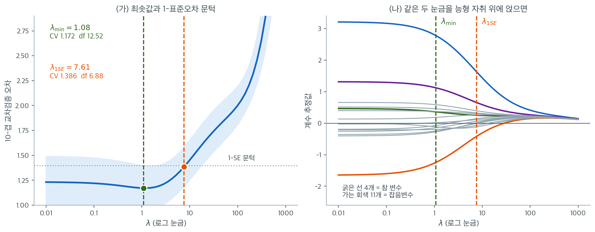
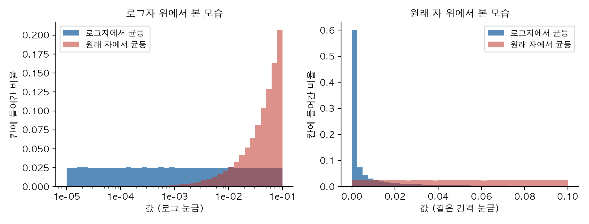

# 능형 자취와 λ의 선택

$n = 80$, $p = 15$, 설명변수 상관 $0.9$, 참 변수가 넷인 자료에 $10$ 겹 교차검증을 돌렸다. $\lambda$ 가 $0.01$ 에서 $1$ 까지 백 배 변하는 동안 교차검증 오차는 $1.23$ 에서 $1.17$ 로 $5\%$ 밖에 움직이지 않고, 최솟값 $\lambda_{\min} = 1.08$ 에서의 표준오차가 $0.226$ 으로 평균의 $19\%$ 나 된다. **곡선이 평평한데 추정에 잡음까지 있으면 최솟값의 위치를 소수점까지 믿을 이유가 없다.** 그렇다면 그 평평한 구간에서 어느 $\lambda$ 를 집어야 하는가.

능형 추정량은 편향과 분산의 절충을 조절하는 정칙화 모수 $\lambda$에 의존한다. $\lambda$가 너무 작으면 정칙화가 부족하고, 너무 크면 모든 계수를 0 쪽으로 지나치게 축소한다. 이 절에서는 $\lambda$를 고르는 세 가지 접근 — 능형 자취(시각적 진단), 교차검증(표준적인 자료 기반 방법), 일반화 교차검증(효율적인 해석적 근사) — 을 제시한다.

---

## 1. 능형 자취

**능형 자취**는 각 계수 $\hat{\beta}_j(\lambda)$를 $\lambda$(또는 $\log\lambda$)의 함수로 그린 그림이다. 정칙화 강도에 따라 능형 해가 어떻게 변하는지 시각적으로 요약한다.

$\lambda$가 0에서 커질 때

- $\lambda = 0$에서 계수는 OLS 값과 같다.
- 처음에는 계수가 빠르게 변할 수 있으며, 특히 다중공선성으로 부풀려진 계수가 그렇다.
- 결국 계수가 안정되고 매끄럽게 0으로 수렴한다.

능형 자취는 계수가 안정되었지만(격렬한 변동이 사라졌지만) 아직 0에 지나치게 가까워지지는 않은 $\lambda$를 찾는 데 도움을 준다. 이 안정 구간이 정칙화가 선형종속의 영향을 성공적으로 제거하면서 과도한 편향은 들이지 않은 지점이다.

!!! note "능형 자취의 해석"
    계수 경로가 평평해지고 대체로 나란히 가는 구간을 찾는다. 정칙화에 의한 분산 감소가 이미 확보되었고 $\lambda$를 더 키우면 편향만 늘어나는 "팔꿈치" 구간이다. 능형회귀 초기 응용에서는 능형 자취가 $\lambda$를 고르는 주된 방법이었다.

---

## 2. K-겹 교차검증으로 고르기

$\lambda$ 를 고르는 자료 기반의 객관적 방법이 교차검증이다. $K$ 겹으로 나누어 겹마다
예측오차를 재고 평균하는 절차와 그 코드는 18.5절
[교차검증과 λ 조율](../tuning/cv_tuning.md) §2 에 있다. 능형에서는 그 절차를
$\lambda$ 의 격자 $\lambda_1 < \cdots < \lambda_M$ 위에서 돌려

$$\hat{\lambda} = \arg\min_{\lambda_m} \text{CV}(\lambda_m)$$

을 고른다. CV 오차 곡선은 대개 **U자**다 — 아주 작은 $\lambda$ 에서 높고(과적합)
최솟값까지 내려갔다가 큰 $\lambda$ 에서 다시 오른다(과소적합). 아래 §3~§5 는 이
곡선에서 어느 점을 집을지, 그리고 겹을 나누지 않고도 같은 일을 할 수 있는지를 다룬다.

---

## 3. 1-표준오차 규칙

CV 곡선의 최솟값이 $\lambda_{\min}$ 을 정하지만 CV 추정값 자체에 잡음이 있다.
**1-표준오차 규칙**은 그 잡음만큼은 깎아도 좋다고 보고 더 보수적인 $\lambda$ 를 집는다 —
식과 그 규칙이 무엇을 사고 무엇을 파는지는 18.5절
[교차검증과 λ 조율](../tuning/cv_tuning.md) §5 에 적혀 있다. 여기서는 그 선택이
**능형 자취에서 계수에 무엇을 하는지**를 본다.



$n = 80$, $p = 15$, 설명변수 상관 $\rho = 0.9$, 참 변수 4개인 자료에 10-겹 교차검증을 돌린 결과다. 왼쪽 파란 띠는 겹 사이의 $\pm 1$ 표준오차 범위다. 먼저 **CV 곡선이 U자라기보다 왼쪽이 길게 평평한 L자**라는 점을 보라. $\lambda$가 $0.01$에서 $1$까지 백 배 변하는 동안 CV 오차는 $1.23$에서 $1.17$로 5%밖에 움직이지 않는다. 반면 $\lambda$가 $10$을 넘으면 급격히 올라간다. **과소정칙화는 완만한 실수이고 과대정칙화는 가파른 실수다.**

최솟값은 $\lambda_{\min} = 1.08$에서 CV $1.172$다. 그런데 그 지점의 표준오차가 $0.226$으로 평균의 19%나 된다. 회색 점선이 그 문턱 $1.172 + 0.226 = 1.398$이고, 이 선 아래에 머무는 가장 큰 $\lambda$가 $\lambda_{1\text{SE}} = 7.61$이다. **곡선이 평평하다는 사실과 CV 추정에 잡음이 있다는 사실이 합쳐져, 최솟값의 위치를 소수점까지 믿을 이유가 없어진다.** 1-SE 규칙은 그 불확실성을 간결성 쪽으로 쓰자는 제안이다.

오른쪽은 같은 자료의 능형 자취에 두 $\lambda$를 세로선으로 얹은 것이다. 두 선택의 차이가 계수에서 어떻게 나타나는지 여기서 읽어야 한다. $\lambda_{\min}$에서 참 변수 넷(굵은 선)의 추정값은 $2.78,\ -1.24,\ 0.36,\ 1.12$이고 잡음변수 열한 개(가는 회색)는 절댓값 평균 $0.24$, 최대 $0.59$로 아직 0에서 제법 떨어져 있다. $\lambda_{1\text{SE}}$로 옮기면 잡음변수의 절댓값 평균이 $0.16$으로, 최대가 $0.39$로 줄고 유효자유도가 $12.52$에서 $6.88$로 절반이 된다. 물론 참 변수도 함께 눌려 첫 계수가 $2.78$에서 $1.63$으로 내려간다. **1-SE 규칙은 잡음만 골라 지우는 것이 아니라 모두를 더 세게 누르는 것이다.**

값을 매겨 보자. **파는 것은 CV 오차 18%**($1.172 \to 1.386$)이고 그 차이는 표준오차 $0.226$ 안에 있으니 통계적으로 구별되지 않는다. **사는 것은 모형 복잡도의 절반**이다. 참 변수가 4개뿐인 자료에서 $\text{df} = 6.88$이 $\text{df} = 12.52$보다 진실에 가깝다. 예측 정확도만이 목표라면 $\lambda_{\min}$을 쓰고, 모형을 남에게 설명하거나 다음 표본에서도 비슷한 결과가 나오기를 바란다면 $\lambda_{1\text{SE}}$를 쓴다.

!!! tip "1-SE 규칙을 언제 쓰는가"
    예측 정확도의 미미한 개선보다 해석 가능성이나 안정성이 중요할 때 $\lambda_{1\text{SE}}$를 쓴다. 예측 정확도가 주된 목표라면 $\lambda_{\min}$을 쓴다.

---

## 4. 하나 남기기 교차검증

능형회귀에서 LOOCV는 모형을 $n$번 재적합하지 않아도 되는 닫힌 형태의 지름길을 갖는다.

$$
\text{CV}_{\text{LOO}}(\lambda) = \frac{1}{n}\sum_{i=1}^n\left(\frac{y_i - \hat{y}_i(\lambda)}{1 - h_{ii}(\lambda)}\right)^2
$$

여기서 $h_{ii}(\lambda)$는 **모자 행렬**

$$
\mathbf{H}(\lambda) = \mathbf{X}(\mathbf{X}^\top\mathbf{X} + \lambda\mathbf{I})^{-1}\mathbf{X}^\top
$$

의 $i$번째 대각원소다. 이 공식은 $\lambda$당 한 번의 적합만 요구하므로 능형회귀에서 LOOCV가 계산적으로 효율적이다.

---

## 5. 일반화 교차검증

**일반화 교차검증**(GCV)은 개별 지렛값 $h_{ii}(\lambda)$를 그 평균으로 대체한다.

$$
\text{GCV}(\lambda) = \frac{\text{RSS}(\lambda)/n}{\bigl(1 - \text{df}(\lambda)/n\bigr)^2}
$$

여기서 $\text{df}(\lambda) = \text{tr}[\mathbf{H}(\lambda)] = \sum_j d_j^2/(d_j^2 + \lambda)$이다. GCV의 장점은 자료의 직교 회전에 대해 불변이고, $n$개의 지렛값 대신 유효자유도 하나로 계산되며, 일정 조건에서 예측에 대해 점근적으로 최적이라는 점이다.

---

## 6. 실무적 고려

**$\lambda$ 격자.** 로그 격자를 쓴다. 예를 들어 $10^{-4}$부터 $10^{4}$까지 100개 점을 잡으면 여러 자릿수에 걸쳐 충분한 해상도를 얻는다.

<div class="aibox" markdown>

**AI로 보는 통계학 1.** 어느 자 위에서 균등하게 뽑을 것인가

왜 같은 간격이 아니라 **로그** 간격인가. 밀도의 변환 공식이 답한다. 확률변수를
$y=h(x)$ 로 바꾸면 작은 구간의 확률이 보존되므로 $f(x)\,dx\approx g(y)\,dy$ 이고, 곧 밀도가
$\lvert dx/dy\rvert$ 배로 눌린다. 「균등하게 뽑는다」는 말이 **어느 자 위에서인지**에 따라
전혀 다른 뜻이 된다는 뜻인데, 모형을 다룰 때 이 선택이 늘 앞에 놓인다.

조정모수는 흔히 자릿수로 움직인다. $\lambda$ 가 그렇고, 경사하강의 보폭도 그렇다. 좋은 값이
어느 자릿수에 있는지 모르는 채로 후보를 뽑아야 하는데, 원래 자에서 균등하게 뽑으면 거의
모두가 큰 쪽에 몰린다. 그래서 **로그자 위에서** 균등하게 뽑는다. 그러면 원래 자에서 본
밀도는 위 공식에 의해

$$
y=\log_{10}x\ \text{가 균등} \;\Longrightarrow\;
g(x)=\frac{1}{x\ln 10\,\bigl(\log_{10}\mathrm{hi}-\log_{10}\mathrm{lo}\bigr)}
$$

가 되어 $1/x$ 꼴로 왼쪽이 높아진다. 자릿수마다 같은 몫을 가져간다는 말과 같다.

```python
import numpy as np

rng = np.random.default_rng(0)
n = 200_000
lo, hi = 1e-5, 1e-1                                   # 네 자릿수에 걸친 범위

y = rng.uniform(np.log10(lo), np.log10(hi), n)        # 로그자 위에서 균등하게
x = 10.0 ** y                                         # 되돌린 값
x_flat = rng.uniform(lo, hi, n)                       # 견주려고 원래 자에서 균등하게

print("구간              로그자에서 균등   원래 자에서 균등         이론값")
for a, b in [(1e-5, 1e-4), (1e-4, 1e-3), (1e-3, 1e-2), (1e-2, 1e-1)]:
    p_log = np.mean((x >= a) & (x < b))
    p_flat = np.mean((x_flat >= a) & (x_flat < b))
    print(f"[{a:.0e}, {b:.0e})   {p_log:12.4f}   {p_flat:14.4f}   {0.25:12.4f}")
```

실행하면 다음이 나온다.

```text
구간              로그자에서 균등   원래 자에서 균등         이론값
[1e-05, 1e-04)         0.2497           0.0010         0.2500
[1e-04, 1e-03)         0.2521           0.0087         0.2500
[1e-03, 1e-02)         0.2494           0.0904         0.2500
[1e-02, 1e-01)         0.2488           0.8999         0.2500
```

로그자에서 균등하게 뽑으면 네 자릿수에 각각 $25\%$ 씩 고르게 들어간다. 원래 자에서 뽑으면
맨 위 자릿수가 $90\%$ 를 가져가고 맨 아래 자릿수에는 천 번에 한 번꼴로만 떨어진다. 후보를
천 개 뽑아도 $10^{-5}$ 둘레는 한 번 볼까 말까 한 셈이다. 위의 $10^{-4}$–$10^{4}$ 는 여덟
자릿수이니 어긋남이 더 심해진다.

<figure markdown>
  { width=740 }
  <figcaption markdown>같은 표본을 **자만 바꾸어** 본 것이다. 로그자에서 평평한 쪽(파랑)은 원래 자에서 $0$ 근처로 치솟고, 원래 자에서 평평한 쪽(붉은색)은 로그자에서 오른쪽 끝에 몰린다. 평평함은 분포의 성질이 아니라 **분포와 자의 관계**다.</figcaption>
</figure>

이 쪽의 다른 대목이 모두 이 격자 위에서 일어난다는 점을 새겨 둘 만하다. $2$ 절의 $K$-겹
교차검증은 격자의 점마다 오차를 재는 것이고, $3$ 절의 $1$-표준오차 규칙은 그 점들 가운데
하나를 고르는 것이다. 격자가 성기면 규칙이 고를 수 있는 값도 그만큼 성기다. 그리고
$\lambda=0$ 을 격자에 넣을 수 없는 까닭도 여기 있다 — 로그자에는 $0$ 이 없다. OLS 에 가까운
해를 보고 싶으면 왼쪽 끝을 충분히 작게 잡는 수밖에 없다.

여기서 챙길 것은 하나다. 「고르게 뽑았다」는 말만으로는 아무것도 정해지지 않는다. 어느 자
위에서 고르게 뽑았는지를 함께 말해야 하고, 자를 바꾸면 $\lvert dx/dy\rvert$ 만큼 밀도가
바뀐다. 다만 로그자가 늘 옳은 것도 아니다 — 좋은 값이 자릿수가 아니라 폭으로 흩어져 있는
양(이를테면 엘라스틱넷의 혼합비처럼 $0$ 과 $1$ 사이에 놓이는 값)이라면 로그자는 되레 한쪽
끝만 들여다보게 만든다.

</div>

**표준화.** 능형 해를 계산하기 전에 설명변수를 표준화(평균 0, 분산 1)해야 벌점 $\lambda\|\boldsymbol{\beta}\|_2^2$이 모든 계수를 같은 척도에서 벌한다.

| 방법 | 계산량 | 장점 | 단점 |
|---|---|---|---|
| 능형 자취 | 시각적 판단 | 직관적, 계수 경로를 드러냄 | 주관적, 자동화되지 않음 |
| $K$-겹 CV | $K \times M$번 적합 | 표준적, 잘 이해됨 | 계산이 무거움 |
| LOOCV (닫힌 형태) | $M$번 적합 | 정확, 분할 난수 없음 | 개별 관측에 과적합할 수 있음 |
| GCV | 해석적 공식 | 효율적, 회전 불변 | 근사(지렛값을 평균냄) |

---

## 연습문제

<div class="drillbox" markdown>

**연습문제 1.** <span class="diff med" title="중간"></span>
$\lambda_{\min}$과 $\lambda_{1\text{SE}}$가 실제로 얼마나 다른지, 그리고 유효자유도로 환산하면 어떤 의미인지 확인하라. $\rho = 0.9$인 표준화된 설명변수 15개 중 4개만 참인 자료($n = 80$)에서 10-겹 교차검증을 수행하라.

</div>

??? success "풀이"
    ```python
    import numpy as np
    from sklearn.linear_model import Ridge
    from sklearn.model_selection import KFold
    rng = np.random.default_rng(31)

    n, p, rho = 80, 15, 0.9
    S = rho*np.ones((p, p)) + (1-rho)*np.eye(p)
    X = rng.normal(size=(n, p)) @ np.linalg.cholesky(S).T
    X -= X.mean(0); X /= X.std(0)
    beta = np.zeros(p); beta[:4] = [3, -2, 1.5, 1]
    y = X @ beta + rng.normal(0, 1, n); y -= y.mean()

    lams = np.logspace(-2, 3, 60)
    kf = KFold(10, shuffle=True, random_state=0)
    mu, se = [], []
    for lam in lams:
        errs = [((y[te] - X[te] @ Ridge(alpha=lam, fit_intercept=False)
                  .fit(X[tr], y[tr]).coef_)**2).mean() for tr, te in kf.split(X)]
        mu.append(np.mean(errs)); se.append(np.std(errs, ddof=1)/np.sqrt(10))
    mu, se = np.array(mu), np.array(se)
    i = mu.argmin(); j = np.max(np.where(mu <= mu[i] + se[i])[0])
    ```

    | 규칙 | $\lambda$ | CV 오차 | $\text{df}(\lambda)$ |
    |:---|---:|---:|---:|
    | $\lambda_{\min}$ | **1.081** | 1.172 | **12.52** |
    | $\lambda_{1\text{SE}}$ | **7.610** | 1.386 | **6.88** |

    **$\lambda$가 7배 커지고 유효자유도는 절반이 된다.** CV 오차는 $1.172 \to 1.386$으로 18% 나빠지지만, 그 차이는 표준오차 $0.226$ 안에 있다.

    **1-SE 규칙이 사는 것과 파는 것.** 파는 것은 CV 오차 18%다. 사는 것은 모형 복잡도의 절반이다. 자료가 $p = 15$ 중 참 변수 $4$개인 상황임을 감안하면 $\text{df} = 6.88$이 $12.52$보다 진실에 가깝다.

    **표준오차 $0.226$이 평균 $1.172$의 19%라는 점에 주목하라.** CV 추정 자체가 그만큼 불안정하다는 뜻이며, 그래서 최솟값을 곧이곧대로 믿지 않는 규칙이 필요하다. 겹 수를 늘리거나 교차검증을 반복하면 이 표준오차가 줄어든다.

<div class="drillbox" markdown>

**연습문제 2.** <span class="diff med" title="중간"></span>
LOOCV의 닫힌 형태 지름길이 실제로 $n$번 재적합한 결과와 일치하는지 확인하라. 왜 능형에는 이 지름길이 있고 라쏘에는 없는가?

</div>

??? success "풀이"
    ```python
    import numpy as np
    from sklearn.linear_model import Ridge

    def loocv_shortcut(X, y, lam):
        n, p = X.shape
        A = np.linalg.inv(X.T @ X + lam*np.eye(p))
        H = X @ A @ X.T
        yhat = H @ y; h = np.diag(H)
        return np.mean(((y - yhat)/(1 - h))**2)

    def loocv_brute(X, y, lam):
        n = len(y); errs = []
        for i in range(n):
            m = np.ones(n, bool); m[i] = False
            b = Ridge(alpha=lam, fit_intercept=False).fit(X[m], y[m]).coef_
            errs.append((y[i] - X[i] @ b)**2)
        return np.mean(errs)

    for lam in (0.1, 1.0, 10.0):
        assert np.isclose(loocv_shortcut(X, y, lam), loocv_brute(X, y, lam))
    ```

    두 값이 기계 정밀도까지 일치한다.

    **왜 능형에는 지름길이 있는가.** 능형은 **선형 평활자**다. 적합값이 $\hat{\mathbf{y}} = \mathbf{H}(\lambda)\mathbf{y}$ 형태이고 $\mathbf{H}$가 $\mathbf{y}$에 의존하지 않는다. 이 성질이 항등식

    $$
    y_i - \hat{y}_i^{(-i)} = \frac{y_i - \hat{y}_i}{1 - H_{ii}}
    $$

    를 성립시킨다.

    **왜 라쏘에는 없는가.** 라쏘 해는 $\mathbf{y}$의 **비선형** 함수다. 활성집합(0이 아닌 계수의 집합)이 $\mathbf{y}$에 의존하므로, 관측 하나를 빼면 활성집합 자체가 바뀔 수 있다. $\hat{\mathbf{y}} = \mathbf{H}\mathbf{y}$로 쓸 수 있는 고정된 $\mathbf{H}$가 존재하지 않는다.

    실무적 결과: `RidgeCV`는 기본적으로 LOOCV를 쓰고 매우 빠르다. `LassoCV`는 $K$-겹 교차검증을 실제로 수행해야 하므로 훨씬 느리다. 대신 라쏘는 경로 알고리즘(LARS나 좌표하강의 온기 시작)으로 전체 $\lambda$ 격자를 한 번에 계산하여 이를 상쇄한다.

<div class="drillbox" markdown>

**연습문제 3.** <span class="diff med" title="중간"></span>
6절은 $\lambda$ 격자를 로그 척도로 잡으라고 했다. 그 권고의 근거를 유효자유도로 확인하라. $\mathbf{X}$의 특잇값이 $d_1^2 = 100$, $d_2^2 = 10$, $d_3^2 = 1$인 $p = 3$짜리 설계를 생각한다.

(가) $\text{df}(\lambda) = \sum_j d_j^2/(d_j^2+\lambda)$를 $\lambda = 0,\ 0.1,\ 1,\ 10,\ 100,\ 1000$에서 소수 넷째 자리까지 구하라.

(나) $\lambda$가 열 배 커질 때마다 df 가 얼마나 줄어드는가? 가장 빨리 줄어드는 구간은 어디인가?

(다) 선형 격자 `np.linspace(0, 1000, 100)`의 100개 점 가운데 $\text{df}(\lambda) > 1.5$인 점은 몇 개인가?

(라) 세 답을 모아 로그 격자를 쓰는 까닭을 한 문장으로 적어라.

</div>

??? success "풀이"
    **(가)** $\lambda = 1$에서 세 항은 $100/101 = 0.990099$, $10/11 = 0.909091$, $1/2 = 0.5$이고 합이 $2.3992$다. $\lambda = 10$에서는 $100/110 = 0.909091$, $10/20 = 0.5$, $1/11 = 0.090909$로 합이 정확히 $1.5$다. 나머지도 같은 방식으로 계산한다.

    | $\lambda$ | 0 | 0.1 | 1 | 10 | 100 | 1000 |
    |:---|---:|---:|---:|---:|---:|---:|
    | $\text{df}(\lambda)$ | 3.0000 | 2.8982 | 2.3992 | 1.5000 | 0.6008 | 0.1018 |
    | 앞 칸에서의 감소 | — | 0.1018 | 0.4990 | 0.8992 | 0.8992 | 0.4990 |

    **(나)** $\lambda$가 $1$에서 $100$까지 가는 두 자릿수 동안 df 는 한 자릿수당 $0.8992$씩, 즉 거의 **일정하게** 내려간다. 그 바깥($\lambda < 0.1$이나 $\lambda > 1000$)에서는 한 자릿수당 $0.1$ 남짓밖에 움직이지 않는다. 까닭은 한 항의 로그 척도 도함수가

    $$
    \frac{d}{d(\log_{10}\lambda)}\,\frac{d_j^2}{d_j^2+\lambda} = -\ln 10 \cdot \frac{\lambda\, d_j^2}{(d_j^2+\lambda)^2}
    $$

    이고 이것이 $\lambda = d_j^2$에서 최대 $-\ln 10/4 = -0.5757$에 이르기 때문이다. 세 $d_j^2$가 한 자릿수씩 떨어져 있으니 합의 기울기가 $\lambda \in [1, 100]$ 전체에서 거의 평평하다. **벌점이 일을 하는 자리는 $\lambda$가 $d_j^2$와 같은 자릿수일 때뿐이다.**

    **(다)** 격자 간격은 $1000/99 = 10.1010$이다. $\text{df}$는 감소함수이고

    $$
    \text{df}(10.1010) = 0.908262 + 0.497488 + 0.090083 = 1.495826 < 1.5
    $$

    이므로 $\lambda = 0$을 뺀 99개 점은 모두 $\text{df} \leq 1.5$다. 즉 **100개 중 1개**뿐이다. 선형 격자는 99개 점을 "변수 한 개 반 이하" 영역에 몰아넣고 $1.5 < \text{df} < 3$ 구간은 아예 훑지 않는다. 같은 100개 점을 $10^{-4}$부터 $10^{4}$까지 로그로 깔면 $\text{df} > 1.5$인 점이 62개가 된다.

    **(라)** df 는 $\lambda$가 아니라 $\log\lambda$에 대해 거의 선형이므로, 모형 복잡도를 고르게 훑으려면 격자도 $\log\lambda$에서 고르게 잡아야 한다. 연습문제 1이 `np.logspace(-2, 3, 60)`을 쓴 것도 그 자료의 $d_j^2$가 걸쳐 있는 자릿수를 덮기 위함이다.

<div class="drillbox" markdown>

**연습문제 4.** <span class="diff med" title="중간"></span>
6절의 표준화 권고가 선택이 아니라 필수임을 수로 보여라. 설명변수가 둘이고 서로 직교하지만 척도가 다른 설계

$$
\mathbf{x}_1^\top\mathbf{x}_1 = 1,\qquad \mathbf{x}_2^\top\mathbf{x}_2 = 100,\qquad \mathbf{x}_1^\top\mathbf{x}_2 = 0
$$

에서 $\mathbf{x}_1^\top\mathbf{y} = 2$, $\mathbf{x}_2^\top\mathbf{y} = 200$이라 하자. 절편은 없다고 본다.

(가) $\lambda = 1$에서 두 계수의 수축률 $\hat\beta_j(\lambda)/\hat\beta_j^{\text{OLS}}$와 $\text{df}(1)$을 구하라.

(나) 둘째 설명변수의 단위만 바꾸어 $\mathbf{x}_2' = \mathbf{x}_2/10$으로 적는다(미터를 데카미터로 바꾼 것과 같다). $\lambda = 1$에서 새 해를 구해 **원래 단위로 환산**하고 (가)와 비교하라. $\text{df}(1)$은 얼마가 되는가?

(다) 단위를 바꾼 자료에서 (가)의 적합값을 되살리려면 각 열이 요구하는 $\lambda'$는 얼마인가? 하나의 $\lambda'$로 가능한가?

(라) $\lambda = 0$에서는 이런 일이 생기지 않음을 확인하라.

</div>

??? success "풀이"
    두 열이 직교하므로 $\mathbf{X}^\top\mathbf{X} = \operatorname{diag}(c_1, c_2)$이고 능형 해가 좌표별로 분리된다.

    $$
    \hat\beta_j(\lambda) = \frac{\mathbf{x}_j^\top\mathbf{y}}{c_j + \lambda} = \frac{c_j}{c_j+\lambda}\,\hat\beta_j^{\text{OLS}},\qquad \text{df}(\lambda) = \frac{c_1}{c_1+\lambda} + \frac{c_2}{c_2+\lambda}
    $$

    **(가)** $\hat\beta^{\text{OLS}} = (2/1,\ 200/100) = (2,\ 2)$다. $\lambda = 1$에서 수축률은

    $$
    \frac{c_1}{c_1+1} = \frac{1}{2} = 0.5,\qquad \frac{c_2}{c_2+1} = \frac{100}{101} = 0.990099
    $$

    이므로 $\hat\beta(1) = (1,\ 1.980198)$이고 $\text{df}(1) = 0.5 + 0.990099 = 1.490099$다. **같은 $\lambda = 1$이 한 열은 절반으로 누르고 다른 열은 1%만 누른다.**

    **(나)** $\mathbf{x}_2' = \mathbf{x}_2/10$이면 $c_2' = 1$, $\mathbf{x}_2'^\top\mathbf{y} = 20$이다. 새 단위의 OLS 는 $\hat\beta_2'^{\text{OLS}} = 20/1 = 20$으로 과연 예전의 10배이고, 능형 해는

    $$
    \hat\beta_2'(1) = \frac{20}{1+1} = 10
    $$

    이다. 원래 단위로 되돌리면 $10/10 = 1.0$으로, (가)의 $1.980198$과 다르다. 적합값의 차이는

    $$
    \lVert \hat{\mathbf{y}}' - \hat{\mathbf{y}} \rVert = \lvert 1.980198 - 1 \rvert \cdot \lVert\mathbf{x}_2\rVert = 0.980198 \times 10 = 9.80198
    $$

    이고 $\text{df}(1)$은 $0.5 + 0.5 = 1.0$으로 떨어진다. **자료를 건드리지 않고 자의 눈금만 바꾸었는데 해와 유효자유도가 모두 바뀐다.**

    **(다)** 둘째 열의 해를 되살리려면 $20/(1+\lambda') = 19.80198$, 즉 $\lambda' = 20/19.80198 - 1 = 0.01$이 필요하다. 일반적으로 열을 $1/a$배 하면 $c \mapsto c/a^2$이므로 $\lambda \mapsto \lambda/a^2$여야 하고, 여기서는 $a = 10$이므로 $\lambda' = 1/100$이다. 그런데 첫째 열은 손대지 않았으니 $\lambda' = 1$을 요구한다. **두 열이 서로 다른 $\lambda'$를 요구하므로 하나의 $\lambda'$로는 불가능하다.** 열마다 척도가 다르면 되돌릴 방법이 없다.

    **(라)** $\lambda = 0$이면 $\hat\beta_2'^{\text{OLS}} = 20$이고 원래 단위로 환산하면 $20/10 = 2 = \hat\beta_2^{\text{OLS}}$다. 적합값도 같다. OLS 의 적합값은 열공간으로의 사영이고 열을 가역 선형변환해도 열공간은 변하지 않기 때문이다(부록 A).

    벌점 $\lambda\lVert\boldsymbol\beta\rVert_2^2$은 $\boldsymbol\beta$의 **좌표**에 걸리는데 좌표의 크기는 단위가 정한다. 표준화는 "하나의 $\lambda$가 모든 열에 같은 뜻을 갖는다"는 전제를 만들어 주는 작업이다. sklearn 의 `Ridge`는 표준화를 해 주지 않으므로 `StandardScaler`를 직접 파이프라인에 넣어야 한다.

<div class="drillbox" markdown>

**연습문제 5.** <span class="diff med" title="중간"></span>
5절은 GCV 가 개별 지렛값 $h_{ii}(\lambda)$를 그 평균으로 바꾼 근사라고 했다. 그 근사가 언제 깨지는지 확인하라. 연습문제 1의 자료와 $\lambda$ 격자를 그대로 쓴다.

(가) 같은 격자 위에서 LOOCV 와 GCV 를 모두 계산하여 각자가 고르는 $\lambda$와 두 곡선의 최대 상대차를 보고하라.

(나) 첫 관측의 설명변수를 6배로 늘려 지렛값을 치우치게 한 뒤 같은 것을 보고하라.

(다) 차이가 공식의 어느 자리에서 비롯되는지 수로 짚어라.

</div>

??? success "풀이"
    ```python
    import numpy as np

    def loo_and_gcv(Z, t, lam):
        """한 번의 적합에서 LOOCV 와 GCV 를 함께 돌려준다."""
        nz, pz = Z.shape
        H = Z @ np.linalg.inv(Z.T @ Z + lam*np.eye(pz)) @ Z.T
        h = np.diag(H)
        r = t - H @ t
        loo = np.mean((r/(1 - h))**2)
        gcv = (r @ r / nz) / (1 - h.sum()/nz)**2
        return loo, gcv, h

    Xb = X.copy()
    Xb[0] = 6.0*Xb[0]                    # 관측 하나만 설계공간에서 멀리 보낸다

    print("자료          h_max  h_bar  lam(LOO)  lam(GCV)  최대상대차")
    for name, Z in (("원자료      ", X), ("한 점을 늘림", Xb)):
        L = np.array([loo_and_gcv(Z, y, l)[0] for l in lams])
        G = np.array([loo_and_gcv(Z, y, l)[1] for l in lams])
        h = loo_and_gcv(Z, y, lams[i])[2]
        print(f"{name}  {h.max():.3f}  {h.mean():.3f}  {lams[L.argmin()]:8.3f}  "
              f"{lams[G.argmin()]:8.3f}    {np.max(np.abs(G - L)/L):.4f}")
    ```

    출력:

    ```text
    자료          h_max  h_bar  lam(LOO)  lam(GCV)  최대상대차
    원자료        0.306  0.157     1.314     1.081    0.0612
    한 점을 늘림  0.810  0.158    11.242     1.081    0.4376
    ```

    **(가)** 원자료에서는 지렛값이 고르다. $\lambda = 1.081$에서 $h_{\max} = 0.306$이고 평균은 $\bar h = \text{df}/n = 12.52/80 = 0.157$이니 둘이 두 배 차이밖에 나지 않는다. LOOCV 는 $1.314$, GCV 는 $1.081$을 골라 격자 한 칸 차이이고 두 곡선의 최대 상대차는 6%다. **이 경우 GCV 는 LOOCV 의 훌륭한 대역이다.**

    **(나)** 한 점을 늘리면 $h_{\max} = 0.810$으로 뛰는데 **평균은 $0.158$로 거의 그대로다.** 지렛값의 합은 $\text{df}$로 묶여 있어 한 관측이 독차지하면 나머지가 줄어들 뿐이다. LOOCV 는 $\lambda = 11.242$까지 올라가고 GCV 는 $1.081$에 머문다. 격자에서 아홉 칸 차이, 유효자유도로는 절반 이상의 차이다.

    **(다)** LOOCV 는 잔차 $i$를 $(1-h_{ii})^{-2}$로 가중한다. 늘어난 점의 가중은

    $$
    (1 - 0.810)^{-2} = 27.7
    $$

    인데 GCV 가 모든 잔차에 똑같이 주는 가중은

    $$
    (1 - 0.158)^{-2} = 1.41
    $$

    에 그친다. 즉 GCV 는 그 점을 맞히기가 얼마나 어려운지를 20배 가까이 과소평가한다. LOOCV 는 그 벌을 피하려 $\lambda$를 크게 올리고, GCV 는 그런 신호를 받지 못한다. **GCV 가 LOOCV 의 대역이 되는 조건은 지렛값이 고르다는 것**이고, 영향점이 하나라도 있으면 그 조건이 깨진다. 6절 표의 "근사(지렛값을 평균냄)"가 뜻하는 바가 이것이다.

<div class="drillbox" markdown>

**연습문제 6.** <span class="diff hard" title="어려움"></span>
능형이 OLS 를 이기는 $\lambda$가 반드시 있다는 것을 직교설계에서 확인하고, 그 최적 $\lambda$를 이 쪽의 $\lambda_{\min}$과 견주어라. $\mathbf{X}^\top\mathbf{X} = c\,\mathbf{I}_p$($c>0$), $\mathbf{y} = \mathbf{X}\boldsymbol\beta + \boldsymbol\varepsilon$, $\boldsymbol\varepsilon \sim N(\mathbf{0}, \sigma^2\mathbf{I}_n)$이라 한다. $B = \lVert\boldsymbol\beta\rVert_2^2$로 적는다.

(가) $R(\lambda) = E\lVert\hat{\boldsymbol\beta}(\lambda) - \boldsymbol\beta\rVert_2^2$를 $\lambda,\ c,\ B,\ p\sigma^2$로 적어라.

(나) $R'(\lambda)$를 구하고 $R'(0) < 0$임을 보여라. 이것이 왜 "능형이 OLS 를 이기는 $\lambda$가 반드시 있다"는 말인가?

(다) 최소점 $\lambda^*$와 $R(\lambda^*)$를 구하고, $\lambda^*$가 $c$에 의존하지 않음을 확인하라.

(라) 연습문제 1의 자료($p = 15$, $\sigma = 1$, $\boldsymbol\beta = (3, -2, 1.5, 1, 0, \dots, 0)$, 표준화하여 $c = n = 80$)에 대입해 $\lambda^*$와 위험 감소율을 구하고 $\lambda_{\min} = 1.081$과 비교하라. 왜 정확히 같지는 않은가?

</div>

??? success "풀이"
    **(가)** $\mathbf{X}^\top\mathbf{X} = c\mathbf{I}$이므로 $\hat{\boldsymbol\beta}(\lambda) = (c+\lambda)^{-1}\mathbf{X}^\top\mathbf{y}$이고 $\mathbf{X}^\top\mathbf{y} = c\boldsymbol\beta + \mathbf{X}^\top\boldsymbol\varepsilon$, $\operatorname{Var}(\mathbf{X}^\top\boldsymbol\varepsilon) = \sigma^2\mathbf{X}^\top\mathbf{X} = c\sigma^2\mathbf{I}$다. 따라서

    $$
    E\hat{\boldsymbol\beta}(\lambda) = \frac{c}{c+\lambda}\boldsymbol\beta,\qquad \text{편향} = -\frac{\lambda}{c+\lambda}\boldsymbol\beta,\qquad \operatorname{Var}(\hat\beta_j) = \frac{c\sigma^2}{(c+\lambda)^2}
    $$

    이고 5.11절 [편향–분산 분해](../../ch05/estimators/bias_variance.md) 정리 1 로

    $$
    R(\lambda) = \frac{\lambda^2 B + p\,c\,\sigma^2}{(c+\lambda)^2}
    $$

    를 얻는다. $R(0) = p\sigma^2/c$는 OLS 의 위험이다.

    **(나)** 분자와 분모를 미분해 정리하면

    $$
    R'(\lambda) = \frac{2\lambda B(c+\lambda)^2 - 2(c+\lambda)(\lambda^2 B + pc\sigma^2)}{(c+\lambda)^4} = \frac{2c\,(\lambda B - p\sigma^2)}{(c+\lambda)^3}
    $$

    이므로

    $$
    R'(0) = -\frac{2p\sigma^2}{c^2} < 0
    $$

    이다. $\sigma^2 > 0$이면 부호가 $\boldsymbol\beta$와 무관하게 음수다. $R$이 $\lambda = 0$에서 **엄격히 감소**하므로 $R(\lambda) < R(0)$인 $\lambda > 0$이 반드시 존재한다. 이것이 "편향을 사서 분산을 파는" 거래가 언제나 이문이 남는 지점에서 시작된다는 뜻이다. $\lambda = 0$에서 편향은 2차($\lambda^2$)로 늘고 분산은 1차로 줄기 때문이다.

    **(다)** $R'(\lambda) = 0 \iff \lambda B = p\sigma^2$이므로

    $$
    \lambda^* = \frac{p\sigma^2}{B}
    $$

    이고 $\lambda < \lambda^*$에서 $R' < 0$, $\lambda > \lambda^*$에서 $R' > 0$이니 전역 최소다. $R'$의 괄호 안에 $c$가 없으므로 $\lambda^*$는 설계의 척도에 의존하지 않는다. 대입해 정리하면

    $$
    R(\lambda^*) = \frac{p\sigma^2 B}{cB + p\sigma^2},\qquad \frac{R(\lambda^*)}{R(0)} = \frac{cB}{cB + p\sigma^2}
    $$

    이다. **이득의 크기는 $c$에 의존한다** — $\lambda^*$의 위치만 척도에 둔감하다.

    **(라)** $B = 3^2 + 2^2 + 1.5^2 + 1^2 = 16.25$, $p\sigma^2 = 15$이므로

    $$
    \lambda^* = \frac{15}{16.25} = 0.923077
    $$

    이고 $\lambda_{\min} = 1.081$과 17% 차이밖에 없다. 반면 $c = 80$에서 위험은

    $$
    R(0) = \frac{15}{80} = 0.1875 \quad\longrightarrow\quad R(\lambda^*) = \frac{15 \times 16.25}{80 \times 16.25 + 15} = \frac{243.75}{1315} = 0.185361
    $$

    로 **1.14%만 줄어든다.**

    정확히 같지 않은 까닭은 셋이다. 첫째, $\lambda^*$는 $\mathbf{X}^\top\mathbf{X} = c\mathbf{I}$에서 나온 값인데 연습문제 1의 설계는 $\rho = 0.9$로 직교가 아니다. 모집단 상관행렬의 고윳값은 $1+(p-1)\rho = 13.6$ 하나와 $1-\rho = 0.1$ 열넷이므로 $d_j^2 \approx 80 \times 13.6 = 1088$ 하나와 $80 \times 0.1 = 8$ 열넷으로 갈라지고, 작은 쪽 방향의 OLS 분산 $\sigma^2/8$이 전체 위험을 지배한다. 둘째, $\lambda_{\min}$은 모수위험이 아니라 **예측** CV 를 최소화한다. 셋째, $\lambda_{\min}$은 격자 위의 한 점이고 그 추정의 표준오차가 평균의 19%다.

    직교설계에서 이득이 1.14%뿐이라는 것은 이 쪽의 CV 곡선이 왼쪽으로 평평한 L자였던 사실과 맞물린다. $\lambda = 0.01$의 CV $1.2320$과 $\lambda_{\min}$의 $1.1716$은 5% 차이이고, 줄일 수 없는 $\sigma^2 = 1$을 빼고 초과오차로 보면 $0.2320 \to 0.1716$, 즉 26% 감소다. **능형의 큰 이득은 $d_j^2$가 0에 붙을 때 나오며, 직교설계는 그런 일이 없는 가장 좋은 경우다.**

<div class="drillbox" markdown>

**연습문제 7.** <span class="diff hard" title="어려움"></span>
6절은 격자를 $10^{-4}$부터 $10^{4}$까지 잡으라고 했다. 그 $\lambda$를 sklearn 에 그대로 넘기면 능형과 라쏘에서 뜻이 달라진다. $n = 80$, 열이 직교정규인 설계 $\mathbf{Q}^\top\mathbf{Q} = \mathbf{I}_5$에서 교과서 꼴

$$
\lVert \mathbf{z} - \mathbf{Q}\boldsymbol\beta\rVert_2^2 + \lambda\lVert\boldsymbol\beta\rVert_2^2, \qquad \lVert \mathbf{z} - \mathbf{Q}\boldsymbol\beta\rVert_2^2 + \lambda\lVert\boldsymbol\beta\rVert_1
$$

을 생각한다. $\lambda = 3$으로 둔다.

(가) 두 해를 $\hat{\boldsymbol\beta}^{\text{OLS}} = \mathbf{Q}^\top\mathbf{z}$로 닫힌 꼴로 적어라.

(나) `Ridge`와 `Lasso`가 실제로 최소화하는 목적함수를 적고 각각의 $\alpha \leftrightarrow \lambda$ 환산을 구하라.

(다) 코드로 확인하고 `Lasso(alpha=3)`이 무엇을 내는지 보라. 6절의 격자를 `alpha`에 그대로 넣으면 무슨 일이 생기는가?

</div>

??? success "풀이"
    **(가)** $\mathbf{Q}^\top\mathbf{Q} = \mathbf{I}$이므로 능형은 비례축소

    $$
    \hat\beta_j^{\text{ridge}} = \frac{\hat\beta_j^{\text{OLS}}}{1+\lambda} = \frac{\hat\beta_j^{\text{OLS}}}{4}
    $$

    이고, 라쏘는 좌표별로 분리되어 $-2(\hat\beta_j^{\text{OLS}} - \beta_j) + \lambda s_j = 0$($s_j \in \partial\lvert\beta_j\rvert$)에서 연성문턱

    $$
    \hat\beta_j^{\text{lasso}} = \operatorname{sign}(\hat\beta_j^{\text{OLS}})\Bigl(\lvert\hat\beta_j^{\text{OLS}}\rvert - \tfrac{\lambda}{2}\Bigr)_+ = \operatorname{sign}(\hat\beta_j^{\text{OLS}})\bigl(\lvert\hat\beta_j^{\text{OLS}}\rvert - 1.5\bigr)_+
    $$

    가 된다. 문턱이 $\lambda$가 아니라 $\lambda/2$인 것은 잔차제곱합을 미분할 때 2가 나오기 때문이다.

    **(나)** sklearn 은 둘을 다르게 규격화한다.

    | 추정량 | sklearn 이 최소화하는 것 | 환산 |
    |:---|:---|:---|
    | `Ridge(alpha)` | $\lVert \mathbf{z}-\mathbf{Q}\boldsymbol\beta\rVert_2^2 + \alpha\lVert\boldsymbol\beta\rVert_2^2$ | $\alpha = \lambda$ |
    | `Lasso(alpha)` | $\frac{1}{2n}\lVert \mathbf{z}-\mathbf{Q}\boldsymbol\beta\rVert_2^2 + \alpha\lVert\boldsymbol\beta\rVert_1$ | $\lambda = 2n\alpha$ |

    `Lasso`의 목적함수에 $2n$을 곱하면 $\lVert \mathbf{z}-\mathbf{Q}\boldsymbol\beta\rVert_2^2 + 2n\alpha\lVert\boldsymbol\beta\rVert_1$이므로 $\lambda = 2n\alpha$, 즉 $\alpha = 3/160 = 0.01875$다. **능형은 1 대 1이고 라쏘는 $2n = 160$배 어긋난다.**

    **(다)**

    ```python
    import numpy as np
    from sklearn.linear_model import Ridge, Lasso

    rng_q = np.random.default_rng(5)
    Q, _ = np.linalg.qr(rng_q.normal(size=(n, 5)))        # Q^T Q = I_5
    z = Q @ np.array([4.0, -3.0, 2.0, 1.0, 0.0]) + rng_q.normal(0, 1, n)
    b_ols = Q.T @ z                                       # 직교정규 설계의 OLS
    lam_t = 3.0                                           # 교과서 꼴의 lambda
    row = lambda v: " ".join(f"{x + 0.0:8.4f}" for x in v)

    print("beta_OLS             ", row(b_ols))
    print("능형 손계산          ", row(b_ols/(1 + lam_t)))
    print("Ridge(alpha=lam)     ", row(Ridge(alpha=lam_t, fit_intercept=False).fit(Q, z).coef_))
    print("라쏘 손계산          ", row(np.sign(b_ols)*np.maximum(np.abs(b_ols) - lam_t/2, 0)))
    for al, tag in ((lam_t/(2*n), "Lasso(alpha=lam/(2n))"), (lam_t, "Lasso(alpha=lam)     ")):
        c = Lasso(alpha=al, fit_intercept=False, max_iter=100000, tol=1e-12).fit(Q, z).coef_
        print(tag, row(c))
    ```

    출력:

    ```text
    beta_OLS                3.8309  -2.5803   2.0343   0.4200   0.4437
    능형 손계산             0.9577  -0.6451   0.5086   0.1050   0.1109
    Ridge(alpha=lam)        0.9577  -0.6451   0.5086   0.1050   0.1109
    라쏘 손계산             2.3309  -1.0803   0.5343   0.0000   0.0000
    Lasso(alpha=lam/(2n))   2.3309  -1.0803   0.5343   0.0000   0.0000
    Lasso(alpha=lam)        0.0000   0.0000   0.0000   0.0000   0.0000
    ```

    손계산과 라이브러리가 소수 넷째 자리까지 일치한다. 두 축소의 모양 차이도 그대로 보인다. 능형은 $3.8309 \to 0.9577$처럼 **모든 계수를 같은 비율로** 줄이고 하나도 0으로 만들지 못한다. 라쏘는 $3.8309 \to 2.3309$로 **일정한 양 $1.5$를 깎아** $0.4200$과 $0.4437$을 정확히 0으로 보낸다. 변수선택이 L1 에서만 일어나는 까닭이 이 한 줄에 있다.

    `Lasso(alpha=3)`은 모든 계수를 0으로 만든다. 문턱이 $n\alpha = 240$이어서 $\lvert\hat\beta_j^{\text{OLS}}\rvert \leq 3.84$를 모두 지운다. 6절의 격자 $10^{-4}$–$10^{4}$를 `alpha`에 그대로 넣으면 교과서 척도로는 $\lambda = 2n\alpha$가 $0.016$부터 $1.6\times 10^6$까지인 격자를 쓰는 셈이고, **격자의 뜻이 표본크기에 따라 달라진다**($n$이 10배면 같은 `alpha`가 10배 센 벌점이다). 교과서 공식과 코드를 섞어 쓸 때 수가 전부 틀어지는 자리다.

<div class="drillbox" markdown>

**연습문제 8.** <span class="diff hard" title="어려움"></span>
3절은 CV 오차가 $1.172 \to 1.386$으로 나빠지는 것이 "표준오차 $0.226$ 안에 있으니 통계적으로 구별되지 않는다"고 했다. 그 판정을 따져라. $0.226$은 $\text{CV}(\lambda_{\min})$ **한 점**의 겹 사이 표준오차이지 두 $\lambda$의 **차이**의 표준오차가 아니다. 두 CV 는 같은 겹에서 계산되므로 쌍을 이룬다.

(가) 겹마다 두 $\lambda$의 오차를 따로 모아 겹별 차이의 평균과 그 표준오차(쌍 SE)를 구하라. 두 겹별 오차열의 상관도 보고하라.

(나) 쌍 SE 가 $0.226$과 얼마나 다른지, 쌍 $t$ 통계량이 얼마인지 보고하라.

(다) 1-SE 규칙을 작은 $\lambda$ 쪽으로 똑같이 적용하면 무엇이 뽑히는가? 이 둘을 합쳐 1-SE 규칙을 어떻게 읽어야 하는지 적어라.

</div>

??? success "풀이"
    ```python
    import numpy as np

    def ridge(Z, t, lam):                      # 능형의 닫힌 꼴
        return np.linalg.solve(Z.T @ Z + lam*np.eye(Z.shape[1]), Z.T @ t)

    lam_min, lam_1se = lams[i], lams[j]        # 연습문제 1 의 변수를 이어 쓴다
    a, b = [], []
    for tr, te in kf.split(X):
        a.append(((y[te] - X[te] @ ridge(X[tr], y[tr], lam_min))**2).mean())
        b.append(((y[te] - X[te] @ ridge(X[tr], y[tr], lam_1se))**2).mean())
    a, b = np.array(a), np.array(b)
    dif = b - a
    print(f"CV(lam_min) = {a.mean():.4f}   겹 SE = {a.std(ddof=1)/np.sqrt(10):.4f}")
    print(f"CV(lam_1SE) = {b.mean():.4f}   겹 SE = {b.std(ddof=1)/np.sqrt(10):.4f}")
    print(f"겹별 차이의 평균 = {dif.mean():.4f}   쌍 SE = {dif.std(ddof=1)/np.sqrt(10):.4f}")
    print(f"두 오차열의 상관 = {np.corrcoef(a, b)[0, 1]:.4f}   "
          f"쌍 t = {dif.mean()/(dif.std(ddof=1)/np.sqrt(10)):.3f}   "
          f"차이가 양수인 겹 = {int((dif > 0).sum())}/10")

    d2 = np.linalg.svd(X, compute_uv=False)**2
    k = np.min(np.where(mu <= mu[i] + se[i])[0])          # 규칙을 작은 쪽으로 적용하면
    print(f"작은 쪽 1-SE: lam = {lams[k]:.4f}   CV = {mu[k]:.4f}   "
          f"df = {(d2/(d2 + lams[k])).sum():.2f}")
    ```

    출력:

    ```text
    CV(lam_min) = 1.1716   겹 SE = 0.2264
    CV(lam_1SE) = 1.3856   겹 SE = 0.1996
    겹별 차이의 평균 = 0.2140   쌍 SE = 0.1088
    두 오차열의 상관 = 0.8770   쌍 t = 1.967   차이가 양수인 겹 = 7/10
    작은 쪽 1-SE: lam = 0.0100   CV = 1.2320   df = 14.97
    ```

    **(가)–(나)** 두 겹별 오차열의 상관이 $0.8770$이다. 같은 겹이 어려우면 두 $\lambda$ 모두 어렵기 때문이다. 쌍 SE 는 공분산을 덜어낸 값이고

    $$
    0.1996^2 + 0.2264^2 - 2 \times 0.8770 \times 0.1996 \times 0.2264 = 0.011835,\qquad \sqrt{0.011835} = 0.1088
    $$

    로 손으로도 맞는다. **쌍 SE $0.1088$은 1-SE 규칙이 쓰는 $0.2264$의 절반 이하다.** 차이 $0.2140$을 이 척도로 재면 쌍 $t = 1.967$(자유도 9, 양쪽 $p \approx 0.08$)이고 10겹 중 7겹에서 $\lambda_{1\text{SE}}$가 더 나빴다. 즉 차이는 경계에 있으며, "구별되지 않는다"고 단언할 근거는 없다. 1-SE 규칙이 쓰는 문턱은 **검정으로 보면 너무 느슨하다.**

    **(다)** 같은 문턱 $1.398$ 아래에 있는 가장 **작은** $\lambda$는 격자의 왼쪽 끝 $0.01$이고 CV $1.2320$, $\text{df} = 14.97$로 OLS 와 거의 같다. 규칙을 대칭으로 적용하면 이것도 "구별되지 않는" 후보인데 아무도 이것을 고르지 않는다.

    두 사실을 합치면 1-SE 규칙의 성격이 드러난다. 그것은 **가설검정이 아니다.** 쌍을 지어 제대로 검정하면 차이는 유의성 경계에 있고, 규칙을 대칭으로 쓰면 반대쪽 끝도 뽑힌다. 규칙을 지탱하는 것은 통계적 구별 불가능성이 아니라 "설명력이 비슷하면 단순한 쪽"이라는 선택이다. 그렇게 읽으면 연습문제 1의 결론("$\text{df} = 6.88$이 진실에 더 가깝다")은 검정 결과가 아니라 간결성에 매긴 값이 된다.

<div class="drillbox" markdown>

**연습문제 9.** <span class="diff hard" title="어려움"></span>
3절은 "다음 표본에서도 비슷한 결과가 나오기를 바란다면 $\lambda_{1\text{SE}}$를 쓴다"고 했다. 그 "안정성"을 두 가지 흔들림으로 나누어 검증하라.

(가) **분할 잡음.** `KFold`의 `random_state`를 0부터 19까지 바꾸어 매번 $\lambda_{\min}$과 $\lambda_{1\text{SE}}$를 다시 고르고, 각자의 기하평균·최소·최대·$\log_{10}$ 표준편차와 df 범위를 보고하라. 1-SE 규칙이 분할 잡음에 더 강한가?

(나) **표본 잡음.** $\lambda$를 $\lambda_{\min}$과 $\lambda_{1\text{SE}}$에 고정하고 같은 $\mathbf{X}$에 잡음만 300번 새로 뽑아, 계수의 표본 표준편차 평균과 편향 노름 $\lVert E\hat{\boldsymbol\beta} - \boldsymbol\beta\rVert_2$를 비교하라.

(다) 두 결과를 합쳐 "안정성"이라는 말이 무엇을 뜻해야 하는지 적어라.

</div>

??? success "풀이"
    ```python
    import numpy as np
    from sklearn.model_selection import KFold

    df = lambda lam: (d2/(d2 + lam)).sum()     # 연습문제 8 의 d2 를 이어 쓴다

    rec = []
    for seed in range(20):
        kfs = KFold(10, shuffle=True, random_state=seed)
        E = np.array([[((y[te] - X[te] @ ridge(X[tr], y[tr], l))**2).mean()
                       for tr, te in kfs.split(X)] for l in lams])
        m = E.mean(1); s = E.std(1, ddof=1)/np.sqrt(10)
        u = m.argmin(); v = np.max(np.where(m <= m[u] + s[u])[0])
        rec.append((lams[u], lams[v]))
    rec = np.array(rec)
    for c, nm in ((0, "lam_min"), (1, "lam_1SE")):
        w = rec[:, c]
        print(f"{nm}: 기하평균 {np.exp(np.log(w).mean()):6.3f}  최소 {w.min():6.3f}  "
              f"최대 {w.max():7.3f}  log10 표준편차 {np.log10(w).std(ddof=1):.3f}  "
              f"df {df(w.max()):5.2f}~{df(w.min()):5.2f}")

    rng_s = np.random.default_rng(7)
    Y = X @ beta + rng_s.normal(0, 1, (300, n))
    Y -= Y.mean(1, keepdims=True)
    for lam, nm in ((lam_min, "lam_min"), (lam_1se, "lam_1SE")):
        Bm = np.linalg.solve(X.T @ X + lam*np.eye(p), X.T @ Y.T).T
        print(f"{nm}: 계수의 표본 표준편차 평균 {Bm.std(0, ddof=1).mean():.4f}   "
              f"편향 노름 {np.linalg.norm(Bm.mean(0) - beta):.4f}")
    ```

    출력:

    ```text
    lam_min: 기하평균  1.192  최소  0.732  최대   1.941  log10 표준편차 0.127  df 11.16~13.20
    lam_1SE: 기하평균  6.384  최소  4.238  최대  11.242  log10 표준편차 0.123  df  5.66~ 8.81
    lam_min: 계수의 표본 표준편차 평균 0.3375   편향 노름 0.8525
    lam_1SE: 계수의 표본 표준편차 평균 0.1624   편향 노름 2.4356
    ```

    **(가)** 겹을 나누는 난수만 바꾸었을 뿐인데 $\lambda_{\min}$은 $0.732$에서 $1.941$까지, 즉 **2.65배 범위**로 흔들린다. 쪽에 실린 $1.081$은 그 가운데 한 값일 뿐이다. 그런데 $\lambda_{1\text{SE}}$도 $4.238$에서 $11.242$까지 역시 2.65배 범위이고, 로그 척도의 표준편차는 $0.127$ 대 $0.123$으로 **사실상 같다.** 즉 **1-SE 규칙은 분할 잡음을 줄이지 않는다.** df 로 환산하면 오히려 뒤집힌다. $\lambda_{\min}$ 쪽은 $11.16$–$13.20$(폭 $2.04$)인데 $\lambda_{1\text{SE}}$ 쪽은 $5.66$–$8.81$(폭 $3.15$)로 더 넓다. 연습문제 3에서 보았듯 df 의 $\log\lambda$ 기울기가 $\lambda \approx d_j^2$ 근처에서 가장 급하고, $\lambda_{1\text{SE}} \approx 6$이 그 급한 구간에 놓이기 때문이다.

    **(나)** 여기서는 1-SE 쪽이 분명히 이긴다. $\lambda$를 $1.081$에서 $7.609$로 올리면 계수의 표본 표준편차 평균이 $0.3375 \to 0.1624$로 **절반 이하**가 된다. 대신 편향 노름이 $0.8525 \to 2.4356$으로 거의 세 배가 된다. 이것이 이 장의 거래를 그대로 수치화한 것이다 — **분산을 절반 팔고 편향을 세 배 산다.**

    **(다)** "안정성"은 두 가지를 뜻할 수 있고 1-SE 규칙은 그중 하나만 준다. 자료를 다시 뽑았을 때 **계수가 덜 흔들린다**는 뜻이라면 참이다((나)). 반면 같은 자료에서 **어떤 $\lambda$가 뽑히는가**가 분할에 덜 흔들린다는 뜻이라면 거짓이다((가)) — 비율로는 똑같이 흔들리고 df 로는 더 흔들린다. 분할 잡음을 줄이려면 겹 수를 늘리거나 서로 다른 분할로 교차검증을 여러 번 반복해 CV 곡선을 평균내야 한다(반복 $K$-겹). 1-SE 규칙은 그 문제를 다루는 도구가 아니다.

<div class="drillbox" markdown>

**연습문제 10.** <span class="diff hard" title="어려움"></span>
4절의 LOOCV 지름길 공식을 증명하라. $\lambda > 0$을 고정하고, $\hat{\boldsymbol\beta}^{(-i)}$를 $i$번째 관측을 뺀 자료의 능형 해, $\hat y_i^{(-i)} = \mathbf{x}_i^\top\hat{\boldsymbol\beta}^{(-i)}$라 하자.

(가) $\tilde{\mathbf{y}}$를 $\mathbf{y}$의 $i$번째 성분만 $\hat y_i^{(-i)}$로 바꾼 벡터라 할 때, $\tilde{\mathbf{y}}$에 대한 **전체 자료** 능형 해가 $\hat{\boldsymbol\beta}^{(-i)}$와 같음을 보여라.

(나) (가)와 $\hat{\mathbf{y}} = \mathbf{H}(\lambda)\mathbf{y}$를 써서

$$
y_i - \hat y_i^{(-i)} = \frac{y_i - \hat y_i}{1 - H_{ii}}
$$

를 유도하라.

(다) $1 - H_{ii} > 0$임을 보여 나눗셈이 안전함을 확인하라.

(라) 라쏘에서는 (가)와 (나) 가운데 어느 단계가 깨지는가?

</div>

??? success "풀이"
    **(가)** $z = \hat y_i^{(-i)}$로 적고 $\tilde{\mathbf{y}}$에 대한 전체 자료 목적함수를 쪼갠다.

    $$
    Q(\boldsymbol\beta) = \underbrace{\sum_{k\neq i}(y_k - \mathbf{x}_k^\top\boldsymbol\beta)^2 + \lambda\lVert\boldsymbol\beta\rVert_2^2}_{Q_1(\boldsymbol\beta)} + \underbrace{(z - \mathbf{x}_i^\top\boldsymbol\beta)^2}_{Q_2(\boldsymbol\beta)}
    $$

    $Q_1$은 정의상 $\hat{\boldsymbol\beta}^{(-i)}$에서 최소다. $Q_2 \geq 0$이고 $\boldsymbol\beta = \hat{\boldsymbol\beta}^{(-i)}$에서 $Q_2 = (z - \mathbf{x}_i^\top\hat{\boldsymbol\beta}^{(-i)})^2 = 0$이니 그 자체의 최솟값이다. **두 조각이 같은 점에서 동시에 최소이므로 그 점이 합 $Q$의 최소점이다.** $\lambda > 0$이면 $Q$는 강볼록이므로 최소점은 유일하고, 따라서 $\tilde{\mathbf{y}}$에 대한 전체 자료 능형 해는 정확히 $\hat{\boldsymbol\beta}^{(-i)}$다.

    **(나)** 능형은 선형 평활자이므로 $\tilde{\mathbf{y}}$에 대한 적합값은 같은 $\mathbf{H}$를 써서 $\mathbf{H}\tilde{\mathbf{y}}$다. 그 $i$번째 성분은

    $$
    (\mathbf{H}\tilde{\mathbf{y}})_i = \sum_{k\neq i}H_{ik}y_k + H_{ii}z = (\hat y_i - H_{ii}y_i) + H_{ii}z
    $$

    인데, (가)에 의해 이 적합값은 $\mathbf{x}_i^\top\hat{\boldsymbol\beta}^{(-i)} = z$와 같다. 따라서

    $$
    z = \hat y_i - H_{ii}y_i + H_{ii}z \quad\Longrightarrow\quad z(1 - H_{ii}) = \hat y_i - H_{ii}y_i
    $$

    이고, 이를 $y_i - z$에 대입하면

    $$
    y_i - z = \frac{y_i(1-H_{ii}) - \hat y_i + H_{ii}y_i}{1 - H_{ii}} = \frac{y_i - \hat y_i}{1 - H_{ii}}
    $$

    이다. 양변을 제곱해 평균내면 4절의 $\text{CV}_{\text{LOO}}(\lambda)$ 공식이다. $\square$

    **(다)** $\mathbf{X} = \mathbf{U}\mathbf{D}\mathbf{V}^\top$로 특잇값분해하면

    $$
    \mathbf{H}(\lambda) = \mathbf{U}\operatorname{diag}\!\left(\frac{d_j^2}{d_j^2+\lambda}\right)\mathbf{U}^\top
    $$

    이므로 $\mathbf{H}$의 고윳값은 $d_j^2/(d_j^2+\lambda)$들과 0 이다. $\lambda > 0$이면 모두 $[0, 1)$에 있고 최대 고윳값을 $\rho < 1$이라 하면

    $$
    H_{ii} = \mathbf{e}_i^\top\mathbf{H}\mathbf{e}_i \leq \rho\,\lVert\mathbf{e}_i\rVert_2^2 = \rho < 1
    $$

    이다. $\lambda = 0$(OLS)에서는 $\rho = 1$이 되어 지렛값이 1인 관측이 있을 수 있고 그때 공식이 깨진다. 정칙화가 분모를 지켜 주는 셈이다.

    **(라)** 깨지는 것은 **(나)**다. (가)의 논증은 목적함수가 "관측별 손실의 합 + 벌점" 꼴이라는 것과 해의 유일성만 썼고 벌점의 모양은 쓰지 않았으므로 라쏘에서도 그대로 성립한다. 그러나 (나)는 적합값이 $\mathbf{y}$의 **선형** 함수라는 점을 두 번 쓴다. 라쏘에서는 $\tilde{\mathbf{y}}$를 넣었을 때의 $i$번째 적합값을 $\sum_k H_{ik}\tilde y_k$로 풀어쓸 수 없다. $\mathbf{y}$에 의존하지 않는 $\mathbf{H}$가 없다는 연습문제 2의 답이 가리키는 자리가 바로 이 전개다.

---

## 정리하며

능형회귀의 $\lambda$ 선택은 적합도와 복잡도의 균형을 요구한다. 능형 자취는 계수 안정성에 대한 시각적 직관을, 교차검증은 검정오차의 자료 기반 추정을 제공하며, 1-표준오차 규칙은 간결성을 선호한다. GCV는 효율적인 해석적 근사를 제공한다. 실무에서는 로그 격자 위의 $K$-겹 교차검증에 1-SE 규칙을 결합하는 방식이 가장 널리 쓰인다.

다음 쪽 **[능형회귀 (L2 정칙화)](ridge.md)**로 넘어가며 18.2절을 마무리한다. 여기까지 나눈 조각들 — 정식화·기하·베이즈·$\lambda$ 선택 — 을 한자리에 모아 실무에서 쓰는 꼴로 정리한다.
