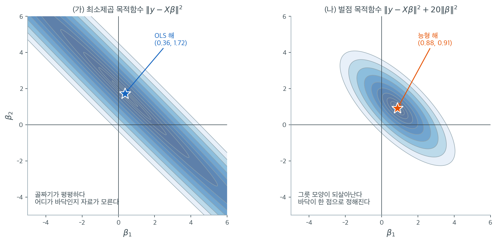
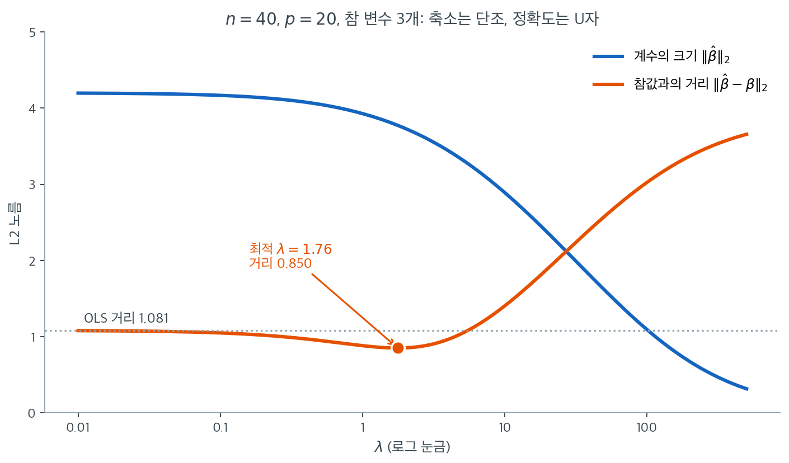
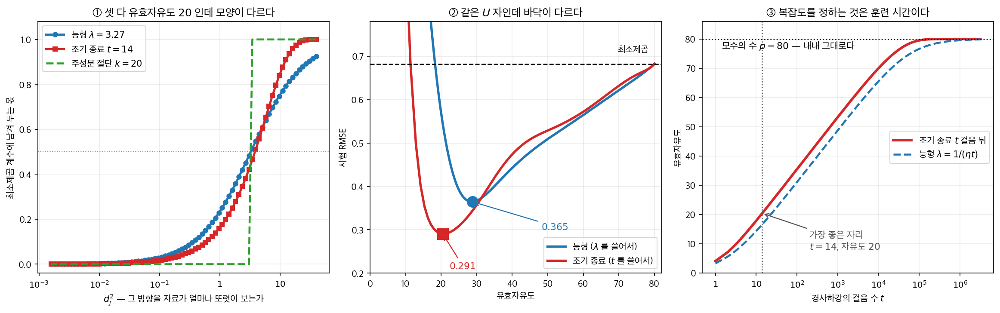

# 능형회귀 (L2 정칙화)


## 1. 동기: OLS의 문제

보통최소제곱(OLS)은 잔차제곱합을 최소화한다.

$$
\hat{\boldsymbol{\beta}}_{\text{OLS}} = \arg\min_{\boldsymbol{\beta}} \|\mathbf{y} - \mathbf{X}\boldsymbol{\beta}\|^2
$$

닫힌 형태 해는 $\hat{\boldsymbol{\beta}}_{\text{OLS}} = (\mathbf{X}^\top \mathbf{X})^{-1}\mathbf{X}^\top \mathbf{y}$이다.

이 추정량은 **불편**이며 Gauss-Markov 정리에 의해 모든 선형 불편추정량 중 최소분산(BLUE)이다. 그러나 다음 상황에서 성능이 나빠질 수 있다.

1. **다중공선성.** 설명변수가 강하게 상관되면 $\mathbf{X}^\top\mathbf{X}$가 거의 특이행렬이 된다. 자료의 작은 변화가 $\hat{\boldsymbol{\beta}}$의 큰 변화를 낳아 분산이 부풀려진다.
2. **고차원 상황.** $p$가 $n$에 가깝거나 넘으면 OLS가 정의되지 않거나 심하게 과적합한다.
3. **예측 정확도.** 편향–분산 절충(5장)에 따르면 약간의 편향을 들여와 분산을 크게 줄이면 MSE와 예측 정확도가 개선될 수 있다.

---

## 2. 능형회귀의 정식화

**능형회귀**(Hoerl and Kennard, 1970)는 OLS 목적함수에 L2 벌점을 더한다.

$$
\hat{\boldsymbol{\beta}}_{\text{ridge}} = \arg\min_{\boldsymbol{\beta}} \left\{ \|\mathbf{y} - \mathbf{X}\boldsymbol{\beta}\|^2 + \lambda \|\boldsymbol{\beta}\|^2 \right\}
$$

여기서 $\lambda \geq 0$이 **정칙화 모수**(조정모수, 벌점강도)이고 $\|\boldsymbol{\beta}\|^2 = \sum_{j=1}^p \beta_j^2$이다.

!!! note "중심화와 척도조정"
    절편 $\beta_0$은 보통 **벌점하지 않는다.** 실무에서는 능형회귀를 적용하기 전에 $\mathbf{y}$를 중심화하고 $\mathbf{X}$의 각 열을 평균 0, 분산 1로 표준화하여 벌점이 모든 계수를 동등하게 다루도록 한다.

---

## 3. 닫힌 형태 해

$$
\hat{\boldsymbol{\beta}}_{\text{ridge}} = (\mathbf{X}^\top\mathbf{X} + \lambda \mathbf{I})^{-1}\mathbf{X}^\top\mathbf{y}
$$

*유도.* 목적함수의 기울기를 0으로 두면

$$
-2\mathbf{X}^\top(\mathbf{y} - \mathbf{X}\boldsymbol{\beta}) + 2\lambda\boldsymbol{\beta} = \mathbf{0}
\;\Longrightarrow\;
(\mathbf{X}^\top\mathbf{X} + \lambda\mathbf{I})\boldsymbol{\beta} = \mathbf{X}^\top\mathbf{y}
$$

$\lambda > 0$에서 $\mathbf{X}^\top\mathbf{X} + \lambda\mathbf{I}$가 양정치이므로($\mathbf{X}^\top\mathbf{X}$가 특이행렬이어도) 해가 언제나 존재하고 유일하다.

---

## 4. 기하적 해석

능형회귀는 **제약최적화**로 동등하게 표현된다.

$$
\min_{\boldsymbol{\beta}} \|\mathbf{y} - \mathbf{X}\boldsymbol{\beta}\|^2 \quad \text{제약} \quad \|\boldsymbol{\beta}\|^2 \leq t
$$

- OLS 목적함수는 계수공간에서 타원형 등고선을 정의한다
- 제약 $\|\boldsymbol{\beta}\|^2 \leq t$는 **구**($p$차원에서는 초구)이다
- 능형 해는 가장 작은 타원 등고선이 구에 닿는 점이다

이 구 제약은 모든 계수를 0 쪽으로 축소하지만 일반적으로 어떤 것도 정확히 0으로 만들지 **않는다.** 자세한 논의는 [기하적 해석](geometry.md)을 보라.



벌점이 하는 일을 목적함수의 모양으로 보면 가장 빠르다. 상관이 $0.99$인 설명변수 두 개, $n = 50$, 참 계수 $(1, 1)$인 자료에서 두 목적함수의 등고선을 그렸다. 왼쪽 최소제곱 목적함수는 **골짜기**다. $\beta_1 + \beta_2$가 일정한 대각선 방향으로는 값이 거의 변하지 않아 등고선이 길게 늘어졌다. $\mathbf{X}^\top\mathbf{X}$의 고윳값이 $121.03$과 $0.48$로 조건수가 $252$인데, 등고선 타원의 장축과 단축 길이의 비가 정확히 그 제곱근인 $16$배다.

골짜기가 평평하다는 것은 **자료가 바닥의 위치를 모른다**는 뜻이다. 이 표본에서 OLS가 찍은 바닥은 $(0.36,\ 1.72)$로 참값 $(1, 1)$에서 꽤 멀다. 자료를 다시 뽑으면 이 점은 같은 대각선을 따라 멀리 미끄러진다. 골짜기 바닥이 평평하므로 미끄러져도 목적함숫값이 거의 오르지 않기 때문이다.

오른쪽은 같은 자료에 $20\|\boldsymbol{\beta}\|^2$을 더한 것뿐이다. 등고선이 **그릇**이 되었다. 벌점항 $20(\beta_1^2 + \beta_2^2)$의 등고선은 원점을 중심으로 한 원이므로, 이것을 더하면 모든 방향의 곡률이 $20$씩 올라간다. 고윳값이 $121.03 \to 141.03$, $0.48 \to 20.48$로 바뀌어 조건수가 $252$에서 $6.9$로 떨어진다. 큰 쪽은 거의 그대로이고 작은 쪽만 40배 커졌다는 점이 핵심이다. **벌점은 자료가 이미 잘 아는 방향은 건드리지 않고, 모르는 방향에만 곡률을 빌려준다.**

그릇의 바닥은 $(0.878,\ 0.908)$로 참값 $(1, 1)$ 바로 옆이다. 물론 이 한 표본의 결과일 뿐이고, 편향이 들어갔으므로 평균적으로는 참값보다 원점 쪽에 놓인다. 그러나 **바닥이 한 점으로 확실히 정해진다**는 성질은 표본과 무관하게 언제나 성립한다. $\mathbf{X}^\top\mathbf{X}$가 특이행렬이어서 왼쪽 골짜기가 아예 평평한 직선이 되어 버리는 $p > n$ 상황에서도 마찬가지다.

---

## 5. SVD 해석

특이값분해 $\mathbf{X} = \mathbf{U}\mathbf{D}\mathbf{V}^\top$($d_1 \geq \cdots \geq d_p \geq 0$)을 쓰면

$$
\hat{\boldsymbol{\beta}}_{\text{ridge}} = \sum_{j=1}^p \frac{d_j^2}{d_j^2 + \lambda} \cdot \frac{\mathbf{u}_j^\top \mathbf{y}}{d_j}\,\mathbf{v}_j
$$

이며 OLS는

$$
\hat{\boldsymbol{\beta}}_{\text{OLS}} = \sum_{j=1}^p \frac{\mathbf{u}_j^\top \mathbf{y}}{d_j}\,\mathbf{v}_j
$$

이다. 인자 $\frac{d_j^2}{d_j^2 + \lambda}$가 0과 1 사이의 **축소인자**다. 특이값이 작은 성분(불안정한 방향)이 가장 많이 축소되며, 바로 그곳이 OLS의 분산이 큰 곳이므로 능형회귀가 추정을 안정시킨다.

---

## 6. 능형회귀의 편향과 분산

$$
\text{Bias}(\hat{\boldsymbol{\beta}}_{\text{ridge}}) = -\lambda(\mathbf{X}^\top\mathbf{X} + \lambda\mathbf{I})^{-1}\boldsymbol{\beta}
$$

$$
\text{Cov}(\hat{\boldsymbol{\beta}}_{\text{ridge}}) = \sigma^2 (\mathbf{X}^\top\mathbf{X} + \lambda\mathbf{I})^{-1}\mathbf{X}^\top\mathbf{X}(\mathbf{X}^\top\mathbf{X} + \lambda\mathbf{I})^{-1}
$$

$\lambda$가 커지면 편향은 커지고 분산은 작아지며, 전체 MSE를 최소화하는 최적 $\lambda^*$가 존재한다.

**정리 (Hoerl and Kennard, 1970).** $\text{MSE}(\hat{\boldsymbol{\beta}}_{\text{ridge}}) < \text{MSE}(\hat{\boldsymbol{\beta}}_{\text{OLS}})$가 되는 $\lambda > 0$이 언제나 존재한다.

축소가 **계수의 크기**에는 단조로 작용하지만 **참값과의 거리**에는 그렇지 않다. 그 차이가 $\lambda$ 를 고르는 일의 전부다.
위의 식들을 코드로 옮긴다. 축소가 **계수의 크기**에는 단조로 작용하지만 **참값과의 거리**에는 그렇지 않다는 것이 여기서 드러난다.

### 계수는 줄어드는데 정확도는 나빠질 수 있다

$\lambda$를 키워 가며 계수가 어떻게 줄어드는지, 그리고 참값과의 거리가 어디에서 가장
작아지는지를 본다.

<div class="exbox" markdown>

**보기 1.** <span class="diff easy" title="쉬움"></span> 람다에 따른 축소와 편향–분산 절충. $n = 40$, $p = 20$이고 참 계수는 앞의 셋만 $(3, -2, 1.5)$이며 잡음은 $N(0,1)$이다. $X$를 고정해 놓고 $\lambda$를 키워 간다.

**(1)** $\lVert\hat\beta^{\text{ridge}}(\lambda)\rVert_2$가 $\lambda$에 대해 **반드시** 감소함을 특이값분해로 보이시오. 참값과의 거리도 그러한가.

**(2)** $E\lVert\hat\beta(\lambda) - \beta\rVert^2$를 편향과 분산으로 나누어 적고, $\lambda = 0$에서의 도함수를 구해 **최소제곱보다 나은 $\lambda > 0$이 반드시 존재함**을 보이시오. 그 값을 코드로 확인하시오.

</div>

??? success "풀이"

    **(1) 해석적으로.** $X = UDV^\top$를 특이값분해라 하면 (연습문제 13에서 유도하듯)

    $$
    \hat\beta^{\text{ridge}}(\lambda) = \sum_{j=1}^p \frac{d_j}{d_j^2+\lambda}\,(u_j^\top y)\,v_j
    $$

    이고 $v_j$가 정규직교이므로

    $$
    \lVert\hat\beta^{\text{ridge}}(\lambda)\rVert_2^2
    = \sum_{j=1}^p \left(\frac{d_j\,u_j^\top y}{d_j^2+\lambda}\right)^2
    $$

    이다. 각 항의 분모가 $\lambda$에 대해 증가하므로 **모든 항이 따로따로 감소한다.** 합도 감소한다. 여기에 U자가 생길 수 없으며, 이것은 자료와 무관한 항등식 수준의 사실이다.

    참값과의 거리는 다르다. $\lambda$가 크면 $\hat\beta \to 0$이고 거리는 $\lVert\beta\rVert = \sqrt{9+4+2.25} = 3.9051$로 올라가므로, 거리가 끝까지 줄어들 수는 없다. (2)에서 보듯 중간에 바닥이 있다.

    **(2) 해석적으로.** $S = X^\top X$, $A_\lambda = (S+\lambda I)^{-1}$이라 두자. $X$를 고정하면 $\hat\beta = A_\lambda X^\top y$이고 $y = X\beta + \varepsilon$, $\operatorname{Var}(\varepsilon) = \sigma^2 I$이므로

    $$
    E[\hat\beta] = A_\lambda S\beta,
    \qquad
    E[\hat\beta] - \beta = (A_\lambda S - I)\beta = -\lambda A_\lambda \beta
    $$

    이다. 마지막 등식은 $A_\lambda S - I = A_\lambda(S + \lambda I - \lambda I) - I = -\lambda A_\lambda$에서 나온다. 분산 쪽은 $\operatorname{Var}(\hat\beta) = \sigma^2 A_\lambda S A_\lambda$이므로

    $$
    E\lVert\hat\beta(\lambda) - \beta\rVert^2
    = \underbrace{\lambda^2\,\beta^\top A_\lambda^2 \beta}_{\text{편향}^2}
    + \underbrace{\sigma^2\operatorname{tr}\!\left(A_\lambda S A_\lambda\right)}_{\text{분산}}
    $$

    다. $\lambda = 0$에서 값은 $\sigma^2\operatorname{tr}(S^{-1})$으로 최소제곱의 오차다.

    이제 $\lambda = 0$에서의 도함수를 본다. 편향항은 $\lambda^2$에 비례하므로 미분하면 $2\lambda(\cdots)$ 꼴이라 $\lambda = 0$에서 **0이다.** 분산항은 $\frac{d}{d\lambda}A_\lambda = -A_\lambda^2$이므로

    $$
    \frac{d}{d\lambda}\,\sigma^2\operatorname{tr}(A_\lambda S A_\lambda)
    = -2\sigma^2\operatorname{tr}(A_\lambda^2 S A_\lambda)
    \;\xrightarrow[\lambda\to 0]{}\;
    -2\sigma^2\operatorname{tr}(S^{-2}) < 0
    $$

    이다. **편향은 이차로 자라고 분산은 일차로 줄어든다.** 그러므로 $\lambda = 0$ 바로 오른쪽에서 오차가 반드시 감소하며, 최소제곱보다 나은 $\lambda > 0$이 언제나 존재한다. 이것이 능형회귀의 존재정리이고, 이 보기의 표에서 $\lambda = 1$이 $\lambda = 0$을 이기는 까닭이다.

    **(2) 수치적으로.**

    ```python
    import numpy as np
    from sklearn.linear_model import LinearRegression, Ridge

    rng = np.random.default_rng(42)

    # 설명변수 20개 중 참으로 쓰이는 것은 앞의 셋뿐이다. 관측은 40개로 변수 수에
    # 비해 적어, 최소제곱이 잡음까지 따라가기 좋은 상황이다.
    n, p = 40, 20
    X = rng.normal(size=(n, p))
    beta_true = np.zeros(p)
    beta_true[:3] = [3.0, -2.0, 1.5]
    y = X @ beta_true + rng.normal(0, 1, n)

    ols = LinearRegression().fit(X, y)

    # lambda 를 키울수록 계수가 0 쪽으로 줄어든다. 라쏘와 달리 정확히 0 이 되지는
    # 않고 작아지기만 한다. 그래서 능형은 변수를 고르지 못한다.
    print(f"{'lambda':>8}  {'계수의 L2 크기':>14}  {'참값과의 거리':>14}")
    print(f"{0.0:>8.1f}  {np.linalg.norm(ols.coef_):>14.3f}  "
          f"{np.linalg.norm(ols.coef_ - beta_true):>14.3f}")
    for lam in [0.1, 1.0, 10.0, 100.0]:
        ridge = Ridge(alpha=lam).fit(X, y)
        print(f"{lam:>8.1f}  {np.linalg.norm(ridge.coef_):>14.3f}  "
              f"{np.linalg.norm(ridge.coef_ - beta_true):>14.3f}")

    # 참값과의 거리가 lambda=0 일 때보다 중간 어딘가에서 작아진다. 편향을 조금
    # 받아들이는 대가로 분산을 크게 줄인 결과이며, 이것이 편향-분산 절충이다.

    # --- 유도한 기댓값 곡선과 맞춰 본다 (sigma = 1, X 는 고정) ---
    S = X.T @ X

    def expected_sq_error(lam):
        """E||beta_hat(lam) - beta||^2 = 편향^2 + 분산.  X 를 고정한 조건부 기댓값."""
        A = np.linalg.inv(S + lam * np.eye(p))
        bias2 = lam ** 2 * beta_true @ (A @ A) @ beta_true
        var = np.trace(A @ S @ A)
        return bias2, var

    lams = np.logspace(-2, 2, 400)
    tot = np.array([sum(expected_sq_error(l)) for l in lams])
    k = tot.argmin()
    b2, v = expected_sq_error(lams[k])
    print(f"이론: lambda = 0 에서 E||.||^2 = tr(S^-1) = {np.trace(np.linalg.inv(S)):.4f}")
    print(f"이론: 최솟값 {tot[k]:.4f} (편향^2 {b2:.4f} + 분산 {v:.4f}) at lambda = {lams[k]:.4f}")
    print(f"0 에서의 도함수 = -2*tr(S^-2) = {-2 * np.trace(np.linalg.inv(S) @ np.linalg.inv(S)):.4f}  (< 0)")

    grid = np.logspace(-2, 2, 2000)
    dist = np.array([np.linalg.norm(Ridge(alpha=l).fit(X, y).coef_ - beta_true) for l in grid])
    print(f"이 표본의 거리 곡선 최솟값 {dist.min():.4f} at lambda = {grid[dist.argmin()]:.4f}")
    ```

    출력:

    ```
      lambda       계수의 L2 크기         참값과의 거리
         0.0           4.202           1.081
         0.1           4.169           1.048
         1.0           3.929           0.880
        10.0           2.891           1.404
       100.0           1.091           3.026
    이론: lambda = 0 에서 E||.||^2 = tr(S^-1) = 1.3683
    이론: 최솟값 1.0621 (편향^2 0.1914 + 분산 0.8707) at lambda = 1.6810
    0 에서의 도함수 = -2*tr(S^-2) = -0.5116  (< 0)
    이 표본의 거리 곡선 최솟값 0.8499 at lambda = 1.7584
    ```

    

    **유도와 코드가 맞는다.** 기댓값 곡선은 $\lambda = 1.6810$에서 바닥을 치고, 이 한 표본의 거리 곡선은 $\lambda = 1.7584$에서 바닥을 친다. 둘이 정확히 같을 이유는 없다. 앞의 것은 $y$에 대한 기댓값이고 뒤의 것은 $y$를 한 번 뽑은 실현값이기 때문이다. 바닥의 **위치**가 가까운 것으로 충분하며, 바닥의 **값**은 $1.0305$(기댓값의 제곱근) 대 $0.8499$로 더 벌어진다. 이 표본이 운 좋게 평균보다 잘 맞은 것이다.

    $\lambda = 0$에서의 도함수가 $-0.5116$으로 음수인 것이 (2)의 결론을 그대로 확인한다. 최적점에서 편향제곱 $0.1914$와 분산 $0.8707$의 합 $1.0621$이 최소제곱의 $1.3683$보다 $22\%$ 작다. **편향 $0.19$를 사서 분산 $0.50$을 깎은 거래다.**

    위 표의 다섯 줄을 촘촘한 격자로 채워 그린 것이 위 그림이다. 파란 곡선은 계수벡터의 크기 $\lVert\hat{\boldsymbol{\beta}}\rVert_2$, 주황 곡선은 참값과의 거리 $\lVert\hat{\boldsymbol{\beta}} - \boldsymbol{\beta}\rVert_2$다. **두 곡선의 모양이 다르다는 것이 이 그림의 전부다.**

    파란 곡선은 끝까지 단조감소한다. $4.202$에서 출발해 $\lambda = 100$에서 $1.091$까지, 그리고 그 뒤로도 계속 내려간다. (1)에서 항별로 보인 그대로이며 여기에는 U자가 있을 수 없다.

    주황 곡선은 다르다. $\lambda = 0.01$에서 $1.081$(OLS와 사실상 같다)로 시작해 $\lambda = 1.76$에서 $0.850$까지 내려갔다가 다시 올라간다. $\lambda = 10$에서 벌써 $1.404$로 OLS보다 나빠지고 $\lambda = 100$에서는 $3.026$이다. 회색 점선으로 그린 OLS 수준 $1.081$과 주황 곡선이 만나는 지점이 $\lambda = 5.51$인데, **그보다 큰 $\lambda$는 손해**라는 뜻이다. 이득이 나는 구간은 생각보다 좁다.

    여기서 실무적 함정 하나가 보인다. 계수가 작아지는 것은 눈에 잘 띄지만 정확도가 나빠지는 것은 눈에 띄지 않는다. $\lambda = 100$에서 계수의 크기는 $1.091$로 "아주 깔끔하게 정리된" 모형처럼 보이는데, 실제로는 참값에서 $3.026$만큼 떨어져 OLS보다 세 배 나쁘다. **계수가 작다는 것은 좋은 모형의 증거가 아니다.** 어디가 바닥인지는 오직 자료로 추정해야 하며, 그 방법이 교차검증이다.

---

---

## 7. λ의 선택: 교차검증

최적 $\lambda$는 알려져 있지 않으므로 자료에서 추정해야 한다. 표준적인 접근은 **$k$-겹 교차검증**이다.

1. 자료를 $k$개 겹으로 나눈다(대개 $k = 5$ 또는 $10$).
2. 격자 위의 각 후보 $\lambda$에 대해, 각 겹을 검정집합으로 삼아 예측오차를 기록하고 평균낸다.
3. $\hat{\lambda} = \arg\min_\lambda \text{CV}(\lambda)$를 고른다.

!!! tip "1-표준오차 규칙"
    CV 오차가 최소인 $\lambda$ 대신, 최솟값에서 1 표준오차 이내에 있는 가장 큰 $\lambda$를 고른다. 예측 성능은 비슷하면서 더 간결한 모형을 얻는다.

능형회귀의 LOOCV에는 닫힌 형태 지름길이 있다.

$$
\text{CV}_{\text{LOO}}(\lambda) = \frac{1}{n}\sum_{i=1}^n \left(\frac{y_i - \hat{y}_i(\lambda)}{1 - h_{ii}(\lambda)}\right)^2
$$

여기서 $h_{ii}(\lambda) = [\mathbf{X}(\mathbf{X}^\top\mathbf{X} + \lambda\mathbf{I})^{-1}\mathbf{X}^\top]_{ii}$이다. 자세한 내용은 [능형 자취와 $\lambda$의 선택](lambda_selection.md)을 보라.

---

## 8. 베이즈 MAP로서의 능형회귀

능형회귀는 가우스 사전분포를 둔 베이즈 선형모형의 **사후최빈값**(MAP) 추정과 동등하다.

$$
\boldsymbol{\beta} \sim N(\mathbf{0}, \tau^2 \mathbf{I}), \quad \mathbf{y} \mid \boldsymbol{\beta} \sim N(\mathbf{X}\boldsymbol{\beta}, \sigma^2\mathbf{I})
$$

$$
\hat{\boldsymbol{\beta}}_{\text{MAP}} = \Bigl(\mathbf{X}^\top\mathbf{X} + \frac{\sigma^2}{\tau^2}\mathbf{I}\Bigr)^{-1}\mathbf{X}^\top\mathbf{y}
$$

$\lambda = \sigma^2/\tau^2$로 두면 능형 해가 된다. 자세한 내용은 [베이즈 해석](bayesian.md)을 보라.

---

## 9. 유효자유도

$$
\text{df}(\lambda) = \text{tr}\left[\mathbf{X}(\mathbf{X}^\top\mathbf{X} + \lambda\mathbf{I})^{-1}\mathbf{X}^\top\right] = \sum_{j=1}^p \frac{d_j^2}{d_j^2 + \lambda}
$$

$\lambda \to 0$에서 $\text{df} \to p$(OLS), $\lambda \to \infty$에서 $\text{df} \to 0$(상수모형)이다. 서로 다른 $\lambda$의 모형 복잡도를 직접 비교할 수 있게 해준다.

<div class="aibox" markdown>

**AI로 보는 통계학 1.** 벌점을 한 줄도 넣지 않았는데 능형이었다

신경망을 학습시키는 사람은 거의 모두 **조기 종료**를 쓴다. 검증오차를 지켜보다가 오르기 시작하면 멈추고 그때의 가중치를 가져간다. 목적함수에는 벌점항이 하나도 없다. 그런데도 이것은 정칙화다. $\S 5$ 의 SVD 해석을 그대로 쓰면 **얼마나 센 능형인지까지** 나온다.

$\mathbf X = \mathbf U \mathbf D \mathbf V^\top$ 라 두고 $\boldsymbol\beta^0 = \mathbf 0$ 에서 학습률 $\eta$ 로 경사하강을 돌린다. $j$ 번째 특이방향의 좌표를 $\alpha_j$ 라 하면 갱신식이

$$
\alpha_j^{t+1} = (1 - \eta d_j^2)\,\alpha_j^{t} + \eta d_j\,(\mathbf u_j^\top \mathbf y)
$$

로 **좌표마다 따로** 돈다. 고정점이 최소제곱값 $\alpha_j^{\text{LS}} = \mathbf u_j^\top \mathbf y / d_j$ 이고 등비수열이므로

$$
\alpha_j^{t} = \Bigl[\,1 - (1 - \eta d_j^2)^{t}\,\Bigr]\,\alpha_j^{\text{LS}}
$$

이다. 대괄호 안이 **수축인자**다. $\S 5$ 의 능형 수축인자 $d_j^2/(d_j^2+\lambda)$ 와 나란히 놓으면 $\eta t d_j^2$ 가 $d_j^2/\lambda$ 자리에 있다. 곧

$$
\boxed{\ \lambda \;\approx\; \frac{1}{\eta t}\ }
$$

이다. **걸음을 두 배 더 걸으면 $\lambda$ 를 반으로 줄인 것과 같다.** 학습률과 걸음 수는 같은 손잡이의 양 끝이다.



$n = 150$, $p = 80$, 조건수 $\kappa(\mathbf X) = 159$ 인 자료로 재 보았다. 세 가지가 보인다.

**첫째, 조기 종료는 능형과 주성분 절단의 사이에 있다.** 그림 ①은 유효자유도를 똑같이 $20$ 으로 맞춘 세 수축 프로파일이다. 능형(파랑)은 완만하게 내려가고 주성분 절단(초록)은 칼로 자르며, 조기 종료(빨강)는 **그 사이**에 있되 능형보다 가파르다. 수축인자가 $\tfrac12$ 을 지나는 자리에서 $d_j^2$ 이 열 배 작은 방향을 보면, 능형은 $0.085$ 를 남기는데 조기 종료는 $0.059$ 만 남긴다. 조기 종료는 **잘 보이지 않는 방향을 능형보다 매몰차게 버린다.**

**둘째, 그 차이가 성적으로 나타난다.** 그림 ②는 유효자유도를 가로축에 두고 시험 RMSE 를 그린 것이다. 둘 다 $U$ 자인데 바닥이 다르다.

| | 가장 좋은 자리 | 시험 RMSE | 유효자유도 |
|---|---|---|---|
| 최소제곱 | — | $0.682$ | $80$ |
| 능형 | $\lambda = 1.08$ | $0.365$ | $28.8$ |
| 조기 종료 | $t = 14$ | $\mathbf{0.291}$ | $20.4$ |

이 자료에서는 **조기 종료가 능형을 이긴다.** 더 적은 자유도로 더 낮은 오차에 닿는다. 참 계수가 큰 특이방향에 몰려 있게 만들어 둔 자료라서, 작은 방향을 매몰차게 버리는 쪽이 유리하다. 자유도를 $20$ 으로 똑같이 맞추어 비교하면 능형 $0.539$, 주성분 절단 $0.302$, 조기 종료 $0.291$ 로 조기 종료가 주성분 절단 쪽에 붙는다. **어느 쪽이 나은지는 신호가 어느 방향에 실려 있느냐로 정해지지, 벌점의 이름으로 정해지지 않는다.**

**셋째가 이 상자의 요점이다.** 그림 ③은 걸음 수에 따른 유효자유도다. $t = 1$ 에서 $4.2$, $t = 100$ 에서 $35.5$, $t = 10^6$ 에서 $80.0$ 으로 올라간다. 그동안 **모수의 수는 내내 $80$ 개로 그대로였다.** 모형의 복잡도를 정한 것은 모수의 수가 아니라 **훈련 시간**이다. 점선으로 그린 능형 $\lambda = 1/(\eta t)$ 곡선이 그 위에 거의 겹쳐 있다.

실무로 세 가지가 따라 나온다.

- **학습률 일정을 바꾸면 정칙화 세기가 함께 바뀐다.** $\lambda \approx 1/(\eta t)$ 이므로 학습률을 올리면 같은 걸음 수에서 더 약하게 정칙화된다. 학습률과 가중치 감쇠를 따로 조율하는 것은 **서로 섞여 있는 두 손잡이**를 따로 돌리는 일이다.
- **「모수가 많으니 과적합한다」는 말에 이 그림은 근거를 주지 않는다.** 같은 $80$ 개 모수가 $t$ 에 따라 자유도 $4$ 짜리 모형도 되고 $80$ 짜리 모형도 된다.
- **조기 종료는 공짜가 아니다.** 멈출 자리를 정하려면 검증집합이 필요하고, 그것은 능형이 $\lambda$ 를 고르려고 교차검증을 쓰는 것과 정확히 같은 비용이다. 바뀐 것은 벌점을 목적함수에 적느냐 최적화 경로에 숨기느냐뿐이다.

</div>

---

## 10. 주요 성질 요약

| 성질 | 값 |
|---|---|
| 벌점 | $\lambda\sum_{j=1}^p \beta_j^2$ (L2) |
| 해 | 닫힌 형태: $(\mathbf{X}^\top\mathbf{X} + \lambda\mathbf{I})^{-1}\mathbf{X}^\top\mathbf{y}$ |
| 변수선택 | 없음(축소하되 0으로 만들지 않음) |
| 다중공선성 처리 | 가능 |
| $p > n$에서 작동 | 가능 |
| 베이즈 해석 | $\boldsymbol{\beta}$에 대한 가우스 사전분포 |
| 기하적 제약 | $\ell_2$ 공(구) |

---

## 연습문제

<div class="drillbox" markdown>

**연습문제 1.** <span class="diff easy" title="쉬움"></span>
능형회귀의 최적화 문제와 닫힌 형태 해를 쓰라. $\lambda$는 해에 어떤 영향을 주는가?

</div>

??? success "풀이"
    최적화 문제는

    $$
    \hat{\boldsymbol{\beta}}_{\text{ridge}} = \arg\min_{\boldsymbol{\beta}} \left\{ \lVert \mathbf{y} - \mathbf{X}\boldsymbol{\beta} \rVert^2 + \lambda \lVert \boldsymbol{\beta} \rVert^2 \right\}
    $$

    이고 닫힌 형태 해는

    $$
    \hat{\boldsymbol{\beta}}_{\text{ridge}} = (\mathbf{X}^\top\mathbf{X} + \lambda\mathbf{I})^{-1}\mathbf{X}^\top\mathbf{y}
    $$

    이다. $\lambda \to 0$이면 $\hat{\boldsymbol{\beta}}_{\text{ridge}} \to \hat{\boldsymbol{\beta}}_{\text{OLS}}$, $\lambda \to \infty$이면 $\hat{\boldsymbol{\beta}}_{\text{ridge}} \to \mathbf{0}$이다. $\lambda$가 편향–분산 절충을 조절하며, 클수록 편향이 커지고 분산이 줄어든다.

---

---

<div class="drillbox" markdown>

**연습문제 2.** <span class="diff easy" title="쉬움"></span>
표준화된 자료에 $\lambda = 1$로 능형회귀를 적합했더니 $\hat{\beta}_1 = 0.45$, $\hat{\beta}_2 = 0.38$을 얻었다. OLS는 $\hat{\beta}_1 = 1.2$, $\hat{\beta}_2 = -0.8$을 준다. 이 차이를 해석하라.

</div>

??? success "풀이"
    OLS 추정값($1.2$와 $-0.8$)은 크기가 크고 부호가 반대인데, 이는 다중공선성의 전형적 특징이다. 설명변수가 상관되어 있어 OLS가 서로를 부분적으로 상쇄하는 불안정하고 부풀려진 계수를 낸다.

    능형회귀($0.45$와 $0.38$)는 두 계수를 모두 0 쪽으로 축소하고 크기를 비슷하게 만든다. $\hat{\beta}_2$의 부호가 $-0.8$에서 $+0.38$로 뒤집힌 것은, OLS의 음수 계수가 진짜 음의 관계가 아니라 선형종속의 산물이었음을 시사한다. 능형회귀는 약간의 편향을 대가로 더 안정적이고 해석 가능한 추정값을 낸다.

    !!! warning "부호 반전을 '능형이 고쳤다'로 읽을 때의 주의"
        능형회귀가 부호를 "바로잡았다"고 단정할 수는 없다. 능형은 계수를 0 쪽으로 당기므로, 참값이 실제로 음수여도 크기가 작으면 양수 쪽으로 넘어갈 수 있다.

        확실히 말할 수 있는 것은 **자료가 두 계수를 개별적으로 결정하지 못한다**는 사실뿐이다. 계수의 합 $\hat\beta_1 + \hat\beta_2$는 OLS에서 $0.4$, 능형에서 $0.83$으로 그나마 안정적이다. 다중공선성이 있을 때는 개별 계수가 아니라 안정적인 조합을 해석해야 한다([다중공선성과 정칙화](../motivation/multicollinearity.md) 연습문제 3 참조).

---

---

<div class="drillbox" markdown>

**연습문제 3.** <span class="diff med" title="중간"></span>
능형회귀가 편향되어 있음을 보이고, 편향을 $\lambda$와 참 $\boldsymbol{\beta}$로 유도하라.

</div>

??? success "풀이"
    $$
    E[\hat{\boldsymbol{\beta}}_{\text{ridge}}] = (\mathbf{X}^\top\mathbf{X} + \lambda\mathbf{I})^{-1}\mathbf{X}^\top\mathbf{X}\boldsymbol{\beta} = \mathbf{W}\boldsymbol{\beta} \neq \boldsymbol{\beta}
    $$

    여기서 $\mathbf{W} = (\mathbf{X}^\top\mathbf{X} + \lambda\mathbf{I})^{-1}\mathbf{X}^\top\mathbf{X}$이다. 편향은

    $$
    \text{Bias} = (\mathbf{W} - \mathbf{I})\boldsymbol{\beta} = -\lambda(\mathbf{X}^\top\mathbf{X} + \lambda\mathbf{I})^{-1}\boldsymbol{\beta}
    $$

    이다. 편향은 $\lambda$와 $\boldsymbol{\beta}$의 크기에 따라 커진다. 그럼에도 분산 감소가 편향의 제곱을 넘어서면 전체 MSE는 OLS보다 작아질 수 있다. $\square$

    **편향의 방향이 $-\boldsymbol{\beta}$ 쪽이라는 점에 주목하라.** 즉 편향은 언제나 계수를 0 쪽으로 당긴다. $\boldsymbol{\beta}$가 클수록 편향도 크며, 이것이 참 계수가 큰 상황에서 $\lambda$를 작게 잡아야 하는 이유다([과적합과 편향–분산 절충](../motivation/overfitting.md) 연습문제 2 참조).

---

---

<div class="drillbox" markdown>

**연습문제 4.** <span class="diff med" title="중간"></span>
능형회귀가 다중공선성에 도움이 되는 이유를 설명하라. $\mathbf{X}^\top\mathbf{X} + \lambda\mathbf{I}$의 조건수는 어떻게 되는가?

</div>

??? success "풀이"
    다중공선성은 $\mathbf{X}^\top\mathbf{X}$가 0에 가까운 고윳값을 가져 거의 특이행렬이 되고 조건수 $\kappa = d_1/d_p$가 커진다는 뜻이다.

    $\lambda\mathbf{I}$를 더하면 모든 고윳값이 $\lambda$만큼 이동한다. 새 조건수는

    $$
    \kappa_{\text{ridge}} = \frac{d_1 + \lambda}{d_p + \lambda} < \frac{d_1}{d_p} = \kappa_{\text{OLS}}
    $$

    이다. 최소 고윳값이 0에 가까운 $d_p$에서 $d_p + \lambda$로 올라가 수치 안정성이 크게 개선되고 $\hat{\boldsymbol{\beta}}$의 분산이 줄어든다.

    구체적인 수치는 [불량조건 계획행렬](../motivation/ill_conditioning.md) 연습문제 1에 있다. $\rho = 0.999$인 등상관 구조에서 $\lambda = 1$이 조건수를 $7993 \to 8.98$로 890배 줄인다.

---

---

<div class="drillbox" markdown>

**연습문제 5.** <span class="diff med" title="중간"></span>
4절은 상관 $0.99$인 자료에서 "$\mathbf{X}^\top\mathbf{X}$의 고윳값이 $121.03$과 $0.48$로 조건수가 $252$인데, 등고선 타원의 장축과 단축 길이의 비가 정확히 그 제곱근인 $16$배다"라고 적었다. 왜 조건수가 아니라 그 **제곱근**인지 밝히고 수를 확인하라.

1. RSS를 $\hat{\boldsymbol{\beta}}_{\text{OLS}}$ 중심의 이차형식으로 쓰고, 등고선 타원의 반축 길이를 $\mathbf{X}^\top\mathbf{X}$의 고윳값으로 표현하라.
2. 축 길이의 비가 $16$에 맞는지 계산하라.
3. $\lambda = 20$을 더한 오른쪽 그릇의 등고선은 축비가 얼마인가.
4. 축비를 정확히 $2$로 만드는 $\lambda$를 구하라.
5. 유한한 $\lambda$로 등고선을 **완전한 원**으로 만들 수 있는가. 그 답이 연습문제 4의 결론에 무엇을 덧붙이는가.

</div>

??? success "풀이"
    **1.** $\hat{\boldsymbol{\beta}} = \hat{\boldsymbol{\beta}}_{\text{OLS}}$라 쓰면 정규방정식 $\mathbf{X}^\top(\mathbf{y} - \mathbf{X}\hat{\boldsymbol{\beta}}) = \mathbf{0}$ 때문에 교차항이 사라져

    $$
    \lVert \mathbf{y} - \mathbf{X}\boldsymbol{\beta} \rVert^2
    = \lVert \mathbf{y} - \mathbf{X}\hat{\boldsymbol{\beta}} \rVert^2
      + (\boldsymbol{\beta} - \hat{\boldsymbol{\beta}})^\top \mathbf{X}^\top\mathbf{X} (\boldsymbol{\beta} - \hat{\boldsymbol{\beta}})
    $$

    가 된다. 따라서 등고선 $\{\boldsymbol{\beta} : \text{RSS}(\boldsymbol{\beta}) = \text{RSS}_{\min} + c\}$는

    $$
    (\boldsymbol{\beta} - \hat{\boldsymbol{\beta}})^\top \mathbf{X}^\top\mathbf{X} (\boldsymbol{\beta} - \hat{\boldsymbol{\beta}}) = c
    $$

    이다. $\mathbf{X}^\top\mathbf{X} = \sum_j \mu_j \mathbf{v}_j\mathbf{v}_j^\top$로 고유분해하고 $w_j = \mathbf{v}_j^\top(\boldsymbol{\beta} - \hat{\boldsymbol{\beta}})$로 좌표를 바꾸면 $\sum_j \mu_j w_j^2 = c$, 곧 반축 길이가 $\sqrt{c/\mu_j}$인 타원이다. **길이가 고윳값의 역수의 제곱근에 비례하므로** 축 길이의 비는

    $$
    \frac{\sqrt{c/\mu_2}}{\sqrt{c/\mu_1}} = \sqrt{\frac{\mu_1}{\mu_2}} = \sqrt{\kappa}
    $$

    가 된다. 고윳값은 곡률이고 축 길이는 그 역수의 제곱근이라는 것이 전부다.

    **2.** $\mu_1/\mu_2 = 121.03/0.48 = 252.146$이고 $\sqrt{252.146} = 15.879$다. 4절의 "$16$배"가 맞다.

    **3.** 벌점을 더한 목적함수도 $\boldsymbol{\beta}$의 이차함수이고, 이차항의 행렬이 $\mathbf{X}^\top\mathbf{X} + \lambda\mathbf{I}$다. 고윳값이 $141.03$과 $20.48$이므로

    $$
    \sqrt{\frac{141.03}{20.48}} = \sqrt{6.8862} = 2.624
    $$

    배다. 장단축 비가 $15.9 \to 2.6$으로 떨어졌다. 등고선이 "골짜기"에서 "그릇"으로 보이는 것이 이 수다.

    **4.** $\dfrac{121.03 + \lambda}{0.48 + \lambda} = 2^2 = 4$를 풀면 $121.03 + \lambda = 1.92 + 4\lambda$, 곧

    $$
    \lambda = \frac{121.03 - 4 \times 0.48}{3} = \frac{119.11}{3} = 39.70
    $$

    이다. 축비를 $15.9$에서 $2.6$으로 줄이는 데는 $\lambda = 20$이면 되지만 거기서 다시 $2$로 줄이려면 $\lambda$를 두 배로 늘려야 한다. **벌점을 키워 얻는 조건수 개선은 수확이 체감한다.**

    **5.** 불가능하다. 축비가 $1$이려면 $121.03 + \lambda = 0.48 + \lambda$여야 하는데 이것은 어떤 $\lambda$에서도 성립하지 않는다. 축비 $\sqrt{(\mu_1+\lambda)/(\mu_2+\lambda)}$는 $\lambda$에 대해 **엄격히 감소하면서 $1$로 수렴할 뿐** $1$에 도달하지 못한다.

    이것이 연습문제 4에 덧붙이는 것은 다음이다. 연습문제 4는 $\kappa_{\text{ridge}} < \kappa_{\text{OLS}}$를 보였지만, 같은 계산은 $\kappa_{\text{ridge}}$가 $\lambda$에 대해 **단조감소**임도 말해 준다. 그러므로 "조건수를 가장 작게"가 목표라면 답은 $\lambda = \infty$이고 그때의 해는 $\hat{\boldsymbol{\beta}} = \mathbf{0}$이다. **조건수는 $\lambda$를 고르는 기준이 될 수 없다.** $\lambda$를 고르는 일에는 7절의 교차검증처럼 예측오차를 보는 기준이 필요하다.

---

---

<div class="drillbox" markdown>

**연습문제 6.** <span class="diff med" title="중간"></span>
9절의 유효자유도를 4절의 자료에 적용하라. $\mathbf{X}^\top\mathbf{X}$의 고윳값이 $d_1^2 = 121.03$, $d_2^2 = 0.48$이다.

1. $\lambda = 20$에서 방향별 축소인자 $d_j^2/(d_j^2+\lambda)$와 $\text{df}(20)$을 구하라.
2. 4절의 능형 해는 $(0.878,\ 0.908)$로 **두 계수가 모두 0이 아니다.** 그런데 $\text{df}(20) < 1$이다. 모순이 아닌 까닭을 설명하라.
3. $\text{df}(\lambda) = 1$이 되는 $\lambda$를 구하고, 일반적인 $p = 2$에서 그 값이 $d_1 d_2$임을 보여라.
4. 라쏘에서는 0이 아닌 계수의 개수가 자유도의 불편추정이 된다. 그 셈법을 능형에 그대로 쓰면 $\lambda = 20$에서 몇이 되고 참값과 몇 배 차이가 나는가.

</div>

??? success "풀이"
    **1.** 축소인자는

    $$
    \frac{121.03}{121.03 + 20} = \frac{121.03}{141.03} = 0.8582, \qquad
    \frac{0.48}{0.48 + 20} = \frac{0.48}{20.48} = 0.0234
    $$

    이고 유효자유도는 $\text{df}(20) = 0.8582 + 0.0234 = 0.8816$이다.

    **2.** 모순이 아니다. $\text{df}(\lambda)$는 **0이 아닌 계수의 개수가 아니라 방향마다의 축소인자를 더한 값**이다. 큰 고윳값 방향(설명변수의 합 방향)은 $85.8\%$가 살아남지만, 작은 고윳값 방향(차 방향, 곧 평평한 골짜기 방향)은 $2.3\%$만 남는다. 둘째 방향이 사실상 지워졌으므로 "자유롭게 움직이는 방향"은 하나에도 못 미친다.

    좌표 $(\beta_1, \beta_2)$가 둘 다 0이 아닌 것과는 아무 상관이 없다. 두 계수는 거의 $\beta_1 \approx \beta_2$라는 **한 방향** 위에서 함께 결정되고 있고, 실제로 $0.878$과 $0.908$이 거의 같다는 사실이 그 증거다. 자유도는 좌표를 세지 않고 방향을 센다.

    **3.** $a = d_1^2$, $b = d_2^2$라 쓰고 $\dfrac{a}{a+\lambda} + \dfrac{b}{b+\lambda} = 1$을 풀면

    $$
    a(b+\lambda) + b(a+\lambda) = (a+\lambda)(b+\lambda)
    \;\Longrightarrow\;
    2ab + (a+b)\lambda = ab + (a+b)\lambda + \lambda^2
    $$

    에서 $\lambda^2 = ab$, 곧

    $$
    \lambda = \sqrt{ab} = d_1 d_2 = \sqrt{\det(\mathbf{X}^\top\mathbf{X})}
    $$

    이다. 수를 넣으면 $\lambda = \sqrt{121.03 \times 0.48} = \sqrt{58.094} = 7.622$다. 확인하면 $121.03/128.652 + 0.48/8.102 = 0.9408 + 0.0592 = 1.0000$이다. **$p=2$에서 자유도를 정확히 하나 남기는 $\lambda$는 두 특잇값의 기하평균이다.**

    **4.** 0이 아닌 계수를 세면 $2$인데 참값은 $0.8816$이므로 $2.27$배 과대평가다. 능형에서 그 셈법이 틀리는 까닭은 능형이 계수를 **버리지 않고 줄이기만** 하기 때문이다. 줄어든 계수는 자유도를 온전히 하나씩 쓰지 않는다. 라쏘에서는 0이 된 계수가 실제로 모형에서 빠지므로 개수 셈이 뜻을 가진다. 정보기준(AIC·BIC)에 벌점모형을 넣을 때 이 차이를 지키지 않으면 능형의 복잡도를 $2$배 넘게 부풀려 모형을 잘못 고른다.

---

---

<div class="drillbox" markdown>

**연습문제 7.** <span class="diff hard" title="어려움"></span>
10절의 요약표는 능형의 변수선택을 "없음(축소하되 0으로 만들지 않음)"이라 적고 4절은 "**일반적으로** 어떤 것도 정확히 0으로 만들지 않는다"라고 적었다. 그 "일반적으로"가 꼭 필요한 말인지 가려라. 중심화·척도조정된 자료의 충분통계량이

$$
\mathbf{X}^\top\mathbf{X} = \begin{pmatrix} 1 & 0.8 \\ 0.8 & 1 \end{pmatrix}, \qquad
\mathbf{X}^\top\mathbf{y} = \begin{pmatrix} 5 \\ 2 \end{pmatrix}
$$

라 하자.

1. $\hat{\boldsymbol{\beta}}_{\text{ridge}}(\lambda)$를 $\lambda$의 함수로 닫힌 꼴로 구하라.
2. $\lambda = 0,\ 0.5,\ 1,\ 2,\ 10,\ 100$에서 두 계수를 표로 적어라.
3. $\hat{\beta}_2(\lambda) = 0$이 되는 $\lambda > 0$을 정확히 구하고, 같은 자료에서 OLS의 $\hat{\beta}_2$는 0이 아님을 확인하라.
4. 그럼에도 "능형은 변수선택을 하지 않는다"는 말이 여전히 옳은 까닭을 라쏘의 연성문턱 $\operatorname{sign}(\hat\beta_j)(\lvert\hat\beta_j\rvert - \lambda)_+$와 견주어 설명하라.
5. $\lvert\hat\beta_2(\lambda)\rvert$가 $\lambda$에 대해 단조가 **아님**을 보이고 최댓값과 그때의 $\lambda$를 구하라.

</div>

??? success "풀이"
    **1.** $\mathbf{A}_\lambda = \mathbf{X}^\top\mathbf{X} + \lambda\mathbf{I} = \begin{pmatrix} 1+\lambda & 0.8 \\ 0.8 & 1+\lambda \end{pmatrix}$의 행렬식은 $D(\lambda) = (1+\lambda)^2 - 0.64$이고

    $$
    \mathbf{A}_\lambda^{-1} = \frac{1}{D(\lambda)}\begin{pmatrix} 1+\lambda & -0.8 \\ -0.8 & 1+\lambda \end{pmatrix}
    $$

    이다. 따라서

    $$
    \hat\beta_1(\lambda) = \frac{5(1+\lambda) - 0.8 \times 2}{D(\lambda)} = \frac{5\lambda + 3.4}{(1+\lambda)^2 - 0.64},
    \qquad
    \hat\beta_2(\lambda) = \frac{2(1+\lambda) - 0.8 \times 5}{D(\lambda)} = \frac{2\lambda - 2}{(1+\lambda)^2 - 0.64}
    $$

    이다.

    **2.**

    | $\lambda$ | $D(\lambda)$ | $\hat\beta_1(\lambda)$ | $\hat\beta_2(\lambda)$ | $\lVert\hat{\boldsymbol{\beta}}(\lambda)\rVert$ |
    |---:|---:|---:|---:|---:|
    | $0$ | $0.36$ | $9.4444$ | $-5.5556$ | $10.9573$ |
    | $0.5$ | $1.61$ | $3.6646$ | $-0.6211$ | $3.7169$ |
    | $1$ | $3.36$ | $2.5000$ | $\mathbf{0}$ | $2.5000$ |
    | $2$ | $8.36$ | $1.6029$ | $0.2392$ | $1.6206$ |
    | $10$ | $120.36$ | $0.4437$ | $0.1496$ | $0.4682$ |
    | $100$ | $10200.36$ | $0.0494$ | $0.0194$ | $0.0530$ |

    **3.** 분자 $2\lambda - 2$가 0이 되는 곳이므로 $\lambda = 1$이다. 그때

    $$
    \hat{\boldsymbol{\beta}}_{\text{ridge}}(1) = \frac{1}{3.36}\begin{pmatrix} 2 \times 5 - 0.8 \times 2 \\ -0.8 \times 5 + 2 \times 2 \end{pmatrix}
    = \frac{1}{3.36}\begin{pmatrix} 8.4 \\ 0 \end{pmatrix}
    = \begin{pmatrix} 2.5 \\ 0 \end{pmatrix}
    $$

    로 둘째 계수가 **정확히** 0이다. 한편 OLS는 $\det(\mathbf{X}^\top\mathbf{X}) = 1 - 0.64 = 0.36$에서

    $$
    \hat{\boldsymbol{\beta}}_{\text{OLS}} = \frac{1}{0.36}\begin{pmatrix} 5 - 1.6 \\ 2 - 4 \end{pmatrix}
    = \begin{pmatrix} 9.4444 \\ -5.5556 \end{pmatrix}
    $$

    이고 $\hat\beta_2^{\text{OLS}} = -5.5556 \neq 0$이다. 곧 **능형이 양의 $\lambda$에서 계수를 정확히 0으로 만드는 일은 일어날 수 있다.** 4절의 "일반적으로"는 꼭 필요한 말이다. 일이 벌어지는 조건은 $\hat\beta_2$의 분자가 0인 것, 곧 $\lambda = \rho c_1/c_2 - 1$이 양수인 것이다($c = \mathbf{X}^\top\mathbf{y}$). 여기서는 $0.8 \times 5/2 - 1 = 1$이었다.

    **4.** 그래도 "변수선택을 하지 않는다"는 말은 옳다. 차이는 **0이 되는 $\lambda$들의 집합의 크기**다.

    - 능형: $\hat\beta_2(\lambda) = 0$인 $\lambda$는 $\lambda = 1$ **한 점**뿐이다. $\lambda = 0.99$에서는 $-0.0060$, $\lambda = 1.01$에서는 $+0.0059$다. 경로가 0을 **지나갈** 뿐이다.
    - 라쏘: 직교설계에서 해는 $\operatorname{sign}(\hat\beta_j)(\lvert\hat\beta_j\rvert-\lambda)_+$이므로 $\lambda \geq \lvert\hat\beta_j\rvert$인 **구간 전체**에서 0이다. 경로가 0에 **머문다.**

    실무적으로도 둘은 다르다. 교차검증으로 고른 $\hat\lambda$가 하필 그 한 점을 집을 확률은 0이고, 설령 집었더라도 $\lambda$를 조금 흔들면 계수가 **부호를 바꾸어 다시 들어온다.** 그러니 이 0은 "변수를 뺀다"는 결정이 아니다. 라쏘의 0은 구간 안에서 흔들어도 0으로 남으므로 결정이다.

    **5.** $\hat\beta_2$를 미분한다. $u = 2\lambda - 2$, $v = (1+\lambda)^2 - 0.64$라 하면

    $$
    u'v - uv' = 2\bigl[(1+\lambda)^2 - 0.64\bigr] - (2\lambda-2) \cdot 2(1+\lambda)
    = -2\lambda^2 + 4\lambda + 4.72
    $$

    이다. $\lambda^2 - 2\lambda - 2.36 = 0$에서 $\lambda = 1 + \sqrt{3.36} = 2.8330$이고(음의 근은 버린다), 그 왼쪽에서 도함수가 양, 오른쪽에서 음이므로 최댓값이다. 값은

    $$
    \hat\beta_2(2.8330) = \frac{3.6661}{14.0521} = 0.2609
    $$

    이고 그때 $\hat\beta_1 = 1.25$다(분자와 분모가 정확히 $1{:}0.8$로 맞아떨어진다). 정리하면 $\hat\beta_2$는 $\lambda$가 커질 때 $-5.5556 \to 0 \to +0.2609 \to 0^+$으로 **한 번 올라갔다 내려온다.** $\lvert\hat\beta_2\rvert$도 $5.5556 \to 0 \to 0.2609 \to 0$으로 단조가 아니다.

    연습문제 2의 경고가 여기서 수로 확인된다. 다중공선성이 있으면 **개별 계수의 부호조차 $\lambda$의 함수**이고, 어느 한 $\lambda$에서 본 부호를 "진짜 부호"로 읽을 근거가 없다. 반면 두 계수의 합 $\hat\beta_1 + \hat\beta_2$는 $3.889 \to 3.043 \to 2.500 \to 1.842 \to 0.593 \to 0.069$로 깔끔하게 줄어든다.

---

---

<div class="drillbox" markdown>

**연습문제 8.** <span class="diff hard" title="어려움"></span>
연습문제 7에서 개별 계수는 $\lambda$에 대해 단조가 아니었다. 그렇다면 4절이 벌점꼴과 제약꼴 $\min_{\boldsymbol\beta} \lVert\mathbf{y}-\mathbf{X}\boldsymbol\beta\rVert^2$ s.t. $\lVert\boldsymbol\beta\rVert^2 \leq t$를 "동등하게" 묶는 근거는 무엇인가.

1. $0 \leq \lambda_1 < \lambda_2$이면 $\lVert\hat{\boldsymbol\beta}(\lambda_2)\rVert \leq \lVert\hat{\boldsymbol\beta}(\lambda_1)\rVert$임을 증명하라. (두 $\lambda$의 최적성 부등식 두 개를 더하는 것으로 끝난다.)
2. 같은 두 부등식에서 RSS가 $\lambda$에 대해 비감소임을 보여라.
3. 연습문제 7의 표로 1을 확인하라.
4. 1이 제약꼴과의 동등성에 어떻게 쓰이는지 적어라.
5. 1의 부등호는 **등호가 될 수 있는가.** 될 수 있다면 정확히 어떤 자료에서인가.

</div>

??? success "풀이"
    $R(\boldsymbol\beta) = \lVert\mathbf{y}-\mathbf{X}\boldsymbol\beta\rVert^2$, $N(\boldsymbol\beta) = \lVert\boldsymbol\beta\rVert^2$라 줄여 쓰고 $\hat{\boldsymbol\beta}_k = \hat{\boldsymbol\beta}(\lambda_k)$라 하자.

    **1.** $\hat{\boldsymbol\beta}_1$이 $\lambda_1$ 문제의 최소점이고 $\hat{\boldsymbol\beta}_2$가 $\lambda_2$ 문제의 최소점이므로

    $$
    R(\hat{\boldsymbol\beta}_1) + \lambda_1 N(\hat{\boldsymbol\beta}_1) \leq R(\hat{\boldsymbol\beta}_2) + \lambda_1 N(\hat{\boldsymbol\beta}_2), \qquad
    R(\hat{\boldsymbol\beta}_2) + \lambda_2 N(\hat{\boldsymbol\beta}_2) \leq R(\hat{\boldsymbol\beta}_1) + \lambda_2 N(\hat{\boldsymbol\beta}_1)
    $$

    이다. 두 식을 더하면 $R$ 항이 모두 지워지고

    $$
    \lambda_1 N(\hat{\boldsymbol\beta}_1) + \lambda_2 N(\hat{\boldsymbol\beta}_2) \leq \lambda_1 N(\hat{\boldsymbol\beta}_2) + \lambda_2 N(\hat{\boldsymbol\beta}_1)
    \;\Longrightarrow\;
    (\lambda_2 - \lambda_1)\bigl[N(\hat{\boldsymbol\beta}_2) - N(\hat{\boldsymbol\beta}_1)\bigr] \leq 0
    $$

    이 남는다. $\lambda_2 > \lambda_1$이므로 $N(\hat{\boldsymbol\beta}_2) \leq N(\hat{\boldsymbol\beta}_1)$이다. $\square$

    **2.** 이제 첫째 부등식에서 $\lambda_1 N(\hat{\boldsymbol\beta}_2) \leq \lambda_1 N(\hat{\boldsymbol\beta}_1)$을 쓰면

    $$
    R(\hat{\boldsymbol\beta}_1) + \lambda_1 N(\hat{\boldsymbol\beta}_1) \leq R(\hat{\boldsymbol\beta}_2) + \lambda_1 N(\hat{\boldsymbol\beta}_2) \leq R(\hat{\boldsymbol\beta}_2) + \lambda_1 N(\hat{\boldsymbol\beta}_1)
    $$

    에서 $R(\hat{\boldsymbol\beta}_1) \leq R(\hat{\boldsymbol\beta}_2)$다. **노름은 줄고 잔차제곱합은 는다** — 편향을 사서 분산을 파는 거래가 목적함수의 두 항에 그대로 나타난다. $\square$

    **3.** 연습문제 7 표의 마지막 열이 $10.9573 \to 3.7169 \to 2.5000 \to 1.6206 \to 0.4682 \to 0.0530$으로 단조감소한다. 개별 계수 $\hat\beta_2$는 올라갔다 내려왔지만 **벡터의 길이는 한 번도 늘지 않았다.** 벌점이 조이는 것은 좌표가 아니라 길이다.

    **4.** 1과 2는 $\lambda \mapsto t(\lambda) = \lVert\hat{\boldsymbol\beta}(\lambda)\rVert^2$가 연속이고 감소한다는 것을 준다. $t(0) = \lVert\hat{\boldsymbol\beta}_{\text{OLS}}\rVert^2$이고 $\lambda \to \infty$에서 $t(\lambda) \to 0$이므로, $0 < t \leq \lVert\hat{\boldsymbol\beta}_{\text{OLS}}\rVert^2$인 모든 $t$에 대해 $t(\lambda) = t$인 $\lambda$가 존재한다. 그 $\lambda$의 능형 해는 제약 $N(\boldsymbol\beta) \leq t$를 등호로 만족하고 KKT 조건의 승수가 바로 $\lambda$이므로 제약꼴의 해다. 역방향도 같은 대응으로 간다.

    이 단조성이 없으면 "$\lambda$ 하나 ↔ $t$ 하나"의 대응이 깨져 4절의 "동등하게"가 성립하지 않는다. $t > \lVert\hat{\boldsymbol\beta}_{\text{OLS}}\rVert^2$이면 제약이 작동하지 않아 해는 OLS이고 대응되는 $\lambda$는 $0$이다.

    **5.** $\lambda > 0$이면 등호는 $\mathbf{X}^\top\mathbf{y} = \mathbf{0}$일 때만 가능하다. 실제로 $N(\hat{\boldsymbol\beta}_1) = N(\hat{\boldsymbol\beta}_2)$라 하면 1의 두 부등식에서 벌점항이 서로 지워져 $R(\hat{\boldsymbol\beta}_1) = R(\hat{\boldsymbol\beta}_2)$이고, 따라서 $\hat{\boldsymbol\beta}_2$도 $\lambda_1$ 문제의 최소점이 된다. $\lambda_1 > 0$에서 목적함수가 강볼록하여 최소점이 유일하므로 $\hat{\boldsymbol\beta}_1 = \hat{\boldsymbol\beta}_2 =: \hat{\boldsymbol\beta}$다. 두 정규방정식

    $$
    (\mathbf{X}^\top\mathbf{X} + \lambda_1\mathbf{I})\hat{\boldsymbol\beta} = \mathbf{X}^\top\mathbf{y} = (\mathbf{X}^\top\mathbf{X} + \lambda_2\mathbf{I})\hat{\boldsymbol\beta}
    $$

    을 빼면 $(\lambda_2-\lambda_1)\hat{\boldsymbol\beta} = \mathbf{0}$, 곧 $\hat{\boldsymbol\beta} = \mathbf{0}$이고 $\mathbf{X}^\top\mathbf{y} = \mathbf{0}$이다. 반대로 $\mathbf{X}^\top\mathbf{y} = \mathbf{0}$이면 모든 $\lambda$에서 해가 $\mathbf{0}$이라 등호다.

    곧 **설명변수가 반응변수와 하나도 상관되어 있지 않은 자료를 빼면 능형 해의 길이는 $\lambda$에 대해 강감소다.** $\lambda_1 = 0$에서 같은 논법을 쓰려면 $\mathbf{X}^\top\mathbf{X}$가 정칙이어야 한다는 조건이 하나 더 붙는다($p > n$에서는 $\lambda = 0$의 해가 유일하지 않다).

---

---

<div class="drillbox" markdown>

**연습문제 9.** <span class="diff hard" title="어려움"></span>
7절은 LOOCV 지름길 공식을 증명 없이 썼다. 작은 자료에서 손으로 확인하고 일반적으로 증명하라. 절편 없는 $p = 1$ 모형 $y_i = \beta x_i + \varepsilon_i$에 $\mathbf{x} = (1, 2, 3)^\top$, $\mathbf{y} = (2, 2, 5)^\top$, $\lambda = 1$을 쓴다.

1. $\hat\beta(1)$, 적합값, 잔차, $h_{ii}(1)$을 구하라. $\sum_i h_{ii}$가 9절의 $\text{df}(1)$과 같은지 확인하라.
2. 지름길 공식으로 $\text{CV}_{\text{LOO}}(1)$을 계산하라.
3. 자료를 하나씩 빼고 세 번 다시 적합하여 예측오차를 직접 구하고 2와 비교하라.
4. 일반적으로 $\hat y_i^{(-i)} = \dfrac{\hat y_i - h_{ii}y_i}{1 - h_{ii}}$임을 증명하여 공식을 유도하라.
5. 보정 없이 $\frac{1}{n}\sum_i r_i^2$을 쓰면 얼마이고, 왜 그것이 예측오차의 과소평가인가.

</div>

??? success "풀이"
    **1.** $\mathbf{x}^\top\mathbf{x} = 1 + 4 + 9 = 14$, $\mathbf{x}^\top\mathbf{y} = 2 + 4 + 15 = 21$이므로

    $$
    \hat\beta(1) = \frac{21}{14 + 1} = \frac{21}{15} = 1.4
    $$

    이고 $\hat{\mathbf{y}} = (1.4,\ 2.8,\ 4.2)^\top$, 잔차 $\mathbf{r} = (0.6,\ -0.8,\ 0.8)^\top$이다. 레버리지는 $h_{ii} = x_i^2/(\mathbf{x}^\top\mathbf{x}+\lambda) = x_i^2/15$이므로

    $$
    h_{11} = \tfrac{1}{15} = 0.0667, \qquad h_{22} = \tfrac{4}{15} = 0.2667, \qquad h_{33} = \tfrac{9}{15} = 0.6000
    $$

    이고 합은 $14/15 = 0.9333$이다. 한편 9절의 공식은 $p=1$, $d_1^2 = 14$에서 $\text{df}(1) = 14/(14+1) = 14/15$를 준다. **같다.** $\text{df}(\lambda) = \text{tr}\,\mathbf{H}(\lambda) = \sum_i h_{ii}(\lambda)$이므로 당연하지만, 유효자유도가 "레버리지의 합"이라는 또 하나의 읽기를 준다.

    **2.** 보정계수 $1/(1-h_{ii})$는 $15/14$, $15/11$, $15/6$이다.

    $$
    \text{CV}_{\text{LOO}}(1) = \frac{1}{3}\left[\left(\frac{9}{14}\right)^2 + \left(-\frac{12}{11}\right)^2 + 2^2\right]
    = \frac{1}{3}\bigl[0.41327 + 1.19008 + 4\bigr] = \frac{5.60335}{3} = 1.86778
    $$

    **3.** 세 번 다시 적합한다. 벌점은 그대로 $\lambda = 1$이다.

    | 뺀 관측 | 남은 자료의 $\mathbf{x}^\top\mathbf{x}$ | $\mathbf{x}^\top\mathbf{y}$ | $\hat\beta^{(-i)}$ | 예측 $x_i\hat\beta^{(-i)}$ | 오차 $y_i - \hat y_i^{(-i)}$ |
    |---:|---:|---:|---:|---:|---:|
    | $i=1$ | $4+9=13$ | $4+15=19$ | $19/14 = 1.35714$ | $1.35714$ | $0.64286 = 9/14$ |
    | $i=2$ | $1+9=10$ | $2+15=17$ | $17/11 = 1.54545$ | $3.09091$ | $-1.09091 = -12/11$ |
    | $i=3$ | $1+4=5$ | $2+4=6$ | $6/6 = 1.00000$ | $3.00000$ | $2.00000$ |

    세 오차가 2에서 쓴 $r_i/(1-h_{ii})$와 분수까지 **똑같다.** 평균제곱은 역시 $1.86778$이다.

    **4.** $\mathbf{A}_\lambda = \mathbf{X}^\top\mathbf{X}+\lambda\mathbf{I}$, $\mathbf{H} = \mathbf{X}\mathbf{A}_\lambda^{-1}\mathbf{X}^\top$라 하자. 핵심은 **능형이 선형 평활자**라는 것이다. $\hat{\mathbf{y}} = \mathbf{H}\mathbf{y}$이고 $\mathbf{H}$는 $\mathbf{y}$에 의존하지 않는다.

    $i$를 고정하고 $\hat{\boldsymbol\beta}^{(-i)}$를 $\sum_{k\neq i}(y_k - \mathbf{x}_k^\top\boldsymbol\beta)^2 + \lambda\lVert\boldsymbol\beta\rVert^2$의 최소점, $z = \mathbf{x}_i^\top\hat{\boldsymbol\beta}^{(-i)} = \hat y_i^{(-i)}$라 쓴다. 이제 $y_i$만 $z$로 바꾼 자료 $\mathbf{y}^\ast$를 생각하자. 그 전체자료 목적함수는

    $$
    \sum_{k\neq i}(y_k - \mathbf{x}_k^\top\boldsymbol\beta)^2 + (z - \mathbf{x}_i^\top\boldsymbol\beta)^2 + \lambda\lVert\boldsymbol\beta\rVert^2
    $$

    이고, $\boldsymbol\beta = \hat{\boldsymbol\beta}^{(-i)}$에서 추가된 항의 기울기 $-2(z - \mathbf{x}_i^\top\hat{\boldsymbol\beta}^{(-i)})\mathbf{x}_i$가 $z$의 정의에 의해 $\mathbf{0}$이다. 따라서 전체 기울기가 제외자료 목적함수의 기울기와 같고 그것은 $\mathbf{0}$이다. $\lambda > 0$에서 목적함수가 강볼록하므로

    $$
    \hat{\boldsymbol\beta}(\mathbf{y}^\ast) = \hat{\boldsymbol\beta}^{(-i)}
    $$

    이다. **$i$번째 관측을 자기 예측값으로 바꿔 놓으면 그 관측은 적합에 아무 영향을 주지 않는다.** 이제 $\mathbf{H}$의 선형성을 쓴다. $\mathbf{y}^\ast = \mathbf{y} + (z - y_i)\mathbf{e}_i$이므로

    $$
    z = \mathbf{x}_i^\top\hat{\boldsymbol\beta}(\mathbf{y}^\ast) = (\mathbf{H}\mathbf{y}^\ast)_i = \hat y_i + h_{ii}(z - y_i)
    $$

    이다. $z$에 대해 풀면 $z(1 - h_{ii}) = \hat y_i - h_{ii}y_i$, 곧

    $$
    \hat y_i^{(-i)} = z = \frac{\hat y_i - h_{ii}y_i}{1 - h_{ii}}, \qquad
    y_i - \hat y_i^{(-i)} = \frac{y_i - \hat y_i}{1 - h_{ii}}
    $$

    이고 제곱하여 평균하면 7절의 공식이다($\lambda>0$이면 $h_{ii} < 1$이라 분모가 0이 아니다). $\square$

    증명이 쓴 성질은 둘뿐이다 — 적합값이 $\mathbf{y}$의 선형함수이고, 목적함수가 관측별 항의 합이라는 것. 라쏘는 앞의 것을 만족하지 않으므로 같은 지름길이 없다.

    **5.** 보정 없는 값은

    $$
    \frac{1}{3}(0.6^2 + 0.8^2 + 0.8^2) = \frac{1.64}{3} = 0.54667
    $$

    로 LOOCV $1.86778$의 $29\%$다. 같은 관측을 적합에도 평가에도 썼기 때문이다. 각 관측은 자기 적합값을 자기 쪽으로 끌어당기고, 그 끌어당기는 세기가 바로 $h_{ii}$다. 세 번째 관측은 $h_{33} = 0.6$으로 영향력이 가장 크고, 보정계수가 $2.5$배, 제곱하면 $6.25$배다. 잔차 $0.8$이 실제 예측오차 $2.0$으로 되살아난다. **레버리지가 큰 점에서 훈련잔차가 가장 심하게 거짓말을 한다.**

---

---

<div class="drillbox" markdown>

**연습문제 10.** <span class="diff hard" title="어려움"></span>
6절은 MSE를 줄이는 $\lambda$가 존재한다고만 말하고, 8절은 $\lambda = \sigma^2/\tau^2$라고 말한다. 두 $\lambda$가 서로 무슨 관계인지 직교설계에서 끝까지 계산하라. $\mathbf{X}^\top\mathbf{X} = \mathbf{I}_p$(곧 $d_j = 1$), $\boldsymbol\varepsilon \sim N(\mathbf{0}, \sigma^2\mathbf{I}_n)$, $S = \lVert\boldsymbol\beta\rVert^2$으로 둔다.

1. 능형 해가 $\hat{\boldsymbol\beta}_{\text{OLS}}/(1+\lambda)$임을 보이고 $g(\lambda) = E\lVert\hat{\boldsymbol\beta}_{\text{ridge}} - \boldsymbol\beta\rVert^2$을 $\lambda$의 함수로 적어라.
2. $g$를 최소화하는 $\lambda^\ast$, 그 최솟값 $g(\lambda^\ast)$, OLS에 대한 상대이득 $1 - g(\lambda^\ast)/g(0)$을 구하라.
3. 8절의 사전분포 $\boldsymbol\beta \sim N(\mathbf{0}, \tau^2\mathbf{I})$ 아래에서 $E[S]$를 구하고, 그것을 $\lambda^\ast$에 꽂아 넣으면 정확히 $\sigma^2/\tau^2$이 됨을 보여라.
4. $\sigma^2 = 1$, $p = 10$에서 $\tau^2 = 0.1,\ 1,\ 10$의 $\lambda$, $E[S]$, 상대이득을 표로 적어라.
5. 사전분포가 틀렸을 때의 손해를 재라. $\tau^2 = 10$으로 믿어 $\lambda = 0.1$을 썼는데 참값이 $S = 1$이었다면 MSE는 얼마인가. $\lambda^\ast$를 썼을 때와 OLS와 비교하라.

</div>

??? success "풀이"
    **1.** $\mathbf{X}^\top\mathbf{X} = \mathbf{I}_p$이면 $\mathbf{A}_\lambda = (1+\lambda)\mathbf{I}_p$이므로

    $$
    \hat{\boldsymbol\beta}_{\text{ridge}} = \frac{\mathbf{X}^\top\mathbf{y}}{1+\lambda} = \frac{\hat{\boldsymbol\beta}_{\text{OLS}}}{1+\lambda}
    $$

    로 **모든 좌표가 같은 비율로** 축소된다. $\hat{\boldsymbol\beta}_{\text{OLS}} = \boldsymbol\beta + \mathbf{X}^\top\boldsymbol\varepsilon \sim N(\boldsymbol\beta, \sigma^2\mathbf{I}_p)$이므로 편향은 $-\lambda\boldsymbol\beta/(1+\lambda)$, 좌표별 분산은 $\sigma^2/(1+\lambda)^2$이고

    $$
    g(\lambda) = \frac{\lambda^2 S}{(1+\lambda)^2} + \frac{p\sigma^2}{(1+\lambda)^2} = \frac{\lambda^2 S + p\sigma^2}{(1+\lambda)^2}
    $$

    이다. 앞항이 편향제곱, 뒤항이 분산이다.

    **2.** $g'(\lambda) = 0$을 풀면

    $$
    2\lambda S(1+\lambda)^2 - 2(1+\lambda)(\lambda^2 S + p\sigma^2) = 0
    \;\Longrightarrow\;
    \lambda S(1+\lambda) = \lambda^2 S + p\sigma^2
    \;\Longrightarrow\;
    \lambda S = p\sigma^2
    $$

    에서

    $$
    \lambda^\ast = \frac{p\sigma^2}{S}
    $$

    이다. 꽂아 넣으면 $1 + \lambda^\ast = (S + p\sigma^2)/S$이고

    $$
    g(\lambda^\ast) = \frac{p^2\sigma^4/S + p\sigma^2}{(S+p\sigma^2)^2/S^2}
    = \frac{p\sigma^2(p\sigma^2+S)}{S} \cdot \frac{S^2}{(S+p\sigma^2)^2}
    = \frac{p\sigma^2 S}{S + p\sigma^2}
    $$

    이다. $g(0) = p\sigma^2$이 OLS의 MSE이므로

    $$
    1 - \frac{g(\lambda^\ast)}{g(0)} = 1 - \frac{S}{S+p\sigma^2} = \frac{p\sigma^2}{S + p\sigma^2}
    $$

    가 상대이득이다. 이것이 $0$보다 크다는 것이 직교설계에서의 Hoerl-Kennard 정리다(존재성의 증명 자체는 [과적합과 편향–분산 절충](../motivation/overfitting.md) 연습문제 4에 있다). 두 조화평균 꼴 $g(\lambda^\ast) = (1/S + 1/p\sigma^2)^{-1}$이 눈에 잘 들어온다 — **최적 능형의 MSE는 신호 $S$와 잡음 $p\sigma^2$ 중 작은 쪽에 묶인다.**

    **3.** $\beta_j \sim N(0, \tau^2)$이 독립이므로 $E[S] = \sum_j E[\beta_j^2] = p\tau^2$이다. $\lambda^\ast$에 넣으면

    $$
    \lambda^\ast\big|_{S = E[S]} = \frac{p\sigma^2}{p\tau^2} = \frac{\sigma^2}{\tau^2}
    $$

    로 8절의 $\lambda$와 **정확히 일치한다.** 곧 MAP의 $\lambda = \sigma^2/\tau^2$는 MSE 최적 $\lambda^\ast = p\sigma^2/S$에서 알 수 없는 $S$를 사전평균 $p\tau^2$로 바꿔 넣은 꽂아넣기 값이다. 두 절이 서로 다른 말을 하는 것이 아니라, 8절이 6절의 최적값을 **사전분포에 대해 평균한** 꼴로 주고 있다.

    **4.** $p\sigma^2 = 10$이다.

    | $\tau^2$ | $\lambda = \sigma^2/\tau^2$ | $E[S] = p\tau^2$ | $g(\lambda^\ast)$ | $g(0)$ | 상대이득 |
    |---:|---:|---:|---:|---:|---:|
    | $0.1$ | $10$ | $1$ | $0.9091$ | $10$ | $0.909$ |
    | $1$ | $1$ | $10$ | $5.0000$ | $10$ | $0.500$ |
    | $10$ | $0.1$ | $100$ | $9.0909$ | $10$ | $0.091$ |

    **신호가 잡음에 비해 약할 때($E[S] \ll p\sigma^2$) 정칙화가 거의 모든 것을 벌고, 신호가 강할 때는 거의 아무것도 벌지 못한다.** 1절이 든 세 상황 — 다중공선성, $p$가 $n$에 가까움, 잡음이 큼 — 은 모두 $p\sigma^2$를 $S$에 비해 키우는 조건이다.

    **5.** $S = 1$, $p\sigma^2 = 10$인데 $\lambda = 0.1$을 썼다면

    $$
    g(0.1) = \frac{0.01 \times 1 + 10}{1.1^2} = \frac{10.01}{1.21} = 8.2727
    $$

    이다. 같은 자료의 최적값은 $\lambda^\ast = 10/1 = 10$이고 $g(10) = (100 + 10)/121 = 0.9091$, OLS는 $g(0) = 10$이다. 쓸 수 있었던 이득 $10 - 0.9091 = 9.0909$ 가운데 실제로 거둔 것은 $10 - 8.2727 = 1.7273$, 곧 $19\%$뿐이다. $\lambda$가 $100$배 작았던 대가로 MSE가 $9.1$배 커졌고 OLS보다 $17\%$ 나은 데서 멈췄다.

    배울 것은 두 가지다. 첫째, $\lambda^\ast = p\sigma^2/S$는 **알 수 없는 $S$에 의존**하므로 계산할 수 없다. 베이즈 경로는 그 미지를 $S$에서 $\tau^2$으로 옮겼을 뿐이고, 그래서 결국 7절의 교차검증처럼 자료에서 $\lambda$를 추정해야 한다. 둘째, $\lambda^\ast$가 $S$에 **반비례**하므로 참 계수가 클수록 $\lambda$를 작게 잡아야 한다 — 연습문제 3에서 편향이 $-\boldsymbol\beta$ 방향이고 $\boldsymbol\beta$에 비례해 커진다고 한 것과 같은 말이다.

---

---

<div class="drillbox" markdown>

**연습문제 11.** <span class="diff med" title="중간"></span> $X^\top X = I_p$(정규직교 계획)라 하자. $\hat{\beta}_j^{\text{ridge}}$를
$\hat{\beta}_j^{\text{OLS}}$와 $\lambda$로 표현하라.

</div>

??? success "풀이"

    $X^\top X = I_p$이면 OLS 추정량은 $\hat{\beta}^{\text{OLS}} = X^\top y$이고, 능형
    추정량은

    $$
    \hat{\beta}^{\text{ridge}} = (I_p + \lambda I_p)^{-1} X^\top y = \frac{1}{1 + \lambda}\, \hat{\beta}^{\text{OLS}}
    $$

    이 된다. 즉 모든 계수가 $1/(1 + \lambda)$배로 균일하게 축소된다. 이는 능형회귀가 비례
    축소를 수행함을 확인해 준다. $\square$

---

---

<div class="drillbox" markdown>

**연습문제 12.** <span class="diff med" title="중간"></span> 다중공선성이 있는 인공자료($n = 200$, $p = 10$)에 대해 5-겹 교차검증으로
격자 $\lambda \in \{10^{-3}, 10^{-2}, \dots, 10^{3}\}$에서 최적 $\lambda$를 찾아라. 최적
$\lambda$의 교차검증 RMSE를 보고하고 OLS의 RMSE와 비교하라.

</div>

??? success "풀이"

    ```python
    import numpy as np
    from sklearn.linear_model import Ridge, LinearRegression
    from sklearn.model_selection import cross_val_score
    from sklearn.preprocessing import StandardScaler

    np.random.seed(42)
    n, p = 200, 10

    # 상관된 설계행렬
    rho = 0.9
    Sigma = rho * np.ones((p, p)) + (1 - rho) * np.eye(p)
    L = np.linalg.cholesky(Sigma)
    X = np.random.randn(n, p) @ L.T
    beta_true = np.array([3, -2, 1.5, 0, 0, 0, 0, 0, 0, 0])
    y = X @ beta_true + np.random.randn(n)

    scaler = StandardScaler()
    X_s = scaler.fit_transform(X)

    # OLS
    ols_scores = cross_val_score(
        LinearRegression(), X_s, y, cv=5,
        scoring="neg_mean_squared_error"
    )
    ols_rmse = np.sqrt(-ols_scores.mean())

    # 능형회귀의 격자탐색
    best_rmse, best_lam = np.inf, None
    for exp in range(-3, 4):
        lam = 10.0 ** exp
        scores = cross_val_score(
            Ridge(alpha=lam), X_s, y, cv=5,
            scoring="neg_mean_squared_error"
        )
        rmse = np.sqrt(-scores.mean())
        if rmse < best_rmse:
            best_rmse, best_lam = rmse, lam

    print(f"OLS CV RMSE:  {ols_rmse:.4f}")
    print(f"Best lambda:  {best_lam}")
    print(f"Ridge CV RMSE: {best_rmse:.4f}")
    ```

    출력:

    ```
    OLS CV RMSE:  1.0171
    Best lambda:  1.0
    Ridge CV RMSE: 1.0156
    ```

    실행하면 OLS의 교차검증 RMSE는 1.0171이고, 최적 $\lambda = 1$에서 능형회귀의 RMSE는
    1.0156으로 조금 더 작다. $\lambda$를 더 키우면(10, 100, 1000) RMSE는 각각 1.0768,
    1.4158, 1.7891로 오히려 나빠진다. 즉 정칙화는 도움이 되지만 그 이득의 크기와 최적
    $\lambda$의 위치는 자료에 따라 다르며, 여기서는 $n = 200$이 $p = 10$에 비해 충분히
    커서 OLS 자체가 이미 안정적이므로 개선폭이 작다. 개선폭은 $p/n$이 커질수록 뚜렷해진다.
    $\square$

---

---

<div class="drillbox" markdown>

**연습문제 13.** <span class="diff hard" title="어려움"></span> $X = U D V^\top$를 특이값분해(SVD)라 할 때, 능형 추정량이
$\hat{\beta}^{\text{ridge}} = \sum_{j=1}^{p} \frac{d_j^2}{d_j^2 + \lambda}\, \frac{u_j^\top y}{d_j}\, v_j$
로 표현됨을 보여라.

</div>

??? success "풀이"

    $X = U D V^\top$이고 $D = \text{diag}(d_1, \dots, d_p)$라 하자. 그러면
    $X^\top X = V D^2 V^\top$, $X^\top y = V D U^\top y$이므로

    $$
    \hat{\beta}^{\text{ridge}} = (V D^2 V^\top + \lambda I)^{-1} V D U^\top y = V (D^2 + \lambda I)^{-1} D U^\top y
    $$

    이다. 성분으로 쓰면 $V^\top \hat{\beta}^{\text{ridge}}$의 $j$번째 원소가
    $\frac{d_j}{d_j^2 + \lambda} u_j^\top y$이므로

    $$
    \hat{\beta}^{\text{ridge}} = \sum_{j=1}^{p} \frac{d_j^2}{d_j^2 + \lambda} \cdot \frac{u_j^\top y}{d_j} \cdot v_j
    $$

    를 얻는다. 인자 $d_j^2 / (d_j^2 + \lambda) \in [0, 1)$은 특이값이 작은 방향을 더 강하게
    축소한다. $\square$

---

---

<div class="drillbox" markdown>

**연습문제 14.** <span class="diff hard" title="어려움"></span> 임의의 $\lambda > 0$에 대해 능형 추정량이
$\|\hat{\beta}^{\text{ridge}}\|_2 \le \|\hat{\beta}^{\text{OLS}}\|_2$를 만족함을 증명하라.

</div>

??? success "풀이"

    KKT 조건에 의해 능형 문제는 어떤 $t > 0$에 대해

    $$
    \min_{\beta} \| y - X\beta \|_2^2 \quad \text{subject to} \quad \|\beta\|_2^2 \le t
    $$

    와 동치다. OLS 해는 아무 제약 없이 손실을 최소화하므로, $\hat{\beta}^{\text{OLS}}$는
    제약영역 안에 있거나(이 경우 $\hat{\beta}^{\text{ridge}} = \hat{\beta}^{\text{OLS}}$이고
    등호가 성립한다) 밖에 있다. 밖에 있으면 제약 최적해는 경계
    $\|\beta\|_2^2 = t < \|\hat{\beta}^{\text{OLS}}\|_2^2$ 위에 놓인다. 어느 경우든

    $$
    \|\hat{\beta}^{\text{ridge}}\|_2 \le \|\hat{\beta}^{\text{OLS}}\|_2. \quad \square
    $$

---

---

<div class="drillbox" markdown>

**연습문제 15.** <span class="diff hard" title="어려움"></span> 절 $2$ 의 「중심화와 척도조정」이 왜 **필수**인지를 손으로 끝까지 계산해 확인한다. 절편을 두지 않는 다음 설계를 보자.

$$
X = \begin{pmatrix} 1 & 0 \\ 0 & 1 \end{pmatrix},
\qquad y = \begin{pmatrix} 1 \\ 1 \end{pmatrix},
\qquad \lambda = 1
$$

**(1)** 능형 해 $\hat\beta^{\text{ridge}}$와 적합값 $\hat y = X\hat\beta^{\text{ridge}}$를 구하라.

**(2)** 둘째 변수의 **단위만** 바꾼다. 즉 $x_2' = 10\,x_2$로 재어 $X' = \begin{pmatrix} 1 & 0 \\ 0 & 10\end{pmatrix}$을 쓴다. 같은 $\lambda = 1$로 $\hat\beta'^{\text{ridge}}$와 적합값을 구하고, 원래 척도로 환산한 둘째 계수 $10\,\hat\beta_2'$를 (1)의 $\hat\beta_2$와 비교하라.

**(3)** 같은 비교를 OLS로 하면 적합값이 두 설계에서 **같음**을 확인하라. 그러므로 (2)의 어긋남은 오직 벌점에서 온다. 축소인자 $d^2/(d^2+\lambda)$로 그 어긋남을 설명하고, **열의 노름이 큰 변수는 벌점을 더 받는가 덜 받는가**를 답하라.

**(4)** 표준화가 이것을 어떻게 고치는지, 그리고 sklearn의 `Ridge`가 표준화를 해 주지 않는다는 사실이 왜 함정인지 한 줄로 적어라.

</div>

??? success "풀이"

    **(1)** $X^\top X = I_2$, $X^\top y = (1,1)^\top$이므로 연습문제 11의 비례축소가 그대로 적용된다.

    $$
    \hat\beta^{\text{ridge}} = \frac{1}{1+\lambda}\,X^\top y = \frac{1}{2}\begin{pmatrix} 1 \\ 1\end{pmatrix}
    = \begin{pmatrix} 0.5 \\ 0.5\end{pmatrix},
    \qquad
    \hat y = \begin{pmatrix} 0.5 \\ 0.5\end{pmatrix}
    $$

    **(2)** 이제 $X'^\top X' = \operatorname{diag}(1, 100)$, $X'^\top y = (1, 10)^\top$이다. 대각이므로 좌표마다 따로 풀린다.

    $$
    \hat\beta_1' = \frac{1}{1+1} = 0.5,
    \qquad
    \hat\beta_2' = \frac{10}{100+1} = \frac{10}{101} = 0.0990
    $$

    적합값은 $\hat y' = (0.5,\; 10 \cdot 10/101)^\top = (0.5,\; 100/101)^\top = (0.5,\; 0.9901)^\top$이다. 원래 척도로 환산한 둘째 계수는

    $$
    10\,\hat\beta_2' = \frac{100}{101} = 0.9901
    \;\ne\;
    0.5 = \hat\beta_2
    $$

    로, **자료를 하나도 바꾸지 않고 자(尺)만 바꾸었는데 둘째 변수의 기여가 두 배로 늘었다.** 첫째 계수는 $0.5$로 그대로이니 두 해는 서로 재조정으로 옮겨 갈 수조차 없다.

    **(3)** OLS는 $\hat\beta^{\text{OLS}} = (X^\top X)^{-1}X^\top y = (1,1)^\top$이고 $\hat\beta'^{\text{OLS}} = (1, 0.1)^\top$이다. 둘 다 적합값은 $\hat y = (1,1)^\top$으로 **같다.** 열을 $a$배 하면 OLS 계수는 정확히 $1/a$배가 되어 $x_j\beta_j$가 보존되기 때문이다(척도 등변성). 능형은 이 성질을 잃는다. 연습문제 13의 축소인자로 보면 둘째 방향의 특잇값이 $d_2 = 1 \to 10$으로 커지므로

    $$
    \frac{d_2^2}{d_2^2+\lambda} : \quad \frac{1}{1+1} = 0.5
    \;\longrightarrow\;
    \frac{100}{100+1} = 0.9901
    $$

    이다. 즉 **열의 노름이 큰 변수는 벌점을 덜 받는다.** 벌점 $\lambda\lVert\beta\rVert_2^2$는 $\beta$의 크기만 보는데, 단위를 키우면 같은 설명력을 더 작은 $\beta$로 낼 수 있어 벌점을 피해 가기 때문이다. $\lambda \to 0$에서는 두 축소인자가 모두 $1$로 가 어긋남이 사라지고, $\lambda \to \infty$에서는 둘 다 $0$으로 간다. 어긋남은 중간 $\lambda$에서 가장 크다.

    **(4)** 각 열을 같은 노름으로 맞추면(여기서는 $x_2'$를 다시 $10$으로 나누면) 모든 $d_j$가 단위에 무관해지고 해가 자(尺)에 불변이 된다. 그래서 절 $2$ 가 말한 표준화 $\tilde x_{ij} = (x_{ij}-\bar x_j)/s_j$ 가 선택이 아니라 **전제**다. 함정은 sklearn의 `Ridge`·`Lasso`가 이 표준화를 **대신 해 주지 않는다**는 데 있다. 키를 cm로 적었다가 m로 적는 것만으로 계수가 바뀌므로, 적합 전에 `StandardScaler`를 반드시 끼워야 한다(그것도 연습문제 18처럼 **폴드 안에서**). $\square$

---

---

<div class="drillbox" markdown>

**연습문제 16.** <span class="diff hard" title="어려움"></span> 능형의 **유효 자유도**를 연습문제 4의 특이값분해로 센다. $H_\lambda = X(X^\top X + \lambda I_p)^{-1}X^\top$을 능형의 모자행렬이라 하고 $\operatorname{df}(\lambda) = \operatorname{tr}(H_\lambda)$로 정의한다.

**(1)** $H_\lambda$의 고유분해를 구하고

$$
\operatorname{df}(\lambda) = \sum_{j=1}^{p} \frac{d_j^2}{d_j^2+\lambda}
$$

임을 보여라. 또 $\operatorname{df}(0) = p$이고 $\operatorname{df}$가 $\lambda$에 대해 단조감소하며 $\lambda \to \infty$에서 $0$으로 감을 확인하라.

**(2)** $\lambda > 0$이면 $H_\lambda$는 **사영행렬이 아님**을 보여라($\operatorname{tr}(H_\lambda^2) < \operatorname{tr}(H_\lambda)$를 쓰면 된다). OLS의 모자행렬과 무엇이 다른가.

**(3)** 특이값이 $d = (3, 1, 0.5)$인 계획행렬에서 $\lambda = 1$과 $\lambda = 3$의 축소인자와 $\operatorname{df}(\lambda)$를 구하라. **자유도를 먼저 잃는 방향은 어디인가.**

**(4)** 계수가 하나도 $0$이 아닌데(절 $10$ 의 요약표) 자유도가 $p$가 아닌 까닭을, 라쏘에서 "$0$이 아닌 계수의 개수"가 자유도의 불편추정이 되는 것과 대비해 설명하라.

</div>

??? success "풀이"

    **(1)** $X = UDV^\top$을 넣으면 $X^\top X + \lambda I = V(D^2+\lambda I)V^\top$이고 $V$가 직교이므로

    $$
    H_\lambda = UDV^\top \cdot V(D^2+\lambda I)^{-1}V^\top \cdot VDU^\top
    = U\,D(D^2+\lambda I)^{-1}D\,U^\top
    = U \operatorname{diag}\!\left(\frac{d_j^2}{d_j^2+\lambda}\right) U^\top
    $$

    이다. 즉 $H_\lambda$의 고유벡터는 $u_j$이고 고유값은 축소인자 $d_j^2/(d_j^2+\lambda) \in (0,1]$이다. 대각합은 고유값의 합이므로

    $$
    \operatorname{tr}(H_\lambda) = \sum_{j=1}^p \frac{d_j^2}{d_j^2+\lambda}
    $$

    를 얻는다. $\lambda = 0$이면 모든 항이 $1$이라 $\operatorname{df}(0) = p$(열이 선형독립일 때)이고, 각 항이 $\lambda$에 대해 감소하므로 합도 감소하며 $\lambda \to \infty$에서 각 항이 $0$으로 간다.

    **(2)** 고유값이 $h_j = d_j^2/(d_j^2+\lambda)$이므로 $H_\lambda^2$의 고유값은 $h_j^2$이다. $\lambda > 0$이면 모든 $h_j \in (0,1)$이라 $h_j^2 < h_j$이고 따라서

    $$
    \operatorname{tr}(H_\lambda^2) = \sum_j h_j^2 < \sum_j h_j = \operatorname{tr}(H_\lambda)
    $$

    이다. $H_\lambda^2 = H_\lambda$라면 대각합도 같아야 하니 모순이고, $H_\lambda$는 멱등이 아니다. OLS의 모자행렬은 고유값이 $1$ 아니면 $0$인 **직교사영**이어서 자유도가 정확히 정수 $p$다. 능형은 사영이 아니라 **방향마다 다른 비율로 누르는** 변환이므로 자유도가 $1.6$처럼 정수가 아닌 값이 된다.

    **(3)** $d^2 = (9, 1, 0.25)$다. $\lambda = 1$에서

    $$
    \frac{9}{10} = 0.9, \qquad \frac{1}{2} = 0.5, \qquad \frac{0.25}{1.25} = 0.2
    \qquad\Rightarrow\qquad
    \operatorname{df}(1) = 1.6
    $$

    이고, $\lambda = 3$에서는

    $$
    \frac{9}{12} = 0.75, \qquad \frac{1}{4} = 0.25, \qquad \frac{0.25}{3.25} = 0.0769
    \qquad\Rightarrow\qquad
    \operatorname{df}(3) = 1.0769
    $$

    이다. $3$에서 각각 $1.6$, $1.08$로 떨어졌다. **먼저 잃는 쪽은 특잇값이 작은 방향이다.** $d_3 = 0.5$인 방향은 $\lambda = 1$에서 벌써 $0.2$만 남고 $\lambda = 3$에서는 $0.08$로 사실상 지워졌지만, $d_1 = 3$인 방향은 $\lambda = 3$에서도 $0.75$를 지킨다. 축소인자를 $\lambda$와 비교하면 $d_j^2 \gg \lambda$인 방향은 거의 그대로이고 $d_j^2 \ll \lambda$인 방향은 거의 사라진다. 이것이 능형이 다중공선성(작은 $d_j$)을 다루는 방식이다 — 불안정한 방향만 골라 누른다.

    참고로 (2)의 계산도 해 보면 $\lambda = 1$에서 $\operatorname{tr}(H_1^2) = 0.81+0.25+0.04 = 1.10 < 1.6$이다.

    **(4)** 자유도는 "$0$이 아닌 계수를 몇 개 썼는가"가 아니라 "자료에 **얼마나 자유롭게** 맞췄는가"를 재는 양이다. 능형은 세 계수를 모두 $0$이 아니게 두지만 각 방향을 $0.9$, $0.5$, $0.2$만큼만 따라가므로, 자료를 따라가는 자유는 세 모수가 아니라 $1.6$개 모수에 해당한다. 라쏘는 다르다. 고른 변수 위에서는 벌점이 **상수**($\lambda$ 곱하기 부호의 합)로 바뀌어 그 부분공간 안에서는 사실상 OLS로 맞추므로, 선택의 비용까지 세면 $0$이 아닌 계수의 개수가 자유도의 불편추정이 된다. 정보기준(AIC·BIC)이나 $C_p$를 쓸 때 능형에는 $\operatorname{df}(\lambda)$를, 라쏘에는 $0$이 아닌 개수를 넣어야 하는 까닭이다. $\square$

---

---

<div class="drillbox" markdown>

**연습문제 17.** <span class="diff hard" title="어려움"></span> 정규직교 계획($X^\top X = I_3$, $n = 100$)에서 능형과 라쏘를 나란히 놓는다. $\hat\beta^{\text{OLS}} = (2.0,\, -0.6,\, 0.15)^\top$이고 벌점은 교과서 꼴

$$
\lVert y - X\beta\rVert_2^2 + \lambda \lVert\beta\rVert_2^2
\qquad\text{또는}\qquad
\lVert y - X\beta\rVert_2^2 + \lambda \lVert\beta\rVert_1
$$

로 쓴다.

**(1)** 열벌점의 열미분(소도함수)으로 라쏘 해가 **연성문턱** $\hat\beta_j = \operatorname{sign}(\hat\beta_j^{\text{OLS}})\bigl(\lvert\hat\beta_j^{\text{OLS}}\rvert - \lambda/2\bigr)_+$임을 유도하라. 문턱이 $\lambda$가 아니라 $\lambda/2$인 까닭을 밝혀라.

**(2)** $\lambda = 0.5$에서 능형 해와 라쏘 해를 모두 구하라.

**(3)** 각 계수를 **정확히 $0$**으로 만드는 가장 작은 $\lambda$를 세 좌표에 대해 구하라. 능형에서는 같은 물음의 답이 무엇인가.

**(4)** sklearn의 `Lasso`는 $\frac{1}{2n}\lVert y-X\beta\rVert_2^2 + \alpha\lVert\beta\rVert_1$을 최소화한다. (2)의 라쏘 해를 얻으려면 $\alpha$를 얼마로 주어야 하는가.

**(5)** $\lambda = 0.5$에서 두 해의 유효 자유도를 연습문제 16의 셈으로 비교하라. 무엇이 같고 무엇이 다른가.

</div>

??? success "풀이"

    **(1)** $X^\top X = I$이면 $\hat\beta^{\text{OLS}} = X^\top y$이고

    $$
    \lVert y - X\beta\rVert_2^2 = \lVert y\rVert^2 - 2\beta^\top X^\top y + \beta^\top\beta
    = \text{(상수)} + \sum_{j} \left(\beta_j - \hat\beta_j^{\text{OLS}}\right)^2
    $$

    이므로 목적함수가 좌표마다 분리된다. 좌표 하나의 문제는

    $$
    \min_{t} \; (t - z)^2 + \lambda\lvert t\rvert,
    \qquad z = \hat\beta_j^{\text{OLS}}
    $$

    다. $t \ne 0$에서 미분하면 $2(t-z) + \lambda\operatorname{sign}(t) = 0$, 즉 $t = z - (\lambda/2)\operatorname{sign}(t)$이다. $z > \lambda/2$이면 $t = z - \lambda/2 > 0$이 부호와 모순 없이 성립하고, $z < -\lambda/2$이면 $t = z+\lambda/2 < 0$이 성립한다. $\lvert z\rvert \le \lambda/2$이면 어느 쪽도 성립하지 않고, $t=0$에서 소도함수 집합 $-2z + \lambda[-1,1]$이 $0$을 포함하는지 보면 그 조건이 바로 $\lvert z \rvert \le \lambda/2$다. 따라서

    $$
    \hat\beta_j^{\text{lasso}} = \operatorname{sign}(z)\left(\lvert z\rvert - \lambda/2\right)_+
    $$

    이다. **문턱이 $\lambda/2$인 것은 제곱손실을 미분할 때 $2$가 나오기 때문이다.** 제곱손실을 $\frac{1}{2}\lVert y-X\beta\rVert^2$로 쓰는 책에서는 문턱이 $\lambda$가 된다 — 이 $2$ 하나가 (4)에서 숫자를 전부 바꾼다.

    **(2)** 능형은 연습문제 11의 비례축소로 $1/(1+0.5) = 2/3$배다.

    $$
    \hat\beta^{\text{ridge}} = \tfrac{2}{3}(2.0,\, -0.6,\, 0.15)^\top = (1.3333,\, -0.4000,\, 0.1000)^\top
    $$

    라쏘는 문턱 $\lambda/2 = 0.25$의 연성문턱이다.

    $$
    \hat\beta^{\text{lasso}} = (2.0-0.25,\; -(0.6-0.25),\; 0)^\top = (1.75,\, -0.35,\, 0)^\top
    $$

    $\lvert 0.15\rvert < 0.25$라 셋째 계수만 정확히 $0$이 되었다. 큰 계수는 $2.0 \to 1.75$로 $12.5\%$만 줄었는데 능형은 $2.0 \to 1.3333$으로 $33\%$를 깎았다. **라쏘는 작은 것을 죽이고 큰 것은 거의 건드리지 않으며(일정량 평행이동), 능형은 모두를 같은 비율로 깎는다.**

    **(3)** 라쏘에서 $\hat\beta_j = 0$이 되는 조건은 $\lvert\hat\beta_j^{\text{OLS}}\rvert \le \lambda/2$, 즉 $\lambda \ge 2\lvert\hat\beta_j^{\text{OLS}}\rvert$다. 따라서 임계값은

    $$
    \lambda_1 = 4.0, \qquad \lambda_2 = 1.2, \qquad \lambda_3 = 0.3
    $$

    이고 $\lambda \ge 4.0$에서 해가 완전히 $0$이 된다. 능형에서는 $\hat\beta_j = \hat\beta_j^{\text{OLS}}/(1+\lambda)$가 유한한 $\lambda$에서 절대 $0$이 아니므로 **그런 $\lambda$는 없다.** 이 한 줄이 "능형은 변수선택을 하지 않는다"(절 $10$)의 전부다.

    **(4)** sklearn의 목적함수에 $2n$을 곱하면 $\lVert y - X\beta\rVert_2^2 + 2n\alpha\lVert\beta\rVert_1$이므로 $\lambda = 2n\alpha$, 곧

    $$
    \alpha = \frac{\lambda}{2n} = \frac{0.5}{200} = 0.0025
    $$

    다. 같은 말로 sklearn의 문턱은 $n\alpha$다. $\alpha = 0.5$를 넣으면 문턱이 $50$이 되어 모든 계수가 $0$으로 죽는다. **$\lambda$를 그대로 $\alpha$에 넣는 것이 이 장에서 가장 흔한 사고다.** (`Ridge`의 `alpha`는 사정이 달라서 교과서의 $\lambda$와 그대로 맞는다. 두 함수의 규약이 서로 다른 것도 함정이다.)

    **(5)** 능형의 유효 자유도는 $X^\top X = I$이므로 모든 $d_j = 1$이고

    $$
    \operatorname{df}(0.5) = \sum_{j=1}^{3} \frac{1}{1+0.5} = \frac{3}{1.5} = 2
    $$

    다. 라쏘는 $0$이 아닌 계수가 둘이니 자유도도 $2$다. **자유도는 똑같이 $2$인데 쓰는 방식이 정반대다.** 능형은 세 변수를 다 남기고 각각을 $2/3$만 신뢰하며, 라쏘는 둘을 거의 그대로 믿고 하나를 버린다. 같은 복잡도를 "조금씩 모두"와 "확실히 몇 개"로 나눠 쓰는 것이 $L_2$와 $L_1$의 차이이고, 예측이 목적이면 앞쪽이, 해석이 목적이면 뒤쪽이 흔히 낫다. $\square$

---

---

<div class="drillbox" markdown>

**연습문제 18.** <span class="diff hard" title="어려움"></span> 절 $7$ 은 $\lambda$ 를 교차검증으로 고르라고 했다. 그런데 **전처리를 폴드 밖에서 하면** 그 교차검증 오차가 거짓이 된다. 이를 수로 보인다.

$n = 50$, $p = 500$이고 $y$를 $X$와 **완전히 무관하게** 생성한다(참 계수가 모두 $0$). $y$와의 $\lvert$상관계수$\rvert$가 큰 설명변수 $10$개를 골라 $\lambda = 1$의 능형을 적합하는 절차를 두 방식으로 교차검증하라.

**(가)** 전체 자료로 변수를 **한 번** 고른 뒤 5-겹 교차검증.
**(나)** 폴드마다 **훈련 부분만** 보고 변수를 고른 뒤 교차검증.

**(1)** 두 방식의 교차검증 RMSE와 $R^2$를 구하라. 참 신호가 없는데도 (가)가 어떤 수를 주는가.

**(2)** 왜 그런 일이 생기는지, $p = 500$에서 $\lvert$상관계수$\rvert$의 최댓값이 얼마였는지로 설명하라.

**(3)** 연습문제 12의 코드도 `StandardScaler`를 전체 자료로 적합한 뒤 교차검증했다. 그것도 누수인가. 같은 자료에서 폴드 안 표준화와 견주어 보고, 이 누수가 (가)보다 훨씬 작은 까닭을 말하라.

</div>

??? success "풀이"

    ```python
    import numpy as np
    from sklearn.linear_model import Ridge
    from sklearn.model_selection import KFold, cross_val_score
    from sklearn.pipeline import make_pipeline
    from sklearn.preprocessing import StandardScaler

    rng = np.random.default_rng(0)
    n, p, k = 50, 500, 10

    # y 는 X 와 완전히 무관하다. 참 계수가 모두 0 이므로 어떤 모형도 y 의
    # 표준편차보다 잘 맞출 수 없다.
    X = rng.normal(size=(n, p))
    y = rng.normal(size=n)


    def top_k(Xa, ya, k):
        """|상관계수| 가 큰 설명변수 k 개의 번호."""
        Xc = Xa - Xa.mean(axis=0)
        yc = ya - ya.mean()
        num = Xc.T @ yc
        den = np.sqrt((Xc ** 2).sum(axis=0) * (yc ** 2).sum())
        return np.argsort(-np.abs(num / den))[:k]


    sel_all = top_k(X, y, k)          # 전체 자료를 한 번 보고 고른다 (새는 쪽)


    def cv_rmse(select_inside):
        kf = KFold(n_splits=5, shuffle=True, random_state=0)
        sq = []
        for tr, te in kf.split(X):
            s = top_k(X[tr], y[tr], k) if select_inside else sel_all
            model = Ridge(alpha=1.0).fit(X[np.ix_(tr, s)], y[tr])
            sq.append((y[te] - model.predict(X[np.ix_(te, s)])) ** 2)
        return np.sqrt(np.concatenate(sq).mean())


    leaky = cv_rmse(select_inside=False)
    honest = cv_rmse(select_inside=True)
    base = np.sqrt(((y - y.mean()) ** 2).mean())

    cc = np.corrcoef(np.column_stack([X[:, sel_all], y]), rowvar=False)[-1, :-1]
    print(f"고른 10 개의 |상관계수|: 최대 {np.abs(cc).max():.4f}, 최소 {np.abs(cc).min():.4f}")
    print(f"기준선 (y 의 표준편차)            RMSE = {base:.4f}")
    print(f"(가) 전체 자료로 고른 뒤 교차검증  RMSE = {leaky:.4f}  R^2 = {1 - leaky ** 2 / base ** 2:+.4f}")
    print(f"(나) 폴드 안에서 고른 교차검증     RMSE = {honest:.4f}  R^2 = {1 - honest ** 2 / base ** 2:+.4f}")

    # --- 표준화만 밖에서 한 경우: 연습문제 12 의 자료로 두 방식을 견준다 ---
    np.random.seed(42)
    m, q = 200, 10
    rho = 0.9
    Sigma = rho * np.ones((q, q)) + (1 - rho) * np.eye(q)
    Xc = np.random.randn(m, q) @ np.linalg.cholesky(Sigma).T
    beta_true = np.array([3, -2, 1.5, 0, 0, 0, 0, 0, 0, 0])
    yc = Xc @ beta_true + np.random.randn(m)

    out = np.sqrt(-cross_val_score(Ridge(alpha=1.0), StandardScaler().fit_transform(Xc), yc,
                                   cv=5, scoring="neg_mean_squared_error").mean())
    inn = np.sqrt(-cross_val_score(make_pipeline(StandardScaler(), Ridge(alpha=1.0)), Xc, yc,
                                   cv=5, scoring="neg_mean_squared_error").mean())
    print(f"표준화를 밖에서   RMSE = {out:.4f}")
    print(f"표준화를 폴드 안에서 RMSE = {inn:.4f}  (차이 {inn - out:+.4f})")
    ```

    출력:

    ```
    고른 10 개의 |상관계수|: 최대 0.4095, 최소 0.3336
    기준선 (y 의 표준편차)            RMSE = 0.8953
    (가) 전체 자료로 고른 뒤 교차검증  RMSE = 0.6519  R^2 = +0.4699
    (나) 폴드 안에서 고른 교차검증     RMSE = 1.1828  R^2 = -0.7454
    표준화를 밖에서   RMSE = 1.0156
    표준화를 폴드 안에서 RMSE = 1.0158  (차이 +0.0003)
    ```

    **(1)** 참 계수가 전부 $0$이니 정직한 절차는 $y$의 표준편차 $0.8953$보다 나을 수 없고, 변수를 $10$개나 집어넣은 값은 그보다 **나빠야** 한다. (나)가 바로 그렇다. RMSE $1.1828$, $R^2 = -0.7454$로 "아무것도 하지 말라"는 정직한 답을 준다. 그런데 (가)는 RMSE $0.6519$, $R^2 = +0.4699$를 준다. **신호가 전혀 없는 자료에서 분산의 $47\%$를 설명했다고 보고하는 것이다.** 두 수의 차이는 모형이 아니라 절차에서 나왔다 — 모형과 $\lambda$와 폴드까지 전부 같고 변수를 고른 **시점**만 다르다.

    **(2)** $p = 500$개의 쓸모없는 변수 가운데 $n = 50$으로 재면 순전히 운으로 $y$와 꽤 닮은 것이 나온다. 출력의 $\lvert r\rvert$ 최댓값이 $0.4095$인데, 상관이 $0$일 때 $\lvert r\rvert$가 $0.33$을 넘을 확률은 한 변수당 대략 $2\%$ 정도이므로 $500$개 중에는 $10$개가 쉽게 나온다. 문제는 그 $10$개를 **전체 $50$개 관측을 다 보고** 골랐다는 데 있다. 그 안에는 나중에 검증 폴드로 쓰일 $10$개 관측의 잡음도 들어 있다. 검증 폴드는 "본 적 없는 자료"여야 하는데 변수선택이 이미 그것을 엿보았으므로, 선택된 변수는 그 폴드에서도 $y$와 닮아 있다. 교차검증은 이 공모를 성능으로 착각한다. 고를 때 쓴 정보가 평가할 때 다시 쓰이는 것, 이것이 **누수**다. (나)처럼 선택을 폴드 안으로 넣으면 훈련 부분에서 운 좋게 뽑힌 변수가 검증 부분에서는 아무 소용이 없어, 오차가 정직하게 커진다.

    **(3)** 그것도 원칙적으로는 누수다. `StandardScaler`가 쓰는 $\bar x_j$와 $s_j$에 검증 폴드의 관측이 들어가 있으니 모형이 검증 폴드를 간접적으로 본 셈이다. 하지만 크기가 전혀 다르다. 출력을 보면 $1.0156$과 $1.0158$로 차이가 $0.0003$, 넷째 자리에서 겨우 보인다. 까닭은 셋이다. 첫째, 표준화는 $y$를 **보지 않는다.** 새는 정보가 $X$의 열평균·열표준편차뿐이고 반응과의 관계는 전혀 담기지 않는다. 둘째, $n = 200$에서 $\bar x_j$와 $s_j$는 폴드를 $40$개 빼도 거의 그대로다. 셋째, 고르는 행동이 없다 — 누수가 가장 커지는 것은 **많은 후보 가운데 $y$를 보고 고를 때**이고, (가)는 $500$개에서 $10$개를 골랐다. 실무 규칙은 그래서 간단하다. **$y$를 보는 모든 조작(변수선택, $\lambda$ 선택, 변수 변환, 결측 대치)은 반드시 폴드 안에서 하라.** $\lambda$까지 고르려면 안쪽 교차검증을 하나 더 두는 **중첩 교차검증**이 필요하다. sklearn에서는 `make_pipeline`으로 전처리까지 추정량에 묶어 `cross_val_score`에 넘기는 것이 가장 안전하다. $\square$

---

---

<div class="drillbox" markdown>

**연습문제 19.** <span class="diff hard" title="어려움"></span> 능형과 라쏘는 모두 MAP 추정량이다. 이 대응이 **어디까지** 성립하는지 따진다. $y = X\beta + \varepsilon$, $\varepsilon \sim N(0, \sigma^2 I)$이고 좌표마다 독립인 사전분포를 둔다.

**(1)** 사전분포가 $\beta_j \sim N(0, \tau^2)$이면 MAP가 능형이고 $\lambda = \sigma^2/\tau^2$임을, 사전분포가 라플라스 $p(\beta_j) \propto e^{-\lvert\beta_j\rvert/b}$이면 MAP가 라쏘이고 $\lambda = 2\sigma^2/b$임을 보여라(교과서 꼴 $\lVert y-X\beta\rVert_2^2 + \lambda\lVert\beta\rVert$ 기준).

**(2)** 정규 사전분포에서는 사후분포가 정규이므로 **최빈값과 평균이 같다.** 즉 능형 추정량은 사후평균이기도 하다. 이를 확인하라.

**(3)** 라플라스 사전분포에서는 그렇지 않다. $p = 1$, $X^\top X = 1$, $\sigma = 1$, $b = 1$인 경우를 보자. 그러면 $z = \hat\beta^{\text{OLS}}$만 있으면 되고 $\lambda = 2$, 연성문턱은 $\lambda/2 = 1$이다. $z = 0.8$에서 MAP는 정확히 $0$이다. 그런데 **사후평균은 $0$이 아님**을 대칭성으로 보이고, 그 값을 구하라. 필요한 수는 $\Phi(-0.2) = 0.42074$, $\varphi(0.2) = 0.39104$, $\Phi(-1.8) = 0.035930$, $\varphi(1.8) = 0.078950$이다.

**(4)** (3)이 "라쏘의 희소성"에 대해 말해 주는 것을 한 줄로 적어라.

</div>

??? success "풀이"

    **(1)** 사후분포는 $p(\beta \mid y) \propto p(y\mid\beta)p(\beta)$이고 음의 로그를 취하면

    $$
    -\log p(\beta\mid y) = \frac{1}{2\sigma^2}\lVert y - X\beta\rVert_2^2 - \log p(\beta) + \text{(상수)}
    $$

    다. 정규 사전분포이면 $-\log p(\beta) = \frac{1}{2\tau^2}\lVert\beta\rVert_2^2 + \text{상수}$이므로 전체에 $2\sigma^2$을 곱해도 최소점이 변하지 않아

    $$
    \arg\max_\beta p(\beta\mid y)
    = \arg\min_\beta \left\{ \lVert y - X\beta\rVert_2^2 + \frac{\sigma^2}{\tau^2}\lVert\beta\rVert_2^2 \right\}
    $$

    이고 $\lambda = \sigma^2/\tau^2$다. 라플라스이면 $-\log p(\beta) = \frac{1}{b}\lVert\beta\rVert_1 + \text{상수}$이므로 같은 곱셈으로

    $$
    \arg\max_\beta p(\beta\mid y)
    = \arg\min_\beta \left\{ \lVert y - X\beta\rVert_2^2 + \frac{2\sigma^2}{b}\lVert\beta\rVert_1 \right\}
    $$

    이고 $\lambda = 2\sigma^2/b$다. 두 식에서 **$\lambda$가 크다는 것은 사전분포가 좁다는 것**($\tau$나 $b$가 작다)이고, $\sigma^2$이 크면(잡음이 크면) 같은 사전분포가 더 센 벌점으로 작동한다. $\lambda$를 교차검증으로 고르는 일은 베이즈 쪽에서 보면 사전분포의 폭을 자료로 정하는 경험적 베이즈다.

    **(2)** 정규 사전분포에서 음의 로그 사후밀도는 $\beta$의 **이차식**이다.

    $$
    \frac{1}{2\sigma^2}\left\{ \beta^\top (X^\top X + \lambda I)\beta - 2\beta^\top X^\top y \right\} + \text{(상수)},
    \qquad \lambda = \sigma^2/\tau^2
    $$

    이차형식의 지수는 정규밀도이므로 사후분포는 $N\!\left((X^\top X+\lambda I)^{-1}X^\top y,\; \sigma^2 (X^\top X+\lambda I)^{-1}\right)$이고, 정규분포는 최빈값과 평균이 같다. 그러므로

    $$
    \hat\beta^{\text{ridge}} = E[\beta \mid y]
    $$

    다. **능형은 MAP이면서 동시에 사후평균이다.** 그래서 베이즈 해석이 깔끔하고, 능형의 축소가 "사전분포로 끌어당기는 것"과 정확히 같은 말이 된다.

    **(3)** $X^\top X = 1$, $\sigma = 1$이면 사후밀도는 $z = \hat\beta^{\text{OLS}}$만 통해 자료에 의존한다.

    $$
    p(\beta \mid y) \propto \exp\!\left( -\tfrac{1}{2}(\beta - z)^2 - \lvert\beta\rvert \right)
    $$

    먼저 **평균이 $0$이 아닌 것**은 대칭성으로 바로 보인다. $\beta > 0$에 대해

    $$
    \frac{p(\beta\mid y)}{p(-\beta\mid y)}
    = \exp\!\left( -\tfrac{1}{2}(\beta-z)^2 + \tfrac{1}{2}(\beta+z)^2 \right)
    = e^{2z\beta} > 1
    \qquad (z = 0.8 > 0)
    $$

    이므로(절댓값 항은 $\pm\beta$에서 같아 지워진다) 사후분포는 양수 쪽에 더 많은 질량을 둔다. $\beta$와 $-\beta$를 짝지어 적분하면 $E[\beta\mid y] > 0$이다. **MAP가 정확히 $0$인데 사후평균은 결코 $0$이 아니다**($z \ne 0$인 모든 자료에서).

    값을 구하자. 지수를 $\beta$의 부호에 따라 완전제곱으로 묶으면, $m_\pm = z \mp 1$이라 둘 때

    $$
    -\tfrac{1}{2}(\beta-z)^2 - \lvert\beta\rvert
    = -\tfrac{1}{2}(\beta - m_+)^2 + \tfrac{1}{2}m_+^2 - \tfrac{1}{2}z^2
    \quad (\beta > 0)
    $$

    이고 $\beta<0$에서는 $m_+$ 대신 $m_- = z+1$이 들어간다. 즉 사후분포는 **평균이 $m_+ = -0.2$인 정규분포를 $\beta>0$으로 자른 조각**과 **평균이 $m_- = 1.8$인 정규분포를 $\beta<0$으로 자른 조각**을 붙인 것이다. 각 조각의 질량은 $\int_0^\infty$와 $\int_{-\infty}^0$을 계산해

    $$
    w_+ = e^{m_+^2/2}\,\Phi(m_+) = e^{0.02}\cdot 0.42074 = 0.4292,
    \qquad
    w_- = e^{m_-^2/2}\,\Phi(-m_-) = e^{1.62}\cdot 0.035930 = 0.1816
    $$

    에 비례한다($e^{0.02} = 1.02020$, $e^{1.62} = 5.05309$). 절단정규의 평균 공식 $E[\,\cdot\mid \beta>0] = m + \varphi(m)/\Phi(m)$, $E[\,\cdot\mid\beta<0] = m - \varphi(m)/\Phi(-m)$을 쓰면

    $$
    E_+ = -0.2 + \frac{0.39104}{0.42074} = 0.7294,
    \qquad
    E_- = 1.8 - \frac{0.078950}{0.035930} = -0.3973
    $$

    이고($\varphi$는 짝함수라 $\varphi(-0.2) = \varphi(0.2)$다) 따라서

    $$
    E[\beta\mid y] = \frac{w_+E_+ + w_-E_-}{w_+ + w_-}
    = \frac{0.4292 \cdot 0.7294 + 0.1816 \cdot (-0.3973)}{0.4292+0.1816}
    = \frac{0.2409}{0.6108}
    = 0.3945
    $$

    다(반올림하지 않고 셈하면 $0.39450$). 사후확률 $P(\beta>0\mid y) = w_+/(w_++w_-) = 0.7028$로 질량의 $70\%$가 양수 쪽에 있다. **MAP는 $0$, 사후평균은 $0.3945$, 심지어 $P(\beta = 0 \mid y) = 0$이다** — 사후분포는 연속이라 어느 한 점에도 질량을 주지 않는다.

    **(4)** 라쏘의 희소성은 사후분포의 성질이 아니라 **사후최빈값을 고르는 행동의 성질**이다. 라플라스 사전분포는 $\beta_j = 0$에 양의 확률을 주지 않으므로 "그 변수는 쓸모없다"는 베이즈적 결론을 담고 있지 않다. 밀도의 꼭짓점이 $0$에서 뾰족하다는 사실이 최적화의 해를 $0$으로 끌어당기는 것일 뿐이며, 같은 사전분포로 사후평균을 쓰면 계수는 전부 $0$이 아니다. 그래서 라쏘의 $0$을 "이 변수는 없다"로 읽으면 안 되고(연습문제 18의 누수와 겹쳐 생각하면 더욱 그렇다), 진짜로 변수를 골라내는 베이즈 모형이 필요하면 $0$에 점질량을 두는 **스파이크–앤–슬랩** 사전분포를 써야 한다. $\square$

<div class="drillbox" markdown>

**연습문제 20.** <span class="diff med" title="중간"></span>
"능형회귀는 계수를 0으로 만들지 않는다"는 주장을 수치로 확인하라. $\lambda$를 극단적으로 키우면 어떻게 되는가?

</div>

??? success "풀이"
    ```python
    import numpy as np
    from sklearn.linear_model import Ridge

    rng = np.random.default_rng(1)
    n, p = 60, 20
    X = rng.normal(size=(n, p))
    beta = np.zeros(p); beta[:3] = 2.0
    y = X @ beta + rng.normal(0, 1, n)

    for lam in (1, 100, 10_000, 1e6):
        b = Ridge(alpha=lam).fit(X, y).coef_
        print(lam, (b == 0).sum(), np.abs(b).max())
    ```

    출력:

    ```
    1 0 2.1943876043430333
    100 0 0.751983387491264
    10000 0 0.013243243417317968
    1000000.0 0 0.0001335700342004583
    ```

    | $\lambda$ | 정확히 0인 계수의 수 | $\max_j\lvert \hat\beta_j\rvert$ |
    |---:|---:|---:|
    | 1 | 0 | $2.16$ |
    | 100 | 0 | $1.32$ |
    | 10{,}000 | 0 | $4.02\times10^{-2}$ |
    | $10^6$ | 0 | $4.11\times10^{-4}$ |

    **$\lambda$를 백만까지 키워도 정확히 0이 되는 계수는 하나도 없다.** 계수들은 0에 한없이 가까워질 뿐이다.

    이유는 닫힌 형태 해 $\hat\beta = (X^\top X + \lambda I)^{-1}X^\top y$에 있다. $\lambda \to \infty$이면 $\hat\beta \approx X^\top y/\lambda \to 0$이지만, $X^\top y$의 성분이 정확히 0이 아닌 한 어떤 유한한 $\lambda$에서도 $\hat\beta_j \neq 0$이다.

    이것이 능형회귀가 **변수선택을 하지 못하는** 구조적 이유다. 실무에서 "능형으로 변수를 골랐다"는 말은 임의의 문턱을 적용했다는 뜻이며, 그 문턱은 자료가 아니라 사용자가 정한 것이다.


<div class="drillbox" markdown>

**연습문제 21.** <span class="diff hard" title="어려움"></span>
능형의 **유효 자유도**는 사영행렬의 대각합 $\operatorname{tr}\bigl(X(X^\top X + \lambda I)^{-1}X^\top\bigr)$로 정의하고, $X$의 특잇값 $d_1,\ldots,d_p$로 쓰면 $\mathrm{df}(\lambda) = \sum_j d_j^2/(d_j^2+\lambda)$가 된다. $n = 60$, $p = 8$, 등상관 $\rho = 0.9$인 설계에서 두 식이 같은 값을 주는지 확인하고, $\mathrm{df}(\lambda) = 3$이 되는 $\lambda$를 구하라. 같은 자료에서 라쏘가 0 이 아닌 계수를 3 개 남기는 `alpha` 도 찾아, 두 방법의 "복잡도 손잡이"가 **질적으로** 어떻게 다른지 말하라.

</div>

??? success "풀이"
    ```python
    import numpy as np
    from sklearn.linear_model import Lasso

    rng = np.random.default_rng(8)
    n, p, rho = 60, 8, 0.9
    S = rho * np.ones((p, p)) + (1 - rho) * np.eye(p)
    X = rng.normal(size=(n, p)) @ np.linalg.cholesky(S).T
    beta = np.zeros(p); beta[:3] = [3.0, -2.0, 1.5]
    y = X @ beta + rng.normal(0, 1.0, n)

    d = np.linalg.svd(X, compute_uv=False)

    def df(lam):
        return float((d**2 / (d**2 + lam)).sum())

    def df_trace(lam):
        H = X @ np.linalg.solve(X.T @ X + lam * np.eye(p), X.T)
        return float(np.trace(H))

    print("     lam    sum d^2/(d^2+lam)      tr(H)")
    for lam in (0.0, 1.0, 10.0, 100.0, 1000.0, 10000.0):
        print(f"{lam:8.1f}{df(lam):18.4f}{df_trace(lam):12.4f}")

    lo, hi = 0.0, 1e6
    for _ in range(200):
        mid = 0.5 * (lo + hi)
        lo, hi = (mid, hi) if df(mid) > 3.0 else (lo, mid)
    print(f"df(lam) = 3 인 lam = {0.5 * (lo + hi):.4f}")

    for al in (0.05, 0.1, 0.2, 0.5, 1.0):
        b = Lasso(alpha=al, fit_intercept=False, max_iter=100000,
                  tol=1e-9).fit(X, y).coef_
        print(f"Lasso alpha={al:.2f}  ->  0 이 아닌 계수 {int((np.abs(b) > 1e-8).sum())} 개")
    ```

    출력:

    ```text
         lam    sum d^2/(d^2+lam)      tr(H)
         0.0            8.0000      8.0000
         1.0            6.9598      6.9598
        10.0            3.6015      3.6015
       100.0            1.2175      1.2175
      1000.0            0.3443      0.3443
     10000.0            0.0457      0.0457
    df(lam) = 3 인 lam = 14.7542
    Lasso alpha=0.05  ->  0 이 아닌 계수 5 개
    Lasso alpha=0.10  ->  0 이 아닌 계수 3 개
    Lasso alpha=0.20  ->  0 이 아닌 계수 2 개
    Lasso alpha=0.50  ->  0 이 아닌 계수 2 개
    Lasso alpha=1.00  ->  0 이 아닌 계수 2 개
    ```

    **두 식이 모든 $\lambda$에서 소수 넷째 자리까지 같다.** 이유는 특이값분해다. $X = UDV^\top$이라 하면

    $$
    X(X^\top X + \lambda I)^{-1}X^\top = U D (D^2 + \lambda I)^{-1} D\, U^\top = U\operatorname{diag}\!\left(\frac{d_j^2}{d_j^2+\lambda}\right)U^\top
    $$

    이고, 대각합은 고윳값의 합이므로 $\sum_j d_j^2/(d_j^2+\lambda)$다. **능형의 모자행렬은 OLS 의 사영을 주성분축마다 $d_j^2/(d_j^2+\lambda)$배로 줄인 것**이고, 자유도는 그 축소배수들의 합이다.

    양 끝을 확인하자. $\lambda = 0$에서 $\mathrm{df} = p = 8$로 OLS 와 같다(사영행렬의 대각합은 계수). $\lambda = 10^4$에서는 $0.0457$로 거의 0 이다. 즉 $\mathrm{df}$는 $p$에서 $0$까지 **연속적으로, 단조 감소**한다.

    $\mathrm{df}(\lambda) = 3$인 지점은 $\lambda = 14.7542$다. ($\mathrm{df}$가 $\lambda$에 대해 연속이고 강하게 감소하므로 이분법이 수렴한다.)

    **라쏘는 전혀 다르게 움직인다.**

    | | 손잡이 | 복잡도의 값 | 성질 |
    |:---|:---|:---|:---|
    | 능형 | $\lambda$ | $\mathrm{df}(\lambda) \in (0, p]$ | 연속·단조 |
    | 라쏘 | `alpha` | 0 이 아닌 계수의 수 $\in \{0,1,\ldots,p\}$ | 정수·계단 |

    `alpha` 를 $0.2$에서 $1.0$까지 다섯 배 키워도 활성 변수는 계속 2 개다. **라쏘의 복잡도는 정수값이어서 계단으로 뛴다.** $\rho = 0.9$로 상관된 설계에서 어떤 `alpha` 로도 3 개가 아닌 구간이 넓게 존재할 수 있고, 여기서는 $\alpha = 0.1$이 마침 3 개를 준다.

    **정보기준을 쓸 때 이 차이가 드러난다.** AIC·BIC 는 $-2\log L + (\text{벌점})\cdot \mathrm{df}$ 꼴이므로 능형에는 $\mathrm{df}(14.75) = 3$처럼 소수 자유도를 넣어야 하고, 라쏘에는 0 이 아닌 계수의 개수를 넣는다(그 개수가 라쏘 자유도의 불편추정이 된다는 사실이 알려져 있다). **능형의 $\lambda$ 격자는 촘촘하게 잡는 것이 뜻이 있지만, 라쏘의 `alpha` 격자는 활성 집합이 바뀌는 지점만 의미가 있다.** 라쏘를 격자 대신 경로 알고리즘으로 푸는 까닭이다.


---

## 정리하며

능형회귀는 **$L_2$ 벌점**으로 계수를 축소한다.

$$
\hat{\boldsymbol\beta}_{\text{ridge}}=(\mathbf X^\top\mathbf X+\lambda\mathbf I)^{-1}\mathbf X^\top\mathbf y
$$

- **대각선에 $\lambda$ 를 더하는 것이 전부다.** $\mathbf X^\top\mathbf X$ 가 특이하거나 거의 특이해도 역행렬이 존재하게 되며, **$p>n$ 에서도 해가 유일하다.**
- **13장의 RSS 곡면 그림이 설명해 준다.** 공선성으로 골짜기가 평평해졌을 때 벌점이 그릇 모양을 되살린다.
- **편향을 들여 분산을 줄인다.** 계수가 $0$ 쪽으로 당겨져 편향이 생기지만 분산이 더 크게 줄어 MSE 가 내려간다. 1장의 편향–분산 절충 그대로다.
- **어느 것도 정확히 $0$ 이 되지 않는다.** 변수선택은 하지 못하며, 그것이 라쏘와의 결정적 차이다.
- **표준화가 필수다.** 벌점이 척도에 의존하므로 설명변수를 표준화하지 않으면 단위가 큰 변수만 덜 벌점을 받는다. **절편은 벌점에서 제외한다.**

다음 절 **[라쏘의 정식화와 희소성](../lasso/formulation.md)**부터 18.3절은 라쏘로 넘어간다. 능형은 모든 계수를 $0$ 쪽으로 당기지만 **어느 것도 없애지 않는다.** $\ell_2$ 를 $\ell_1$ 로 바꾸면 계수가 정확히 $0$ 이 되어 변수선택이 따라온다.
