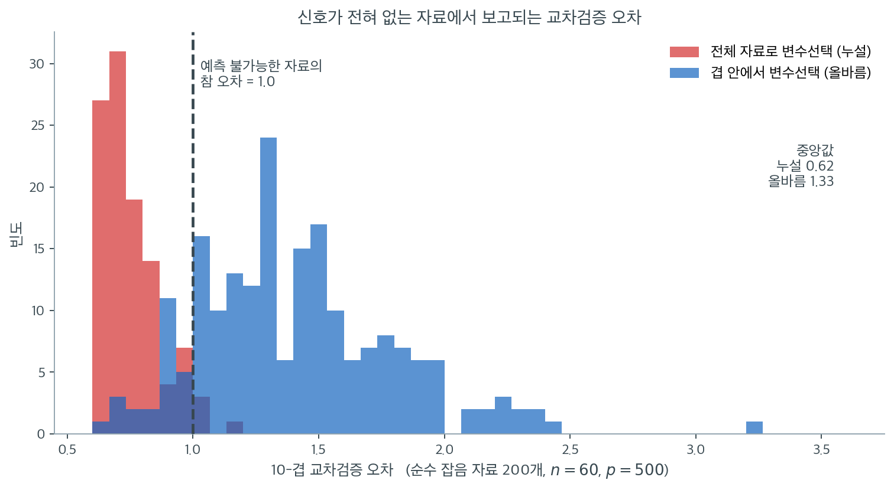

# λ 선택을 위한 교차검증

정칙화 모수 $\lambda$는 자료 적합과 모형 제약 사이의 절충을 조절한다. 훈련오차는 $\lambda$가 작아질수록 언제나 줄어들므로 $\lambda$ 선택에 쓸 수 없다. 검정오차의 추정값이 필요하며, 교차검증(CV)이 표준적인 접근을 제공한다.

---

## 1. 교차검증이 필요한 이유

고정된 $\lambda$에서 정칙화 모형의 훈련오차

$$
\text{Err}_{\text{train}}(\lambda) = \frac{1}{n}\|\mathbf{y} - \mathbf{X}\hat{\boldsymbol{\beta}}(\lambda)\|^2
$$

는 참 검정오차의 편향된 추정값이다. 같은 자료를 적합과 평가에 모두 썼기 때문이다. $\lambda$가 줄면 모형이 유연해져 훈련오차는 줄지만 과적합으로 검정오차는 늘 수 있다. 교차검증은 평가용 자료를 떼어 놓아 거의 불편인 검정오차 추정값을 제공한다.

---

## 2. K-겹 교차검증 절차

**준비.** 후보 $\lambda_1 > \cdots > \lambda_M$의 격자와 겹 수 $K$(보통 5 또는 10)를 정한다.

1. $n$개 관측을 크기가 비슷한 $K$개 겹 $F_1, \ldots, F_K$로 무작위 분할한다.
2. 각 겹 $k$와 각 $\lambda_m$에 대해, 겹 $k$를 뺀 자료로 적합하고 겹 $k$를 예측하여 $\text{MSE}_k(\lambda_m)$를 계산한다.
3. 겹에 걸쳐 평균낸다.

$$
\text{CV}(\lambda_m) = \frac{1}{K}\sum_{k=1}^K \text{MSE}_k(\lambda_m)
$$

4. CV 추정값의 표준오차를 계산한다.

$$
\text{SE}(\lambda_m) = \sqrt{\frac{1}{K}\cdot\frac{1}{K-1}\sum_{k=1}^K \bigl(\text{MSE}_k(\lambda_m) - \text{CV}(\lambda_m)\bigr)^2}
$$

---

## 3. λ_min의 선택

가장 단순한 규칙은 CV 오차를 최소화하는 $\lambda$를 고르는 것이다.

$$
\lambda_{\min} = \arg\min_{\lambda_m} \text{CV}(\lambda_m)
$$

CV 곡선은 대개 U자 모양이다. 큰 $\lambda$에서 높고(과소적합), 최솟값까지 감소했다가, 작은 $\lambda$에서 다시 증가한다(과적합).

---

## 4. 1-표준오차 규칙

CV 추정값에는 잡음이 있고 $\lambda_{\min}$이 필요 이상으로 복잡한 모형에 대응할 수 있다.

$$
\lambda_{1\text{SE}} = \max\bigl\{\lambda_m : \text{CV}(\lambda_m) \leq \text{CV}(\lambda_{\min}) + \text{SE}(\lambda_{\min})\bigr\}
$$

최솟값에서 1 표준오차 이내인 것 중 가장 크게 정칙화된 $\lambda$다. CV 오차가 1 표준오차 이내인 모형들은 통계적으로 구별되지 않으므로 그중 가장 단순한 것을 택한다는 논리다.

!!! tip "어느 규칙을 쓸 것인가"
    예측 정확도가 주된 목표면 $\lambda_{\min}$을, 해석 가능성·안정성·간결성이 중요하면 $\lambda_{1\text{SE}}$를 쓴다. 어떤 변수가 중요한지 이해하는 것이 예측만큼 중요한 과학적 응용에서는 $\lambda_{1\text{SE}}$가 선호되는 경우가 많다.

---

## 5. 격자의 구성

격자는 $\lambda_{\max}$(라쏘에서 모든 계수가 0이 되는 값)에서 그 작은 배수까지 걸쳐야 한다. 라쏘와 엘라스틱넷에서

$$
\lambda_{\max} = \frac{1}{\alpha n}\|\mathbf{X}^\top\mathbf{y}\|_\infty
$$

이며 격자는 보통 로그 간격이다. 흔히 100개 점을 $\lambda_{\max}$의 $10^{-3}$배에서 $1$배까지 잡는다. 능형회귀에서는 희소성 문턱으로 $\lambda_{\max}$가 정의되지 않지만, 큰 값에서 작은 값까지의 비슷한 로그 격자가 잘 작동한다.

---

## 6. 구현 시 주의점

### 겹 안에서의 표준화

설명변수는 적합 전에 표준화해야 한다. 결정적으로, **표준화는 훈련 겹에서만 계산해 떼어 둔 겹에 적용해야 한다.** 전체 자료로 표준화하면 미묘한 자료 누설이 생겨 CV 오차 추정값이 낙관적으로 편향된다.

### 경로를 따라가는 온기 시작

라쏘와 엘라스틱넷에서는 좌표하강과 온기 시작으로 전체 $\lambda$ 격자의 정칙화 경로를 계산한다. 각 겹의 적합이 이전 $\lambda$의 해를 활용하므로 전체 CV 절차가 효율적이다.

### 겹 배정

시계열 자료에서는 시간 순서를 존중하도록 무작위 배정 대신 연속된 블록을 쓴다. 군집 자료(같은 피험자의 반복 측정 등)에서는 같은 군집의 관측을 같은 겹에 배정한다.

!!! danger "흔한 함정: 자료 누설"
    겹을 나누기 **전에** 전체 자료로 변수선택, 변수변환, 그 밖의 자료 의존적 전처리를 하지 말라. 모든 전처리는 각 겹의 훈련집합 안에서 수행해야 한다. 이 규칙을 어기면 CV 추정값이 낙관적으로 편향되며, 그 크기는 연습문제 2에서 보듯 결론을 완전히 뒤집을 수 있다.



이 경고가 과장인지 확인하는 가장 확실한 방법은 **신호가 아예 없는 자료**에 두 절차를 돌려 보는 것이다. $n = 60$, $p = 500$인 순수 난수 자료를 200개 만들었다. $\mathbf{y}$는 $\mathbf{X}$와 아무 관계가 없으므로 어떤 모형도 예측할 수 없고, 정직한 교차검증 오차는 $\text{Var}(y) = 1$ 근처여야 한다. 검은 점선이 그 기준선이다.

파란 분포가 각 겹 안에서 변수 10개를 고른 올바른 절차다. 중앙값이 $1.335$로 **기준선보다 크다.** 당연한 결과다. 예측할 것이 없는데 모수 10개를 추정했으니 그만큼 손해를 본다. 올바른 교차검증은 "이 모형은 아무것도 안 하는 것보다 나쁘다"고 정확히 보고한다.

빨간 분포는 전체 자료로 변수 10개를 먼저 고른 뒤 교차검증한 결과다. 중앙값 $0.62$로 **200개 중 196개(98%)가 기준선 아래에 놓인다.** 예측이 원리적으로 불가능한 자료에서 "잡음 수준의 60%밖에 안 되는 오차"를 보고하는 것이다. 실제로 이 그림은 두 분포가 거의 겹치지 않는다. 누설된 절차의 최댓값이 $1.19$인데 올바른 절차의 최솟값이 $0.65$다.

무슨 일이 벌어졌는지는 간단하다. 500개 중 $\mathbf{y}$와 **우연히** 가장 강하게 상관된 10개를 고르는 데 전체 $\mathbf{y}$를 썼다. 검정 겹의 $y$ 값도 그 선택에 참여했으므로, 검정 겹은 더 이상 "본 적 없는 자료"가 아니다. 규칙은 하나다. **$\mathbf{y}$를 보는 모든 단계가 겹 안에 있어야 한다.** 변수선택, 변수변환, 결측값 대체, 이상값 제거, 초모수 조정이 모두 여기 포함된다.

---

## 7. K의 선택

| $K$ | 편향 | 분산 | 계산 |
|---|---|---|---|
| $K = 5$ | 중간(비관적) | 낮음 | 빠름 |
| $K = 10$ | 더 낮음 | 중간 | 중간 |
| $K = n$ (LOOCV) | 거의 불편 | 클 수 있음 | 비쌈(지름길이 없으면) |

가장 흔한 선택은 $K = 5$와 $K = 10$이다. 능형회귀에는 LOOCV의 닫힌 형태 지름길이 있지만 라쏘에는 없다.

---

## 8. 엘라스틱넷의 2차원 교차검증

1. $\alpha$의 격자를 고정한다(예: $\{0.1, 0.25, 0.5, 0.75, 0.9, 1.0\}$).
2. 각 $\alpha$에 대해 $\lambda$ 격자에서 $K$-겹 CV를 수행한다.
3. CV 오차가 가장 낮은 $(\lambda, \alpha)$ 쌍을 고른다.

또는 영역 지식으로 $\alpha$를 고정하고 $\lambda$만 최적화한다.

---

## 연습문제

<div class="drillbox" markdown>

**연습문제 1.** <span class="diff med" title="중간"></span>
$\lambda_{\min}$과 $\lambda_{1\text{SE}}$가 고르는 모형의 복잡도를 비교하고, 참 모형과 견주어 보라. 참 변수 5개와 잡음변수 15개가 있는 자료($n = 100$)에서 라쏘로 10-겹 교차검증을 하라.

</div>

??? success "풀이"
    ```python
    import numpy as np
    from sklearn.linear_model import Lasso, lasso_path
    from sklearn.model_selection import KFold
    rng = np.random.default_rng(55)

    n, p = 100, 20
    X = rng.normal(size=(n, p)); X -= X.mean(0); X /= X.std(0)
    beta = np.zeros(p); beta[:5] = [3, -2, 1.5, 1, -1]
    y = X @ beta + rng.normal(0, 1, n); y -= y.mean()

    alphas, coefs, _ = lasso_path(X, y, n_alphas=80)   # alphas는 내림차순
    kf = KFold(10, shuffle=True, random_state=0)
    mu, se = [], []
    for a in alphas:
        e = [((y[te] - X[te] @ Lasso(alpha=a, fit_intercept=False,
              max_iter=50000).fit(X[tr], y[tr]).coef_)**2).mean()
             for tr, te in kf.split(X)]
        mu.append(np.mean(e)); se.append(np.std(e, ddof=1)/np.sqrt(10))
    mu, se = np.array(mu), np.array(se)
    i = mu.argmin()
    j = np.where(mu <= mu[i] + se[i])[0].min()   # 내림차순이므로 최소 인덱스가 최대 lambda
    ```

    | 규칙 | $\lambda$ | 선택된 변수 수 | CV 오차 |
    |:---|---:|---:|---:|
    | $\lambda_{\min}$ | 0.0800 | **12** | 1.216 (SE 0.176) |
    | $\lambda_{1\text{SE}}$ | 0.1757 | **9** | 1.386 |
    | 참값 | — | **5** | — |

    **두 규칙 모두 참 변수 수를 넘게 고른다.** $\lambda_{1\text{SE}}$가 12개에서 9개로 줄이지만 여전히 5개보다 많다.

    이것이 라쏘의 알려진 성질이다. **예측을 최적화하는 $\lambda$는 변수선택을 최적화하는 $\lambda$보다 작다.** 예측 관점에서는 작은 계수를 조금이라도 살려 두는 편이 유리하지만, 그 결과 잡음변수가 딸려 들어온다.

    **`alphas`가 내림차순이라는 점에 주의하라.** `np.where(...)[0].max()`를 쓰면 가장 **작은** $\lambda$를 고르게 되어 1-SE 규칙이 정반대로 작동한다. 실제로 그렇게 하면 $\lambda = 0.0034$, 변수 20개가 나온다.

    **표준오차 $0.176$이 CV 오차 $1.216$의 14%라는 점도 중요하다.** CV 추정 자체가 그만큼 불안정하므로 최솟값을 곧이곧대로 믿지 않는 것이 합리적이다.

<div class="drillbox" markdown>

**연습문제 2.** <span class="diff med" title="중간"></span>
자료 누설이 CV 오차를 얼마나 낙관적으로 만드는지 확인하라. 반응변수가 설명변수와 **아무 관계도 없는** 순수 잡음 자료($n = 60$, $p = 500$)에서, 변수선택을 (a) 전체 자료로 미리 하는 경우와 (b) 각 겹 안에서 하는 경우를 비교하라.

</div>

??? success "풀이"
    ```python
    import numpy as np
    from sklearn.linear_model import LinearRegression
    from sklearn.model_selection import KFold
    rng = np.random.default_rng(1)
    X = rng.normal(size=(60, 500))
    y = rng.normal(size=60)                    # y 는 X 와 완전히 무관하다

    def cv(leak, k=10):
        kf = KFold(10, shuffle=True, random_state=0); errs = []
        if leak:
            s = np.argsort(-np.abs(X.T @ y))[:k]        # 전체 자료로 선택
        for tr, te in kf.split(X):
            idx = s if leak else np.argsort(-np.abs(X[tr].T @ y[tr]))[:k]
            m = LinearRegression().fit(X[tr][:, idx], y[tr])
            errs.append(((y[te] - m.predict(X[te][:, idx]))**2).mean())
        return np.mean(errs)
    ```

    | 절차 | CV 오차 |
    |:---|---:|
    | 전체 자료로 변수선택 후 교차검증 (**누설**) | **1.053** |
    | 각 겹 안에서 변수선택 (올바름) | **2.268** |
    | 참 오차(예측 불가능하므로 $\text{Var}(y) = 1$) | 1.000 |

    **누설된 절차는 CV 오차 $1.05$를 보고한다.** 이는 이론적 최선인 $1.0$에 거의 도달한 값으로, "모형이 완벽하게 작동한다"는 결론을 낳는다.

    **그러나 $y$는 $X$와 완전히 무관한 난수다.** 예측 가능한 신호가 조금도 없다. 올바른 절차는 $2.27$을 보고하여, 이 모형이 아무것도 안 하는 것보다 **두 배 이상 나쁘다**고 정확히 말한다.

    **무슨 일이 일어났는가.** $p = 500$개 중 $y$와 우연히 가장 강하게 상관된 10개를 전체 자료에서 골랐다. 그 상관은 순전히 우연이지만, **검정 겹의 $y$도 그 선택에 이미 쓰였다.** 검정 자료가 훈련 과정에 새어 들어간 것이다.

    !!! danger "이것이 실무에서 가장 자주 일어나는 치명적 오류다"
        전형적인 형태는 다음과 같다.

        1. 전체 자료로 상관이 높은 변수 $k$개를 고른다.
        2. 그 변수들로 교차검증을 한다.
        3. 훌륭한 CV 성능을 보고한다.
        4. 새 자료에서 완전히 실패한다.

        올바른 규칙은 단순하다. **$y$를 보는 모든 단계는 겹 안에 있어야 한다.** 변수선택, 변수변환, 결측값 대체, 이상값 제거, 초모수 조정이 모두 포함된다.

        scikit-learn에서는 `Pipeline`으로 전처리를 묶고 그 파이프라인 전체를 `cross_val_score`에 넘기면 이 규칙이 자동으로 지켜진다.

    표준화만 누설시키는 경우는 영향이 훨씬 작다(이 자료에서 $1.224$ 대 $1.209$로 차이가 잡음 수준이다). **위험한 것은 $y$를 사용하는 단계**이며, 표준화는 $X$만 쓰므로 상대적으로 무해하다. 그럼에도 원칙을 지키는 편이 안전하다.

<div class="drillbox" markdown>

**연습문제 3.** <span class="diff med" title="중간"></span>
2 절과 4 절의 식을 손으로 돌려 보자. 어떤 자료에서 $K = 5$ 겹 교차검증을 후보 $\lambda$ 네 개에서 수행하여 겹별 오차 $\text{MSE}_k(\lambda_m)$ 을 얻었다.

| $\lambda_m$ | 겹 1 | 겹 2 | 겹 3 | 겹 4 | 겹 5 |
|---:|---:|---:|---:|---:|---:|
| $10$ | 1.90 | 2.10 | 1.70 | 2.30 | 2.00 |
| $3$ | 1.40 | 1.60 | 1.30 | 1.50 | 1.20 |
| $1$ | 1.85 | 0.65 | 1.45 | 1.05 | 1.25 |
| $0.3$ | 1.30 | 2.00 | 1.40 | 1.80 | 1.50 |

**(가)** 각 $\lambda_m$ 에서 $\text{CV}(\lambda_m)$ 과 $\text{SE}(\lambda_m)$ 을 소수 넷째 자리까지 구하라.

**(나)** $\lambda_{\min}$ 과 $\lambda_{1\text{SE}}$ 를 구하라.

**(다)** 겹별 오차의 흩어짐은 그대로인데 겹 수만 $K = 10$ 으로 늘렸다고 하자(곧 $\lambda = 1$ 에서 겹별 오차의 표본표준편차가 여전히 $0.4472$ 다). $\lambda_{1\text{SE}}$ 가 어떻게 바뀌는가. 1-표준오차 규칙의 보수성은 무엇에 달려 있는가.

</div>

??? success "풀이"
    **(가)** 4 절의 식은 겹별 오차의 표본표준편차 $s$ 를 $\sqrt{K}$ 로 나눈 것이다.

    $$
    \text{SE}(\lambda_m) = \sqrt{\frac{1}{K}\cdot\frac{1}{K-1}\sum_k \bigl(\text{MSE}_k - \text{CV}\bigr)^2} = \frac{s(\lambda_m)}{\sqrt{K}}
    $$

    $\lambda = 1$ 에서 끝까지 적어 보면 평균이 $(1.85+0.65+1.45+1.05+1.25)/5 = 6.25/5 = 1.25$, 편차가 $(0.60,\ -0.60,\ 0.20,\ -0.20,\ 0.00)$, 편차제곱합이 $0.36+0.36+0.04+0.04+0 = 0.80$ 이므로

    $$
    s^2 = \frac{0.80}{4} = 0.20, \qquad s = 0.4472, \qquad \text{SE} = \frac{0.4472}{\sqrt{5}} = 0.2000
    $$

    나머지도 같은 방식으로 계산한다.

    | $\lambda_m$ | $\text{CV}$ | 편차제곱합 | $s$ | $\text{SE}$ |
    |---:|---:|---:|---:|---:|
    | $10$ | 2.0000 | 0.20 | 0.2236 | 0.1000 |
    | $3$ | 1.4000 | 0.10 | 0.1581 | 0.0707 |
    | $1$ | **1.2500** | 0.80 | 0.4472 | **0.2000** |
    | $0.3$ | 1.6000 | 0.34 | 0.2915 | 0.1304 |

    **(나)** 최솟값은 $\lambda_{\min} = 1$ 이고 $\text{CV} = 1.2500$ 이다. 문턱은

    $$
    \text{CV}(\lambda_{\min}) + \text{SE}(\lambda_{\min}) = 1.2500 + 0.2000 = 1.4500
    $$

    이다. 문턱 아래에 있는 $\lambda$ 는 $\lambda = 3$ ($1.4000 \leq 1.4500$) 과 $\lambda = 1$ 뿐이고($\lambda = 10$ 은 $2.0000$, $\lambda = 0.3$ 은 $1.6000$ 으로 넘는다), 그중 가장 큰 것이

    $$
    \lambda_{1\text{SE}} = 3
    $$

    이다. 정칙화를 세 배 세게 걸면서 CV 오차는 $1.2500 \to 1.4000$ 으로 $12\%$ 만 나빠진다. 그 $12\%$ 가 표준오차 $0.2000$ 안에 있다는 것이 4 절의 논리다.

    **(다)** $\lambda = 1$ 에서 $s = 0.4472$ 가 그대로라면 $K = 10$ 에서는

    $$
    \text{SE} = \frac{0.4472}{\sqrt{10}} = 0.1414, \qquad \text{문턱} = 1.2500 + 0.1414 = 1.3914
    $$

    이다. 이제 $\lambda = 3$ 의 $1.4000$ 이 문턱을 **넘는다.** 문턱 아래에 남는 것은 $\lambda = 1$ 뿐이므로 $\lambda_{1\text{SE}} = \lambda_{\min} = 1$ 이 되어 규칙이 아무 일도 하지 않는다.

    **1-표준오차 규칙의 보수성은 자료가 아니라 교차검증의 설계에 달려 있다.** 문턱의 폭이 $s/\sqrt{K}$ 이므로 겹을 늘리거나 교차검증을 여러 번 반복해 평균하면 폭이 $1/\sqrt{K}$ 로 좁아지고, 규칙은 $\lambda_{\min}$ 쪽으로 끌려간다. "1 표준오차" 는 모형의 성질이 아니라 **추정의 잡음 크기**이며, 같은 자료에서도 $K$ 를 바꾸면 고르는 모형이 바뀐다.

    덧붙여 이 $\text{SE}$ 는 겹별 오차 **평균의** 표준오차다. 겹들은 훈련자료를 공유하여 서로 상관되어 있으므로, 이 값은 "다른 표본에서 다시 재면 CV 가 얼마나 흔들릴까" 를 과소평가한다. 그 흔들림의 진짜 크기는 연습문제 5 에서 분할 난수만 바꾸어 재어 본다.

<div class="drillbox" markdown>

**연습문제 4.** <span class="diff med" title="중간"></span>
5 절의 $\lambda_{\max} = \frac{1}{\alpha n}\|\mathbf{X}^\top\mathbf{y}\|_\infty$ 가 어디서 오는지 확인하고 작은 자료에서 끝까지 계산하자. `sklearn` 의 `ElasticNet` 은 절편 없이

$$
\frac{1}{2n}\lVert\mathbf{y} - \mathbf{X}\boldsymbol\beta\rVert^2 + \lambda\Bigl(\alpha\lVert\boldsymbol\beta\rVert_1 + \frac{1-\alpha}{2}\lVert\boldsymbol\beta\rVert_2^2\Bigr)
$$

을 최소화한다. 자료는 $n = 5$, $p = 3$ 이고 모든 열과 $\mathbf{y}$ 가 중심화되어 있다.

$$
\mathbf{X} = \begin{pmatrix} 2 & 1 & -1 \\ 1 & -1 & 1 \\ 0 & 2 & 1 \\ -1 & -1 & 1 \\ -2 & -1 & -2 \end{pmatrix}, \qquad \mathbf{y} = \begin{pmatrix} 4 \\ 1 \\ -1 \\ -2 \\ -2 \end{pmatrix}
$$

**(가)** $\boldsymbol\beta = \mathbf{0}$ 이 최소점이 되는 조건에서 $\lambda_{\max}$ 의 식을 유도하라. L2 항이 조건에 들어오지 않는 까닭도 말하라.

**(나)** $\alpha = 1$ (라쏘) 과 $\alpha = 0.5$ 에서 $\lambda_{\max}$ 를 구하라.

**(다)** $\alpha = 1$, $\lambda = 2$ 에서 라쏘 해를 정확히 구하고 KKT 조건으로 확인하라.

**(라)** 교과서 꼴 $\lVert\mathbf{y} - \mathbf{X}\boldsymbol\beta\rVert^2 + \lambda\lVert\boldsymbol\beta\rVert_1$ 로 같은 격자를 만들면 $\lambda_{\max}$ 가 얼마인가. 두 규약을 섞으면 격자가 몇 배 어긋나는가.

</div>

??? success "풀이"
    먼저 필요한 양을 계산한다. 열별로

    $$
    \mathbf{X}^\top\mathbf{y} = (15,\ 5,\ -2)^\top, \qquad \lVert\mathbf{x}_1\rVert^2 = 10, \quad \lVert\mathbf{x}_2\rVert^2 = 8, \quad \lVert\mathbf{x}_3\rVert^2 = 8
    $$

    이고 $\mathbf{x}_1^\top\mathbf{x}_2 = 4$, $\mathbf{x}_1^\top\mathbf{x}_3 = 2$ 다. 예를 들어 $\mathbf{x}_1^\top\mathbf{y} = 8 + 1 + 0 + 2 + 4 = 15$ 다.

    **(가)** 목적함수는 $\lVert\boldsymbol\beta\rVert_1$ 때문에 $\beta_j = 0$ 에서 미분불가능하므로 부분미분을 쓴다. $\boldsymbol\beta = \mathbf{0}$ 이 최소점일 필요충분조건은 $0$ 이 부분미분에 들어 있는 것, 곧 각 $j$ 에 대해 $\lvert s_j \rvert \leq 1$ 인 $s_j$ 가 있어

    $$
    -\frac{1}{n}\mathbf{x}_j^\top\mathbf{y} + \lambda\alpha s_j = 0
    $$

    를 만족하는 것이다. $s_j = \mathbf{x}_j^\top\mathbf{y}/(n\lambda\alpha)$ 이므로 조건은 모든 $j$ 에서

    $$
    \frac{\lvert \mathbf{x}_j^\top\mathbf{y}\rvert}{n} \leq \lambda\alpha \quad\Longleftrightarrow\quad \lambda \geq \frac{\lVert\mathbf{X}^\top\mathbf{y}\rVert_\infty}{\alpha n}
    $$

    이고, 등호가 되는 값이 $\lambda_{\max}$ 다. L2 항 $\frac{1-\alpha}{2}\lVert\boldsymbol\beta\rVert_2^2$ 의 기울기는 $(1-\alpha)\boldsymbol\beta$ 이고 $\boldsymbol\beta = \mathbf{0}$ 에서 $\mathbf{0}$ 이므로 조건에 아무 기여를 하지 않는다. **문턱을 만드는 것은 L1 항의 꺾임뿐이다** — 능형($\alpha = 0$)에서 $\lambda_{\max}$ 가 정의되지 않는 것도 같은 이유다(연습문제 6).

    **(나)** $\lVert\mathbf{X}^\top\mathbf{y}\rVert_\infty = 15$ 이므로

    $$
    \alpha = 1: \ \lambda_{\max} = \frac{15}{1 \times 5} = 3, \qquad \alpha = 0.5: \ \lambda_{\max} = \frac{15}{0.5 \times 5} = 6
    $$

    $\alpha$ 가 절반이면 L1 벌점의 무게 $\lambda\alpha$ 를 맞추기 위해 $\lambda$ 가 두 배 필요하다. 격자의 위치가 $\alpha$ 마다 다르다는 뜻이고, 8 절의 2차원 교차검증에서 $\lambda$ 격자를 $\alpha$ 와 독립으로 잡으면 안 되는 까닭이다(연습문제 9).

    **(다)** $\lambda = 2 < 3$ 이므로 적어도 한 계수가 0 이 아니다. $\lvert\mathbf{x}_j^\top\mathbf{y}\rvert/n$ 이 $(3,\ 1,\ 0.4)$ 이므로 문턱 $2$ 를 넘는 것은 첫 열뿐이다. 1 번 변수만 활성이라고 놓고 풀면, 그 방향의 정상조건은

    $$
    -\frac{1}{n}\mathbf{x}_1^\top(\mathbf{y} - \beta_1\mathbf{x}_1) + \lambda\,\text{sign}(\beta_1) = 0
    \ \Longrightarrow\
    \beta_1 = \frac{\mathbf{x}_1^\top\mathbf{y}/n - \lambda}{\lVert\mathbf{x}_1\rVert^2/n} = \frac{3 - 2}{10/5} = 0.5
    $$

    이다. 곧 $\hat{\boldsymbol\beta} = (0.5,\ 0,\ 0)^\top$ 이다. 확인을 위해 잔차를 구하면

    $$
    \mathbf{r} = \mathbf{y} - 0.5\,\mathbf{x}_1 = (3,\ 0.5,\ -1,\ -1.5,\ -1)^\top
    $$

    이고 비활성 좌표의 KKT 조건은 $\lvert\mathbf{x}_j^\top\mathbf{r}\rvert/n \leq \lambda$ 다.

    $$
    \frac{\lvert\mathbf{x}_2^\top\mathbf{r}\rvert}{5} = \frac{3}{5} = 0.6 \leq 2, \qquad \frac{\lvert\mathbf{x}_3^\top\mathbf{r}\rvert}{5} = \frac{3}{5} = 0.6 \leq 2
    $$

    둘 다 만족하므로 해가 맞다. $\square$

    **(라)** 교과서 꼴에서 $\boldsymbol\beta = \mathbf{0}$ 의 조건은 $-2\mathbf{x}_j^\top\mathbf{y} + \lambda s_j = 0$, $\lvert s_j\rvert \leq 1$ 이므로

    $$
    \lambda_{\max}^{\text{교과서}} = 2\lVert\mathbf{X}^\top\mathbf{y}\rVert_\infty = 30
    $$

    이다. 두 목적함수는 $2n$ 배 차이이므로 $\lambda^{\text{교과서}} = 2n\lambda^{\text{sklearn}}$ 이고, 여기서는 $2n = 10$ 배다. `sklearn` 의 격자 $[0.003,\ 3]$ 을 교과서 꼴로 읽으면 $[0.03,\ 30]$ 이 되어야 하는데 그대로 쓰면 **벌점이 열 배 약해진다.** $n$ 이 다른 자료에서는 어긋나는 배수까지 달라지므로 한 번 맞춰 본 격자를 다른 자료에 옮겨 쓸 수도 없다.

    마지막으로 경로를 조금 더 따라가 보면 재미있는 일이 보인다. 1 번 변수만 활성인 구간에서 $\beta_1(\lambda) = (3-\lambda)/2$ 이므로 비활성 좌표의 상관은

    $$
    \frac{\mathbf{x}_2^\top\mathbf{r}}{n} = \frac{5 - 4\beta_1}{5} = \frac{2\lambda - 1}{5}, \qquad \frac{\mathbf{x}_3^\top\mathbf{r}}{n} = \frac{-2 - 2\beta_1}{5} = \frac{\lambda - 5}{5}
    $$

    다. $\lvert\lambda - 5\rvert/5 = \lambda$ 가 되는 $\lambda = 5/6$ 에서 **3 번 변수가 둘째로 들어온다.** 처음에 $\lvert\mathbf{x}_j^\top\mathbf{y}\rvert$ 가 가장 작았던($2$) 변수다. 라쏘 경로에서 들어오는 순서는 $\mathbf{y}$ 와의 상관 순서가 아니라 **잔차와의 상관 순서**이며, 이미 들어온 변수와의 상관이 그 순서를 바꾼다.

<div class="drillbox" markdown>

**연습문제 5.** <span class="diff med" title="중간"></span>
4 절은 "CV 추정값에는 잡음이 있다" 고 했다. 그 잡음을 **자료를 고정한 채** 재어 보자. $n = 80$, $p = 20$, 참 변수 4 개인 자료 하나를 만들고, 겹을 나누는 난수만 20 번 바꾸어 10-겹 교차검증을 돌려라. 능형은 닫힌 꼴로 푼다. $\lambda_{\min}$ 과 $\lambda_{1\text{SE}}$ 가 각각 얼마나 흔들리는지 비교하고, 그 흔들림이 CV 오차로는 얼마짜리인지 말하라.

</div>

??? success "풀이"
    ```python
    import numpy as np
    rng = np.random.default_rng(7)

    n, p = 80, 20
    X = rng.normal(size=(n, p)); X -= X.mean(0); X /= X.std(0)
    beta = np.zeros(p); beta[:4] = [2, -1.5, 1, -1]
    y = X @ beta + rng.normal(0, 1, n); y -= y.mean()
    lams = np.logspace(-2, 3, 41)                      # 오름차순

    def cv_curve(seed, K=10):
        """겹 분할 난수만 바꾸어 CV 곡선과 그 표준오차를 돌려준다."""
        idx = np.random.default_rng(seed).permutation(n)
        mse = np.empty((K, len(lams)))
        for k, te in enumerate(np.array_split(idx, K)):
            tr = np.setdiff1d(np.arange(n), te)
            G, b = X[tr].T @ X[tr], X[tr].T @ y[tr]
            for m, lam in enumerate(lams):             # 능형은 닫힌 꼴로 정확하다
                bh = np.linalg.solve(G + lam*np.eye(p), b)
                mse[k, m] = ((y[te] - X[te] @ bh)**2).mean()
        return mse.mean(0), mse.std(0, ddof=1)/np.sqrt(K)

    rows = []
    for s in range(20):
        mu, se = cv_curve(s)
        i = mu.argmin()
        j = np.max(np.where(mu <= mu[i] + se[i])[0])   # 오름차순이므로 최대 인덱스가 최대 lambda
        rows.append((lams[i], lams[j], mu[i], se[i], mu[24]))   # lams[24] = 10
    res = np.array(rows)

    for name, c in (("lam_min", res[:, 0]), ("lam_1SE", res[:, 1])):
        print(f"{name}: 최소 {c.min():7.3f}  중앙값 {np.median(c):7.3f}  "
              f"최대 {c.max():7.3f}  최대/최소 {c.max()/c.min():6.1f}배")
    print(f"lam_min 이 격자 아래끝 {lams[0]:.2f} 에 닿은 분할: "
          f"{(res[:, 0] == lams[0]).sum()}/20")
    print(f"CV(lam_min) 평균 {res[:, 2].mean():.4f},  같은 분할에서 "
          f"lam=10 고정 {res[:, 4].mean():.4f},  SE 평균 {res[:, 3].mean():.4f}")
    ```

    출력:

    ```text
    lam_min: 최소   0.010  중앙값   1.334  최대   3.162  최대/최소  316.2배
    lam_1SE: 최소   5.623  중앙값   7.499  최대  10.000  최대/최소    1.8배
    lam_min 이 격자 아래끝 0.01 에 닿은 분할: 1/20
    CV(lam_min) 평균 1.2347,  같은 분할에서 lam=10 고정 1.4457,  SE 평균 0.1971
    ```

    **자료는 하나도 바뀌지 않았고 겹을 나누는 난수만 바꾸었다.** 그런데 $\lambda_{\min}$ 은 $0.010$ 에서 $3.162$ 까지 **316 배** 움직인다. 한 분할에서는 CV 곡선이 격자 끝까지 내려가 $\lambda_{\min}$ 이 아래끝 $0.01$ 에 닿았다 — 격자 경계에서 최솟값이 잡히면 그 값은 "최적" 이 아니라 "격자가 짧았다" 는 뜻이므로, 격자를 늘려 다시 보아야 한다.

    **$\lambda_{1\text{SE}}$ 는 $5.623$ 에서 $10.000$ 까지 $1.8$ 배만 움직인다.** 문턱 $\text{CV}(\lambda_{\min}) + \text{SE}$ 가 평평한 곡선을 가로지르는 자리는 분할이 바뀌어도 크게 변하지 않기 때문이다. 4 절의 "안정성이 중요하면 $\lambda_{1\text{SE}}$" 가 바로 이 수다.

    **그러나 316 배의 흔들림이 예측 성능으로는 얼마짜리인가.** $\lambda$ 를 아예 $10$ 으로 고정해 버려도 CV 오차는 평균 $1.2347 \to 1.4457$ 로 $0.21$ 만 나빠지고, 이는 CV 자체의 표준오차 평균 $0.1971$ 과 비슷한 크기다. **CV 곡선이 평평하기 때문에 $\lambda_{\min}$ 의 위치는 불안정하지만 그 대가는 작다.** $\lambda$ 를 소수점까지 믿지 말라는 것과 $\lambda$ 선택이 무의미하다는 것은 다른 말이다 — 격자를 몇 자릿수에 걸쳐 잡는 일은 여전히 중요하고, 그 안에서 최솟값의 정확한 위치를 다투는 일이 의미가 없는 것이다.

<div class="drillbox" markdown>

**연습문제 6.** <span class="diff hard" title="어려움"></span>
5 절은 "능형회귀에서는 희소성 문턱으로 $\lambda_{\max}$ 가 정의되지 않는다" 고 적었다. 그 말을 정확히 하고, 격자의 상한을 대신 정하는 눈금을 세우자.

**(가)** 능형 해 $\hat{\boldsymbol\beta}(\lambda) = (\mathbf{X}^\top\mathbf{X} + \lambda\mathbf{I})^{-1}\mathbf{X}^\top\mathbf{y}$ 가 유한한 $\lambda > 0$ 에서 $\mathbf{0}$ 이 되는 필요충분조건을 구하라. 라쏘와 무엇이 다른가.

**(나)** $\lambda \to \infty$ 에서 $\lVert\hat{\boldsymbol\beta}(\lambda)\rVert$ 가 0 으로 가는 속도를 구하라.

**(다)** 유효자유도 $\text{df}(\lambda) = \sum_j d_j^2/(d_j^2 + \lambda)$ 가 $(0, r)$ 위로 일대일 감소함을 보여라($r = \text{rank}(\mathbf{X})$, $d_j$ 는 $\mathbf{X}$ 의 특잇값). 특잇값 제곱이 $d^2 = (50,\ 20,\ 10,\ 1)$ 인 설계에서 $\text{df}(10)$ 과 $\text{df}(500)$ 을 구하고, $\text{df}(\lambda) = 1$ 인 $\lambda$ 를 소수 첫째 자리까지 구하라.

**(라)** 큰 $\lambda$ 에서 $\text{df}(\lambda) \approx \text{tr}(\mathbf{X}^\top\mathbf{X})/\lambda$ 임을 보이고, 표준화된 설계($\lVert\mathbf{x}_j\rVert^2 = n$)에서 $\text{df} = 1$ 에 해당하는 $\lambda$ 가 대략 $np$ 임을 보여라. $n = 100$, $p = 20$ 이면 얼마인가. (다) 의 자료에서 이 어림이 얼마나 맞는가.

</div>

??? success "풀이"
    **(가)** $\lambda > 0$ 이면 $\mathbf{X}^\top\mathbf{X} + \lambda\mathbf{I}$ 는 고윳값이 모두 $\geq \lambda > 0$ 이라 가역이다. 따라서

    $$
    \hat{\boldsymbol\beta}(\lambda) = \mathbf{0} \iff \mathbf{X}^\top\mathbf{y} = \mathbf{0}
    $$

    이고, 이 조건은 $\lambda$ 와 무관하다. **$\mathbf{X}^\top\mathbf{y} \neq \mathbf{0}$ 이면 어떤 유한한 $\lambda$ 에서도 능형 해는 정확히 $\mathbf{0}$ 이 되지 않는다.** 라쏘는 목적함수가 $\boldsymbol\beta = \mathbf{0}$ 에서 꺾여 있어 부분미분이 구간이 되고, 그 구간이 $\mathbf{0}$ 을 품는 순간부터 해가 정확히 $\mathbf{0}$ 이 된다(연습문제 4 (가)). 능형의 벌점 $\lambda\lVert\boldsymbol\beta\rVert_2^2$ 는 $\mathbf{0}$ 에서 매끄럽고 기울기가 $\mathbf{0}$ 이므로 그런 문턱이 생길 수 없다.

    **(나)** $(\mathbf{X}^\top\mathbf{X} + \lambda\mathbf{I})^{-1} = \lambda^{-1}(\mathbf{I} + \lambda^{-1}\mathbf{X}^\top\mathbf{X})^{-1}$ 이므로 $\lambda \to \infty$ 에서

    $$
    \hat{\boldsymbol\beta}(\lambda) = \frac{1}{\lambda}\mathbf{X}^\top\mathbf{y} + O(\lambda^{-2}), \qquad \lVert\hat{\boldsymbol\beta}(\lambda)\rVert \sim \frac{\lVert\mathbf{X}^\top\mathbf{y}\rVert}{\lambda}
    $$

    곧 $O(1/\lambda)$ 로 **느리게** 줄어든다. 계수를 $10^{-6}$ 배로 만들려면 $\lambda$ 를 $10^6$ 배로 키워야 하고, 그래도 0 은 아니다.

    **(다)** 각 항 $d_j^2/(d_j^2+\lambda)$ 는 $\lambda$ 에 대해 미분하면

    $$
    \frac{d}{d\lambda}\frac{d_j^2}{d_j^2+\lambda} = -\frac{d_j^2}{(d_j^2+\lambda)^2} < 0 \quad (d_j \neq 0)
    $$

    이므로 $\text{df}$ 는 연속이고 엄격히 감소한다. $\lambda \to 0^+$ 에서 0 이 아닌 $d_j$ 마다 항이 1 로 가므로 $\text{df} \to r$, $\lambda \to \infty$ 에서 $\text{df} \to 0$ 이다. 따라서 $(0, r)$ 의 어떤 목표 자유도에 대해서도 그것을 주는 $\lambda$ 가 **유일하게** 존재한다. 능형의 격자를 "자유도" 로 매길 수 있다는 뜻이다.

    주어진 $d^2 = (50, 20, 10, 1)$ 에서

    $$
    \text{df}(10) = \frac{50}{60} + \frac{20}{30} + \frac{10}{20} + \frac{1}{11} = 0.8333 + 0.6667 + 0.5000 + 0.0909 = 2.0909
    $$

    $$
    \text{df}(500) = \frac{50}{550} + \frac{20}{520} + \frac{10}{510} + \frac{1}{501} = 0.0909 + 0.0385 + 0.0196 + 0.0020 = 0.1510
    $$

    $\text{df}(\lambda) = 1$ 은 이분법으로 좁힌다. $\text{df}(45) = 0.5263 + 0.3077 + 0.1818 + 0.0217 = 1.0375$ 이고 $\text{df}(50) = 0.5000 + 0.2857 + 0.1667 + 0.0196 = 0.9720$ 이므로 답은 $(45, 50)$ 안에 있다. $\text{df}(47.5) = 1.0036$, $\text{df}(48) = 0.9971$ 이므로

    $$
    \lambda \approx 47.8
    $$

    이다($\text{df}(47.8) = 0.9997$).

    **(라)** $\lambda \gg d_1^2$ 이면 $d_j^2/(d_j^2+\lambda) = (d_j^2/\lambda)(1 + d_j^2/\lambda)^{-1} \approx d_j^2/\lambda$ 이므로

    $$
    \text{df}(\lambda) \approx \frac{1}{\lambda}\sum_j d_j^2 = \frac{\text{tr}(\mathbf{X}^\top\mathbf{X})}{\lambda}
    $$

    표준화된 설계에서는 $\text{tr}(\mathbf{X}^\top\mathbf{X}) = \sum_j \lVert\mathbf{x}_j\rVert^2 = np$ 이므로 $\text{df} = 1$ 은 $\lambda \approx np$ 다. $n = 100$, $p = 20$ 이면 $\lambda \approx 2000$ 이다.

    (다) 의 자료에서는 $\text{tr} = 81$ 이라 어림이 $\lambda \approx 81$ 을 주지만 정답은 $47.8$ 이니, **어림이 $70\%$ 나 크다.** $\lambda = 48$ 이 가장 큰 특잇값 제곱 $50$ 보다 크지 않아 어림의 전제가 깨졌기 때문이다. 같은 어림을 $\lambda = 500$ 에서 쓰면 $81/500 = 0.1620$ 으로 정확한 $0.1510$ 과 $7\%$ 차이이니, $\lambda$ 가 $d_1^2$ 의 열 배쯤 되면 쓸 만해진다.

    정리하면 **라쏘의 $\lambda_{\max}$ 는 "여기서부터 전부 0" 이라는 정확한 문턱이지만 능형의 상한은 사람이 정하는 관례다.** 쓸 만한 눈금이 $\text{tr}(\mathbf{X}^\top\mathbf{X}) = np$ 이며, 그 자리에서 자유도가 이미 1 아래로 내려가므로 모형은 사실상 절편만 남는다. 거기서 몇 자릿수 아래까지 로그 격자를 깔면 5 절이 말한 "큰 값에서 작은 값까지의 로그 격자" 가 된다.

<div class="drillbox" markdown>

**연습문제 7.** <span class="diff hard" title="어려움"></span>
6 절의 "겹 배정" 은 군집 자료에서 같은 군집의 관측을 같은 겹에 두라고 했다. 그 말을 어기면 얼마나 낙관적이 되는지 재어 보자. 피험자 20 명을 5 번씩 측정한 자료($n = 100$, $p = 10$)에서 같은 피험자의 관측은 피험자 수준 성분 $\mathbf{u}_i$ 와 피험자 효과 $b_i \sim N(0, 3^2)$ 을 공유한다. $\lambda = 1$ 인 능형을 (가) 무작위 10-겹, (나) 피험자별 10-겹(`GroupKFold`)으로 교차검증하고, (다) 전체 자료로 적합한 모형이 **새 피험자**에서 내는 참 오차와 비교하라. 자료를 200 번 다시 만들어 평균을 보라. 이 누수는 연습문제 2 의 누수와 어떻게 다른가.

</div>

??? success "풀이"
    ```python
    import numpy as np
    from sklearn.model_selection import KFold, GroupKFold

    G, m, p, lam = 20, 5, 10, 1.0        # 피험자 20명 x 반복 5회, 설명변수 10개
    beta = np.zeros(p); beta[:3] = [1, -1, 0.5]
    g = np.repeat(np.arange(G), m)

    def make(G, rng):
        """같은 피험자의 관측은 피험자 수준 성분 u 와 피험자 효과 b 를 공유한다."""
        u = rng.normal(0, 1, (G, p))
        X = np.repeat(u, m, 0) + rng.normal(0, 1, (G*m, p))
        b = rng.normal(0, 3, G)
        y = X @ beta + np.repeat(b, m) + rng.normal(0, 1, G*m)
        return X, y

    def fit(Xtr, ytr):
        """겹 안에서 표준화한 뒤 능형을 닫힌 꼴로 푼다."""
        mu, sd, ym = Xtr.mean(0), Xtr.std(0), ytr.mean()
        Z = (Xtr - mu)/sd
        c = np.linalg.solve(Z.T @ Z + lam*np.eye(p), Z.T @ (ytr - ym))
        return lambda Xte: (Xte - mu)/sd @ c + ym

    def cv(X, y, splitter, **kw):
        e = [((y[te] - fit(X[tr], y[tr])(X[te]))**2).mean()
             for tr, te in splitter.split(X, y, **kw)]
        return np.mean(e)

    rows = []
    for r in range(200):
        rng = np.random.default_rng(100 + r)
        X, y = make(G, rng)
        Xn, yn = make(400, rng)                       # 새 피험자 400명
        rows.append((cv(X, y, KFold(10, shuffle=True, random_state=0)),
                     cv(X, y, GroupKFold(10), groups=g),
                     ((yn - fit(X, y)(Xn))**2).mean()))
    res = np.array(rows)

    for name, c in (("무작위 10-겹 CV      ", res[:, 0]),
                    ("피험자 10-겹 CV      ", res[:, 1]),
                    ("새 피험자에서의 참 오차", res[:, 2])):
        print(f"{name} 평균 {c.mean():7.3f}")
    print(f"참 오차보다 작게 나온 횟수: 무작위 {(res[:,0] < res[:,2]).sum()}/200, "
          f"피험자 {(res[:,1] < res[:,2]).sum()}/200")
    ```

    출력:

    ```text
    무작위 10-겹 CV       평균   8.877
    피험자 10-겹 CV       평균  13.475
    새 피험자에서의 참 오차 평균  13.254
    참 오차보다 작게 나온 횟수: 무작위 187/200, 피험자 105/200
    ```

    | 절차 | 평균 오차 | 참값 대비 |
    |:---|---:|---:|
    | 무작위 10-겹 CV (**겹 배정을 어김**) | **8.877** | $-33\%$ |
    | 피험자 10-겹 CV (올바름) | **13.475** | $+1.7\%$ |
    | 새 피험자에서의 참 오차 | 13.254 | — |

    **무작위 겹은 참 오차를 $33\%$ 낮게 보고하며, 200 번 중 187 번(94%) 그렇다.** 피험자별 겹은 평균 $13.475$ 로 참값 $13.254$ 를 거의 맞히고, 작게 나온 횟수도 $105/200$ 으로 동전 던지기에 가깝다(남는 $+1.7\%$ 는 피험자 20 명 중 18 명으로만 훈련한 탓이다 — 13 장의 학습곡선 효과다).

    **무슨 일이 일어났는가.** 피험자 $i$ 의 다섯 관측은 $\mathbf{u}_i$ 와 $b_i$ 를 공유한다. 무작위 겹에서는 그중 넷쯤이 훈련자료에 들어가므로, 회귀가 $\mathbf{u}_i$ 를 통해 그 사람의 치우침 $b_i$ 를 맞추는 계수를 세운다. 그렇게 세운 계수는 **같은 사람의 남은 관측에는 그대로 들어맞지만** 새 사람에게는 아무 소용이 없다. 검정 겹이 "본 적 없는 자료" 가 아닌 것이다.

    **연습문제 2 의 누수와는 성격이 다르다.** 거기서는 $\mathbf{y}$ 를 보는 전처리가 겹 밖에 있었고, 규칙은 "$\mathbf{y}$ 를 보는 모든 단계를 겹 안으로" 였다. 여기서는 전처리가 전부 겹 안에 있다 — 표준화도, 적합도. 그런데도 새는 것은 **겹의 단위**가 틀렸기 때문이다. 교차검증이 재현하려는 것은 "떼어 둔 자료를 예측하는 일" 이고, 그 떼어 냄이 실제로 올 자료를 닮아야 한다.

    그래서 올바른 분할은 **질문에 달려 있다.** 새 환자의 결과를 예측하려면 피험자별 겹이 맞다. 반면 이미 관찰한 환자의 다음 측정을 예측하는 것이 목적이라면 무작위 겹의 $8.877$ 이 오히려 겨냥하는 답이다. 겹을 나누기 전에 "무엇을 예측하려는가" 를 적어 두는 것이 안전하다.

<div class="drillbox" markdown>

**연습문제 8.** <span class="diff hard" title="어려움"></span>
6 절은 표준화를 겹 안에서 하라고 했다. 그렇다면 표준화를 아예 **빼면** 어떻게 되는가. `sklearn` 의 `Ridge` 는 표준화를 해 주지 않으므로 이것은 실제로 자주 일어나는 일이다. $n = 50$, $p = 20$, 설명변수 상관 $\rho = 0.7$, 참 변수 5 개, $\sigma = 2$ 인 자료를 만들고, 1 번 열의 **단위만** m 에서 km 으로 바꾼(열에 $0.001$ 을 곱한) 같은 자료를 함께 둔다.

**(가)** 표준화 없이 두 자료에서 $\lambda$ 격자의 CV 오차를 비교하라. $\lambda \to 0$ 에서 두 값이 같아지는 까닭을 설명하라.

**(나)** 겹 안에서 표준화하면 두 자료의 CV 오차가 소수 넷째 자리까지 같은지 확인하라.

**(다)** $\lambda_{\min}$ 과 그때의 CV 오차는 단위에 따라 어떻게 달라지는가.

</div>

??? success "풀이"
    ```python
    import numpy as np
    from sklearn.model_selection import KFold
    rng = np.random.default_rng(5)

    n, p, rho = 50, 20, 0.7
    S = rho*np.ones((p, p)) + (1 - rho)*np.eye(p)
    X = rng.normal(size=(n, p)) @ np.linalg.cholesky(S).T   # 단위: m
    beta = np.zeros(p); beta[:5] = [2, -1.5, 1, 1, -1]
    y = X @ beta + rng.normal(0, 2, n)
    Xkm = X.copy(); Xkm[:, 0] *= 0.001                      # 1 열만 km 로 바꾼 같은 자료

    kf = KFold(10, shuffle=True, random_state=0)

    def cv(Z, lam, standardize):
        """능형을 닫힌 꼴로 푼다. 중심화와 표준화는 훈련 겹에서만 계산한다."""
        e = []
        for tr, te in kf.split(Z):
            A, B, ym = Z[tr], Z[te], y[tr].mean()
            if standardize:
                mu, sd = A.mean(0), A.std(0)
                A, B = (A - mu)/sd, (B - mu)/sd
            else:
                A, B = A - A.mean(0), B - A.mean(0)
            c = np.linalg.solve(A.T @ A + lam*np.eye(p), A.T @ (y[tr] - ym))
            e.append(((y[te] - (B @ c + ym))**2).mean())
        return np.mean(e)

    print("lambda      원래단위  km단위 | 표준화:원래단위  km단위")
    for lam in (1e-8, 1e-4, 1e-2, 1e0, 1e1, 1e2, 1e3):
        print(f"{lam:9.0e}  {cv(X, lam, False):8.4f}{cv(Xkm, lam, False):8.4f} |"
              f"{cv(X, lam, True):14.4f}{cv(Xkm, lam, True):8.4f}")

    lams = np.logspace(-3, 5, 33)
    for name, Z, st in (("표준화 없음, 원래 단위", X, False),
                        ("표준화 없음, km 단위  ", Xkm, False),
                        ("겹 안 표준화, 원래 단위", X, True),
                        ("겹 안 표준화, km 단위 ", Xkm, True)):
        mu = np.array([cv(Z, lam, st) for lam in lams]); i = mu.argmin()
        print(f"{name}: lam_min {lams[i]:9.4f}  CV {mu[i]:.4f}")
    ```

    출력:

    ```text
    lambda      원래단위  km단위 | 표준화:원래단위  km단위
        1e-08    5.6078  5.6082 |        5.6078  5.6078
        1e-04    5.6077  7.0234 |        5.6077  5.6077
        1e-02    5.5984  7.1325 |        5.5985  5.5985
        1e+00    5.0211  6.1763 |        5.0282  5.0282
        1e+01    4.0656  4.5125 |        4.0548  4.0548
        1e+02    4.1264  4.2850 |        4.1251  4.1251
        1e+03    5.1021  5.1990 |        5.1909  5.1909
    표준화 없음, 원래 단위: lam_min   17.7828  CV 3.9690
    표준화 없음, km 단위  : lam_min   31.6228  CV 4.2359
    겹 안 표준화, 원래 단위: lam_min   17.7828  CV 3.9619
    겹 안 표준화, km 단위 : lam_min   17.7828  CV 3.9619
    ```

    **(가)** $\lambda = 10^{-8}$ 에서 두 단위의 CV 오차가 $5.6078$ 과 $5.6082$ 로 사실상 같다. OLS 는 **척도에 불변**이기 때문이다. 1 번 열을 $c$ 배 하면 그 계수가 $1/c$ 배 되어 적합값 $\mathbf{X}\hat{\boldsymbol\beta}$ 가 그대로다(열공간이 바뀌지 않는다). 예측값이 같으면 CV 오차도 같다.

    벌점이 들어오면 이 불변성이 깨진다. 1 번 열이 km 이면 같은 적합값을 내기 위해 계수가 $1000$ 배 커져야 하고, 벌점 $\lambda\sum_j\beta_j^2$ 는 그 제곱인 $10^6$ 배를 물린다. $\lambda = 10^{-4}$ 만 되어도 그 항의 벌점이 사실상 이 변수를 지워 버려 CV 오차가 $5.6077 \to 7.0234$ 로 $25\%$ 나빠진다. **$\lambda$ 를 바꾼 것이 아니라 자료를 적는 단위를 바꾼 것인데 모형이 변수 하나를 잃었다.**

    **(나)** 겹 안에서 표준화한 두 자료는 소수 넷째 자리까지 같은 수를 준다($5.6077$, $5.5985$, $5.0282$, $\ldots$). 표준화는 각 열을 자기 표준편차로 나누므로 열에 $c$ 를 곱한 효과가 정확히 지워지고, **벌점이 단위와 무관한 양**이 된다. 겹 안에서 계산했으므로 누설도 없다.

    **(다)** 표준화 없이는 $\lambda_{\min}$ 이 $17.78$ 에서 $31.62$ 로 옮겨가고 그때의 CV 오차도 $3.9690 \to 4.2359$ 로 $6.7\%$ 나빠진다. 교차검증은 자기가 받은 설계행렬 안에서 최선을 찾을 뿐이어서 **단위가 틀어진 사실을 알려 주지 않는다** — 오차가 조금 더 큰 채로 조용히 끝난다. 표준화하면 두 단위가 $\lambda_{\min} = 17.78$, CV $3.9619$ 로 완전히 같다.

    이 자료는 원래 열의 표준편차가 1 근처라서 "표준화 없음, 원래 단위" 와 "표준화" 가 거의 같은 수를 낸다. 곧 여기서 문제를 만든 것은 표준화를 빼는 일 자체가 아니라 **열들의 척도가 서로 다르다는 사실**이다. 실제 자료에서 나이(년), 소득(원), 키(m)를 한 설계행렬에 담으면 척도가 몇 자릿수 벌어지니, `Ridge`·`Lasso` 앞에는 `StandardScaler` 를 `Pipeline` 으로 묶어 두는 것이 안전하다.

<div class="drillbox" markdown>

**연습문제 9.** <span class="diff hard" title="어려움"></span>
8 절의 2차원 교차검증을 실제로 돌려, $\alpha$ 격자가 얼마나 값어치를 하는지 재어 보자. $n = 100$, $p = 30$, 설명변수 상관 $0.8$, 참 변수 6 개(계수 $\pm 2$), $\sigma = 2$ 인 자료를 쓴다. 각 $\alpha \in \{0.1, 0.25, 0.5, 0.75, 0.9, 1.0\}$ 에서 5 절의 $\lambda_{\max}$ 로 로그 격자를 만들어 10-겹 CV 를 돌려라.

**(가)** $\lambda_{\max}$ 가 $\alpha$ 에 따라 어떻게 변하는지 식과 맞춰 보라.

**(나)** $\alpha$ 방향의 CV 차이를 표준오차와 비교하라. 같은 겹에서 비교하면(짝비교) 결론이 달라지는가.

**(다)** $\alpha$ 를 교차검증으로 고를 가치가 있는가.

</div>

??? success "풀이"
    ```python
    import numpy as np
    from sklearn.linear_model import ElasticNet
    from sklearn.model_selection import KFold
    rng = np.random.default_rng(11)

    n, p, rho = 100, 30, 0.8
    S = rho*np.ones((p, p)) + (1 - rho)*np.eye(p)
    X = rng.normal(size=(n, p)) @ np.linalg.cholesky(S).T
    X -= X.mean(0); X /= X.std(0)
    beta = np.zeros(p); beta[:6] = [2, 2, 2, -2, -2, -2]
    y = X @ beta + rng.normal(0, 2, n); y -= y.mean()

    kf = KFold(10, shuffle=True, random_state=0)
    splits = list(kf.split(X))

    def fold_mse(a, lam):
        """겹별 MSE 벡터. 좌표하강은 넉넉히 수렴시킨다."""
        return np.array([((y[te] - X[te] @ ElasticNet(
            alpha=lam, l1_ratio=a, fit_intercept=False,
            max_iter=100000, tol=1e-8).fit(X[tr], y[tr]).coef_)**2).mean()
            for tr, te in splits])

    print("alpha  lambda_max    lambda*       CV      SE")
    best = {}
    for a in (0.1, 0.25, 0.5, 0.75, 0.9, 1.0):
        lmax = np.abs(X.T @ y).max()/(a*n)                  # 5 절의 식
        lams = np.logspace(np.log10(lmax) - 3, np.log10(lmax), 25)
        E = np.array([fold_mse(a, lam) for lam in lams])    # (격자, 겹)
        mu = E.mean(1); i = int(mu.argmin())
        se = E[i].std(ddof=1)/np.sqrt(10)
        best[a] = (lams[i], mu[i], E[i])
        print(f"{a:5.2f}{lmax:11.4f}{lams[i]:11.4f}{mu[i]:10.4f}{se:8.4f}")

    astar = min(best, key=lambda a: best[a][1])
    print(f"최적 쌍: alpha {astar:.2f}, lambda {best[astar][0]:.4f}, "
          f"CV {best[astar][1]:.4f}")
    for a in (0.1, 0.5):
        d = best[a][2] - best[astar][2]                     # 같은 겹에서의 짝비교
        s = d.std(ddof=1)/np.sqrt(10)
        print(f"alpha {astar:.2f} 대 {a:.2f}: 차이 {d.mean():.4f}, "
              f"짝비교 SE {s:.4f}, t {d.mean()/s:.2f}")
    ```

    출력:

    ```text
    alpha  lambda_max    lambda*       CV      SE
     0.10     3.8468     0.0385    4.0251  0.6505
     0.25     1.5387     0.0487    3.9652  0.6547
     0.50     0.7694     0.0577    3.8625  0.6379
     0.75     0.5129     0.0513    3.7935  0.6152
     0.90     0.4274     0.0427    3.7831  0.5952
     1.00     0.3847     0.0513    3.7870  0.6209
    최적 쌍: alpha 0.90, lambda 0.0427, CV 3.7831
    alpha 0.90 대 0.10: 차이 0.2421, 짝비교 SE 0.1528, t 1.58
    alpha 0.90 대 0.50: 차이 0.0795, 짝비교 SE 0.0941, t 0.84
    ```

    **(가)** $\lambda_{\max} = \lVert\mathbf{X}^\top\mathbf{y}\rVert_\infty/(\alpha n)$ 이므로 $\alpha$ 에 **정확히 반비례**해야 한다. 표의 수가 그렇다. $\alpha = 1$ 의 $0.3847$ 에 대해 $\alpha = 0.5$ 는 두 배($0.7694$), $\alpha = 0.25$ 는 네 배($1.5387$), $\alpha = 0.1$ 은 열 배($3.8468$)다(끝자리가 $1.5388$, $3.8470$ 과 어긋나는 것은 표가 소수 넷째 자리에서 반올림되었기 때문이다). **같은 $\lambda$ 격자를 모든 $\alpha$ 에 돌려 쓰면 $\alpha$ 가 작은 쪽에서는 격자가 너무 아래에 깔려 과소정칙화만 보게 된다.** $\alpha$ 마다 격자를 다시 만들어야 한다.

    **(나)** CV 최솟값은 $3.7831$($\alpha = 0.9$)에서 $4.0251$($\alpha = 0.1$)까지 $0.242$ 만큼 퍼져 있는데, 각 추정값의 표준오차가 $0.60$ 쯤이다. 퍼짐이 표준오차의 **$40\%$** 밖에 안 된다.

    다만 두 $\alpha$ 를 **같은 겹**에서 비교했으므로 짝비교가 더 정확한 견주기다. 겹별 차이의 표준오차는 $0.1528$ 로 훨씬 작아져 $t = 1.58$ 이 된다. 짝을 지어도 유의하지 않지만, **$0.60$ 과 $0.15$ 는 네 배 차이이므로 어느 표준오차를 쓰는지가 결론을 뒤집을 수도 있었다.** 4 절의 1-SE 규칙이 쓰는 $\text{SE}$ 는 짝을 짓지 않은 쪽이라 모형 간 비교에는 보수적이다.

    **(다)** 이 자료에서 $\alpha$ 를 $0.9$ 로 고른 근거는 약하다. $\alpha = 0.5$ 와의 차이는 $t = 0.84$ 로 잡음과 구별되지 않고, 가장 먼 $\alpha = 0.1$ 과도 $t = 1.58$ 이다. 반면 비용은 분명하다. $\alpha$ 격자가 6 개면 적합 횟수가 **6 배**다. 게다가 $\alpha$ 를 CV 로 고르면 "최솟값 고르기" 를 2차원에서 하는 셈이라 선택 자체의 낙관적 편향도 커진다.

    그래서 8 절의 마지막 문장("영역 지식으로 $\alpha$ 를 고정하고 $\lambda$ 만 최적화한다")이 실무의 기본값이 된다. 상관된 설명변수를 묶어 가져가고 싶으면 $\alpha$ 를 $0.5$ 근처로, 희소성이 목적이면 $1$ 로 고정한 뒤 $\lambda$ 만 교차검증하면 계산을 $1/6$ 로 줄이면서 잃는 것이 거의 없다.

<div class="drillbox" markdown>

**연습문제 10.** <span class="diff hard" title="어려움"></span>
교차검증이 찾아 주려는 $\lambda$ 가 애초에 존재하는지, 그리고 그 크기가 무엇으로 정해지는지를 직교설계에서 끝까지 계산하자. $\mathbf{X}^\top\mathbf{X} = \mathbf{I}_p$ (열이 정규직교)이고 $\mathbf{y} = \mathbf{X}\boldsymbol\beta + \boldsymbol\varepsilon$, $\boldsymbol\varepsilon \sim N(\mathbf{0}, \sigma^2\mathbf{I})$ 라 하자. 능형 해는 $\hat{\boldsymbol\beta}(\lambda) = \hat{\boldsymbol\beta}^{\text{OLS}}/(1+\lambda)$ 이다.

**(가)** $\text{MSE}(\lambda) = \mathbb{E}\lVert\hat{\boldsymbol\beta}(\lambda) - \boldsymbol\beta\rVert^2$ 을 $\lambda$, $p$, $\sigma^2$, $\lVert\boldsymbol\beta\rVert^2$ 로 쓰라.

**(나)** 이것을 최소화하는 $\lambda^*$ 를 구하고, $\lambda = 0$ 에서 도함수가 음수임을 보여 **능형이 OLS 를 이기는 $\lambda$ 가 반드시 있음**을 말하라.

**(다)** $p = 10$, $\sigma^2 = 1$ 에서 $\lVert\boldsymbol\beta\rVert^2 = 5$ 와 $\lVert\boldsymbol\beta\rVert^2 = 100$ 의 두 경우에 $\lambda^*$, $\text{MSE}(\lambda^*)$, OLS 대비 비를 구하라.

**(라)** 최적점에서 편향제곱과 분산의 비가 정확히 $\lambda^*$ 임을 보이고, 이 결과가 왜 교차검증을 필요로 하는지 한 줄로 말하라.

</div>

??? success "풀이"
    **(가)** $\hat{\boldsymbol\beta}^{\text{OLS}} = \mathbf{X}^\top\mathbf{y} \sim N(\boldsymbol\beta, \sigma^2\mathbf{I}_p)$ 이므로 좌표마다

    $$
    \mathbb{E}\hat\beta_j(\lambda) = \frac{\beta_j}{1+\lambda}, \qquad \text{편향}_j = -\frac{\lambda\beta_j}{1+\lambda}, \qquad \text{Var}\,\hat\beta_j(\lambda) = \frac{\sigma^2}{(1+\lambda)^2}
    $$

    6 장의 편향–분산 분해를 좌표마다 적용해 더하면

    $$
    \text{MSE}(\lambda) = \frac{\lambda^2\lVert\boldsymbol\beta\rVert^2 + p\sigma^2}{(1+\lambda)^2}
    $$

    **(나)** $B = \lVert\boldsymbol\beta\rVert^2$ 로 적고 미분한다.

    $$
    \frac{d}{d\lambda}\text{MSE}(\lambda) = \frac{2\lambda B(1+\lambda)^2 - 2(1+\lambda)(\lambda^2 B + p\sigma^2)}{(1+\lambda)^4} = \frac{2(\lambda B - p\sigma^2)}{(1+\lambda)^3}
    $$

    분모가 양수이므로 도함수의 부호는 $\lambda B - p\sigma^2$ 의 부호다. 따라서 $\text{MSE}$ 는 $\lambda < \lambda^*$ 에서 감소하고 $\lambda > \lambda^*$ 에서 증가하며

    $$
    \lambda^* = \frac{p\sigma^2}{\lVert\boldsymbol\beta\rVert^2}
    $$

    에서 유일한 최솟값을 갖는다. 특히 $\lambda = 0$ 에서 도함수가 $-2p\sigma^2 < 0$ 이므로, **$\sigma^2 > 0$ 이면 언제나 OLS 보다 나은 $\lambda > 0$ 이 존재한다.** 이것이 "편향을 사서 분산을 판다" 는 거래가 $\lambda = 0$ 근처에서 항상 이득인 이유다. $\square$

    최솟값을 대입해 정리하면

    $$
    \text{MSE}(\lambda^*) = \frac{p\sigma^2 B}{B + p\sigma^2} = \frac{p\sigma^2}{1 + \lambda^*}, \qquad \frac{\text{MSE}(\lambda^*)}{\text{MSE}(0)} = \frac{B}{B + p\sigma^2} = \frac{1}{1+\lambda^*}
    $$

    **(다)** $p\sigma^2 = 10$ 이다.

    | $\lVert\boldsymbol\beta\rVert^2$ | $\lambda^*$ | $\text{MSE}(\lambda^*)$ | OLS $= 10$ 대비 |
    |---:|---:|---:|---:|
    | $5$ | $2.0$ | $10 \times 5/15 = 3.3333$ | $0.3333$ |
    | $100$ | $0.1$ | $10 \times 100/110 = 9.0909$ | $0.9091$ |

    신호가 약할 때($B = 5$, 계수 하나의 제곱이 평균 $0.5$ 로 잡음분산 $1$ 보다 작다) 능형은 오차를 **$1/3$ 로** 줄인다. 신호가 강할 때($B = 100$)는 $9\%$ 만 줄인다. **정칙화가 값어치를 하는 것은 신호 대 잡음비가 낮을 때**이고, $\lambda^* = p\sigma^2/B$ 가 바로 그 역수다.

    **(라)** 최적점에서

    $$
    \frac{\text{편향}^2}{\text{분산}} = \frac{\lambda^{*2}B/(1+\lambda^*)^2}{p\sigma^2/(1+\lambda^*)^2} = \frac{\lambda^{*2}B}{p\sigma^2} = \frac{\lambda^{*2}B}{\lambda^* B} = \lambda^*
    $$

    이다. $B = 5$ 에서는 편향제곱 $= 2 \times$ 분산이고($2.2222$ 와 $1.1111$, 합이 $3.3333$ 로 (다) 와 맞는다), $B = 100$ 에서는 $0.1 \times$ 분산이다. **거래의 최적 환율이 $\lambda^*$ 그 자체다.**

    그런데 $\lambda^* = p\sigma^2/\lVert\boldsymbol\beta\rVert^2$ 은 **모르는 $\boldsymbol\beta$ 와 $\sigma^2$ 으로만 적힌다.** 이득이 가장 큰 경우($B$ 가 작을 때)가 바로 $B$ 를 자료에서 가장 알기 어려운 경우이기도 하다. 그래서 $\lambda$ 를 공식으로 정할 수 없고, 1 절이 말한 대로 검정오차를 **자료에서 추정**해야 한다 — 교차검증이 하는 일이 정확히 이것이다.

    덧붙여 직교설계에서는 $\mathbb{E}\lVert\mathbf{X}(\hat{\boldsymbol\beta} - \boldsymbol\beta)\rVert^2 = \mathbb{E}\lVert\hat{\boldsymbol\beta} - \boldsymbol\beta\rVert^2$ 이므로, 예측오차를 최소화하는 $\lambda$ 와 계수의 MSE 를 최소화하는 $\lambda$ 가 일치한다. 교차검증은 예측오차를 겨냥하지만 그 답이 (가)–(나)의 $\lambda^*$ 와 같은 것이다. 일반 설계에서는 두 목표가 갈라지며, 그때는 $\lambda^*$ 가 특잇값에 따라 방향마다 달라진다(연습문제 6 의 $\text{df}(\lambda)$ 가 그 분해를 보여 준다).

---

## 정리하며

교차검증은 떼어 둔 겹을 돌아가며 검정오차를 추정하여 $\lambda$ 선택의 자료 기반 방법을 제공한다. 최소 CV 오차가 $\lambda_{\min}$을, 1-표준오차 규칙이 더 간결한 $\lambda_{1\text{SE}}$를 정한다. 실무 구현에는 $\lambda_{\max}$에서 시작하는 로그 격자, 자료 누설을 피하는 겹 내부 표준화, 계산 효율을 위한 온기 시작이 필요하다.
