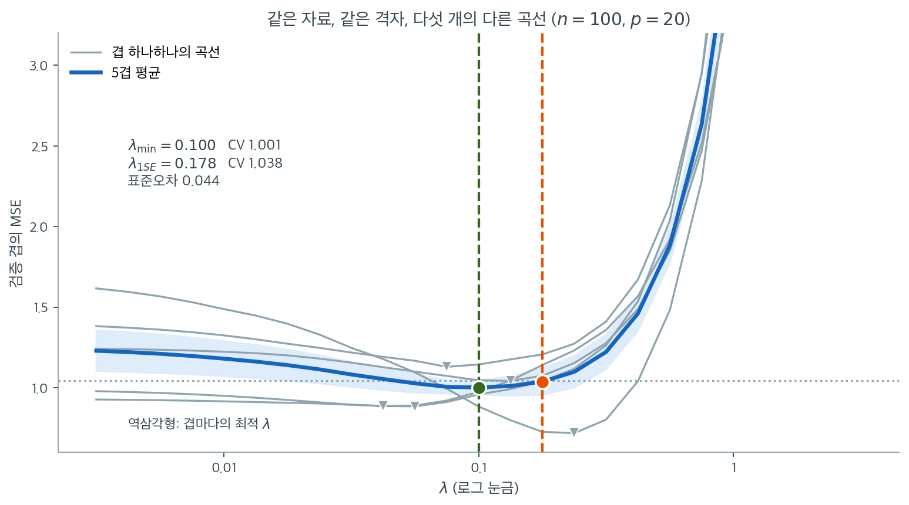
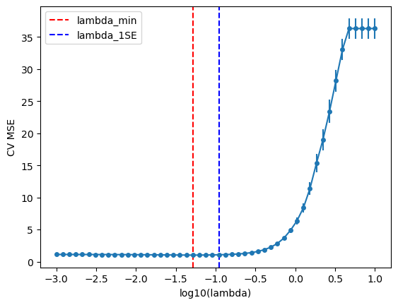

# 교차검증과 람다 조율

## 개요

정칙화 모수 $\lambda$는 능형회귀, 라쏘, 엘라스틱넷에서 벌점의 강도를 조절한다. $\lambda$를 잘
고르는 일은 결정적이다. 너무 작으면 모형이 과적합하고, 너무 크면 과소적합한다. 교차검증(CV)은
표본 밖 예측오차를 추정함으로써 $\lambda$를 자료에 근거해 원리적으로 선택하는 방법이다.

---

## 1. 조율 문제

어떤 벌점회귀에서든 표본 내 손실은 $\lambda$가 0으로 줄어들수록 단조적으로 감소한다(정칙화가
약할수록 훈련자료에 더 잘 맞는다). 그러나 표본 밖 예측오차는 대개 U자 곡선을 그린다.

$$
\text{CV}(\lambda) = \frac{1}{K}\sum_{k=1}^{K} \text{MSE}^{(-k)}(\lambda),
$$

여기서 $\text{MSE}^{(-k)}$는 나머지 $K - 1$개 겹으로 모형을 적합했을 때 겹 $k$에서의
평균제곱오차다. 최적 $\lambda$는 이 곡선을 최소화한다.

---

## 2. K-겹 교차검증

표준 절차는 다음과 같다.

1. 자료를 크기가 거의 같은 $K$개의 겹으로 무작위 분할한다.
2. 격자 $\{\lambda_1, \dots, \lambda_M\}$의 각 후보 $\lambda$에 대해:
    - $k = 1, \dots, K$에 대해 겹 $k$를 남겨 두고 나머지 자료로 모형을 적합한 뒤 겹 $k$에서
      예측오차를 계산한다.
    - $K$개의 예측오차를 평균하여 $\text{CV}(\lambda)$를 얻는다.
3. $\hat{\lambda} = \arg\min_\lambda \text{CV}(\lambda)$를 선택한다.

$K = 5$ 또는 $K = 10$이 흔히 쓰인다.

---

## 3. 람다 격자

후보 $\lambda$ 격자는 보통 로그 척도로 잡는다.

$$
\lambda_1 > \lambda_2 > \cdots > \lambda_M, \quad \text{where } \lambda_m = 10^{a + (b-a)\frac{m-1}{M-1}}
$$

여기서 $[a, b]$는 적당한 범위다(예: $a = -4$, $b = 2$). 실무에서는 다음과 같이 잡는다.

- $\lambda_{\max}$는 모든 라쏘 계수를 0으로 만드는 가장 작은 값
  $\lambda_{\max} = \frac{1}{n}\|X^\top y\|_\infty$이다.
- 격자는 $\lambda_{\max}$에서 시작해 그 작은 배수 $\epsilon \cdot \lambda_{\max}$까지 내려간다
  (예: $\epsilon = 10^{-4}$).

---

## 4. 코드: 기본 교차검증 시연

<div class="exbox" markdown>

**보기 1.** <span class="diff easy" title="쉬움"></span> 교차검증과 1-표준오차 규칙. $n = 100$, $p = 20$이고 참 계수는 앞의 셋만 $(3, -2, 1.5)$, 잡음은 $N(0,1)$이다. 라쏘의 $\lambda$를 $10^{0.5}$에서 $10^{-2.5}$까지 25점으로 훑으며 $5$-겹 교차검증을 한다.

**(1)** 이 자료에서 교차검증 곡선이 **내려갈 수 없는 바닥**과 **올라갈 수 있는 천장**을 각각 수로 구하시오.

**(2)** 교차검증을 실제로 돌려 (1)의 두 값을 확인하고, 최소 규칙과 1-표준오차 규칙이 고른 모형을 견주시오.

</div>

??? success "풀이"

    **(1) 해석적으로.** 새 관측 $(x_0, y_0)$에서 $y_0 = x_0^\top\beta + \varepsilon_0$이고 $\varepsilon_0$은 훈련자료와 독립이다. 어떤 추정량 $\hat\beta$를 쓰든

    $$
    E\!\left[(y_0 - x_0^\top\hat\beta)^2\right]
    = E\!\left[(\varepsilon_0 + x_0^\top(\beta - \hat\beta))^2\right]
    = \sigma^2 + E\!\left[(x_0^\top(\beta-\hat\beta))^2\right]
    \;\ge\; \sigma^2
    $$

    이다. 교차항은 $\varepsilon_0$이 $\hat\beta$와 독립이고 평균이 0이라 사라진다. **바닥은 $\sigma^2 = 1$이고, 이는 $\beta$를 완벽히 알아도 줄일 수 없는 몫이다.**

    천장은 반대쪽 끝에 있다. $\lambda \ge \lambda_{\max} = \lVert X^\top y\rVert_\infty / n$이면 라쏘 해가 영벡터이므로(연습문제 4) 예측값이 절편뿐이고, 그때의 예측오차는 $y$의 분산 $\operatorname{Var}(y) = \beta^\top\Sigma\beta + \sigma^2$이 된다. 설계가 독립 표준정규이므로 $\Sigma = I$이고

    $$
    \operatorname{Var}(y) \approx 3^2 + (-2)^2 + 1.5^2 + 1 = 17.25
    $$

    다. **격자의 왼쪽 끝은 영모형, 오른쪽 끝은 최소제곱**이며 교차검증 곡선은 그 사이 어딘가에서 바닥을 친다.

    **(2) 수치적으로.** 1-표준오차 규칙은

    $$
    \hat\lambda_{1\text{SE}} = \max\{\lambda : \mathrm{CV}(\lambda) \le \mathrm{CV}(\hat\lambda_{\min}) + \mathrm{SE}(\hat\lambda_{\min})\}
    $$

    이다. 코드의 격자 `lambdas` 가 **큰 값에서 작은 값으로** 내려가므로 `np.where(cv_mean <= threshold)[0][0]` 이 집는 첫 번째 자리가 곧 조건을 만족하는 **가장 큰** $\lambda$다.

    ```python
    import numpy as np
    from sklearn.linear_model import Lasso
    from sklearn.model_selection import KFold

    rng = np.random.default_rng(42)

    # 참으로 쓰이는 변수는 앞의 셋뿐이고 나머지 열일곱은 잡음이다.
    n, p = 100, 20
    X = rng.normal(size=(n, p))
    beta_true = np.zeros(p)
    beta_true[:3] = [3.0, -2.0, 1.5]
    y = X @ beta_true + rng.normal(0, 1, n)

    # lambda 격자는 로그 눈금으로 잡는다. 벌점의 효과가 곱셈으로 작동하므로
    # 등간격보다 등비간격이 알맞다.
    lambdas = np.logspace(0.5, -2.5, 25)

    kf = KFold(n_splits=5, shuffle=True, random_state=0)

    # 겹마다의 MSE 를 따로 남긴다. 평균만 구하면 1-표준오차 규칙을 쓸 수 없다.
    fold_mse = np.zeros((5, len(lambdas)))
    for k, (tr, va) in enumerate(kf.split(X)):
        for i, lam in enumerate(lambdas):
            model = Lasso(alpha=lam, max_iter=10000).fit(X[tr], y[tr])
            fold_mse[k, i] = np.mean((y[va] - model.predict(X[va])) ** 2)

    cv_mean = fold_mse.mean(axis=0)
    cv_se = fold_mse.std(axis=0, ddof=1) / np.sqrt(5)

    i_min = int(np.argmin(cv_mean))

    # 1-표준오차 규칙: 최솟값에서 1 표준오차 안에 드는 lambda 중 가장 큰 것을
    # 고른다. CV 곡선의 최소점은 그 자체가 흔들리는 추정값이므로, 조금 더
    # 단순한 모형 쪽으로 물러서는 편이 안전하다는 생각이다.
    threshold = cv_mean[i_min] + cv_se[i_min]
    i_1se = int(np.where(cv_mean <= threshold)[0][0])

    for name, i in [("최소 CV", i_min), ("1-표준오차", i_1se)]:
        beta = Lasso(alpha=lambdas[i], max_iter=10000).fit(X, y).coef_
        print(f"{name:>10}: lambda = {lambdas[i]:.4f}, "
              f"CV MSE = {cv_mean[i]:.3f} (SE {cv_se[i]:.3f}), "
              f"0 이 아닌 계수 = {np.sum(np.abs(beta) > 1e-8)}개")
    print("참으로 0 이 아닌 계수: 3개")

    # --- (1) 의 바닥과 천장을 확인한다 ---
    print(f"잡음분산 sigma^2 = 1 이므로 CV MSE 의 하한은 1.000")
    print(f"최소 CV MSE = {cv_mean[i_min]:.4f}  ->  하한 위로 {cv_mean[i_min] - 1:+.4f}")
    print(f"1-SE 문턱 = {cv_mean[i_min]:.4f} + {cv_se[i_min]:.4f} = {threshold:.4f}")
    print(f"격자 첫 값 lambda = {lambdas[0]:.4f},  이론 lambda_max = |X'y|_inf/n = "
          f"{np.abs(X.T @ (y - y.mean())).max() / n:.4f}")
    print(f"가장 큰 lambda 에서의 CV MSE = {cv_mean[0]:.4f}  (영모형: Var(y) = {y.var():.4f})")
    ```

    출력:

    ```
         최소 CV: lambda = 0.1000, CV MSE = 1.001 (SE 0.044), 0 이 아닌 계수 = 9개
        1-표준오차: lambda = 0.1778, CV MSE = 1.038 (SE 0.083), 0 이 아닌 계수 = 5개
    참으로 0 이 아닌 계수: 3개
    잡음분산 sigma^2 = 1 이므로 CV MSE 의 하한은 1.000
    최소 CV MSE = 1.0014  ->  하한 위로 +0.0014
    1-SE 문턱 = 1.0014 + 0.0441 = 1.0455
    격자 첫 값 lambda = 3.1623,  이론 lambda_max = |X'y|_inf/n = 3.1113
    가장 큰 lambda 에서의 CV MSE = 17.4719  (영모형: Var(y) = 17.5023)
    ```

    **바닥이 맞는다.** 최소 CV MSE가 $1.0014$로 유도한 하한 $\sigma^2 = 1$보다 겨우 $0.0014$ 높다. 표준오차가 $0.044$이니 이 차이는 재어 낼 수도 없는 크기다. $n = 100$에 참 변수가 셋뿐이라 라쏘가 $\beta$를 거의 완벽히 되찾았다는 뜻이다.

    **천장도 맞는다.** 격자의 첫 값 $3.1623$이 이론적 $\lambda_{\max} = 3.1113$보다 크므로 거기서 라쏘 해는 영벡터이고, 실제 CV MSE가 $17.4719$로 $\operatorname{Var}(y) = 17.5023$과 사실상 같다. (1)에서 어림한 $17.25$와도 가깝다. 둘의 작은 차이는 $n = 100$에서 $X$의 표본공분산이 $I$와 꼭 같지는 않기 때문이다. 겹을 나누어 적합했으므로 완전히 같아질 이유도 없다.

    최소 CV 규칙은 잡음 변수를 여섯 개나 남겼지만, 1-표준오차 규칙은 다섯 개만 남겼다. 참으로 쓰인 변수가 셋임을 생각하면 뒤쪽이 더 나은 선택이다. **다만 CV가 겨냥하는 것은 예측오차이지 올바른 변수집합이 아니다.** 둘 다 과다선택을 한 것은 CV가 실패했기 때문이 아니라, 계수가 거의 0인 잡음변수를 하나 더 넣어도 예측오차가 거의 늘지 않기 때문이다.

---

## 5. 1-표준오차 규칙

$\hat{\lambda}$를 CV 곡선의 정확한 최소점으로 잡는 대신, CV 오차가 최솟값으로부터 1 표준오차
이내인 $\lambda$ 중 가장 큰 것을 고르는 보수적 규칙이 널리 쓰인다.

$$
\hat{\lambda}_{1\text{SE}} = \max\left\{ \lambda : \text{CV}(\lambda) \le \text{CV}(\hat{\lambda}) + \text{SE}(\hat{\lambda}) \right\}.
$$

이 규칙은 예측오차를 거의 늘리지 않으면서 더 단순한(더 강하게 정칙화된) 모형을 선호한다.



위 보기의 `fold_mse` 행렬을 평균내기 **전에** 그려 본 것이다. 굵은 파란 선이 우리가 보통 보는 5겹 평균이고, 가는 회색 선 다섯 개가 그 평균을 이루는 겹별 곡선이다. 역삼각형은 각 겹이 혼자서 골랐을 최적 $\lambda$다.

회색 곡선들이 얼마나 다른지 보라. 다섯 겹의 최적 $\lambda$는 $0.042,\ 0.056,\ 0.075,\ 0.133,\ 0.237$로 **가장 작은 것과 가장 큰 것이 5.6배 차이난다.** 최저 오차도 $0.718$에서 $1.130$까지 흩어진다. 같은 자료를 어떻게 다섯 조각으로 나누느냐에 따라 "최적"이 이만큼 움직인다는 뜻이다. 평균 곡선의 최소점 $\lambda_{\min} = 0.100$은 이 다섯 의견의 타협일 뿐이며, 소수점까지 믿을 근거가 없다.

이 흔들림을 숫자로 요약한 것이 표준오차 $0.044$이고, 회색 점선이 그 문턱 $1.001 + 0.044 = 1.045$다. 문턱 아래에 머무는 가장 큰 $\lambda$가 $\lambda_{1\text{SE}} = 0.178$이다. **두 $\lambda$ 사이의 곡선이 평평하다는 점이 1-SE 규칙의 전부다.** 평균 곡선이 그 구간에서 $1.001$에서 $1.038$로 4% 오를 뿐이라면, 통계적으로 구별되지 않는 모형들 중 가장 단순한 것을 고르는 편이 낫다.

그 선택이 실제로 무엇을 바꾸는지는 계수를 세어 보면 안다. $\lambda_{\min}$은 변수 9개를, $\lambda_{1\text{SE}}$는 5개를 남긴다. 참으로 쓰인 변수는 3개이므로 **둘 다 과다선택이지만 후자가 진실에 가깝다.** 예측 정확도를 마지막 한 자리까지 다투는 상황이 아니라면, 곡선이 평평한 구간에서는 오른쪽 끝을 고르는 것이 합리적이다.

---

## 6. 실무상의 고려사항

- **표준화.** 교차검증 전에 항상 설명변수를 표준화하라. 단, 표준화에 쓰는 평균과 표준편차는
  전체 자료가 아니라 훈련 겹에서만 계산해야 자료 누설을 피할 수 있다.
- **중첩 교차검증.** 최종 모형의 일반화 오차까지 추정하려면 중첩(이중) 교차검증을 쓴다.
  바깥 루프가 검정오차를 추정하고 안쪽 루프가 $\lambda$를 선택한다.
- **계산 비용.** 온기 시작(직전 $\lambda$의 해에서 좌표하강을 시작하는 것)은 경로 계산을
  극적으로 빠르게 한다.
- **무작위 분할.** 분할 전에 섞거나 반복 교차검증을 쓰면 특정 분할에 대한 민감도가 줄어든다.

---

## 7. 해석

- CV 곡선은 U자(적어도 비단조) 모양이어야 한다. 가장 작은 $\lambda$에서도 여전히 감소 중이라면
  격자를 더 작은 쪽으로 넓혀라.
- 가장 큰 $\lambda$에서도 여전히 감소 중이라면 그 자료에는 정칙화가 필요 없을 수도 있다.
- 1SE 규칙은 예측오차를 조금 희생하는 대신 더 희소하고 해석하기 좋은 모형을 준다.

---

## 연습문제

<div class="drillbox" markdown>

**연습문제 1.** <span class="diff med" title="중간"></span> 교차검증 전에 전체 자료로 설명변수를 표준화하면 왜 자료 누설이 생기는지
설명하고, 올바른 절차를 서술하라.

</div>

??? success "풀이"

    검증 겹까지 포함한 전체 자료에서 $\bar{x}_j$와 $s_j$를 계산해 표준화하면, 검증 겹의 자료가
    자기 자신에게 적용되는 변환에 영향을 미친다. 결국 모형이 훈련 과정에서 검증 겹의 정보를
    간접적으로 "본" 셈이 되어 CV 오차 추정이 낙관적으로 편향된다.

    **올바른 절차:** 각 CV 반복 안에서 훈련 겹만으로 평균과 표준편차를 계산한 뒤, 같은 변환을
    남겨 둔 겹에 적용한다.

    ```python
    import numpy as np
    from sklearn.model_selection import KFold

    rng = np.random.default_rng(0)
    X = rng.normal(5, 3, (100, 4))          # 평균과 척도가 0/1이 아닌 자료
    y = X @ np.array([1.0, -1.0, 0.5, 0.0]) + rng.normal(0, 1, 100)

    for k, (train_idx, val_idx) in enumerate(KFold(5).split(X)):
        X_train, X_val = X[train_idx], X[val_idx]
        mu = X_train.mean(axis=0)
        sigma = X_train.std(axis=0)
        X_train_s = (X_train - mu) / sigma
        X_val_s = (X_val - mu) / sigma
        # 훈련자료로 적합하고 검증자료에서 잰다
        if k == 0:
            print("훈련 겹 평균:", np.round(X_train_s.mean(axis=0), 4))
            print("검증 겹 평균:", np.round(X_val_s.mean(axis=0), 4))
    ```

    출력:

    ```
    훈련 겹 평균: [-0.  0. -0. -0.]
    검증 겹 평균: [-0.1022  0.1113  0.5175  0.243 ]
    ```

    이렇게 하면 검증 겹이 진정으로 미관측 상태로 남는다. $\square$

---

<div class="drillbox" markdown>

**연습문제 2.** <span class="diff med" title="중간"></span> 1-표준오차 규칙을 구현하라. 배열 `lambdas`, `cv_mean`, `cv_se`(각 $\lambda$의
CV MSE 평균과 표준오차)가 주어졌을 때 $\hat{\lambda}_{1\text{SE}}$를 반환하는 함수를 작성하라.

</div>

??? success "풀이"

    ```python
    def one_se_rule(lambdas, cv_mean, cv_se):
        """
        Select the largest lambda whose CV error is within
        one SE of the minimum CV error.
        """
        best_idx = np.argmin(cv_mean)
        threshold = cv_mean[best_idx] + cv_se[best_idx]

        # 교차검증 오차가 문턱 이하인 lambda 중 가장 큰 것을 고른다
        candidates = np.where(cv_mean <= threshold)[0]
        best_1se_idx = candidates[np.argmax(lambdas[candidates])]
        return lambdas[best_1se_idx]
    ```

    이 함수는 최소 CV 오차를 찾아 1 표준오차를 더해 문턱값을 만들고, 그 문턱값 이내에서 가장
    강하게 정칙화된 모형(가장 큰 $\lambda$)을 고른다.

    !!! warning "흔한 함정"
        후보 인덱스에서 곧바로 `candidates.max()`나 `candidates.min()`을 쓰면 안 된다.
        `lambdas` 배열이 오름차순인지 내림차순인지에 따라 정반대 결과가 나오기 때문이다.
        `sklearn.linear_model.lasso_path`가 돌려주는 `alphas`는 **내림차순**이라
        `candidates.max()`는 가장 작은 $\lambda$를 고르게 되어 규칙의 취지와 반대가 된다.
        위처럼 $\lambda$ 값 자체에 `argmax`를 취하면 정렬 순서와 무관하게 항상 옳다.
    $\square$

---

<div class="drillbox" markdown>

**연습문제 3.** <span class="diff med" title="중간"></span> 인공자료($n = 200$, $p = 30$, 참 계수 중 5개만 0이 아님)에 대해 로그 등간격
$\lambda$ 50개 위에서 라쏘의 5-겹 교차검증을 수행하라. 오차막대($\pm 1$ SE)를 포함한 CV 곡선을
그리고 $\hat{\lambda}_{\min}$과 $\hat{\lambda}_{1\text{SE}}$를 모두 표시하라.

</div>

??? success "풀이"

    ```python
    import numpy as np
    import matplotlib.pyplot as plt
    from sklearn.linear_model import Lasso
    from sklearn.model_selection import KFold
    from sklearn.preprocessing import StandardScaler

    np.random.seed(42)
    n, p = 200, 30
    X = np.random.randn(n, p)
    beta_true = np.zeros(p)
    beta_true[:5] = [3, -2, 4, -1, 2]
    y = X @ beta_true + np.random.randn(n)

    X_s = StandardScaler().fit_transform(X)
    lambdas = np.logspace(1, -3, 50)
    kf = KFold(n_splits=5, shuffle=True, random_state=42)

    mse_folds = np.zeros((len(lambdas), 5))
    for fold_idx, (tr, va) in enumerate(kf.split(X_s)):
        mu, sig = X_s[tr].mean(0), X_s[tr].std(0)
        Xtr = (X_s[tr] - mu) / sig
        Xva = (X_s[va] - mu) / sig
        for i, lam in enumerate(lambdas):
            m = Lasso(alpha=lam, max_iter=10000).fit(Xtr, y[tr])
            mse_folds[i, fold_idx] = np.mean((y[va] - m.predict(Xva))**2)

    cv_mean = mse_folds.mean(axis=1)
    cv_se = mse_folds.std(axis=1) / np.sqrt(5)

    best_idx = np.argmin(cv_mean)
    lam_min = lambdas[best_idx]
    lam_1se = one_se_rule(lambdas, cv_mean, cv_se)

    plt.errorbar(np.log10(lambdas), cv_mean, yerr=cv_se, fmt='o-', ms=4)
    plt.axvline(np.log10(lam_min), color='red', ls='--', label='lambda_min')
    plt.axvline(np.log10(lam_1se), color='blue', ls='--', label='lambda_1SE')
    plt.xlabel('log10(lambda)')
    plt.ylabel('CV MSE')
    plt.legend()
    plt.show()
    ```

    

    실행하면 $\hat{\lambda}_{\min} = 0.0518$에서 CV MSE는 $1.0154$(SE $= 0.0611$)이고,
    1SE 규칙은 $\hat{\lambda}_{1\text{SE}} = 0.1099$를 고르며 그때 CV MSE는 $1.0637$이다.
    전체 자료에 다시 적합하면 $\hat{\lambda}_{\min}$은 0이 아닌 계수를 16개 남기지만
    $\hat{\lambda}_{1\text{SE}}$는 10개만 남긴다. 즉 예측오차가 5% 가까이 늘어나는 대신
    모형이 훨씬 희소해진다. 곡선은 특징적인 U자 모양이며, 잡음변수 25개 중 상당수가 여전히
    선택된다는 점은 교차검증이 **예측**을 최적화할 뿐 **변수선택**을 최적화하지는 않음을
    보여준다. $\square$

---

<div class="drillbox" markdown>

**연습문제 4.** <span class="diff hard" title="어려움"></span> 라쏘에 대해 $\lambda_{\max} = \frac{1}{n}\|X^\top y\|_\infty$를 유도하라. 즉
$\lambda \ge \lambda_{\max}$이면 라쏘 해가 $\hat{\beta} = 0$임을 보여라.

</div>

??? success "풀이"

    라쏘 목적함수는 $f(\beta) = \frac{1}{2n}\|y - X\beta\|_2^2 + \lambda\|\beta\|_1$이다.
    $\beta = 0$에서의 부분미분은

    $$
    \partial f(0) = \left\{-\frac{1}{n}X^\top y + \lambda s : s \in \partial\|\cdot\|_1(0)\right\} = \left\{-\frac{1}{n}X^\top y + \lambda s : s_j \in [-1,1]\right\}
    $$

    이다. 최적성 조건 $0 \in \partial f(0)$은 $|s_j| \le 1$인 어떤 $s$에 대해
    $\frac{1}{n}X^\top y = \lambda s$가 성립할 것을 요구한다. 이는 모든 $j$에 대해
    $\frac{1}{n}|X_j^\top y| \le \lambda$일 때, 그리고 그때에만 가능하다. 즉
    $\lambda \ge \frac{1}{n}\|X^\top y\|_\infty = \lambda_{\max}$이다. $\square$

---

<div class="drillbox" markdown>

**연습문제 5.** <span class="diff hard" title="어려움"></span> 능형회귀의 하나 남기기 교차검증(LOOCV)이 닫힌 형태
$\text{CV}_{\text{LOO}} = \frac{1}{n}\sum_{i=1}^{n}\left(\frac{y_i - \hat{y}_i}{1 - h_{ii}}\right)^2$
로 계산됨을 증명하라. 여기서 $H = X(X^\top X + \lambda I)^{-1}X^\top$는 능형 모자행렬이고
$h_{ii}$는 그 $i$번째 대각원소다.

</div>

??? success "풀이"

    관측치 $i$를 제거하면 나머지 $n-1$개로 적합한 능형 모형이 예측 $\hat{y}_{(-i), i}$를 준다.
    셔먼-모리슨 공식에 의해, $X$에서 $i$번째 행과 $y$에서 $i$번째 원소를 빼고 다시 적합하는
    것은

    $$
    \hat{y}_{(-i), i} = x_i^\top (X_{(-i)}^\top X_{(-i)} + \lambda I)^{-1} X_{(-i)}^\top y_{(-i)}
    $$

    와 같다. 선형모형의 표준 결과(OLS의 LOOCV 지름길을 확장한 것)에 따르면 능형회귀의 LOO
    잔차는

    $$
    y_i - \hat{y}_{(-i),i} = \frac{y_i - \hat{y}_i}{1 - h_{ii}}
    $$

    를 만족한다. 여기서 $\hat{y}_i = h_i^\top y$는 전체 자료로 적합한 능형 예측값이고
    $h_{ii}$는 모자행렬 $H = X(X^\top X + \lambda I)^{-1}X^\top$의 $(i,i)$ 원소다.

    따라서

    $$
    \text{CV}_{\text{LOO}} = \frac{1}{n}\sum_{i=1}^{n}\left(\frac{y_i - \hat{y}_i}{1 - h_{ii}}\right)^2
    $$

    이다. 이 식은 전체 모형을 한 번 적합하고 $H$의 대각만 구하면 되므로, 순진한 방법의
    $O(n^2 p^2)$ 대신 $O(np^2)$에 계산된다. $\square$

---

<div class="drillbox" markdown>

**연습문제 6.** <span class="diff hard" title="어려움"></span> 3절은 $\lambda_{\max} = \frac{1}{n}\lVert X^\top y\rVert_\infty$라고 적었지만, 보기 1의 코드는
`np.abs(X.T @ (y - y.mean())).max() / n` 으로 $3.1113$을 계산했다. $y$를 중심화한 쪽이 맞다.

**(1)** sklearn 의 `Lasso` 는 절편을 벌점에서 뺀다. 목적함수
$f(\beta_0, \beta) = \frac{1}{2n}\lVert y - \beta_0\mathbf{1} - X\beta\rVert_2^2 + \lambda\lVert\beta\rVert_1$
에 대해 $\beta = 0$일 때 최적 절편을 구하고, 부분미분 조건에서
$\lambda_{\max} = \frac{1}{n}\lVert X^\top(y - \bar{y}\mathbf{1})\rVert_\infty$임을 보이라.

**(2)** 두 공식의 차이를 $\bar{y}$와 열합 $\mathbf{1}^\top X_j$로 적고, 보기 1의 자료에서
중심화하지 않은 값이 $3.1132$, 중심화한 값이 $3.1113$인 까닭을 수로 설명하라. 설계행렬의
열을 중심화해 두면 두 공식이 언제나 일치함도 보이라.

**(3)** 첫 열의 단위를 바꾸어 $x_1 \mapsto 100\,x_1$으로 쓰면 $\lambda_{\max}$와 격자가 어떻게
변하는가. 고정된 $\lambda$에서 해가 어떻게 달라지는지 설명하고, 표준화를 왜 먼저 해야 하는지
말하라.

</div>

??? success "풀이"

    **(1)** $\beta = 0$을 고정하면 목적함수는 $\frac{1}{2n}\lVert y - \beta_0\mathbf{1}\rVert_2^2$뿐이고 ($\beta_0$에는 벌점이 없다) 이것은 $\beta_0 = \bar{y}$에서 최소가 된다. 그러므로 후보점은 $(\beta_0, \beta) = (\bar{y}, 0)$이다.

    이 점에서 $\beta$에 대한 부분미분을 보자. 잔차는 $r = y - \bar{y}\mathbf{1}$이고

    $$
    \partial_\beta f(\bar{y}, 0) = \left\{-\frac{1}{n}X^\top(y - \bar{y}\mathbf{1}) + \lambda s : \lvert s_j\rvert \le 1\right\}
    $$

    이다. $0$이 이 집합에 들어가려면 모든 $j$에 대해 $\frac{1}{n}\lvert X_j^\top(y - \bar{y}\mathbf{1})\rvert \le \lambda$여야 하고, 그 조건이 곧

    $$
    \lambda \;\ge\; \frac{1}{n}\lVert X^\top(y - \bar{y}\mathbf{1})\rVert_\infty \;=\; \lambda_{\max}
    $$

    다. 연습문제 4와 유도가 똑같고, 다른 점은 $y$가 아니라 **절편을 적합한 뒤의 잔차** $y - \bar{y}\mathbf{1}$이 들어간다는 것뿐이다. 벌점을 받지 않는 모수는 언제나 먼저 최적화되고, 벌점을 받는 모수의 문턱은 그 뒤에 남은 잔차로 재어진다.

    **(2)** 한 열씩 떼어 보면

    $$
    \frac{1}{n}X_j^\top(y - \bar{y}\mathbf{1}) = \frac{1}{n}X_j^\top y - \bar{y}\cdot\frac{\mathbf{1}^\top X_j}{n}
    $$

    이므로 두 공식의 차이는 **$\bar{y}$와 열평균의 곱**이다. 보기 1의 자료에서 최댓값을 내는 열은 첫 열이고

    $$
    \frac{1}{n}X_1^\top y = 3.113233, \qquad \bar{y} = -0.043118, \qquad \frac{\mathbf{1}^\top X_1}{n} = -0.045328
    $$

    이다. 따라서 보정항은 $(-0.043118)\times(-0.045328) = 0.001954$이고

    $$
    3.113233 - 0.001954 = 3.111279 \approx 3.1113
    $$

    이 되어 코드가 찍은 값과 맞는다. 차이가 $0.002$밖에 안 되는 것은 $X$가 평균 0에서 뽑혔고 $y$의 평균도 0에 가까워 두 인수가 모두 작기 때문이다. **열을 중심화하면 $\mathbf{1}^\top X_j = 0$이므로 보정항이 정확히 사라지고 3절의 공식이 그대로 맞는다.** 3절의 식은 열이 이미 중심화되었다는 암묵적 전제 아래 적힌 것이다.

    **(3)** $x_1 \mapsto 100\,x_1$이면 첫 열의 값만 100배가 되어

    $$
    \frac{1}{n}\lvert (100X_1)^\top(y - \bar{y}\mathbf{1})\rvert = 100 \times 3.111279 = 311.1279
    $$

    이고 다른 열은 그대로이므로 $\lambda_{\max}$가 $3.1113$에서 $311.1279$로 커진다. 격자를 $[\epsilon\lambda_{\max}, \lambda_{\max}]$로 잡으면 격자 전체가 100배 오른쪽으로 옮겨 가고, 보기 1이 쓴 고정 격자 $10^{0.5} \sim 10^{-2.5}$는 **전 구간이 $\lambda_{\max}$ 아래가 되어 영모형 쪽 끝을 아예 보지 못한다.**

    고정된 $\lambda$에서의 해도 달라진다. 같은 적합값을 내려면 새 계수가 $\beta_1/100$이어야 하므로 L1 벌점이 그 변수에 매기는 값은 $\lambda\lvert\beta_1\rvert/100$, 즉 **100배 싸진다.** 값을 큰 수로 적은 변수(미터 대신 센티미터로 적은 변수)는 벌점을 거의 받지 않고 경로에 가장 먼저 들어오며, 작은 수로 적은 변수는 먼저 0으로 밀려난다. 즉 "센티미터로 적었는가 미터로 적었는가"가 변수선택을 바꾼다.

    $\lVert\beta\rVert_1$도 $\lVert\beta\rVert_2^2$도 단위가 섞인 좌표들의 합이라서 척도불변이 아니다. 그래서 벌점회귀에서는 열을 평균 0, 표준편차 1로 맞춘 뒤 벌점을 매기고, 절편은 벌점에서 뺀다. 그리고 그 표준화는 **겹 안에서** 해야 한다(연습문제 1). $\square$

---

<div class="drillbox" markdown>

**연습문제 7.** <span class="diff hard" title="어려움"></span> 연습문제 5의 능형 LOOCV 공식
$\text{CV}_{\text{LOO}}(\lambda) = \frac{1}{n}\sum_i \bigl(\frac{y_i - \hat{y}_i}{1 - h_{ii}}\bigr)^2$을
출발점으로 삼는다. $X$의 특잇값을 $d_1, \dots, d_p$, 능형 모자행렬을
$H = X(X^\top X + \lambda I)^{-1}X^\top$라 하자.

**(1)** $\lambda > 0$일 때 $0 \le h_{ii} < 1$임을 보이고, 따라서
$\text{CV}_{\text{LOO}}(\lambda) \ge \frac{1}{n}\text{RSS}(\lambda)$임을 보이라. 등호는 언제 성립하는가.

**(2)** $\operatorname{tr}(H) = \sum_{j=1}^{p} \frac{d_j^2}{d_j^2 + \lambda}$임을 보이고, 이 값이
$\lambda$에 대해 감소하며 $\lambda \to 0$에서 $\operatorname{rank}(X)$, $\lambda \to \infty$에서 $0$으로
감을 보이라. 이것을 $\text{df}(\lambda)$로 쓴다.

**(3)** 모든 $h_{ii}$가 같은 설계에서는
$\text{CV}_{\text{LOO}}(\lambda) = \frac{\text{RSS}(\lambda)}{n(1 - \text{df}(\lambda)/n)^2}$
임을 보이라(이것이 일반화 교차검증 GCV 다).

**(4)** $n = 100$, $p = 20$이고 $X^\top X = nI_p$이며 모든 행의 길이가
$\lVert x_i\rVert_2^2 = p$인 설계에서 $\lambda = 10$일 때 $\text{df}$, $h_{ii}$,
$\text{CV}_{\text{LOO}}/(\text{RSS}/n)$을 수로 구하고 $\lambda = 0$과 견주라.

</div>

??? success "풀이"

    **(1)** $X = UDV^\top$를 특잇값분해라 하면

    $$
    H = U\operatorname{diag}\!\left(\frac{d_j^2}{d_j^2+\lambda}\right)U^\top
    $$

    이다. 고윳값이 모두 $[0, 1)$ 안에 있으므로 $H$는 양반정부호이고, 대각원소는 $h_{ii} = e_i^\top H e_i \ge 0$이며

    $$
    h_{ii} \le \lambda_{\max}(H) = \max_j \frac{d_j^2}{d_j^2+\lambda} < 1 \quad (\lambda > 0)
    $$

    이다. $\lambda > 0$인 덕분에 분모가 분자보다 반드시 크고, 이것이 $1 - h_{ii} > 0$을 보장해 LOOCV 공식의 분모가 0이 되지 않게 한다. 그러면 $1/(1-h_{ii})^2 \ge 1$이므로

    $$
    \text{CV}_{\text{LOO}} = \frac{1}{n}\sum_{i=1}^n \frac{r_i^2}{(1-h_{ii})^2} \;\ge\; \frac{1}{n}\sum_{i=1}^n r_i^2 = \frac{\text{RSS}(\lambda)}{n}
    $$

    이다($r_i = y_i - \hat{y}_i$). **등호는 $r_i \ne 0$인 모든 $i$에서 $h_{ii} = 0$일 때만 성립한다.** 그런데 $h_{ii} = x_i^\top(X^\top X + \lambda I)^{-1}x_i$이고 괄호 안은 양정부호이므로 $h_{ii} = 0 \iff x_i = 0$이다. 즉 등호는 설명변수가 전부 0인 행만 잔차를 남기는 퇴화된 경우뿐이고, **실제로는 표본 내 RSS 가 LOOCV 를 늘 과소평가한다.** 이것이 표본 내 손실로 $\lambda$를 고를 수 없는 이유다.

    **(2)** $\operatorname{tr}(AB) = \operatorname{tr}(BA)$를 쓰면

    $$
    \operatorname{tr}(H) = \operatorname{tr}\!\left(X(X^\top X+\lambda I)^{-1}X^\top\right) = \operatorname{tr}\!\left((X^\top X+\lambda I)^{-1}X^\top X\right) = \sum_{j=1}^p \frac{d_j^2}{d_j^2+\lambda}
    $$

    인데, 마지막 등식은 $X^\top X = V D^2 V^\top$를 대입하면 $(X^\top X + \lambda I)^{-1}X^\top X = V\operatorname{diag}(d_j^2/(d_j^2+\lambda))V^\top$가 되기 때문이다. 각 항 $d_j^2/(d_j^2+\lambda)$는 $\lambda$에 대해 미분하면 $-d_j^2/(d_j^2+\lambda)^2 \le 0$이라 감소하고, $\lambda \to 0$에서는 $d_j > 0$인 항이 1, $d_j = 0$인 항이 0이 되어 합이 $\operatorname{rank}(X)$이며, $\lambda \to \infty$에서는 모든 항이 0으로 간다.

    $$
    \text{df}(0) = \operatorname{rank}(X), \qquad \text{df}(\infty) = 0
    $$

    즉 $\lambda$를 키우는 것은 **모수의 개수를 연속적으로 깎는 것**이다. 정수가 아닌 자유도가 나오는 까닭이 여기 있다.

    **(3)** $h_{ii} = h$가 모든 $i$에 같다면 $nh = \sum_i h_{ii} = \operatorname{tr}(H) = \text{df}(\lambda)$이므로 $h = \text{df}(\lambda)/n$이고

    $$
    \text{CV}_{\text{LOO}} = \frac{1}{n}\sum_i \frac{r_i^2}{(1-h)^2} = \frac{1}{(1-h)^2}\cdot\frac{\text{RSS}(\lambda)}{n} = \frac{\text{RSS}(\lambda)}{n\left(1 - \text{df}(\lambda)/n\right)^2}
    $$

    이다. 오른쪽이 GCV 다. **GCV 는 "지렛값이 모두 같다"고 가정한 LOOCV 의 어림이며, 그 가정이 맞는 설계에서는 어림이 아니라 등식이다.** 모자행렬의 대각을 일일이 구하지 않고 대각합만 알면 되므로 계산이 더 싸다.

    **(4)** $X^\top X = nI_p$이면 모든 특잇값이 같아 $d_j^2 = n = 100$이다. 따라서

    $$
    \text{df}(10) = \sum_{j=1}^{20}\frac{100}{100+10} = 20\cdot\frac{10}{11} = \frac{200}{11} = 18.1818
    $$

    이다. 한편 $(X^\top X + \lambda I)^{-1} = \frac{1}{n+\lambda}I$이므로

    $$
    h_{ii} = \frac{\lVert x_i\rVert_2^2}{n+\lambda} = \frac{20}{110} = \frac{2}{11} = 0.1818
    $$

    로 모든 $i$에 같다. 검산하면 $n h_{ii} = 100 \cdot 2/11 = 200/11 = \text{df}(10)$이 맞는다. 그러므로 (3)의 꼴이 정확히 성립하고

    $$
    \frac{\text{CV}_{\text{LOO}}}{\text{RSS}/n} = \frac{1}{(1 - 2/11)^2} = \left(\frac{11}{9}\right)^2 = \frac{121}{81} = 1.4938
    $$

    이다. $\lambda = 0$에서는 $\text{df} = 20$, $h_{ii} = p/n = 0.2$, 배율이 $(1/0.8)^2 = 1.5625$다.

    $\lambda$를 0에서 10으로 올리면 자유도가 $20$에서 $18.18$로 줄고 과적합 보정 배율도 $1.5625$에서 $1.4938$로 줄어든다. **그러나 $\text{RSS}(\lambda)$ 자체는 늘어난다.** LOOCV 곡선의 U 자 모양은 이 두 힘이 곱해진 결과다 — 줄어드는 배율과 늘어나는 RSS 가 균형을 이루는 곳에 최솟값이 있다. $\square$

---

<div class="drillbox" markdown>

**연습문제 8.** <span class="diff hard" title="어려움"></span> 연습문제 1은 표준화를 겹 밖에서 하면 자료가 새어든다고 말했다. 그 누수를 수로 보이자.
다만 표준화보다 훨씬 크게 새는 것은 **변수선택**이다. $n = 100$, $p = 400$이고 $y$가 $X$와
**아무 관계도 없는** 잡음일 때, $y$와의 상관이 큰 열 10개를 **전체 자료로** 고른 뒤 그 열만으로
5-겹 교차검증을 하면 CV MSE 가 $\operatorname{Var}(y)$보다 **작게** 나온다는 것을 확인하라.
변수선택을 겹 안으로 옮기면 어떻게 바뀌는가. 능형은 닫힌 꼴로 적합하고 절편은 벌점에서 빼라.

</div>

??? success "풀이"

    $y$가 $X$와 독립이므로 어떤 정직한 예측기도 $y$를 절편(즉 $\bar{y}$)보다 잘 맞힐 수 없고, 정직한 예측오차는 $\operatorname{Var}(y)$ 아래로 내려갈 수 없다. 그런데 $p = 400$개의 잡음 열 가운데에는 우연히 $y$와 상관이 큰 열이 반드시 있다. 그 열을 **전체 자료를 보고** 고르면 검증 겹에서의 우연한 일치까지 골라 넣게 되고, 그 겹은 더 이상 미관측이 아니다.

    ```python
    import numpy as np
    from sklearn.model_selection import KFold

    rng = np.random.default_rng(1)

    # y 는 X 와 아무 관계가 없다. 정직한 예측오차는 Var(y) 아래로 내려갈 수 없다.
    n, p, k = 100, 400, 10
    X = rng.normal(size=(n, p))
    y = rng.normal(size=n)
    lam = 1.0


    def ridge_fit_predict(Xtr, ytr, Xva, lam):
        """절편은 벌점에서 빼고 닫힌 꼴로 푼다. 반복 해법이 아니라 정확하다."""
        mu, yb = Xtr.mean(axis=0), ytr.mean()
        Xc, yc = Xtr - mu, ytr - yb
        G = Xc.T @ Xc + lam * np.eye(Xc.shape[1])
        beta = np.linalg.solve(G, Xc.T @ yc)
        return yb + (Xva - mu) @ beta


    def top_k(Xs, ys, k):
        """y 와의 상관이 큰 열 k 개의 번호."""
        Xc = Xs - Xs.mean(axis=0)
        yc = ys - ys.mean()
        sc = np.abs(Xc.T @ yc) / (np.linalg.norm(Xc, axis=0) * np.linalg.norm(yc))
        return np.argsort(-sc)[:k]


    kf = KFold(n_splits=5, shuffle=True, random_state=0)

    # (A) 새는 방식: 전체 자료로 변수를 고른 뒤 그 열만 가지고 교차검증한다.
    sel_all = top_k(X, y, k)
    mse_leak = []
    for tr, va in kf.split(X):
        pred = ridge_fit_predict(X[np.ix_(tr, sel_all)], y[tr],
                                 X[np.ix_(va, sel_all)], lam)
        mse_leak.append(np.mean((y[va] - pred) ** 2))

    # (B) 정직한 방식: 변수선택을 폴드 안으로 옮긴다.
    mse_hon = []
    overlap = []
    for tr, va in kf.split(X):
        sel = top_k(X[tr], y[tr], k)
        overlap.append(len(set(sel.tolist()) & set(sel_all.tolist())))
        pred = ridge_fit_predict(X[np.ix_(tr, sel)], y[tr],
                                 X[np.ix_(va, sel)], lam)
        mse_hon.append(np.mean((y[va] - pred) ** 2))

    print(f"Var(y)                  = {y.var():.4f}")
    print(f"(A) 밖에서 고른 CV MSE  = {np.mean(mse_leak):.4f}")
    print(f"(B) 안에서 고른 CV MSE  = {np.mean(mse_hon):.4f}")
    print(f"과소평가의 크기         = {np.mean(mse_hon) - np.mean(mse_leak):.4f}")
    print(f"폴드마다 다시 고른 열이 전체 선택과 겹친 개수: {overlap}")
    ```

    출력:

    ```text
    Var(y)                  = 1.0945
    (A) 밖에서 고른 CV MSE  = 0.6400
    (B) 안에서 고른 CV MSE  = 1.1118
    과소평가의 크기         = 0.4718
    폴드마다 다시 고른 열이 전체 선택과 겹친 개수: [8, 7, 5, 9, 4]
    ```

    **새는 방식은 설명력이 없는 자료에서 분산의 41%를 설명했다고 보고한다.** $\operatorname{Var}(y) = 1.0945$인데 CV MSE 가 $0.6400$이다. $y$는 $X$와 독립이므로 $R^2$의 참값은 0이고, 이 $0.6400$은 전부 허구다. 정직한 방식은 $1.1118$로 $\operatorname{Var}(y)$보다 오히려 조금 크다 — 쓸모없는 변수 10개를 넣느라 모수를 낭비했으니 당연한 결과이며, 이것이 옳은 보고다. 누수의 크기는 $0.4718$, 즉 정직한 오차의 42%다.

    **왜 그렇게 되는지는 마지막 줄이 말해 준다.** 겹마다 다시 고른 10개 중 전체 선택과 겹치는 것은 $8, 7, 5, 9, 4$개뿐이다. 선택 자체가 자료의 흔들림에 민감한 **적합 단계**라는 뜻이다. 그런데 (A)는 그 단계를 교차검증 바깥에 두었으므로, 검증 겹이 자기를 평가할 모형을 고르는 데 참여한 셈이 된다.

    교훈은 하나다. **$y$를 보는 모든 단계가 모형 적합이다.** 표준화, 변수선택, 차원축소, 결측값 대체, 이상점 제거, 이항화 문턱 — 어느 것이든 $y$나 검증 겹의 $X$를 쓰는 순간 겹 안으로 들어가야 한다. 연습문제 1의 표준화 누수가 이 현상의 가장 순한 사례일 뿐이고, 변수선택은 그보다 훨씬 거칠게 샌다. 바깥 겹이 정직한 오차를, 안쪽 겹이 $\lambda$를 담당하는 중첩 교차검증(6절)이 필요한 까닭이다. $\square$

---

<div class="drillbox" markdown>

**연습문제 9.** <span class="diff hard" title="어려움"></span> sklearn 의 `Lasso` 는 $\frac{1}{2n}\lVert y - X\beta\rVert_2^2 + \alpha\lVert\beta\rVert_1$을
최소화하고, 교과서는 흔히 $\lVert y - X\beta\rVert_2^2 + \lambda\lVert\beta\rVert_1$을 쓴다.

**(1)** 절편 없이 $X^\top X = I_p$인 설계에서 sklearn 의 해가
$\hat\beta_j = \operatorname{sign}(z_j)(\lvert z_j\rvert - n\alpha)_+$ ($z = X^\top y$)임을 유도하고,
교과서 꼴과의 대응이 $\lambda = 2n\alpha$임을 보이라.

**(2)** $Q^\top Q = I_p$인 $Q$와 $Z = \sqrt{n}\,Q$를 보라. 같은 자료, 열의 척도만 다르다. 같은
$\alpha$를 주면 두 적합값이 다르며, $Q$ 자리로 환산한 실효 문턱이 각각 $n\alpha$와
$\sqrt{n}\alpha$임을 보이라.

**(3)** $n = 50$, $p = 4$, $\alpha = 0.01$로 (1)과 (2)를 수치로 확인하라. 아울러 $\lambda$를
$\alpha$ 자리에 그대로 넣는 흔한 실수가 어떤 해를 주는지 보이라.

</div>

??? success "풀이"

    **(1)** $X^\top X = I_p$를 쓰면

    $$
    \frac{1}{2n}\lVert y - X\beta\rVert_2^2 = \frac{1}{2n}\left(\lVert y\rVert_2^2 - 2\beta^\top z + \lVert\beta\rVert_2^2\right), \qquad z = X^\top y
    $$

    이므로 목적함수가 좌표별로 분리된다. $j$번째 좌표의 최적성 조건은

    $$
    \frac{1}{n}(\beta_j - z_j) + \alpha s_j = 0, \qquad s_j \in \partial\lvert\beta_j\rvert
    $$

    즉 $\beta_j = z_j - n\alpha s_j$다. $\lvert z_j\rvert > n\alpha$면 $s_j = \operatorname{sign}(z_j)$이고 그렇지 않으면 $\beta_j = 0$에서 $\lvert z_j\rvert/(n\alpha) \le 1$이 성립해 최적이다. 합치면 연성문턱

    $$
    \hat\beta_j = \operatorname{sign}(z_j)\left(\lvert z_j\rvert - n\alpha\right)_+
    $$

    이다. $X^\top X = I$이니 $z = X^\top y$가 곧 최소제곱해임도 유의하라. 같은 계산을 교과서 꼴로 하면 $\partial_j$가 $-2z_j + 2\beta_j + \lambda s_j = 0$, 즉 문턱이 $\lambda/2$다. 두 문턱이 같아야 하므로

    $$
    \frac{\lambda}{2} = n\alpha \quad\Longrightarrow\quad \lambda = 2n\alpha
    $$

    다. $n$이 곱해져 있으니 $n = 50$에서 둘은 100배 차이난다.

    **(2)** $Z = \sqrt{n}Q$면 $Z^\top Z = nI_p$이고 $Z^\top y = \sqrt{n}z$다. 최적성 조건은

    $$
    \frac{1}{2n}\left(-2\sqrt{n}z_j + 2n\beta_j\right) + \alpha s_j = 0 \;\Longrightarrow\; \beta_j = \frac{z_j}{\sqrt{n}} - \alpha s_j
    $$

    이므로 $\hat\beta^Z_j = \operatorname{sign}(z_j)(\lvert z_j/\sqrt{n}\rvert - \alpha)_+$, 문턱이 $\alpha$다. 두 적합값을 비교하려면 같은 자리로 옮겨야 한다. $Z\hat\beta^Z = \sqrt{n}\,Q\hat\beta^Z$이므로 $Q$ 자리의 계수는 $\sqrt{n}\hat\beta^Z$이고

    $$
    \sqrt{n}\,\hat\beta^Z_j = \operatorname{sign}(z_j)\left(\lvert z_j\rvert - \sqrt{n}\alpha\right)_+
    $$

    다. **같은 $\alpha$인데 실효 문턱이 $n\alpha$ 대 $\sqrt{n}\alpha$다.** 열에 상수를 곱하는 것만으로 벌점의 세기가 바뀐다 — L1 벌점이 척도불변이 아니라는 사실의 가장 깨끗한 증거다.

    **(3)** 수치로 확인한다.

    ```python
    import numpy as np
    from sklearn.linear_model import Lasso

    rng = np.random.default_rng(7)

    n, p = 50, 4
    Q, _ = np.linalg.qr(rng.normal(size=(n, p)))      # Q'Q = I_p
    b = np.array([3.0, -1.5, 0.8, 0.0])
    y = Q @ b + 0.5 * rng.normal(size=n)

    alpha = 0.01
    z = Q.T @ y                                        # Q'Q = I 이므로 이것이 OLS 해
    print("Q'Q = I 인가:", np.allclose(Q.T @ Q, np.eye(p)))
    print("OLS  z =", np.array2string(z, formatter={"float_kind": lambda v: f"{v:.4f}"}))


    def soft(v, t):
        return np.sign(v) * np.maximum(np.abs(v) - t, 0.0)


    # --- 설계 1: Q (Q'Q = I) ---
    m1 = Lasso(alpha=alpha, fit_intercept=False, max_iter=100000, tol=1e-12).fit(Q, y)
    c1 = soft(z, n * alpha)
    print(f"\n[설계 1] Q'Q = I,  문턱은 n*alpha = {n*alpha:.4f} 이다")
    print("sklearn :", np.array2string(m1.coef_, formatter={"float_kind": lambda v: f"{v:.4f}"}))
    print("연성문턱:", np.array2string(c1, formatter={"float_kind": lambda v: f"{v:.4f}"}))
    print(f"최대 차이 = {np.max(np.abs(m1.coef_ - c1)):.2e}")

    # --- 설계 2: Z = sqrt(n) Q (Z'Z = n I) — 같은 자료, 열의 척도만 바꿨다 ---
    Z = np.sqrt(n) * Q
    m2 = Lasso(alpha=alpha, fit_intercept=False, max_iter=100000, tol=1e-12).fit(Z, y)
    c2 = soft(z / np.sqrt(n), alpha)
    print(f"\n[설계 2] Z = sqrt(n) Q,  문턱은 alpha = {alpha:.4f} 이다")
    print("sklearn :", np.array2string(m2.coef_, formatter={"float_kind": lambda v: f"{v:.4f}"}))
    print("연성문턱:", np.array2string(c2, formatter={"float_kind": lambda v: f"{v:.4f}"}))
    print(f"최대 차이 = {np.max(np.abs(m2.coef_ - c2)):.2e}")

    # 같은 alpha 가 같은 적합값을 주지 않는다. Q 자리로 환산해 비교한다.
    print(f"\nQ 자리로 환산한 설계 2 의 계수:",
          np.array2string(np.sqrt(n) * m2.coef_, formatter={"float_kind": lambda v: f"{v:.4f}"}))
    print(f"환산된 실효 문턱 = sqrt(n)*alpha = {np.sqrt(n)*alpha:.4f}  (설계 1 은 {n*alpha:.4f})")
    print(f"두 적합값의 거리 ||Q b1 - Z b2|| = {np.linalg.norm(Q @ m1.coef_ - Z @ m2.coef_):.4f}")

    # --- 교과서 꼴 lambda = 2 n alpha 와의 대응 ---
    lam_book = 2 * n * alpha
    print(f"\n교과서 꼴 lambda = 2*n*alpha = {lam_book:.4f}, 문턱 lambda/2 = {lam_book/2:.4f}")
    print(f"soft(z, lambda/2) 와 sklearn 의 최대 차이 = {np.max(np.abs(soft(z, lam_book/2) - m1.coef_)):.2e}")
    print(f"lambda 를 alpha 로 착각하면 문턱이 {alpha:.4f} 이 되어 계수는",
          np.array2string(soft(z, alpha), formatter={"float_kind": lambda v: f"{v:.4f}"}))
    ```

    출력:

    ```text
    Q'Q = I 인가: True
    OLS  z = [3.6742 -2.5042 0.7542 0.3321]

    [설계 1] Q'Q = I,  문턱은 n*alpha = 0.5000 이다
    sklearn : [3.1742 -2.0042 0.2542 0.0000]
    연성문턱: [3.1742 -2.0042 0.2542 0.0000]
    최대 차이 = 8.88e-16

    [설계 2] Z = sqrt(n) Q,  문턱은 alpha = 0.0100 이다
    sklearn : [0.5096 -0.3442 0.0967 0.0370]
    연성문턱: [0.5096 -0.3442 0.0967 0.0370]
    최대 차이 = 2.22e-16

    Q 자리로 환산한 설계 2 의 계수: [3.6035 -2.4335 0.6835 0.2613]
    환산된 실효 문턱 = sqrt(n)*alpha = 0.0707  (설계 1 은 0.5000)
    두 적합값의 거리 ||Q b1 - Z b2|| = 0.7881

    교과서 꼴 lambda = 2*n*alpha = 1.0000, 문턱 lambda/2 = 0.5000
    soft(z, lambda/2) 와 sklearn 의 최대 차이 = 8.88e-16
    lambda 를 alpha 로 착각하면 문턱이 0.0100 이 되어 계수는 [3.6642 -2.4942 0.7442 0.3221]
    ```

    **(1)의 확인.** 설계 1에서 sklearn 의 계수와 손으로 적은 연성문턱이 $8.88\times10^{-16}$까지 같다. $z = (3.6742, -2.5042, 0.7542, 0.3321)$에서 $0.5$를 깎으면 $(3.1742, -2.0042, 0.2542, 0)$이고, 네 번째는 $\lvert z_4\rvert = 0.3321 < 0.5$라 **정확히 0**이 된다. 교과서 꼴 $\lambda = 2n\alpha = 1$의 문턱 $\lambda/2 = 0.5$도 같은 해를 준다. 좌표하강의 수렴오차가 아니라 기계정밀도까지 맞는 것은 직교설계에서 좌표하강이 한 바퀴에 끝나기 때문이다.

    **(2)의 확인.** 설계 2는 문턱이 $\alpha = 0.01$이고, 네 번째 계수가 $0.0370 \ne 0$으로 **살아남는다.** $Q$ 자리로 환산하면 계수가 $(3.6035, -2.4335, 0.6835, 0.2613)$, 실효 문턱이 $\sqrt{50}\times 0.01 = 0.0707$이다. 설계 1의 $0.5$와 7배 차이이고, 적합값의 거리는 $0.7881$이다. **열에 $\sqrt{n}$을 곱했을 뿐인데 변수선택의 결과가 달라졌다** — 0 이 아닌 계수가 3개에서 4개로 늘었다.

    **흔한 실수.** 교과서에서 읽은 $\lambda = 1$을 `Lasso(alpha=1)`에 넣으면 실효 문턱이 $n\alpha = 50$이 되어 모든 계수가 0이 된다. 반대로 $\lambda$를 쓸 자리에 $\alpha = 0.01$을 그대로 적으면 문턱이 $0.01$로, 계수는 $(3.6642, -2.4942, 0.7442, 0.3221)$이 되어 **최소제곱해와 거의 구별되지 않는다.** 둘 다 "정칙화를 했다"고 보고하지만 하나는 영모형, 하나는 OLS 다.

    여기서 배울 것은 둘이다. 첫째, **$\lambda$를 옮겨 쓸 때는 $n$을 반드시 함께 옮겨라** — $\lambda = 2n\alpha$. 둘째, $\lambda$의 값을 논문에서 베껴 올 수 없다. $\lambda$는 자료의 척도와 $n$에 묶인 수이므로, 새 자료에서는 교차검증으로 다시 고르는 것이 유일하게 안전한 길이다. $\square$

---

<div class="drillbox" markdown>

**연습문제 10.** <span class="diff hard" title="어려움"></span> 보기 1의 교차검증 곡선이 안쪽에 최솟값을 가진 것은 우연이 아니다. 직교설계
$X^\top X = I_p$에서 $y = X\beta + \varepsilon$, $\varepsilon \sim N(0, \sigma^2 I_n)$라 하자.

**(1)** 능형 추정량이 $\hat\beta(\lambda) = \hat\beta^{\text{OLS}}/(1+\lambda)$임을 보이고,
$\text{MSE}(\lambda) = E\lVert\hat\beta(\lambda) - \beta\rVert_2^2$를 $\lVert\beta\rVert_2^2$,
$p$, $\sigma^2$, $\lambda$로 적으라.

**(2)** $\text{MSE}'(\lambda)$를 구하고 $\text{MSE}'(0) < 0$임을 보이라. 즉 $\sigma^2 > 0$이면
**최소제곱보다 나은 $\lambda > 0$이 언제나 있다.** 최적값 $\lambda^\star$를 구하라.

**(3)** $\text{MSE}(\lambda^\star)/\text{MSE}(0)$을 $\lVert\beta\rVert_2^2$와 $p\sigma^2$로 간단히 적고,
$\lVert\beta\rVert_2^2 \to 0$과 $\to\infty$에서 $\lambda^\star$가 어디로 가는지 말하라.

**(4)** 보기 1의 모수 $\beta = (3, -2, 1.5, 0, \dots, 0)$, $p = 20$, $\sigma^2 = 1$을 넣어
$\lambda^\star$와 MSE 감소율을 수로 구하라. 이어서 $X^\top X = cI_p$로 일반화해 $\lambda^\star$가
$c$에 무관함을 보이고, 보기 1의 설계($c \approx n = 100$)에서 감소율이 어떻게 달라지는지 말하라.

</div>

??? success "풀이"

    **(1)** 능형 해는 $\hat\beta(\lambda) = (X^\top X + \lambda I)^{-1}X^\top y$이고 $X^\top X = I_p$이므로

    $$
    \hat\beta(\lambda) = \frac{X^\top y}{1+\lambda} = \frac{\hat\beta^{\text{OLS}}}{1+\lambda}
    $$

    다(직교설계에서 $\hat\beta^{\text{OLS}} = X^\top y$). 모든 좌표를 같은 비율로 줄이는 **비례 축소**이고, $(1+\lambda)^{-1} > 0$이므로 **0을 만들지 못한다.** 라쏘의 연성문턱(연습문제 9)과 갈리는 지점이다.

    $\hat\beta^{\text{OLS}} = \beta + X^\top\varepsilon$이고 $\operatorname{Var}(X^\top\varepsilon) = \sigma^2 X^\top X = \sigma^2 I_p$이므로

    $$
    E\hat\beta(\lambda) = \frac{\beta}{1+\lambda}, \qquad \operatorname{Var}(\hat\beta_j(\lambda)) = \frac{\sigma^2}{(1+\lambda)^2}
    $$

    다. 편향–분산 분해(6장 정리 1)를 좌표마다 적용해 더하면

    $$
    \text{MSE}(\lambda) = \underbrace{\left(\frac{1}{1+\lambda}-1\right)^2\lVert\beta\rVert_2^2}_{\text{편향}^2} + \underbrace{\frac{p\sigma^2}{(1+\lambda)^2}}_{\text{분산}} = \frac{\lambda^2\lVert\beta\rVert_2^2 + p\sigma^2}{(1+\lambda)^2}
    $$

    이다. $B = \lVert\beta\rVert_2^2$로 줄여 쓴다.

    **(2)** $\text{MSE}(\lambda) = (\lambda^2 B + p\sigma^2)(1+\lambda)^{-2}$를 미분하면

    $$
    \text{MSE}'(\lambda) = \frac{2\lambda B(1+\lambda)^2 - 2(1+\lambda)(\lambda^2B + p\sigma^2)}{(1+\lambda)^4} = \frac{2\left(\lambda B - p\sigma^2\right)}{(1+\lambda)^3}
    $$

    이다. 분자를 펼쳐 보면 $\lambda B(1+\lambda) - \lambda^2 B - p\sigma^2 = \lambda B - p\sigma^2$로 $\lambda^2$ 항이 지워진다. 따라서

    $$
    \text{MSE}'(0) = -2p\sigma^2 < 0 \qquad (\sigma^2 > 0)
    $$

    **이다. $\lambda = 0$은 결코 최적이 아니다.** $\lambda = 0$ 근처에서 편향을 사는 비용은 $\lambda$에 대해 2차($O(\lambda^2)$)인데 분산을 파는 이득은 1차($O(\lambda)$)라서, 출발점에서는 거래가 언제나 남는다. 도함수는 $\lambda < p\sigma^2/B$에서 음, 그 위에서 양이므로 유일한 최소점은

    $$
    \lambda^\star = \frac{p\sigma^2}{B} = \frac{p\sigma^2}{\lVert\beta\rVert_2^2}
    $$

    다. 잡음이 크고 신호가 작을수록 더 강하게 줄여야 한다는 뜻이다.

    **(3)** $\text{MSE}(0) = p\sigma^2$이고, $1 + \lambda^\star = (B + p\sigma^2)/B$이므로

    $$
    \text{MSE}(\lambda^\star) = \frac{(p\sigma^2)^2/B + p\sigma^2}{\left((B+p\sigma^2)/B\right)^2} = \frac{p\sigma^2(p\sigma^2+B)}{B}\cdot\frac{B^2}{(B+p\sigma^2)^2} = \frac{p\sigma^2 B}{B + p\sigma^2}
    $$

    이고 따라서

    $$
    \frac{\text{MSE}(\lambda^\star)}{\text{MSE}(0)} = \frac{\lVert\beta\rVert_2^2}{\lVert\beta\rVert_2^2 + p\sigma^2} = \frac{1}{1+\lambda^\star}
    $$

    이다. 축소비율이 그대로 MSE 비율이 된다는 깔끔한 꼴이다. $B \to 0$이면 $\lambda^\star \to \infty$이고 비율이 $0$으로 가며(신호가 없으면 전부 0으로 줄이는 것이 최선), $B \to \infty$이면 $\lambda^\star \to 0$이고 비율이 $1$로 간다(신호가 압도적이면 OLS 로 충분하다). 다만 비율이 1에 가까워질 뿐 **1을 넘지는 않는다** — 이득은 작아져도 사라지지 않는다.

    **(4)** $B = 3^2 + (-2)^2 + 1.5^2 = 9 + 4 + 2.25 = 15.25$, $p\sigma^2 = 20$이므로

    $$
    \lambda^\star = \frac{20}{15.25} = 1.3115, \qquad \frac{\text{MSE}(\lambda^\star)}{\text{MSE}(0)} = \frac{15.25}{35.25} = 0.4326
    $$

    다. $\text{MSE}(0) = 20$이 $\text{MSE}(\lambda^\star) = \frac{20 \times 15.25}{35.25} = 8.6525$로 줄어, **계수추정의 오차가 57% 깎인다.** $p = 20$인데 참으로 쓰이는 좌표가 셋뿐이라 17개 좌표는 순수한 잡음 분산만 보태고 있고, 축소가 그 17개를 함께 눌러 주기 때문이다.

    일반화하면 $X^\top X = cI_p$에서 $\hat\beta(\lambda) = X^\top y/(c+\lambda)$, $X^\top y = c\beta + X^\top\varepsilon$, $\operatorname{Var}(X^\top\varepsilon) = \sigma^2 cI_p$이므로

    $$
    \text{MSE}(\lambda) = \frac{\lambda^2 B + p\sigma^2 c}{(c+\lambda)^2}, \qquad \text{MSE}'(\lambda) = \frac{2c\left(\lambda B - p\sigma^2\right)}{(c+\lambda)^3}
    $$

    이고 최소점은 여전히 $\lambda^\star = p\sigma^2/B$다. **$\lambda^\star$는 설계의 척도 $c$에 무관하다.** 그러나 감소율은 다르다. $\tau = p\sigma^2/c$로 두면 $\text{MSE}(0) = \tau$, $\text{MSE}(\lambda^\star) = \tau B/(B+\tau)$이므로 비율이 $B/(B+\tau)$다. 보기 1의 설계는 $X$의 열이 표준정규라 $X^\top X \approx nI = 100I$, 즉 $c = 100$이고 $\tau = 0.2$이므로

    $$
    \frac{\text{MSE}(\lambda^\star)}{\text{MSE}(0)} = \frac{15.25}{15.45} = 0.9871
    $$

    로 이득이 1.3%에 그친다. $n = 100$에 $p = 20$이면 OLS 의 분산 $p\sigma^2/n$이 이미 작아 팔 분산이 많지 않은 것이다.

    두 수를 나란히 두면 이 장의 거래가 보인다. 감소율 $B/(B+\tau)$를 지배하는 양은

    $$
    \frac{\tau}{B} = \frac{p\sigma^2}{c\,\lVert\beta\rVert_2^2}
    $$

    이다. **분자는 OLS 가 치르는 분산, 분모는 설계가 담은 정보량과 신호의 세기다.** 이 비가 클 때, 즉 모수가 많고($p$ 큼) 잡음이 크고($\sigma^2$ 큼) 설계의 정보량이 작을 때($c$ 작음) 정칙화가 크게 이긴다. 그래서 $p$가 $n$에 가까운 자료, 다중공선성 때문에 어떤 방향으로는 $c$가 사실상 0에 가까운 자료(13장 VIF)에서 능형이 빛나고, 보기 1처럼 $n = 100$에 $p = 20$인 넉넉한 자료에서는 이득이 1%대에 머문다.

    그리고 $\lambda^\star = p\sigma^2/\lVert\beta\rVert_2^2$는 모르는 $\beta$와 $\sigma^2$에 달려 있으므로 계산할 수 없다. **교차검증은 바로 이 양을 자료에서 어림잡는 장치다.** $\text{MSE}'(0) < 0$은 참 오차곡선이 안쪽에 최솟값을 가진다는 뜻이고, 보기 1의 교차검증 곡선이 $\lambda_{\min} = 0.1$에서 바닥을 친 것은 그 최솟값을 표본으로 더듬은 결과다. $\square$

---

## 정리하며

$\lambda$ 선택은 **교차검증**으로 한다.

- **U 자 곡선의 최소점을 찾는다.** $\lambda$ 가 작으면 과적합, 크면 과소적합이며 그 사이에 최적점이 있다.
- **1-표준오차 규칙이 널리 쓰인다.** 최소 오차에서 1 표준오차 안에 드는 가장 큰 $\lambda$ 를 고르며, **더 단순하고 더 안정적인 모형**을 얻는다.
- **격자를 로그 등간격으로 잡는다.** $\lambda_{\max}$ 에서 시작해 여러 자릿수를 훑는 것이 표준이다.
- **자료 누출을 피한다.** 표준화를 **각 겹 안에서** 해야 하며, 전체 자료로 먼저 표준화하면 검증자료가 새어든다. 13장에서 강조한 점이다.
- **겹 배정과 온기 시작.** 경로를 따라가며 이전 해를 출발값으로 쓰면 계산이 빨라지고, 겹 배정을 고정해야 $\lambda$ 들 사이의 비교가 공정하다.

다음 절 **주성분회귀**로 넘어간다.
