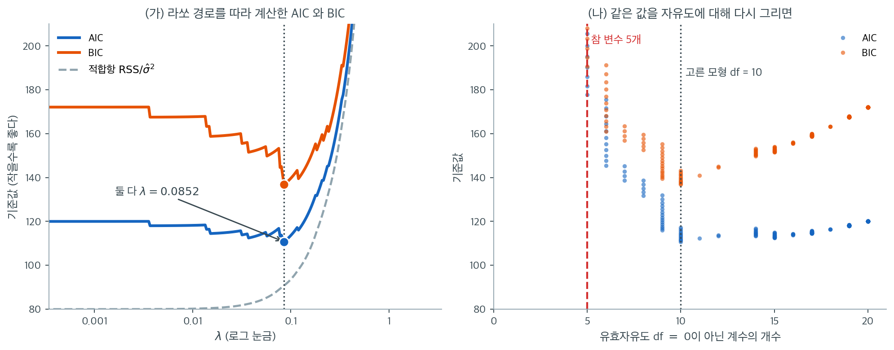

# 정칙화 모형의 정보기준

교차검증은 $\lambda$ 선택의 믿을 만한 방법이지만 겹마다 모형을 여러 번 적합해야 한다. 정보기준은 해석적 대안을 제공한다. 훈련오차에 복잡도 벌점을 더해 한 번의 적합만으로 예측오차를 추정한다. 정칙화 모형에서 핵심 난점은 적절한 복잡도 척도를 정의하는 것이다. 계수가 연속적으로 축소되므로 "모수의 개수"가 의미 있는 개념이 아니기 때문이다.

---

## 1. AIC와 BIC 복습

로그가능도가 $\ell(\hat{\boldsymbol{\beta}})$이고 추정 모수가 $d$개인 모형에서

$$
\text{AIC} = -2\ell(\hat{\boldsymbol{\beta}}) + 2d, \qquad
\text{BIC} = -2\ell(\hat{\boldsymbol{\beta}}) + d\log n
$$

이다. $\sigma^2$이 알려진 가우스 선형모형에서 $-2\ell = n\log(2\pi\sigma^2) + \text{RSS}/\sigma^2$이므로, 상수를 무시하면

$$
\text{AIC} = \frac{\text{RSS}}{\sigma^2} + 2d, \qquad
\text{BIC} = \frac{\text{RSS}}{\sigma^2} + d\log n
$$

이다. 여기서 $\text{RSS} = \sum_i (y_i - \hat y_i)^2$은 잔차제곱**합**이다.

!!! warning "배율에 주의"
    문헌에 따라 $\text{RSS}$를 잔차제곱합이 아니라 평균제곱잔차 $\frac{1}{n}\sum_i(y_i-\hat y_i)^2$로 쓰기도 한다. 그 규약에서는 첫 항이 $n\,\text{RSS}/\sigma^2$이 된다.

    **어느 규약이든 두 항의 상대적 크기가 맞아야 한다.** 첫 항에 $n$을 잘못 곱하면 복잡도 벌점 $2d$가 상대적으로 $n$배 작아져 사실상 무시되고, AIC가 언제나 가장 복잡한 모형을 고르게 된다.

AIC는 예측오차 최소화를 겨냥하며 점근적으로 LOOCV와 동등하다. BIC는 모형선택 일치성을 겨냥한다. $n > 8$이면 $\log n > 2$이므로 BIC가 더 무거운 벌점을 주어 단순한 모형을 선호한다.

---

## 2. 유효자유도

정칙화 모형에서는 정수 모수 개수 $d$를 **유효자유도** $\text{df}(\lambda)$로 대체한다.

### 능형회귀

$$
\text{df}_{\text{ridge}}(\lambda) = \text{tr}\bigl[\mathbf{X}(\mathbf{X}^\top\mathbf{X} + \lambda\mathbf{I})^{-1}\mathbf{X}^\top\bigr] = \sum_{j=1}^p \frac{d_j^2}{d_j^2 + \lambda}
$$

각 항이 $j$번째 성분의 축소인자다. $\lambda \to 0$에서 $p$로, $\lambda \to \infty$에서 $0$으로 간다. 이는 모자 행렬의 대각합이며 선형 평활자의 자유도에 대한 표준 정의다.

### 라쏘

$$
\text{df}_{\text{lasso}}(\lambda) = |\hat{S}(\lambda)| = \text{0이 아닌 계수의 개수}
$$

Zou, Hastie, Tibshirani(2007)가 Stein의 불편위험추정(SURE)으로 증명한 이 놀라운 결과는, 라쏘의 유효자유도가 선택된 변수의 개수와 정확히 같음을 말한다. $\mathbf{X}$에 대한 온건한 조건과 가우스 오차 아래에서 성립한다.

!!! note "라쏘의 자유도는 불연속이다"
    $\text{df}(\lambda)$가 연속적으로 변하는 능형과 달리, 라쏘의 자유도는 계수가 활성집합에 들어오거나 나갈 때마다 1씩 뛴다. 이 불연속성이 변수선택의 이산적 성격을 반영한다.

### 엘라스틱넷

엘라스틱넷의 유효자유도에는 이만큼 단순한 공식이 없다. 선택된 변수에 대해 L2 벌점을 반영한 근사를 쓴다.

$$
\text{df}_{\text{EN}}(\lambda, \alpha) \approx \text{tr}\bigl[\mathbf{X}_{\hat{S}}(\mathbf{X}_{\hat{S}}^\top\mathbf{X}_{\hat{S}} + \lambda(1-\alpha)\mathbf{I})^{-1}\mathbf{X}_{\hat{S}}^\top\bigr]
$$

---

## 3. 정칙화 모형의 AIC와 BIC

$$
\text{AIC}(\lambda) = \frac{\text{RSS}(\lambda)}{\hat{\sigma}^2} + 2\,\text{df}(\lambda), \qquad
\text{BIC}(\lambda) = \frac{\text{RSS}(\lambda)}{\hat{\sigma}^2} + \text{df}(\lambda)\log n
$$

$\hat{\sigma}^2$은 오차분산의 추정값이다($p < n$이면 전체 OLS 모형에서, 아니면 저차원 모형에서 얻는다). $\lambda$ 격자에서 AIC나 BIC를 최소화하는 $\lambda$를 고른다.



$n = 100$, $p = 20$, 참 변수 5개인 자료에서 라쏘 경로 위의 모든 $\lambda$에 대해 두 기준을 계산한 것이다($\hat\sigma^2 = 0.981$). 왼쪽 회색 점선이 적합항 $\text{RSS}/\hat\sigma^2$만 그린 것인데, 예상대로 $\lambda$가 작아질수록 단조감소한다. **적합항만 보면 언제나 $\lambda = 0$이 이긴다.** 두 기준이 내부에 최소점을 갖는 것은 오직 복잡도 벌점 $2\,\text{df}$와 $\text{df}\log n$ 덕분이다.

두 곡선이 계단 모양이라는 점을 놓치지 말라. 라쏘의 유효자유도는 0이 아닌 계수의 **개수**이므로 정수 값만 갖고, 변수가 하나 들어올 때마다 곡선이 한 단씩 점프한다. 능형의 $\text{df}(\lambda)$가 연속적으로 변하는 것과 대조적이며, 변수선택의 이산적 성격이 그대로 드러난 것이다.

두 기준이 **같은 $\lambda = 0.0852$를 골랐고 둘 다 $\text{df} = 10$**이다. $\log n = 4.61$로 BIC의 벌점이 AIC의 두 배가 넘는데도 결과가 같다. 오른쪽 그림이 그 이유를 보여준다. $\text{df}$가 5에서 10으로 가는 동안 기준값이 AIC 기준 $177.7$에서 $110.7$로 **$67$이나 떨어진다.** 벌점 차이 $(4.61 - 2) \times 5 = 13$으로는 그 낙차를 메울 수 없다. 벌점의 무게보다 적합의 개선이 훨씬 컸던 것이다.

여기서 중요한 것은 두 기준 모두 참 변수 개수 $5$의 두 배인 $10$을 골랐다는 사실이다. 원인은 라쏘의 축소에 있다. 남긴 계수가 $\lambda$만큼 0 쪽으로 밀려 있어 RSS가 부풀고, 모형은 그 손실을 메우려 변수를 더 집어넣는다. 대응책은 두 가지다. **사후 라쏘로 축소를 되돌린 뒤 기준을 계산하거나**, $p$가 클 때 벌점을 더 키운 확장 BIC(EBIC)를 쓴다.

!!! warning "$\sigma^2$의 추정"
    정보기준은 $\sigma^2$의 추정값을 요구한다. $p > n$이면 OLS 잔차분산을 쓸 수 없다. 저차원 모형을 쓰거나, 척도 라쏘(scaled lasso)를 쓰거나, 교차검증으로 $\sigma^2$을 따로 추정하는 방법이 있다.

---

## 4. 정보기준과 교차검증의 비교

| 기준 | 계산 | 이론 | 실무 |
|---|---|---|---|
| AIC | $\lambda$당 1회 적합 | 예측에 점근적으로 최적 | 예측 중심 선택에 좋음 |
| BIC | $\lambda$당 1회 적합 | 모형선택에 일치 | 참 모형이 희소할 때 좋음 |
| $K$-겹 CV | $\lambda$당 $K$회 적합 | 분포무관, 유한표본 | 가장 견고, 표준 선택 |
| GCV | $\lambda$당 1회 적합 | LOOCV와 점근적으로 동등 | 능형에 효율적 |

정보기준은 빠르지만 가우스 가정에 의존하고 $\sigma^2$ 추정값이 필요하다. 교차검증은 더 견고하지만 계산이 무겁다. 실무에서는 CV가 기본 선택이며, 계산 자원이 제한적일 때나 검산 용도로 정보기준을 쓴다.

---

## 5. 실무 권고

1. 계산 제약이 심하지 않으면 **CV를 주 방법으로** 쓴다.
2. 예측이 목표이고 가우스 가정이 합리적이면 **AIC**를 쓴다.
3. 참 희소 모형의 식별이 목표면 **BIC**를 쓴다.
4. **능형회귀**에는 GCV가 CV의 효율적 해석적 대안이다.
5. **라쏘와 엘라스틱넷**에서는 $\text{df} = |\hat{S}|$ 공식 덕분에 정칙화 경로를 따라 AIC와 BIC를 쉽게 계산할 수 있다.

---

## 연습문제

<div class="drillbox" markdown>

**연습문제 1.** <span class="diff med" title="중간"></span>
라쏘 경로를 따라 AIC와 BIC를 계산하여 각각이 고르는 모형을 비교하라. 참 변수 5개, 잡음변수 15개, $n = 100$인 자료를 쓴다.

</div>

??? success "풀이"
    ```python
    import numpy as np
    from sklearn.linear_model import lasso_path, LinearRegression
    rng = np.random.default_rng(55)
    n, p = 100, 20
    X = rng.normal(size=(n, p)); X -= X.mean(0); X /= X.std(0)
    beta = np.zeros(p); beta[:5] = [3, -2, 1.5, 1, -1]
    y = X @ beta + rng.normal(0, 1, n); y -= y.mean()

    # 전체 OLS 잔차로 sigma^2 추정 (p < n 이므로 가능)
    b_ols = LinearRegression(fit_intercept=False).fit(X, y).coef_
    s2 = ((y - X @ b_ols)**2).sum() / (n - p)          # 0.9808 (참값 1.0)

    alphas, coefs, _ = lasso_path(X, y, n_alphas=300, eps=1e-4)
    rss = ((y[:, None] - X @ coefs)**2).sum(0)
    df  = (np.abs(coefs) > 1e-10).sum(0)
    aic = rss/s2 + 2*df
    bic = rss/s2 + df*np.log(n)
    ```

    | 기준 | 고른 $\lambda$ | $\text{df}$ |
    |:---|---:|---:|
    | AIC | 0.0852 | **10** |
    | BIC | 0.0852 | **10** |
    | 참값 | — | **5** |

    **두 기준이 같은 $\lambda$를 골랐고, 둘 다 참 변수 수의 두 배를 선택한다.**

    BIC의 벌점이 더 무거운데도($\log 100 = 4.61 > 2$) 같은 답이 나온 것은, 이 자료에서 RSS 곡선이 $\text{df} = 10$ 부근에서 가파르게 꺾이기 때문이다. 벌점의 차이가 그 꺾임을 넘어서지 못했다.

    **10개 대 5개의 과다선택이 더 중요한 관찰이다.** 이는 잘 알려진 현상으로, 라쏘의 축소가 남은 계수를 작게 만들어 RSS를 부풀리고, 그 손실을 메우려 모형이 변수를 더 넣기 때문이다.

    대응책은 두 가지다. **사후 라쏘**로 축소를 되돌린 뒤 정보기준을 계산하거나, 확장 BIC(EBIC)처럼 $p$가 클 때 벌점을 더 키운 변형을 쓴다.

<div class="drillbox" markdown>

**연습문제 2.** <span class="diff med" title="중간"></span>
"AIC는 LOOCV와 점근적으로 동등하다"는 주장의 의미를 정확히 서술하고, 유한표본에서 두 방법이 갈릴 수 있는 이유를 설명하라.

</div>

??? success "풀이"
    **점근적 동등성의 정확한 의미.** 선형 평활자에서 LOOCV 오차를 1차 근사하면

    $$
    \text{CV}_{\text{LOO}} = \frac{1}{n}\sum_i \left(\frac{y_i-\hat y_i}{1-H_{ii}}\right)^2
    \approx \frac{\text{RSS}}{n}\left(1 + \frac{2\,\text{tr}(\mathbf{H})}{n}\right)
    = \frac{\text{RSS}}{n} + \frac{2\,\text{df}\cdot\text{RSS}}{n^2}
    $$

    를 얻는다($H_{ii}$가 작을 때 $(1-H_{ii})^{-2} \approx 1 + 2H_{ii}$). $\text{RSS}/n \approx \sigma^2$으로 두면

    $$
    n\,\text{CV}_{\text{LOO}}/\sigma^2 \approx \frac{\text{RSS}}{\sigma^2} + 2\,\text{df} = \text{AIC}
    $$

    이다. 즉 **AIC는 LOOCV의 2차 테일러 근사**다.

    **유한표본에서 갈리는 이유는 세 가지다.**

    | 근사 단계 | 언제 깨지는가 |
    |:---|:---|
    | $(1-H_{ii})^{-2} \approx 1 + 2H_{ii}$ | 지렛값이 클 때, 즉 $p/n$이 클 때 |
    | $\text{RSS}/n \approx \sigma^2$ | $\hat\sigma^2$ 추정이 나쁠 때 |
    | 개별 $H_{ii}$를 평균 $\text{df}/n$으로 대체 | 지렛값이 불균등할 때(이상값, 불균형 설계) |

    **실무적 함의:** $p/n$이 작고($< 0.1$) 설계가 균형 잡혀 있으면 AIC와 LOOCV가 거의 같은 답을 준다. 이때는 훨씬 싼 AIC를 쓰는 것이 합리적이다.

    $p/n$이 크거나 지렛값이 불균등하면 두 방법이 갈리며, 이때는 근사를 쓰지 않는 교차검증이 옳다. 특히 **가우스 가정이 의심스러우면 AIC의 근거 자체가 무너지므로** 교차검증이 유일한 선택이다.

<div class="drillbox" markdown>

**연습문제 3.** <span class="diff med" title="중간"></span>
설계행렬 $\mathbf{X}$의 특잇값이 $d_1 = 3$, $d_2 = 2$, $d_3 = 1$이다.

(가) $\text{df}_{\text{ridge}}(\lambda)$를 $\lambda = 0, 1, 4, 16$에서 구하고 $\lambda \to \infty$ 극한을 적어라.

(나) $\text{df}_{\text{ridge}}(\lambda) < 1$이 되는 가장 작은 자연수 $\lambda$를 구하라.

(다) $\text{df}(\lambda)$가 1보다 작아져도 능형회귀는 계수를 하나도 0으로 만들지 못한다. 유효자유도와 "0이 아닌 계수의 개수"가 어떻게 다른지 설명하라.

</div>

??? success "풀이"
    **(가)** $\text{df}(\lambda) = \dfrac{9}{9+\lambda} + \dfrac{4}{4+\lambda} + \dfrac{1}{1+\lambda}$이므로

    | $\lambda$ | $\frac{9}{9+\lambda}$ | $\frac{4}{4+\lambda}$ | $\frac{1}{1+\lambda}$ | $\text{df}$ |
    |---:|---:|---:|---:|---:|
    | $0$ | $1$ | $1$ | $1$ | $3$ |
    | $1$ | $0.9$ | $0.8$ | $0.5$ | $2.2$ |
    | $4$ | $0.6923$ | $0.5$ | $0.2$ | $1.3923$ |
    | $16$ | $0.36$ | $0.2$ | $0.0588$ | $0.6188$ |
    | $\infty$ | $0$ | $0$ | $0$ | $0$ |

    각 열이 그 성분의 축소인자다. $\lambda = 4$에서 가장 큰 특잇값 방향은 $69\%$가 남는데 가장 작은 방향은 $20\%$만 남는다. **능형은 작은 특잇값 방향을 먼저 죽인다.** 작은 $d_j$는 설명변수들이 거의 한 방향으로 겹쳐 있는 방향, 곧 OLS 추정의 분산이 $\sigma^2/d_j^2$으로 폭발하는 방향이다(13장 다중공선성). 능형이 편향을 사서 분산을 파는 거래가 바로 이 방향에서 가장 이익이다.

    **(나)** 두 점만 계산하면 된다.

    $$
    \text{df}(7) = \frac{9}{16} + \frac{4}{11} + \frac{1}{8} = 0.5625 + 0.3636 + 0.125 = 1.0511
    $$

    $$
    \text{df}(8) = \frac{9}{17} + \frac{4}{12} + \frac{1}{9} = 0.5294 + 0.3333 + 0.1111 = 0.9739
    $$

    $\text{df}$는 $\lambda$의 연속인 감소함수이므로 답은 $\lambda = 8$이다.

    **(다)** 능형의 해는 특잇값 기저에서 $\hat\beta_j^{\text{ridge}} = \frac{d_j^2}{d_j^2+\lambda}\,\hat\beta_j^{\text{OLS}}$꼴의 **비례축소**다. 축소인자 $d_j^2/(d_j^2+\lambda)$는 유한한 $\lambda$에서 결코 0이 아니므로, $\hat\beta_j^{\text{OLS}} \ne 0$이면 $\hat\beta_j^{\text{ridge}} \ne 0$이다. 0이 아닌 계수의 개수는 언제나 $p = 3$이다.

    유효자유도는 **몇 개를 쓰는가**가 아니라 **얼마나 쓰는가**를 센다. $\text{df}(8) = 0.9739$는 "세 방향을 다 쓰지만 모두 많이 눌러서, 자료에 맞추는 자유도로 치면 1개분이 채 안 된다"는 뜻이다. 라쏘의 $\text{df} = \lvert \hat S \rvert$가 정수인 것과 대조하면 이 차이가 선명하다. 라쏘에서는 계수를 쓰든 안 쓰든 둘 중 하나이므로 두 수가 일치하지만, 능형에서는 일치할 까닭이 없다.

<div class="drillbox" markdown>

**연습문제 4.** <span class="diff med" title="중간"></span>
$n = 100$, $\hat\sigma^2 = 1$인 자료에서 라쏘 경로 위의 다섯 점을 얻었다. $\text{RSS}$는 잔차제곱**합**이다.

| $\lambda$ | $0.5$ | $0.2$ | $0.085$ | $0.03$ | $0.005$ |
|:---|---:|---:|---:|---:|---:|
| $\text{RSS}$ | $150$ | $110$ | $96$ | $90$ | $87$ |
| $\text{df}$ | $3$ | $6$ | $10$ | $15$ | $20$ |

(가) AIC와 BIC를 다섯 점에서 계산하여 각각이 고르는 $\text{df}$를 구하라.

(나) 어떤 사람이 "배율에 주의" 경고를 거꾸로 읽어 첫 항을 $n\,\text{RSS}/\hat\sigma^2$으로 썼다. 이 잘못된 기준이 고르는 $\text{df}$는 무엇인가?

(다) (나)의 척도를 그대로 두고 올바른 순위를 되살리려면 복잡도 벌점을 몇 배로 키워야 하는가? 그렇게 고친 값이 (가)의 AIC와 어떤 관계인지도 적어라.

</div>

??? success "풀이"
    **(가)** $\log 100 = 4.60517$이다.

    | $\text{df}$ | $\text{RSS}$ | $\text{AIC} = \text{RSS} + 2\,\text{df}$ | $\text{BIC} = \text{RSS} + \text{df}\log n$ |
    |---:|---:|---:|---:|
    | $3$ | $150$ | $156$ | $163.82$ |
    | $6$ | $110$ | $122$ | $\mathbf{137.63}$ |
    | $10$ | $96$ | $\mathbf{116}$ | $142.05$ |
    | $15$ | $90$ | $120$ | $159.08$ |
    | $20$ | $87$ | $127$ | $179.10$ |

    AIC는 $\text{df} = 10$, BIC는 $\text{df} = 6$을 고른다. 벌점이 무거운 BIC가 더 단순한 모형을 고르는 교과서적 모습이다.

    **(나)** 첫 항이 $100\,\text{RSS}$가 된다.

    | $\text{df}$ | $100\,\text{RSS}$ | $+\,2\,\text{df}$ |
    |---:|---:|---:|
    | $3$ | $15000$ | $15006$ |
    | $6$ | $11000$ | $11012$ |
    | $10$ | $9600$ | $9620$ |
    | $15$ | $9000$ | $9030$ |
    | $20$ | $8700$ | $\mathbf{8740}$ |

    $\text{df} = 20$, 곧 **격자에서 가장 복잡한 모형**을 고른다. 적합항의 차이가 수백~수천인데 벌점의 차이는 고작 $2(20-3) = 34$다. 벌점이 사실상 사라진 것이고, 적합항만 보면 언제나 $\lambda = 0$이 이긴다는 §3의 관찰이 그대로 작동한다. 격자를 더 촘촘히 깔면 $\lambda \to 0$까지 끌려간다.

    **(다)** 적합항을 $n$배 했으므로 벌점도 $n = 100$배 해야 한다. 즉 $2n\,\text{df} = 200\,\text{df}$를 쓴다.

    | $\text{df}$ | $100\,\text{RSS} + 200\,\text{df}$ | (가)의 AIC $\times 100$ |
    |---:|---:|---:|
    | $3$ | $15600$ | $15600$ |
    | $6$ | $12200$ | $12200$ |
    | $10$ | $\mathbf{11600}$ | $\mathbf{11600}$ |
    | $15$ | $12000$ | $12000$ |
    | $20$ | $12700$ | $12700$ |

    고친 값은 (가)의 AIC를 정확히 $100$배 한 것이고, 따라서 순위도 최솟값의 위치도 같다. $\text{df} = 10$을 고른다.

    **교훈은 규약을 섞지 말라는 것이다.** 정보기준에서 의미가 있는 것은 두 항의 **상대적** 크기뿐이다. 첫 항에 $n$을 곱하거나 나누는 것은 기준 전체를 상수배 하는 일이 아니라 **벌점의 무게만 $n$배 바꾸는** 일이다. $n = 100$이면 $2\,\text{df}$가 $0.02\,\text{df}$로 줄어든 것과 같다.

<div class="drillbox" markdown>

**연습문제 5.** <span class="diff med" title="중간"></span>
능형회귀의 GCV는

$$
\text{GCV}(\lambda) = \frac{\text{RSS}(\lambda)/n}{\bigl(1 - \text{df}(\lambda)/n\bigr)^2}
$$

로 정의된다. 연습문제 2에서 본 LOOCV 공식의 개별 지렛값 $H_{ii}$를 평균 $\text{df}/n$으로 바꾼 것이다. $n = 60$, $p = 8$이고 열끼리 상관이 큰 설계에서 SVD로 $\text{df}(\lambda)$, GCV, **정확한** LOOCV, AIC를 $\lambda$ 격자 위에서 계산하라. 세 기준이 고르는 $\lambda$를 비교하고, GCV의 선택이 LOOCV 최솟값에 비해 얼마나 손해인지 재어라.

</div>

??? success "풀이"
    $\mathbf{X} = \mathbf{U}\mathbf{D}\mathbf{V}^\top$로 쓰면 능형의 모자행렬이 $\mathbf{H}_\lambda = \mathbf{U}\,\text{diag}\!\left(\frac{d_j^2}{d_j^2+\lambda}\right)\mathbf{U}^\top$이므로 축소인자 하나만으로 $\text{df}$, 잔차, 대각원소 $H_{ii}$가 모두 나온다. 역행렬을 $\lambda$마다 다시 구할 필요가 없다.

    ```python
    import numpy as np

    rng = np.random.default_rng(18)
    n, p = 60, 8
    Z = rng.normal(size=(n, p))
    X = Z + 2.0 * rng.normal(size=(n, 1))          # 열끼리 상관시킨다
    X -= X.mean(0); X /= X.std(0)
    beta = np.array([2.0, -1.5, 1.0, 0.0, 0.0, 0.0, 0.5, 0.0])
    y = X @ beta + rng.normal(0.0, 4.0, n); y -= y.mean()

    U, d, Vt = np.linalg.svd(X, full_matrices=False)
    b_ols = Vt.T @ ((U.T @ y) / d)
    s2 = ((y - X @ b_ols) ** 2).sum() / (n - p)     # lambda 와 무관하게 한 번만

    lams = np.logspace(-2, 3, 101)
    res = np.zeros((len(lams), 4))                  # df, GCV, LOOCV, AIC
    for i, lam in enumerate(lams):
        f = d**2 / (d**2 + lam)                     # 축소인자
        r = y - (U * f) @ (U.T @ y)                 # 잔차
        hii = (U**2 * f).sum(1)                     # H 의 대각원소
        dfl, rss = f.sum(), (r**2).sum()
        res[i] = [dfl,
                  (rss / n) / (1 - dfl / n)**2,     # GCV: 평균 지렛값 근사
                  ((r / (1 - hii))**2).mean(),      # 정확한 LOOCV
                  rss / s2 + 2 * dfl]               # AIC

    print(f"sigma^2 추정값 = {s2:.4f}")
    print(f"{'lambda':>8}{'df':>9}{'GCV':>10}{'LOOCV':>10}{'AIC':>10}")
    for lam in [0.1, 1.0, 10.0, 100.0]:
        i = int(np.argmin(np.abs(lams - lam)))
        print(f"{lams[i]:8.2f}{res[i,0]:9.4f}{res[i,1]:10.4f}"
              f"{res[i,2]:10.4f}{res[i,3]:10.4f}")

    i_g, i_l, i_a = res[:, 1].argmin(), res[:, 2].argmin(), res[:, 3].argmin()
    print(f"GCV   선택: lambda = {lams[i_g]:7.4f}, df = {res[i_g,0]:.4f}")
    print(f"LOOCV 선택: lambda = {lams[i_l]:7.4f}, df = {res[i_l,0]:.4f}")
    print(f"AIC   선택: lambda = {lams[i_a]:7.4f}, df = {res[i_a,0]:.4f}")
    print(f"GCV 선택에서의 LOOCV 값 = {res[i_g,2]:.4f}, 최솟값 = {res[i_l,2]:.4f}")
    print(f"두 곡선의 최대 상대차 = "
          f"{np.max(np.abs(res[:,1] - res[:,2]) / res[:,2]):.4f}")
    ```

    출력:

    ```text
    sigma^2 추정값 = 19.5974
      lambda       df       GCV     LOOCV       AIC
        0.10   7.9386   22.5595   22.2070   67.8781
        1.00   7.4368   22.1648   21.8398   66.9544
       10.00   4.8212   21.2308   21.0925   64.6170
      100.00   1.5998   23.0604   23.0980   70.0873
    GCV   선택: lambda = 10.0000, df = 4.8212
    LOOCV 선택: lambda =  7.9433, df = 5.2049
    AIC   선택: lambda = 10.0000, df = 4.8212
    GCV 선택에서의 LOOCV 값 = 21.0925, 최솟값 = 21.0758
    두 곡선의 최대 상대차 = 0.0160
    ```

    **GCV와 LOOCV는 격자에서 한 칸 차이로 갈린다**($10.0000$ 대 $7.9433$, $\text{df}$로는 $4.82$ 대 $5.20$). 두 곡선의 값은 어디서도 $1.6\%$ 이상 어긋나지 않고, GCV의 선택에서 LOOCV는 $21.0925$인데 최솟값은 $21.0758$이니 손해가 $0.0167$, 상대적으로 $0.08\%$다. **실질적으로 같은 모형을 고른 셈이다.**

    근사가 이만큼 잘 맞는 까닭은 지렛값이 작고 고르기 때문이다. 최적점에서 $\text{df}/n = 4.82/60 = 0.080$이고, 설계가 가우스 난수이므로 $H_{ii}$가 평균 주변에 모여 있다. 연습문제 2의 표에서 근사가 깨지는 조건—큰 $p/n$, 불균등한 지렛값—이 모두 비켜 간 상황이다.

    **AIC가 GCV와 정확히 같은 $\lambda$를 고른 것도 우연이 아니다.** $(1-\text{df}/n)^{-2} \approx 1 + 2\,\text{df}/n$으로 펴면

    $$
    n\,\text{GCV} \approx \text{RSS} + \frac{2\,\text{df}\cdot\text{RSS}}{n}
    $$

    인데, $\text{RSS}/n \approx \hat\sigma^2$인 곳에서 이것은 $\hat\sigma^2(\text{RSS}/\hat\sigma^2 + 2\,\text{df}) = \hat\sigma^2\,\text{AIC}$다. 여기서 최적점의 $\text{RSS}/n = 21.2308 \times (1-0.080)^2 = 17.96$이고 $\hat\sigma^2 = 19.60$으로 가까우니, 두 기준이 사실상 같은 함수를 최소화한다. 다만 AIC는 $\hat\sigma^2$ 추정값이 필요하고 GCV는 필요 없다—쪽 §4의 표에서 GCV를 능형의 효율적 대안으로 꼽은 이유다.

<div class="drillbox" markdown>

**연습문제 6.** <span class="diff hard" title="어려움"></span>
열이 정규직교인 설계($\mathbf{X}^\top\mathbf{X} = \mathbf{I}_4$), $n = 50$, $\sigma^2 = 1$은 알려져 있다. OLS 해가 $\hat{\boldsymbol{\beta}}^{\text{OLS}} = (2.5,\ 1.2,\ 0.4,\ -0.3)$이고 그때의 잔차제곱합이 $\text{RSS}_0 = 46$이다. 라쏘를 $\frac{1}{2}\lVert \mathbf{y}-\mathbf{X}\boldsymbol{\beta} \rVert^2 + \lambda\lVert \boldsymbol{\beta} \rVert_1$로 정의한다(따라서 해는 문턱 $\lambda$의 연성문턱이다).

(가) 활성집합을 $\hat S$라 할 때

$$
\text{RSS}(\lambda) = \text{RSS}_0 + \lvert \hat S \rvert\,\lambda^2 + \sum_{j \notin \hat S}\bigl(\hat\beta_j^{\text{OLS}}\bigr)^2
$$

임을 보여라.

(나) 활성집합이 바뀌지 않는 구간에서 $\text{AIC}(\lambda)$가 $\lambda$의 증가함수임을 보이고, 따라서 $\lambda \ge 0$ 전체에서의 최솟값이 $\lambda \in \{2.5,\ 1.2,\ 0.4,\ 0.3,\ 0\}$에서만 나타남을 설명하라.

(다) 그 다섯 매듭에서 AIC와 BIC를 계산하여 각각이 고르는 $\lambda$와 $\text{df}$를 구하라.

(라) 사후 라쏘(선택된 변수만으로 OLS 재적합)로 AIC를 다시 계산하면 선택이 어떻게 달라지는가? §3이 말한 과다선택의 원인과 어떻게 이어지는지 적어라.

</div>

??? success "풀이"
    **(가)** 잔차 $\mathbf{y} - \mathbf{X}\hat{\boldsymbol{\beta}}^{\text{OLS}}$는 $\mathbf{X}$의 열공간에 직교하므로 임의의 $\boldsymbol{\beta}$에 대해

    $$
    \lVert \mathbf{y}-\mathbf{X}\boldsymbol{\beta} \rVert^2
    = \lVert \mathbf{y}-\mathbf{X}\hat{\boldsymbol{\beta}}^{\text{OLS}} \rVert^2
    + \lVert \mathbf{X}(\hat{\boldsymbol{\beta}}^{\text{OLS}}-\boldsymbol{\beta}) \rVert^2
    = \text{RSS}_0 + \lVert \hat{\boldsymbol{\beta}}^{\text{OLS}}-\boldsymbol{\beta} \rVert^2
    $$

    이다(마지막 등호가 정규직교성이다). 연성문턱 해를 넣으면 $j \in \hat S$에서 $\hat\beta_j = \operatorname{sign}(\hat\beta_j^{\text{OLS}})(\lvert \hat\beta_j^{\text{OLS}} \rvert - \lambda)$이므로 차이의 절댓값이 정확히 $\lambda$이고, $j \notin \hat S$에서는 $\hat\beta_j = 0$이므로 차이가 $\hat\beta_j^{\text{OLS}}$다. 제곱해 더하면 주장한 식이 된다. $\square$

    **(나)** 구간 $\lambda \in [\,\lvert \hat\beta \rvert_{(k+1)},\ \lvert \hat\beta \rvert_{(k)})$에서 활성집합은 크기가 큰 $k$개로 고정이고 $\text{df} = k$다. 그러면

    $$
    \text{AIC}(\lambda) = \text{RSS}_0 + k\lambda^2 + \sum_{j \notin \hat S}\bigl(\hat\beta_j^{\text{OLS}}\bigr)^2 + 2k
    $$

    에서 $\lambda$에 의존하는 항이 $k\lambda^2$뿐이므로 $k \ge 1$이면 증가함수다($k = 0$이면 상수). 따라서 각 구간의 최솟값은 **왼쪽 끝점**에서 나오고, 그 끝점이 바로 매듭 $\lvert \hat\beta \rvert_{(k+1)}$이다. 크기순으로 늘어놓은 $2.5 > 1.2 > 0.4 > 0.3$과 $\lambda = 0$을 합한 다섯 값이 후보 전부다.

    **(다)** $\log 50 = 3.912023$이다. 매듭 $\lambda$에서 활성집합은 $\lvert \hat\beta^{\text{OLS}} \rvert > \lambda$인 것들이다.

    | $\lambda$ | $\text{df}$ | $\text{df}\cdot\lambda^2$ | $\sum_{j \notin \hat S}(\hat\beta_j^{\text{OLS}})^2$ | $\text{RSS}(\lambda)$ | AIC | BIC |
    |---:|---:|---:|---:|---:|---:|---:|
    | $2.5$ | $0$ | $0$ | $7.94$ | $53.94$ | $53.94$ | $53.94$ |
    | $1.2$ | $1$ | $1.44$ | $1.69$ | $49.13$ | $51.13$ | $\mathbf{53.042}$ |
    | $0.4$ | $2$ | $0.32$ | $0.25$ | $46.57$ | $\mathbf{50.57}$ | $54.394$ |
    | $0.3$ | $3$ | $0.27$ | $0.09$ | $46.36$ | $52.36$ | $58.096$ |
    | $0$ | $4$ | $0$ | $0$ | $46$ | $54$ | $61.648$ |

    (셋째 행을 손으로 따라가 보면, $\lambda = 0.4$에서 $\hat{\boldsymbol{\beta}} = (2.1,\ 0.8,\ 0,\ 0)$이므로 $\text{RSS} = 46 + 2(0.4)^2 + 0.4^2 + 0.3^2 = 46 + 0.32 + 0.25 = 46.57$이다.)

    **AIC는 $\lambda = 0.4$에서 $\text{df} = 2$를, BIC는 $\lambda = 1.2$에서 $\text{df} = 1$을 고른다.** AIC 쪽에서 $\text{df}$를 1에서 2로 올리는 값은 적합 $-2.56$에 벌점 $+2$로 남는 장사지만, BIC에서는 벌점이 $+3.91$이라 손해다. 벌점 하나 차이로 선택이 갈리는 지점을 수로 잡은 것이다.

    **(라)** 사후 라쏘는 축소를 되돌리므로 $\text{df}\cdot\lambda^2$ 항이 사라진다. $\text{RSS} = \text{RSS}_0 + \sum_{j \notin \hat S}(\hat\beta_j^{\text{OLS}})^2$이다.

    | $\text{df}$ | $\text{RSS}$ | AIC | BIC |
    |---:|---:|---:|---:|
    | $0$ | $53.94$ | $53.94$ | $53.94$ |
    | $1$ | $47.69$ | $\mathbf{49.69}$ | $\mathbf{51.602}$ |
    | $2$ | $46.25$ | $50.25$ | $54.074$ |
    | $3$ | $46.09$ | $52.09$ | $57.826$ |
    | $4$ | $46$ | $54$ | $61.648$ |

    **사후 라쏘의 AIC는 $\text{df} = 1$을 고른다.** 축소를 되돌리기 전에는 2개였다. 두 표를 나란히 두면 원인이 보인다. $\text{df} = 1$일 때 축소가 RSS에 더한 벌금은 $\lambda^2 = 1.44$인데 $\text{df} = 2$일 때는 $2\lambda^2 = 0.32$뿐이다. **희소한 모형일수록 문턱 $\lambda$가 커서 축소의 손실이 크므로, 라쏘 적합값으로 계산한 AIC는 희소한 쪽을 부당하게 불리하게 매긴다.** 그 결과 변수를 더 집어넣게 되고, 이것이 §3에서 참 변수 5개인 자료에 두 기준이 $\text{df} = 10$을 고른 것과 같은 메커니즘이다.

    사후 라쏘 AIC가 BIC와 같은 답($\text{df} = 1$)에 닿은 것도 눈여겨볼 만하다. 축소 벌금을 걷어내면 두 기준의 간격이 좁아진다.

<div class="drillbox" markdown>

**연습문제 7.** <span class="diff hard" title="어려움"></span>
AIC로 $\lambda$를 고르는 절차 전체가 설명변수의 **단위**에 의존한다. $n = 50$, $p = 3$이고 $\beta = (3, 1, -1)$, $\sigma = 5$인 자료를 만든 뒤, $x_1$을 m에서 km으로 바꾸기만 하고(자료에 담긴 정보는 조금도 바뀌지 않는다) 같은 절차를 다시 돌려라. 고른 $\lambda$, $\text{df}$, 독립 시험자료의 MSE, 그리고 m 단위로 환산한 $\hat\beta_1$을 비교하라. 표준화를 넣으면 어떻게 되는지도 보이고, **OLS로 같은 일을 하면 왜 이 문제가 생기지 않는지** 설명하라.

</div>

??? success "풀이"
    ```python
    import numpy as np

    rng = np.random.default_rng(118)
    n, nt, p = 50, 4000, 3
    beta = np.array([3.0, 1.0, -1.0])        # x1 이 가장 센 설명변수다

    Z = rng.normal(size=(n, p))              # x1 은 길이, 처음에는 m 단위
    Zt = rng.normal(size=(nt, p))
    y = Z @ beta + rng.normal(0.0, 5.0, n)
    yt = Zt @ beta + rng.normal(0.0, 5.0, nt)
    ybar = y.mean(); y = y - ybar; yt = yt - ybar

    Z_km = Z.copy();   Z_km[:, 0] /= 1000.0  # 단위만 km 으로 바꾼 것뿐
    Zt_km = Zt.copy(); Zt_km[:, 0] /= 1000.0

    lams = np.logspace(-2, 6, 161)


    def select(X, Xt, std, scale1):
        """AIC 로 lambda 를 고르고 (lambda, df, 시험 MSE, m 단위 beta1) 반환."""
        mu = X.mean(0)
        sd = X.std(0) if std else np.ones(p)
        Xc, Xtc = (X - mu) / sd, (Xt - mu) / sd
        d = np.linalg.svd(Xc, compute_uv=False)
        b_ols = np.linalg.lstsq(Xc, y, rcond=None)[0]
        s2 = ((y - Xc @ b_ols) ** 2).sum() / (n - p)     # lambda 와 무관
        G, Xty = Xc.T @ Xc, Xc.T @ y
        best = None
        for lam in lams:
            b = np.linalg.solve(G + lam * np.eye(p), Xty)
            rss = ((y - Xc @ b) ** 2).sum()
            dfl = (d**2 / (d**2 + lam)).sum()
            aic = rss / s2 + 2 * dfl
            if best is None or aic < best[0]:
                best = (aic, lam, dfl, ((yt - Xtc @ b) ** 2).mean(),
                        b[0] / sd[0] * scale1)
        return best[1:]


    for tag, std in [("표준화 없음", False), ("표준화 함", True)]:
        for name, X, Xt, s1 in [("x1 = m ", Z, Zt, 1.0),
                                ("x1 = km", Z_km, Zt_km, 1 / 1000.0)]:
            lam, dfl, mse, b1 = select(X, Xt, std, s1)
            print(f"{tag:6s} {name}: lambda = {lam:8.4f}, df = {dfl:.4f}, "
                  f"시험 MSE = {mse:.4f}, m 단위 beta1 = {b1:.4f}")
    ```

    출력:

    ```text
    표준화 없음 x1 = m : lambda =   8.9125, df = 2.6176, 시험 MSE = 27.4523, m 단위 beta1 = 2.9520
    표준화 없음 x1 = km: lambda =  44.6684, df = 1.1505, 시험 MSE = 36.3597, m 단위 beta1 = 0.0000
    표준화 함  x1 = m : lambda =   6.3096, df = 2.6565, 시험 MSE = 27.4550, m 단위 beta1 = 2.9695
    표준화 함  x1 = km: lambda =   6.3096, df = 2.6565, 시험 MSE = 27.4550, m 단위 beta1 = 2.9695
    ```

    **단위를 바꾸기만 했는데 모형이 무너졌다.** $\text{df}$가 $2.6176$에서 $1.1505$로 떨어지고, 시험 MSE가 $27.45$에서 $36.36$으로 **$32\%$ 나빠졌다**. 얼마나 나쁜지는 두 극단과 견주면 보인다. 완벽한 모형의 MSE는 $\sigma^2 = 25$이고, 아무 설명변수도 안 쓰는 영모형의 MSE는 $\text{Var}(y) = 9 + 1 + 1 + 25 = 36$이다. **km 판은 설명 가능한 몫 $11$을 거의 전부 잃고 영모형 수준에 와 있다.** 가장 결정적인 수는 마지막 열이다. m 단위로 환산한 $\hat\beta_1$이 $2.9520$에서 $0.0000$으로 **완전히 지워졌다.** 가장 센 설명변수를 잃고 남은 둘로만 맞춘 모형이 된 것이다.

    **왜 그런가.** 길이를 km으로 재면 같은 예측을 내려면 계수가 $1000$배가 되어야 한다. 즉 $\beta_1 = 3000$이다. 벌점은 $\lambda\lVert \boldsymbol{\beta} \rVert_2^2$이므로 이 계수 하나가 $9 \times 10^6 \lambda$를 물게 되고, 벌점을 줄이는 가장 값싼 길이 $\beta_1$을 0으로 보내는 것이 된다. AIC는 이 왜곡된 경로 위에서 최선을 고를 뿐이므로 왜곡을 되돌려 주지 않는다.

    **OLS는 왜 멀쩡한가.** 열 $j$를 $c$배 하면 $\hat\beta_j \to \hat\beta_j/c$가 되어 적합값 $\mathbf{X}\hat{\boldsymbol{\beta}}$와 RSS가 **그대로**다(부록 A 사영의 성질: 열공간이 바뀌지 않으므로 사영도 바뀌지 않는다). OLS는 열의 재척도에 대해 등변이다. 그러나 벌점항 $\lVert \boldsymbol{\beta} \rVert_2^2$은 $\boldsymbol{\beta}$의 단위에 그대로 의존하므로 등변성이 깨진다. **벌점을 붙이는 순간 척도가 모형의 일부가 된다.**

    표준화하면 두 단위가 같은 수를 준다. $(x - \bar x)/s_x$는 단위가 없어서 $c$배 하면 $s_x$도 $c$배 되어 상쇄된다. 표에서 아래 두 줄이 소수점까지 일치하는 것이 그 확인이다.

    !!! warning "sklearn 은 표준화를 해 주지 않는다"
        `Ridge`, `Lasso`, `ElasticNet` 모두 설명변수를 표준화하지 않는다(`fit_intercept=True`가 중심화만 한다). 반드시 `make_pipeline(StandardScaler(), Ridge(alpha=...))`처럼 파이프라인에 넣어야 한다. 교차검증을 쓸 때는 더 중요하다—파이프라인 안에 넣으면 표준화가 **겹 안에서** 일어나 검증 겹의 정보가 새 나가지 않는다.

        절편을 벌점에서 빼는 것도 같은 이유다. 절편은 $y$의 단위를 그대로 물려받으므로, 벌점에 넣으면 $y$에 상수를 더하기만 해도 해가 달라진다.

<div class="drillbox" markdown>

**연습문제 8.** <span class="diff hard" title="어려움"></span>
$\mathbf{X}^\top\mathbf{X} = \mathbf{I}_{20}$인 직교설계에서 $\sigma = 1$이라 하자. $\mathbf{z} = \mathbf{X}^\top\mathbf{y} \sim N(\boldsymbol{\beta}, \mathbf{I})$이고 라쏘 해는 좌표마다 $\hat\beta_j = \operatorname{sign}(z_j)(\lvert z_j \rvert - \lambda)_+$다(반복 해법이 필요 없다).

(가) $\boldsymbol{\beta} = (3, 3, 3, 0, \dots, 0)$, $\lambda = 2$에서 $\mathbb{E}\lvert \hat S(\lambda) \rvert$의 닫힌 꼴을 적고 모의실험으로 확인하라.

(나) 같은 설계에서 **참 계수가 모두 0**인 자료를 만들고, AIC와 BIC로 $\lambda$를 고른 뒤 선택된 변수 개수의 평균과 빈 모형을 고를 확률을 구하라($n = 100$). 연습문제 6(나)의 결과를 쓰면 격자 없이 정확히 최소화할 수 있다.

(다) (나)의 결과는 "$\text{df} = \lvert \hat S \rvert$가 자유도의 불편추정"이라는 §2의 주장과 모순되어 보인다. 왜 모순이 아닌가?

</div>

??? success "풀이"
    **(가)** $\hat\beta_j \ne 0 \iff \lvert z_j \rvert > \lambda$이고 $z_j \sim N(\beta_j, 1)$이 독립이므로

    $$
    \mathbb{E}\lvert \hat S(\lambda) \rvert
    = \sum_{j=1}^{p} \mathbb{P}(\lvert z_j \rvert > \lambda)
    = \sum_{j=1}^{p}\bigl[\Phi(\beta_j - \lambda) + \Phi(-\beta_j - \lambda)\bigr]
    $$

    다. $\lambda = 2$에서 $\beta_j = 3$인 셋은 각각 $\Phi(1) + \Phi(-5) = 0.84134$, $\beta_j = 0$인 열일곱은 각각 $2\Phi(-2) = 0.04550$이므로 합이 $3(0.84134) + 17(0.04550) = 2.5240 + 0.7735 = 3.2975$다.

    **(나)** 연습문제 6(나)에 따라 후보는 매듭뿐이다. $\lvert z \rvert$를 내림차순으로 $a_1 \ge \dots \ge a_p$라 하고 $a_{p+1} = 0$으로 두면, $\text{df} = k$를 주는 매듭은 $\lambda = a_{k+1}$이고

    $$
    \text{AIC}(k) - \text{RSS}_0 = k\,a_{k+1}^2 + \sum_{j > k} a_j^2 + 2k
    $$

    이다. $k = 0, \dots, p$에서 이 값을 비교하면 된다.

    ```python
    import numpy as np
    from scipy.stats import norm

    # 직교설계 X^T X = I, sigma = 1. 그러면 z = X^T y ~ N(beta, I) 이고
    # 라쏘 해는 좌표마다 연성문턱 soft(z_j, lam) 이다 (반복 해법이 필요 없다).
    rng = np.random.default_rng(1818)
    p, n, B = 20, 100, 50000
    lam = 2.0

    # (a) 고정된 lambda 에서 0 이 아닌 계수의 개수
    beta = np.zeros(p); beta[:3] = 3.0
    z = rng.normal(beta, 1.0, size=(B, p))
    mc = (np.abs(z) > lam).sum(1).mean()
    th = (norm.cdf(beta - lam) + norm.cdf(-beta - lam)).sum()
    print(f"(a) lambda = {lam:.1f} 에서  E|S| 이론값 = {th:.4f},  "
          f"모의실험 = {mc:.4f}  (반복 {B} 회)")

    # (b) 참 모형이 공집합인 자료에서 AIC/BIC 로 lambda 를 고른다.
    #     직교설계이므로 RSS(lam) = RSS_OLS + sum_{active} lam^2 + sum_{inactive} z_j^2
    #     이고, 활성집합이 고정된 구간에서 이 값은 lam 에 대해 증가한다.
    #     따라서 최솟값은 |z| 를 내림차순으로 늘어놓은 매듭에서만 나타난다.
    z0 = rng.normal(0.0, 1.0, size=(B, p))
    a2 = -np.sort(-z0**2, axis=1)                 # |z|^2 내림차순
    tail = np.concatenate([np.cumsum(a2[:, ::-1], axis=1)[:, ::-1],
                           np.zeros((B, 1))], axis=1)   # tail[:,k] = sum_{j>k}
    knot = np.concatenate([a2, np.zeros((B, 1))], axis=1)  # knot[:,k] = a2_{k+1}
    k = np.arange(p + 1)
    fit = k * knot[:, k] + tail[:, k]             # RSS(lam_k) - RSS_OLS
    for name, pen in [("AIC", 2.0), ("BIC", np.log(n))]:
        kh = (fit + pen * k).argmin(1)
        print(f"(b) {name}: 고른 df 의 평균 = {kh.mean():.4f},  "
              f"df = 0 을 고를 확률 = {(kh == 0).mean():.4f},  "
              f"최댓값 = {kh.max()}")
    ```

    출력:

    ```text
    (a) lambda = 2.0 에서  E|S| 이론값 = 3.2975,  모의실험 = 3.2901  (반복 50000 회)
    (b) AIC: 고른 df 의 평균 = 1.8792,  df = 0 을 고를 확률 = 0.4736,  최댓값 = 19
    (b) BIC: 고른 df 의 평균 = 0.1140,  df = 0 을 고를 확률 = 0.9148,  최댓값 = 9
    ```

    (가)는 $3.2975$ 대 $3.2901$로 맞는다. 반복 $50{,}000$회의 몬테카를로 표준오차가 약 $0.008$이니 차이 $0.0074$는 잡음 범위다.

    **(나)에서 AIC는 순수한 잡음에서 평균 $1.88$개를 집어넣는다.** 참 모형은 공집합인데도 빈 모형을 고르는 일이 $47.4\%$뿐이고, 어떤 자료에서는 스무 개 중 열아홉 개를 골랐다. BIC는 평균 $0.11$개, 빈 모형을 고를 확률 $91.5\%$로 훨씬 보수적이다. **AIC는 예측을 겨냥하므로 잡음변수 한둘을 끼우는 것을 큰 손실로 보지 않고, BIC는 모형선택 일치성을 겨냥하므로 이를 벌한다**(§1, §5). 이 한 쌍의 수가 두 기준의 성격 차이를 그대로 보여준다.

    **(다) 모순이 아니다.** Zou–Hastie–Tibshirani의 결과는 **$\lambda$를 고정했을 때** $\mathbb{E}\lvert \hat S(\lambda) \rvert$가 그 $\lambda$에서의 유효자유도와 같다는 진술이다. (가)가 바로 그 상황이고, 실제로 잘 맞았다.

    (나)에서는 **같은 자료로 $\lambda$를 골랐다.** 그러면 $\hat\lambda$가 확률변수가 되고, "후보 $21$개 모형 가운데 가장 잘 맞는 것을 고르는" 행위 자체가 자유도를 쓴다. 그 비용은 $\lvert \hat S(\hat\lambda) \rvert$ 어디에도 기록되지 않는다—우리는 고정된 $\lambda$의 자유도를 **고른 뒤에** 가져다 쓴 것이다. 그래서 벌점이 실제 복잡도보다 작고, 기준은 체계적으로 과다선택한다.

    §3에서 참 변수 5개인 자료에 두 기준이 $\text{df} = 10$을 고른 것은 라쏘의 축소(연습문제 6(라))와 이 선택 비용이 겹친 결과다. 앞의 것은 사후 라쏘로 고칠 수 있지만 뒤의 것은 그렇지 않다. **$\lambda$를 고른 뒤의 모형을 평가하려면 그 선택 과정 전체를 감싼 교차검증이 필요하다**(19장).

<div class="drillbox" markdown>

**연습문제 9.** <span class="diff hard" title="어려움"></span>
§2의 엘라스틱넷 유효자유도 근사를 쓴다. 선택된 변수가 둘이고 $\mathbf{X}_{\hat S}^\top\mathbf{X}_{\hat S} = \text{diag}(4, 1)$이며 $\lambda = 2$다.

(가) $\alpha = 1,\ 0.8,\ 0.5$에서 $\text{df}_{\text{EN}}$을 구하라.

(나) 일반적으로 $\text{df}_{\text{EN}} \le \lvert \hat S \rvert$이고, 등호는 $\alpha = 1$이거나 $\lambda = 0$일 때만 성립함을 보여라.

(다) 이 공식을 $\alpha \to 0$으로 보내면 능형의 $\text{df}$와 어긋난다. 어디서 어긋나며 왜 그런가?

(라) 이 근사가 참 자유도를 과소평가한다고 볼 근거를 적고, AIC에 쓸 때 어떤 결과가 생기는지 말하라.

</div>

??? success "풀이"
    **(가)** $\mathbf{X}_{\hat S}^\top\mathbf{X}_{\hat S}$가 대각이므로 특잇값제곱이 $d_1^2 = 4$, $d_2^2 = 1$이고

    $$
    \text{df}_{\text{EN}} = \frac{4}{4 + \lambda(1-\alpha)} + \frac{1}{1 + \lambda(1-\alpha)}
    $$

    다. $\lambda = 2$에서

    | $\alpha$ | $\lambda(1-\alpha)$ | 첫째 항 | 둘째 항 | $\text{df}_{\text{EN}}$ |
    |---:|---:|---:|---:|---:|
    | $1$ | $0$ | $1$ | $1$ | $2$ |
    | $0.8$ | $0.4$ | $0.9091$ | $0.7143$ | $1.6234$ |
    | $0.5$ | $1$ | $0.8$ | $0.5$ | $1.3$ |

    **L2 성분이 섞일수록 자유도가 줄어든다.** 라쏘($\alpha = 1$)에서는 선택된 변수에 벌점이 더 걸리지 않으므로 $\text{df}$가 정확히 개수와 같고, $\alpha < 1$이면 선택된 계수까지 다시 눌리므로 "개수보다 적게 쓴다".

    **(나)** 각 항이 $\dfrac{d_j^2}{d_j^2 + \lambda(1-\alpha)}$이고 $\lambda(1-\alpha) \ge 0$, $d_j^2 > 0$이므로 모든 항이 $(0, 1]$에 있다. 따라서 합은 $\lvert \hat S \rvert$ 이하다. 항 하나가 1이 되려면 $\lambda(1-\alpha) = 0$이어야 하고, 이는 $\alpha = 1$ 또는 $\lambda = 0$과 동치다. 그때 모든 항이 동시에 1이 되므로 등호가 성립한다. $\square$

    이것이 쪽에서 라쏘에만 $\text{df} = \lvert \hat S \rvert$를 쓰고 엘라스틱넷에는 쓰지 않는 이유다. 라쏘의 $\text{df} = \lvert \hat S \rvert$는 이 근사의 $\alpha = 1$ 특수경우이고, 그 경우에만 깔끔한 정수가 된다.

    **(다)** 공식을 그대로 $\alpha \to 0$에 적용하면 $\lambda(1-\alpha) \to 2$이므로 $\text{df} \to \frac{4}{6} + \frac{1}{3} = 1$이다. 그런데 $\alpha = 0$은 **순수 능형**이고 능형은 어떤 계수도 0으로 만들지 못한다(연습문제 3(다)). 따라서 $\alpha = 0$에서 참 $\hat S$는 전체 $p$개 열이어야 하고, 능형의 $\text{df}$는 **$p$개 열 전부**에 대한 대각합 $\sum_{j=1}^{p} d_j^2/(d_j^2+\lambda)$다. 선택된 둘만 센 값은 그보다 반드시 작다.

    어긋나는 지점은 **$\hat S$를 $\alpha$와 무관한 것처럼 둔 것**이다. 실제로는 $\alpha$가 작아질수록 $\hat S$가 커져 $\alpha \to 0^+$에서 $\lvert \hat S \rvert \to p$가 된다. 공식은 $\hat S$를 고정해 놓고 $\lambda(1-\alpha)$만 움직이므로 이 동시 변화를 못 따라간다. **근사가 "근사"인 첫 번째 이유다.**

    **(라)** 두 번째 이유가 더 무겁다. 공식은 $\hat S$를 **자료로 고른 것**인데도 미리 정해진 집합처럼 다룬다. 집합을 고르는 데 쓴 자유도—연습문제 8(다)에서 본, 선택 자체의 비용—가 전혀 들어가 있지 않다. 라쏘에서 $\text{df} = \lvert \hat S \rvert$가 성립하는 것은 SURE 계산이 그 선택의 비용까지 세어 준 **놀라운** 결과였는데, 엘라스틱넷의 이 근사는 그 계산을 하지 않고 $\hat S$를 조건부로 고정해 버린다. 그러므로 $\text{df}_{\text{EN}}$은 참 자유도보다 작게 나온다.

    AIC에 쓰면 벌점 $2\,\text{df}$가 깎이고, 기준은 더 복잡한 모형—더 작은 $\lambda$ 또는 더 많은 변수—을 고른다. **원래도 과다선택하는 쪽으로 기울어 있던 기준이 한 번 더 기운다.** 엘라스틱넷의 $\lambda$와 $\alpha$를 정보기준으로 고르는 것을 권하지 않고 교차검증을 쓰는 실무 관행(§5)이 여기서 나온다.

<div class="drillbox" markdown>

**연습문제 10.** <span class="diff hard" title="어려움"></span>
§3의 기준에서 $\hat\sigma^2$을 $\lambda$마다 그 모형의 잔차로 다시 추정해 $\hat\sigma^2(\lambda) = \text{RSS}(\lambda)/(n - \text{df}(\lambda))$로 쓴다고 하자.

(가) 이때 $\text{AIC}(\lambda)$와 $\text{BIC}(\lambda)$를 간단히 정리하고, $n > e$일 때 각각을 최소화하는 $\text{df}$를 구하라.

(나) 따라서 이 방식이 고르는 모형은 무엇인가?

(다) 쪽 §3의 그림 설명에 나온 두 점($\text{df} = 5$에서 $\text{AIC} = 177.7$, $\text{df} = 10$에서 $\text{AIC} = 110.7$, $\hat\sigma^2 = 0.981$, $n = 100$)에서 $\text{RSS}$를 되찾고, 위 방식의 AIC를 계산해 (가)를 확인하라.

(라) $\hat\sigma^2(\lambda) = \text{RSS}(\lambda)/n$으로 바꾸면 달라지는가? 그리고 $p \ge n$일 때 쓸 수 있는 대책 하나를 적어라.

</div>

??? success "풀이"
    **(가)** 정의를 그대로 넣으면 적합항이 상수가 된다.

    $$
    \frac{\text{RSS}(\lambda)}{\hat\sigma^2(\lambda)}
    = \frac{\text{RSS}(\lambda)}{\text{RSS}(\lambda)/(n - \text{df}(\lambda))}
    = n - \text{df}(\lambda)
    $$

    따라서

    $$
    \text{AIC}(\lambda) = n - \text{df} + 2\,\text{df} = n + \text{df}, \qquad
    \text{BIC}(\lambda) = n - \text{df} + \text{df}\log n = n + \text{df}(\log n - 1)
    $$

    이다. $n > e$이면 $\log n - 1 > 0$이므로 **둘 다 $\text{df}$의 증가함수**이고, $\text{df} = 0$에서 최소가 된다.

    **(나)** 영모형이다. 라쏘라면 $\lambda$를 모든 계수가 0이 될 만큼 크게, 능형이라면 $\lambda \to \infty$로 보낸다. 적합의 좋고 나쁨이 기준에서 완전히 사라졌으므로 복잡도만 보고 가장 단순한 것을 고르는 것이다. **기준이 붕괴했다.**

    **(다)** 쪽의 수에서 $\text{RSS}$를 되찾는다. $\text{AIC} = \text{RSS}/\hat\sigma^2 + 2\,\text{df}$이므로

    | $\text{df}$ | 쪽의 AIC | $\text{RSS}/\hat\sigma^2$ | $\text{RSS}$ | $\hat\sigma^2(\lambda) = \frac{\text{RSS}}{n-\text{df}}$ | 새 적합항 | 새 AIC |
    |---:|---:|---:|---:|---:|---:|---:|
    | $5$ | $177.7$ | $167.7$ | $164.5137$ | $1.7317$ | $95$ | $\mathbf{105}$ |
    | $10$ | $110.7$ | $90.7$ | $88.9767$ | $0.9886$ | $90$ | $110$ |

    (예를 들어 $\text{df} = 10$에서 $\text{RSS}/\hat\sigma^2 = 110.7 - 20 = 90.7$이므로 $\text{RSS} = 90.7 \times 0.981 = 88.9767$이고, $\hat\sigma^2(\lambda) = 88.9767/90 = 0.9886$, 적합항 $= 88.9767/0.9886 = 90 = n - \text{df}$다.)

    새 적합항이 정확히 $n - \text{df}$로 나와 (가)가 확인된다. **원래 AIC는 $\text{df} = 10$을 $177.7$ 대 $110.7$로 압도적으로 선호했는데, 뒤집혀서 $\text{df} = 5$가 $105$ 대 $110$으로 이긴다.** 그리고 계속 내려가 $\text{df} = 0$에서 $\text{AIC} = 100$으로 최소가 된다. $\hat\sigma^2$이 $0.9886$에서 $1.7317$로 $75\%$나 커진 것이 뒤집힘의 전부다—희소한 모형은 잔차가 크니 "잡음이 원래 크다"고 스스로 선언하고, 그러면 자기 잔차가 더 이상 커 보이지 않는다.

    **(라) 달라지지 않는다.** $\hat\sigma^2(\lambda) = \text{RSS}(\lambda)/n$이면 적합항이 $n$으로 고정되어

    $$
    \text{AIC}(\lambda) = n + 2\,\text{df}, \qquad \text{BIC}(\lambda) = n + \text{df}\log n
    $$

    이고 역시 $\text{df} = 0$에서 최소다. 붕괴의 원인은 나눈 수가 $n - \text{df}$냐 $n$이냐가 아니라 **$\hat\sigma^2$을 $\lambda$에 의존하게 둔 것** 자체다.

    **따라서 $\hat\sigma^2$은 $\lambda$와 무관한 하나의 값으로 고정해야 한다.** 연습문제 1의 코드가 전체 OLS 잔차로 `s2`를 고리 **밖에서 한 번** 계산하는 것이 그 때문이다. $p \ge n$이면 OLS 잔차분산을 쓸 수 없으니, 쪽의 경고가 적은 대로 저차원 모형에서 추정하거나(예: CV로 고른 하나의 $\lambda$에서 한 번만 계산해 고정), 척도 라쏘처럼 $\sigma$를 모형과 함께 추정하는 방법을 쓴다. 어느 쪽이든 **격자 위의 모든 $\lambda$가 같은 $\hat\sigma^2$을 쓰는 것**이 핵심이다.

    한 줄로 요약하면, 정보기준은 적합도와 복잡도를 **같은 저울**에 올려 비교하는 장치이고 그 저울의 단위가 $\hat\sigma^2$이다. 모형마다 저울을 바꾸면 비교 자체가 뜻을 잃는다.

---

## 정리하며

정보기준은 모수 개수를 유효자유도로 대체하여 정칙화 모형으로 확장된다. 능형에서 $\text{df}(\lambda)$는 축소인자의 합이고, 라쏘에서는 0이 아닌 계수의 개수다. AIC는 최적 예측을, BIC는 모형선택 일치성을 겨냥하며 둘 다 오차분산 추정값을 요구한다. 교차검증이 여전히 가장 견고하고 널리 쓰이지만, 정보기준은 정칙화 경로를 탐색할 때 특히 유용한 계산 효율적 대안이다.
