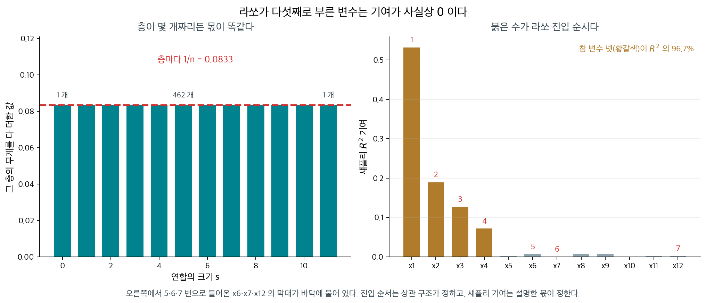
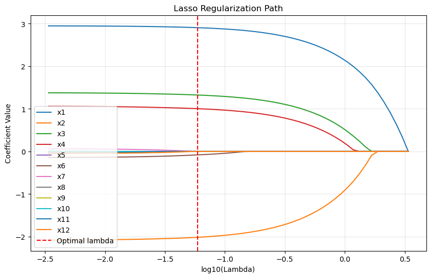

# 정칙화 경로


## 개요

**정칙화 경로**는 정칙화 모수 $\lambda$가 큰 값(강한 정칙화, 희소해)에서 작은 값(약한 정칙화, OLS에 근접)으로 변할 때 모형 계수가 어떻게 달라지는지를 추적한다. 정칙화 경로를 이해하는 것은 다음에 필수적이다.

1. **편향–분산 절충의 시각화** — 정칙화가 강해질 때 계수가 어떻게 축소되는지 본다
2. **변수선택** — 정칙화 수준마다 어떤 변수가 선택되는지 확인한다
3. **모형 복잡도의 이해** — 각 $\lambda$에서 몇 개의 변수가 "활성"인지 관찰한다
4. **최적 $\lambda$의 선택** — 교차검증과 결합하여 최적 정칙화 강도를 고른다

---

## 1. 라쏘의 정칙화 경로

$$\text{minimize} \quad \frac{1}{2n}\|y - X\beta\|^2_2 + \lambda \|\beta\|_1$$

$\lambda$가 커지면

- 더 많은 계수가 정확히 0으로 축소된다
- 모형이 더 희소해진다
- 편향이 커지고 분산이 줄어든다
- 예측오차가 U자 곡선을 그린다(최적 $\lambda$에서 최소)

---

## 2. 라쏘 경로의 주요 성질

### 변수 활성화 순서

1. $\lambda$가 아주 크면 모든 계수가 0이다
2. $\lambda$가 줄면 변수가 하나씩 모형에 들어온다
3. 진입 순서가 L1 정칙화 아래에서의 변수 중요도를 반영한다
4. $\lambda$가 아주 작으면 모든 변수가 활성이 된다(OLS 해에 근접)

### 변수선택의 단조성

라쏘 경로에서 한 번 0이 아니게 된 변수는 $\lambda$가 줄어드는 동안 대체로 계속 0이 아니다. 이 "호모토피" 구조가 계산에 유용하다.

!!! warning "단조성은 보장되지 않는다"
    "대체로"라는 단서가 중요하다. **변수가 활성집합에 들어왔다가 다시 나가는 일이 실제로 일어난다.** 상관된 설명변수가 있으면 특히 그렇다.

    구체적인 예를 하나 확인했다($n = 40$, $p = 8$, 상관된 쌍 포함, 씨앗 191).

    | 변수 | 진입 $\lambda$ | 이탈 구간 |
    |---:|---:|:---|
    | 3 | 0.1113 | $\lambda \in [0.0237,\ 0.0611]$에서 다시 0 |
    | 6 | — | 역시 이탈 구간 존재 |

    변수 3이 $\lambda = 0.111$에서 들어왔다가 $\lambda$가 더 줄어들자 잠시 0으로 돌아가고, 이후 다시 활성화된다.

    **왜 그런가.** 상관된 다른 변수가 활성화되면서 그 변수가 설명하던 몫을 가져가면, 원래 변수의 부분상관이 문턱 아래로 떨어질 수 있다. LARS 알고리즘이 "변수 제거" 단계를 명시적으로 포함하는 이유가 이것이다.

    실무적 함의: **"경로에 일찍 등장한 변수가 더 중요하다"는 해석을 조심해야 한다.** 진입 순서는 상관 구조에 좌우되며 안정적인 중요도 순위가 아니다.

<div class="aibox" markdown>

**AI로 보는 통계학 1.** 기여를 공리로 나누면 순서가 달라진다

바로 위 경고가 「진입 순서는 안정적인 중요도 순위가 아니다」라고 했다. 그렇다면 **무엇이**
중요도인가. 기계학습 쪽이 쓰는 답 하나가 **섀플리값**이고, 뿌리는 통계학이 아니라 게임
이론이다.

특징 집합 $S$ 만 넣고 적합했을 때의 설명력을 $v(S)$ 라 하자(여기서는 $R^2$ 을 쓴다).
특징 $j$ 의 몫은 $j$ 를 **더할 때의 증가분**을 모든 $S$ 에 대해 가중평균한 것이다.

$$
\phi_j = \sum_{S \not\ni j} w(\lvert S\rvert)\,\bigl[v(S \cup \{j\}) - v(S)\bigr],
\qquad
w(s) = \frac{s!\,(p-s-1)!}{p!}
$$

계승만 늘어놓으면 어디서 나온 수인지 알 수 없는데, 고쳐 적으면 뜻이 드러난다.

$$
w(s) = \frac{1}{p\dbinom{p-1}{s}}
$$

크기가 $s$ 인 $S$ 가 $\binom{p-1}{s}$ 개이므로 **그 층의 무게를 다 더하면 꼭
$\tfrac1p$** 이고, 층이 $p$ 개이니 전체가 $1$ 이 된다. 곧 이 무게는 크기마다 공평하게
$\tfrac1p$ 씩 나누어 준 것이고, 그래서 $\sum_j \phi_j$ 가 전체 $R^2$ 을 **정확히**
복원한다. 라쏘의 진입 순서에는 이런 보존이 없다.

<figure markdown>
  { width=980 }
  <figcaption markdown>§4 와 같은 자료다(씨앗 $0$, $n=200$, 참 계수 $3, -2, 1.5, 1$ 과 잡음 여덟). 붉은 수가 라쏘 진입 순서이고, $5 \cdot 6 \cdot 7$ 번으로 들어온 $x_6 \cdot x_7 \cdot x_{12}$ 의 막대가 바닥에 붙어 있다. 자료에서 직접 그렸다.</figcaption>
</figure>

$2^{12} = 4096$ 개 부분집합을 전부 돌려 직접 센다.

```python
import itertools
from math import factorial
import numpy as np

rng = np.random.default_rng(0)
n, p = 200, 12
X = rng.normal(0, 1, (n, p))
y = X @ np.array([3.0, -2.0, 1.5, 1.0] + [0.0] * 8) + rng.normal(0, 1, n)

tss = ((y - y.mean()) ** 2).sum()
ones = np.ones((n, 1))
r2 = np.zeros(1 << p)
for mask in range(1 << p):                       # 2^12 개 부분집합의 R^2 을 미리 센다
    cols = [j for j in range(p) if mask >> j & 1]
    A = np.hstack([ones, X[:, cols]]) if cols else ones
    resid = y - A @ np.linalg.lstsq(A, y, rcond=None)[0]
    r2[mask] = 1.0 - (resid ** 2).sum() / tss

w = [factorial(s) * factorial(p - s - 1) / factorial(p) for s in range(p)]
phi = np.zeros(p)
for j in range(p):
    rest = [k for k in range(p) if k != j]
    for s in range(p):
        for S in itertools.combinations(rest, s):
            m = sum(1 << k for k in S)
            phi[j] += w[s] * (r2[m | (1 << j)] - r2[m])

entry = ["x1", "x2", "x3", "x4", "x6", "x7", "x12"]
print(f"전체 R^2        {r2[-1]:.6f}")
print(f"섀플리 기여의 합 {phi.sum():.6f}")
print("라쏘가 부른 순서와 그 변수의 섀플리 기여")
for rank, nm in enumerate(entry, 1):
    print(f"  {rank}번째 {nm:>3}   {phi[int(nm[1:]) - 1]:+.5f}")
print(f"참 변수 넷의 몫  {phi[:4].sum() / phi.sum() * 100:.1f}%")
```

```text
전체 R^2        0.952398
섀플리 기여의 합 0.952398
라쏘가 부른 순서와 그 변수의 섀플리 기여
  1번째  x1   +0.53228
  2번째  x2   +0.18949
  3번째  x3   +0.12721
  4번째  x4   +0.07199
  5번째  x6   +0.00671
  6번째  x7   +0.00031
  7번째 x12   +0.00175
참 변수 넷의 몫  96.7%
```

**둘째 줄이 보존을 확인한다.** 기여 열둘을 다 더하면 전체 $R^2$ 과 소수 여섯째 자리까지
같다. 그리고 아래가 경고의 알맹이다 — 라쏘가 **여섯째**로 부른 $x_7$ 의 기여가
$+0.00031$ 로 사실상 $0$ 이고, 반대로 라쏘가 여덟째에야 부른 $x_8$ 은 $+0.00838$ 로 그보다
스물일곱 배 크다. 참 변수 넷이 $R^2$ 의 $96.7\%$ 를 가져간다.

**두 순서가 다른 것은 서로 다른 것을 재기 때문이다.** 진입 순서는 「지금 잔차와 가장
상관이 큰 것」을 고르므로 상관 구조에 휘둘리고, 섀플리는 「다른 변수들이 이미 있을 때와
없을 때의 평균적 증가분」이라 끼워 넣는 순서를 **전부 평균 내어** 지운다.

값은 비싸다. 특징이 $p$ 개면 부분집합이 $2^p$ 개이므로 $p = 30$ 만 되어도 셀 수가 없다.
실무에서 쓰는 것은 표본추출이나 모형별 근사이며, 여기서 $p = 12$ 로 둔 까닭도 **정확히**
세어 보이기 위해서다.

</div>

### 자유도

경로 위 어느 점에서든 유효자유도는

$$\text{eDoF}(\lambda) = \text{0이 아닌 계수의 개수}$$

이다. 능형회귀와 달리 이 관계가 정확히 성립하므로 라쏘가 모형선택에 특히 유용하다.

---

## 3. 정칙화 경로의 계산

### 알고리즘: 온기 시작을 이용한 좌표하강

```
초기화: β = 0

λ를 큰 값부터 작은 값 순으로:
    이전 해에서 β를 초기화 (온기 시작)
    각 좌표 j에 대해:
        부분잔차 계산: r_j = y - X β + X_j β_j
        연성 문턱 적용: β_j = soft_threshold(X_j^T r_j / n, λ)
    수렴할 때까지 반복
```

온기 시작은 이전 해를 활용해 계산을 가속한다. 인접한 $\lambda$의 해는 비슷하므로 최적해 근처에서 출발하게 된다.

### 복잡도

- **단일 $\lambda$**: 반복당 $O(np)$
- **전체 경로** ($M$개 $\lambda$): 순차 계산 시 $O(M \times np \times \text{반복})$
- **효율적 구현**: 온기 시작 덕분에 전체 경로가 단일 문제를 푸는 것과 비슷한 시간에 끝난다

---

## 4. 경로의 실용적 해석

### 주택가격

!!! note "아래 표는 예시용 수치다"
    실제 자료에서 계산한 값이 아니라, 경로의 전형적 양상을 보이기 위한 예시다. 실제 수치가 필요하면 [라쏘 주택 정칙화 경로](../lasso/lasso_housing_regularization_path.md)의 계산을 보라.

변수 12개로 주택가격을 예측하는 라쏘 경로는 대략 다음과 같은 모습이다.

| $\lambda$ (척도조정) | 0이 아닌 계수 | 선택된 변수 | RMSE |
|---|---|---|---|
| 10.0 | 0 | (없음) | 340,000 |
| 5.0 | 1 | SqFtTotLiving | 280,000 |
| 2.0 | 4 | SqFtTotLiving, BldgGrade, YrBuilt, Bathrooms | 240,000 |
| 1.0 | 7 | + SqFtLot, Bedrooms, NbrLivingUnits | 225,000 |
| 0.5 | 10 | + SqFtFinBasement, YrRenovated | 220,000 |
| 0.1 | 12 | 전체 변수 (OLS에 근접) | 218,000 |

**읽어야 할 점:**

- 가장 중요한 변수(SqFtTotLiving)가 먼저 들어온다
- 건물 등급과 건축연도가 그다음이다
- 덜 중요한 변수(YrRenovated)는 작은 $\lambda$에서 들어온다
- RMSE는 계속 줄지만 변수 7개를 넘으면 개선이 둔화된다

마지막 항목이 실무적으로 중요하다. **변수 7개에서 12개로 늘리며 얻는 개선이 $225{,}000 \to 218{,}000$으로 3%에 불과하다.** 1-표준오차 규칙이 이런 상황에서 더 단순한 모형을 고르게 해 준다.

### 경로 위에서의 교차검증

각 $\lambda$를 따로 최적화하는 대신, 미리 계산한 경로 위에서 각 $\lambda$의 CV 오차를 구한다.

```
경로 위의 각 lambda에 대해:
    각 CV 겹에 대해:
        훈련 겹에서 적합
        검증 겹에서 예측
        오차 기록
    겹에 걸쳐 평균
CV 오차가 최소인 lambda 선택
```

각 $\lambda$에서 처음부터 다시 적합하는 것보다 훨씬 빠르다.

---

## 5. 경로의 시각화

### 그림 1: 계수 대 λ

<div class="exbox" markdown>

**보기 1.** <span class="diff easy" title="쉬움"></span> 라쏘 정칙화 경로 그리기. 참으로 관련 있는 변수 넷 $(3, -2, 1.5, 1)$과 잡음 변수 여덟, $n = 200$인 자료에서 경로를 그린다.

**(1)** 경로가 시작하는 $\lambda_{\max}$를 하위기울기 조건에서 유도하고, **가장 먼저** 모형에 들어오는 변수가 어느 것인지 말하시오.

**(2)** 경로를 실제로 계산해 (1)을 확인하고, 변수가 들어오는 **순서**가 $\lvert x_j^\top y\rvert$의 순서와 같은지 따지시오.

</div>

??? success "풀이"

    **(1) 해석적으로.** $\beta = 0$이 라쏘의 해일 조건은 모든 $j$에 대해

    $$
    \frac{\lvert x_j^\top y\rvert}{n} \le \lambda
    $$

    이다. 목적함수 $\frac{1}{2n}\lVert y - X\beta\rVert_2^2 + \lambda\lVert\beta\rVert_1$을 $\beta = 0$에서 하위미분하면 $-x_j^\top y/n + \lambda s_j = 0$, $s_j \in [-1,1]$이 나오고, $s_j$를 $[-1,1]$ 안에서 고를 수 있어야 하기 때문이다. 따라서

    $$
    \lambda_{\max} = \frac{1}{n}\lVert X^\top y\rVert_\infty = \max_j \frac{\lvert x_j^\top y\rvert}{n}
    $$

    이고, 이 최댓값을 **달성하는** 변수가 $\lambda$를 조금 낮출 때 가장 먼저 조건을 깨고 들어온다. 참 계수가 가장 큰 $x_1$이 그 자리일 것으로 기대된다.

    그 뒤로는 사정이 다르다. 두 번째 변수가 들어오는 조건은 $\lvert x_j^\top y\rvert$가 아니라 **잔차와의 상관** $\lvert x_j^\top(y - X\hat\beta)\rvert$가 $n\lambda$에 닿는 것이다. $x_1$이 들어오면서 잔차가 바뀌었으므로, 둘째부터는 주변상관의 순서와 어긋날 수 있다.

    **(2) 수치적으로.**

    ```python
    import matplotlib.pyplot as plt
    import numpy as np
    from sklearn.linear_model import lasso_path, LassoCV

    plt.rcParams["font.sans-serif"] = ["NanumGothic", "Apple SD Gothic Neo", "Malgun Gothic"]
    plt.rcParams["font.family"] = "sans-serif"
    plt.rcParams["axes.unicode_minus"] = False

    # 예시 자료: 참으로 관련 있는 변수 4개와 잡음 변수 8개
    rng = np.random.default_rng(0)
    n, n_features = 200, 12
    X = rng.normal(0, 1, (n, n_features))
    beta = np.array([3.0, -2.0, 1.5, 1.0] + [0.0] * 8)
    y = X @ beta + rng.normal(0, 1, n)
    feature_names = [f"x{j+1}" for j in range(n_features)]

    # lasso_path 는 격자 위의 계수를 한꺼번에 계산한다. 하나씩 적합하는
    # 것보다 훨씬 빠른데, 앞 lambda 의 해를 다음 계산의 출발점으로 쓰기 때문이다.
    lambdas, coefs, _ = lasso_path(X, y, n_alphas=60)
    lasso_coefs = coefs.T                       # (n_lambda, n_features)
    # 교차검증으로 고른 lambda. 그림의 붉은 세로선이 이 자리다.
    lambda_opt = LassoCV(cv=5, random_state=0).fit(X, y).alpha_
    print(f"최적 lambda = {lambda_opt:.4f}, "
          f"그때 0이 아닌 계수 = {(np.abs(lasso_coefs[np.argmin(np.abs(lambdas - lambda_opt))]) > 1e-9).sum()}개")

    # --- (1) 을 확인한다 ---
    marg = np.abs(X.T @ y) / n
    print(f"이론 lambda_max = |X'y|_inf/n = {marg.max():.6f}  (달성하는 변수 "
          f"{feature_names[marg.argmax()]})")
    print(f"lasso_path 가 쓴 가장 큰 lambda = {lambdas[0]:.6f}")

    entered = []
    for i in range(len(lambdas)):
        for j in np.where(np.abs(lasso_coefs[i]) > 1e-12)[0]:
            if j not in entered:
                entered.append(j)
    print("경로에서 들어온 순서:", [feature_names[j] for j in entered])
    print("주변상관이 큰 순서  :", [feature_names[j] for j in np.argsort(-marg)])

    # 가로축이 오른쪽에서 왼쪽으로 갈수록 벌점이 약해진다. 가장 먼저 0 에서
    # 떨어져 나오는 선이 그만큼 중요한 변수다.
    fig, ax = plt.subplots(figsize=(10, 6))
    for j in range(n_features):
        ax.plot(np.log10(lambdas), lasso_coefs[:, j], label=feature_names[j])

    ax.axvline(np.log10(lambda_opt), color='red', linestyle='--', label='Optimal lambda')
    ax.set_xlabel('log10(Lambda)')
    ax.set_ylabel('Coefficient Value')
    ax.set_title('Lasso Regularization Path')
    ax.legend()
    ax.grid(True, alpha=0.3)
    plt.show()
    ```

    출력:

    ```
    최적 lambda = 0.0589, 그때 0이 아닌 계수 = 6개
    이론 lambda_max = |X'y|_inf/n = 3.381446  (달성하는 변수 x1)
    lasso_path 가 쓴 가장 큰 lambda = 3.381446
    경로에서 들어온 순서: ['x1', 'x2', 'x3', 'x4', 'x6', 'x7', 'x12', 'x8', 'x11', 'x10', 'x5']
    주변상관이 큰 순서  : ['x1', 'x3', 'x2', 'x4', 'x9', 'x8', 'x6', 'x11', 'x5', 'x12', 'x10', 'x7']
    ```

    

    **유도한 $\lambda_{\max}$가 코드와 소수 여섯째 자리까지 같다.** `lasso_path` 가 격자의 출발점으로 쓰는 값이 바로 $\lVert X^\top y\rVert_\infty / n$이기 때문이다. 그 최댓값을 달성하는 변수도 예상대로 $x_1$이고, 그림에서 가장 오른쪽에서 0을 벗어나는 선이 그것이다.

    **둘째 물음의 답은 "아니다"이다.** 경로의 진입 순서는 $x_1, x_2, x_3, x_4, \dots$인데 주변상관의 순서는 $x_1, x_3, x_2, x_4, \dots$로 $x_2$와 $x_3$이 바뀌어 있다. (1)에서 말한 그대로, 첫 변수만 주변상관이 정하고 그다음부터는 **잔차와의 상관**이 정하기 때문이다. $x_3$의 주변상관 $1.7438$이 $x_2$의 $1.7312$보다 컸지만, $x_1$을 모형에 넣고 남은 잔차에 대해서는 순서가 뒤집혔다.

    **"진입 순서가 곧 변수 중요도"라는 흔한 해석은 그래서 조심해서 써야 한다.** 참 계수의 크기가 $3, 2, 1.5, 1$로 뚜렷이 갈리는 이 자료에서조차 둘째와 셋째가 뒤바뀌었다. 잡음변수 $x_6, x_7, x_{12}$가 참 변수 넷 바로 뒤에 들어온다는 점도 함께 보아야 하며, 경로의 왼쪽 끝에 가까운 진입은 신호의 증거로 읽을 수 없다.

    이 그림이 드러내는 것은 각 $\lambda$에서 어떤 변수가 활성인지(변수선택), 계수가 어떻게 변하는지(축소 방향), 변수가 들어오는 순서와 시점(희소성)이다. 반면 **보이지 않는 것**은 각 계수의 불확실성이고, 어느 진입이 재현될지는 이 한 장으로 알 수 없다.

### 그림 2: 교차검증 오차

CV 오차를 $\log_{10}\lambda$에 대해 그리고 $\lambda_{\min}$과 $\lambda_{1\text{SE}}$를 수직선으로 표시한다. 오차막대(겹에 걸친 표준오차)를 함께 그리면 두 선택의 차이가 통계적으로 의미 있는지 눈으로 판단할 수 있다.

---

## 연습문제

<div class="drillbox" markdown>

**연습문제 1.** <span class="diff med" title="중간"></span>
"한 번 활성화된 변수는 계속 활성이다"라는 단조성 주장의 반례를 찾아라.

</div>

??? success "풀이"
    ```python
    import numpy as np
    from sklearn.linear_model import lasso_path

    for seed in range(400):
        rng = np.random.default_rng(seed)
        n, p = 40, 8
        z = rng.normal(size=n); X = rng.normal(size=(n, p))
        for j in (0, 1):
            X[:, j] = 0.97*z + 0.24*X[:, j]        # 상관된 쌍을 심는다
        X -= X.mean(0); X /= X.std(0)
        y = X @ np.array([2., -1.5, 1., 0, 0, 0, 0, 0]) + rng.normal(0, 1, n)
        y -= y.mean()

        al, co, _ = lasso_path(X, y, n_alphas=400, eps=1e-4)
        act = np.abs(co) > 1e-10                   # alphas 는 내림차순
        for j in range(p):
            a = act[j]
            if a.any():
                first = np.argmax(a)
                if (~a[first:]).any():             # 들어왔다가 다시 나갔다
                    print(seed, j, al[first])
    ```

    출력:

    ```
    0 5 0.14533826609464778
    11 5 0.15786584474888607
    17 4 0.09202967459332306
    21 6 0.061069059642378826
    25 7 0.16421747457563748
    29 5 0.09564176701389139
    50 7 0.09730101859849617
    52 6 0.05433921418806813
    58 6 0.12649580495042542
    63 5 0.1043991390582132
    65 7 0.1198087071175573
    69 7 0.1431149082333018
    76 4 0.19972704832311491
    84 5 0.06438456630443766
    85 5 0.11036365221675698
    86 3 0.21939444206651912
    92 3 0.11055859553245179
    112 3 0.13206922855124728
    113 6 0.08963310275833748
    123 4 0.159097754880989
    125 7 0.1957833488148913
    131 7 0.10063797222812551
    139 7 0.21460541428412652
    145 6 0.09374445725601274
    155 6 0.33155757071949243
    156 5 0.22273319823792345
    157 7 0.11203435018956415
    163 3 0.05913989250888755
    175 4 0.10079236477418044
    178 3 0.13363708694140472
    189 5 0.14856785880590306
    190 6 0.06945283080164662
    191 3 0.11129934784097824
    191 6 0.13081816657941317
    209 3 0.08457451796537765
    213 5 0.06431316913202441
    222 4 0.16212979243501816
    225 3 0.055643548259800626
    234 3 0.08604905805395764
    237 7 0.03398257045596872
    240 3 0.0450833345465129
    242 6 0.05067978100402035
    244 5 0.10773201019537812
    247 4 0.12893923879438057
    251 6 0.09736210952221452
    255 3 0.12362506735084454
    256 6 0.04118519202458965
    268 7 0.11470218232705999
    276 3 0.15128605341184065
    277 4 0.08656337296250692
    281 3 0.06593893748768749
    285 6 0.11464589169125029
    286 4 0.09359497516288097
    290 7 0.09852991247798647
    294 4 0.23125151384530612
    294 5 0.12985480309523229
    313 5 0.056255704840079954
    316 3 0.09631940754632905
    336 4 0.23152612303627923
    336 6 0.15637738063367923
    346 6 0.19008193966893952
    351 3 0.13850693003946973
    357 5 0.14522496498588258
    369 7 0.14005648694419903
    376 3 0.12844247001873285
    376 7 0.18158693094111125
    383 4 0.14710885846787092
    388 5 0.04534325659264666
    390 3 0.04752451383824699
    396 6 0.17224112905995362
    398 6 0.22224528098855587
    ```

    **씨앗 191에서 변수 2개가 활성집합을 떠난다.**

    | 변수 | 진입 $\lambda$ | 다시 0이 되는 구간 |
    |---:|---:|:---|
    | 3 | 0.1113 | $\lambda \in [0.0237,\ 0.0611]$ |
    | 6 | — | 역시 이탈 구간이 있다 |

    **기제.** 변수 3이 처음 들어올 때는 잔차와의 상관이 문턱을 넘었기 때문이다. $\lambda$가 더 줄어 상관된 변수 0과 1이 본격적으로 활성화되면, 이들이 잔차의 상당 부분을 흡수한다. 그 결과 변수 3의 **부분** 상관이 다시 문턱 아래로 떨어진다.

    **LARS 알고리즘이 명시적으로 "제거" 단계를 갖는 이유가 이것이다.** 순수한 전진 선택이라면 이런 후퇴가 불가능하지만, 라쏘의 KKT 조건은 활성집합에서 변수가 빠지는 것을 허용한다.

    **해석에 대한 함의가 크다.** 경로에서 변수가 등장하는 순서를 "중요도 순위"로 읽는 관행이 흔하지만, 이 예는 그 순서가 안정적이지 않음을 보여준다. 상관 구조가 조금만 달라도 순서가 바뀐다. 중요도를 논하려면 안정성 선택 같은 재표집 기반 방법이 필요하다.

<div class="drillbox" markdown>

**연습문제 2.** <span class="diff med" title="중간"></span>
$\lambda_{\max}$에서 시작하는 로그 격자를 쓰는 이유는 무엇인가? 선형 격자를 쓰면 어떤 문제가 생기는가?

</div>

??? success "풀이"
    **로그 격자를 쓰는 이유는 계수 경로가 $\log\lambda$에 대해 대략 균등하게 변하기 때문이다.**

    라쏘 경로에서 활성 변수의 개수는 $\lambda$가 절반이 될 때마다 대략 일정한 수씩 늘어난다. 즉 $\text{df}$가 $\log\lambda$의 대략 선형 함수다. 따라서 $\log\lambda$에 균등한 격자를 쓰면 $\text{df}$의 해상도가 고르게 확보된다.

    **선형 격자의 문제.** $\lambda \in \{0, 0.1, 0.2, \ldots, 3.5\}$처럼 잡았다고 하자($\lambda_{\max} = 3.5$).

    | 구간 | 격자점 수 | 일어나는 일 |
    |:---|---:|:---|
    | $\lambda \in [1.75,\ 3.5]$ | 18개 | 활성 변수 0–1개, 거의 아무 일도 없다 |
    | $\lambda \in [0,\ 0.1]$ | 2개 | 활성 변수가 5개에서 20개로 폭증 |

    **격자의 절반이 아무 정보도 없는 구간에 낭비되고, 정작 중요한 구간은 두 점으로 건너뛴다.**

    $\lambda_{\max}$에서 시작하는 이유도 분명하다. $\lambda > \lambda_{\max}$에서는 해가 항상 $\mathbf{0}$이므로 계산할 가치가 없다([라쏘의 정식화](../lasso/formulation.md) 연습문제 2에서 확인했다).

    표준 관행은 $\lambda_{\max}$에서 $10^{-3}\lambda_{\max}$ 또는 $10^{-4}\lambda_{\max}$까지 100개 점을 로그 균등하게 잡는 것이며, `sklearn`의 `lasso_path(eps=1e-3)`와 `glmnet`의 기본값이 정확히 이것이다.

<div class="drillbox" markdown>

**연습문제 3.** <span class="diff med" title="중간"></span>
보기 1 의 출력에서 "경로에서 들어온 순서" 목록에는 이름이 **11 개**뿐인데 설명변수는 12 개다.

**(1)** 빠진 변수를 찾고, 같은 출력의 "주변상관이 큰 순서" 목록에서 그 변수가 몇째인지 적으시오.

**(2)** 코드가 그 목록을 만드는 방식을 보면, 이름이 빠졌다는 것은 그 변수에 대해 **무엇이** 성립한다는 뜻인가. 출력의 다른 수와 모순이 없는지 확인하시오.

**(3)** 경로의 격자는 어디서 멈추는가(연습문제 2 가 적은 기본값을 쓰시오). 격자를 더 늘리면 그 변수가 언젠가 들어오는가? $\lambda \to 0$ 극한으로 답하시오.

</div>

??? success "풀이"
    **(1)** 진입 순서 목록은

    $$
    x_1,\ x_2,\ x_3,\ x_4,\ x_6,\ x_7,\ x_{12},\ x_8,\ x_{11},\ x_{10},\ x_5
    $$

    로 11 개이고, 주변상관 순서 목록은 12 개를 모두 담고 있다. 두 목록을 맞춰 보면 빠진 것은 $x_9$ 다. 그런데 $x_9$ 는 주변상관 순서에서 $x_1, x_3, x_2, x_4$ 다음 **다섯째**다. 주변상관으로는 상위권인 변수가 경로에는 한 번도 나타나지 않았다.

    **(2)** 코드는 격자의 모든 점 $i$ 를 훑으며 $\lvert\hat\beta_j\rvert > 10^{-12}$ 인 $j$ 를 처음 보는 순서로 담는다. 따라서 $x_9$ 가 목록에 없다는 것은 **격자의 60 개 점 어디에서도 $x_9$ 의 계수가 0 이었다**는 뜻이다. 한 점에서만 0 이었던 것이 아니다.

    출력의 다른 수와 어긋나지 않는다. 격자의 가장 작은 $\lambda$ 에서 0 이 아닌 계수는 $12 - 1 = 11$ 개여야 하고, 이것이 바로 목록의 길이다. 또 최적 $\lambda = 0.0589$ 에서 0 이 아닌 계수가 6 개라고 찍혀 있으니, 그 자리에서 활성인 여섯은 목록의 앞쪽 여섯 $x_1, x_2, x_3, x_4, x_6, x_7$ 이다.

    **(3)** `lasso_path` 의 기본 격자는 $\lambda_{\max}$ 에서 $\text{eps} \cdot \lambda_{\max}$ 까지 로그 균등하게 잡히고 기본값은 $\text{eps} = 10^{-3}$ 이다(연습문제 2). 보기 1 의 $\lambda_{\max} = 3.381446$ 이므로 격자의 하한은

    $$
    \lambda_{\min} = 10^{-3} \times 3.381446 = 0.003381
    $$

    이다. $x_9$ 는 이 $\lambda_{\min}$ 에서도 문턱을 넘지 못했다.

    그러나 $\lambda \to 0$ 에서 라쏘 해는 OLS 해로 가고, 일반적 위치의 자료에서 OLS 해의 좌표는 모두 0 이 아니다. 따라서 격자를 더 아래로 밀면 $x_9$ 도 **반드시** 들어온다. 실제로 `eps=1e-6` 으로 격자를 늘리면 $\lambda \approx 0.0020$ 에서 들어오는데, 이것은 기본 격자의 하한 $0.003381$ 보다 작아서 보이지 않았던 것이다.

    **해석.** $x_9$ 는 참 계수가 0 인 잡음변수다. 주변상관이 다섯째로 컸던 것은 $x_9$ 가 표본에서 우연히 $x_1, \dots, x_4$ 와 조금 상관되어 신호를 빌려 왔기 때문이고, 그 넷이 모형에 들어오는 순간 빌려 온 몫이 회수되어 잔차와의 상관이 거의 0 으로 주저앉는다. **주변 선별과 라쏘는 다른 변수를 고른다.** 라쏘는 주변상관 7·12·10 위인 $x_6, x_7, x_{12}$ 를 넣으면서 5 위인 $x_9$ 는 끝까지 뺐다. 보기 1 의 풀이가 말한 "첫 변수만 주변상관이 정한다"는 말의 가장 강한 형태가 이것이다.

<div class="drillbox" markdown>

**연습문제 4.** <span class="diff med" title="중간"></span>
연습문제 1 의 출력은 400 개 자료에서 찾은 이탈 사건의 목록이다. 그 목록에서 수를 뽑아내자.

**(1)** 출력은 몇 줄인가. 서로 다른 씨앗은 몇 개인가. 두 줄을 차지한 씨앗을 모두 적으시오.

**(2)** "자료 하나에서 이탈이 적어도 한 번 일어날 확률"의 추정값과 그 표준오차, 95% 신뢰구간을 구하시오.

**(3)** 이탈한 변수의 번호를 모아 보시오. 무엇이 눈에 띄는가. 그 자료의 참 계수 $(2, -1.5, 1, 0, 0, 0, 0, 0)$ 과 견주어 설명하시오.

**(4)** (2)의 추정값은 실제 비율의 과대추정인가 과소추정인가. 검출 방식에서 세 군데를 짚으시오.

</div>

??? success "풀이"
    **(1)** 출력은 **71 줄**이다. 씨앗 191, 294, 336, 376 이 각각 두 줄을 차지하므로(그 자료에서는 변수 두 개가 이탈했다) 서로 다른 씨앗은 $71 - 4 = 67$ 개다.

    **(2)** 400 개 자료 가운데 67 개에서 사건이 검출되었으므로

    $$
    \hat p = \frac{67}{400} = 0.1675, \qquad
    \text{SE} = \sqrt{\frac{\hat p(1-\hat p)}{400}} = \sqrt{\frac{0.1675 \times 0.8325}{400}} = 0.0187
    $$

    이고 95% 신뢰구간은 $0.1675 \pm 1.96 \times 0.0187 = [0.131,\ 0.204]$ 이다. **여섯 자료 중 하나쯤에서 일어난다.** 2 절이 쓴 "대체로"라는 단서가 꽤 무거운 단서였다는 뜻이다.

    **(3)** 번호별로 세면 다음과 같다.

    | 변수 번호 | 3 | 4 | 5 | 6 | 7 | 합 |
    |---:|---:|---:|---:|---:|---:|---:|
    | 이탈 횟수 | 17 | 11 | 14 | 16 | 13 | 71 |

    **번호 0, 1, 2 는 한 번도 나오지 않는다.** 이들이 바로 참 계수가 $2, -1.5, 1$ 인 신호변수다. 신호변수는 큰 $\lambda$ 에서 일찍 들어와 계수가 금방 커지므로 0 으로 되돌아갈 거리가 멀다. 반면 번호 3 부터 7 까지는 참 계수가 0 인 잡음변수여서 들어올 때의 계수가 문턱 바로 위에 있고, 상관된 짝 $(x_0, x_1)$ 이 본격적으로 활성화되면서 잔차를 흡수하면 쉽게 문턱 아래로 밀려난다. 이탈은 **계수가 작은 변수에서 일어나는 현상**이다.

    **(4)** 과소추정으로 읽는 것이 안전하다. 검출이 놓치는 자리가 셋이다.

    1. **격자.** 경로를 400 개 격자점에서만 평가하므로, 이탈 구간이 인접한 두 격자점 사이보다 좁으면 보이지 않는다. 씨앗 191 의 구간 $[0.0237,\ 0.0611]$ 은 격자점 42 개를 덮을 만큼 넓어서 잡혔을 뿐이다.
    2. **격자의 하한.** `eps=1e-4` 이므로 $\lambda < 10^{-4}\lambda_{\max}$ 구간은 아예 보지 않는다. 그 아래에서 일어나는 이탈은 셀 수 없다.
    3. **0 의 판정.** `np.abs(co) > 1e-10` 이라는 문턱과 좌표하강의 수렴 허용오차가 함께 작용한다. 이 쪽은 양방향으로 틀릴 수 있어서, 아주 작은 계수를 0 으로 보고하면 거짓 이탈이 생기고 반대로 정확히 0 이어야 할 것이 $10^{-10}$ 을 넘으면 참 이탈을 놓친다.

    주된 효과는 1 번과 2 번이므로 $0.1675$ 는 하한으로 읽는다. 아울러 이 수는 **이 설계**(상관된 쌍 하나, $n = 40$, $p = 8$, 신호 3 개)에 대한 것이고 보편적인 비율이 아니다. 상관을 키우거나 $p$ 를 늘리면 올라간다.

<div class="drillbox" markdown>

**연습문제 5.** <span class="diff hard" title="어려움"></span>
4 절 주택가격 표의 RMSE 열은 $\lambda$ 가 줄어들수록 단조감소한다.

**(1)** 이것이 1 절의 "예측오차가 U자 곡선을 그린다"와 모순인가. 표의 RMSE 가 어느 오차인지 밝혀 양립 가능성을 설명하고, 만일 교차검증 오차였다면 표가 어떤 모양이어야 하는지 적으시오.

**(2)** $\lambda = 10.0$ 행은 활성 변수가 0 개다. 그 행의 RMSE $340{,}000$ 이 무엇과 같아야 하는지 말하고, 그 값을 기준으로 $\lambda = 1.0$ 과 $\lambda = 0.1$ 의 $R^2$ 를 구하시오.

**(3)** 쪽은 1-표준오차 규칙이 "이런 상황에서 더 단순한 모형을 고르게 해 준다"고 적었다. 표의 RMSE 를 교차검증 오차라고 **가정**할 때, 그 규칙이 $\lambda = 1.0$(7 변수)을 고르려면 표준오차가 적어도 얼마여야 하는가. 표준오차가 $3{,}000$ 이면 어느 행이 뽑히는가. $22{,}000$ 이면?

**(4)** 표만으로는 쪽의 그 주장을 확인할 수 없다. 왜인지 한 줄로 적으시오.

</div>

??? success "풀이"
    **(1) 모순이 아니다. 표의 RMSE 는 표본내 오차로 읽어야 한다.** 라쏘의 훈련 잔차제곱합은 $\lambda$ 의 증가함수다. $\lambda$ 가 작을 때의 해는 더 큰 L1 예산을 쓸 수 있으므로 같은 자료에서 잔차를 더 줄일 수 있고, $\lambda \to 0$ 에서 OLS 에 닿아 훈련오차가 최소가 된다. 그러므로 **훈련 RMSE 가 단조감소하는 것은 정리이지 관찰이 아니다.** 1 절의 U자 곡선은 표본 **밖** 오차에 대한 말이다.

    교차검증 오차였다면 표의 RMSE 열이 어딘가에서 다시 올라가야 하고 최솟값이 양 끝이 아닌 **안쪽** 행에 있어야 한다. 표는 $\lambda = 0.1$ 에서 최소이므로 끝점이 최적이고, 이는 격자가 너무 짧거나 그 열이 CV 오차가 아니라는 뜻이다. 실제로 표 위의 note 가 예시용 수치라고 밝혀 두었다.

    **(2)** 활성 변수가 0 개면 모든 예측값이 $\bar y$ 이므로 RMSE 는 반응변수의 표본표준편차와 같다. 곧 $s_y \approx 340{,}000$ 이다. 그러면

    $$
    R^2 = 1 - \frac{\text{MSE}}{s_y^2} = 1 - \left(\frac{\text{RMSE}}{340{,}000}\right)^2
    $$

    이고

    | $\lambda$ | 변수 | RMSE | $\text{RMSE}/s_y$ | $R^2$ |
    |---:|---:|---:|---:|---:|
    | 1.0 | 7 | 225,000 | 0.6618 | 0.5621 |
    | 0.1 | 12 | 218,000 | 0.6412 | 0.5889 |

    변수를 7 개에서 12 개로 늘려 얻는 것은 $R^2$ 로 $0.0268$ 이다. 쪽이 "3%"라고 말한 RMSE 개선 $(225-218)/225 = 3.1\%$ 와 같은 사실을 다르게 적은 것이다.

    **(3)** 1-표준오차 규칙은 "CV 오차가 $\min + \text{SE}$ 이하인 행 가운데 $\lambda$ 가 가장 큰 것"을 고른다. 최솟값은 $\lambda = 0.1$ 의 $218{,}000$ 이므로 조건은 $\text{RMSE} \le 218{,}000 + \text{SE}$ 다.

    | 뽑히려면 | 필요한 SE |
    |:---|---:|
    | $\lambda = 0.5$ (10 변수, 220,000) | $\ge 2{,}000$ |
    | $\lambda = 1.0$ (7 변수, 225,000) | $\ge 7{,}000$ |
    | $\lambda = 2.0$ (4 변수, 240,000) | $\ge 22{,}000$ |

    따라서 $\lambda = 1.0$ 을 고르려면 $\text{SE} \ge 7{,}000$, 곧 최소 오차의 $7{,}000/218{,}000 = 3.2\%$ 여야 한다. $\text{SE} = 3{,}000$ 이면 $221{,}000$ 이하인 행만 자격이 있어 $\lambda = 0.5$ 의 **10 변수** 모형이 뽑히고, $\text{SE} = 22{,}000$ 이면 $\lambda = 2.0$ 의 **4 변수** 모형까지 내려간다. 규칙이 고르는 모형은 표준오차의 크기에 그대로 끌려다닌다.

    **(4)** 표에 표준오차 열이 없다. 1-표준오차 규칙은 CV 오차와 그 **겹에 걸친 표준오차** 두 열을 모두 요구하는데, 표의 한 열은 (1)에서 본 대로 CV 오차도 아니다. 5 절 그림 2 가 말하는 오차막대가 바로 이 빠진 열이다.

<div class="drillbox" markdown>

**연습문제 6.** <span class="diff hard" title="어려움"></span>
2 절은 유효자유도가 "0 이 아닌 계수의 개수"이고 "능형회귀와 달리 이 관계가 정확히 성립"한다고 적었다. 그 등식을 $\lambda$ 의 **함수**로 보면 능형에는 있고 라쏘에는 없는 성질이 하나 드러난다.

**(1)** 능형의 $\text{df}(\lambda) = \sum_j d_j^2/(d_j^2+\lambda)$ 가 $\lambda$ 에 대해 엄격감소임을 보이고, $\lambda \mapsto \text{df}$ 가 $(0, p)$ 위로의 일대일 대응임을 말하시오.

**(2)** 라쏘에서는 그 일대일 대응이 깨진다. 연습문제 1 의 씨앗 191 자료를 들어 설명하시오.

**(3)** 수로 확인하시오. 그 자료의 경로에서 $\text{df}$ 가 줄어드는 자리와, 지난 최댓값보다 작게 머무는 $\lambda$ 구간을 찍으시오.

**(4)** 실무에 뜻하는 것. "$\text{df} = 5$ 인 모형"을 $\lambda$ 로 지정할 수 있는가. 경로 위에서 $\text{BIC} = n\log(\text{RSS}/n) + \text{df}\cdot\log n$ 을 쓰면 어떤 일이 생기는가.

</div>

??? success "풀이"
    **(1)** 항마다 미분하면

    $$
    \frac{d}{d\lambda}\frac{d_j^2}{d_j^2+\lambda} = -\frac{d_j^2}{(d_j^2+\lambda)^2} < 0
    $$

    이므로 $d_j > 0$ 인 항이 하나라도 있으면 합은 엄격감소다. $\text{df}$ 는 $\lambda$ 의 연속함수이고 $\text{df}(0) = p$, $\lambda \to \infty$ 에서 $0$ 이다. 연속이고 엄격감소이므로 $\lambda \in (0, \infty)$ 와 $\text{df} \in (0, p)$ 사이에 **일대일 대응**이 있다. 그래서 능형에서는 "$\text{df} = 2.5$ 인 적합"을 말할 수 있고 그것을 주는 $\lambda$ 가 유일하다.

    **(2)** 라쏘의 $\text{df}(\lambda)$ 는 활성 변수의 개수이므로 정수값만 갖는다. 정수값이라는 것만으로는 일대일이 깨지지 않지만(계단이 한 방향이면 구간마다 한 값), 연습문제 1 이 보인 **이탈**이 계단을 되돌린다. 씨앗 191 에서 변수 3 은 $\lambda = 0.1113$ 에서 들어왔다가 $\lambda \in [0.0237,\ 0.0611]$ 에서 다시 0 이 된다. 그 구간에 들어서는 자리에서 활성 변수가 하나 줄므로 $\text{df}$ 도 하나 줄고, 구간을 빠져나오면 다시 늘어난다. 곧 $\lambda$ 가 줄어드는 동안 $\text{df}$ 가 **감소하는 구간**이 있고, 같은 $\text{df}$ 값이 서로 떨어진 여러 $\lambda$ 구간에서 나타난다.

    **(3)**

    ```python
    import numpy as np
    from sklearn.linear_model import lasso_path

    # 연습문제 1 의 씨앗 191 자료를 그대로 되살린다.
    rng = np.random.default_rng(191)
    n, p = 40, 8
    z = rng.normal(size=n)
    X = rng.normal(size=(n, p))
    for j in (0, 1):
        X[:, j] = 0.97*z + 0.24*X[:, j]
    X -= X.mean(0); X /= X.std(0)
    y = X @ np.array([2., -1.5, 1., 0, 0, 0, 0, 0]) + rng.normal(0, 1, n)
    y -= y.mean()

    al, co, _ = lasso_path(X, y, n_alphas=400, eps=1e-4, tol=1e-12)
    act = np.abs(co) > 1e-10
    df = act.sum(0)                      # 쪽이 말한 eDoF = 0 이 아닌 계수의 개수

    for j in (3, 6):                     # 연습문제 1 이 지목한 두 변수
        first = np.argmax(act[j])
        zeros = np.where(~act[j, first:])[0] + first
        print(f"변수 {j}: 진입 lambda = {al[first]:.4f}, "
              f"다시 0 인 구간 = [{al[zeros].min():.4f}, {al[zeros].max():.4f}]")

    print("lambda 가 줄어드는 동안 df 가 줄어드는 자리")
    for i in range(1, len(al)):
        if df[i] < df[i-1]:
            out = np.where(act[:, i-1] & ~act[:, i])[0]
            print(f"  lambda {al[i-1]:.4f} -> {al[i]:.4f} : df {df[i-1]} -> {df[i]} "
                  f"(빠진 변수 {list(out)})")

    low = np.where(df < np.maximum.accumulate(df))[0]
    print(f"df 가 지난 최댓값보다 작은 lambda 구간 = "
          f"[{al[low].min():.4f}, {al[low].max():.4f}], 그 안의 최소 df = {df[low].min()}")
    print(f"df 가 lambda 감소에 대해 비감소인가 = {bool(np.all(np.diff(df) >= 0))}")
    ```

    출력:

    ```text
    변수 3: 진입 lambda = 0.1113, 다시 0 인 구간 = [0.0237, 0.0611]
    변수 6: 진입 lambda = 0.1308, 다시 0 인 구간 = [0.0260, 0.0597]
    lambda 가 줄어드는 동안 df 가 줄어드는 자리
      lambda 0.0625 -> 0.0611 : df 6 -> 5 (빠진 변수 [3])
      lambda 0.0611 -> 0.0597 : df 5 -> 4 (빠진 변수 [6])
    df 가 지난 최댓값보다 작은 lambda 구간 = [0.0260, 0.0611], 그 안의 최소 df = 4
    df 가 lambda 감소에 대해 비감소인가 = False
    ```

    2 절의 표와 정확히 맞는다. 변수 3 과 6 이 차례로 빠지면서 $\text{df}$ 가 $6 \to 5 \to 4$ 로 **두 칸 내려간다.** $\lambda$ 를 더 줄이면 둘이 돌아와 $\text{df}$ 가 다시 오른다.

    **(4) "$\text{df} = 5$ 인 모형"은 $\lambda$ 로 지정되지 않는다.** 위 출력에서 $\text{df} = 5$ 를 주는 $\lambda$ 는 서로 떨어진 **세 구간**에 흩어져 있다. 들어오는 길의 한 구간, 이탈하는 길의 두 구간이다. 게다가 세 구간의 활성집합이 서로 다르다. 능형이라면 $\text{df}$ 를 정하는 것이 $\lambda$ 를 정하는 것과 같은 일이지만, 라쏘에서는 $\text{df}$ 가 모형을 지목하지 못한다.

    BIC 에도 그대로 번진다. $\text{RSS}(\lambda)$ 는 $\lambda$ 에 대해 연속이고 증가하지만 $\text{df}$ 는 뛴다. 변수가 들어오는 자리에서 벌점이 $\log n$ 만큼 **위로** 뛰고, 이탈하는 자리에서는 **아래로** 뛴다. 그래서 BIC 는 $\lambda$ 가 줄어드는 동안 단조롭지 않게 움직이고, 최솟값이 여러 국소 최솟값 가운데 하나로 나온다. 격자를 바꾸면 고르는 자리가 달라질 수 있다는 뜻이다. 2 절이 적은 "이 관계가 정확히 성립한다"는 말은 **고정된 $\lambda$ 에서 활성 변수를 세면 된다**는 뜻으로만 옳고, "$\text{df}$ 로 복잡도를 매개화할 수 있다"는 뜻으로는 옳지 않다.

<div class="drillbox" markdown>

**연습문제 7.** <span class="diff hard" title="어려움"></span>
3 절은 두 가지를 주장한다. (가) 온기 시작이 계산을 가속한다. (나) "온기 시작 덕분에 전체 경로가 단일 문제를 푸는 것과 비슷한 시간에 끝난다." 유사코드를 그대로 구현해 **순회 횟수**로 재자. 열은 $\lVert x_j\rVert^2 = n$ 으로 표준화하고 $y$ 는 중심화하며, 격자는 $\lambda_{\max}$ 에서 $10^{-3}\lambda_{\max}$ 까지 로그 균등, 수렴판정은 $\max_j\lvert\Delta\beta_j\rvert < 10^{-8}$ 로 둔다.

**(1)** 구현이 `sklearn` 의 `lasso_path` 와 같은 해를 주는지 확인하시오.

**(2)** 세 가지를 세시오. (가) 온기 시작으로 경로 전체, (나) 격자점마다 $\beta = 0$ 에서 시작해 경로 전체, (다) 가장 작은 $\lambda$ **하나만** $\beta = 0$ 에서.

**(3)** 온기 시작 경로가 적어도 몇 순회를 해야 하는지 하한을 말하고 측정값과 견주시오. 주장 (가)와 (나) 가운데 어느 것이 지지되고 어느 것이 깨지는가.

**(4)** 상관이 심한 설계($\rho = 0.9$ 등상관, $p = 30$)에서 세 수가 어떻게 바뀌는가. 주장 (나)를 살리려면 "비용"의 단위를 무엇으로 바꿔야 하는가.

</div>

??? success "풀이"
    **(1)–(2)** 유사코드를 글자 그대로 옮긴다. $\lVert x_j\rVert^2 = n$ 이어야 갱신식 $\beta_j \leftarrow S_\lambda(x_j^\top r_j/n)$ 이 맞다.

    ```python
    import numpy as np
    from sklearn.linear_model import lasso_path

    def sweeps(X, y, grid, warm, tol=1e-8, max_sweep=5000):
        """3 절 유사코드 그대로. 전체 순회 횟수와 마지막 해를 돌려준다."""
        n, p = X.shape
        total, b = 0, np.zeros(p)
        for lam in grid:
            if not warm:
                b = np.zeros(p)                             # 온기 시작을 끈다
            r = y - X @ b
            for s in range(1, max_sweep + 1):
                delta = 0.0
                for j in range(p):
                    bj = b[j]
                    rj = r + X[:, j] * bj                   # 부분잔차
                    z = X[:, j] @ rj / n
                    new = np.sign(z) * max(abs(z) - lam, 0.0)   # 연성 문턱
                    if new != bj:
                        b[j] = new
                        r = rj - X[:, j] * new
                        delta = max(delta, abs(new - bj))
                if delta < tol:
                    break
            total += s
        return total, b

    # (A) 보기 1 의 자료. 열 노름^2 = n 으로 맞추고 y 를 중심화한다.
    rng = np.random.default_rng(0)
    XA = rng.normal(0, 1, (200, 12))
    yA = XA @ np.array([3.0, -2.0, 1.5, 1.0] + [0.0]*8) + rng.normal(0, 1, 200)
    XA = (XA - XA.mean(0)) / XA.std(0); yA = yA - yA.mean()

    # (B) 상관이 심한 설계. rho = 0.9 등상관, p = 30.
    rng = np.random.default_rng(1)
    z = rng.normal(size=(100, 1))
    XB = np.sqrt(0.9)*z + np.sqrt(0.1)*rng.normal(size=(100, 30))
    XB = (XB - XB.mean(0)) / XB.std(0)
    bB = np.zeros(30); bB[:4] = [3.0, -2.0, 1.5, 1.0]
    yB = XB @ bB + rng.normal(0, 1, 100); yB = yB - yB.mean()

    for tag, X, y, m in (("A 보기 1 자료 (p=12, 상관 없음)", XA, yA, 60),
                         ("B 등상관 rho=0.9 (p=30)", XB, yB, 30)):
        lam_max = np.abs(X.T @ y).max() / len(y)
        grid = lam_max * np.logspace(0, -3, m)
        warm, b_end = sweeps(X, y, grid, warm=True)
        cold, _ = sweeps(X, y, grid, warm=False)
        one, _ = sweeps(X, y, grid[-1:], warm=False)
        ref = lasso_path(X, y, alphas=grid, tol=1e-12, max_iter=100000)[1][:, -1]
        print(f"{tag}: 격자 {m} 점, lambda_max = {lam_max:.4f}")
        print(f"  (가) 온기 시작, 경로 전체 순회        = {warm}")
        print(f"  (나) 격자점마다 0 에서 시작, 경로 전체 = {cold}")
        print(f"  (다) 가장 작은 lambda 하나만 0 에서    = {one}")
        print(f"  (나)/(가) = {cold/warm:.2f},  (가)/(다) = {warm/one:.1f},  격자점 수 = {m}")
        print(f"  sklearn lasso_path 와 일치(최대 차이 < 1e-3) = {np.abs(b_end - ref).max() < 1e-3}")
    ```

    출력:

    ```text
    A 보기 1 자료 (p=12, 상관 없음): 격자 60 점, lambda_max = 3.2358
      (가) 온기 시작, 경로 전체 순회        = 347
      (나) 격자점마다 0 에서 시작, 경로 전체 = 426
      (다) 가장 작은 lambda 하나만 0 에서    = 10
      (나)/(가) = 1.23,  (가)/(다) = 34.7,  격자점 수 = 60
      sklearn lasso_path 와 일치(최대 차이 < 1e-3) = True
    B 등상관 rho=0.9 (p=30): 격자 30 점, lambda_max = 3.4696
      (가) 온기 시작, 경로 전체 순회        = 15664
      (나) 격자점마다 0 에서 시작, 경로 전체 = 18831
      (다) 가장 작은 lambda 하나만 0 에서    = 3045
      (나)/(가) = 1.20,  (가)/(다) = 5.1,  격자점 수 = 30
      sklearn lasso_path 와 일치(최대 차이 < 1e-3) = True
    ```

    유사코드가 `lasso_path` 와 같은 해에 닿는다. 표준화 덕분에 갱신식에 보정이 들어가지 않았다.

    **(3) 하한은 격자점의 개수다.** 온기 시작이라도 격자점마다 "더 움직일 것이 없다"를 확인하는 순회를 한 번은 해야 하므로 경로 전체는 적어도 $m$ 순회다. A 에서 하한은 60 이고 측정값은 347, 곧 격자점당 평균 5.8 순회다.

    - **주장 (가)는 지지되지만 이득이 작다.** $426/347 = 1.23$ 배, B 에서도 $1.20$ 배다. 20% 남짓이다.
    - **주장 (나)는 이 측정에서 깨진다.** 경로 전체 347 순회는 가장 작은 $\lambda$ 하나를 처음부터 푸는 10 순회의 **34.7 배**다. "단일 문제와 비슷한 시간"이 아니다. 하한 $m = 60$ 이 이미 10 의 6 배이므로, 순회를 비용으로 잡는 한 이 주장은 구조적으로 성립할 수 없다.

    **(4)** B 에서는 절대 비용이 통째로 커진다. A 의 347 에 비해 B 는 15,664 순회이고, 격자점은 절반인데도 45 배다. 상관이 심해지면 좌표하강이 느려지기 때문이다(연습문제 9 의 립시츠 상수가 $1/(1-\rho)$ 로 커지는 것과 같은 뿌리다). 그런데 온기 시작의 **상대적** 이득은 $1.20$ 배로 A 와 비슷하고 $(\text{가})/(\text{다})$ 는 $5.1$ 로 줄어든다. 단일 문제 자체가 어려워졌기 때문이다.

    주장 (나)를 살리려면 비용의 단위를 순회가 아니라 **좌표 갱신 횟수**, 더 정확히는 **활성 좌표의 갱신 횟수**로 바꿔야 한다. 희소해에서 0 인 좌표는 갱신해도 0 에 머물고, 활성집합 전략을 쓰면 그 좌표를 아예 건너뛴다. 그러면 격자점을 하나 더 푸는 추가 비용이 활성집합의 크기에 비례해 작아진다. 비교 상대도 "가장 작은 $\lambda$ 하나"가 아니라 "격자점마다 처음부터 푸는 것"이어야 하고, 그 비교에서 이 자료의 이득은 1.2 배다. **3 절의 문장은 "격자를 촘촘히 해도 비용이 거의 늘지 않는다"로 고쳐 읽어야 한다.**

<div class="drillbox" markdown>

**연습문제 8.** <span class="diff hard" title="어려움"></span>
보기 1 의 코드는 경로를 `lasso_path` 로 계산하고 $\lambda$ 를 `LassoCV` 로 골랐다. 두 함수의 **절편** 처리가 다르다.

**(1)** `lasso_path` 에는 `fit_intercept` 인수가 없다. 이 함수가 최소화하는 목적함수를 적고, $y$ 를 상수 $c$ 만큼 평행이동했을 때 $\lambda_{\max}$ 가 어떻게 바뀌는지 식으로 적으시오.

**(2)** `LassoCV` 는 절편을 적합한다(벌점에서는 뺀다). 같은 평행이동에서 그 계수와 고르는 $\lambda$ 는 어떻게 되는가.

**(3)** $c = 10$ 으로 수치 확인하시오. $\lambda_{\max}$ 와 **진입 순서**가 어떻게 바뀌는가.

**(4)** 그런데도 보기 1 의 비교가 어긋나지 않았다. 그 까닭을 수로 말하고(중심화한 자료의 $\lambda_{\max}$ 와 견주시오), 올바른 사용법을 한 줄로 적으시오.

</div>

??? success "풀이"
    **(1)** `lasso_path` 는 절편 없이

    $$
    \frac{1}{2n}\lVert y - X\beta\rVert_2^2 + \lambda\lVert\beta\rVert_1
    $$

    를 푼다. 보기 1 의 유도에서 $\beta = 0$ 이 해일 조건은 모든 $j$ 에 대해 $\lvert x_j^\top y\rvert/n \le \lambda$ 였고 이때 $y$ 는 **중심화되어 있지 않다.** $y$ 를 $y + c\mathbf{1}$ 로 바꾸면 $x_j^\top(y + c\mathbf{1}) = x_j^\top y + c\,n\bar x_j$ 이므로

    $$
    \lambda_{\max}(c) = \max_j \left\lvert \frac{x_j^\top y}{n} + c\,\bar x_j \right\rvert
    $$

    이다. **열평균 $\bar x_j$ 가 정확히 0 이 아니면 $\lambda_{\max}$ 가 $c$ 와 함께 움직인다.** 최댓값을 달성하는 $j$ 도 바뀔 수 있으므로 첫 진입 변수까지 달라진다.

    **(2)** 절편을 벌점에서 빼면 절편의 최적성 조건이 $\mathbf{1}^\top(y - \beta_0\mathbf{1} - X\beta) = 0$, 곧 $\beta_0 = \bar y - \bar x^\top\beta$ 다. 이것을 대입하면 문제는 $X$ 와 $y$ 를 **중심화한** 문제와 같아진다. 중심화는 $y \to y + c\mathbf{1}$ 에 불변이므로 $\hat\beta$, 경로, 교차검증 오차, 고르는 $\lambda$ 가 모두 $c$ 에 **불변**이고 절편만 $c$ 만큼 올라간다.

    **(3)**

    ```python
    import numpy as np
    from sklearn.linear_model import lasso_path, LassoCV

    rng = np.random.default_rng(0)
    n, n_features = 200, 12
    X = rng.normal(0, 1, (n, n_features))
    beta = np.array([3.0, -2.0, 1.5, 1.0] + [0.0]*8)
    y = X @ beta + rng.normal(0, 1, n)
    names = [f"x{j+1}" for j in range(n_features)]

    def order(al, co):
        seen = []
        for i in range(len(al)):
            for j in np.where(np.abs(co[:, i]) > 1e-12)[0]:
                if j not in seen:
                    seen.append(j)
        return [names[j] for j in seen]

    for tag, yy in (("원래 y", y), ("y + 10", y + 10.0)):
        al, co, _ = lasso_path(X, yy, n_alphas=60)
        cv = LassoCV(cv=5, random_state=0).fit(X, yy)
        print(f"{tag:7s}: lasso_path 의 lambda_max = {al[0]:.6f}, "
              f"공식 |X'y|_inf/n = {np.abs(X.T @ yy).max()/n:.6f}, "
              f"LassoCV lambda = {cv.alpha_:.6f}")
        print(f"         처음 세 진입 = {order(al, co)[:3]}")

    big = np.argsort(-np.abs(X.mean(0)))[:3]
    print("열평균의 절댓값이 큰 셋 =", [(names[j], round(X[:, j].mean(), 4)) for j in big])

    Xc, yc = X - X.mean(0), y - y.mean()
    alc, coc, _ = lasso_path(Xc, yc, n_alphas=60)
    print(f"중심화한 자료: lambda_max = {alc[0]:.6f}, 처음 세 진입 = {order(alc, coc)[:3]}")
    al10, _, _ = lasso_path(Xc, (y + 10) - (y + 10).mean(), n_alphas=60)
    print(f"중심화한 y+10: lambda_max = {al10[0]:.6f}  (평행이동에 불변)")
    ```

    출력:

    ```text
    원래 y   : lasso_path 의 lambda_max = 3.381446, 공식 |X'y|_inf/n = 3.381446, LassoCV lambda = 0.058938
             처음 세 진입 = ['x1', 'x2', 'x3']
    y + 10 : lasso_path 의 lambda_max = 3.134707, 공식 |X'y|_inf/n = 3.134707, LassoCV lambda = 0.058938
             처음 세 진입 = ['x1', 'x8', 'x6']
    열평균의 절댓값이 큰 셋 = [('x8', 0.1838), ('x10', -0.1594), ('x7', -0.1534)]
    중심화한 자료: lambda_max = 3.372636, 처음 세 진입 = ['x1', 'x2', 'x3']
    중심화한 y+10: lambda_max = 3.372636  (평행이동에 불변)
    ```

    $\lambda_{\max}$ 가 $3.381446$ 에서 $3.134707$ 로 내려갔다. (1)의 식이 그대로 맞는다. $x_1$ 의 열평균이 $-0.024674$ 이므로 $3.381446 + 10 \times (-0.024674) = 3.134707$ 로 출력과 같다.

    더 나쁜 것은 **진입 순서**다. $x_1, x_2, x_3$ 이던 것이 $x_1, x_8, x_6$ 으로 바뀌었다. $x_8$ 은 참 계수가 0 인 잡음변수인데 열평균의 절댓값이 가장 커서($0.1838$) 평행이동한 $y$ 의 평균을 흡수하는 **대리 절편**이 되었다. 절편을 넣지 않으면 모형은 평균을 맞출 길이 없으므로 열평균이 큰 변수를 절편 대신 쓴다. 반면 `LassoCV` 가 고른 $\lambda$ 는 $0.058938$ 로 소수 여섯째 자리까지 똑같다. (2)의 불변성이다.

    **(4)** 보기 1 의 자료는 $\bar y = -0.357$ 이고 열평균도 모두 0 근처다. 중심화한 자료의 $\lambda_{\max} = 3.372636$ 은 중심화하지 않은 $3.381446$ 과

    $$
    \frac{3.381446 - 3.372636}{3.381446} = 0.0026
    $$

    곧 0.26% 밖에 다르지 않다. 그래서 절편 없는 경로와 절편 있는 교차검증을 한 그림에 올려도 눈에 띄는 어긋남이 없었다. **운이 좋았을 뿐 올바른 코드가 아니다.** 반응변수의 평균이 0 에서 멀기만 해도(주택가격처럼 수십만 단위라면) 경로가 통째로 다른 그림이 된다.

    올바른 사용법은 한 줄이다. **`lasso_path` 에 넘기기 전에 $X$ 와 $y$ 를 중심화하라**(또는 `Lasso(fit_intercept=True)` 를 격자마다 호출하라). 출력의 마지막 두 줄이 보여주듯, 중심화하면 평행이동에 불변인 경로를 얻는다.

<div class="drillbox" markdown>

**연습문제 9.** <span class="diff hard" title="어려움"></span>
3 절은 온기 시작의 근거로 "인접한 $\lambda$ 의 해는 비슷하다"고만 적었고, 2 절은 활성집합이 단조가 **아니라고** 경고했다. 두 말이 충돌하는가. 근거를 정확한 부등식으로 바꾸자.

**(1)** 직교설계 $X^\top X = nI$ 에서 $\hat\beta_j(\lambda) = S_\lambda(c_j)$, $c_j = x_j^\top y/n$ 임을 써서

$$
\lVert\hat\beta(\lambda_1) - \hat\beta(\lambda_2)\rVert_\infty \le \lvert\lambda_1 - \lambda_2\rvert
$$

를 증명하시오.

**(2)** 일반 설계에서 활성집합 $A$ 와 부호 $s_A$ 가 고정된 구간의 해는 $\hat\beta_A(\lambda) = R_A^{-1}(X_A^\top y/n - \lambda s_A)$ 다($R = X^\top X/n$). 립시츠 상수는 무엇이 되는가. $p = 2$, 상관 $\rho$, $s_A = (1,1)^\top$ 과 $s_A = (1,-1)^\top$ 에 수를 넣어 $\rho = 0.9$ 에서 비교하시오.

**(3)** 보기 1 의 격자(60 점, $\text{eps} = 10^{-3}$)에서 인접한 두 격자점의 거리를 구하고, (1)의 한계로 온기 시작의 출발점이 해에서 얼마나 떨어져 있는지 적으시오.

**(4)** 2 절의 비단조성이 온기 시작을 무효로 만드는가.

</div>

??? success "풀이"
    **(1)** 좌표마다 본다. $\hat\beta_j(\lambda) = \operatorname{sign}(c_j)(\lvert c_j\rvert - \lambda)_+$ 이고 $\lambda$ 가 바뀌어도 $\operatorname{sign}(c_j)$ 는 바뀌지 않으므로

    $$
    \lvert\hat\beta_j(\lambda_1) - \hat\beta_j(\lambda_2)\rvert = \bigl\lvert(\lvert c_j\rvert - \lambda_1)_+ - (\lvert c_j\rvert - \lambda_2)_+\bigr\rvert
    $$

    이다. 함수 $t \mapsto (u - t)_+$ 는 1-립시츠다. $u - t$ 가 둘 다 양이면 차가 $\lvert\lambda_1-\lambda_2\rvert$ 이고, 둘 다 음이면 0 이며, 한쪽만 양이면 차가 $\lvert\lambda_1-\lambda_2\rvert$ 보다 작다. 따라서 모든 $j$ 에 대해 $\lvert\hat\beta_j(\lambda_1)-\hat\beta_j(\lambda_2)\rvert \le \lvert\lambda_1-\lambda_2\rvert$ 이고 최댓값을 취하면 주어진 부등식이다. $\square$

    **(2)** $\hat\beta_A(\lambda)$ 는 $\lambda$ 의 아핀함수이고 기울기가 $-R_A^{-1}s_A$ 이므로 그 구간의 립시츠 상수는

    $$
    L = \lVert R_A^{-1}s_A\rVert_\infty
    $$

    이다. $p = 2$, $R = \begin{pmatrix} 1 & \rho \\ \rho & 1 \end{pmatrix}$ 에서

    $$
    R^{-1}\begin{pmatrix}1\\1\end{pmatrix} = \frac{1}{1+\rho}\begin{pmatrix}1\\1\end{pmatrix}, \qquad
    R^{-1}\begin{pmatrix}1\\-1\end{pmatrix} = \frac{1}{1-\rho}\begin{pmatrix}1\\-1\end{pmatrix}
    $$

    이므로 $L = 1/(1+\rho)$ 와 $L = 1/(1-\rho)$ 다. $\rho = 0.9$ 에서 각각 $0.526$ 과 $10$ 이다. **부호가 같은 두 변수는 직교설계보다도 더 느리게 움직이고, 부호가 다르면 열 배 빠르게 움직인다.** 상관이 1 에 가까워지면 뒤쪽 상수가 폭발하고 온기 시작의 출발점이 해에서 멀어진다. 연습문제 7 의 설계 B 가 느렸던 까닭이 여기에 있다.

    **(3)** 격자는 $\lambda_k = \lambda_{\max} r^k$, $k = 0, \dots, 59$ 이고 $r = (10^{-3})^{1/59} = 0.8895$ 다. 인접한 두 점의 거리는

    $$
    \lambda_k - \lambda_{k+1} = \lambda_k(1 - r) = 0.1105\,\lambda_k
    $$

    이므로 (1)의 한계는 $\lVert\hat\beta(\lambda_{k+1}) - \hat\beta(\lambda_k)\rVert_\infty \le 0.1105\lambda_k$ 다. 직교설계에서 **온기 시작의 출발점은 그 자리 $\lambda$ 의 11% 안쪽에 있다.** 거리가 $\lambda_k$ 에 비례하므로 격자의 오른쪽(큰 $\lambda$)에서는 절대 거리가 크고 왼쪽에서는 작다. 다만 그 자리의 계수 크기도 $\lambda$ 와 함께 변하므로, 상대 거리로 보면 격자 전체에서 고르다. 이것이 로그 격자를 쓰는 또 하나의 이유다(연습문제 2).

    **(4) 무효로 만들지 않는다.** (1)과 (2)의 증명은 활성집합이 커지는지 줄어드는지를 **한 번도 쓰지 않는다.** 쓴 것은 라쏘 해가 $\lambda$ 의 연속함수(실은 조각마다 아핀)라는 사실뿐이다. 활성집합이 바뀌는 자리에서도 계수는 0 을 지나며 연속으로 이어지므로, 변수가 빠지는 지점이라 해서 해가 튀지 않는다. 온기 시작은 "다음 해가 가깝다"만 필요하고 "활성집합이 전보다 크다"는 필요하지 않다.

    단조성을 **필요로 하는** 것은 다른 종류의 알고리즘이다. 활성집합을 한 방향으로만 키우는 순수 전진선택이나, 제거 단계가 없는 LARS 는 이탈을 표현할 수 없어서 틀린 경로를 내놓는다. 2 절이 "LARS 가 제거 단계를 명시적으로 포함하는 이유"라고 적은 것이 그것이고, 좌표하강은 매 순회에서 모든 좌표를 다시 보기 때문에 애초에 그 제약이 없다.

<div class="drillbox" markdown>

**연습문제 10.** <span class="diff hard" title="어려움"></span>
2 절은 이탈이 "상관된 설명변수가 있으면 특히 그렇다"고만 적었다. 언제 가능한지를 KKT 조건으로 정확히 가려내자. 표기는 연습문제 9 (2)를 따른다($R = X^\top X/n$, 활성집합 $A$, 부호 $s_A$).

**(1)** 활성집합과 부호가 고정된 구간에서 $d\hat\beta_A/d\lambda$ 를 구하고, $\lambda$ 가 **줄어들 때** 변수 $j$ 의 계수가 0 을 향해 움직일 조건이 $s_j\,[R_A^{-1}s_A]_j < 0$ 임을 보이시오.

**(2)** 직교설계에서는 그 조건이 결코 성립하지 않음을 보이시오.

**(3)** 활성 변수가 **둘뿐이면** 상관이 아무리 커도 이탈이 불가능함을 보이시오($\lvert\rho\rvert < 1$).

**(4)** 셋이면 가능하다. $R_A = \begin{pmatrix} 1 & 1/2 & 0 \\ 1/2 & 1 & 3/5 \\ 0 & 3/5 & 1 \end{pmatrix}$, $s_A = (1,1,1)^\top$ 에서 $R_A^{-1}s_A$ 를 구하고 어느 변수가 밀려나는지 말하시오. 이 설계의 모양을 말로 설명하시오.

**(5)** 연습문제 1 의 출력에서 이탈한 변수의 번호가 모두 3 이상이었다(연습문제 4). (3)–(4)와 어떻게 맞물리는가.

</div>

??? success "풀이"
    **(1)** 활성집합 $A$ 위에서 목적함수 $\frac{1}{2n}\lVert y - X_A\beta_A\rVert^2 + \lambda\lVert\beta_A\rVert_1$ 의 KKT 조건은

    $$
    -\frac{1}{n}X_A^\top(y - X_A\hat\beta_A) + \lambda s_A = 0
    \quad\Longrightarrow\quad
    \hat\beta_A(\lambda) = R_A^{-1}\left(\frac{X_A^\top y}{n} - \lambda s_A\right)
    $$

    이다. $\lambda$ 로 미분하면

    $$
    \frac{d\hat\beta_A}{d\lambda} = -R_A^{-1}s_A
    $$

    이고, $\lambda$ 를 $h > 0$ 만큼 **줄이면** $\Delta\hat\beta_A = +h\,R_A^{-1}s_A$ 다. 좌표 $j$ 의 계수는 부호 $s_j$ 를 가지고 있으므로 0 을 향해 움직인다는 것은 변화량의 부호가 $s_j$ 와 **반대**라는 뜻이다. 곧

    $$
    \operatorname{sign}\bigl([R_A^{-1}s_A]_j\bigr) = -s_j
    \quad\Longleftrightarrow\quad
    s_j\,[R_A^{-1}s_A]_j < 0
    $$

    이다. 이 구간이 유지되는 동안 계수가 계속 줄어 0 에 닿으면 그 변수가 활성집합에서 빠진다.

    **(2)** 직교설계에서는 $R_A = I$ 이므로 $R_A^{-1}s_A = s_A$ 이고

    $$
    s_j\,[R_A^{-1}s_A]_j = s_j^2 = 1 > 0
    $$

    이다. 모든 $j$ 에서 양수이므로 (1)의 조건이 **결코** 성립하지 않는다. 직교설계의 활성집합 $\{j : \lvert c_j\rvert > \lambda\}$ 는 $\lambda$ 가 줄어들면 커지기만 한다는 사실과 같은 말이다. **비단조성에는 상관이 필수 조건이다.** 2 절의 경고가 "상관된 설명변수가 있으면"으로 시작하는 까닭이 이것이다.

    **(3)** $A$ 가 두 원소이고 그 두 열의 표본상관이 $\rho$ 라면 $R_A = \begin{pmatrix} 1 & \rho \\ \rho & 1 \end{pmatrix}$ 이고

    $$
    R_A^{-1}s_A = \frac{1}{1-\rho^2}\begin{pmatrix} s_1 - \rho s_2\\ s_2 - \rho s_1\end{pmatrix}
    \quad\Longrightarrow\quad
    s_1[R_A^{-1}s_A]_1 = s_2[R_A^{-1}s_A]_2 = \frac{1 - \rho\,s_1s_2}{1-\rho^2}
    $$

    이다($s_j^2 = 1$ 을 썼다). $\lvert\rho s_1 s_2\rvert = \lvert\rho\rvert < 1$ 이므로 분자가 양이고 분모도 양이다. 두 좌표 모두 양수이므로 **활성 변수가 둘뿐인 동안에는 어느 쪽도 0 을 향해 움직이지 않는다.** 상관을 $0.999$ 로 올려도 마찬가지다. 이탈에는 활성 변수가 **셋 이상** 필요하다.

    **(4)** $\det R_A = 1\cdot(1 - 9/25) - \tfrac12\cdot(\tfrac12 - 0) = \tfrac{16}{25} - \tfrac14 = \tfrac{39}{100}$ 이고, 여인수를 모아

    $$
    R_A^{-1} = \frac{100}{39}\begin{pmatrix} 16/25 & -1/2 & 3/10\\ -1/2 & 1 & -3/5\\ 3/10 & -3/5 & 3/4\end{pmatrix}
    \quad\Longrightarrow\quad
    R_A^{-1}\begin{pmatrix}1\\1\\1\end{pmatrix} = \frac{1}{39}\begin{pmatrix}44\\ -10\\ 45\end{pmatrix}
    $$

    이다(행별 합 $0.44,\ -0.10,\ 0.45$ 를 $0.39$ 로 나눈 것). 수로는 $(1.1282,\ -0.2564,\ 1.1538)$ 이다. 둘째 성분만 음수이고 $s_2 = +1$ 이므로

    $$
    s_2\,[R_A^{-1}s_A]_2 = -\frac{10}{39} < 0
    $$

    곧 **둘째 변수가 밀려난다.** 설계의 모양이 그 까닭을 말해 준다. 첫째와 셋째 변수는 서로 **무상관**($\rho_{13} = 0$)인데 둘 다 둘째 변수와 상관되어 있다($0.5$, $0.6$). 둘째 변수가 설명하던 몫은 사실 두 이웃이 나누어 가질 수 있는 **중복**이고, $\lambda$ 가 줄어 두 이웃의 계수가 커지면 가운데 변수는 설 자리를 잃는다. 2 절이 적은 "상관된 다른 변수가 그 변수가 설명하던 몫을 가져가면"의 가장 작은 모형이 이 $3\times3$ 행렬이다.

    **(5)** 두 가지가 맞물린다. 첫째, (3)에 따라 이탈은 활성 변수가 셋 이상인 뒤에야 가능하므로 경로의 초반에는 일어날 수 없다. 그 무렵이면 참 변수 $0, 1, 2$ 는 이미 들어와 계수가 참값 $2, -1.5, 1$ 근처까지 자라 있다. 둘째, (1)의 조건은 계수가 0 **쪽으로 움직인다**는 것만 말하고, 실제로 이탈하려면 그 구간이 유지되는 동안 0 에 **닿아야** 한다. 계수가 큰 변수는 닿기까지의 거리가 멀어 그 전에 활성집합이 또 바뀐다.

    그래서 이탈은 방금 들어와 계수가 문턱 바로 위인 변수, 곧 그 자료에서는 잡음변수 $3$–$7$ 에서만 현실적으로 일어난다. 연습문제 4 가 센 71 건이 모두 번호 3 이상이었던 것은 우연이 아니다. **실무적 결론은 2 절이 적은 것보다 조금 더 구체적이다.** 경로의 진입 순서에서 믿을 수 없는 부분은 계수가 작은 변수들의 순서이고, 큰 신호는 상관이 있어도 제자리를 지킨다.

---

## 정리하며

정칙화 경로는 $\lambda$가 변할 때 계수가 어떻게 움직이는지를 보여주며, 변수 활성화 순서, 편향–분산 절충, 모형 복잡도를 한눈에 드러낸다. 라쏘 경로는 $\lambda$에 대해 조각별 선형이고 유효자유도가 활성 변수의 개수와 정확히 같다. 온기 시작을 쓴 좌표하강으로 전체 경로를 단일 문제 수준의 비용에 계산할 수 있으며, 그 위에서 교차검증을 수행하는 것이 표준 절차다.
