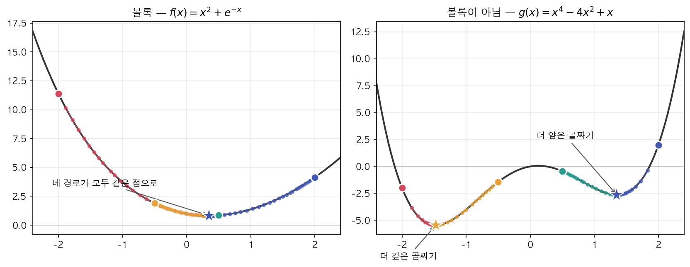
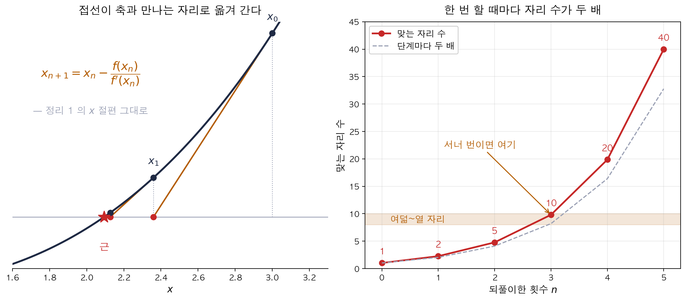
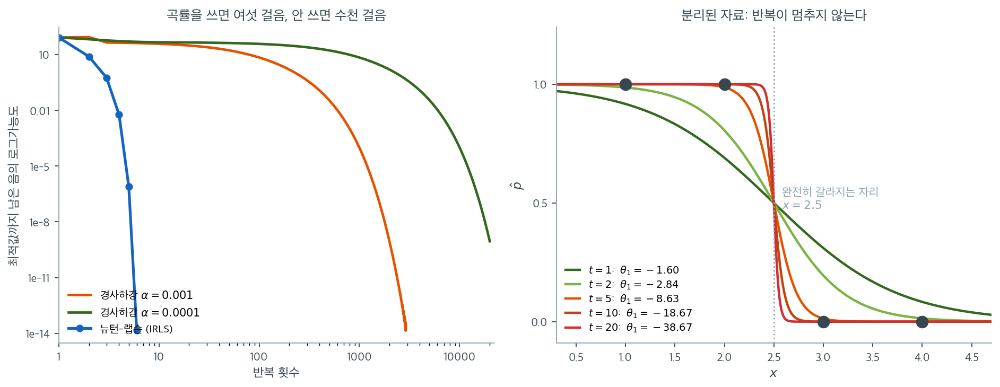

# 뉴턴–랩슨과 반복재가중최소제곱

## 1. 반복 알고리즘이 필요한 이유

로지스틱 회귀에는 닫힌 해가 없어 반복으로 찾아야 한다. 그런데 출발값을 $-2.0$, $-0.5$, $+0.5$, $+2.0$ 으로 전혀 달리 주어도 넷 다 $+0.3517$ 에 닿고 함숫값까지 $+0.8272$ 로 같다. 출발점을 신경 쓰지 않아도 되는 이 일은 모든 최적화에서 일어나지 않는다. 무엇이 그것을 보장하며, 보장이 없을 때는 무엇이 달라지는가.

선형회귀에서 최소제곱 추정량은 닫힌 형태의 해
$\hat{\boldsymbol{\theta}} = (\mathbf{X}^\top\mathbf{X})^{-1}\mathbf{X}^\top\mathbf{y}$를 갖는다.
로지스틱 회귀에는 그런 호사가 없다. 로그가능도가 모수에 대해 비선형이므로 최대가능도 추정치는
반복적 수치 최적화로 찾아야 한다. 이 절에서는 가장 널리 쓰이는 두 알고리즘, **뉴턴–랩슨**과
**반복재가중최소제곱(IRLS)**을 전개한다.

---

## 2. 로지스틱 회귀의 로그가능도

[가능도 절](../logistic_regression/likelihood.md)에서 보았듯이, $y_i \in \{0,1\}$인 독립
관측치 $(y_i, \mathbf{x}_i)$ $n$개에 대한 로그가능도는

$$
\ell(\boldsymbol{\theta})
= \sum_{i=1}^{n}\bigl[y_i\,\mathbf{x}_i^\top\boldsymbol{\theta}
  - \log\bigl(1 + e^{\mathbf{x}_i^\top\boldsymbol{\theta}}\bigr)\bigr]
$$

이며, $\boldsymbol{\theta} \in \mathbb{R}^{p}$는 절편과 기울기 계수를 모은 것이다. 관측치 $i$의
예측확률은 $\hat{p}_i = \sigma(\mathbf{x}_i^\top\boldsymbol{\theta})$이고 $\sigma$는 시그모이드
함수다.

---

## 3. 점수방정식

**점수**(로그가능도의 기울기)는

$$
\mathbf{s}(\boldsymbol{\theta})
= \frac{\partial \ell}{\partial \boldsymbol{\theta}}
= \sum_{i=1}^{n}(y_i - \hat{p}_i)\,\mathbf{x}_i
= \mathbf{X}^\top(\mathbf{y} - \hat{\mathbf{p}})
$$

이다. 여기서 $\mathbf{X}$는 $n \times p$ 계획행렬이고
$\hat{\mathbf{p}} = (\hat{p}_1, \ldots, \hat{p}_n)^\top$이다. 점수를 0으로 놓으면 $p$개의 비선형
방정식계를 얻는다. $\hat{\mathbf{p}}$가 시그모이드를 통해 $\boldsymbol{\theta}$에 의존하므로
닫힌 형태의 해가 없다.

---

## 4. 헤세행렬

로그가능도의 이차도함수가 **헤세행렬**이다.

$$
\mathbf{H}(\boldsymbol{\theta})
= \frac{\partial^2 \ell}{\partial \boldsymbol{\theta}\,\partial \boldsymbol{\theta}^\top}
= -\sum_{i=1}^{n}\hat{p}_i(1-\hat{p}_i)\,\mathbf{x}_i\mathbf{x}_i^\top
= -\mathbf{X}^\top\mathbf{W}\mathbf{X}
$$

여기서 $\mathbf{W} = \operatorname{diag}\bigl(\hat{p}_1(1-\hat{p}_1),\ldots,
\hat{p}_n(1-\hat{p}_n)\bigr)$는 $n \times n$ 대각 가중행렬이다. $0 < \hat{p}_i < 1$인 한
$\mathbf{W}$의 대각원소는 모두 양수이므로, $\mathbf{X}$가 완전열계수이면 헤세행렬은 음정치다.
그러면 로그가능도가 **강오목**이므로 국소최대점은 유일한 전역최대점이 된다.

앞 쪽 [최대가능도 추정](mle.md) 2 절이 같은 행렬을 손실 쪽에서 $A^\top B A$ 로 적고,
그 가중치 $\hat p_i(1-\hat p_i)$ 가 관측치마다 발언권을 어떻게 나누는지를 그림으로
보인다.

!!! note "완전열계수 가정이 필요하다"
    $\mathbf{X}$의 열이 일차종속이면 $\mathbf{X}v = 0$인 $v \ne 0$이 존재하여
    $v^\top\mathbf{H}v = 0$이 된다. 즉 헤세행렬은 음반정치일 뿐이고 로그가능도는 오목이지만
    강오목은 아니다. 이때 최대점은 유일하지 않고, $\mathbf{X}^\top\mathbf{W}\mathbf{X}$가
    특이행렬이 되어 뉴턴 단계 자체가 정의되지 않는다.

<div class="aibox" markdown>

**AI로 보는 통계학 1.** 한 점의 기울기만 보고 전체의 최적을 믿는 근거

바로 위에서 「강오목이므로 국소최대점은 유일한 전역최대점이 된다」고 적었다. 그 한 줄이
어떻게 보증이 되는지가 이 상자의 주제다.

오목함수는 **접선이 곡선을 위에서 덮는다.** 한 변수로 적으면 $f''\le 0$ 인 $f$ 에 대하여

$$
f(x)\ \le\ f(x_0)+f'(x_0)(x-x_0)\qquad(\text{모든 }x)
$$

이고, 접점 하나만 잡으면 곡선 전체에 대한 상계가 공짜로 생긴다. 여기서 $x_0$ 를 기울기가
$0$ 인 점으로 잡으면 일차항이 사라져

$$
f(x)\ \le\ f(x_0)\qquad(\text{모든 }x)
$$

가 된다. 곧 **오목하면 기울기가 $0$ 인 점이 그대로 전체의 최댓값**이고, $3$ 절의 점수방정식
$\mathbf s(\boldsymbol\theta)=\mathbf 0$ 하나만 풀고서 「MLE 를 찾았다」고 말할 수 있는
근거가 이것이다. 거꾸로 오목하지 않으면 이 한 줄이 통하지 않는다 — 기울기가 $0$ 이라는
사실은 그 둘레에서만 참인 말이 된다.

기계학습에서 학습이란 **손실함수를 작게 만드는 가중치를 찾는 일**이고, 그 방법은 거의
언제나 하나다 — 지금 자리에서 기울기를 재어 **그 반대쪽으로 조금 간다.** 로그가능도를
최대로 하는 일은 $-\ell$ 을 최소로 하는 일과 같으므로 아래에서는 내려가는 쪽으로 적는다
(부등호와 볼록·오목이 함께 뒤집힐 뿐 같은 이야기다).

차이가 실제로 나타나는지 돌려 본다. 같은 알고리듬을 볼록한 함수와 볼록하지 않은 함수에
각각 쓰고, 출발점만 네 군데로 바꾼다.

```python
from math import exp

def descend(df, x, step=0.01, n=5000):
    """기울기의 반대쪽으로 step 만큼 n 번 간다 — 경사하강법 그 자체다."""
    for _ in range(n):
        x -= step * df(x)          # 기울기가 양수면 왼쪽으로, 음수면 오른쪽으로
    return x

f, df = lambda x: x*x + exp(-x),  lambda x: 2*x - exp(-x)      # f''=2+e^{-x}>0 — 볼록
g, dg = lambda x: x**4-4*x*x+x,   lambda x: 4*x**3 - 8*x + 1   # g''=12x^2-8 — 부호가 바뀐다

for tag, name, h, dh in (("볼록  ", "f(x)=x^2+e^(-x)", f, df),
                         ("비볼록", "g(x)=x^4-4x^2+x", g, dg)):
    print(tag, name)
    for x0 in (-2.0, -0.5, 0.5, 2.0):      # 출발점만 바꾸고 나머지는 그대로
        r = descend(dh, x0)                # 같은 보폭·같은 횟수로 내려간다
        print(f"   출발 {x0:+.1f} → 도착 {r:+.4f},  함숫값 {h(r):+.4f}")

x0 = 2.0                                   # 접선 부등식을 수로 확인하는 자리
print("\nf(y) - [f(x0)+f'(x0)(y-x0)]  "
      "(x0=2, 음수가 하나라도 나오면 접선 부등식이 깨진다)")
print("  " + "  ".join(                    # 곡선에서 접선을 뺀 값 — 음수가 나오면 안 된다
    f"y={y:+d}: {f(y) - (f(x0) + df(x0)*(y-x0)):+.3f}" for y in (-2,-1,0,1,2,3)))
```

실행하면 다음이 나온다.

```text
볼록   f(x)=x^2+e^(-x)
   출발 -2.0 → 도착 +0.3517,  함숫값 +0.8272
   출발 -0.5 → 도착 +0.3517,  함숫값 +0.8272
   출발 +0.5 → 도착 +0.3517,  함숫값 +0.8272
   출발 +2.0 → 도착 +0.3517,  함숫값 +0.8272
비볼록 g(x)=x^4-4x^2+x
   출발 -2.0 → 도착 -1.4730,  함숫값 -5.4442
   출발 -0.5 → 도착 -1.4730,  함숫값 -5.4442
   출발 +0.5 → 도착 +1.3470,  함숫값 -2.6186
   출발 +2.0 → 도착 +1.3470,  함숫값 -2.6186

f(y) - [f(x0)+f'(x0)(y-x0)]  (x0=2, 음수가 하나라도 나오면 접선 부등식이 깨진다)
  y=-2: +22.712  y=-1: +11.177  y=+0: +4.594  y=+1: +1.097  y=+2: +0.000  y=+3: +1.050
```

왼쪽 함수에서는 네 번 모두 같은 자리에 선다. 볼록성이 그러리라고 미리 말해 준 그대로다.
오른쪽에서는 출발점에 따라 둘로 갈리고, **더 나쁜 쪽에 선 둘은 자기가 나쁜 자리에 있다는
것을 알 길이 없다** — 그 점에서도 기울기는 똑같이 $0$ 이기 때문이다. 아래 마지막 줄은
접선 부등식을 수로 확인한 것이다. $x_0=2$ 에서 그은 접선과 곡선의 차가 어디서나 $0$ 이상이고,
접점에서만 꼭 $0$ 이 된다.

<figure markdown>
  { width=740 }
  <figcaption markdown>같은 알고리듬, 같은 보폭, 출발점만 넷. 왼쪽은 네 별이 한자리에 겹치고 오른쪽은 둘로 갈린다. 갈린 두 자리는 **깊이가 다르다** — 그런데 기울기는 양쪽 모두 $0$ 이라, 서 있는 자리에서는 둘을 구별할 수가 없다.</figcaption>
</figure>

로지스틱 회귀는 다행히 왼쪽 쪽이다. 다만 강오목이 보증하는 것은 최대점이 **많아야 하나**라는
것뿐이고, 그 점이 유한한 자리에 **있다**는 보증은 아니다 — $8$ 절의 완전분리가 바로 그 경우다.

그리고 솔직할 것이 하나 더 있다. **실제로 쓰이는 신경망의 손실함수는 볼록하지 않다.** 층을
겹쳐 쌓는 순간 오른쪽 그림 쪽이 되고, 오목성이 주던 보증은 거기서 끊긴다. 그런데도 같은
방법을 쓰는 까닭은 보증이 생겨서가 아니라 **해 보니 쓸 만한 자리에 서더라**는 경험 때문이고,
그 경험을 설명하는 일은 아직 끝나지 않았다.

</div>

---

## 5. 뉴턴–랩슨 알고리즘

뉴턴–랩슨은 다음 반복으로 점수방정식의 근을 찾는다.

$$
\boldsymbol{\theta}^{(t+1)}
= \boldsymbol{\theta}^{(t)}
  - \bigl[\mathbf{H}(\boldsymbol{\theta}^{(t)})\bigr]^{-1}
    \mathbf{s}(\boldsymbol{\theta}^{(t)})
$$

위에서 유도한 점수와 헤세행렬을 대입하면

$$
\boldsymbol{\theta}^{(t+1)}
= \boldsymbol{\theta}^{(t)}
  + \bigl(\mathbf{X}^\top\mathbf{W}^{(t)}\mathbf{X}\bigr)^{-1}
    \mathbf{X}^\top\bigl(\mathbf{y} - \hat{\mathbf{p}}^{(t)}\bigr)
$$

이며, $\mathbf{W}^{(t)}$와 $\hat{\mathbf{p}}^{(t)}$는 현재 반복값
$\boldsymbol{\theta}^{(t)}$에서 평가한 것이다.

### 수렴

로그가능도가 강오목이므로 뉴턴–랩슨은 어떤 출발점에서든 유일한 MLE로 수렴한다. 최적점 근처에서
수렴은 **이차적**이다. 즉 반복마다 정확한 자릿수가 대략 두 배가 된다. 실무에서는 3회에서 8회면
충분한 경우가 많다.

<div class="storybox" markdown>

**그림으로 보는 통계학 1.** 절편을 다시 집어넣은 사람

<figure markdown>
  { width=860 }
  <figcaption markdown>왼쪽 — $x^{3}-2x-5=0$ 에서 $x_{0}=3$ 으로 시작해 접선을 긋고 그 $x$ 절편을 다음 값으로 삼기를 되풀이한 것이다. 뉴턴이 본보기로 든 바로 그 방정식이다. 오른쪽 — 참값과 맞는 자리 수. $1\to2\to5\to10\to20\to40$ 으로 **단계마다 거의 두 배**가 되고, 세 번만에 열 자리에 닿는다. *(이 책에서 그렸다)*</figcaption>
</figure>

위의 갱신식은 **접선의 $x$ 절편**이다. 설명변수가 하나뿐인 자리에 적어 보면

$$
\theta^{(t+1)}=\theta^{(t)}-\frac{s(\theta^{(t)})}{s'(\theta^{(t)})}
\qquad\bigl(s'=H\bigr)
$$

인데, 이것은 곡선 $y=s(\theta)$ 위의 점에서 그은 접선이 $\theta$ 축과 만나는 자리다. 곡선의
근을 구하는 대신 **접선의 근**을 구하는 셈이고, 접선은 일차식이라 근이 바로 나온다.

접선의 절편을 적는 일은 어느 미적분 교과서에나 있다. 달라지는 것은 그 값을 **다시 $\theta$
자리에 집어넣는** 한 걸음이고, 그 걸음을 밟은 사람이 조지프 랩슨이다.

$1690$ 년에 낸 『방정식의 보편적 해석』에서 그는 근을 구하는 방법으로 이것을 내놓았다.
왼쪽 그림이 그 절차다. 곡선 위의 한 점에서 접선을 긋고, 접선이 $x$ 축과 만나는 자리로
옮겨 가고, 거기서 다시 접선을 긋는다.

얼마나 빠른지는 당대의 기록이 말한다. 핼리가 이 책을 들고 온 $1690$ 년 $12$ 월 $17$ 일의
왕립학회 회의록은 **「한 번 할 때마다 알려진 근의 자리 수가 두 배가 되어, 서너 번
되풀이하면 여덟이나 열 자리까지 맞는다」**고 적었다. 바로 위에서 「반복마다 정확한 자릿수가
대략 두 배」, 「$3$ 회에서 $8$ 회면 충분하다」고 적은 것과 **글자까지 같은 말**이다. 오른쪽
그림이 그 말 그대로다 — 맞는 자리가 $1$, $2$, $5$, $10$, $20$, $40$ 으로 늘고, 세 번째에
이미 열 자리다. 삼백삼십여 년 전의 서술이 자릿수까지 맞는다. $10$ 절 왼쪽 그림의
$84.5\to7.91\to0.576\to0.0059\to7.8\times10^{-7}\to1.4\times10^{-14}$ 가 로지스틱 회귀에서
같은 일이 일어난 기록이다.

이름은 보통 **뉴턴–랩슨법**이라 부르는데, 인쇄된 차례로는 랩슨이 앞선다. 뉴턴은
$1671$ 년에 쓴 『유율법』에 같은 방법을 담았지만 그 책이 활자가 된 것은 $1736$ 년,
랩슨의 책보다 **마흔여섯 해 뒤**다. 정작 랩슨 자신에 대해서는 알려진 것이 적어 생몰년도
흔들린다 — 태어난 해를 $1668$ 년쯤으로 보지만 $1649$ 년이라는 설도 있고, 죽은 해는
왕립학회 회원 명부에 $1712$ 년에는 있고 $1713$ 년에는 없다는 것으로 미루어 잡은
값이다.

접선의 절편은 **구하고 끝나는** 값이다. 랩슨이 한 일은 그 답을 물음 자리에 도로 넣은
것뿐이다. 한 번 쓰고 마는 식을 되풀이 식으로 바꾸는 그 한 걸음에 이름이 붙었다.

*확인한 곳 — 생몰년이 확실하지 않다는 것(출생 $1668$ 년쯤으로 보나 카조리는 $1649$ 년을 제시했고, $1660$ 년대 피너의 세례 기록이 있다 · 사망은 $1712$ 년 왕립학회 명부에는 있고 $1713$ 년에는 없다는 데서 잡았다), 『Analysis aequationum universalis』($1690$), $1690$ 년 $12$ 월 $17$ 일 회의록의 원문 「… which doubles the known figures of the Root known by each Operation, So that by repeating 3 or 4 times he finds them true to Numbers of 8 or 10 places」, 뉴턴의 『유율법』이 $1671$ 년에 쓰였으나 $1736$ 년에야 인쇄되었다는 것, 그리고 뉴턴이 $x^{3}-2x-5=0$ 을 본보기로 들었다는 것은 [MacTutor 「Joseph Raphson」](https://mathshistory.st-andrews.ac.uk/Biographies/Raphson/) · 맞는 자리가 $1,2,5,10,20,40$ 으로 느는 것은 이 쪽에서 직접 계산해 보았다*

</div>

---

## 6. 피셔 점수법과 IRLS

**피셔 점수법**은 관측 헤세행렬을 그 기댓값으로 대체한다. 로지스틱 회귀에서는 두 양이 일치한다.

$$
-\mathbf{H}(\boldsymbol{\theta})
= \mathbf{X}^\top\mathbf{W}\mathbf{X}
= \mathcal{I}(\boldsymbol{\theta})
$$

여기서 $\mathcal{I}(\boldsymbol{\theta})$는 **피셔 정보행렬**이다. 따라서 로지스틱 회귀에서는
피셔 점수법과 뉴턴–랩슨이 같은 반복열을 만든다.

### IRLS 해석

뉴턴–랩슨 갱신식을 다시 쓰면

$$
\boldsymbol{\theta}^{(t+1)}
= \bigl(\mathbf{X}^\top\mathbf{W}^{(t)}\mathbf{X}\bigr)^{-1}
  \mathbf{X}^\top\mathbf{W}^{(t)}\mathbf{z}^{(t)}
$$

이고, **작업 반응변수**는

$$
\mathbf{z}^{(t)}
= \mathbf{X}\boldsymbol{\theta}^{(t)}
  + \bigl(\mathbf{W}^{(t)}\bigr)^{-1}
    \bigl(\mathbf{y} - \hat{\mathbf{p}}^{(t)}\bigr)
$$

이다. 각 반복은 가중치 $\mathbf{W}^{(t)}$와 반응변수 $\mathbf{z}^{(t)}$를 갖는 **가중최소제곱**
문제를 푼다. 가중치가 단계마다 바뀌므로 이 절차를 **반복재가중최소제곱**이라 부른다.

---

## 7. 알고리즘 요약

| 단계 | 내용 |
|---|---|
| 0 | $\boldsymbol{\theta}^{(0)}$을 초기화한다(예: 전부 0) |
| 1 | $\hat{\mathbf{p}}^{(t)} = \sigma(\mathbf{X}\boldsymbol{\theta}^{(t)})$를 계산한다 |
| 2 | $\mathbf{W}^{(t)} = \operatorname{diag}(\hat{p}_i(1-\hat{p}_i))$를 만든다 |
| 3 | 작업 반응변수 $\mathbf{z}^{(t)}$를 계산한다 |
| 4 | $\boldsymbol{\theta}^{(t+1)} = (\mathbf{X}^\top\mathbf{W}^{(t)}\mathbf{X})^{-1}\mathbf{X}^\top\mathbf{W}^{(t)}\mathbf{z}^{(t)}$를 푼다 |
| 5 | $\lVert\boldsymbol{\theta}^{(t+1)} - \boldsymbol{\theta}^{(t)}\rVert < \varepsilon$이 될 때까지 1--4를 반복한다 |

??? example "손으로 따라가는 예: 첫 두 반복"
    설명변수 하나(와 절편)를 갖는 관측치 $n=4$를 생각하자.

    | $i$ | $x_i$ | $y_i$ |
    |---|---|---|
    | 1 | 1.0 | 1 |
    | 2 | 2.0 | 1 |
    | 3 | 3.0 | 0 |
    | 4 | 4.0 | 0 |

    **반복 0.** $\boldsymbol{\theta}^{(0)} = (0, 0)^\top$에서 출발한다. 그러면 모든 $i$에 대해
    $\hat{p}_i = 0.5$이고 $w_i = 0.25$이다.

    점수는 $\mathbf{X}^\top(\mathbf{y} - \hat{\mathbf{p}})$이고
    $\mathbf{y} - \hat{\mathbf{p}} = (0.5, 0.5, -0.5, -0.5)^\top$이다.

    **반복 1.** 가중최소제곱 문제를 풀면 $\boldsymbol{\theta}^{(1)} = (4.0,\, -1.6)^\top$를 얻는다.
    $x_i = 1, 2$인 관측치의 $\hat{p}_i$는 올라가고 $x_i = 3, 4$인 관측치의 $\hat{p}_i$는
    내려간다.

    !!! warning "이 보기는 수렴하지 않는다"
        위 자료는 $x = 2.5$를 기준으로 **완전히 분리 가능**하므로 MLE가 존재하지 않는다.
        반복을 계속하면 다음과 같이 계수가 한없이 커진다.

        | $t$ | $\theta_0^{(t)}$ | $\theta_1^{(t)}$ |
        |---|---|---|
        | 1 | $4.00$ | $-1.60$ |
        | 2 | $7.11$ | $-2.84$ |
        | 5 | $21.58$ | $-8.63$ |
        | 10 | $46.68$ | $-18.67$ |
        | 20 | $96.68$ | $-38.67$ |

        반복마다 $\theta_0$이 약 $5$씩, $\theta_1$이 약 $-2$씩 커진다. 이차 수렴이 아니라
        발산이며, 아래 "분리와 비수렴" 절에서 설명하는 그대로다. 비분리 자료에서 알고리즘이
        어떻게 행동하는지는 연습문제 1에서 다룬다.

---

## 8. 분리와 비수렴

두 범주가 **완전히 분리**되어 있으면 — 특성공간의 어떤 초평면이 모든 훈련점을 정확히 분류하면 —
MLE가 존재하지 않는다. $\lVert\boldsymbol{\theta}\rVert \to \infty$일 때 로그가능도가 상한에
접근할 뿐이고, 뉴턴–랩슨은 발산한다. 계수가 한없이 커지고 표준오차가 매우 커지는 것이 증상이다.

!!! warning "분리 탐지하기"
    최신 소프트웨어(R의 `glm`, 파이썬의 `statsmodels` 등)는 분리를 감지하면 경고를 낸다.
    해결책으로는 작은 능형 벌점을 더하거나(파스의 벌점가능도), 정확 조건부 로지스틱 회귀를 쓰는
    방법이 있다.

---

## 9. 경사하강과의 관계

경사하강은 고정된 보폭 $\eta$로
$\boldsymbol{\theta}^{(t+1)} = \boldsymbol{\theta}^{(t)} + \eta\,\mathbf{s}(\boldsymbol{\theta}^{(t)})$
를 갱신한다. 뉴턴–랩슨은 헤세행렬의 역이 정해 주는 적응적 보폭을 쓰는 경사하강으로 볼 수 있다.
이 곡률 정보 덕분에 빠르게 수렴하지만, 매 단계 $p \times p$ 헤세행렬을 만들고 역을 구해야 하는
비용이 든다. $p$가 큰 고차원 문제에서는 L-BFGS 같은 준뉴턴법이 헤세행렬을 근사하여 계산 비용을
줄인다.

<div class="aibox" markdown>

**AI로 보는 통계학 2.** 보폭을 얼마로 할 것인가 — 기계가 매일 묻는 물음

뉴턴–랩슨은 보폭을 헤세행렬에게 물어 정하지만, 경사하강은 그 수 $\eta$ 를 **사람이** 정해야
한다. 기울기 하나는 **어느 쪽으로** 갈지만 말해 줄 뿐 **얼마나** 갈지는 말해 주지 않는다.
답은 평균값 정리에서 나온다. (같은 알고리듬을 $4$ 절의 상자는 다른 쪽에서 — 기울기가 $0$ 인
점이 왜 전체의 최적인가로 — 들여다본다.)

$|f''|\le L$ 이라 하고 $f'$ 에 평균값 정리를 쓰면

$$
|f'(x)-f'(y)|\le L\,|x-y|
$$

이고, 곧 **기울기가 얼마나 빨리 변하는지**를 $L$ 하나가 눌러 준다. 한 걸음을 가면 기울기가
$\eta f'(x)$ 만큼 떨어진 자리의 것으로 바뀌는데, 그 변화가 $L\,\eta|f'(x)|$ 를 넘지 못한다.
그러니 $\eta L$ 이 $1$ 을 넘어서면 **고치려던 양보다 더 많이 지나쳐** 반대쪽으로 넘어가고,
넘어간 자리가 처음보다 더 멀어지는 순간부터 걸음마다 거리가 늘어 터진다.

가장 간단한 꼴로 보면 경계가 또렷하다. $f(x)=\frac{L}{2}x^{2}$ 이면 $f'(x)=Lx$ 이므로 한
걸음은 $x\leftarrow(1-\eta L)x$ 라는 곱셈 하나다. 따라서 $|1-\eta L| < 1$, 곧

$$
0 < \eta < \frac{2}{L}
$$

일 때만 $x$ 가 줄어든다. $\eta=\dfrac1L$ 이면 곱해지는 수가 $0$ 이라 **한 걸음에 바닥**이다.

```python
L = 4.0                                    # f''(x) = L — 기울기가 변하는 빠르기
f  = lambda x: 0.5 * L * x * x
df = lambda x: L * x

def descend(eta, x=1.0, n=60):
    """보폭 eta 로 n 걸음. 중간에 넘치면 inf 로 돌려 준다."""
    for _ in range(n):
        x -= eta * df(x)                   # 기울기 반대쪽으로 eta 만큼
        if abs(x) > 1e12: return float("inf")
    return f(x)

print(f"L = {L}  이므로 경계는 2/L = {2/L}")
for eta in [0.10, 0.25, 0.40, 0.49, 0.50, 0.51, 0.60]:
    mark = "   경계" if eta == 2 / L else ""      # 터지기 직전의 보폭에 표시
    print(f"  보폭 {eta:.2f}  →  60 걸음 뒤 f = {descend(eta):.3e}{mark}")
```

실행하면 다음이 나온다.

```text
L = 4.0  이므로 경계는 2/L = 0.5
  보폭 0.10  →  60 걸음 뒤 f = 4.777e-27
  보폭 0.25  →  60 걸음 뒤 f = 0.000e+00
  보폭 0.40  →  60 걸음 뒤 f = 4.777e-27
  보폭 0.49  →  60 걸음 뒤 f = 1.491e-02
  보폭 0.50  →  60 걸음 뒤 f = 2.000e+00   경계
  보폭 0.51  →  60 걸음 뒤 f = 2.213e+02
  보폭 0.60  →  60 걸음 뒤 f = 6.861e+17
```

$2/L=0.5$ 를 사이에 두고 세상이 갈린다. $0.49$ 에서는 내려가고, 정확히 $0.50$ 에서는 $\pm1$
사이를 영원히 오가 값이 $2$ 에 멈춰 있으며, $0.51$ 에서는 예순 걸음 만에 백 배로 커지고
$0.60$ 에서는 $10^{17}$ 이다. **보폭을 $2\%$ 더 준 것뿐인데 결과가 반대가 된다.** 그리고
$0.10$ 과 $0.40$ 이 같은 값에서 끝나는 것도 읽을 거리다 — 둘 다 $\eta=\dfrac1L=0.25$ 에서
같은 거리만큼 떨어져 있어 $|1-\eta L|$ 이 같기 때문이다. 보폭과 빠르기의 관계가 직선이
아니라 $\dfrac1L$ 을 꼭짓점으로 하는 **접힌 꼴**이다.

로지스틱 회귀는 드물게 이 $L$ 을 적어 볼 수 있는 경우다. $4$ 절의 헤세행렬이
$-\mathbf X^\top\mathbf W\mathbf X$ 이고 $\hat p_i(1-\hat p_i)\le\frac14$ 이므로

$$
L\ \le\ \tfrac14\,\lambda_{\max}\!\bigl(\mathbf X^\top\mathbf X\bigr)
$$

이고, 쓸 수 있는 보폭의 범위 $0 < \eta < 2/L$ 이 **자료에서 계산된다.** 설명변수의 눈금을
맞추는 일이 수렴 속도를 바꾸는 까닭도 여기서 보인다 — $\lambda_{\max}$ 가 줄면 보폭을 더
줄 수 있다. 뉴턴–랩슨은 이 수를 고를 필요가 아예 없고, $10$ 절에서 같은 자료에
$\alpha=0.001$ 과 $\alpha=0.0001$ 을 주었을 때 $2{,}900$ 회와 $2$ 만 회로 갈리는 것이 이
수를 손으로 더듬은 결과다.

그래서 기계를 학습시키는 쪽에서는 이 $L$ 을 눌러 두는 장치를 여럿 쓴다. 기울기가 너무
커지면 잘라 내고, 층마다 값의 크기를 다시 맞추고, 가중치 행렬이 늘일 수 있는 배율에 뚜껑을
씌운다. 이름은 저마다 다르지만 하는 일은 하나다 — **$L$ 을 작게 만들어 쓸 수 있는 보폭을
넓히는 것.**

다만 층을 쌓은 손실함수에서는 $L$ 을 계산해 낼 길이 없다. 자리마다 다르고, 변수가 수십억
개면 이차도함수를 적어 볼 수조차 없다. 그래서 $2/L$ 은 **왜 터지는지는 설명해 주지만 얼마로
하라고는 말해 주지 않는다.** 보폭이 아직도 손으로 더듬어 정하는 수인 까닭이 여기에 있다.

</div>

---

## 10. 두 알고리즘을 나란히 보기

"이차 수렴"과 "발산"은 말로만 들으면 정도의 차이처럼 들린다. 실제로 재 보면 차원이 다른
이야기다. 아래 왼쪽은 19.1절의 공부 시간 자료 300건에서 최적값까지 남은 음의 로그가능도를
반복 횟수에 대해 그린 것이고(두 축 모두 로그 눈금), 오른쪽은 이 절 앞의 표에 나온 네 점짜리
분리 자료에서 반복이 만들어 내는 확률 곡선이다.



왼쪽에서 뉴턴–랩슨의 남은 거리는 $84.5 \to 7.91 \to 0.576 \to 0.0059 \to 7.8\times10^{-7}
\to 1.4\times10^{-14}$로 줄어든다. 정확한 자릿수가 반복마다 대략 두 배씩 늘어나는 이차 수렴이
눈에 그대로 보인다. 여섯 걸음이면 배정도 부동소수점의 한계에 닿는다. 같은 자료에서 학습률
$\alpha=0.001$의 경사하강은 같은 정확도에 이르는 데 약 2,900회, $\alpha=0.0001$이면 2만 회를
넘어도 $10^{-9}$ 근처에 머문다. 곡률 정보를 쓰느냐 마느냐가 세 자릿수의 차이를 만든다.

한 걸음의 비용은 다르다. 뉴턴 단계는 $p\times p$ 행렬을 만들고 풀어야 하므로
$O(np^2 + p^3)$이고, 경사하강 한 걸음은 $O(np)$다. 설명변수가 두어 개인 문제에서는 뉴턴이
압도적이지만, $p$가 수천인 문제에서는 $p^3$이 감당되지 않아 L-BFGS나 확률적 경사하강으로
갈아타게 된다. 그 선택은 수렴 속도가 아니라 한 걸음의 가격이 정한다.

오른쪽은 같은 알고리즘이 멈추지 못하는 경우다. 자료가 $x=2.5$를 기준으로 완전히 갈리므로
반복이 진행될수록 곡선이 점점 가팔라진다. $t=1$에서 $\theta_1=-1.60$이던 기울기가 $t=5$에서
$-8.63$, $t=20$에서 $-38.67$이 되고, 곡선은 계단함수로 수렴해 간다. 로그가능도는 계속 올라가지만
상한 0에 도달하지는 못하므로 최대점이 존재하지 않는다. 알고리즘이 고장 난 것이 아니라, 찾으라고
시킨 것이 없는 것이다. 수렴 판정이 계수의 변화량에 걸려 있다면 이 반복은 영원히 멈추지 않는다.

---

## 연습문제

<div class="drillbox" markdown>

**연습문제 1.** <span class="diff easy" title="쉬움"></span>
설명변수 $x = (1,2,3,4,5,6)$과 반응변수 $y = (0,0,1,0,1,1)$에 대해 $\boldsymbol{\theta}^{(0)} = \mathbf{0}$
에서 출발하는 IRLS를 구현하라. 반복마다 $\lVert\boldsymbol{\theta}^{(t)} - \hat{\boldsymbol{\theta}}\rVert$
를 기록하고 수렴이 이차적임을 확인하라.

</div>

??? success "풀이"

    ```python
    import numpy as np

    x = np.array([1., 2., 3., 4., 5., 6.])
    y = np.array([0., 0., 1., 0., 1., 1.])
    X = np.column_stack([np.ones(6), x])

    theta = np.zeros(2)
    history = [theta.copy()]
    for t in range(10):
        p_hat = 1 / (1 + np.exp(-X @ theta))
        W = p_hat * (1 - p_hat)
        H = X.T @ (X * W[:, None])          # X^T W X
        s = X.T @ (y - p_hat)               # score
        theta = theta + np.linalg.solve(H, s)
        history.append(theta.copy())

    theta_hat = theta
    for t, th in enumerate(history):
        print(f"{t}  {th}  err = {np.linalg.norm(th - theta_hat):.3e}")
    ```

    출력:

    ```
    0  [0. 0.]  err = 4.419e+00
    1  [-2.8  0.8]  err = 1.507e+00
    2  [-3.88421522  1.10977578]  err = 3.795e-01
    3  [-4.22143618  1.20612462]  err = 2.877e-02
    4  [-4.24892948  1.21397985]  err = 1.738e-04
    5  [-4.24909654  1.21402758]  err = 6.365e-09
    6  [-4.24909655  1.21402759]  err = 9.155e-16
    7  [-4.24909655  1.21402759]  err = 2.747e-15
    8  [-4.24909655  1.21402759]  err = 0.000e+00
    9  [-4.24909655  1.21402759]  err = 2.747e-15
    10  [-4.24909655  1.21402759]  err = 0.000e+00
    ```

    MLE는 $\hat{\boldsymbol{\theta}} = (-4.2491,\; 1.2140)^\top$이고 오차의 변화는 다음과 같다.

    | $t$ | $\boldsymbol{\theta}^{(t)}$ | $\lVert\boldsymbol{\theta}^{(t)} - \hat{\boldsymbol{\theta}}\rVert$ |
    |---|---|---|
    | 0 | $(0,\ 0)$ | $4.42$ |
    | 1 | $(-2.800,\ 0.800)$ | $1.51$ |
    | 2 | $(-3.884,\ 1.110)$ | $3.80 \times 10^{-1}$ |
    | 3 | $(-4.221,\ 1.206)$ | $2.88 \times 10^{-2}$ |
    | 4 | $(-4.2489,\ 1.21398)$ | $1.74 \times 10^{-4}$ |
    | 5 | $(-4.24910,\ 1.214028)$ | $6.37 \times 10^{-9}$ |
    | 6 | $(-4.24910,\ 1.214028)$ | $9.2 \times 10^{-16}$ |

    이차 수렴이 뚜렷하다. 오차의 지수가 $-1 \to -2 \to -4 \to -9 \to -16$으로 대략 두 배씩
    커진다. 반복 6회 만에 배정도 부동소수점의 한계에 도달한다.

    첫 단계에서 $(-2.8,\ 0.8)$이라는 깔끔한 값이 나오는 것도 우연이 아니다.
    $\boldsymbol{\theta}^{(0)} = \mathbf{0}$이면 모든 $\hat{p}_i = 0.5$이고 $w_i = 1/4$로
    **상수**이므로, 첫 IRLS 단계는 가중치 없는 최소제곱
    $4(\mathbf{X}^\top\mathbf{X})^{-1}\mathbf{X}^\top(\mathbf{y} - \tfrac12\mathbf{1})$로 환원된다.
    $\square$

---

<div class="drillbox" markdown>

**연습문제 2.** <span class="diff med" title="중간"></span>
로지스틱 회귀에서 관측정보와 기대정보가 일치하는 이유를 설명하라. 이 성질이 성립하지 않는
이항 모형의 예를 하나 들어라.

</div>

??? success "풀이"

    관측정보는 $-\mathbf{H}(\boldsymbol{\theta})$이고 기대정보는
    $\mathcal{I}(\boldsymbol{\theta}) = \mathbb{E}[-\mathbf{H}(\boldsymbol{\theta})]$이다.
    로지스틱 회귀에서

    $$
    -\mathbf{H} = \sum_i \hat{p}_i(1-\hat{p}_i)\mathbf{x}_i\mathbf{x}_i^\top
    $$

    인데, 이 식에는 $y_i$가 **전혀 나타나지 않는다.** $\mathbf{x}_i$를 조건부로 고정하면
    $-\mathbf{H}$는 상수이므로 기댓값을 취해도 그대로다. 따라서 두 정보가 같다.

    이는 우연이 아니라 **로짓이 이항분포의 정준연결**이기 때문이다. 정준연결을 쓰는 일반화선형
    모형에서는 언제나 관측정보와 기대정보가 일치하고, 뉴턴–랩슨과 피셔 점수법이 같아진다.

    **성립하지 않는 예:** 프로빗 모형 $P(Y=1) = \Phi(\mathbf{x}^\top\boldsymbol{\theta})$은
    정준연결을 쓰지 않는다. 그 로그가능도의 이차도함수에는 $y_i$가 남아 있어 관측정보와
    기대정보가 다르며, 뉴턴–랩슨과 피셔 점수법이 서로 다른 반복열을 만든다. 여담이지만 이 경우
    피셔 점수법이 더 안정적인 경우가 많다. 기대정보는 항상 양반정치이지만 관측정보는 최적점에서
    멀리 떨어진 곳에서 그렇지 않을 수 있기 때문이다. $\square$

---

<div class="drillbox" markdown>

**연습문제 3.** <span class="diff med" title="중간"></span>
반복당 계산 비용을 뉴턴–랩슨과 경사하강에 대해 $n$과 $p$로 나타내라. $n = 10^6$, $p = 10^4$일 때
어느 쪽을 쓰겠는가?

</div>

??? success "풀이"

    **뉴턴–랩슨 한 반복:**

    | 연산 | 비용 |
    |---|---|
    | $\hat{\mathbf{p}} = \sigma(\mathbf{X}\boldsymbol{\theta})$ | $O(np)$ |
    | $\mathbf{X}^\top\mathbf{W}\mathbf{X}$ 구성 | $O(np^2)$ |
    | 그 계를 풀기(촐레스키) | $O(p^3)$ |
    | 합계 | $O(np^2 + p^3)$ |

    **경사하강 한 반복:** $\mathbf{X}^\top(\mathbf{y} - \hat{\mathbf{p}})$만 필요하므로 $O(np)$.

    $n = 10^6$, $p = 10^4$이면 뉴턴 한 반복은 $np^2 = 10^{14}$번의 곱셈이 필요하다. 게다가
    $\mathbf{X}^\top\mathbf{W}\mathbf{X}$만으로도 $p^2 = 10^8$개의 배정도 실수, 즉 800MB의
    메모리를 쓴다. 반복 몇 번이면 되더라도 현실적이지 않다.

    경사하강 한 반복은 $np = 10^{10}$이라 $10{,}000$배 싸다. 반복이 수천 번 필요해도 총 비용이
    뉴턴법 한 반복보다 작다.

    **실무적 답:** 이 규모에서는 확률적 경사하강이나 L-BFGS를 쓴다. L-BFGS는 최근 $m$개(보통
    $m \approx 10$)의 기울기 차이만으로 헤세행렬의 역을 암묵적으로 근사하므로, $p^2$ 크기의
    행렬을 만들지 않고도 곡률 정보를 일부 활용한다. 저장공간은 $O(mp)$이고 반복당 비용은
    $O(np + mp)$다. scikit-learn의 `LogisticRegression`이 기본 해법기로 L-BFGS를 쓰는 이유가
    바로 이것이다. $\square$

---

<div class="drillbox" markdown>

**연습문제 4.** <span class="diff med" title="중간"></span>
IRLS의 작업 반응변수 $\mathbf{z}^{(t)}$의 각 성분은 어떤 의미를 갖는가?
$\hat{p}_i$가 0이나 1에 가까울 때 $z_i$에 무슨 일이 일어나는지 설명하고, 실무적 대응책을
제시하라.

</div>

??? success "풀이"

    성분별로 쓰면

    $$
    z_i = \mathbf{x}_i^\top\boldsymbol{\theta} + \frac{y_i - \hat{p}_i}{\hat{p}_i(1-\hat{p}_i)}
    $$

    이다. 첫 항은 현재의 로짓이고 둘째 항은 잔차를 확률 척도에서 로짓 척도로 옮긴 것이다. 실제로
    둘째 항은 $\hat p$에서 평가한 $\operatorname{logit}$의 도함수가 $1/[p(1-p)]$이므로, 관측된
    잔차를 로짓 척도로 선형근사한 값이다. 즉 $\mathbf{z}$는 "로짓 척도에서 본, 우리가 맞히고자
    하는 반응변수"다.

    $\hat{p}_i \to 0$ 또는 $1$이면 분모 $\hat{p}_i(1-\hat{p}_i) \to 0$이므로 $z_i$가 발산한다.
    동시에 가중치 $w_i = \hat{p}_i(1-\hat{p}_i)$도 0으로 간다. 가중최소제곱에서 이 관측치가
    기여하는 양은 $w_i z_i^2$ 꼴이므로 곱은 유한하게 남지만, $z_i$와 $w_i$를 따로 계산하면
    큰 수와 작은 수를 곱하는 전형적인 수치 문제가 생긴다.

    **실무적 대응:**

    1. 가중치에 하한을 둔다. 예컨대 $w_i \leftarrow \max(w_i, 10^{-10})$으로 잘라 낸다.
       R의 `glm`이 쓰는 방식이다.
    2. $\mathbf{z}$를 명시적으로 만들지 않고 뉴턴 형태
       $\boldsymbol{\theta}^{+} = \boldsymbol{\theta} + (\mathbf{X}^\top\mathbf{W}\mathbf{X})^{-1}\mathbf{X}^\top(\mathbf{y}-\hat{\mathbf{p}})$
       를 그대로 쓴다. 대수적으로 동등하면서 $\mathbf{W}^{-1}$이 등장하지 않는다.
    3. 애초에 원인이 분리라면(연습문제와 위 보기 참조) 수치적 처방이 아니라 모형을 고쳐야 한다.
       벌점을 넣거나 문제의 변수를 제거하라.

    $\square$

---

<div class="drillbox" markdown>

**연습문제 5.** <span class="diff hard" title="어려움"></span>
뉴턴–랩슨 갱신식으로부터 IRLS의 작업 반응변수
$\mathbf{z}^{(t)} = \mathbf{X}\boldsymbol{\theta}^{(t)} + (\mathbf{W}^{(t)})^{-1}(\mathbf{y} - \hat{\mathbf{p}}^{(t)})$
를 유도하라.

</div>

??? success "풀이"

    표기를 줄이기 위해 위첨자 $(t)$를 생략하고 $\mathbf{W}$, $\hat{\mathbf{p}}$,
    $\boldsymbol{\theta}$로 쓴다. 뉴턴 갱신은

    $$
    \boldsymbol{\theta}^{+}
    = \boldsymbol{\theta} + (\mathbf{X}^\top\mathbf{W}\mathbf{X})^{-1}\mathbf{X}^\top(\mathbf{y} - \hat{\mathbf{p}})
    $$

    이다. 첫 항 앞에 항등원 $(\mathbf{X}^\top\mathbf{W}\mathbf{X})^{-1}(\mathbf{X}^\top\mathbf{W}\mathbf{X})$
    를 끼워 넣으면

    $$
    \boldsymbol{\theta}^{+}
    = (\mathbf{X}^\top\mathbf{W}\mathbf{X})^{-1}
      \bigl[\mathbf{X}^\top\mathbf{W}\mathbf{X}\boldsymbol{\theta} + \mathbf{X}^\top(\mathbf{y} - \hat{\mathbf{p}})\bigr]
    $$

    이고, 대괄호 안에서 $\mathbf{X}^\top\mathbf{W}$를 묶어 내면

    $$
    = (\mathbf{X}^\top\mathbf{W}\mathbf{X})^{-1}\mathbf{X}^\top\mathbf{W}
      \underbrace{\bigl[\mathbf{X}\boldsymbol{\theta} + \mathbf{W}^{-1}(\mathbf{y} - \hat{\mathbf{p}})\bigr]}_{\mathbf{z}}
    $$

    를 얻는다. 이는 반응변수 $\mathbf{z}$와 가중치 $\mathbf{W}$를 갖는 가중최소제곱의
    정규방정식이다.

    $\mathbf{W}$가 가역이어야 하는데, $0 < \hat{p}_i < 1$인 한 대각원소가 모두 양수이므로
    성립한다. $\hat{p}_i$가 0이나 1에 수치적으로 도달하면 $\mathbf{W}^{-1}$이 발산하며, 이것이
    분리가 있을 때 IRLS 구현이 깨지는 지점이다. $\square$

---

## 정리하며

**반복 알고리즘**으로 해를 찾는다.

- **뉴턴–랩슨이 표준이다.** 헤세행렬을 쓰므로 이차 수렴하며, 오목한 로그가능도에서 빠르고 안정적이다.
- **IRLS 가 그 다른 이름이다.** 뉴턴 갱신을 다시 쓰면 **가중최소제곱을 반복**하는 형태가 되며, 가중치가 $p_i(1-p_i)$ 다. 11장의 WLS 와 직접 이어진다.
- **기울기 하강은 느리지만 확장성이 좋다.** $p$ 가 아주 크면 헤세행렬 계산이 부담이므로 확률적 기울기 하강 계열을 쓴다.
- **수렴하지 않으면 분리를 의심한다.** 계수가 계속 커지고 표준오차가 폭발하면 완전분리나 준분리이며, 정칙화나 퍼스 보정이 처방이다.
- **초기값은 대개 $\mathbf 0$ 으로 충분하다.** 오목하므로 어디서 출발해도 같은 곳에 도달한다.

다음 절 **[검정](tests.md)**으로 넘어간다.
