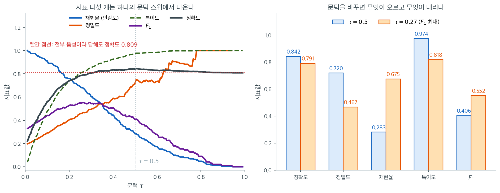
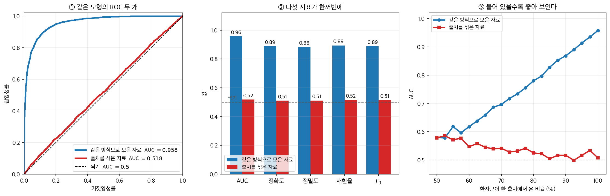

# 혼동행렬, ROC 곡선, 분류 지표

## 1. 분류 결정

로지스틱 회귀는 예측확률 $\hat{p} = P(Y = 1 \mid \mathbf{x})$를 출력한다. 이항 분류 결정을
내리려면 **문턱** $c$(기본값 $c = 0.5$)를 적용한다.

$$\hat{Y} = \begin{cases} 1 & \text{if } \hat{p} \geq c \\ 0 & \text{if } \hat{p} < c \end{cases}$$

문턱의 선택은 모든 분류 지표에 영향을 준다.

---

## 2. 혼동행렬

**혼동행렬**은 예측과 실제 이름표를 교차표로 정리한다.

|  | 양성으로 예측 ($\hat{Y} = 1$) | 음성으로 예측 ($\hat{Y} = 0$) |
|---|---|---|
| **실제 양성** ($Y = 1$) | 참양성 (TP) | 위음성 (FN) |
| **실제 음성** ($Y = 0$) | 위양성 (FP) | 참음성 (TN) |

모든 분류 지표는 이 네 개의 도수에서 유도된다.

---

## 3. 주요 지표

### 정확도

$$\text{Accuracy} = \frac{TP + TN}{TP + TN + FP + FN}$$

전체 예측 중 옳은 것의 비율이다. **한계:** 범주가 불균형하면 오도한다. 거래의 95%가 정상이라면
언제나 "정상"이라고 예측하는 모형도 정확도 95%를 달성하지만 이상거래는 하나도 잡지 못한다.

### 정밀도(양성예측도)

$$\text{Precision} = \frac{TP}{TP + FP}$$

"양성으로 예측한 것 중 실제로 양성인 비율은?" 정밀도가 높으면 허위경보가 적다.

### 재현율(민감도, 참양성률)

$$\text{Recall} = \frac{TP}{TP + FN}$$

"실제 양성 중 잡아낸 비율은?" 재현율이 높으면 놓치는 양성이 적다.

### 특이도(참음성률)

$$\text{Specificity} = \frac{TN}{TN + FP}$$

"실제 음성 중 옳게 가려낸 비율은?"

### F1 점수

정밀도와 재현율의 조화평균이다.

$$F_1 = \frac{2 \cdot \text{Precision} \cdot \text{Recall}}{\text{Precision} + \text{Recall}} = \frac{2\,TP}{2\,TP + FP + FN}$$

F1 점수는 정밀도와 재현율이 동등하게 중요할 때 둘의 균형을 맞춘다.

### 정밀도–재현율 절충

문턱 $c$를 낮추면 재현율이 올라가지만(더 많은 양성을 잡음) 정밀도는 대체로 내려간다(위양성이
늘어남). 최적 문턱은 응용에 따라 다르다.

- **의학적 선별검사:** 재현율 우선(환자를 놓치지 말 것)
- **스팸 필터:** 정밀도 우선(정상 메일을 잘못 분류하지 말 것)
- **이상거래 탐지:** 놓친 이상거래와 헛경보의 비용 비율에 따라 균형을 잡는다

### 지표 다섯 개, 스윕 하나

위에서 정의한 다섯 지표는 서로 다른 다섯 가지 성질처럼 보이지만, 실은 **문턱 $c$ 하나를
움직이며 읽은 다섯 개의 눈금**이다. 연체율 $19\%$인 대출자료 1,000건에서 문턱을 0부터 1까지
쓸어 보면 다음과 같다.

왼쪽에서 가장 먼저 눈에 띄는 것은 정확도(검은 선)가 거의 평평하다는 점이다. 문턱을 $0.3$에서
$1.0$까지 어떻게 옮기든 $0.80$ 언저리를 맴돈다. 이유는 간단하다. 이 자료에서 전부 "상환"이라고
답하기만 해도 정확도가 $0.809$이기 때문이다(빨간 점선). 정확도가 높다는 말은 여기서 아무
정보도 주지 않는다. 반면 재현율은 $1.0$에서 $0$까지, 정밀도는 $0.2$에서 $1.0$까지 훑고
지나간다. 문턱에 민감한 지표라야 모형에 대해 무언가를 말해 준다.

오른쪽은 두 문턱에서의 값을 나란히 놓은 것이다. 관행적인 $\tau = 0.5$에서는 정확도 $0.842$,
특이도 $0.974$로 보기 좋은 숫자가 나오지만 재현율이 $0.283$이다. 실제 연체의 $72\%$를 놓치고
있다는 뜻이다. $F_1$을 최대로 만드는 $\tau = 0.27$로 옮기면 재현율이 $0.675$로 뛰고 정밀도는
$0.720$에서 $0.467$로 내려가며, $F_1$은 $0.406$에서 $0.552$로 올라간다. 정확도는 $0.842$에서
$0.791$로 조금 떨어진다.

여기서 중요한 것은 어느 쪽이 "더 좋은 모형"이냐는 질문이 성립하지 않는다는 점이다. 두 막대는
**같은 모형**이며 문턱만 다르다. 모형을 평가하는 일과 작동점을 고르는 일은 분리해야 하고,
전자를 위해 문턱과 무관한 AUC 같은 요약이 필요한 것이다. 그것이 바로 다음 절의 주제다.

---

## 4. ROC 곡선

**ROC 곡선**은 가능한 모든 문턱값에 대해 위양성률($\text{FPR} = 1 - \text{특이도}$)에
대한 참양성률(재현율)을 그린 것이다. 정의와 성질은
[ROC 곡선과 AUC](roc_auc.md) 1 절에 있다.

### 완벽한 분류기는 왼쪽 위 모서리에 붙는다

- 완벽한 분류기는 왼쪽 위 모서리에 붙는다(TPR = 1, FPR = 0).
- 대각선은 무작위 분류기(판별력 없음)를 나타낸다.
- ROC 곡선은 **문턱에 의존하지 않는다.** 모든 문턱에 걸친 성능을 요약한다.

### AUC(ROC 곡선 아래 면적)

$$\text{AUC} = \int_0^1 \text{ROC}(t)\, dt$$

등급표는 [ROC 곡선과 AUC](roc_auc.md) 3 절에 있다. 구간 기준은 출처마다 다르므로
한곳에만 둔다 — AUC $0.85$ 가 좋은지 나쁜지는 표가 아니라 **문제**가 정한다.
신용평가에서 $0.85$ 는 훌륭하지만, 이미 $0.90$ 짜리 모형이 배치되어 있는
자리에서는 후퇴다.

**확률적 해석:** AUC는 무작위로 뽑은 양성 사례를 무작위로 뽑은 음성 사례보다 높게 순위 매길
확률과 같다. 증명은 [ROC 곡선과 AUC](roc_auc.md) 4 절에 있다.

$$\text{AUC} = P(\hat{p}_{\text{positive}} > \hat{p}_{\text{negative}})$$

---

## 5. 정밀도–재현율 곡선

불균형 자료에서는 **PR 곡선**(정밀도 대 재현율)이 ROC 곡선보다 유용한 정보를 준다. PR 곡선을
요약하는 값이 **평균정밀도(AP)**다.

$$\text{AP} = \sum_k (R_k - R_{k-1}) \cdot P_k$$

여기서 $P_k$와 $R_k$는 $k$번째 문턱에서의 정밀도와 재현율이다.

---

## 6. 로그손실(교차엔트로피 손실)

**로그손실**은 분류 결과만이 아니라 예측확률 자체의 질을 직접 잰다.

$$\text{Log-Loss} = -\frac{1}{n}\sum_{i=1}^n \left[y_i \log \hat{p}_i + (1 - y_i)\log(1 - \hat{p}_i)\right]$$

로그손실이 낮을수록 확률이 잘 보정되어 있다. 완벽한 모형의 로그손실은 0이다.

---

## 7. 알맞은 지표 고르기

| 상황 | 권장 지표 |
|---|---|
| 균형 잡힌 범주, 동일한 비용 | 정확도, F1 |
| 불균형 범주 | AUC, F1, 평균정밀도 |
| FN의 비용 ≫ FP의 비용 | 재현율, 그다음 F1 |
| FP의 비용 ≫ FN의 비용 | 정밀도, 그다음 F1 |
| 확률 보정이 중요한 경우 | 로그손실, 브라이어 점수 |
| 모형 전반을 비교할 때 | AUC |

**AI로 보는 통계학 1.** 어느 칸도 고를 수 없을 때

위 표는 **어느 지표를 고를 것인가**를 묻는다. 그 물음이 뜻을 잃는 경우가 있다.

$2020$ 년, 코로나가 번지는 동안 흉부 X선과 CT 로 감염 여부를 가려내겠다는 기계학습
논문이 쏟아졌다. 어느 쪽도 AUC $0.95$ 아래를 보고하지 않았다. $2021$ 년에 케임브리지의
**마이클 로버츠**와 공저자들이 그것들을 모아 검토한다. 논문 $2{,}212$ 편을 훑고 $415$ 편을
추려 그 가운데 $62$ 편을 자세히 뜯어본 결과가 『네이처 머신 인텔리전스』에 실렸다.
결론은 한 문장이었다 — **임상에 쓸 수 있을 만한 것은 하나도 없었다.**

가장 자주 나온 흠을 그들은 「**프랑켄슈타인 자료집합**」이라 불렀다. 여기저기서 모은
자료를 이어 붙이고 새 이름을 붙인 것이다. 그 가운데 한 유형이 특히 눈에 띈다.
**환자군 영상은 성인에서, 대조군 영상은 소아에서** 가져온 것이다. 아이들은 어른보다
코로나에 훨씬 덜 걸리므로 그런 자료를 모으기가 쉬웠을 것이다.

그 모형이 배운 것은 코로나가 아니라 **어른과 아이의 차이**다.

<figure markdown>
{ width="960" }
  <figcaption markdown>세 칸 모두 **같은 모형**이다. 바뀐 것은 평가에 쓴 자료뿐이다.</figcaption>
</figure>

그림은 그 상황을 가장 단순하게 흉내 낸 것이다. 병이 만드는 신호는 약하고(효과크기
$0.3$), 자료를 어디서 모았는지를 알려 주는 겉모습의 차이는 크다($2.4$). 환자군을 모두
한 출처에서, 대조군을 모두 다른 출처에서 모은 뒤 로지스틱 회귀를 적합하면 계수가 이렇게
나온다 — 신호에 $+0.39$, **출처의 겉모습에 $+2.39$.** 모형은 자기가 가진 신호 가운데
$6$ 배 선명한 쪽을 썼을 뿐이고, 그것은 잘못이 아니다.

그렇게 얻은 모형을 **같은 방식으로 모은 자료**에서 재면 이렇게 보인다.

| 지표 | 같은 방식으로 모은 자료 | 출처를 섞은 자료 |
|:---|---:|---:|
| AUC | $0.958$ | $0.518$ |
| 정확도 | $0.889$ | $0.511$ |
| 정밀도 | $0.883$ | $0.511$ |
| 재현율 | $0.894$ | $0.516$ |
| $F_1$ | $0.888$ | $0.514$ |

왼쪽 열이 논문에 실리는 수이고 오른쪽 열이 병원에서 나오는 수다. **다섯 지표가 한꺼번에
무너진다.** 불균형이면 AUC 를 보라거나 FN 이 비싸면 재현율을 보라는 위 표의 조언은
여기서 아무것도 구해 주지 못한다. 어느 칸을 골라도 $0.95$ 를 보여 주고, 어느 칸을 골라도
$0.51$ 로 떨어진다.

한 가지 더. 섞은 자료에서의 AUC $0.518$ 은 신호만 제대로 썼을 때 낼 수 있는
$\Phi(0.3/\sqrt2) = 0.584$ **보다도 낮다.** 지름길을 배운 모형은 쓸모없는 데서 그치지
않고, 그 지름길이 더 이상 통하지 않는 곳에서 **틀린 방향으로** 확신한다.

오른쪽 칸이 왜 눈치채기 어려운지를 말해 준다. 출처와 라벨이 완전히 붙어 있지 않고
$70\%$ 쯤만 붙어 있어도 보고되는 AUC 가 $0.70$ 으로 올라간다. **「그럴듯하지만 대단하지는
않은」 수가 나오므로 의심을 사지 않는다.**

그러니 이 쪽의 지표들은 **모형이 아니라 모형과 자료의 짝**을 재는 양이다. 로버츠 외가
내놓은 권고의 첫 줄이 「자료가 어디서 왔는지를 적으라」인 까닭이고, 이 책이
[자료가 어떻게 수집되는가](../../ch01/classical/bias_nonresponse.md)로 시작하는 까닭이다.

_확인한 곳 — 로버츠 외($2021$) 『네이처 머신 인텔리전스』의 검토 규모($2{,}212$ → $415$ → $62$)와 「임상에 쓸 수 있는 것이 없었다」는 결론, 「프랑켄슈타인 자료집합」이라는 표현, 소아 영상을 대조군으로 쓴 사례. 표와 계수는 모두 직접 모의실험한 값이다_

---

## 연습문제

**연습문제 1.** 
어떤 이상거래 탐지 모형이 검정자료 10,000건(이상거래 100건)에서 다음 결과를 냈다.
TP $= 60$, FP $= 40$, FN $= 40$, TN $= 9{,}860$.
정확도, 정밀도, 재현율, 특이도, F1을 계산하고, "아무것도 잡지 않는" 분류기와 비교하라.

??? success "풀이"

    | 지표 | 계산 | 값 |
    |---|---|---|
    | 정확도 | $(60+9860)/10000$ | $0.9920$ |
    | 정밀도 | $60/(60+40)$ | $0.600$ |
    | 재현율 | $60/(60+40)$ | $0.600$ |
    | 특이도 | $9860/(9860+40)$ | $0.9960$ |
    | F1 | $2(60)/(2 \cdot 60 + 40 + 40)$ | $0.600$ |

    모두를 "정상"으로 예측하는 분류기와 비교하면,

    | 지표 | 실제 모형 | 아무것도 안 하는 분류기 |
    |---|---|---|
    | 정확도 | $0.9920$ | $0.9900$ |
    | 재현율 | $0.600$ | $0.000$ |
    | F1 | $0.600$ | $0.000$ |

    정확도는 99.00%에서 99.20%로 겨우 0.2%포인트 올랐다. 이 숫자만 보면 모형이 거의 아무것도
    하지 않은 것처럼 보인다. 그러나 실제로는 이상거래 100건 중 60건을 잡아냈다. **정확도는
    분모가 압도적으로 음성 범주라 신호를 희석시킨다.** 재현율과 F1은 0에서 0.6으로 올라 실제
    개선을 제대로 반영한다.

    특이도 $0.9960$이 "거의 완벽"해 보이는 것도 같은 착시다. FPR $= 0.004$지만 음성이 9,900건
    이므로 위양성이 40건이나 되며, 이는 참양성 60건과 맞먹는 규모다. $\square$

---

**연습문제 2.** 
정확도가 문턱 $c$의 함수로서 최대가 되는 지점은 어디인가? 비용이 동일할 때 $c = 0.5$가
최적임을 보이고, $c_{FP} \ne c_{FN}$일 때의 최적 문턱을 유도하라.

??? success "풀이"

    예측확률 $\hat p$를 갖는 관측치 하나를 생각하자. 이를 양성으로 분류할 때의 기대비용은
    실제로 음성일 확률 $(1-\hat p)$에 위양성 비용을 곱한 $c_{FP}(1-\hat p)$이고, 음성으로 분류할
    때의 기대비용은 $c_{FN}\,\hat p$이다.

    양성으로 분류하는 것이 유리할 조건은

    $$
    c_{FP}(1-\hat p) < c_{FN}\,\hat p
    \quad\Longleftrightarrow\quad
    \hat p > \frac{c_{FP}}{c_{FP}+c_{FN}}
    $$

    이다. 즉 최적 문턱은

    $$
    c^* = \frac{c_{FP}}{c_{FP}+c_{FN}}
    $$

    이다.

    비용이 같으면($c_{FP} = c_{FN}$) $c^* = 1/2$이 된다. 정확도를 최대화하는 것은 두 오류에
    같은 비용을 매기는 특수한 경우이고, 그때에만 $0.5$가 옳다.

    위음성이 위양성보다 4배 비싸면 $c^* = 1/(1+4) = 0.2$다. 문턱을 낮춰 더 공격적으로 양성을
    예측하게 된다.

    !!! warning "보정이 전제다"
        이 유도는 $\hat p$가 **잘 보정된 확률**이라는 전제 위에 서 있다. 모형이 확률을 체계적으로
        과대·과소평가하면 $c^*$를 그대로 쓸 수 없다. 보정되지 않은 모형에서는 검증자료에서 직접
        기대비용을 최소화하는 문턱을 찾는 편이 안전하다.

    $\square$

---

**연습문제 3.** 
같은 모형을 두고 정확도, F1, AUC가 서로 다른 순위를 매기는 상황을 구성하라. 이것이 지표 선택에
대해 무엇을 말해 주는가?

??? success "풀이"

    양성 유병률이 5%인 자료에 두 모형이 있다고 하자.

    | | 모형 A | 모형 B |
    |---|---|---|
    | 정확도 | $0.95$ | $0.90$ |
    | 재현율 | $0.00$ | $0.70$ |
    | 정밀도 | 정의 불가 | $0.30$ |
    | F1 | $0.00$ | $0.42$ |
    | AUC | $0.50$ | $0.85$ |

    모형 A는 모두를 음성으로 예측하는 퇴화된 분류기다. 정확도로는 A가 이기고, F1과 AUC로는
    B가 압도적으로 이긴다.

    반대 방향의 예도 만들 수 있다. 순위는 훌륭하지만 문턱이 나쁘게 잡힌 모형은 AUC가 높으면서
    F1이 낮고, 순위는 평범하지만 문턱이 잘 맞은 모형은 그 반대가 된다. AUC는 문턱과 무관하고
    F1은 특정 문턱에서만 정의되기 때문이다.

    **결론:** 지표는 결정 문제에 대한 **가정을 담고 있다.** 정확도는 두 오류의 비용이 같다고
    가정하고, F1은 특정 문턱을 고정하며 TN을 무시한다. AUC는 문턱을 아예 고르지 않고 순위만
    본다. 무엇을 최적화할지 정하지 않은 채 지표부터 고르면, 지표가 대신 결정해 버린다. 순서는
    반대여야 한다. 비용 구조를 먼저 적고, 그것을 반영하는 지표를 고르라. $\square$

---

**연습문제 4.** 
AUC가 만–휘트니 U 통계량과 같음을 보여라. 즉 양성 $m$개와 음성 $n$개의 점수에 대해

$$
\text{AUC} = \frac{1}{mn}\sum_{i \in \text{pos}}\sum_{j \in \text{neg}} \left[\mathbf{1}(s_i > s_j) + \tfrac{1}{2}\mathbf{1}(s_i = s_j)\right]
$$

임을 확인하라.

??? success "풀이"

    확률적 해석에서 출발한다. $S^+$와 $S^-$를 각각 무작위로 뽑은 양성과 음성의 점수라 하면

    $$
    \text{AUC} = P(S^+ > S^-) + \tfrac{1}{2}P(S^+ = S^-)
    $$

    이다(동점은 절반씩 나눈다). 양성과 음성을 각각 균등하게 뽑으면 이 확률의 경험적 추정치가
    모든 $(i,j)$ 쌍 $mn$개에 대한 평균, 즉 위 식이다.

    사다리꼴 면적과의 연결은 다음과 같다. 점수를 내림차순으로 훑으며 문턱을 낮추면, 양성 하나를
    만날 때 TPR이 $1/m$ 오르고 음성 하나를 만날 때 FPR이 $1/n$ 오른다. 음성 $j$를 만나 폭
    $1/n$의 사다리꼴 조각이 생길 때, 그 높이는 그 시점까지 이미 지나온 양성의 비율, 즉
    $\frac{1}{m}\#\{i : s_i > s_j\}$다. 모든 음성에 대해 더하면

    $$
    \text{AUC} = \sum_{j \in \text{neg}} \frac{1}{n}\cdot\frac{1}{m}\#\{i : s_i > s_j\}
    = \frac{1}{mn}\sum_{i}\sum_{j}\mathbf{1}(s_i > s_j)
    $$

    가 되어 동점이 없을 때 두 식이 일치한다. 동점이 있으면 그 구간에서 곡선이 대각선 방향으로
    올라가고, 사다리꼴이 삼각형 절반을 더해 $\tfrac12$ 항을 만든다.

    **함의:** AUC는 **순위통계량**이므로 점수에 단조증가 변환을 가해도 변하지 않는다.
    $\hat p$를 쓰든 로짓 $z$를 쓰든 AUC는 같다. 이는 장점이자 한계다. AUC는 모형이 순위를
    잘 매기는지만 볼 뿐, 확률이 잘 보정되어 있는지는 전혀 보지 않는다. 모든 $\hat p$를 절반으로
    나눠도 AUC는 그대로지만 로그손실은 크게 나빠진다. $\square$

---

## 정리하며

분류 평가를 **한자리에** 정리한다.

- **모형은 확률을 내고, 판정은 문턱이 만든다.** 이 둘을 구별하는 것이 이 절의 핵심이다. **$0.5$ 는 기본값일 뿐 최적이 아니다.**
- **문턱 의존 지표와 비의존 지표가 갈린다.** 정확도·정밀도·재현율·$F_1$ 은 문턱에 달려 있고, AUC 는 그렇지 않다.
- **비용이 비대칭이면 문턱을 옮긴다.** 거짓 음성의 비용이 거짓 양성의 열 배라면 문턱을 낮춰야 하며, 기대비용을 최소화하는 지점이 답이다.
- **불균형 자료에서는 지표 선택이 결론을 바꾼다.** 정확도 대신 정밀도–재현율이나 균형 정확도를 본다.
- **하나의 수로 요약하려는 유혹을 경계한다.** 혼동행렬과 곡선을 함께 보고해야 독자가 판단할 수 있다.

다음 절 **[평가지표 구현](evaluation_metrics.md)**으로 넘어간다.
