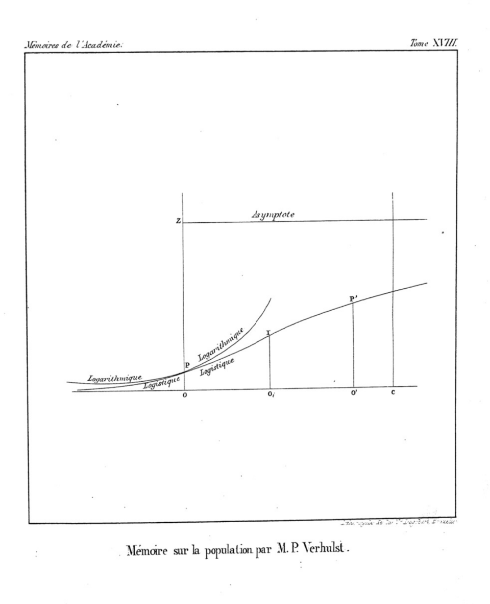
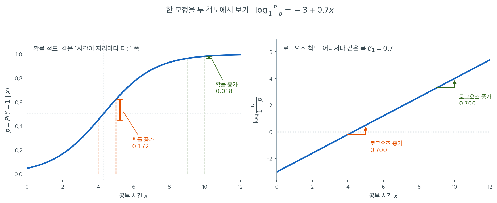
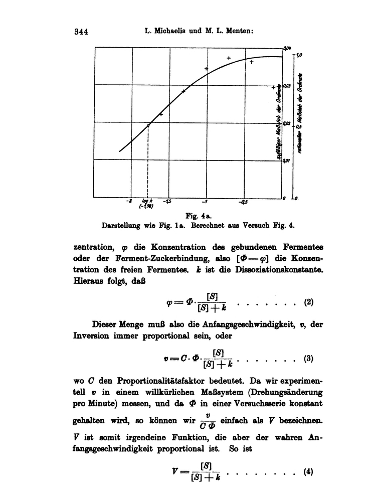
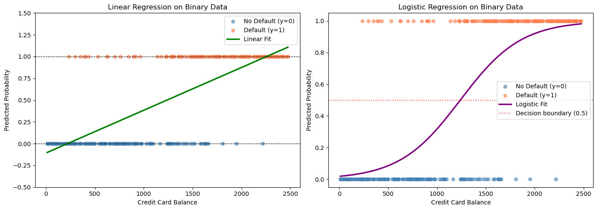

# 로짓 연결과 오즈


## 1. 선형모형에서 분류로

선형회귀에서 반응변수 $y$는 연속형이다. 반응변수가 0 또는 1의 값을 갖는 이항변수일 때는
$\mathbb{R}$을 구간 $(0,1)$로 옮기는 모형이 필요하다. 로지스틱 회귀는 선형예측자를
**시그모이드(로지스틱) 함수**에 통과시켜 이를 달성한다.

그 어긋남이 수로 얼마나 되는지는 시그모이드와 로짓을 손에 넣은 뒤 $5$ 절에서
모의자료 하나로 끝까지 대비해 본다.

## 2. 시그모이드 함수

$$
\sigma(z) = \frac{1}{1+e^{-z}}
$$

시그모이드는 모든 실수를 $(0,1)$로 옮기므로 조건부확률 $P(Y=1 \mid \mathbf{x})$의 모형으로
타당하다.

### 주요 성질

| 성질 | 값 |
|---|---|
| 정의역 | $z \in (-\infty, +\infty)$ |
| 치역 | $\sigma(z) \in (0, 1)$ |
| 대칭성 | $\sigma(-z) = 1 - \sigma(z)$ |
| 중점 | $\sigma(0) = 0.5$ |
| 최대 기울기 | $\sigma'(0) = 0.25$ |

### 시그모이드의 도함수

도함수는 놀랄 만큼 깔끔한 형태를 가지며, 로지스틱 회귀 전반의 기울기 계산을 단순하게 만든다.

$$
\sigma'(z) = \frac{e^{-z}}{(1+e^{-z})^2} = \sigma(z)\bigl(1-\sigma(z)\bigr)
$$

??? note "유도"
    $\sigma = (1+e^{-z})^{-1}$로 두고 연쇄법칙을 적용하면

    $$
    \sigma' = -\,(1+e^{-z})^{-2}\cdot(-e^{-z})
            = \frac{e^{-z}}{(1+e^{-z})^2}
    $$

    이고, $\frac{1}{1+e^{-z}} \cdot \frac{e^{-z}}{1+e^{-z}} = \sigma(1-\sigma)$로 인수분해된다.

<div class="storybox" markdown>

**그림으로 보는 통계학 1.** 이 곡선에 이름이 붙던 도판

<figure markdown>
  { width=520 }
  <figcaption markdown>베르휠스트 「인구 증가 법칙에 관한 수학적 연구」($1845$)에 딸린 도판. 오른쪽 머리글에 *Tome XVIII.*, 위쪽 가로선에 *Asymptote*, 점 $\mathrm P$ 에서 만나 갈라지는 두 곡선에 각각 *Logarithmique* 와 *Logistique* 라 적혀 있고, 도판 아래에는 *Mémoire sur la population par M. P. Verhulst*(인구에 관한 논문, P. 베르휠스트 지음)라 적혀 있다. *(Wikimedia Commons, PD-old-100-1923)*</figcaption>
</figure>

이 절이 쓰는 이름 **로지스틱**은 위의 도판과 함께 태어났다. 벨기에의 **피에르 프랑수아 베르휠스트** $(1804\text{–}1849)$ 가 $1845$ 년 브뤼셀 왕립학술원 신논문집 제$18$ 권에 실은 「인구 증가 법칙에 관한 수학적 연구」의 도판이고, 그 논문에서 그는 자기가 얻은 곡선을 *courbe logistique* 라 불렀다.

그가 풀려던 것은 한 가지였다. 인구가 지금 인구에 비례해 는다고 보면 곡선은 지수함수가 되어 끝없이 치솟는데, 실제 인구는 그러지 않는다. 그래서 그는 늘어나는 속도에 **남은 자리**를 곱해 붙였다. 도판에서 두 곡선이 점 $\mathrm P$ 에서 만나 그 뒤로 갈라지는 것이 그 손질의 결과다 — *Logarithmique* 라 적힌 쪽은 가파르게 위로 달아나고, *Logistique* 는 가로선 *Asymptote* 아래에 눌려 머문다.

「남은 자리를 곱한다」는 손질이 바로 위에서 구한 도함수다. 베르휠스트의 식을 $\sigma$ 로 적으면 $\sigma'=\sigma(1-\sigma)$ 이고, 뒤의 인수 $1-\sigma$ 가 그 **남은 자리**다. 로지스틱 회귀의 기울기 계산이 깔끔한 까닭이 $1845$ 년에 인구를 세던 식에 이미 들어 있었다.

도판에 적힌 것이 곧 이 쪽의 주장이다. 글자로 적힌 가로선 *Asymptote* 는 $\displaystyle\lim_{z\to\infty}\sigma(z)=1$, 곧 위 성질표의 치역 $(0,1)$ 이다. *Logistique* 곡선이 처음에는 아래로 볼록하게 오르다 어느 자리부터 위로 볼록하게 눕는 것은 $\sigma'=\sigma(1-\sigma)$ 가 $\sigma=\frac12$ 에서 홀로 최대가 되는 **유일한 변곡점**이고, 성질표의 「중점 $\sigma(0)=0.5$」와 「최대 기울기 $\sigma'(0)=0.25$」가 그 한 자리를 가리킨다. 옆에 나란히 그려 둔 *Logarithmique* 곡선에는 그 눕는 자리가 없다.

다만 이 곡선이 널리 쓰이기까지는 오래 걸렸다. 베르휠스트가 죽은 뒤 $1911$ 년과 $1920$ 년에 두 차례 따로 다시 발견되었고, 일흔 해가 지난 그 두 번째 재발견에 이르러서야 이름이 굳었다. 세로축을 인구에서 **확률**로 갈아 끼우는 일, 곧 $3$ 절처럼 그 자리에 $P(Y=1\mid\mathbf x)$ 를 놓는 일은 또 한참 뒤에야 일어났다.

*확인한 곳 — 베르휠스트 「Recherches mathématiques sur la loi d'accroissement de la population」(브뤼셀 왕립학술원 신논문집 제$18$ 권, $1845$)의 도판. 원본 스캔은 [괴팅겐 대학 GDZ 의 그 권](https://gdz.sub.uni-goettingen.de/id/PPN129323640_0018) 에서 펴 볼 수 있다 · 논문 제목·학술지 이름·권 번호와 「$1845$ 년 논문에서 그 곡선을 logistic curve 라 이름 붙였다」는 것은 [Wikipedia 「Pierre François Verhulst」](https://en.wikipedia.org/wiki/Pierre_Fran%C3%A7ois_Verhulst) 의 저작 목록과 「Logistic equation」 절에서 확인했다 · 다시 발견된 두 해($1911$ 년 맥켄드릭, $1920$ 년 펄과 리드)는 [Wikipedia 「Logistic function」](https://en.wikipedia.org/wiki/Logistic_function) 에 적혀 있다 · 머리글의 *Tome XVIII.*, 도판 아래의 *Mémoire sur la population par M. P. Verhulst.*, 그리고 *Asymptote* · *Logarithmique* · *Logistique* 라는 글자와 두 곡선이 점 $\mathrm P$ 에서 만나 갈라지는 모습은 사진에서 직접 읽었다 · 그림의 라이선스 틀이 PD-old-100-1923 인 것은 [Commons 「Courbe logistique, Verhulst, 1845」](https://commons.wikimedia.org/wiki/File:Courbe_logistique,_Verhulst,_1845.png) 파일 쪽에서 확인했다*

</div>

<div class="aibox" markdown>

**AI로 보는 통계학 1.** 점수를 매길 수 없는 것을 둘씩 견주어 줄 세우기

이 절의 시그모이드가 이 상자의 전부다. 겨루는 둘에게 실력 $x_1$ 과 $x_2$ 를 매기고 앞쪽이
이길 확률을

$$
p_1=\frac1{1+e^{-(x_1-x_2)}}=\sigma(x_1-x_2)
$$

로 두면, 승률은 **두 실력의 차**만으로 정해진다. 뒤집어 말하면 두 실력에 같은 수를 더해도
승률은 한 치도 달라지지 않는다. 로짓을 취하면 $\operatorname{logit}(p_1)=x_1-x_2$ 이니,
$3$ 절의 「로그오즈에서 선형」을 **겨루는 짝**에 그대로 쓴 것이기도 하다.

요즘 언어모델을 평가할 때 이 두 성질이 고스란히 쓰인다. 글을 요약하거나 상담에 답하는
일에는 **채점할 정답이 없다.** 「$73$ 점짜리 답」이라는 것이 없으니 점수를 직접 매길
수가 없다. 그래서 하는 일이 둘씩 견주는 것이다 — 같은 물음에 두 모델이 내놓은 답을
나란히 놓고 사람에게 **어느 쪽이 나은지만** 고르게 한다.

그렇게 모은 「$\mathrm A$ 가 $\mathrm B$ 를 이겼다」는 기록만 가지고 모델마다 실력 $x_k$ 를
하나씩 매길 수 있을까. 위 식을 뒤집어 쓰면 된다. 이긴 횟수가 가장 그럴듯해지는
$x_k$ 들을 찾는 것이다.

```python
import numpy as np

rng = np.random.default_rng(0)                      # 씨앗을 고정해 늘 같은 값이 나오게
true = np.array([0.0, 0.8, 1.5, 2.4])               # 네 모델의 참 실력
n = len(true)

# 사람에게 둘씩 보여 주고 어느 쪽이 나은지 고르게 한다
W = np.zeros((n, n))                                # W[i,j] = i 가 j 를 이긴 횟수
for _ in range(20000):
    i, j = rng.choice(n, 2, replace=False)
    p = 1 / (1 + np.exp(-(true[i] - true[j])))      # 시그모이드 — 차만으로 정해진다
    if rng.random() < p:
        W[i, j] += 1
    else:
        W[j, i] += 1

x = np.zeros(n)                                     # 실력을 되찾는다 (경사 올리기)
for _ in range(4000):
    P = 1 / (1 + np.exp(-(x[:, None] - x[None, :])))
    x += 1e-4 * (W - (W + W.T) * P).sum(axis=1)

print("참 실력   (첫 모델을 0 으로) :", np.round(true - true[0], 2))
print("추정 실력 (첫 모델을 0 으로) :", np.round(x - x[0], 2))

y = x + 100                                         # 모두에 100 을 더해 본다
P1 = 1 / (1 + np.exp(-(x[:, None] - x[None, :])))
P2 = 1 / (1 + np.exp(-(y[:, None] - y[None, :])))
print("모두에 100 을 더해도 예측 승률이 같은가 :", np.allclose(P1, P2))
```

실행하면 다음이 나온다.

```text
참 실력   (첫 모델을 0 으로) : [0.  0.8 1.5 2.4]
추정 실력 (첫 모델을 0 으로) : [0.   0.79 1.47 2.4 ]
모두에 100 을 더해도 예측 승률이 같은가 : True
```

「이겼다 / 졌다」는 기록만 이만 번 모았을 뿐인데 실력의 **차이**가 소수 첫째 자리까지
되살아난다($1.5$ 를 $1.47$ 로 맞혔으니 둘째 자리까지는 아니다). 체스의 엘로 점수가 바로 이것이고, 요즘 모델을 사람 투표로 줄 세우는
순위표도 같은 셈을 한다. 로지스틱 회귀의 말로 적으면 설명변수가 「누가 겨루었나」를 가리키는
더미뿐인 모형이고, 추정한 $x_k$ 가 곧 계수다.

마지막 줄이 그 **기준점 자유**다. 모두에게 $100$ 을 더해도 예측 승률이 한 치도
달라지지 않으므로, 이 방법으로 정할 수 있는 것은 **차이뿐이고 기준점은 정해지지 않는다.**
엘로 점수에서 평균을 $1500$ 으로 잡는 것이 바로 그래서다 — 수학이 정해 주지 않으니 사람이
그냥 정한 것이다. 「$1500$ 점」 자체에는 아무 뜻이 없다. 더미 하나를 빼고 적합해야 하는
까닭, 곧 절편을 둘 자리를 사람이 골라야 하는 까닭과 같은 이야기다.

그래서 한계도 분명하다. 이 셈은 **실력이 수 하나로 줄 세워진다**고 미리 가정하고 있다.
가위바위보처럼 $\mathrm A$ 가 $\mathrm B$ 를, $\mathrm B$ 가 $\mathrm C$ 를, $\mathrm C$ 가
$\mathrm A$ 를 이기는 일이 생기면 그런 수는 아예 존재하지 않는다. 모델은 저마다 잘하는
분야가 다르므로 이런 일이 실제로 일어나고, 그때 순위표의 한 줄은 **없는 것을 있다고 적은
셈**이 된다.

</div>

---

## 3. 로짓(로그오즈) 연결

확률 $p$의 **로짓**을 다음과 같이 정의한다.

$$
\operatorname{logit}(p) = \log\frac{p}{1-p}
$$

비 $p/(1-p)$는 사건의 **오즈**이고, 로짓은 **로그오즈**다. 로지스틱 회귀는 로그오즈에서
선형관계를 가정한다.

$$
\operatorname{logit}\bigl(P(Y=1\mid\mathbf{x})\bigr) = \mathbf{x}^\top\boldsymbol{\theta}
$$

동등하게, 특성벡터가 $A[i,:]$(절편을 위한 선행 1을 포함한 계획행렬의 행)인 $i$번째 관측치에
대해

$$
z^{(i)} = A[i,:]\,\boldsymbol{\theta},
\qquad
\sigma^{(i)} = \sigma\!\bigl(z^{(i)}\bigr)
$$

이다.

---

## 4. 선형성은 로그오즈 척도에 산다

"로지스틱 회귀는 선형모형이다"라는 말은 확률을 보고 있으면 도저히 납득이 되지 않는다. 확률
그림에는 직선이 하나도 없기 때문이다. 아래 그림은 같은 모형
$\log\frac{p}{1-p} = -3 + 0.7x$를 두 척도에서 나란히 그린 것이다. 왼쪽이 확률 척도, 오른쪽이
로그오즈 척도이며, 두 그림의 자료와 계수는 완전히 같다.



왼쪽에서 공부 시간을 4시간에서 5시간으로 한 시간 늘리면 합격 확률이 $0.450$에서 $0.623$으로
$0.172$ 올라간다. 그런데 똑같은 한 시간을 9시간에서 10시간으로 옮기면 확률은 $0.964$에서
$0.982$로 $0.018$밖에 오르지 않는다. 열 배 가까이 차이가 난다. 확률 척도에서는 "한 시간의
효과"라는 말 자체가 성립하지 않는다. 어느 자리에서 옮기느냐에 따라 값이 달라지기 때문이다.

오른쪽에서는 사정이 완전히 다르다. 같은 두 이동이 모두 로그오즈를 정확히 $0.700$만큼 올린다.
곡선이 직선이 되었고, 기울기가 곧 $\beta_1 = 0.7$이다. 계수를 하나의 숫자로 보고할 수 있는
것은 이 척도에서만 가능한 일이다. 확률 척도로 돌아가면 그 하나의 숫자가 자리마다 다른 폭으로
흩어져 버린다.

그래서 연결함수는 편의를 위한 장치가 아니라 모형의 주소다. $(0,1)$에 갇힌 확률을 로그오즈로
옮기면 값의 범위가 $\mathbb{R}$ 전체로 풀리고, 그제야 선형모형을 얹을 자리가 생긴다. 시그모이드는
그 반대 방향, 즉 직선을 다시 확률로 눌러 담는 역함수일 뿐이다. 왼쪽 그림의 굽음은 모형이
비선형이라는 증거가 아니라, 직선을 $(0,1)$ 안에 밀어 넣은 결과다.

<div class="storybox" markdown>

**그림으로 보는 통계학 2.** 쌍곡선을 S 자로 그린 쪽

<figure markdown>
  { width=520 }
  <figcaption markdown>미하엘리스·멘텐 「인베르틴 작용의 반응속도론」(『생화학지』 제$49$ 권, $1913$) $344$ 쪽. 머리글 왼쪽 끝에 쪽 번호 $344$ 가 있다. 맨 아래 식 $(4)$ 가 $V=\dfrac{[S]}{[S]+k}$ 이고, 위의 그림 $4\mathrm a$ 는 그 식을 그린 것이다. 가로축의 $\log k$ 에서 올라간 점선이 오른쪽 눈금 $0.5$ 에서 곡선과 만난다. *(Internet Archive · 저작권 없음)*</figcaption>
</figure>

「같은 모형, 다른 자」를 $1913$ 년에 먼저 그린 쪽이 있다. 사진 맨 아래의 식 $(4)$ 는 농도 $[S]$ 를 $x$ 로 쓰면

$$
V=\frac{x}{x+k}=1-\frac{k}{x+k}
$$

인 **쌍곡선**이다. 미분하면 $V'=k/(x+k)^2$ 이라 부호가 바뀌지 않으니 올라가기만 하고 극값이 없으며, 수평점근선은 $y=1$ 이다. 그런데 이 식은 효소가 설탕을 가르는 속도를 적은 것이어서, **점근선 $y=1$ 이 곧 더 이상 빨라질 수 없는 최대 속도**이고 **「극값이 없다」가 「속도는 올라가다 멎을 뿐 결코 되돌아 내려오지 않는다」**가 된다. 사진의 바로 위 문장이 $k$ 를 해리상수라 부르는데, 오늘 그것을 미하엘리스 상수라 한다.

그런데 같은 쪽 위의 그림은 쌍곡선이 아니라 **S 자**다. 가로축이 농도가 아니라 **농도의 상용로그**이기 때문이다. 다음 쪽이 그 까닭을 적는다 — 「이 함수는 형식이 산의 해리곡선과 똑같다」. 산도를 로그 눈금에 그리던 버릇을 그대로 가져온 것이다.

로그 자 위에서는 다른 것이 보인다. $u=\log_{10}x$ 로 두면

$$
V=\frac{10^{u}}{10^{u}+k}=\frac{1}{1+e^{-\ln 10\,(u-\log_{10}k)}}=\sigma\bigl(\ln 10\,(u-\log_{10}k)\bigr)
$$

으로 **$2$ 절의 시그모이드 그대로**다. 그러니 가장 가파른 자리는 $u=\log_{10}k$, 거기서 $V=\dfrac12$ 이고($2$ 절 성질표의 「중점 $\sigma(0)=0.5$」), 그때의 기울기는

$$
\left.\frac{dV}{du}\right|_{u=\log_{10}k}=\frac{\ln 10}{4}=0.5756
$$

으로 **$k$ 가 무엇이든 같은 값**이다. 분모의 $4$ 가 성질표의 「최대 기울기 $\sigma'(0)=0.25$」이고, 연습문제 4 (b) 의 **「$4$ 로 나누기」 어림**을 $\beta=\ln 10$ 에 쓴 것이 바로 이 수다. 글이 $346$ 쪽에 인쇄한 수가 $0.576$ 이고, 「곡선 가운데의 거의 곧은 토막이 가로축과 이루는 각의 탄젠트가 $0.576$, 곧 거의 정확히 $30^{\circ}$」라고 적혀 있다. 실제로 $\arctan 0.5756=29.93^{\circ}$ 다.

이것이 쓸모였다. 곡선 가운데의 곧은 토막에 자를 대고 세로 눈금 $\dfrac12$ 인 자리에서 아래로 내리면 거기가 $\log_{10}k$ 다. 사진의 점선이 바로 그것이고, 그들이 읽은 값이 $\log k=-1.78$, 곧 $k=0.0167$ 이다. 거꾸로 $10^{-1.78}=0.0166$ 이니 반올림까지 맞는다.

좌표를 바꾸면 같은 식이 전혀 다른 그림이 된다. 「극값이 없다」는 어느 쪽에서도 참이지만, 쌍곡선에서는 **눕는 것**으로 보이고 S 자에서는 **멎는 것**으로 보인다. 오늘 교과서가 이 식을 쌍곡선으로 그리는 것은 최대 속도를 한눈에 보이려는 것이고, $1913$ 년에 로그 자 위에 그린 것은 $k$ 를 자로 재려는 것이었다. 어느 쪽도 틀리지 않았다 — 무엇을 읽어 내려는가가 축을 정했을 뿐이다. 이 절이 로그오즈 자를 고른 까닭도 꼭 같다. 확률 자 위에서는 「한 시간의 효과」가 자리마다 달라 수 하나로 적을 수 없고, 자를 바꾸고 나서야 그 수가 기울기 $\beta_1$ 로 읽힌다.

_확인한 곳 — [Internet Archive 「Biochemische Zeitschrift 49.1913」](https://archive.org/details/biochemische-zeitschrift-49.1913). 쪽 번호 $344$, 그림 $4\mathrm a$ 와 가로축의 $\log k\,(-1.78)$ · 오른쪽의 「rationeller Maßstab der Ordinate」 눈금, 식 $(2)$ $(3)$ $(4)$ 와 바로 위의 「$k$ 는 해리상수다」는 **사진에서 직접 읽었다** · 「이 함수는 형식이 산의 해리곡선과 똑같다」는 인쇄 $345$ 쪽, 「$\frac{2{,}3026}{4}=0{,}576$ · 거의 정확히 $30^{\circ}$」와 $k=0{,}0167$ 은 $346$–$347$ 쪽에서 읽었다(이 권은 낱장 번호가 쪽 번호보다 $7$ 크다) · **수는 이 쪽에서 직접 계산했다** — $V=\frac{10^u}{10^u+k}$ 를 미분해 변곡점이 $u=\log_{10}k$, 거기서 $V=\frac12$, 기울기가 $\frac{\ln 10}{4}=0.5756$ 임을 $k$ 와 무관하게 얻었고, $\arctan 0.5756=29.93^{\circ}$ 와 $10^{-1.78}=0.0166$ 을 확인했다_

</div>

---

## 5. 선형회귀와 로지스틱을 한 자료에서 대비하기

### 인공자료

신용카드 보유자 $n = 300$명을 모의로 생성한다. 연체 확률은 계좌 잔액에 따라 로지스틱 관계로
증가한다.

$$
P(\text{Default} = 1 \mid \text{Balance}) = \frac{1}{1 + \exp\!\bigl(-({\text{Balance}} - 1250)/300\bigr)}
$$

<div class="exbox" markdown>

**보기 1.** <span class="diff easy" title="쉬움"></span> 참 모형을 로지스틱의 꼴로 읽기. 잔액이 $\text{Balance} \sim \text{Uniform}(0, 2500)$이고 연체확률이 $P(Y = 1 \mid b) = \sigma\!\bigl((b - 1250)/300\bigr)$인 카드 보유자 $n = 300$명을 생성한다.

**(1)** 이 참 모형을 $\operatorname{logit} p = \beta_0 + \beta_1 b$의 꼴로 적을 때 $\beta_0$과 $\beta_1$을 구하시오. 또 잔액을 모른 채 한 명을 뽑았을 때의 **주변 연체확률** $P(Y = 1)$을 구하시오.

**(2)** 자료를 생성해 표본 연체율이 (1)의 값과 맞는지 확인하시오.

</div>

??? success "풀이"

    **(1) 해석적으로.** 시그모이드의 인수를 펼치면

    $$
    \frac{b - 1250}{300} = -\frac{1250}{300} + \frac{1}{300}\,b
    $$

    이므로

    $$
    \beta_0 = -\frac{1250}{300} = -4.16667,
    \qquad
    \beta_1 = \frac{1}{300} = 0.00333333
    $$

    이다. **참 관계가 로지스틱이므로 로지스틱 회귀는 올바르게 지정된 모형이다.** 뒤에서 선형회귀가 지는 데는 이 사정도 한몫한다.

    주변확률은 $\text{Balance}$를 적분해 없앤다. $z = (b - 1250)/300$으로 바꾸면 $b$가 $0$에서 $2500$까지 갈 때 $z$는 $-c$에서 $c$까지 가고 $c = 1250/300 = 25/6$이다. 적분 구간이 $0$에 대해 **대칭**이므로 $\sigma(z) + \sigma(-z) = 1$을 쓸 수 있다.

    $$
    \int_{-c}^{c} \sigma(z)\,dz
    = \int_0^{c} \bigl[\sigma(z) + \sigma(-z)\bigr]\,dz
    = \int_0^{c} 1\,dz = c
    $$

    균일분포의 밀도가 $1/(2c)$이므로

    $$
    P(Y = 1) = \frac{1}{2c}\int_{-c}^{c}\sigma(z)\,dz = \frac{c}{2c} = \frac{1}{2}
    $$

    이다. **근사가 아니라 등식으로 $0.5$다.** 변곡점 $1250$이 구간 $[0, 2500]$의 정확한 가운데에 놓여 시그모이드의 대칭성이 그대로 살아나기 때문이다.

    **(2) 수치적으로.**

    ```python
    import numpy as np
    from sklearn.linear_model import LinearRegression, LogisticRegression

    # 카드 잔액이 커질수록 연체 확률이 오르는 자료. 참 관계가 S 자 곡선이다.
    np.random.seed(42)
    n_samples = 300
    balance = np.random.uniform(0, 2500, n_samples)

    true_prob = 1 / (1 + np.exp(-(balance - 1250) / 300))
    default = np.random.binomial(1, true_prob)

    X = balance.reshape(-1, 1)
    y = default
    X_test = np.linspace(balance.min(), balance.max(), 300).reshape(-1, 1)

    print(f"참 계수   beta0 = {-1250 / 300:.5f},  beta1 = {1 / 300:.8f}")
    print(f"표본 연체율            = {y.mean():.4f}   (이론 0.5)")
    print(f"생성에 쓰인 참 확률의 평균 = {true_prob.mean():.4f}")
    print(f"연체율의 표준오차        = {np.sqrt(0.25 / n_samples):.4f}")
    ```

    출력:

    ```
    참 계수   beta0 = -4.16667,  beta1 = 0.00333333
    표본 연체율            = 0.5000   (이론 0.5)
    생성에 쓰인 참 확률의 평균 = 0.4959
    연체율의 표준오차        = 0.0289
    ```

    표본 연체율이 정확히 $150/300 = 0.5000$으로 나와 이론값과 소수 넷째 자리까지 같다. **다만 이것은 운이다.** 연체율의 표준오차가 $\sqrt{0.25/300} = 0.0289$이므로 $0.47$에서 $0.53$ 사이 아무 값이나 나올 수 있었다. 실제로 뽑힌 $300$개의 잔액 자체가 완벽히 균일하지는 않아 생성에 쓰인 참 확률의 평균은 $0.4959$로 $0.5$에서 조금 벗어나 있다. **유도한 $0.5$는 모집단의 성질이고, $0.5000$은 그 위에서 흔들린 한 번의 값이 우연히 맞아떨어진 것이다.**

### 이항 자료에 대한 선형회귀

선형회귀는 이항 결과를 연속변수로 취급하여

$$
\hat{y} = \hat\beta_0 + \hat\beta_1 \cdot \text{Balance}
$$

를 최소제곱으로 적합한다. 직선은 무한히 뻗어 나가므로, Balance가 충분히 크거나 작으면 예측값이
필연적으로 $[0,1]$ 밖으로 나간다.

<div class="exbox" markdown>

**보기 2.** <span class="diff easy" title="쉬움"></span> 선형회귀가 범위를 벗어나는 자리. 보기 1의 $0/1$ 반응에 최소제곱 직선을 적합한다. 적합 결과는 $\hat y = -0.107902 + 0.00049103\,b$다.

**(1)** $\hat y = 0$과 $\hat y = 1$이 되는 Balance를 구하고, 격자 `X_test`의 $300$개 점 가운데 **몇 개**가 $[0,1]$ 밖에 놓이는지 세어서 예측하시오.

**(2)** 코드로 확인하시오.

</div>

??? success "풀이"

    **(1) 해석적으로.** 단순선형회귀이므로 적합값은 직선 하나다. $\hat y = 0$으로 놓으면

    $$
    b = \frac{0.107902}{0.00049103} = 219.746
    $$

    이고 $\hat y = 1$로 놓으면

    $$
    b = \frac{1.107902}{0.00049103} = 2256.277
    $$

    이다. 그러므로 $b < 219.746$에서 예측값이 음수이고 $b > 2256.277$에서 $1$을 넘는다.

    격자는 `np.linspace(12.65396, 2475.13463, 300)`이라 간격이

    $$
    h = \frac{2475.13463 - 12.65396}{299} = 8.23572
    $$

    이고 $k$번째 점은 $b_k = 12.65396 + 8.23572\,k$다. 아래쪽을 세면

    $$
    b_k < 219.746
    \iff k < \frac{219.746 - 12.654}{8.23572} = 25.146
    \iff k = 0, 1, \dots, 25
    $$

    로 $26$개이고, 위쪽은

    $$
    b_k > 2256.277
    \iff k > \frac{2256.277 - 12.654}{8.23572} = 272.426
    \iff k = 273, \dots, 299
    $$

    로 $27$개다. 합해 **$53$개**, 곧 $53/300 = 17.67\%$다.

    예측 범위도 두 끝점에서 바로 나온다. $b = 12.654$에서 $\hat y = -0.1017$, $b = 2475.135$에서 $\hat y = 1.1075$다.

    **(2) 수치적으로.**

    ```python
    # 0/1 반응에 선형회귀를 씌우면 예측값이 0 아래나 1 위로 나간다.
    # 확률이라 부를 수 없는 값이 나오는 것이다.
    linear_model = LinearRegression()
    linear_model.fit(X, y)
    y_pred_linear = linear_model.predict(X_test)

    print(f"Linear predictions range: "
          f"[{y_pred_linear.min():.3f}, {y_pred_linear.max():.3f}]")

    b0, b1 = linear_model.intercept_, linear_model.coef_[0]
    print(f"적합        yhat = {b0:.6f} + {b1:.8f} * Balance")
    print(f"yhat = 0 인 Balance = {-b0 / b1:.3f}")
    print(f"yhat = 1 인 Balance = {(1 - b0) / b1:.3f}")

    grid = X_test.ravel()
    low = int(np.sum(grid < -b0 / b1))
    high = int(np.sum(grid > (1 - b0) / b1))
    print(f"격자 간격 h = {grid[1] - grid[0]:.5f}")
    print(f"[0,1] 밖 격자점: 아래 {low} + 위 {high} = {low + high}개"
          f"  ({100 * (low + high) / len(grid):.2f}%)")
    ```

    출력:

    ```
    Linear predictions range: [-0.102, 1.107]
    적합        yhat = -0.107902 + 0.00049103 * Balance
    yhat = 0 인 Balance = 219.746
    yhat = 1 인 Balance = 2256.277
    격자 간격 h = 8.23572
    [0,1] 밖 격자점: 아래 26 + 위 27 = 53개  (17.67%)
    ```

    **손으로 센 $26 + 27 = 53$과 코드가 센 $53$이 같다.** 예측 범위 $[-0.102,\ 1.107]$도 두 끝점을 식에 넣은 $-0.1017$, $1.1075$와 소수 셋째 자리까지 맞는다.

    여기서 요점은 $17.67\%$라는 숫자 자체가 아니다. **외삽이 아니라 관측된 잔액 범위 안에서 벌어진 일**이라는 점이다. 실제 자료 $300$개 가운데도 $55$개가 $[0,1]$ 밖의 예측값을 받는다. 확률이라 불러서는 안 되는 값이 전체의 $18\%$에 달한다.

### 이항 자료에 대한 로지스틱 회귀

로지스틱 회귀는 시그모이드 함수를 통해 확률을 모형화한다.

$$
P(Y = 1 \mid x) = \frac{1}{1 + e^{-(\beta_0 + \beta_1 x)}}
$$

이렇게 하면 어떤 입력에 대해서도 $\hat{p} \in (0,1)$이 보장된다.

<div class="exbox" markdown>

**보기 3.** <span class="diff easy" title="쉬움"></span> 로지스틱의 예측은 갇혀 있다. 같은 자료에 로지스틱 회귀를 적합하면 $\hat\beta_0 = -3.97898$, $\hat\beta_1 = 0.00321188$이 나온다.

**(1)** 격자의 두 끝 $b = 12.654$와 $b = 2475.135$에서 예측확률을 계산하고, 왜 어떤 $b$에서도 예측값이 $0$이나 $1$에 닿을 수 없는지 말하시오.

**(2)** scikit-learn의 `LogisticRegression`은 기본으로 L2 벌점(`C=1.0`)을 건다. 이 자료에서 벌점이 실제로 얼마나 일하는지 재어 보고, 교차엔트로피 손실이 내려갈 수 있는 **바닥**을 구하시오.

</div>

??? success "풀이"

    **(1) 해석적으로.** 선형예측자를 두 끝점에서 재면

    $$
    \hat\eta(12.654) = -3.97898 + 0.00321188 \times 12.654 = -3.93834
    $$

    $$
    \hat\eta(2475.135) = -3.97898 + 0.00321188 \times 2475.135 = 3.97085
    $$

    이고 시그모이드를 거치면

    $$
    \sigma(-3.93834) = \frac{1}{1 + e^{3.93834}} = 0.019108,
    \qquad
    \sigma(3.97085) = 0.981492
    $$

    로 예측 범위가 $[0.0191,\ 0.9815]$다.

    **$0$이나 $1$에 닿을 수 없는 까닭은 구조적이다.** $\sigma(\eta) = 1/(1+e^{-\eta})$에서 $e^{-\eta} > 0$이므로 모든 유한한 $\eta$에 대해 $0 < \sigma(\eta) < 1$이다. $\sigma$는 $\eta \to \pm\infty$에서만 끝에 점근하고, $b$가 유계인 구간 $[0, 2500]$에 있으면 $\hat\eta$도 유계이므로 예측확률은 열린구간 안에 **갇힌다.** 보기 2처럼 "범위를 벗어나는 구간을 찾는" 계산 자체가 성립하지 않는다.

    **(2) 벌점은 얼마나 일하는가.** scikit-learn이 최소화하는 목적함수는 절편을 뺀 계수에 대해

    $$
    \tfrac12\lVert \hat\beta_{1}\rVert^2 + C \sum_{i=1}^{n} \bigl[-\ell_i(\hat\beta)\bigr]
    $$

    이고 `C=1.0`이면 두 항의 무게가 같다. 그런데 이 자료에서

    $$
    \tfrac12 \hat\beta_1^2 = \tfrac12 (0.00321188)^2 = 5.16\times 10^{-6},
    \qquad
    \sum_i \bigl[-\ell_i\bigr] = 111.4884
    $$

    로 벌점이 자료항의 $4.6\times 10^{-8}$에 지나지 않는다. 기울기가 \$1당 효과라 수치가 워낙 작기 때문이다. **그래서 이 쪽에서만은 `C=1.0`으로 적합한 것을 "최대가능도"라 불러도 된다.** 벌점을 완전히 끄면 로그가능도가 $1.3\times 10^{-12}$ 올라갈 뿐이고 계수는 소수 여덟째 자리까지 같다.

    **그러나 일반적으로는 그렇지 않다.** 잔액을 표준화해 $z = (b - 1238.01)/734.62$를 쓰면 계수가 $734.62$배 커지고, 벌점이 곧바로 드러난다.

    **바닥은 $0$이 아니다.** [6장](../../ch06/mle/mle_bernoulli.md)에서 보았듯이 교차엔트로피 손실은 아무리 잘 맞춰도 $0$으로 내려가지 않는다. 여기에는 세 층의 기준이 있다.

    - 절편만 있는 모형은 $\hat p \equiv \bar y = 0.5$를 주므로 손실이 $n H(0.5) = 300\log 2 = 207.944$다.
    - 참 확률 $p_i$를 전부 안다 해도 손실의 **기댓값**은 $\sum_i H(p_i) = 108.126$ 아래로 내려갈 수 없다.
    - 적합 모형의 손실은 $111.488$이다.

    **(2) 수치적으로.**

    ```python
    # 로지스틱은 시그모이드를 거치므로 예측값이 언제나 (0, 1) 안에 머문다.
    logistic_model = LogisticRegression(solver='lbfgs')
    logistic_model.fit(X, y)
    y_pred_logistic = logistic_model.predict_proba(X_test)[:, 1]

    print(f"Logistic predictions range: "
          f"[{y_pred_logistic.min():.3f}, {y_pred_logistic.max():.3f}]")

    a0, a1 = logistic_model.intercept_[0], logistic_model.coef_[0][0]
    print(f"적합 계수  b0 = {a0:.5f},  b1 = {a1:.8f}   (참값 -4.16667, 0.00333333)")

    # 벌점이 얼마나 일하는가. 음의 로그가능도와 벌점의 크기를 나란히 본다.
    def nll(p):
        return -np.sum(y * np.log(p) + (1 - y) * np.log(1 - p))

    p_fit = logistic_model.predict_proba(X)[:, 1]
    no_pen = LogisticRegression(penalty=None).fit(X, y)
    print(f"벌점 0.5*b1^2 = {0.5 * a1**2:.3e}   자료항 NLL = {nll(p_fit):.4f}")
    print(f"penalty=None  b1 = {no_pen.coef_[0][0]:.8f}, "
          f"NLL = {nll(no_pen.predict_proba(X)[:, 1]):.10f}")

    # 같은 자료를 표준화하면 계수가 커져 벌점이 눈에 보인다.
    Z = ((balance - balance.mean()) / balance.std()).reshape(-1, 1)
    print(f"표준화  C=1.0        b1 = {LogisticRegression().fit(Z, y).coef_[0][0]:.6f}")
    print(f"표준화  penalty=None b1 = "
          f"{LogisticRegression(penalty=None).fit(Z, y).coef_[0][0]:.6f}")

    # 교차엔트로피의 세 층.
    ent_sum = -np.sum(true_prob * np.log(true_prob)
                      + (1 - true_prob) * np.log(1 - true_prob))
    print(f"절편만 (300 log2)     = {300 * np.log(2):.3f}")
    print(f"참 확률의 엔트로피 합    = {ent_sum:.3f}")
    print(f"참 확률을 그대로 쓴 손실  = {nll(true_prob):.3f}")
    print(f"적합 모형의 손실        = {nll(p_fit):.3f}")
    ```

    출력:

    ```
    Logistic predictions range: [0.019, 0.981]
    적합 계수  b0 = -3.97898,  b1 = 0.00321188   (참값 -4.16667, 0.00333333)
    벌점 0.5*b1^2 = 5.158e-06   자료항 NLL = 111.4884
    penalty=None  b1 = 0.00321188, NLL = 111.4883505231
    표준화  C=1.0        b1 = 2.230632
    표준화  penalty=None b1 = 2.359120
    절편만 (300 log2)     = 207.944
    참 확률의 엔트로피 합    = 108.126
    참 확률을 그대로 쓴 손실  = 111.574
    적합 모형의 손실        = 111.488
    ```

    유도한 $[0.0191,\ 0.9815]$가 코드의 $[0.019,\ 0.981]$과 맞고, 벌점의 크기 $5.16\times10^{-6}$도 맞는다. 표준화하면 계수가 $2.359120 \to 2.230632$로 **$5.4\%$ 줄어든다.** 같은 `C=1.0`인데 원래 단위에서는 소수 여덟째 자리까지 아무 일도 없었고 표준화 뒤에는 둘째 자리에서 차이가 난다. **벌점의 세기는 계수의 크기에 달려 있고, 계수의 크기는 설명변수의 단위에 달려 있다.** 표준화 없이 `C`를 고르는 일이 왜 위험한지가 이 두 줄에 들어 있다.

    바닥 쪽에서는 한 가지가 눈에 걸린다. 참 확률을 그대로 쓴 손실이 $111.574$인데 **적합 모형이 $111.488$로 그보다 낮다.** 참값을 이긴 것이 아니라 모수 두 개를 이 표본에 맞추었기 때문이다. 기댓값으로 본 바닥 $\sum_i H(p_i) = 108.126$은 어느 모형도 이길 수 없으며, 적합 모형이 $207.944$에서 $111.488$까지 내려온 것이 설명변수가 한 일 전부다.

!!! note "여기서는 기본 L2 벌점이 사실상 아무 일도 하지 않는다"
    scikit-learn의 기본값 `C=1.0`은 L2 벌점을 건다. 그런데 이 자료에서 벌점을 완전히 끄고
    (`penalty=None`) 적합해도 계수는 소수점 넷째 자리까지 똑같은 $(-3.9790,\ 0.003212)$가
    나온다. 기울기가 $0.003$ 수준으로 워낙 작아 벌점 $\frac{1}{2}\beta_1^2 \approx 5\times10^{-6}$
    이 로그가능도에 비해 무시할 만하기 때문이다. 설명변수를 표준화했다면 계수가 커져 벌점의
    영향도 뚜렷해진다.

### 나란히 시각화하기

<div class="exbox" markdown>

**보기 4.** <span class="diff easy" title="쉬움"></span> 두 적합을 나란히 그리기. 왼쪽에 선형 적합, 오른쪽에 로지스틱 적합을 같은 산점도 위에 얹는다.

**(1)** 왼쪽 칸에서 초록 직선이 점선 $0$과 $1$을 넘어가는 자리를 읽고, 오른쪽 칸의 보라색 곡선에는 왜 그런 일이 없는지 그림에서 확인하시오.

**(2)** 이 그림이 **가리는 것**은 무엇인가. 두 모형의 우열을 이 그림만으로 판정할 수 있는가.

</div>

??? success "풀이"

    유도할 답이 있는 문제가 아니다. **그림에서 무엇이 읽히고 무엇이 읽히지 않는가**가 이 보기의 전부다.

    **(2) 를 답하려면 수치가 하나 더 필요하다.** 아래 코드의 마지막 묶음이 그것을 찍는다.

    ```python
    import matplotlib.pyplot as plt

    plt.rcParams["font.sans-serif"] = ["NanumGothic", "Apple SD Gothic Neo", "Malgun Gothic"]
    plt.rcParams["font.family"] = "sans-serif"
    plt.rcParams["axes.unicode_minus"] = False

    fig, axes = plt.subplots(1, 2, figsize=(14, 5))

    # 왼쪽: 선형회귀. 직선이 0 과 1 을 그은 점선을 넘어가는 것을 본다.
    axes[0].scatter(X[y == 0], y[y == 0], alpha=0.6, s=30,
                    color='steelblue', label='No Default (y=0)')
    axes[0].scatter(X[y == 1], y[y == 1], alpha=0.6, s=30,
                    color='coral', label='Default (y=1)')
    axes[0].plot(X_test, y_pred_linear, 'g-', linewidth=2.5,
                 label='Linear Fit')
    axes[0].axhline(y=0, color='black', linestyle='--', linewidth=0.8)
    axes[0].axhline(y=1, color='black', linestyle='--', linewidth=0.8)
    axes[0].set_xlabel('Credit Card Balance')
    axes[0].set_ylabel('Predicted Probability')
    axes[0].set_title('Linear Regression on Binary Data')
    axes[0].legend(); axes[0].set_ylim(-0.5, 1.5)

    # 오른쪽: 로지스틱. 곡선이 0 과 1 사이에 갇혀 있고, 자료가 만들어진
    # 참 관계와도 모양이 맞는다.
    axes[1].scatter(X[y == 0], y[y == 0], alpha=0.6, s=30,
                    color='steelblue', label='No Default (y=0)')
    axes[1].scatter(X[y == 1], y[y == 1], alpha=0.6, s=30,
                    color='coral', label='Default (y=1)')
    axes[1].plot(X_test, y_pred_logistic, 'purple', linewidth=2.5,
                 label='Logistic Fit')
    axes[1].axhline(y=0.5, color='red', linestyle=':', linewidth=1.5,
                    alpha=0.7, label='Decision boundary (0.5)')
    axes[1].set_xlabel('Credit Card Balance')
    axes[1].set_ylabel('Predicted Probability')
    axes[1].set_title('Logistic Regression on Binary Data')
    axes[1].legend(); axes[1].set_ylim(-0.05, 1.05)

    plt.tight_layout()
    plt.show()

    # 그림이 보여 주지 않는 것 — 0.5 문턱으로 자른 뒤의 분류 결과.
    cut_lin = (0.5 - linear_model.intercept_) / linear_model.coef_[0]
    cut_log = -logistic_model.intercept_[0] / logistic_model.coef_[0][0]
    print(f"0.5 를 지나는 Balance   선형 {cut_lin:.4f}   로지스틱 {cut_log:.4f}")
    print(f"잔액의 표본평균        {balance.mean():.4f}")

    pred_lin = (linear_model.predict(X) > 0.5).astype(int)
    pred_log = (logistic_model.predict_proba(X)[:, 1] > 0.5).astype(int)
    print(f"두 분류가 엇갈린 관측 수 = {(pred_lin != pred_log).sum()}")
    print(f"정확도   선형 {(pred_lin == y).mean():.4f}   "
          f"로지스틱 {(pred_log == y).mean():.4f}")

    p_lin = linear_model.predict(X)
    p_log = logistic_model.predict_proba(X)[:, 1]
    print(f"브라이어 점수  선형 {np.mean((p_lin - y) ** 2):.5f}   "
          f"로지스틱 {np.mean((p_log - y) ** 2):.5f}")
    print(f"선형 예측이 [0,1] 밖인 관측 수 = {int(((p_lin < 0) | (p_lin > 1)).sum())}")
    ```

    출력:

    ```
    0.5 를 지나는 Balance   선형 1238.0115   로지스틱 1238.8332
    잔액의 표본평균        1238.0115
    두 분류가 엇갈린 관측 수 = 0
    정확도   선형 0.8367   로지스틱 0.8367
    브라이어 점수  선형 0.11988   로지스틱 0.11446
    선형 예측이 [0,1] 밖인 관측 수 = 55
    ```

    

    **(1) 왼쪽 직선은 양 끝에서 점선을 넘는다.** 초록 직선이 아래쪽 점선 $y = 0$을 $b \approx 220$에서 끊고 들어오고, 위쪽 점선 $y = 1$을 $b \approx 2256$에서 뚫고 나간다. 보기 2에서 계산한 $219.746$과 $2256.277$이 그 자리다. 세로축이 $[-0.5,\ 1.5]$까지 열려 있어 점선 밖으로 나간 부분이 그대로 보인다.

    오른쪽에는 그런 자리가 없다. 보라색 곡선이 왼쪽 끝에서 $0.019$, 오른쪽 끝에서 $0.981$이고 **곡선의 양 끝이 축의 위아래 가장자리에 평평하게 눕는다.** 이것이 시그모이드의 점근이다. 결정경계 $0.5$를 그은 빨간 점선과는 $b = 1238.8$에서 만나며, 자료를 만든 참값 $1250$에서 $0.9\%$ 어긋나 있다.

    **(2) 이 그림이 가리는 것은 두 가지다.**

    첫째, **점의 밀도를 읽을 수 없다.** $300$개의 관측이 $y = 0$과 $y = 1$ 두 줄에 깔려 있는데, $\alpha = 0.6$으로 반투명하게 그렸어도 겹침이 심해 어느 구간에 몇 개가 모였는지 셀 수가 없다. 오른쪽 칸에서 파란 줄이 $b > 1500$에서 성겨지고 주황 줄이 $b < 700$에서 성겨지는 **경향**만 읽히고, 그것이 $20$개인지 $40$개인지는 알 길이 없다. $0/1$ 산점도는 언제나 이 한계를 안고 있으며, 구간별 관측비율을 점으로 찍어 곡선과 겹쳐 보는 것이 정직한 보완이다.

    둘째, 그리고 더 중요하게, **이 그림은 두 모형의 분류 성능을 전혀 말해 주지 않는다.** 왼쪽은 "틀려 보이고" 오른쪽은 "맞아 보이지만", $0.5$ 문턱으로 잘라 분류하면 **두 모형이 $300$개 관측을 하나도 다르지 않게 나눈다.** 정확도가 $0.8367$로 똑같다.

    까닭은 출력의 첫 두 줄에 있다. 선형회귀는 $(\bar x, \bar y)$를 반드시 지나는데 이 자료는 보기 1에서 보았듯 $\bar y = 0.5$이므로, $\hat y = 0.5$가 되는 자리가 **정확히 $\bar x = 1238.0115$**다. 로지스틱의 경계는 $1238.8332$이니 둘의 거리가 \$0.82에 지나지 않고, 그 사이에 떨어진 관측이 하나도 없다. **그림이 극적으로 보여 준 차이가 분류 결과에서는 통째로 사라진다.**

    차이는 분류가 아니라 **확률**에 있다. 브라이어 점수가 $0.11988$ 대 $0.11446$으로 로지스틱이 $4.5\%$ 낫고, 교차엔트로피는 아예 비교할 수조차 없다. 선형 적합이 관측 $300$개 중 $55$개에 $[0,1]$ 밖의 값을 주어 $\log \hat p$가 정의되지 않기 때문이다. **그러므로 이 그림은 "확률로 쓸 수 있는가"를 보이는 데는 성공하고 "어느 쪽이 더 잘 맞히는가"를 보이는 데는 실패한다.** 뒤의 물음은 다음 절들의 ROC·AUC가 맡는다.

### 두 접근의 차이

선형회귀에는 이에 대응하는 확률적 해석이 없다. 기울기는 $x$ 한 단위 증가당 $\hat{y}$의
변화량을 주지만, $\hat{y}$가 확률이라는 보장이 없다.

두 접근의 핵심 차이는 다음과 같다.

| 성질 | 선형회귀 | 로지스틱 회귀 |
|---|---|---|
| 예측 범위 | $(-\infty, +\infty)$ | $(0, 1)$ |
| 연결함수 | 항등 | 시그모이드 |
| 손실함수 | 제곱오차 | 교차엔트로피 |
| 계수의 의미 | $\hat{y}$의 변화 | 로그오즈의 변화 |
| 확률로 유효한가 | 아니다 | 그렇다 |

선형회귀는 확률이 $[0,1]$에 있어야 한다는 기본 요건을 위배하므로 이항 결과에 부적절하다.
로지스틱 회귀의 시그모이드 곡선은 이 제약을 지키면서 오즈비를 통한 자연스러운 확률적 해석을
제공한다.

!!! note "선형확률모형이 아주 무용한 것은 아니다"
    공정하게 말하면, 계량경제학에서 널리 쓰이는 **선형확률모형(LPM)**이 바로 이항 자료에 대한
    최소제곱이다. 예측이 목적이 아니라 **평균 한계효과**를 추정하는 것이 목적이고 $\hat p$가
    대체로 $0.2$--$0.8$ 범위에 머문다면, LPM의 계수는 해석하기 쉽고 로지스틱 모형의 평균
    한계효과와 비슷한 값을 준다. 문제는 (a) 확률이 범위를 벗어나는 것과 (b) 오차의 이분산성
    이며, 후자는 로버스트 표준오차로 처리한다. 이 절의 자료처럼 $\hat p$가 0과 1 전체를 훑는
    경우에는 로지스틱 회귀가 분명히 낫다.

---

## 6. 로지스틱 회귀에서의 교란

선형회귀와 마찬가지로 로지스틱 회귀도 **교란**을 겪을 수 있다. 제3의 변수가 설명변수와 결과
모두와 연관되어 있어 둘 사이의 겉보기 관계를 왜곡하는 것이다.

### 학생 신분이 잔액과 연체를 교란하는 경우

신용카드 연체($Y$)를 계좌 잔액($X_1$)으로 예측한다고 하자. 이변량 로지스틱 회귀는 음의 관계를
보여준다.

$$
\log\frac{P(\text{Default}=1)}{P(\text{Default}=0)} = \beta_0 + \beta_1 \cdot \text{Balance}
$$

$\beta_1 < 0$이 나와 잔액이 클수록 연체 위험이 낮다고 읽힐 수 있다. 그러나 이는 **오도**일 수
있다.

교란변수는 **학생 신분**($X_2$)이다. 자료에서 다음과 같은 경향이 나타난다.

- **학생**은 대체로,
    - 계좌 잔액이 낮고(나이가 어리고 경제적 기반이 약함),
    - 연체율이 높다(소득이 낮고 고용이 불안정함).

- **비학생**은 대체로,
    - 계좌 잔액이 높고(나이가 많고 기반이 안정적임),
    - 연체율이 낮다(소득이 높고 직업이 안정적임).

### 역설

**이변량 모형**(학생 신분을 무시):

$$
\log\frac{P(\text{Default}=1)}{1-P(\text{Default}=1)} = \beta_0 + \beta_1 \cdot \text{Balance}
$$

여기서는 $\beta_1 < 0$, 즉 잔액이 클수록 연체 확률이 낮다.

**그러나 이는 교란된 결과다.** 학생 신분이 두 변수를 서로 반대 방향으로 움직이고 있다.

**다변량 모형**(학생 신분 포함):

$$
\log\frac{P(\text{Default}=1)}{1-P(\text{Default}=1)} = \beta_0 + \beta_1 \cdot \text{Balance} + \beta_2 \cdot \text{Student}
$$

학생 신분을 통제하고 나면 잔액과 연체의 관계가 뒤집히거나 크게 달라질 수 있다.

- $\beta_1$이 **양수**가 될 수 있다(학생이든 비학생이든 잔액이 클수록 연체 확률이 높다).
- 계수의 크기도 상당히 달라질 수 있다.

이 역전은 분류에서 나타나는 **심프슨의 역설**의 한 예다. 주변(이변량) 모형에서 관찰된 연관이
교란변수를 통제하면 사라지거나 뒤집힌다.

### 교란이 있을 때의 오즈비 해석

이변량 모형에서는

$$
\text{Odds Ratio}_{X_1} = e^{\beta_1} \approx 0.99
$$

("잔액이 \$1 늘어날 때마다 오즈가 1% 감소한다")

다변량 모형에서는

$$
\text{Odds Ratio}_{X_1 | X_2} = e^{\hat{\beta}_1} \approx 1.01
$$

("*학생 신분을 통제할 때* 잔액이 \$1 늘어날 때마다 오즈가 1% 증가한다")

해석이 다른 것은 다음을 반영한다.

- 첫 번째는 **주변**(무조건부) 효과다.
- 두 번째는 **조건부**(부분) 효과다.

### 교란 확인하기

로지스틱 회귀에서 교란을 탐지하려면,

1. **이변량 모형을 적합한다:** $\log\frac{p}{1-p} = \beta_0 + \beta_1 X_1$
2. **다변량 모형을 적합한다:** $\log\frac{p}{1-p} = \beta_0 + \beta_1 X_1 + \beta_2 X_2$
3. **계수를 비교한다:**
    - $|\hat{\beta}_1^{\text{다변량}} - \hat{\beta}_1^{\text{이변량}}| / |\hat{\beta}_1^{\text{이변량}}| > 0.10$
      이면 교란이 있을 가능성이 크다.
    - 부호가 바뀌었다면 교란의 강력한 증거다.

### 출력 예시

```
Bivariate Model (Balance only):
  Intercept:  -10.65
  Balance:     -0.00555  (Odds Ratio: 0.9945)

Multivariate Model (Balance + Student):
  Intercept:  -11.10
  Balance:     +0.00265  (Odds Ratio: 1.0027)
  Student:     +0.71    (Odds Ratio: 2.03)
```

학생 신분을 포함시키자 잔액 계수가 음수에서 양수로 바뀌었다. 교란의 분명한 신호다.

### 예측과 추론에 대한 함의

- **예측 관점:** 교란변수를 포함하면 참된 관계를 포착하므로 예측정확도가 높아진다.
- **추론 관점:** 교란변수를 무시하면 계수 추정이 편향되고 오즈비 해석이 틀리게 된다.
- **모범 실무:** 항상 배경지식을 검토하고 잠재적 교란변수의 자료를 함께 수집하라.

관련 내용: [교란과 연관 대 인과](../../ch01/classical/confounding_causation.md)에서 여러
통계적 방법에 걸친 교란의 문제를 더 폭넓게 다룬다.

---

## 연습문제

<div class="drillbox" markdown>

**연습문제 1.** <span class="diff easy" title="쉬움"></span>
대출 연체($Y = 1$)에 대한 로지스틱 회귀 모형이 다음과 같다.
$\log\frac{p}{1-p} = -2.5 + 0.8\,\text{DTI} - 0.03\,\text{Credit Score}$

여기서 DTI는 소득 대비 부채 비율이고 Credit Score는 FICO 점수다.

**(a)** DTI = 3.0, Credit Score = 700인 차입자의 연체 예측확률을 계산하라.

**(b)** DTI의 계수 0.8을 오즈비로 해석하라.

**(c)** Credit Score = 650인 차입자에게 연체 확률 50%를 주는 DTI는 얼마인가?

</div>

??? success "풀이"

    **(a)** $\text{logit} = -2.5 + 0.8(3) - 0.03(700) = -2.5 + 2.4 - 21 = -21.1$

    $\hat{p} = \frac{1}{1 + e^{21.1}} \approx 6.9 \times 10^{-10}$. 연체 확률이 매우 낮다.

    **(b)** $e^{0.8} \approx 2.23$. 신용점수를 고정한 채 DTI가 한 단위 증가하면 연체 오즈가
    2.23배가 된다(123% 증가).

    **(c)** $p = 0.5$이면 $\text{logit} = 0$이므로
    $0 = -2.5 + 0.8\,\text{DTI} - 0.03(650)$이고,

    $0.8\,\text{DTI} = 2.5 + 19.5 = 22$에서 $\text{DTI} = 27.5$이다.

    !!! note "숫자를 곧이곧대로 받아들이지 말 것"
        이 모형의 계수는 예시를 위해 크게 잡은 값이다. 실제 신용 모형에서 FICO 점수 1점당
        계수는 $-0.005$ 수준이지 $-0.03$이 아니다. 또한 (c)의 답 $\text{DTI} = 27.5$는 현실의
        어떤 자료 범위에도 없는 값이다. 이는 로짓이 선형이라는 가정을 자료가 존재하지 않는
        영역까지 외삽할 때 무엇이 벌어지는지 보여주는 좋은 예다. 계산 자체는 옳지만 그 답을
        실제 차입자에 대한 진술로 읽어서는 안 된다.

---

<div class="drillbox" markdown>

**연습문제 2.** <span class="diff easy" title="쉬움"></span>
확률·오즈·로짓을 오가기

**(a)** $p = 0.01,\ 0.25,\ 0.5,\ 0.75,\ 0.99$의 오즈와 로짓을 구해 표로 적어라.

**(b)** $p$와 $1-p$의 로짓 사이에 어떤 관계가 있는가?

**(c)** "확률이 두 배가 되는 것"과 "오즈가 두 배가 되는 것"은 같은 말인가? $p = 0.1$과
$p = 0.4$에서 각각 확인하라.

</div>

??? success "풀이"

    **(a)**

    | $p$ | 0.01 | 0.25 | 0.50 | 0.75 | 0.99 |
    |---|---|---|---|---|---|
    | 오즈 | 0.0101 | 0.3333 | 1 | 3 | 99 |
    | 로짓 | $-4.595$ | $-1.099$ | 0 | $+1.099$ | $+4.595$ |

    **(b)** $\operatorname{logit}(1-p) = \log\frac{1-p}{p} = -\operatorname{logit}(p)$로
    **부호만 뒤집힌다.** 표가 $p = 0.5$를 중심으로 대칭인 것이 그 때문이고, 본문 성질표의
    $\sigma(-z) = 1 - \sigma(z)$와 같은 사실의 다른 표현이다.

    **(c)** 같지 않다. $p = 0.1$에서 확률을 두 배로 하면 $0.2$이고 오즈는
    $0.111 \to 0.25$로 $2.25$배다. $p = 0.4$에서 확률을 두 배로 하면 $0.8$인데 오즈는
    $0.667 \to 4$로 **$6$배**다. 확률이 $1$에 가까워질수록 같은 확률 증가가 훨씬 큰 오즈
    증가가 된다. 로지스틱 회귀의 계수가 확률이 아니라 **오즈**의 곱셈으로 해석되는 까닭이고,
    이 둘을 섞어 말하는 것이 보고서에서 가장 흔한 오류다. $\square$

---

<div class="drillbox" markdown>

**연습문제 3.** <span class="diff easy" title="쉬움"></span>
본문 그림의 수를 직접 확인하기

본문 4절의 모형은 $\log\frac{p}{1-p} = -3 + 0.7x$다($x$는 공부 시간).

**(a)** $x = 4, 5, 9, 10$에서 $p$를 구해 본문의 $0.450,\ 0.623,\ 0.964,\ 0.982$를 확인하라.

**(b)** 두 "한 시간"의 확률 증가가 왜 다른지, 로그오즈 척도에서는 왜 같은지 설명하라.

**(c)** $p = 0.5$가 되는 $x$를 구하라.

</div>

??? success "풀이"

    **(a)** $\sigma(z) = 1/(1+e^{-z})$에 $z = -3 + 0.7x$를 넣는다.

    | $x$ | 4 | 5 | 9 | 10 |
    |---|---|---|---|---|
    | $z$ | $-0.2$ | $0.5$ | $3.3$ | $4.0$ |
    | $p$ | 0.4502 | 0.6225 | 0.9644 | 0.9820 |

    증가폭은 $0.1723$과 $0.0176$으로 거의 **열 배** 차이다.

    **(b)** 로그오즈 척도에서는 두 이동 모두 $z$를 정확히 $0.7$ 올린다. 확률로 돌아올 때
    시그모이드가 **자리마다 다른 기울기**로 눌러 담기 때문에 확률 증가폭이 달라진다.
    기울기는 $\sigma'(z) = \sigma(1-\sigma)$라 $p$가 $0.5$ 근처면 크고 양 끝이면 작다.
    $x=4$ 둘레에서 $p(1-p) = 0.2475$, $x=9$ 둘레에서 $0.0343$으로 일곱 배 차이가 나는 것이
    위 열 배의 정체다.

    **(c)** $p = 0.5 \iff z = 0 \iff x = 3/0.7 = 4.286$시간이다. 로지스틱 곡선의 변곡점이자
    기울기가 최대인 자리다. $\square$

---

<div class="drillbox" markdown>

**연습문제 4.** <span class="diff med" title="중간"></span>
시그모이드의 성질 증명하기

**(a)** $\sigma(-z) = 1 - \sigma(z)$를 보여라.

**(b)** $\sigma'(z) = \sigma(z)(1-\sigma(z))$에서 $\sigma'$의 최댓값과 그 자리를 구하라.

**(c)** $\sigma$가 로지스틱분포의 누적분포함수임을 보이고, 프로빗(정규 CDF) 대신 로짓이 널리
쓰이는 실무적 까닭을 적어라.

</div>

??? success "풀이"

    **(a)** $\sigma(-z) = \dfrac{1}{1+e^{z}}$이고

    $$
    1 - \sigma(z) = 1 - \frac{1}{1+e^{-z}} = \frac{e^{-z}}{1+e^{-z}}
    = \frac{1}{e^{z}+1}
    $$

    로 같다(분자·분모에 $e^{z}$를 곱했다).

    **(b)** $u = \sigma(z) \in (0,1)$로 두면 $\sigma' = u(1-u)$이고 이는 $u = 1/2$에서 최대
    $1/4$다. $u = 1/2$은 $z = 0$이므로 **$\sigma'(0) = 0.25$** 가 최댓값이다. 그래서 기울기
    $\beta$인 로짓 모형의 확률 척도 최대 기울기는 $\beta/4$이고, 이것이 계수를 빠르게 읽는
    **"4로 나누기" 어림**의 근거다. 본문 모형이라면 $0.7/4 = 0.175$이고 실제로 $x = 4.29$에서의
    한계효과가 $0.175$다.

    **(c)** 로지스틱분포의 밀도는 $f(z) = e^{-z}/(1+e^{-z})^2$이고 이를 적분하면
    $F(z) = 1/(1+e^{-z}) = \sigma(z)$다. 정규 CDF $\Phi$는 **닫힌 형태가 없어** 수치적분이
    필요한 반면 $\sigma$는 초등함수이고, 도함수마저 $\sigma(1-\sigma)$로 자기 자신으로 표현된다.
    가능도와 그 기울기·헤세행렬이 모두 간단해져 적합이 빠르다. 두 모형의 적합 자체는 거의
    구별되지 않으며($\beta_{\text{logit}} \approx 1.7\beta_{\text{probit}}$), **계수를 오즈비로
    읽을 수 있다**는 해석상의 이점이 결정적이다. $\square$

---

<div class="drillbox" markdown>

**연습문제 5.** <span class="diff med" title="중간"></span>
오즈비로 읽기

본문 연습문제 1의 모형 $\log\frac{p}{1-p} = -2.5 + 0.8\,\text{DTI} - 0.03\,\text{CS}$를 쓴다.

**(a)** DTI가 $2$ 단위 오를 때 오즈가 몇 배가 되는가?

**(b)** 신용점수가 $50$점 오를 때는?

**(c)** 두 변화가 동시에 일어나면 오즈가 어떻게 되는가? 이 계산이 보여 주는 로짓 모형의 성질을
한 줄로 적어라.

</div>

??? success "풀이"

    **(a)** $e^{0.8 \times 2} = e^{1.6} = 4.953$배다.

    **(b)** $e^{-0.03 \times 50} = e^{-1.5} = 0.223$배, 곧 $77.7\%$ 줄어든다.

    **(c)** 로그오즈가 더해지므로 오즈는 **곱해진다.**

    $$
    e^{1.6 - 1.5} = e^{0.1} = 1.105
    $$

    로 $10.5\%$ 늘어난다. $4.953 \times 0.223 = 1.105$로 따로 구한 배수를 곱한 것과 같다.

    **성질:** 로짓 척도의 **덧셈**이 오즈 척도의 **곱셈**으로 옮겨 간다. 그래서 여러 변수의
    효과를 곱으로 결합할 수 있고, 변수마다 "오즈를 몇 배로 만드는가"라는 자리에 무관한
    수 하나를 붙일 수 있다. 확률 척도에서는 이런 분해가 불가능하다. $\square$

---

<div class="drillbox" markdown>

**연습문제 6.** <span class="diff med" title="중간"></span>
한계효과는 자리마다 다르다

로짓 모형에서 $x_j$의 **확률 척도 한계효과**는 $\dfrac{\partial p}{\partial x_j} = \beta_j\,p(1-p)$다.

**(a)** 이 식을 유도하라.

**(b)** 본문 모형($\beta = 0.7$)에서 $x = 4, 9$일 때의 한계효과를 구하고 연습문제 3 (a)의
실제 증가폭과 견주어라.

**(c)** 보고서에 "효과"를 하나의 수로 적어야 한다면 무엇을 쓰는 것이 좋은가? 둘 이상 제시하고
각각의 장단을 말하라.

</div>

??? success "풀이"

    **(a)** $p = \sigma(\mathbf{x}^\top\boldsymbol\beta)$이므로 연쇄법칙으로

    $$
    \frac{\partial p}{\partial x_j} = \sigma'(\mathbf{x}^\top\boldsymbol\beta)\cdot \beta_j
    = \beta_j\, p(1-p)
    $$

    이다. **같은 $\beta_j$가 $p(1-p)$라는 자리 의존 인수에 곱해진다.**

    **(b)** $x = 4$에서 $p = 0.4502$이므로 $0.7(0.4502)(0.5498) = 0.1733$,
    $x = 9$에서 $p = 0.9644$이므로 $0.7(0.9644)(0.0356) = 0.0240$이다. 연습문제 3의 실제
    증가폭 $0.1723$, $0.0176$과 가깝다. 미분은 **순간 기울기**이고 실제 증가폭은 한 단위
    구간의 평균이라 곡률만큼 차이가 나며, 곡선이 더 휜 오른쪽에서 차이가 크다.

    **(c)** 셋을 쓸 수 있다.

    1. **오즈비 $e^{\beta_j}$** — 자리에 무관해 하나의 수로 적을 수 있다. 다만 오즈를 확률로
       오해하는 독자가 많다.
    2. **평균 한계효과** $\frac1n\sum_i \beta_j p_i(1-p_i)$ — 확률 척도라 읽기 쉽고 표본 전체를
       반영한다. 표본 구성이 바뀌면 값이 달라진다.
    3. **대표값에서의 한계효과** $\beta_j \bar p(1-\bar p)$ 또는 $\beta_j/4$(최댓값) — 계산이
       간단하지만 그 한 자리의 값일 뿐이다.

    실무에서는 오즈비와 평균 한계효과를 **함께** 적는 것이 가장 정직하다. $\square$

---

<div class="drillbox" markdown>

**연습문제 7.** <span class="diff med" title="중간"></span>
외삽의 위험

본문 연습문제 1 (c)는 $p = 0.5$를 주는 $\text{DTI} = 27.5$를 얻었고, 주석은 그 값이 현실의
어떤 자료 범위에도 없다고 했다.

**(a)** 자료의 DTI가 $0.1 \sim 0.6$에 있다면 이 모형이 그 범위에서 내놓는 확률의 범위는
얼마인가(신용점수 $650$ 고정)?

**(b)** 로짓이 선형이라는 가정이 자료 밖에서 검증 불가능한 까닭을 설명하라.

**(c)** 이런 외삽을 막는 실무적 장치를 둘 들어라.

</div>

??? success "풀이"

    **(a)** $z = -2.5 + 0.8\,\text{DTI} - 19.5 = -22 + 0.8\,\text{DTI}$이므로 DTI가
    $0.1$이면 $z = -21.92$, $0.6$이면 $z = -21.52$다. 확률은

    $$
    \sigma(-21.92) = 3.0 \times 10^{-10}, \qquad \sigma(-21.52) = 4.5 \times 10^{-10}
    $$

    로 **자료 범위 전체에서 사실상 $0$이다.** 모형이 그 구간에서 아무것도 구별하지 못한다는
    뜻이고, (c)의 $\text{DTI} = 27.5$는 자료에서 $45$배나 떨어진 자리의 이야기다.

    **(b)** 선형성은 "로그오즈가 $x$에 대해 직선"이라는 주장인데, 자료가 없는 구간에서는
    그 직선을 떠받칠 관측값이 하나도 없다. 적합은 관측된 구간의 기울기를 그대로 **연장**할
    뿐이며, 자료는 그 연장에 대해 아무 정보도 주지 않는다. 신뢰구간이 자료에서 멀어질수록
    넓어지는 것이 그나마의 경고지만, 구간이 넓어지는 속도조차 같은 선형 가정에서 계산된 것이라
    진짜 불확실성을 과소평가한다.

    **(c)** 둘을 든다.

    1. **예측 시 입력 범위를 검사한다.** 학습자료의 분위수 밖 입력에는 예측을 거부하거나
       경고를 붙인다.
    2. **유연한 항을 넣어 선형성을 검정한다.** $x$의 스플라인이나 구간 더미를 넣어 로그오즈가
       정말 직선인지 자료 범위 안에서 확인한다. 범위 안에서도 굽어 있다면 범위 밖 외삽은
       더더욱 못 믿을 일이다. $\square$

---

<div class="drillbox" markdown>

**연습문제 8.** <span class="diff med" title="중간"></span>
교란이 부호를 뒤집는 수치 예 만들기

본문 6절의 잔액–학생–연체 구조를 아주 작은 표로 재현한다. 학생 $100$명과 비학생 $100$명이
있고, 각 집단 안에서 잔액이 높을수록 연체율이 **높다**고 하자.

| | 잔액 낮음 | 잔액 높음 |
|---|---|---|
| 학생 (연체율) | $60/80 = 0.75$ | $18/20 = 0.90$ |
| 비학생 (연체율) | $2/20 = 0.10$ | $24/80 = 0.30$ |

**(a)** 학생 신분을 무시하고 잔액 높음·낮음의 전체 연체율을 구하라.

**(b)** 주변 오즈비와 집단별 오즈비를 각각 구하고 부호(또는 $1$과의 대소)를 견주어라.

**(c)** 이 현상이 심프슨의 역설이라 불리는 까닭과, 로지스틱 회귀에서 이것이 계수에 어떻게
나타나는지 말하라.

</div>

??? success "풀이"

    **(a)** 잔액 낮음은 학생 $80$명 중 $60$명, 비학생 $20$명 중 $2$명이 연체하므로
    $62/100 = 0.62$다. 잔액 높음은 학생 $20$명 중 $18$명, 비학생 $80$명 중 $24$명이므로
    $42/100 = 0.42$다. **전체로 보면 잔액이 높을수록 연체율이 낮다**($0.62 \to 0.42$).

    **(b)** 주변 오즈비는

    $$
    \text{OR}_{\text{주변}} = \frac{0.42/0.58}{0.62/0.38} = \frac{0.724}{1.632} = 0.444 < 1
    $$

    로 "잔액이 높으면 연체가 준다"고 말한다. 집단별로는

    $$
    \text{OR}_{\text{학생}} = \frac{0.90/0.10}{0.75/0.25} = \frac{9}{3} = 3,
    \qquad
    \text{OR}_{\text{비학생}} = \frac{0.30/0.70}{0.10/0.90} = \frac{0.4286}{0.1111} = 3.857
    $$

    로 **둘 다 $1$보다 한참 크다.** 방향이 완전히 뒤집혔다.

    **(c)** 두 집단이 **잔액 분포와 기저 연체율 모두에서** 크게 다르기 때문이다. 학생은
    잔액이 낮은 쪽에 몰려 있으면서 연체율 자체가 높다. 그래서 "잔액 낮음" 묶음에는 학생이,
    "잔액 높음" 묶음에는 비학생이 가득 차고, 비교하는 두 묶음이 사실상 서로 다른 모집단이
    된다. 집단 안에서의 관계와 합친 뒤의 관계가 반대가 되는 이 현상이 **심프슨의 역설**이다.

    로지스틱 회귀에서는 그대로 **계수의 부호 역전**으로 나타난다. 잔액만 넣으면
    $\hat\beta_{\text{잔액}} < 0$이고, 학생 더미를 함께 넣으면 $\hat\beta_{\text{잔액}} > 0$이
    된다. 본문의 출력 예 $-0.00555 \to +0.00265$가 바로 이 그림이다. $\square$

---

<div class="drillbox" markdown>

**연습문제 9.** <span class="diff med" title="중간"></span>
이항 자료에 적합한 선형회귀가 어떤 관측치에 대해 $\hat{y} = -0.1$을 내놓았다. 왜 문제인지
설명하고 두 가지 해결책을 제시하라.

</div>

??? success "풀이"

    예측값 $\hat{y} = -0.1$은 음수 확률이므로 정의되지 않는다. 확률의 공리를 위배한다.

    두 가지 대응이 있다.

    1. **로지스틱 회귀를 쓴다.** 시그모이드가 임의의 실수 선형예측자를 $(0,1)$로 옮기므로
       확률이 항상 유효하다.

    2. **예측값을 잘라 낸다.** 선형회귀를 적합한 뒤 $[0,1]$로 절단한다.
       $\hat{p} = \max(0, \min(1, \hat{y}))$. 다만 이는 임시방편이며 근본적인 모형 오지정을
       해결하지 못한다. 로지스틱 회귀가 훨씬 낫다.

    절단이 왜 임시방편에 그치는지는 손실함수를 보면 분명하다. 최소제곱은 절단을 고려하지 않고
    계수를 추정하므로, 범위를 벗어난 관측치들이 **적합 전체를 끌어당긴 뒤에** 절단된다. 즉
    절단은 증상만 가릴 뿐 추정의 왜곡은 그대로 남는다. $\square$

---

<div class="drillbox" markdown>

**연습문제 10.** <span class="diff med" title="중간"></span>
이항 자료에 대한 선형회귀가 $\hat{y} = 0.2 + 0.0003 \cdot \text{Balance}$를 주었다.
어느 Balance에서 예측값이 1을 넘는가? 어느 Balance에서 음수가 되는가?

</div>

??? success "풀이"

    $\hat{y} = 1$로 놓으면

    $$
    0.2 + 0.0003 \cdot \text{Balance} = 1
    \implies \text{Balance} = \frac{0.8}{0.0003} \approx 2667
    $$

    $\hat{y} = 0$으로 놓으면

    $$
    0.2 + 0.0003 \cdot \text{Balance} = 0
    \implies \text{Balance} = \frac{-0.2}{0.0003} \approx -667
    $$

    잔액은 음수가 될 수 없으므로 음수 예측은 비현실적인 입력에서만 나온다. 그러나 예측값이 1을
    넘는 지점은 Balance $\approx$ \$2667로 충분히 있을 법한 값이며, 선형회귀가 **현실적인 입력
    범위 안에서도** 유효하지 않은 확률을 만들어 냄을 보여준다.

    본문의 실제 적합에서는 상황이 더 나쁘다. $\hat{y} = -0.1079 + 0.000491 \cdot \text{Balance}$
    이므로 Balance $< 220$에서 음수가 되고 Balance $> 2256$에서 1을 넘는다. 자료의 관측 범위가
    $[0, 2500]$이므로 격자점의 $17.7\%$가 유효하지 않은 확률을 받는다. $\square$

---

<div class="drillbox" markdown>

**연습문제 11.** <span class="diff hard" title="어려움"></span>
오즈비는 묶어도 되지만 위험비는 그렇지 않다

로지스틱 회귀가 널리 쓰이는 숨은 이유 가운데 하나는 **오즈비의 붕괴 불변성**이다.

**(a)** 사례–대조 연구처럼 양성·음성을 서로 다른 비율로 **표집**해도 오즈비가 변하지 않음을
보여라. 이때 절편은 어떻게 되는가?

**(b)** 같은 상황에서 **상대위험**(위험비) $P(Y=1\mid x=1)/P(Y=1\mid x=0)$은 보존되는가?

**(c)** 사건이 드물 때 오즈비가 상대위험의 좋은 근사가 되는 조건을 적고, 그 근사가 깨지는 예를
연습문제 8의 표에서 찾아라.

</div>

??? success "풀이"

    **(a)** 양성을 비율 $s_1$, 음성을 비율 $s_0$으로 표집하면 각 칸의 도수가 $s_1$ 또는 $s_0$
    배가 된다. 오즈비는

    $$
    \text{OR} = \frac{a\,d}{b\,c}
    $$

    꼴인데 $a, c$(양성 쪽)에는 $s_1$이, $b, d$(음성 쪽)에는 $s_0$이 곱해지므로 분자에
    $s_1 s_0$, 분모에도 $s_1 s_0$이 생겨 **약분된다.** 로짓 모형으로 보면 표집비는 절편만
    $\log(s_1/s_0)$만큼 옮기고 기울기는 건드리지 않는다. 그래서 사례–대조 자료로 적합한
    로지스틱 회귀의 **기울기는 그대로 쓰고 절편만 보정**하면 된다.

    **(b)** 보존되지 않는다. 상대위험은 $P(Y=1\mid x)$ 자체에 의존하는데, 표집비를 바꾸면
    그 확률이 통째로 달라지기 때문이다. 사례–대조 연구에서 상대위험을 보고할 수 없는 까닭이고,
    이것이 역학에서 오즈비가 표준이 된 역사적 이유다.

    **(c)** 사건이 드물면($p \ll 1$) $1 - p \approx 1$이라
    $\text{오즈} = p/(1-p) \approx p$이므로 오즈비 $\approx$ 상대위험이다. 경험적으로 두 군의
    위험이 모두 $10\%$ 아래면 쓸 만하다.

    연습문제 8의 학생 집단이 그 반례다. 위험이 $0.75$와 $0.90$으로 아주 높아
    상대위험은 $0.90/0.75 = 1.2$인데 오즈비는 $3$이다. **$1.2$를 $3$이라 말하는 셈**이라
    근사가 완전히 무너진다. 흔한 결과에 오즈비를 상대위험처럼 소개하면 효과크기를 몇 배로
    부풀리게 되며, 의학 보도에서 되풀이되는 오류다. $\square$

---

<div class="drillbox" markdown>

**연습문제 12.** <span class="diff hard" title="어려움"></span>
완전분리와 로짓의 발산

$x$가 어떤 값 $c$보다 크면 모두 $y = 1$, 작으면 모두 $y = 0$인 자료를 생각한다(완전분리).

**(a)** 최대가능도추정값 $\hat\beta$가 어떻게 되는지 가능도를 보고 설명하라.

**(b)** 소프트웨어가 내놓는 거대한 계수와 거대한 표준오차를 어떻게 읽어야 하는가?

**(c)** 대응책을 둘 들고, 각각이 무엇을 바꾸는지 말하라.

</div>

??? success "풀이"

    **(a)** 로그가능도는

    $$
    \ell(\boldsymbol\beta) = \sum_i \bigl[y_i \log \sigma(z_i) + (1-y_i)\log(1 - \sigma(z_i))\bigr]
    $$

    이다. 완전분리이면 $\beta$를 키울수록 모든 $y_i = 1$ 관측에서 $\sigma(z_i) \to 1$,
    모든 $y_i = 0$ 관측에서 $\sigma(z_i) \to 0$이 되어 $\ell \to 0$(최댓값)에 **단조로
    다가간다.** 상한에 닿지 않고 계속 커지므로 **최대가능도추정값이 존재하지 않는다.**
    $\hat\beta = \infty$가 "답"인 셈이다.

    **(b)** 소프트웨어는 수렴 기준이나 반복 한도에서 멈춘 값을 돌려준다. 그 수(예:
    $\hat\beta = 23.7$, SE $= 4{,}100$)는 **자료가 정한 값이 아니라 알고리즘이 멈춘 자리**다.
    표준오차가 터무니없이 큰 것이 그 신호이고, 신뢰구간과 왈드 검정은 쓸 수 없다. 수렴 경고를
    무시하고 계수를 해석하는 것이 가장 위험한 대응이다.

    **(c)** 둘을 든다.

    1. **벌점 가능도(Firth 보정 또는 리지 벌점).** 가능도에 $\log|I(\boldsymbol\beta)|^{1/2}$나
       $-\lambda\|\boldsymbol\beta\|^2$를 더해 **유한한 최대점을 만들어 준다.** Firth 보정은
       소표본 편향까지 줄여 주어 분리 상황의 표준 처방이다. 바뀌는 것은 추정 대상이며, 더 이상
       순수한 MLE가 아니라 약한 사전정보를 넣은 추정값이다.
    2. **모형이나 자료를 손본다.** 분리를 일으키는 변수를 묶거나 범주를 합치고, 그 변수가
       사실상 결과를 그대로 베낀 것은 아닌지(자료 누출) 확인한다. 바뀌는 것은 질문 자체다.

    어느 쪽이든 **"계수를 그대로 보고하지 않는다"**가 핵심이다. 완전분리는 자료가 그 방향으로
    아주 강한 증거를 준다는 뜻이기도 하므로, 결과를 "효과가 매우 크다. 다만 크기는 자료가
    정하지 못한다"로 적는 것이 정직하다. $\square$

---

## 정리하며

로지스틱 회귀는 **선형예측자를 $(0,1)$ 로 옮긴다.**

$$
\log\frac{p}{1-p}=\mathbf x^\top\boldsymbol\beta
\quad\Longleftrightarrow\quad
p=\frac{1}{1+e^{-\mathbf x^\top\boldsymbol\beta}}
$$

- **로짓이 연결함수다.** 확률을 로그오즈로 바꾸면 범위가 $\mathbb{R}$ 전체가 되어 선형모형을 쓸 수 있다.
- **시그모이드가 그 역함수다.** 4장의 로지스틱분포 누적분포함수이며, 닫힌 형태를 갖는다는 것이 프로빗 대신 로짓이 널리 쓰이는 실무적 이유다.
- **선형회귀를 이진 반응에 쓰면 안 되는 이유가 분명하다.** 예측값이 $[0,1]$ 을 벗어나고 오차가 등분산일 수 없다.
- **교란이 여기서도 문제다.** 이 페이지의 학생 신분 예처럼 제3의 변수가 부호를 뒤집을 수 있으며, 1장·12장의 논의가 그대로 적용된다.
- **계수의 해석이 로그오즈 변화**이므로, 다음 절의 오즈비로 옮겨 읽는 것이 보통이다.

다음 절 **[오즈비](odds_ratios.md)**로 넘어간다.
