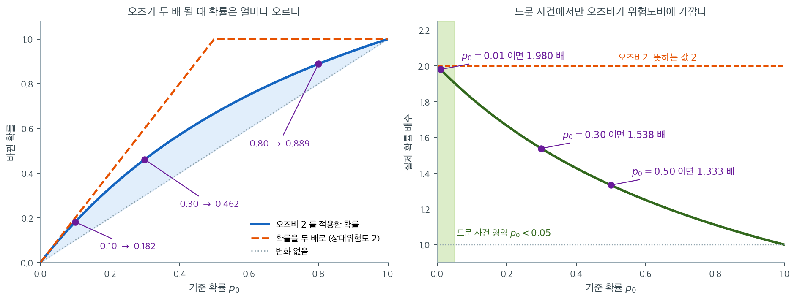
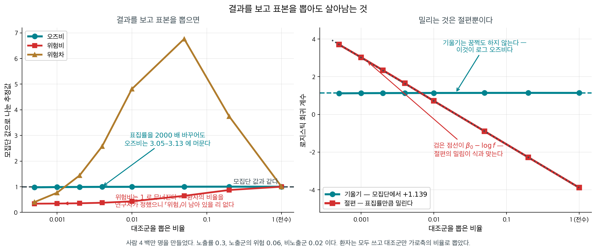

# 오즈비와 계수 해석


## 1. 오즈와 오즈비

계수 $\theta_j = 0.5$ 는 오즈에 $e^{0.5} \approx 1.649$ 를 곱하므로 오즈가 $64.9\%$ 늘어난다. 그러면 부호를 바꾼 $-0.5$ 는 $64.9\%$ 줄어들까. 아니다 — $e^{-0.5} \approx 0.606$ 이니 $39.4\%$ 줄어든다. 같은 크기의 계수가 늘릴 때와 줄일 때 다른 퍼센트를 내놓는 것이다. 계수를 퍼센트로 옮겨 읽는 일이 왜 이렇게 비대칭이며, 어디까지 말해도 되는가.

로지스틱 회귀에서 계수 $\theta_j$는 **오즈비**를 통해 직접 해석된다. 로짓 모형이 로그오즈를
설명변수의 선형함수로 놓는다는 점을 떠올리자.

$$
\operatorname{logit}\bigl(P(Y=1\mid\mathbf{x})\bigr) = \mathbf{x}^\top\boldsymbol{\theta}
$$

이는

$$
\log\left(\frac{p}{1-p}\right) = \mathbf{x}^\top\boldsymbol{\theta}
$$

와 같으며, 여기서 $p = P(Y=1\mid\mathbf{x})$이다.

---

## 2. 계수의 곱셈 효과

다른 특성을 모두 고정한 채 특성 $x_j$를 한 단위 늘리면 로그오즈가 $\theta_j$만큼 증가한다.
따라서 **오즈에는 $e^{\theta_j}$가 곱해진다.**

$$
\frac{\text{odds}_{\text{new}}}{\text{odds}_{\text{old}}} = e^{\theta_j}
$$

### 계수 0.5 는 오즈를 1.65 배로 만든다

어떤 설명변수의 계수가 $\theta_j = 0.5$이면, 그 변수가 한 단위 증가할 때 연체 오즈에
$e^{0.5} \approx 1.649$가 곱해진다. 즉 오즈가 약 64.9% 증가한다.

반대로 $\theta_j = -0.5$이면 오즈에 $e^{-0.5} \approx 0.606$이 곱해지므로 오즈가 39.4%
감소한다.

---

## 3. 계수 해석하기

**오즈비** $OR_j = e^{\theta_j}$는 직관적으로 다음과 같이 읽힌다.

| $\theta_j$ | $OR_j = e^{\theta_j}$ | 해석 |
|---|---|---|
| $-1.0$ | $\approx 0.368$ | 한 단위 증가마다 오즈가 63.2% 감소 |
| $-0.5$ | $\approx 0.606$ | 한 단위 증가마다 오즈가 39.4% 감소 |
| $0.0$ | $1.0$ | 오즈에 영향 없음 |
| $0.5$ | $\approx 1.649$ | 한 단위 증가마다 오즈가 64.9% 증가 |
| $1.0$ | $\approx 2.718$ | 한 단위 증가마다 오즈가 171.8% 증가 |

### 오즈비는 확률비가 아니다

표의 "오즈가 두 배"를 "확률이 두 배"로 옮겨 읽는 실수가 대단히 흔하다. 오즈비는 오즈에 곱해지는
수이지 확률에 곱해지는 수가 아니다. 아래 그림은 $OR = 2$ 하나를 여러 기준 확률에 적용해 본
것이다. 왼쪽은 바뀐 확률 자체, 오른쪽은 그것이 기준 확률의 몇 배인지를 그렸다.



왼쪽에서 기준 확률이 $0.10$이면 바뀐 확률은 $0.182$다. 두 배인 $0.20$에 못 미친다. 기준 확률이
$0.30$이면 $0.462$가 되어 $0.60$과는 한참 멀고, $0.80$이면 $0.889$로 올라 봐야 원래 값의 1.1배
남짓이다. 주황 파선이 "확률을 두 배로"인데, 파란 곡선은 $p_0$가 커질수록 그 선에서 빠르게
멀어진다. 애초에 확률을 두 배 한다는 규칙은 $p_0 > 0.5$에서 정의조차 되지 않는다. 확률은 1을
넘을 수 없지만 오즈는 얼마든지 커질 수 있고, 오즈비가 곱셈 규칙으로 아무 데서나 쓸 수 있는
이유가 바로 그 무한한 여유다.

오른쪽은 같은 이야기를 배수로 다시 쓴 것이다. $p_0 = 0.01$처럼 사건이 드물면 확률이 $1.980$배가
되어 오즈비 $2$와 사실상 같다. 그러나 $p_0 = 0.30$에서는 $1.538$배, $p_0 = 0.50$에서는
$1.333$배로 내려앉고, $p_0 \to 1$이면 배수가 $1$로 수렴한다. 연습문제 4에서 다룰 "오즈비는
드문 결과에서만 상대위험도에 가깝다"는 규칙이 이 곡선의 왼쪽 끝 한 구석이다.

실무에서 이 구분이 중요해지는 자리는 보고서다. $e^{\hat\beta_j} = 2$를 "위험이 두 배"로 적으면,
결과가 흔한 자료에서는 효과를 크게 부풀린 진술이 된다. 정확히 말하려면 오즈비를 그대로 보고하고
기준 확률을 함께 제시하거나, 관심 있는 $x$ 값에서 예측확률을 직접 계산해 보여 주는 편이 낫다.

<div class="exbox" markdown>

**보기 1.** <span class="diff easy" title="쉬움"></span> 오즈비는 하나인데 확률 변화는 하나가 아니다. 19.1절 [로짓 연결과 오즈](logit.md) $5$ 절의 카드 잔액 자료 — 잔액이 커질수록 연체 확률이 오르는 모의자료 $300$ 건 — 에 적합한 계수가 $\hat\beta_1 = 0.00321188$이다.

**(1)** \$1당 오즈비와 \$100당 오즈비를 구하시오. 또 잔액이 \$100 늘 때 **연체확률**은 얼마나 변하는가 — 하나의 수로 답할 수 있는가?

**(2)** 확률 변화가 가장 큰 자리와 그 크기를 구하고, 코드로 확인하시오.

</div>

??? success "풀이"

    **(1) 해석적으로.** 로지스틱 모형에서

    $$
    \log\frac{p(b)}{1 - p(b)} = \hat\beta_0 + \hat\beta_1 b
    $$

    이므로 $b$를 $\Delta$만큼 늘리면 로그오즈가 $\hat\beta_1\Delta$만큼 **더해지고**, 오즈에는 $e^{\hat\beta_1\Delta}$가 **곱해진다.** 따라서

    $$
    \text{OR}(\$1) = e^{0.00321188} = 1.003217,
    \qquad
    \text{OR}(\$100) = e^{0.321188} = 1.37876
    $$

    로 \$100당 오즈가 $37.88\%$ 늘어난다. **이 값은 $b$가 어디든 똑같다.** 로그오즈가 $b$의 일차함수이기 때문이다.

    **확률의 변화는 하나의 수로 답할 수 없다.** 미분하면

    $$
    \frac{dp}{db} = \hat\beta_1\, p(b)\bigl(1 - p(b)\bigr)
    $$

    인데 오른쪽이 $p$에 의존한다. **오즈비는 상수이지만 확률의 기울기는 상수가 아니다.** 이것이 로지스틱 계수를 "확률이 얼마씩 는다"로 읽으면 안 되는 이유다.

    **(2) 해석적으로.** $p(1-p)$는 $p = 1/2$에서 최댓값 $1/4$을 가지므로 기울기의 최댓값은

    $$
    \max_b \frac{dp}{db} = \frac{\hat\beta_1}{4} = \frac{0.00321188}{4} = 0.00080297
    $$

    이다. **이것이 흔히 쓰는 "$\beta/4$ 규칙"이다.** \$100 단위로 바꾸면 최대 기울기가 $0.0803$, 곧 \$100당 최대 $8.03$ 퍼센트포인트다. 그 자리는 $p = 1/2$인 곳, 곧 $b = -\hat\beta_0/\hat\beta_1 = 1238.83$이다.

    다만 $\beta/4$는 **접선**의 기울기라 폭이 \$100인 구간의 실제 변화보다 조금 크다. 시그모이드가 그 구간에서 오목하게 꺾이기 때문이다. 정확한 값은

    $$
    \sigma(0 + 0.321188) - \sigma(0) = 0.57962 - 0.5 = 0.07962
    $$

    로 $0.0803$보다 작다.

    **(2) 수치적으로.**

    ```python
    import numpy as np
    from sklearn.linear_model import LogisticRegression

    # 19.1절 5 절과 같은 자료, 같은 적합
    np.random.seed(42)
    balance = np.random.uniform(0, 2500, 300)
    default = np.random.binomial(1, 1 / (1 + np.exp(-(balance - 1250) / 300)))
    logistic_model = LogisticRegression(solver='lbfgs').fit(
        balance.reshape(-1, 1), default)

    # 계수가 아주 작으므로 1 달러당 오즈비는 1 에 가깝다. 이럴 때는 단위를
    # 바꿔 100 달러당으로 읽는 편이 뜻이 잘 통한다.
    odds_ratio = np.exp(logistic_model.coef_[0][0])
    print(f"Odds ratio per $1 increase: {odds_ratio:.4f}")
    print(f"Percentage increase in odds per $100: "
          f"{(np.exp(100 * logistic_model.coef_[0][0]) - 1) * 100:.2f}%")

    b0_hat = logistic_model.intercept_[0]
    b1_hat = logistic_model.coef_[0][0]
    sigmoid = lambda z: 1 / (1 + np.exp(-z))

    print(f"\n최대 기울기 beta/4 = {b1_hat / 4:.8f} (/$1)"
          f"  ->  {100 * b1_hat / 4:.4f} (/$100)")
    print("\nBalance    p(b)    오즈비($100)   확률 변화(+$100)")
    for b in [400, 900, 1238.83, 1600, 2100]:
        p_here = sigmoid(b0_hat + b1_hat * b)
        p_next = sigmoid(b0_hat + b1_hat * (b + 100))
        odds_here = p_here / (1 - p_here)
        odds_next = p_next / (1 - p_next)
        print(f"{b:8.1f}  {p_here:.4f}      {odds_next / odds_here:.5f}"
              f"         {p_next - p_here:.4f}")
    ```

    출력:

    ```
    Odds ratio per $1 increase: 1.0032
    Percentage increase in odds per $100: 37.88%

    최대 기울기 beta/4 = 0.00080297 (/$1)  ->  0.0803 (/$100)

    Balance    p(b)    오즈비($100)   확률 변화(+$100)
       400.0  0.0633      1.37876         0.0219
       900.0  0.2519      1.37876         0.0652
      1238.8  0.5000      1.37876         0.0796
      1600.0  0.7613      1.37876         0.0534
      2100.0  0.9408      1.37876         0.0156
    ```

    표의 셋째 칸이 다섯 줄 모두 **$1.37876$으로 똑같다.** 유도한 $e^{100\hat\beta_1}$이 $b$에 의존하지 않는다는 것이 그대로 확인된다. 반면 넷째 칸은 $0.0156$에서 $0.0796$까지 **다섯 배 넘게** 흔들린다. $p = 0.5$ 근처에서 가장 크고 양 끝으로 갈수록 작아지는 모양이 시그모이드의 S자 그 자체다.

    $p = 0.5$ 자리의 $0.0796$이 $\beta/4$가 준 상한 $0.0803$보다 $0.9\%$ 작다. 접선과 할선의 차이이며, $\beta/4$를 **상한**이라 부르는 이유가 여기 있다.

    \$1당 오즈비 $1.0032$는 거의 $1$이라 실감이 나지 않는다. **오즈비는 설명변수의 단위에 의존하므로, 의미 있는 크기의 단위로 바꾸어 보고해야 한다.**

<div class="storybox" markdown>

**그림으로 보는 통계학 1.** 그러면 왜 굳이 오즈비를 쓰는가

위의 경고를 읽고 나면 당연한 물음이 남는다. 읽기 어렵고, 오해를 부르고, 확률비도 아닌 양을 **왜 쓰는가?** 그냥 위험비를 보고하면 되지 않는가.

답은 $1951$ 년에 **콘필드**가 냈다. 이 책 [10.4절](../../ch10/causation/causal_criteria.md)에서 「교란일 수도 있다」에 수를 붙인 그 사람이다.

드문 병을 생각해 보자. 발생률이 $2\%$ 라면 무작위로 만 명을 모아도 환자가 이백 명이다. 그래서 역학에서는 **환자–대조 설계**를 쓴다 — 환자를 먼저 다 모으고, 대조군을 따로 적당히 모은다.

이 설계에서는 **「위험」을 복구할 수 없다.** 표본 안의 환자 비율을 자료가 아니라 **연구자가 정했기** 때문이다. 대조군을 두 배로 모으면 표본의 「발생률」이 절반이 된다.

**그런데 오즈비는 그대로 남는다.**

<figure markdown>
{ width="900" }
  <figcaption markdown>사람 $4$ 백만 명을 만들어 환자는 모두 쓰고 대조군만 가로축의 비율로 뽑았다. 세 측도를 모집단 값으로 나누어 그렸다.</figcaption>
</figure>

| 대조군 표집률 | 오즈비 | 위험비 | 위험차 |
|---|---|---|---|
| $1$ (전수) | $3.124$ | $2.996$ | $0.0400$ |
| $0.05$ | $3.125$ | $1.933$ | $0.2708$ |
| $0.01$ | $3.113$ | $1.287$ | $0.1925$ |
| $0.0005$ | $3.053$ | $1.016$ | $0.0160$ |

**표집률을 $2000$ 배 바꾸는 동안 오즈비는 $3.1$ 에 머문다.** 위험비는 $3.00$ 에서 $1.02$ 로 무너지고, 위험차는 올랐다가 내리며 아무 데도 수렴하지 않는다.

로지스틱 회귀로 보면 더 깔끔하다.

| | 절편 | 기울기 |
|---|---|---|
| 모집단 | $-3.889$ | $\mathbf{+1.139}$ |
| 표집률 $0.05$ | $-0.894$ | $\mathbf{+1.140}$ |
| 표집률 $0.002$ | $+2.343$ | $\mathbf{+1.130}$ |

**기울기는 꿈쩍도 하지 않고 절편만 정확히 $-\log f$ 만큼 밀린다.** 그림 오른쪽의 검은 점선이 그 예측이고, 붉은 점들이 그 위에 그대로 올라앉는다.

까닭은 식에 있다. 결과 $Y$ 를 보고 표집률을 달리하면 로그오즈에 상수가 더해질 뿐이고, 그 상수는 **절편이 통째로 흡수한다.** $x$ 에 붙은 계수는 손대지 않는다. 그리고 $x$ 에 붙은 계수가 바로 로그 오즈비다.

**로지스틱 회귀가 역학의 일꾼이 된 까닭이 이것이다.** 위험비를 쓰고 싶어도 환자–대조 자료에서는 쓸 수가 없다. 오즈비는 그 설계를 견디는 **유일한** 양이고, 그래서 읽기 불편한 값을 백 년 가까이 참고 쓰는 것이다.

다만 값을 치른다. 위에서 본 대로 오즈비는 결과가 흔할수록 위험비를 부풀린다. 그래서 역학 논문이 **희귀질병 가정**을 적어 두는 것이다 — 발생률이 낮으면 오즈비와 위험비가 가까워진다는 조건이고, 이 조건이 깨지면 오즈비를 위험비처럼 읽어서는 안 된다.

_확인한 곳 — 콘필드의 $1951$ 년 논문이 **희귀질병 가정**을 세워 환자–대조 자료의 오즈비를 상대위험의 근사로 쓸 수 있게 한 것, 발생률이 낮으면 오즈비가 상대위험에 가까워진다는 것. 두 표의 수는 모두 직접 모의실험한 값이다_

</div>

---

## 4. 대출 연체 예측

대출 연체 연구에서 추정된 계수가 다음과 같다고 하자.

| 특성 | 계수 | 오즈비 | 해석 |
|---|---|---|---|
| payment_inc_ratio | $0.0797$ | $e^{0.0797} \approx 1.083$ | 한 단위 증가마다 오즈 8.3% 증가 |
| borrower_score | $-4.6126$ | $e^{-4.6126} \approx 0.0098$ | 한 단위 증가마다 오즈 99% 감소 |
| small_business | $1.2153$ | $e^{1.2153} \approx 3.373$ | 기준범주 대비 오즈 237% 증가 |

소득 대비 상환액 비율이 높을수록 연체 위험이 커지고, 차입자 점수가 높을수록 위험이 급격히
줄어든다. 사업 자금 목적 대출은 기준범주인 신용카드 목적 대출보다 연체 위험이 훨씬 높다.

---

## 5. 오즈비의 신뢰구간

최대가능도 추정으로 추론할 때 계수 $\theta_j$의 표준오차와 신뢰구간을 얻는다. 이를 오즈비의
신뢰구간으로 변환할 수 있다.

$\theta_j$의 95% 신뢰구간이 $[\theta_j^L, \theta_j^U]$이면 $OR_j = e^{\theta_j}$의 95%
신뢰구간은

$$
[e^{\theta_j^L}, e^{\theta_j^U}]
$$

이다.

**중요:** $OR_j$의 신뢰구간이 1.0을 포함하지 않으면, 해당 신뢰수준에서 계수 $\theta_j$가 0과
통계적으로 유의하게 다르다는 뜻이다.

---

## 6. 범주형 특성과 기준범주 부호화

범주형 변수(예: 주택 소유 형태)에 원–핫 부호화나 기준범주 부호화를 쓰면, 계수는 **기준범주에
대한 상대적 변화**를 나타낸다. 다중공선성을 피하기 위해 생략한 기준범주는 암묵적으로 계수가 0,
오즈비가 1이다.

예를 들어 "MORTGAGE"가 기준범주이고 "RENT"의 계수가 $0.157$이면, (담보대출로 소유하는 경우에
비해) 임차는 연체 오즈를 $e^{0.157} - 1 \approx 17\%$ 높인다.

---

## 7. 통계적 유의성

계수가 0과 유의하게 다른지 검정하려면 다음을 쓴다.

- **왈드 검정:** $Z = \theta_j / \text{SE}(\theta_j) \sim N(0,1)$
- **가능도비 검정:** 내포모형들의 로그가능도를 비교한다.

두 방법 모두 `statsmodels` 같은 통계 패키지에 구현되어 있으며 가설검정을 위한 p-값을 제공한다.

---

## 연습문제

<div class="drillbox" markdown>

**연습문제 1.** <span class="diff easy" title="쉬움"></span>
어떤 로지스틱 회귀에서 이항 설명변수의 계수가 $\hat{\beta}_1 = 0.693$이다. 오즈비를 계산하고
해석하라.

</div>

??? success "풀이"
    오즈비는 $\text{OR} = e^{\hat{\beta}_1} = e^{0.693} = 2.0$이다.

    해석: 다른 변수를 고정할 때, $X = 1$인 집단의 결과(예: 발병) 오즈가 $X = 0$인 집단의 2배다.
    달리 말해 그 요인이 있으면 오즈가 두 배가 된다.

    주의: $\text{OR} = 2$는 확률이 두 배가 된다는 뜻이 **아니다.** 기준 확률이 10%(오즈 0.111)
    라면 새 오즈는 0.222이고 확률은 $0.222/1.222 = 18.2\%$로, 두 배에 못 미친다.

---

<div class="drillbox" markdown>

**연습문제 2.** <span class="diff easy" title="쉬움"></span>
심장질환에 대한 로지스틱 회귀에 연속형 변수인 나이가 들어 있고
$\hat{\beta}_{\text{age}} = 0.05$이다. 이 계수를 오즈비로 해석하라.

</div>

??? success "풀이"
    나이 1년 증가당 오즈비는 $e^{0.05} = 1.051$이다. 즉 나이가 한 살 많아질 때마다 심장질환
    오즈가 약 5.1% 증가한다.

    10년 증가라면 $\text{OR}_{10} = e^{10 \times 0.05} = e^{0.5} = 1.649$이다. 열 살 많은
    사람은 심장질환 오즈가 약 65% 높다.

    이 곱셈적 해석이 핵심이다. 1년마다 오즈에 1.051이 곱해지므로 나이 차이가 커지면 효과가
    복리처럼 누적된다.

---

<div class="drillbox" markdown>

**연습문제 3.** <span class="diff easy" title="쉬움"></span>
어떤 오즈비의 95% 신뢰구간이 $(0.85, 1.42)$이다. 이 설명변수의 통계적 유의성에 대해 무엇을
알 수 있는가?

</div>

??? success "풀이"
    오즈비의 신뢰구간이 1.0을 포함하므로 $\alpha = 0.05$에서 효과는 **통계적으로 유의하지
    않다.** OR $= 1.0$은 연관이 없음($\beta = 0$)에 대응하며, 이것이 구간에 포함되어 있으므로
    $H_0: \text{OR} = 1$을 기각할 수 없다.

    동등하게 $\beta$의 신뢰구간은 $(\ln 0.85, \ln 1.42) = (-0.163, 0.351)$이고 0을 포함한다.

    결과는 이 설명변수의 효과가 작고 유의하지 않음을 시사한다. 점추정치
    OR $= \sqrt{0.85 \times 1.42} \approx 1.10$은 완만한 양의 연관을 가리키지만, 자료는 효과가
    없거나 심지어 약한 음의 효과인 경우와도 양립한다.

    !!! note "왜 기하평균인가"
        점추정치를 산술평균 $(0.85+1.42)/2 = 1.135$가 아니라 기하평균으로 구한 이유는, 신뢰구간이
        오즈비 척도가 아니라 **로그오즈비 척도에서 대칭**이기 때문이다.
        $\hat\beta = (\ln 0.85 + \ln 1.42)/2$이고 이를 지수화하면 곧 기하평균
        $\sqrt{0.85 \times 1.42}$가 된다.

---

<div class="drillbox" markdown>

**연습문제 4.** <span class="diff med" title="중간"></span>
오즈비와 상대위험도의 차이를 설명하라. 둘은 언제 거의 같아지는가?

</div>

??? success "풀이"
    **오즈비**는 $\text{OR} = \frac{p_1/(1-p_1)}{p_0/(1-p_0)}$이고, **상대위험도**는
    $\text{RR} = p_1/p_0$이다.

    결과가 드물 때($p_0$과 $p_1$이 모두 작을 때) 둘은 거의 같다. $p \ll 1$이면 오즈 $\approx p$
    이므로 $\text{OR} \approx \text{RR}$이다.

    결과가 흔하면($p > 10\%$) OR는 RR에 비해 연관을 과장한다. 예컨대 $p_0 = 0.3$, $p_1 = 0.5$
    이면 $\text{RR} = 1.67$이지만 $\text{OR} = (0.5/0.5)/(0.3/0.7) = 2.33$이다. OR가 상대적
    증가를 부풀려 보여준다.

    로지스틱 회귀는 RR가 아니라 OR를 직접 추정한다. 드문 결과에서는 이 구분이 사소하지만, 흔한
    결과에서는 로그이항 회귀나 로버스트 표준오차를 쓰는 푸아송 회귀로 RR를 직접 추정하는 편이
    낫다.

---

## 정리하며

계수는 **오즈비**로 읽는다.

$$
e^{\beta_j}=\text{다른 변수를 고정한 채 } x_j \text{ 가 1 늘 때의 오즈비}
$$

- **$\beta_j$ 는 로그오즈의 변화**이고 $e^{\beta_j}$ 가 오즈의 배수다. $e^{\beta_j}=1$ 이면 효과가 없다.
- **오즈비는 확률비가 아니다.** 흔한 혼동이며, 사건이 드물 때($p$ 가 작을 때)만 상대위험에 가까워진다.
- **신뢰구간은 로그 척도에서 만들어 지수변환한다.** 로그오즈 척도에서 대칭인 구간이 오즈비 척도에서는 비대칭이 되며, 그 순서가 옳다.
- **곱셈적으로 작동한다.** $x_j$ 가 2 늘면 오즈가 $e^{2\beta_j}$ 배가 된다.
- **인과 해석에는 여전히 10장의 조건이 필요하다.** 오즈비가 크다고 원인인 것이 아니다.

다음 절 **[가능도](likelihood.md)**로 넘어간다.
