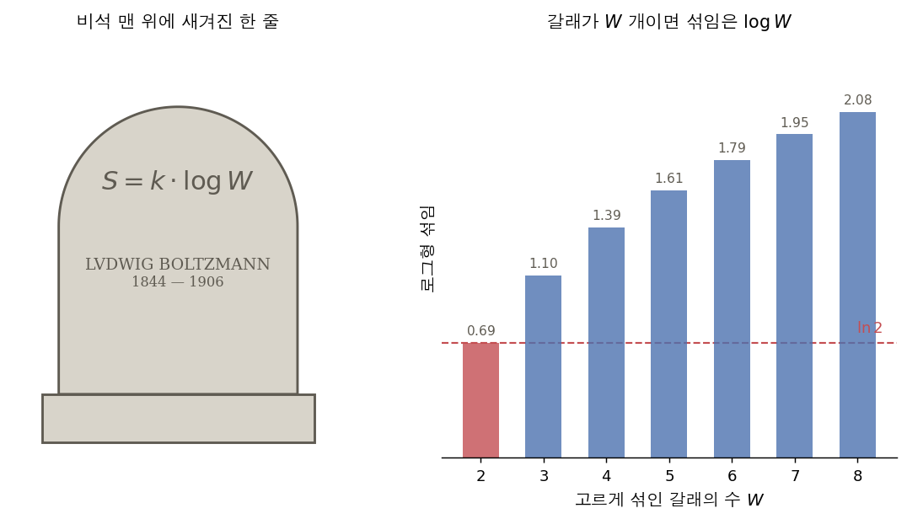
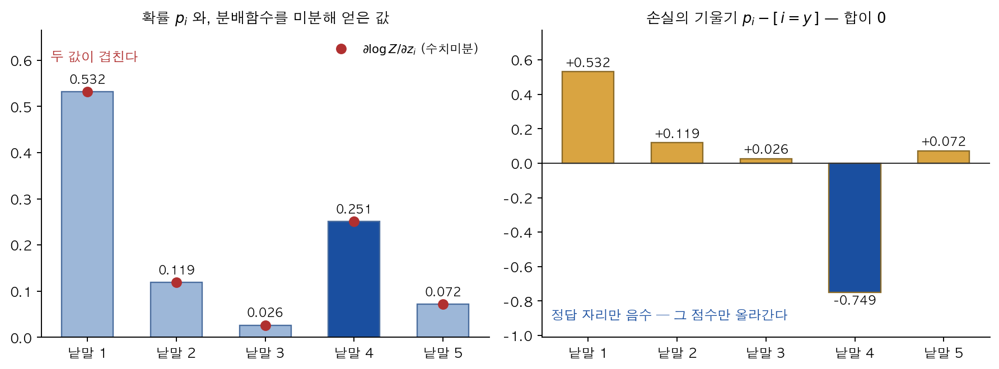
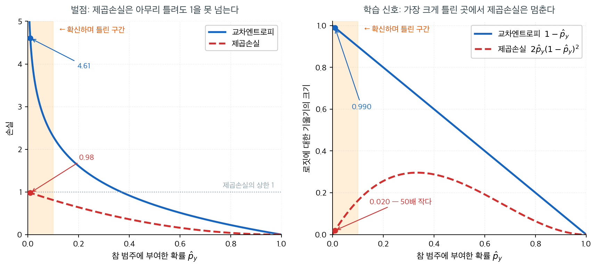
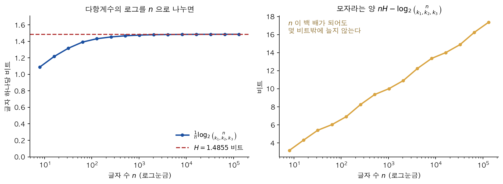

# 교차엔트로피 손실


아무것도 배우지 않은 모형, 곧 모든 범주에 똑같이 $1/C$ 를 주는 모형의 손실은 정확히 $\log C$ 다. 그래서 학습 곡선의 첫 값이 $\log C$ 근처가 아니면 코드가 틀린 것이고, 거꾸로 $\log C$ 아래로 내려가지 않으면 모형이 아무것도 배우지 못한 것이다 — **기준선이 식 안에 들어 있다.** 이 손실이 왜 하필 그 꼴이어야 하는지, 그리고 그 꼴이 기울기를 얼마나 간결하게 만드는지가 이 쪽의 내용이다.

<div class="defn" markdown>

### 정의 1. 범주형 교차엔트로피 손실 { .dfn }

관측치 $n$개와 범주 $C$개에 대해 **범주형 교차엔트로피 손실**은

$$
J = -\sum_{i=0}^{n-1}\sum_{c=0}^{C-1} y_{ic}\,\log\hat{y}_{ic}
$$

이다. 여기서 $\mathbf{Y}$는 $n\times C$ 원–핫 이름표 행렬이고 $\hat{\mathbf{Y}}$는 소프트맥스가
낸 $n\times C$ 예측확률 행렬이다.

</div>

<div class="storybox" markdown>

**그림으로 보는 통계학 1.** 묘비에 새긴 로그 하나

<figure markdown>
  { width=880 }
  <figcaption markdown>왼쪽은 비석의 형식만 빌려 그 한 줄을 새겨 본 것이다(실물을 옮겨 그린 것이 아니고, 얼굴은 그리지 않는다). 다만 글자는 실물을 따라 적었다 — 이름이 $\mathrm{U}$ 가 아니라 $\mathrm{V}$ 로 새겨져 있다. 오른쪽에서 갈래가 $W$ 개이고 고르게 섞였을 때의 로그형 섞임이 정확히 $\log W$ 이며, 붉은 막대 $W=2$ 의 높이가 $\ln 2=0.69\cdots$ 다.</figcaption>
</figure>

정의 1 이 **손실**이라 부르는 $-\sum_c y_{ic}\log\hat y_{ic}$ 는 이 쪽 안에서는 모형을 고치는 눈금이지만, 밖에서는 훨씬 오래된 이름을 가지고 있다. **엔트로피**다. 앞에 「교차」가 붙은 것은 두 분포 $\mathbf y_i$ 와 $\hat{\mathbf y}_i$ 를 엇갈려 넣었다는 뜻이고, 두 자리에 같은 분포를 넣은

$$
H(\mathbf p)=-\sum_c p_c\log p_c
$$

가 그냥 엔트로피다. 빈 중앙묘지에 있는 **루트비히 볼츠만** $(1844\text{–}1906)$ 의 비석에는 이름보다 위에 식 한 줄이 새겨져 있다.

> $S = k \cdot \log W$

읽는 법은 이렇다. 어떤 상태가 똑같이 그럴듯한 $W$ 가지로 갈릴 수 있을 때, 그 섞인 정도는 $\log W$ 에 비례한다. $k$ 는 단위를 맞추는 상수일 뿐이므로, 수학으로 남는 것은 **로그 하나**다.

이 쪽의 식과 어디서 만나는가. 위의 $H$ 에 고른 분포 $p_c=\frac1C$ 를 넣으면 $C$ 개의 항이 저마다 $\frac1C\log C$ 이므로 합이 $\log C$ 다. 비석의 $\log W$ 가 바로 이 값이다. 그래서 **아무것도 배우지 않은 모형이 $C$ 갈래에서 내는 손실이 $\log C$** 이고($C=10$ 이면 $2.303$), 학습을 시작할 때 찍히는 첫 손실이 그 수에 가까운지 보는 것이 가장 값싼 점검이다. 특히 $C=2$ 이면 $\ln 2=0.693$ 이다 — 「반반일 때 가장 섞였다」와 「두 갈래이면 섞임이 $\log 2$ 다」는 같은 문장이다.

반대쪽 끝도 비석이 말해 준다. $W=1$ 이면 $\log W=0$ 이다. $3$ 절이 교차엔트로피를 $H(\mathbf y_i)+D_{\mathrm{KL}}(\mathbf y_i\Vert\hat{\mathbf y}_i)$ 로 가르고 「원–핫 이름표에서는 $H(\mathbf y_i)=0$」이라 적는 것이 바로 그 자리다. 정답이 한 갈래로 확정되어 있으면 갈릴 데가 없으니 섞임이 $0$ 이고, 그래서 남는 것이 KL 발산뿐이다.

새긴 사람은 그가 아니다. 볼츠만은 $1906$ 년에 죽어 처음에는 빈의 되블링 묘지에 묻혔고, $1929$ 년에 중앙묘지의 명예묘로 옮겨진 뒤 $1933$ 년 $7$ 월 $4$ 일에 지금의 묘비가 제막되면서 이 줄이 올라갔다. 그가 살아서 이 꼴로 적은 적도 없다 — 볼츠만이 세운 것은 $1872$–$1875$ 년의 일이고, $\log$ 앞의 $k$ 를 넣어 지금 꼴로 쓴 사람은 $1900$ 년 무렵의 플랑크다.

*확인한 곳 — [Wikipedia 「Boltzmann's entropy formula」](https://en.wikipedia.org/wiki/Boltzmann%27s_entropy_formula) — 식이 빈 중앙묘지의 묘비에 새겨져 있다는 것, 그리고 볼츠만이 $1872$–$1875$ 년에 세운 것을 $1900$ 년 무렵 지금 꼴로 적은 사람이 플랑크라는 것 · [독일어 위키백과 「Ludwig Boltzmann」 의 "Posthume Ehrungen"](https://de.wikipedia.org/wiki/Ludwig_Boltzmann#Posthume_Ehrungen) — $1929$ 년에 되블링 묘지에서 중앙묘지의 명예묘로 옮겼고 $1933$ 년 $7$ 월 $4$ 일에 지금의 묘비를 제막했다는 것 · 맨 위 줄이 $S=k\cdot\log W$ 이고 그 아래 이름이 $\mathrm{LVDWIG\ BOLTZMANN}$, $1844$–$1906$ 으로 새겨져 있다는 것은 [묘지 사진](https://commons.wikimedia.org/wiki/File:Zentralfriedhof_Vienna_-_Boltzmann.JPG)(Daderot 촬영, CC BY-SA 3.0)에서 직접 읽었다*

</div>

---

## 1. 기울기 dJ/dZ^o의 유도

이 기울기는 소프트맥스 층을 거치는 역전파의 출발점이며 놀랄 만큼 단순한 형태를 갖는다.

### 1단계 --- 손실 다시 쓰기

$\hat{y}_{ic} = e^{z_{ic}^o}\big/\sum_{c'}e^{z_{ic'}^o}$이므로

$$
J = -\sum_i\sum_c y_{ic}\,z_{ic}^o + \sum_i\sum_c y_{ic}\,\log\sum_{c'}e^{z_{ic'}^o}
$$

이고, $\sum_c y_{ic}=1$(원–핫)이므로

$$
J = -\sum_i\sum_c y_{ic}\,z_{ic}^o + \sum_i\log\sum_{c'}e^{z_{ic'}^o}
$$

이다.

### 2단계 --- 미분하기

$$
\frac{\partial J}{\partial z_{ic}^o}
= -y_{ic} + \frac{e^{z_{ic}^o}}{\sum_{c'}e^{z_{ic'}^o}}
= \hat{y}_{ic} - y_{ic}
$$

### 행렬 형태

$$
\frac{\partial J}{\partial \mathbf{Z}^o}
= \hat{\mathbf{Y}} - \mathbf{Y}
$$

이는 이항 로지스틱 회귀에 나타나는 "예측값 빼기 목표값" 잔차와 같은 형태다. 소프트맥스와
교차엔트로피의 조합은 범주 수와 무관하게 깔끔한 기울기를 만들어 낸다.

<div class="aibox" markdown>

**AI로 보는 통계학 1.** 분배함수를 미분하면 확률이 떨어져 나온다

위 두 걸음을 물리 쪽 말로 옮기면 한 줄이 된다 — **합을 미분하면 각 항에 무게가 붙는다.**
$1$ 단계에서 나온 $\log\sum_{c'}e^{z_{ic'}}$ 의 안쪽 합

$$
Z=\sum_{j}e^{z_j}
$$

를 **분배함수**라 하고, 그 로그를 $z_i$ 로 미분하면

$$
\frac{\partial \log Z}{\partial z_i}=\frac{1}{Z}\cdot e^{z_i}=p_i
$$

다. **미분 한 번이 그 항의 확률을 떨어뜨려 놓는다** — 붙는 무게가 「그 항이 전체에서
차지하는 몫」인 것이다. 손실이 $L=-z_y+\log Z$ 이므로 기울기가 $p_i-[\,i=y\,]$, 곧
$2$ 단계의 결과로 곧장 떨어진다.

그런데 이 관점이 공짜로 얹어 주는 것이 둘 더 있다. 아래에서 확인한다.

```python
import numpy as np

z = np.array([2.0, 0.5, -1.0, 1.25, 0.0])        # 다섯 갈래의 점수
y = 3                                             # 정답은 네 번째
logZ = lambda v: np.log(np.exp(v).sum())          # 분배함수의 로그
p = np.exp(z) / np.exp(z).sum()                   # 소프트맥스 확률 — 곧 식으로 얻은 d logZ/dz

eps = 1e-6                                        # 같은 값을 수치미분으로도 구해 맞추어 본다
num = np.array([(logZ(z + eps * np.eye(len(z))[i])
               - logZ(z - eps * np.eye(len(z))[i])) / (2 * eps)
                for i in range(len(z))])

grad = p - np.eye(len(z))[y]                      # 교차엔트로피의 기울기 = 확률 - 정답

row = lambda name, v, s="": print(f"{name:<22}", " ".join(f"{x:{s}.6f}" for x in v))
row("d logZ/dz (식) = p", p)                      # 미분이 떨어뜨려 놓는 값
row("d logZ/dz (수치미분)", num)                   # 두 줄이 자리마다 겹쳐야 한다
row("손실의 기울기 p-[i=y]", grad, "+")            # 정답 자리에서만 음수
print(f"{'기울기의 합':<22}", f"{grad.sum():.1e}", " (언제나 0)")
```

실행하면 다음이 나온다.

```text
d logZ/dz (식) = p      0.531740 0.118647 0.026474 0.251176 0.071963
d logZ/dz (수치미분)       0.531740 0.118647 0.026474 0.251176 0.071963
손실의 기울기 p-[i=y]        +0.531740 +0.118647 +0.026474 -0.748824 +0.071963
기울기의 합                 -1.4e-17  (언제나 0)
```

식으로 얻은 첫 줄과 수치미분한 둘째 줄이 자리마다 소수 여섯째 자리까지 겹친다 —
$\dfrac{\partial\log Z}{\partial z_i}$ 가 정말로 $p_i$ 라는 것이다.

**첫째로 얹어 주는 것.** 넷째 줄이 보이듯 한 관측치의 기울기 다섯 개를 더하면 $0$ 이다.
$\hat{\mathbf Y}-\mathbf Y$ 의 **각 행의 합이 언제나 $0$** 이라는 뜻이고, 까닭은 확률의 합이
$1$ 로 묶여 있기 때문이다. 그래서 한 갈래의 점수를 올리면 나머지가 반드시 함께 내려간다.
범주마다의 로짓이 따로 노는 것이 아니라 한 덩어리로 움직이고, 소프트맥스 모형의 모수가
$C$ 벌이 아니라 사실상 $C-1$ 벌인 것도 같은 사실의 다른 얼굴이다.

<figure markdown>
  { width=840 }
  <figcaption markdown>왼쪽 — 식으로 얻은 확률과 $\log Z$ 를 수치미분한 값이 자리마다 겹친다. 오른쪽 — 손실의 기울기는 정답 자리에서만 음수이고 막대의 합이 $0$ 이다. 합이 $0$ 인 것은 확률의 합이 $1$ 로 묶여 있기 때문이고, 그래서 한 낱말의 점수를 올리면 나머지가 함께 내려간다.</figcaption>
</figure>

**둘째로 얹어 주는 것.** 한 번 더 미분하면

$$
\frac{\partial^2 \log Z}{\partial z_i\,\partial z_j}=p_i\,[\,i=j\,]-p_ip_j
$$

가 되어 확률들의 **분산과 공분산**이 나온다. 이것이 소프트맥스의 야코비이고, $2$ 절에서
제곱손실의 기울기를 $\hat p_y(1-\hat p_y)$ 로 눌러 버리던 바로 그 인자다. 교차엔트로피는
로그의 미분 $1/\hat p_y$ 가 이 인자를 정확히 지워 주기 때문에 잔차만 남는다. 미분을 한 번
할 때마다 한 차수 높은 적률이 떨어져 나오는 것이 분배함수의 성질이다.

다만 이 모든 것은 **$Z$ 를 실제로 더할 수 있을 때의 이야기**다. 범주가 수만이어도 유한하므로
한 번에 더할 수 있지만, 더해야 할 대상이 문장 전체처럼 사실상 끝이 없으면 $\log Z$ 를 적을
수 없고, 그때부터는 이 깔끔한 한 줄 대신 표본으로 어림하는 방법을 쓸 수밖에 없다.

</div>

---

## 2. 왜 하필 교차엔트로피인가

"$\hat{\mathbf{Y}} - \mathbf{Y}$라는 깔끔한 꼴이 나와서"는 절반의 답이다. 나머지 절반은 그
깔끔함이 **어디에서 학습을 살려 내는가**에 있다. 참 범주에 부여한 확률을 $\hat{p}_y$라 두고,
교차엔트로피 $-\log\hat{p}_y$와 제곱손실 $(1-\hat{p}_y)^2$을 나란히 그려 보자.



왼쪽 그림이 **벌점**의 차이다. 모형이 참 범주에 $\hat{p}_y = 0.01$만 주는, 즉 확신하며 틀린
사례에서 교차엔트로피는 $4.61$이지만 제곱손실은 $0.98$에 그친다. 제곱손실은 $\hat{p}_y \to 0$
에서도 $1$을 넘지 못한다. 회색 점선이 그 상한이다. 확률이 아무리 터무니없어도 벌점의 크기가
유한하게 묶여 있다는 뜻이며, 반대로 교차엔트로피는 $-\log \hat p_y \to \infty$로 발산한다.
"자신 있게 틀리는 것"을 원리적으로 금지하는 쪽은 교차엔트로피뿐이다.

오른쪽 그림이 더 결정적이다. 최적화가 실제로 쓰는 것은 손실값이 아니라 **기울기**다. 로짓
$z_y$에 대한 기울기의 크기는 교차엔트로피가 $1-\hat{p}_y$, 제곱손실이
$2\hat{p}_y(1-\hat{p}_y)^2$이다. $\hat{p}_y = 0.01$에서 앞의 것은 $0.990$으로 거의 최대치인데
뒤의 것은 $0.0196$으로 **50배나 작다**. 제곱손실의 기울기는 $\hat{p}_y = 1/3$에서 $8/27
\approx 0.296$으로 최대가 되고, 양쪽 끝에서 모두 0으로 눌린다. 소프트맥스 야코비에서 남은
$\hat p_y(1-\hat p_y)$ 인자가 원흉이다.

이 그림이 말하는 바는 한 문장으로 요약된다. **제곱손실을 쓰면 모형이 가장 크게 틀린 곳에서
학습이 가장 느려진다.** 고쳐야 할 사례일수록 갱신량이 0에 가까워지니, 나쁜 초기값에서 출발하면
빠져나오는 데 오래 걸린다. 교차엔트로피는 야코비의 $\hat p_y(1-\hat p_y)$가 로그의 미분
$1/\hat p_y$와 정확히 소거되어 기울기가 잔차 $\hat{p}_y - y$만 남는다. 앞 절에서 본 그 간결한
식은 우연한 대수적 행운이 아니라, 틀린 만큼 그대로 벌하겠다는 설계의 결과다.

---

## 3. KL 발산과의 관계

교차엔트로피는

$$
H(\mathbf{y}_i,\hat{\mathbf{y}}_i)
= H(\mathbf{y}_i) + D_{\mathrm{KL}}(\mathbf{y}_i\|\hat{\mathbf{y}}_i)
$$

로 분해된다. 원–핫 이름표에서는 $H(\mathbf{y}_i)=0$이므로, 교차엔트로피를 최소화하는 것은 참
분포와 예측 분포 사이의 KL 발산을 최소화하는 것과 같다.

<div class="aibox" markdown>

**AI로 보는 통계학 2.** 같은 성적을 두 가지 단위로 적는다

정의 1 도 위의 분해도 그냥 $\log$ 라고만 적었다. 밑을 정해 주지 않았는데 그래도 되는 까닭이
로그의 밑변환

$$
\log_a x=\frac{\ln x}{\ln a}
$$

이다. 「밑을 바꾸면 상수배만 달라진다」는 이 한 줄이, 요즘 언어모델을 다루는 자리에서는
**단위 환산표**로 쓰인다.

모델이 글을 얼마나 잘 맞히는지는 **다음 낱말의 확률분포가 얼마나 뾰족한가**로 잰다.
그 뾰족함을 재는 수가 엔트로피인데, 로그를 쓰므로 밑을 정해야 하고 **밑마다 단위 이름이
다르다.** 밑이 $e$ 면 **내트**(nat), 밑이 $2$ 면 **비트**(bit)다. 학습할 때 찍히는 손실값은
거의 언제나 내트이고, 압축률을 말할 때는 비트를 쓴다. 둘은 다른 값이지만 다른 성적이
아니다.

```python
import numpy as np

rng = np.random.default_rng(0)                   # 씨앗을 고정해 늘 같은 값이 나오게
p = rng.dirichlet(np.ones(50_000) * 0.3)         # 낱말 5 만 개에 대한 다음 낱말 분포

H_nat = -(p * np.log(p)).sum()                   # 밑이 e — 단위는 내트
H_bit = -(p * np.log2(p)).sum()                  # 밑이 2 — 단위는 비트

print(f"내트로 잰 엔트로피 : {H_nat:.4f}")
print(f"비트로 잰 엔트로피 : {H_bit:.4f}")
print(f"비 H_bit / H_nat   : {H_bit / H_nat:.6f}")
print(f"1 / ln 2           : {1 / np.log(2):.6f}")

# 같은 값을 두 밑으로 되돌리면 하나의 수로 만난다 — 그것이 혼란도다
print(f"e^(내트)  = {np.exp(H_nat):.2f}")
print(f"2^(비트)  = {2 ** H_bit:.2f}")
```

실행하면 다음이 나온다.

```text
내트로 잰 엔트로피 : 9.7883
비트로 잰 엔트로피 : 14.1215
비 H_bit / H_nat   : 1.442695
1 / ln 2           : 1.442695
e^(내트)  = 17823.30
2^(비트)  = 17823.30
```

셋째 줄과 넷째 줄이 소수 여섯째 자리까지 같다. 두 엔트로피의 비는 분포가 무엇이든
언제나 $\dfrac{1}{\ln 2}=1.442695\cdots$ 이고, 이것이 바로 밑변환
$\log_2 x=\dfrac{\ln x}{\ln 2}$ 다.
**밑을 바꾸는 일은 눈금의 이름을 바꾸는 일일 뿐 잰 대상을 바꾸지 않는다.**

학습에서도 그렇다. 정의 1 의 $J$ 를 어느 밑으로 재든 그 값을 가장 작게 하는
$\hat{\mathbf Y}$ 는 같다. 밑을 바꾸는 것은 손실에 양수 상수를 곱하는 일일 뿐이라
$1$ 절의 기울기 $\hat{\mathbf Y}-\mathbf Y$ 도 그 상수배로만 달라지고, 보폭을 그만큼 줄이면
완전히 같은 학습이 된다. 손실값을 보고할 때 단위를 적어야 하는 까닭은 **견주기 위해서**이지
학습이 달라져서가 아니다.

마지막 두 줄은 $a^{x}=e^{x\ln a}$ 를 거꾸로 쓴 것이다. 내트 값을
$e$ 로 되돌리든 비트 값을 $2$ 로 되돌리든 $17823.30$ 이라는 **하나의 수**로 만난다. 이 수를
**혼란도**(perplexity)라 하고, 「이 모델은 다음 낱말을 고를 때 평균 $17823$ 개 가운데
하나를 찍는 것만큼 헤매고 있다」로 읽는다. 단위가 사라졌으므로 내트로 학습한 모델과
비트로 보고된 모델을 이 수 하나로 견줄 수 있다. 앞의 **그림으로 보는 통계학 1** 이
「아무것도 배우지 않은 모형의 손실이 $\log C$」라 한 것을 이 눈금으로 옮기면 혼란도가
$C$ 다 — 갈래 수 그대로 헤맨다는 뜻이니, 눈금이 바뀌어도 말이 같다.

다만 혼란도는 **낱말을 어떻게 쪼갰느냐에 매여 있다.** 같은 글이라도 토막을 잘게 내면
토막마다의 선택지가 줄어 혼란도가 내려간다. 그래서 쪼개는 방식이 다른 두 모델의 혼란도를
맞대어 놓는 것은 밑을 바꾸는 일과 달리 **정당한 환산이 아니다.** 그럴 때는 글자 수나
바이트 수로 나누어 밑을 맞추듯 단위를 맞추어야 한다.

</div>

<div class="aibox" markdown>

**AI로 보는 통계학 3.** 「글자 하나에 몇 비트」라는 말이 참말인 까닭

앞 상자가 엔트로피를 **비트**로 잴 수 있다고 적었다. 그런데 왜 하필 비트인가. 확률의
로그를 더한 수에 어째서 「정보의 양」이라는 이름이 붙는가. 수를 세는 일 하나로 보일 수 있다.

글자가 $m$ 가지이고 길이가 $n$ 인 글에서 글자별 횟수가 $k_1,\ \dots,\ k_m$ 이라 하자. 그 횟수를 **이미 알고 있다면**, 남은 일은 같은 횟수를 가진 줄들 가운데 어느 것인지를 가리키는 것뿐이고, 그런 줄은

$$
\binom{n}{k_1,\ \dots,\ k_m}
$$

가지다. 가짓수가 $N$ 인 것 하나를 가리키는 데 $\log_2 N$ 비트가 드니, 글자 하나당 드는 비트는 $\dfrac1n\log_2\dbinom{n}{k_1,\dots,k_m}$ 이다. 이 값이 $n$ 이 커지면 어디로 가는지 보자.

```python
from math import lgamma, log, log2

def log2_다항계수(ks):                      # n! 을 그대로 만들면 자릿수가 터지므로 로그로 센다
    n = sum(ks)
    return (lgamma(n + 1) - sum(lgamma(k + 1) for k in ks)) / log(2)

p = (0.5, 0.3, 0.2)                         # 세 글자가 나오는 비율
H = -sum(x * log2(x) for x in p)            # 엔트로피 (비트)
print("H =", round(H, 4), "비트")
for n in (10, 100, 1000, 10000):
    ks = [round(n * x) for x in p]
    ks[0] += n - sum(ks)                    # 반올림 오차는 첫 칸에서 흡수한다
    print("n=%6d  log2(다항계수)=%10.3f   nH=%10.3f   비=%.5f"
          % (n, log2_다항계수(ks), n * H, log2_다항계수(ks) / (n * H)))
```

실행하면 다음이 나온다.

```text
H = 1.4855 비트
n=    10  log2(다항계수)=    11.299   nH=    14.855   비=0.76065
n=   100  log2(다항계수)=   141.770   nH=   148.548   비=0.95438
n=  1000  log2(다항계수)=  1475.386   nH=  1485.475   비=0.99321
n= 10000  log2(다항계수)= 14841.343   nH= 14854.753   비=0.99910
```

여기서 $H$ 는

$$
H=-\sum_{i=1}^{m}p_i\log_2 p_i,\qquad p_i=\frac{k_i}{n}
$$

이고 이것이 위 분해의 $H(\mathbf y_i)$ 와 같은 식이다. 출력의 마지막 칸이 보이듯 다항계수의 로그가 $nH$ 로 다가간다 — 늘어놓을 수 있는 줄의 수가 곧 $2^{\,nH}$ 인 셈이다.

<figure markdown>
  { width=840 }
  <figcaption markdown>왼쪽 — 글자 하나당 비트가 $H=1.4855$ 로 다가간다. 오른쪽 — 모자라는 양은 $n$ 을 백 배 늘려도 몇 비트밖에 늘지 않는다. 스털링 근사가 남기는 $\dfrac{m-1}2\log_2 n$ 꼴의 항이기 때문이다.</figcaption>
</figure>

그래서 **$H$ 가 「글자 하나에 몇 비트」**가 된다. 비트라는 단위는 비유가 아니라 **가리키는 데 실제로 드는 자릿수**다. 그리고 정의 1 이 최소로 만들려는 교차엔트로피는 「참 분포가 $\mathbf y$ 인데 부호를 $\hat{\mathbf y}$ 에 맞추어 짰을 때 드는 비트」이므로, 위 분해의 KL 발산은 **잘못 짠 부호 때문에 더 쓰게 된 비트**다. 「교차엔트로피를 줄인다」가 「낭비하는 비트를 줄인다」와 같은 말이 되는 것이다.

다만 이 셈은 **횟수만 알면 나머지는 아무렇게나 섞여 있다**고 본 것이다. 실제 글은 그렇지 않다 — 앞말이 뒷말을 좁히므로 진짜로 필요한 비트는 이보다 훨씬 적다. 글자 빈도만으로 잰 $H$ 와 모델이 실제로 이르는 값의 **차이**가 그 모델이 문맥에서 건져 낸 몫이고, 다항계수가 주는 수는 그 몫을 재는 **출발선**이다.

</div>

---

## 4. 수치적 안정성

실무에서는 **로그–합–지수** 기법을 써서 로짓 $\mathbf{z}$로부터 손실을 직접 계산한다.

$$
\log\hat{y}_{ic}
= z_{ic} - \log\sum_{c'}\exp(z_{ic'})
= z_{ic} - \Bigl(m_i + \log\sum_{c'}\exp(z_{ic'}-m_i)\Bigr)
$$

여기서 $m_i=\max_c z_{ic}$다. 이렇게 하면 오버플로와 로그에서의 정밀도 손실을 모두 피할 수
있다. PyTorch의 `nn.CrossEntropyLoss`와 TensorFlow의
`tf.nn.softmax_cross_entropy_with_logits`가 이를 자동으로 구현한다.

---

## 연습문제

<div class="drillbox" markdown>

**연습문제 1.** <span class="diff easy" title="쉬움"></span>
교차엔트로피 손실

참 범주 이름표가 $y = 2$($C = 4$개 범주 중)이고 예측확률 벡터가
$\hat{\mathbf{p}} = (0.1, 0.6, 0.2, 0.1)^\top$인 훈련 사례 하나를 생각하자.

**(a)** 이 사례의 원–핫 부호화 $\mathbf{y}$를 쓰라.

**(b)** 교차엔트로피 손실을 계산하라.

$$
L = -\sum_{k=1}^C y_k \log \hat{p}_k
$$

**(c)** 다른 모형이 $\hat{\mathbf{p}}' = (0.05, 0.85, 0.05, 0.05)^\top$을 예측했다고 하자. 그
교차엔트로피 손실을 계산하고 어느 모형이 더 나은지 설명하라.

**(d)** 옳게 분류된 사례의 교차엔트로피 손실의 최솟값은 얼마인가? 언제 달성되는가?

</div>

??? success "풀이"

    **(a)** 범주 2의 원–핫 부호화는(1부터 세는 색인 기준)

    $$
    \mathbf{y} = (0, 1, 0, 0)^\top
    $$

    이다.

    **(b)** $y_2 = 1$만 0이 아니므로 합이 한 항으로 줄어든다.

    $$
    L = -\log \hat{p}_2 = -\log(0.6) \approx 0.511
    $$

    **(c)** 두 번째 모형은

    $$
    L' = -\log(0.85) \approx 0.163
    $$

    이다. $L' < L$이므로 두 번째 모형이 더 낫다. 참 범주에 더 높은 확률을 부여했기 때문이다.
    교차엔트로피는 참 범주에 대한 확신이 낮은 것을 벌한다. $\hat{p}_y$가 1에 가까울수록 손실이
    작아진다.

    **(d)** 최솟값은 0이며, $\hat{p}_y = 1$일 때(모형이 참 범주에 확률 1을 부여할 때) 달성된다.
    $-\log(1) = 0$이므로 완벽히 확신하고 옳은 예측은 손실이 0이다.

    !!! note "0은 도달할 수 없는 하한이다"
        소프트맥스의 출력은 항상 **엄밀히** 0과 1 사이이므로 $\hat p_y = 1$은 유한한 로짓으로
        달성할 수 없다. $\hat p_y \to 1$이 되려면 $z_y - \max_{k \ne y} z_k \to \infty$가
        필요하다. 즉 훈련자료가 완전히 분리 가능하면 손실이 0으로 수렴하되 도달하지는 않으며,
        가중치가 발산한다. 19장의 완전 분리 문제가 다범주에서 되풀이되는 것이며, 정칙화가
        필요한 이유이기도 하다.

<div class="drillbox" markdown>

**연습문제 2.** <span class="diff hard" title="어려움"></span>
교차엔트로피의 기울기

범주 $C$개인 소프트맥스 회귀를 생각하자. 범주 $k$의 예측확률은
$\hat{p}_k = \text{softmax}(\mathbf{z})_k$이고 $\mathbf{z} = \mathbf{W}\mathbf{x} + \mathbf{b}$
이다.

**(a)** 소프트맥스 함수의 도함수가

$$
\frac{\partial \hat{p}_k}{\partial z_j} = \hat{p}_k(\delta_{kj} - \hat{p}_j)
$$

를 만족함을 보여라($\delta_{kj}$는 크로네커 델타).

**(b)** (a)의 결과를 이용해 로짓에 대한 교차엔트로피 손실의 기울기

$$
\frac{\partial L}{\partial z_j} = \hat{p}_j - y_j
$$

를 유도하라.

**(c)** 이 기울기를 해석하라. 모형이 매우 확신하며 옳을 때는 어떻게 되는가? 확신하며 틀렸을
때는?

</div>

??? success "풀이"

    **(a)** 소프트맥스는 $\hat{p}_k = e^{z_k} / S$이고 $S = \sum_m e^{z_m}$이다.

    **경우 $k = j$:** 몫의 미분법으로

    $$
    \frac{\partial \hat{p}_k}{\partial z_k} = \frac{e^{z_k} \cdot S - e^{z_k} \cdot e^{z_k}}{S^2} = \frac{e^{z_k}}{S} - \left(\frac{e^{z_k}}{S}\right)^2 = \hat{p}_k - \hat{p}_k^2 = \hat{p}_k(1 - \hat{p}_k)
    $$

    **경우 $k \ne j$:**

    $$
    \frac{\partial \hat{p}_k}{\partial z_j} = \frac{0 - e^{z_k} \cdot e^{z_j}}{S^2} = -\hat{p}_k \hat{p}_j
    $$

    두 경우가 $\frac{\partial \hat{p}_k}{\partial z_j} = \hat{p}_k(\delta_{kj} - \hat{p}_j)$로
    통합된다.

    **(b)** 교차엔트로피 손실은 $L = -\sum_k y_k \log \hat{p}_k$이고, 연쇄법칙에 의해

    $$
    \frac{\partial L}{\partial z_j} = -\sum_k y_k \frac{1}{\hat{p}_k} \frac{\partial \hat{p}_k}{\partial z_j} = -\sum_k y_k \frac{1}{\hat{p}_k} \hat{p}_k(\delta_{kj} - \hat{p}_j)
    $$

    $$
    = -\sum_k y_k (\delta_{kj} - \hat{p}_j) = -y_j + \hat{p}_j \sum_k y_k
    $$

    이다. $\mathbf{y}$가 원–핫이므로 $\sum_k y_k = 1$이고, 따라서

    $$
    \frac{\partial L}{\partial z_j} = \hat{p}_j - y_j
    $$

    벡터 형태로는 $\nabla_{\mathbf{z}} L = \hat{\mathbf{p}} - \mathbf{y}$다.

    **(c)** 기울기 $\hat{p}_j - y_j$는 깔끔하게 해석된다.

    - **옳고 확신함**($y_j = 1$, $\hat{p}_j \approx 1$): 기울기 $\approx 0$. 이미 옳으므로
      갱신이 거의 필요 없다.
    - **옳지만 불확실함**($y_j = 1$, $\hat{p}_j \approx 0.3$): 기울기 $\approx -0.7$. 음의
      기울기가 $z_j$를 올려 $\hat{p}_j$를 키운다.
    - **틀렸고 확신함**($y_j = 0$, $\hat{p}_j \approx 0.9$): 기울기 $\approx 0.9$. 큰 양의
      기울기가 $z_j$를 내려 $\hat{p}_j$를 줄인다.

    이 "잔차" 형태 $(\hat{\mathbf{p}} - \mathbf{y})$는 선형회귀에서 제곱오차의 기울기
    $(\hat{\mathbf{y}} - \mathbf{y})$와 나란하여 경사하강 갱신을 직관적으로 만든다.

    !!! note "제곱오차를 썼다면 이렇게 되지 않는다"
        분류에 제곱손실 $\frac{1}{2}\|\hat{\mathbf{p}} - \mathbf{y}\|^2$를 쓰면 기울기가
        $(\hat{\mathbf{p}} - \mathbf{y})$에 소프트맥스 야코비가 곱해진 형태가 되어
        $\hat p_j(1-\hat p_j)$ 인자가 남는다. 그러면 **확신하며 틀린** 경우
        ($\hat p_j \approx 1$, $y_j = 0$)에 이 인자가 0에 가까워져 기울기가 사라진다. 가장
        크게 틀린 사례에서 학습이 가장 느려지는 것이다. 교차엔트로피에서는 이 인자가 정확히
        소거되므로 그런 문제가 없다. 이것이 분류에 교차엔트로피를 쓰는 실질적인 이유다.

---

## 정리하며

교차엔트로피가 **소프트맥스의 손실함수**다.

$$
L=-\frac1n\sum_i\sum_c y_{ic}\log p_{ic}
$$

- **음의 로그가능도와 같다.** 19장에서 본 대로 통계학의 최대가능도와 기계학습의 손실 최소화가 **같은 계산**이다.
- **기울기가 다시 단순하다.** $\nabla_{\mathbf W}L=\mathbf X^\top(\mathbf P-\mathbf Y)$ 이며, 로지스틱 회귀의 $\mathbf X^\top(\mathbf p-\mathbf y)$ 와 같은 꼴이다. **소프트맥스와 교차엔트로피를 짝지어 쓰는 이유**가 이 간결함에 있다.
- **정답 범주의 확률만 본다.** 원–핫 라벨이면 $-\log p_{y_i}$ 하나로 줄어든다.
- **오답에 무겁게 벌한다.** 정답 확률이 $0$ 에 가까우면 손실이 무한대로 가므로, 자신 있게 틀리는 것을 강하게 막는다.
- **$\log 0$ 을 피해야 한다.** 로그–합–지수 기법으로 안정적으로 계산한다.

다음 절 **[최적화](optimization.md)**로 넘어간다.
