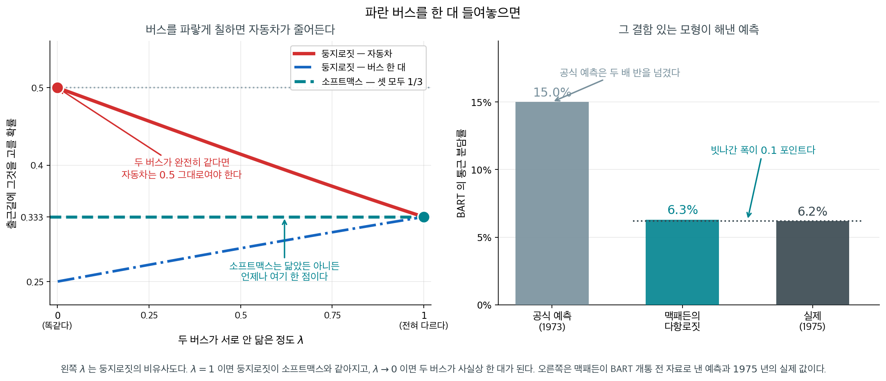
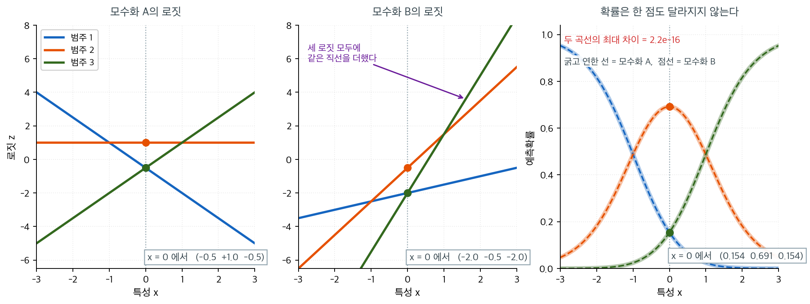

# 다항 로지스틱 회귀


## 1. 이항에서 다범주로

범주가 둘이면 로지스틱 회귀가 답을 낸다. 셋이 되는 순간 「$A$ 인가 아닌가」를 세 번 따로 묻는 길과 세 범주를 한꺼번에 다루는 길이 갈리는데, 둘은 같은 답을 주지 않는다. 결정경계에서 이항 로지스틱이 $1/2$ 을 내놓는 자리에서 소프트맥스는 가로축 **어디서나** $0.333$ 한 값을 내놓는다 — 범주 셋이 서로를 나누어 가지기 때문이다. 하나의 가중벡터를 가중행렬로 바꾸는 이 한 걸음이 무엇을 보존하고 무엇을 새로 요구하는가.

로지스틱 회귀는 이항 반응변수를 모형화한다. 반응변수가 $C>2$개의 범주를 가지면 **다항 로지스틱
회귀**(**소프트맥스 회귀**라고도 한다)로 일반화한다. 하나의 가중벡터 $\boldsymbol{\theta}$
대신, 각 입력을 범주마다 하나씩 $C$개의 실숫값 점수(로짓)로 옮기는 가중행렬 $\mathbf{W}$와
편향벡터 $\mathbf{b}$를 학습한다.

---

## 2. 모형 구조(단층)

관측치 $n$개와 특성 $p$개를 갖는 자료에 대해 단층 소프트맥스 모형은 다음을 계산한다.

$$
\underset{n \times C}{\mathbf{Z}}
= \underset{n \times p}{\mathbf{X}}\;
  \underset{p \times C}{\mathbf{W}} + \underset{1 \times C}{\mathbf{b}}
$$

$$
\underset{n \times C}{\hat{\mathbf{Y}}}
= \operatorname{softmax}(\mathbf{Z})
$$

여기서 $\hat{\mathbf{Y}}$의 각 행은 $C$개 범주에 대한 확률분포다.

<div class="storybox" markdown>

**그림으로 보는 통계학 1.** 파란 버스를 한 대 들여놓으면

위 식에서 두 범주의 확률의 비를 적어 보면

$$
\frac{\hat y_i}{\hat y_j} = \frac{e^{z_i}}{e^{z_j}} = e^{z_i - z_j}
$$

이다. **$i$ 와 $j$ 의 점수만 들어 있다.** 다른 범주가 몇 개든, 무엇이든 이 비에 영향을 주지
못한다. 분모의 합이 통째로 약분되기 때문이다. 루스는 1959 년에 이 성질을 사람의 선택을
설명하는 **공리**로 내세웠고 — 「무관한 대안으로부터의 독립」이다 — 그 공리에서 소프트맥스
꼴이 유일하게 따라 나온다는 것을 보였다. 지금 우리가 쓰는 식이 그 식이다.

이듬해 드브뢰가 짧은 서평 한 편으로 반례를 들었다. 출근길에 **자동차**와 **빨간 버스**가
있고 반반으로 갈린다고 하자. 여기에 빨간 버스와 노선도 요금도 시각표도 똑같고 **색만 다른
파란 버스**를 한 대 들여놓는다. 점수가 같으니 공리는 셋을 $1/3$ 씩으로 나눈다. **자동차가
$50\%$ 에서 $33\%$ 로 떨어진 것이다 — 버스에 다른 색을 칠했다는 이유로.** 상식은 자동차가
$50\%$ 그대로고 두 버스가 $25\%$ 씩 나눠 가진다고 말한다.

<figure markdown>
{ width="900" }
  <figcaption markdown>왼쪽 $\lambda$ 는 둥지로짓의 비유사도다. $\lambda = 1$ 이면 둥지로짓이 소프트맥스와 같아지고, $\lambda \to 0$ 이면 두 버스가 사실상 한 대가 된다.</figcaption>
</figure>

비슷한 것을 한 둥지에 묶어 주는 **둥지로짓**은 자동차의 몫을 $1/(1+2^{\lambda})$ 로 내놓는다.
두 버스가 전혀 안 닮았다면($\lambda = 1$) $1/3$ 이고, 완전히 같다면($\lambda \to 0$)
$1/2$ 다. 왼쪽 그림의 빨간 곡선이 그것이다. 소프트맥스는 이 가로축 **어디서나 $0.333$ 한
점**이다. 닮았는지 아닌지를 물어볼 자리가 식 안에 없다.

그런데 이 이야기에는 뒷면이 있다. 1970 년대 초 맥패든은 샌프란시스코의 새 전철 BART 가
개통하기 **전**의 통근 자료로 바로 이 다항로짓을 맞추었고, BART 의 통근 분담률을
$6.3\%$ 로 내다보았다. 1975 년의 실제 값이 $6.2\%$ 였다. 같은 시기 BART 측의 공식
예측은 $15\%$ 였다 — 두 배 반을 넘겼다. 맥패든은 2000 년에 노벨 경제학상을 받았다.

그러니 교훈은 「소프트맥스를 쓰지 말라」가 아니다. **가정이 어디서 무는지를 알고 쓰라**는
것이다. 무는 자리는 분명하다. 범주들 가운데 **서로 거의 같은 것**이 섞여 있을 때다. 분류에서
이 일이 실제로 일어나는 곳은 학습이 끝난 모형에 **새 범주를 덧붙여 점수만 매길 때**, 그리고
질의마다 **후보 집합이 달라지는** 검색·추천이다. 학습을 처음부터 다시 하면 절편이 그 몫을
흡수해 주지만, 후보가 바뀌는 쪽에는 흡수해 줄 절편이 없다.
[소프트맥스 구현](../optimization/softmax_implementation.md) 쪽에서 이 성질을 식으로 한
번 더 만난다.

_확인한 곳 — 루스의 『Individual Choice Behavior』($1959$)가 무관한 대안으로부터의 독립을 공리로 내세우고 거기서 다항로짓 꼴이 따라 나온다는 것, 드브뢰가 $1960$ 년 서평에서 빨간 버스–파란 버스 반례를 든 것, 맥패든이 BART 개통 전 자료로 통근 분담률을 **$6.3\%$** 로 내다보았고 $1975$ 년 실제가 **$6.2\%$**, $1973$ 년의 공식 예측이 **$15\%$** 였다는 것, 그가 $2000$ 년에 노벨 경제학상을 받은 것. 둥지로짓 곡선의 수는 직접 계산한 값이다_

</div>

---

## 3. 이층 모형(은닉층 + 소프트맥스)

로지스틱 활성함수를 갖는 은닉층을 추가하면 얕은 신경망이 된다. 아래 MNIST 보기에서 쓰는 구조다.

$$
\begin{aligned}
\underset{n \times 100}{\mathbf{Z}^h}
  &= \underset{n \times 784}{\mathbf{X}}\;
     \underset{784 \times 100}{\mathbf{W}^h} + \underset{1 \times 100}{\mathbf{b}^h} \\[4pt]
\underset{n \times 100}{\mathbf{H}}
  &= \operatorname{logistic}\!\bigl(\mathbf{Z}^h\bigr) \\[4pt]
\underset{n \times 10}{\mathbf{Z}^o}
  &= \underset{n \times 100}{\mathbf{H}}\;
     \underset{100 \times 10}{\mathbf{W}^o} + \underset{1 \times 10}{\mathbf{b}^o} \\[4pt]
\underset{n \times 10}{\hat{\mathbf{Y}}}
  &= \operatorname{softmax}\!\bigl(\mathbf{Z}^o\bigr)
\end{aligned}
$$

로지스틱(시그모이드) 활성함수는

$$
\operatorname{logistic}(x) = \frac{1}{1+e^{-x}},
\qquad
\operatorname{logistic}'(x) = \operatorname{logistic}(x)\bigl(1-\operatorname{logistic}(x)\bigr)
$$

이다.

---

## 4. MNIST 자료

MNIST 자료는 이 모형군의 표준 기준자료다.

$$
\mathbf{X} \in \mathbb{R}^{n\times 784},\quad
\mathbf{Y} \in \{0,1\}^{n\times 10}\;\text{(one-hot)},\quad
\mathbf{y}_{\text{cls}} \in \{0,\ldots,9\}^n
$$

각 이미지는 $28\times 28$ 화소이며 784차원 벡터로 펼친다. 화소값은 $[0,1]$로 척도화한다.

---

## 5. 이항 로지스틱 회귀와의 관계

$C=2$이면 다항 로지스틱 회귀는 보통의 로지스틱 회귀로 환원된다. 두 범주 소프트맥스가 시그모이드
모형과 같은 결정경계를 주는 이유는 범주 확률의 로그비가 특성에 대해 일차식이기 때문이다.

$$
\log\frac{P(Y=1\mid\mathbf{x})}{P(Y=0\mid\mathbf{x})}
= (\mathbf{w}_1-\mathbf{w}_0)^\top\mathbf{x} + (b_1-b_0)
$$

---

## 6. 모수가 과잉이라는 말의 뜻

위 식에서 자료가 말해 주는 것은 $\mathbf{w}_1$도 $\mathbf{w}_0$도 아니고 오직 그 **차**뿐이다.
$C$가 3 이상일 때도 사정은 같다. 특성이 하나뿐인 3범주 모형으로 직접 확인해 보자.



왼쪽은 기울기 $(-1.5,\ 0,\ 1.5)$, 절편 $(-0.5,\ 1.0,\ -0.5)$인 모수화 A다. 가운데는 세 범주
**모두**의 기울기에 $2.0$을, 절편에 $-1.5$를 더한 모수화 B다. 두 그림은 한눈에도 다르다.
A에서는 범주 2의 로짓이 수평선이고 범주 1이 우하향하는데, B에서는 세 직선이 모두 우상향한다.
$x = 0$에서 로짓벡터도 $(-0.5,\ +1.0,\ -0.5)$ 대 $(-2.0,\ -0.5,\ -2.0)$으로 전혀 다르다.

그런데 오른쪽 그림에는 세 곡선밖에 없다. A의 굵고 연한 선과 B의 점선이 완전히 포개져 있기
때문이다. 두 모수화가 내놓은 확률의 최대 차이는 $2.2 \times 10^{-16}$으로, 부동소수점의
반올림 오차 수준이다. $x = 0$에서 둘 다 $(0.154,\ 0.691,\ 0.154)$를 내놓는다. 이유는
소프트맥스의 정의에 이미 들어 있다. 모든 로짓에 같은 양 $c$를 더하면

$$
\frac{e^{z_k + c}}{\sum_j e^{z_j + c}}
= \frac{e^{c}\,e^{z_k}}{e^{c}\sum_j e^{z_j}}
= \frac{e^{z_k}}{\sum_j e^{z_j}}
$$

로 $e^c$가 분자와 분모에서 약분된다. 여기서 $c$는 $\mathbf{x}$에 의존해도 된다. 즉 모든
$\mathbf{w}_k$에 같은 벡터를, 모든 $b_k$에 같은 상수를 더하는 것은 모형을 전혀 건드리지 않는
조작이다.

이것이 **모수 과잉**이다. $\mathbf{W} \in \mathbb{R}^{p\times C}$와
$\mathbf{b}\in\mathbb{R}^C$는 $(p+1)C$개의 수를 담고 있지만, 그중 $p+1$개는 자료가 결정할 수
없다. 실질적인 자유도는 $(p+1)(C-1)$개다. 실무적 귀결이 둘 있다. 첫째, 벌점 없이 최대가능도만
풀면 해가 **유일하지 않다.** 위 그림의 A와 B는 훈련 손실이 완전히 같은 값을 가지며, 그런 해가
연속적으로 무한히 많다. 둘째, 그래서 한 범주를 기준으로 $\mathbf{w}_C = \mathbf{0}$으로
고정하거나(통계학의 관례), L2 벌점을 걸어 노름이 가장 작은 대표를 고르게 한다(기계학습의 관례).
벌점을 걸면 $\lVert\mathbf{W}\rVert_F^2$가 이동량에 대해 순볼록이므로 무한히 많은 동치해 중
정확히 하나가 선택된다.

---
<div class="aibox" markdown>

**AI로 보는 통계학 1.** 가중치의 크기를 읽기 전에 어느 관례에 서 있는지부터

바로 위에서 두 관례를 적었다 — 한 범주를 $\mathbf{0}$ 으로 고정하거나, L2 벌점으로
노름이 가장 작은 대표를 고르거나. 둘 중 **아무것도 하지 않았을 때** 무슨 일이
일어나는지를 보아 두면 그 관례가 왜 필요한지가 분명해진다.

오늘의 실무는 가중치의 크기를 자주 읽는다. 「이 특성의 가중치가 크니 중요하다」,
「작은 가중치는 잘라 내도 된다」, 「두 번 학습시킨 모형의 가중치를 견주어 보자」가
모두 그렇다. 소프트맥스 층에서 그 읽기가 어떻게 되는지 보자.

```python
import numpy as np

def smax(Z):
    Z = Z - Z.max(1, keepdims=True)
    E = np.exp(Z)
    return E / E.sum(1, keepdims=True)

rg = np.random.default_rng(3)
nn, dd, CC = 400, 4, 3
Xd = rg.normal(size=(nn, dd))
Wa = rg.normal(size=(CC, dd))              # 모수화 A
Pa = smax(Xd @ Wa.T)

# 모든 범주의 가중치에 같은 벡터를 더한다 — 로짓이 다 같이 움직이므로 확률은 그대로다
Wb = Wa - Wa[0]                            # 그 벡터로 범주 0 의 가중치를 고른다
Pb = smax(Xd @ Wb.T)

print("  범주 0 의 가중치")
print(f"    A : {np.round(Wa[0], 4)}")
print(f"    B : {np.round(Wb[0], 4)}   ← 전부 0 이다")
print(f"\n  가중치 행렬의 크기  ||W||  A {np.linalg.norm(Wa):.4f}   B {np.linalg.norm(Wb):.4f}")
print(f"  예측확률의 최대 차이        {np.abs(Pa - Pb).max():.2e}")
print(f"  예측 범주가 다른 건수       {(Pa.argmax(1) != Pb.argmax(1)).sum()} / {nn}")

print("\n  '가중치가 크니 중요한 특성이다' 로 범주 1 의 특성을 줄 세우면")
print(f"    A 기준 : {list(np.argsort(-np.abs(Wa[1])))}")
print(f"    B 기준 : {list(np.argsort(-np.abs(Wb[1])))}")
```

출력:

```
  범주 0 의 가중치
    A : [-1.8168  0.0027  1.4208  1.6651]
    B : [0. 0. 0. 0.]   ← 전부 0 이다

  가중치 행렬의 크기  ||W||  A 4.0656   B 4.6999
  예측확률의 최대 차이        3.33e-16
  예측 범주가 다른 건수       0 / 400

  '가중치가 크니 중요한 특성이다' 로 범주 1 의 특성을 줄 세우면
    A 기준 : [0, 3, 1, 2]
    B 기준 : [3, 2, 1, 0]
```

범주 $0$ 의 가중치를 **전부 $0$ 으로** 만들었는데 예측이 $3.3\times10^{-16}$ 안에서
같고, $400$ 건 가운데 판정이 바뀐 것이 하나도 없다. 위 본문이 말한 「한 범주를
$\mathbf{0}$ 으로 고정하는 관례」를 실제로 해 본 것이다.

그런데 아래 두 줄을 보라. 특성 중요도 순위가 $[0, 3, 1, 2]$ 에서 $[3, 2, 1, 0]$ 으로
**완전히 뒤집혔다.** $\lVert\mathbf{W}\rVert$ 도 $4.0656$ 에서 $4.6999$ 로 바뀐다.
**모형은 한 치도 바뀌지 않았는데 가중치에서 읽어 낸 이야기가 전부 바뀐 것이다.**

그래서 소프트맥스 층의 가중치를 읽을 때는 **어느 관례에 서 있는지를 먼저 말해야**
한다. 크기로 특성을 줄 세우는 일, 작은 가중치를 잘라 내는 일, 두 번 학습시킨 모형의
가중치를 견주거나 평균 내는 일은 모두 같은 가정 위에 서 있다 — **두 가중치가 같은
관례로 적혔다**는 가정이다. 벌점 없이 적합한 두 모형은 그 가정을 지킬 까닭이 없고,
위처럼 무한히 많은 동치해 가운데 아무 데나 멈춰 있을 수 있다.

실무에서 이것이 조용히 해결되는 까닭은 **거의 언제나 L2 벌점이 켜져 있기 때문**이다.
위 본문이 적은 대로 벌점은 노름이 가장 작은 대표 하나를 고르므로, 벌점을 쓴 두 모형은
같은 관례 위에 선다. 가중치를 읽는 일이 뜻을 가지려면 그 정도의 장치가 **먼저** 있어야
한다는 뜻이기도 하다.

</div>

---


## 연습문제

<div class="drillbox" markdown>

**연습문제 1.** <span class="diff med" title="중간"></span>
MNIST($p = 784$, $C = 10$)에서 단층 소프트맥스 모형과 은닉 노드 100개짜리 이층 모형의 모수
개수를 각각 세어라. 두 모형이 실제로 갖는 자유도는 얼마인가?

</div>

??? success "풀이"

    **단층 모형:**

    | 성분 | 크기 | 개수 |
    |---|---|---|
    | $\mathbf{W}$ | $784 \times 10$ | $7{,}840$ |
    | $\mathbf{b}$ | $10$ | $10$ |
    | **합계** | | $\mathbf{7{,}850}$ |

    **이층 모형:**

    | 성분 | 크기 | 개수 |
    |---|---|---|
    | $\mathbf{W}^h$ | $784 \times 100$ | $78{,}400$ |
    | $\mathbf{b}^h$ | $100$ | $100$ |
    | $\mathbf{W}^o$ | $100 \times 10$ | $1{,}000$ |
    | $\mathbf{b}^o$ | $10$ | $10$ |
    | **합계** | | $\mathbf{79{,}510}$ |

    이층 모형이 10배 이상 많은 모수를 쓴다.

    **실제 자유도.** 연습문제 4에서 보았듯이 소프트맥스 출력층은 중복되어 있다. 모든 로짓에서
    같은 값을 빼도 출력이 같으므로, 출력층에서 $784 + 1 = 785$개(단층) 또는
    $100 + 1 = 101$개(이층)의 자유도가 실제로는 없다. 따라서 유효 자유도는 각각 $7{,}065$개와
    $79{,}409$개다.

    MNIST의 훈련표본이 60,000개이므로, 단층 모형은 모수당 관측치가 약 8개인 반면 이층 모형은
    1개도 되지 않는다. 이것이 이층 모형에 정칙화나 조기 종료가 특히 필요한 이유다. $\square$

---

<div class="drillbox" markdown>

**연습문제 2.** <span class="diff med" title="중간"></span>
은닉층의 활성함수를 제거하면(즉 $\mathbf{H} = \mathbf{Z}^h$로 두면) 이층 모형이 단층 모형과
동등해짐을 보여라. 이것이 비선형 활성함수의 필요성에 대해 무엇을 말해 주는가?

</div>

??? success "풀이"

    활성함수 없이 $\mathbf{H} = \mathbf{Z}^h = \mathbf{X}\mathbf{W}^h + \mathbf{b}^h$이면,

    $$
    \mathbf{Z}^o = \mathbf{H}\mathbf{W}^o + \mathbf{b}^o
    = \mathbf{X}\underbrace{\mathbf{W}^h\mathbf{W}^o}_{=: \mathbf{W}^{\text{eff}}}
      + \underbrace{\mathbf{b}^h\mathbf{W}^o + \mathbf{b}^o}_{=: \mathbf{b}^{\text{eff}}}
    $$

    이다. 즉 $\mathbf{Z}^o$는 $\mathbf{X}$의 아핀함수이며, 이는 정확히 단층 모형의 형태다.
    층을 아무리 쌓아도 마찬가지다. 아핀사상의 합성은 아핀사상이다.

    **함의:** 깊이 자체가 표현력을 주는 것이 아니라 **비선형성**이 준다. 활성함수가 없으면
    79,510개의 모수를 학습하고도 $784 \times 10 + 10 = 7{,}850$개짜리 모형의 함수족을 벗어나지
    못한다. 모수만 늘고 표현력은 그대로다.

    한 가지 더 미묘한 점이 있다. $\mathbf{W}^{\text{eff}} = \mathbf{W}^h\mathbf{W}^o$의
    계수(rank)는 $\min(784, 100, 10) = 10$ 이하이므로, 은닉층이 $C$보다 좁으면
    오히려 단층 모형보다 **제약이 생긴다.** 이 경우 활성함수 없는 이층 모형은 저계수
    제약을 건 소프트맥스 회귀와 같다. $\square$

---

<div class="drillbox" markdown>

**연습문제 3.** <span class="diff med" title="중간"></span>
MNIST 화소값을 $[0, 255]$가 아니라 $[0,1]$로 척도화하는 이유는 무엇인가? 척도화하지 않으면
학습에 무슨 일이 일어나는가?

</div>

??? success "풀이"

    화소값을 그대로 두면 입력의 크기가 255배 커지고, 그에 따라 로짓과 기울기의 크기도 커진다.
    구체적으로 세 가지 문제가 생긴다.

    1. **로짓 폭발과 포화.** $\mathbf{z} = \mathbf{X}\mathbf{W}$에서 $\mathbf{X}$가 255배
       커지면 초기 가중치가 같을 때 로짓도 255배가 된다. 소프트맥스가 곧바로 포화되어
       예측확률이 0이나 1이 되고, 기울기 $\hat{\mathbf{Y}} - \mathbf{Y}$는 여전히 유한하지만
       은닉층의 시그모이드는 도함수 $\sigma(1-\sigma) \approx 0$이 되어 학습이 멈춘다.

    2. **학습률 문제.** 19장 연습문제 5에서 보았듯 허용 가능한 학습률의 상한은
       $\lambda_{\max}(\mathbf{X}^\top\mathbf{X})$에 반비례한다. 입력을 255배 키우면 이 값이
       $255^2 \approx 65{,}000$배 커지므로 학습률을 그만큼 줄여야 하고, 그러면 수렴이 그만큼
       느려진다.

    3. **정칙화의 의미 변화.** 벌점 $\|\mathbf{W}\|^2$은 가중치의 절대적 크기를 벌하는데,
       입력의 척도가 바뀌면 같은 예측을 내는 가중치의 크기도 바뀐다. 즉 같은 $\lambda$가
       전혀 다른 강도의 정칙화가 된다.

    $[0,1]$ 척도화는 세 문제를 한꺼번에 완화한다. 더 나아가 화소별로 평균 0, 분산 1로 표준화하면
    수렴이 더 빨라지지만, MNIST는 화소값 분포가 이미 비슷해 단순한 $255$로 나누기만 해도
    충분한 경우가 많다. $\square$

---

<div class="drillbox" markdown>

**연습문제 4.** <span class="diff hard" title="어려움"></span>
$C = 2$인 소프트맥스 회귀가 이항 로지스틱 회귀와 동등함을 보이고, 로지스틱 모형의 계수
$\boldsymbol\theta$가 소프트맥스의 $\mathbf{w}_0$, $\mathbf{w}_1$과 어떤 관계인지 밝혀라.

</div>

??? success "풀이"

    $C = 2$인 소프트맥스에서

    $$
    P(Y=1\mid\mathbf{x}) = \frac{e^{z_1}}{e^{z_0}+e^{z_1}}
    = \frac{1}{1+e^{-(z_1-z_0)}} = \sigma(z_1 - z_0)
    $$

    이고 $z_k = \mathbf{w}_k^\top\mathbf{x} + b_k$이므로

    $$
    z_1 - z_0 = (\mathbf{w}_1-\mathbf{w}_0)^\top\mathbf{x} + (b_1-b_0)
    $$

    이다. 따라서 소프트맥스는 계수

    $$
    \boldsymbol\theta = \mathbf{w}_1-\mathbf{w}_0, \qquad \theta_0 = b_1-b_0
    $$

    을 갖는 로지스틱 회귀와 정확히 같다.

    **중요한 귀결:** 자료가 결정하는 것은 오직 **차** $\mathbf{w}_1-\mathbf{w}_0$뿐이다.
    $\mathbf{w}_0$과 $\mathbf{w}_1$ 각각은 결정되지 않는다. 같은 벡터를 둘 다에 더해도 차가
    변하지 않으므로 예측이 같기 때문이다. 이것이 소프트맥스 모수화의 중복이며, 일반적인 $C$에
    대해서는 자유도가 $C$가 아니라 $C-1$임을 뜻한다. $\square$

---

<div class="drillbox" markdown>

**연습문제 5.** <span class="diff hard" title="어려움"></span>
단층 소프트맥스 모형에서 교차엔트로피 손실의 $\mathbf{W}$에 대한 기울기가
$\nabla_{\mathbf{W}}\mathcal{L} = \mathbf{X}^\top(\hat{\mathbf{Y}} - \mathbf{Y})$
임을 유도하라.

</div>

??? success "풀이"

    관측치 $i$에 대한 손실은 $\mathcal{L}_i = -\sum_c Y_{ic}\log \hat Y_{ic}$이고
    $\hat Y_{ic} = \operatorname{softmax}(\mathbf{z}_i)_c$이다. 먼저 소프트맥스의 야코비를 구한다.

    $$
    \frac{\partial \hat Y_{ic}}{\partial z_{ik}} = \hat Y_{ic}(\delta_{ck} - \hat Y_{ik})
    $$

    ($\delta_{ck}$는 크로네커 델타). 연쇄법칙으로

    $$
    \frac{\partial \mathcal{L}_i}{\partial z_{ik}}
    = -\sum_c \frac{Y_{ic}}{\hat Y_{ic}}\cdot \hat Y_{ic}(\delta_{ck}-\hat Y_{ik})
    = -\sum_c Y_{ic}(\delta_{ck}-\hat Y_{ik})
    $$

    이고, $\sum_c Y_{ic} = 1$(원–핫)이므로

    $$
    = -Y_{ik} + \hat Y_{ik}\sum_c Y_{ic} = \hat Y_{ik} - Y_{ik}
    $$

    를 얻는다. 즉 **로짓에 대한 기울기가 단순한 잔차다.**

    이제 $z_{ik} = \sum_j X_{ij}W_{jk} + b_k$이므로
    $\partial z_{ik}/\partial W_{jk} = X_{ij}$이고, 모든 관측치에 대해 더하면

    $$
    \frac{\partial \mathcal{L}}{\partial W_{jk}} = \sum_i X_{ij}(\hat Y_{ik} - Y_{ik})
    \quad\Longrightarrow\quad
    \nabla_{\mathbf{W}}\mathcal{L} = \mathbf{X}^\top(\hat{\mathbf{Y}} - \mathbf{Y})
    $$

    이다. 편향은 $\nabla_{\mathbf{b}}\mathcal{L} = \mathbf{1}^\top(\hat{\mathbf{Y}} - \mathbf{Y})$
    이다.

    이 결과가 우아한 이유는, 소프트맥스 야코비의 복잡한 항들이 교차엔트로피의 $1/\hat Y$와
    정확히 소거되기 때문이다. 이는 우연이 아니라 **로짓이 다항분포의 정준연결**이라는 사실의
    귀결이며, 19장에서 로지스틱 회귀의 기울기가 $A^\top(\boldsymbol\sigma - \mathbf{y})$였던
    것과 같은 이유다. $\square$

---

## 정리하며

소프트맥스 회귀는 로지스틱 회귀를 **$C>2$ 범주로** 확장한 것이다.

- **가중벡터 하나가 가중행렬로 바뀐다.** $\boldsymbol\theta\in\mathbb{R}^p$ 대신 $\mathbf W\in\mathbb{R}^{p\times C}$ 를 추정한다.
- **모수가 과잉이다.** 모든 범주의 가중치에 같은 벡터를 더해도 확률이 변하지 않으므로, 한 범주를 기준으로 고정하거나(식별) 정칙화로 해를 유일하게 만든다.
- **$C=2$ 면 로지스틱 회귀가 된다.** 두 로짓의 차이만 의미가 있고, 그 차이가 곧 로짓 하나다. **특수한 경우임을 확인하는 것이 중요하다.**
- **범주에 순서가 없다고 가정한다.** 순서형 반응에는 누적 로짓 모형 같은 다른 도구가 맞다.
- **IIA 가정이 따라온다.** 두 범주의 상대 오즈가 다른 범주의 존재와 무관하다는 성질이며, 현실에서 깨질 수 있다.

다음 절 **[소프트맥스 함수](softmax.md)**로 넘어간다.
