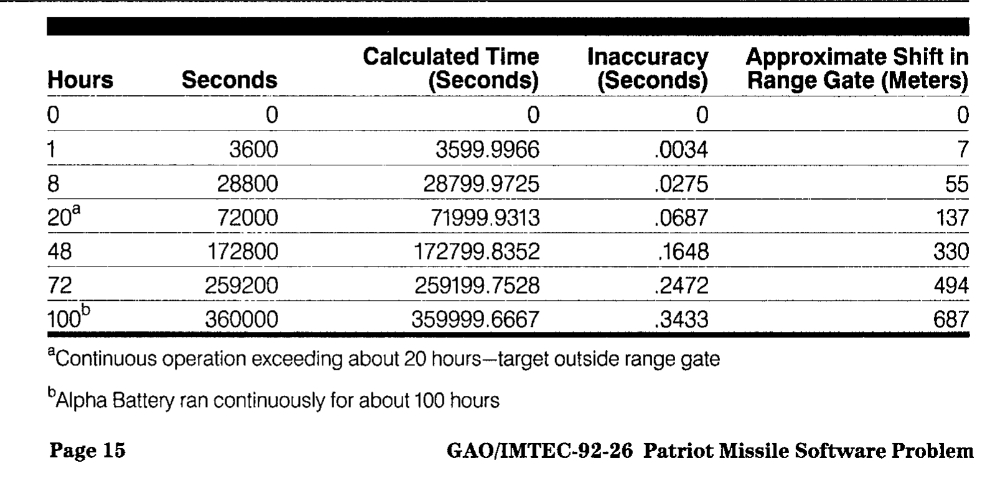
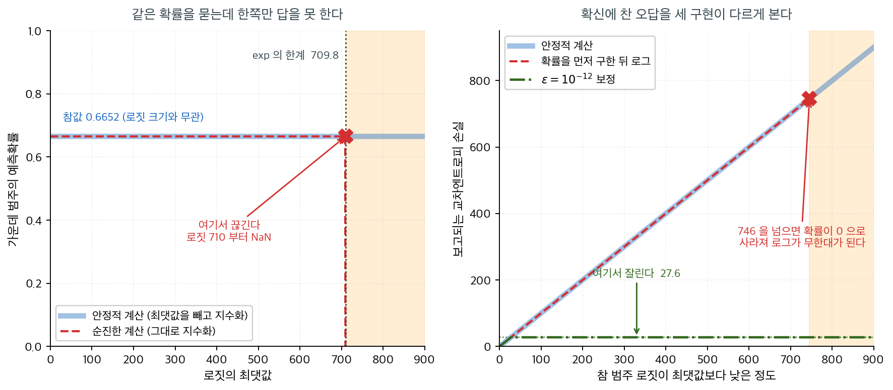

# 수치적 안정성(로그–합–지수 기법)

## 1. 오버플로 문제

소프트맥스는 로짓을 지수화한다. 로짓이 $1000$ 이면 $e^{1000}$ 을 만들어야 하는데 $64$ 비트 부동소수점은 그 수를 담지 못하고 `inf` 를 내놓으며, 그다음 나눗셈은 `nan` 이 된다. 자료도 모형도 멀쩡한데 수를 적는 **방식** 때문에 계산이 멈추는 것이다. 더 흔한 쪽은 작은 수에서 일어난다 — 아래 상자가 $\frac{1}{10}$ 하나를 끝까지 적지 못해 벌어진 일을 보인다. 이 쪽은 같은 답을 내면서 터지지 않는 계산을 세운다.

소프트맥스를 계산하려면 로짓 $z_1, \ldots, z_C$를 지수화해야 한다. 64비트 부동소수점에서
$e^{z}$는 $z \gtrsim 709$이면 무한대로 넘치고 $z \lesssim -745$이면 0으로 사라진다. 신경망이나
큰 선형모형이 내는 원시 로짓은 이 한계를 쉽게 넘어서므로, 소프트맥스를 순진하게 구현하면
`inf`나 `0/0`이 나온다.

이 절에서는 수학적 결과를 바꾸지 않으면서 오버플로를 없애고 언더플로를 크게 줄이는 간단한
대수적 항등식, **로그–합–지수(LSE) 기법**을 전개한다.

<div class="storybox" markdown>

**그림으로 보는 통계학 1.** $\dfrac{1}{10}$ 을 끝까지 적지 못한 기계

<figure markdown>
  { width=700 }
  <figcaption markdown>미국 회계감사원 보고서 GAO/IMTEC-$92$-$26$($1992$)의 부록 II, $15$ 쪽. 맨 아랫줄이 $100$ 시간이고, 어긋난 시간 $0.3433$ 초가 거리로는 $687$ 미터다. 각주에 「알파 포대는 약 $100$ 시간을 쉬지 않고 돌렸다」고 적혀 있다. *(미국 정부 보고서, PD)*</figcaption>
</figure>

부동소수점이 못 담는 것은 $e^{709}$ 같은 **큰 수**만이 아니다. 아주 흔한 수 하나도 담지 못한다.

어떤 수가 유한한 자리로 끊기는지 아닌지는 **그 수만으로 정해지지 않는다** — 밑이 함께 정해져야 한다. $\dfrac1{10}$ 은 십진법에서 $0.1$ 로 딱 끊기지만, 밑을 $2$ 로 바꾸면

$$
\frac1{10}=0.0\overline{0011}_{(2)}=0.000110011001100\cdots_{(2)}
$$

로 끝나지 않는다. 분모의 소인수 $5$ 가 밑 $2$ 를 나누지 못하기 때문이다. 기계에게 $\dfrac1{10}$ 은 우리에게 $\dfrac13$ 과 같은 처지인 셈이다.

$1991$ 년 $2$ 월 $25$ 일 사우디아라비아 다란에서, 미사일을 막는 포대가 날아오는 탄을 **엉뚱한 곳에서 찾았다.** 탄은 병영에 떨어졌고 $28$ 명이 죽었다. 미국 회계감사원이 조사해 적은 까닭이 바로 이것이다. 그 기계의 시계는 시간을 $0.1$ 초 눈금의 **정수**로 세고 있었고, 그것을 초로 바꾸려면 $\dfrac1{10}$ 을 곱해야 하는데, 레지스터가 $24$ 비트뿐이라 그 수를 끝까지 적을 수 없었다. 그래서 오차는 **켜 둔 시간에 비례해 쌓였다.**

사진의 표가 그 쌓임이다. 그리고 이 표는 손으로 그대로 나온다. 소수점 아래 $23$ 자리에서 자르면 참값과의 차가

$$
\frac1{10}-\frac{838860}{2^{23}}=9.5367\cdots\times10^{-8}
$$

이고, $100$ 시간은 $0.1$ 초 눈금으로 $3{,}600{,}000$ 번이므로 쌓인 차는

$$
3{,}600{,}000\times 9.5367\cdots\times10^{-8}=0.3433\cdots
$$

곧 표의 $0.3433$ 초다. 나머지 줄도 모두 같은 식으로 맞는다. 마지막 칸의 미터는 그 시간차에 표적의 속력을 곱한 것인데, 각 줄의 미터를 초로 나누어 보면 한결같이 초속 $2{,}000$ 미터쯤이 나온다.

알파 포대는 $100$ 시간을 끄지 않고 돌리고 있었다. 이미 고친 소프트웨어가 있었지만 다란에 닿은 것은 **이튿날인 $2$ 월 $26$ 일**이었다.

끊기느냐 끝없이 되풀이되느냐는 수의 성질이 아니라 **수와 밑 사이의 관계**다. 우리가 십진법으로 살기 때문에 $\dfrac1{10}$ 이 깔끔해 보일 뿐이다. 그리고 이 쪽이 하는 일과 하지 못하는 일이 여기서 갈린다 — $2$ 절부터의 평행이동은 **같은 값을 주는 다른 식**이 있어서 오버플로를 통째로 없앨 수 있지만, $0.1$ 을 담지 못하는 일에는 그런 항등식이 없다. LSE 기법이 고마운 까닭은 오차를 줄이는 재주가 아니라 **바꿔 쓸 식이 있다는 것**이다.

_확인한 곳 — 보고서는 [Internet Archive 에 올라온 국방기술정보센터 사본 AD-A$344865$](https://archive.org/details/DTIC_ADA344865) — 「패트리엇 미사일 방어: 소프트웨어 문제가 사우디아라비아 다란에서 체계 실패를 불렀다」(GAO/IMTEC-$92$-$26$, $1992$). 표와 각주, 쪽 번호 $15$ 는 **사진에서 직접 읽었다** · 「$28$ 명이 죽었다」, 「시계가 $0.1$ 초 단위로 세고 정수로 표현된다」, 「레지스터가 $24$ 비트뿐이라 변환이 그보다 정확해질 수 없다」, 「오차는 표적의 속력과 켜 둔 시간에 정비례한다」, 「고친 소프트웨어는 사건 이튿날인 $1991$ 년 $2$ 월 $26$ 일에야 다란에 닿았다」는 모두 같은 보고서 본문에서 직접 읽었다 · **표의 값은 이 쪽에서 직접 맞추어 보았다** — $\frac1{10}$ 을 소수점 아래 $23$ 자리에서 자른 뒤 시간을 곱하면 $1$ 시간 $0.0034$, $8$ 시간 $0.0275$, $20$ 시간 $0.0687$, $48$ 시간 $0.1648$, $72$ 시간 $0.2472$, $100$ 시간 $0.3433$ 으로 표의 다섯째 칸과 끝자리까지 같다 · ⚠️ 다만 표의 맨 아랫줄 「계산된 시각」만은 보고서가 $359999.6667$ 로 찍었는데, 같은 줄의 어긋난 시간 $0.3433$ 과 맞지 않는다($360000-0.3433=359999.6567$). 보고서 쪽의 오타로 보이며, 다른 여섯 줄은 모두 어긋남 없이 들어맞는다_

</div>

---

## 2. 소프트맥스의 평행이동 불변성

[소프트맥스 절](softmax.md)에서 보았듯이 소프트맥스는 평행이동 불변이다. 임의의 스칼라 $c$에
대해

$$
\operatorname{softmax}(\mathbf{z})_k
= \frac{e^{z_k}}{\sum_{j=1}^{C}e^{z_j}}
= \frac{e^{z_k - c}}{\sum_{j=1}^{C}e^{z_j - c}}
$$

가 성립한다. 분자와 분모에 $e^{-c}$를 곱하면 소거되기 때문이다. $c$를 잘 고르면 모든 지수를
안전한 범위에 둘 수 있다.

---

## 3. 로그–합–지수 항등식

벡터 $\mathbf{z}$의 **로그–합–지수**는

$$
\operatorname{LSE}(\mathbf{z})
= \log\sum_{j=1}^{C}e^{z_j}
$$

이다. $c = \max_j z_j$로 평행이동을 적용하면

$$
\operatorname{LSE}(\mathbf{z})
= c + \log\sum_{j=1}^{C}e^{z_j - c}
$$

를 얻는다. 이동 후에는 모든 지수가 $z_j - c \le 0$이므로 $e^{z_j - c} \le 1$이다. 따라서
다음이 보장된다.

- **오버플로 없음:** 가장 큰 지수가 $e^0 = 1$이다.
- **언더플로 감소:** 최댓값보다 훨씬 작은 로짓만 0으로 사라지는데, 그런 항은 어차피 합에
  기여하는 바가 무시할 만하다.

---

## 4. LSE를 이용한 안정적인 소프트맥스

두 아이디어를 결합하면 수치적으로 안정한 소프트맥스는

$$
\log\operatorname{softmax}(\mathbf{z})_k
= z_k - \operatorname{LSE}(\mathbf{z})
= (z_k - c) - \log\sum_{j=1}^{C}e^{z_j - c}
$$

이다. 확률 자체가 필요하면 지수화한다.
$\operatorname{softmax}(\mathbf{z})_k = e^{\log\operatorname{softmax}(\mathbf{z})_k}$.
가능한 한 오래 로그 공간에서 작업할수록 안정성이 좋아진다.

---

## 5. 안정적인 교차엔트로피 손실

참 범주가 $y$인 관측치 하나의 교차엔트로피 손실은

$$
\mathcal{L} = -\log\operatorname{softmax}(\mathbf{z})_y
= -z_y + \operatorname{LSE}(\mathbf{z})
$$

이고, 안정적인 LSE를 쓰면

$$
\mathcal{L} = -(z_y - c) + \log\sum_{j=1}^{C}e^{z_j - c}
$$

가 된다. 이 형태는 큰 $z_j$에 대해 $e^{z_j}$를 직접 계산하는 일이 아예 없다. PyTorch와
TensorFlow 같은 프레임워크는 확률이 아니라 원시 로짓을 받는 `cross_entropy_with_logits` 같은
융합 연산으로 이를 구현한다.

!!! warning "손실함수에 확률을 넘기지 말 것"
    `softmax`를 먼저 계산한 뒤 `log`를 취하면 수치 문제가 되살아난다. 확률이 0으로 언더플로되면
    `log(0)`이 `-inf`가 되기 때문이다. 프레임워크가 제공하는 융합 log-softmax나
    로짓 기반 교차엔트로피 함수를 항상 사용하라.

---

## 6. 단계별 알고리즘

| 단계 | 연산 | 목적 |
|---|---|---|
| 1 | $c \leftarrow \max_j z_j$ | 이동 상수 찾기 |
| 2 | 모든 $j$에 대해 $s_j \leftarrow z_j - c$ | 로짓을 비양수 범위로 이동 |
| 3 | 모든 $j$에 대해 $e_j \leftarrow e^{s_j}$ | 안전한 지수화($e_j \le 1$) |
| 4 | $S \leftarrow \sum_j e_j$ | 소프트맥스의 분모 |
| 5 | $p_j \leftarrow e_j / S$ | 소프트맥스 확률 |
| 6 | $\operatorname{LSE} \leftarrow c + \log S$ | 손실함수용 |

??? example "보기"
    $C = 3$이고 로짓이 $\mathbf{z} = (1000,\; 1001,\; 999)$라 하자.

    **순진한 계산.** float64에서 $e^{1000}$이 `inf`로 넘쳐 `inf / inf = NaN`이 된다.

    **안정적인 계산.**

    1. $c = 1001$.
    2. 이동된 로짓: $(-1, 0, -2)$.
    3. 지수: $(e^{-1}, e^0, e^{-2}) = (0.3679, 1.0, 0.1353)$.
    4. 합: $S = 1.5032$.
    5. 확률: $(0.2447, 0.6652, 0.0900)$.
    6. $\operatorname{LSE} = 1001 + \log(1.5032) = 1001.4076$.

    모든 연산이 안전한 범위에 머물고, 확률은 정확한 수학적 값과 일치한다.

---

## 7. 두 구현이 갈라지는 지점

위 보기의 $\mathbf{z} = (1000,\ 1001,\ 999)$는 극단적으로 보이지만, 사실 벽은 그보다 훨씬 앞에
있다. 로짓의 모양 $(-1,\ 0,\ -2)$는 그대로 두고 전체 크기만 $0$에서 $900$까지 밀어 올리며 두
구현의 답을 비교해 보자.



왼쪽 그림에서 두 곡선은 $0.6652$에서 완벽히 겹쳐 간다. 소프트맥스가 평행이동 불변이므로 로짓을
아무리 키워도 확률은 $(0.2447,\ 0.6652,\ 0.0900)$ 그대로여야 하고, 실제로 그렇다. 그러다
붉은 점선이 갑자기 끊긴다. float64에서 $e^z$가 표현 가능한 상한은
$\log(1.8\times 10^{308}) = 709.78$이고, 로짓이 $710$을 넘는 순간 분자도 분모도 `inf`가 되어
`inf/inf = NaN`이 된다. 주목할 점은 **경고 없이 조용히 죽는다**는 것이다. $709$에서는 소수점
넷째 자리까지 정확한 답을 내던 코드가 $710$에서는 `NaN`을 낸다. 답이 조금 나빠지는 것이 아니라
아예 없어진다.

$709$라는 수가 커 보인다면 착각이다. 로짓은 $\mathbf{w}^\top\mathbf{x} + b$이므로 특성이
$784$개인 MNIST에서 척도화를 잊거나 학습률을 크게 잡아 가중치가 몇 스텝 폭주하면 세 자리 수
로짓은 금방 나온다. 그리고 한 번 `NaN`이 생기면 기울기를 타고 가중치 전체로 퍼져 학습이
되돌아오지 못한다.

오른쪽 그림은 반대쪽 끝, 즉 **언더플로**를 보여 준다. 가로축은 참 범주의 로짓이 최댓값보다
얼마나 낮은가이고, 세로축은 그때 보고되는 손실이다. 안정적인 구현은 손실이
$d + \log(1+e^{-d}) \approx d$로 **선형으로 계속 커진다.** 확률을 먼저 구한 뒤 로그를 취하는
구현은 $d$가 $746$을 넘는 순간 확률이 $0$으로 언더플로되어 $\log 0 = -\infty$가 된다. 그리고
[구현 절](../optimization/softmax_implementation.md)에서 쓴 $\varepsilon = 10^{-12}$ 보정은
`inf`는 막지만 손실을 $-\log(10^{-12}) = 27.6$에서 **평평하게 잘라 버린다.** $d = 100$이든
$d = 800$이든 똑같이 $27.6$을 보고하므로, 보고된 손실만 보고는 모형이 얼마나 심하게 틀렸는지
알 수 없다.

세 곡선이 말하는 결론은 하나다. LSE 기법은 "정확도를 조금 희생해서 안전을 사는" 절충이
아니다. 수학적으로 **완전히 같은 값**을 계산하되 지수의 인자를 항상 $0$ 이하로 유지할 뿐이다.
공짜로 얻는 안전이니 쓰지 않을 이유가 없다.

---

## 8. 두 항의 LSE(시그모이드)

이항 로지스틱 회귀($C = 2$)에서 LSE는

$$
\log(1 + e^z) = \max(0, z) + \log(1 + e^{-|z|})
$$

로 환원된다. 이 항등식은 지수 $-|z| \le 0$을 유지하여 오버플로를 막는다. 수치 라이브러리에서
**softplus** 함수의 표준 구현이다.

<div class="aibox" markdown>

**AI로 보는 통계학 1.** 되돌릴 때 커지는 것 — 왜 확률이 아니라 점수를 들고 다니는가

위 항등식이 **$z$ 를 받아서** 적혀 있는 것, 곧 확률 $p$ 가 아니라 점수 $z$ 를 입력으로
삼는 것이 우연이 아니다.

역함수의 미분법은 $g=f^{-1}$ 일 때

$$
g'(b)=\frac{1}{f'\bigl(g(b)\bigr)}
$$

라고 한다. 기울기가 **뒤집힌다**는 말인데, 여기서 한 가지가 따라 나온다 — $f$ 가 **납작한
곳**에서는 $f'$ 이 작으니 $g'$ 이 **커진다.** 되돌아갈 때는 그만큼 **오차도 함께 커진다.**

기계가 내놓는 값에서 이 일이 매일 일어난다. 모형이 속으로 들고 있는 것은 크기에 제한이 없는
**점수** $z$ 이고, 바깥으로 내보낼 때 그것을 확률로 바꾼다.

$$
p=f(z)=\frac{1}{1+e^{-z}},\qquad f'(z)=p(1-p)
$$

$p$ 가 $0$ 이나 $1$ 에 가까우면 $f'$ 이 $0$ 으로 눌린다. 그러니 거꾸로
$p$ 에서 $z$ 를 되찾는 일은 그 자리에서 **몹시 불안해진다.** 얼마나 그런지 재어 보자.

```python
import numpy as np

sig  = lambda z: 1/(1+np.exp(-z))         # 점수 z 를 확률 p 로 바꾼다 (f)
ginv = lambda p: np.log(p/(1-p))          # 되돌리는 함수 g = f^{-1}

print("   점수 z    확률 p         g'(p)=1/f'(z)    p 를 소수 6자리로 끊었을 때 되돌린 z 의 어긋남")
for z in (0.0, 2.0, 5.0, 10.0, 14.0, 16.0):
    p  = sig(z)
    d  = 1/(p*(1-p))                      # 1/f'(z) — 여기서 f'(z)=p(1-p) 다
    p6 = round(float(p), 6)               # 확률만 저장하고 여섯 자리로 끊은 경우
    if p6 >= 1.0:                         # 1 로 끊겨 버리면 g 에 넣을 수조차 없다
        err = "되돌릴 수 없음 (p 가 1 로 끊긴다)"
    else:
        err = f"{abs(ginv(p6) - z):.6f}"  # 되돌린 점수가 얼마나 어긋나는가
    print(f"{z:7.1f}   {p:.8f}   {d:15.1f}     {err}")
```

실행하면 다음이 나온다.

```text
   점수 z    확률 p         g'(p)=1/f'(z)    p 를 소수 6자리로 끊었을 때 되돌린 z 의 어긋남
    0.0   0.50000000               4.0     0.000000
    2.0   0.88079708               9.5     0.000001
    5.0   0.99330715             150.4     0.000022
   10.0   0.99995460           22028.5     0.008803
   14.0   0.99999917         1202606.3     0.184490
   16.0   0.99999989         8886112.5     되돌릴 수 없음 (p 가 1 로 끊긴다)
```

가운데 칸이 그 $1/f'$ 그대로다 — $p$ 가 $1$ 에 다가갈수록 $g'=\dfrac{1}{p(1-p)}$ 가 $4$ 에서
팔백만을 넘는 데까지 간다. 오른쪽 칸은 그 값이 실제로 하는 일이다. 확률을 소수 여섯 자리로만
적어 두면 $z=5$ 일 때는 백만분의 이십이밖에 안 틀리지만, $z=14$ 에서는 $0.18$ 이 틀리고,
$z=16$ 에서는 **아예 되돌아오지 못한다.** $0.99999989$ 가 $1.000000$ 으로 끊기는 순간
「얼마나 확신하는가」가 통째로 사라지기 때문이다.

그래서 기계를 다루는 쪽에서는 **확률이 아니라 점수를 들고 다니는 것**이 규칙처럼 되어 있다.
확률로 바꾸는 것은 사람에게 보여 줄 때 **맨 마지막에 한 번**만 하고, 계산은 점수 쪽에서
한다. 라이브러리의 손실함수가 확률 대신 점수를 받는 꼴(`BCEWithLogitsLoss` 같은 이름)로
되어 있는 것이 그 규칙이고, 위의
$\log(1+e^{z})=\max(0,z)+\log\bigl(1+e^{-\lvert z\rvert}\bigr)$ 가 바로 **점수를 받아 손실을
곧바로 적는 식**이다. 확률로 한 번 바꾸었다가 로그를 다시 씌우는 길 — $5$ 절이 피하라고 한
그 길 — 을 아예 지나가지 않는다.

다만 점수 쪽이 늘 편한 것은 아니다. 점수는 **크기의 뜻이 없어서** 그 자체로는 읽히지 않고,
모형이 다르면 같은 $z$ 가 같은 뜻도 아니다. 사람이 알고 싶은 것은 결국 확률이라,
**읽히는 쪽($p$)과 다루기 좋은 쪽($z$)이 서로 다르다**는 것이 이 자리의 사정이고,
그 둘을 잇는 환율이 $1/f'$ 이다.

</div>

---

## 연습문제

<div class="drillbox" markdown>

**연습문제 1.** <span class="diff easy" title="쉬움"></span>
수치적 안정성과 로그–합–지수

로짓 $\mathbf{z} = (1000, 1001, 999)^\top$을 생각하자.

**(a)** $e^{1000}$, $e^{1001}$, $e^{999}$를 순진하게 계산하면 표준 64비트 부동소수점에서 왜
오버플로가 나는지 설명하라.

**(b)** 로그–합–지수 기법을 적용하라. $m = \max_k z_k = 1001$을 빼고
$\text{softmax}(\mathbf{z} - m\mathbf{1})$을 계산하라.

**(c)** 로그–합–지수 공식

$$
\log\sum_{k=1}^C e^{z_k} = m + \log\sum_{k=1}^C e^{z_k - m}
$$

을 유도하고, 우변이 왜 수치적으로 안정한지 설명하라.

</div>

??? success "풀이"

    **(a)** 64비트 부동소수점(배정도)에서 표현 가능한 최댓값은 약 $1.8 \times 10^{308}$이며
    이는 $e^{709.8}$에 해당한다. $e^{999} \approx 10^{434}$부터 이미 이 한계를 훨씬 넘으므로
    $e^{1000}$이나 $e^{1001}$을 직접 계산하면 `inf`가 되고, 소프트맥스
    $\hat{p}_k = e^{z_k}/\sum e^{z_j}$는 `inf/inf`가 되어 `nan`을 낸다.

    **(b)** $m = 1001$만큼 이동하면

    $$
    \mathbf{z} - m\mathbf{1} = (-1, 0, -2)^\top
    $$

    $$
    e^{-1} \approx 0.368, \quad e^{0} = 1, \quad e^{-2} \approx 0.135
    $$

    $$
    S = 0.368 + 1 + 0.135 = 1.503
    $$

    $$
    \hat{p}_1 = \frac{0.368}{1.503} \approx 0.245, \quad \hat{p}_2 = \frac{1}{1.503} \approx 0.665, \quad \hat{p}_3 = \frac{0.135}{1.503} \approx 0.090
    $$

    모든 계산이 작은 수의 지수만 다루므로 오버플로가 없다.

    **(c)** 정의에서 출발하면

    $$
    \log\sum_{k=1}^C e^{z_k} = \log\sum_{k=1}^C e^{(z_k - m) + m} = \log\left(e^m \sum_{k=1}^C e^{z_k - m}\right)
    $$

    $$
    = m + \log\sum_{k=1}^C e^{z_k - m}
    $$

    이다. 우변이 안정적인 이유는 다음과 같다. (1) 합에서 가장 큰 항이
    $e^{z_{\max} - m} = e^0 = 1$이므로 어떤 항도 넘치지 않는다. (2) 나머지 항은
    $e^{\text{음수}} < 1$이므로 0으로 언더플로되어도 무해하다(그 항이 무시할 만하다는 뜻일
    뿐이다). (3) 따라서 로그 안의 합이 최소 1이므로 $\log$ 값이 0 이상이고, 최종 결과
    $m + (\text{0 이상})$이 잘 정의된다.

---

<div class="drillbox" markdown>

**연습문제 2.** <span class="diff med" title="중간"></span>
$\max(0, z) + \log(1 + e^{-|z|}) = \log(1 + e^z)$임을 $z > 0$과 $z \le 0$ 두 경우로 나누어
증명하라. $z = 1000$에서 두 식을 각각 계산해 비교하라.

</div>

??? success "풀이"

    **경우 1: $z > 0$.** $\max(0,z) = z$이고 $|z| = z$이므로 좌변은

    $$
    z + \log(1 + e^{-z}) = \log\bigl(e^z(1 + e^{-z})\bigr) = \log(e^z + 1)
    $$

    **경우 2: $z \le 0$.** $\max(0,z) = 0$이고 $|z| = -z$이므로 좌변은

    $$
    0 + \log(1 + e^{z}) = \log(1 + e^z)
    $$

    두 경우 모두 우변과 같다.

    **$z = 1000$에서:**

    - 순진한 식 $\log(1 + e^{1000})$: `np.exp(1000)`이 `inf`가 되고
      `np.log(inf)` $= \infty$가 되어 손실이 `inf`가 된다.
    - 안정적인 식: $\max(0, 1000) + \log(1 + e^{-1000}) = 1000 + \log(1 + 0) = 1000.0$.

    참값은 $\log(1+e^{1000}) = 1000 + \log(1+e^{-1000}) \approx 1000$이므로 안정적인 식이
    정확하다. NumPy에서는 `np.logaddexp(0, z)`가 정확히 이 계산을 수행한다. $\square$

---

<div class="drillbox" markdown>

**연습문제 3.** <span class="diff med" title="중간"></span>
로짓이 $\mathbf{z} = (-1000, -1001, -999)$처럼 **모두 매우 작은** 경우에도 최댓값을 빼는 것이
올바르게 작동하는지 확인하라. 최솟값을 빼면 어떻게 되는가?

</div>

??? success "풀이"

    **최댓값을 뺄 때.** $c = \max_j z_j = -999$이므로 이동된 로짓은 $(-1, -2, 0)$이고 지수는
    $(0.368, 0.135, 1.0)$, 합은 $1.503$, 확률은 $(0.245, 0.090, 0.665)$다. 문제없다.

    최댓값을 빼는 규칙은 로짓의 절대적 크기와 무관하게 작동한다. 이동 후 최댓값이 항상 정확히
    0이 되도록 만들기 때문이다. 로짓이 모두 크든 모두 작든 결과는 같다.

    **최솟값을 빼면.** $c = \min_j z_j = -1001$이면 이동된 로짓이 $(1, 0, 2)$가 되어 이 예에서는
    안전하다. 그러나 일반적으로는 위험하다. 로짓의 범위가 넓으면(예:
    $\mathbf{z} = (0, 800)$) 최솟값을 뺀 결과가 $(0, 800)$ 그대로여서 $e^{800}$이 넘친다.

    **핵심:** 최댓값을 빼는 것은 이동 후 최대 지수를 $e^0 = 1$로 **고정**하므로 언제나 안전하다.
    다른 어떤 선택도 이 보장을 주지 못한다. 언더플로는 여전히 생길 수 있지만, 언더플로되는 항은
    정의상 최댓값보다 $700$ 이상 작아 상대 기여가 $e^{-700} \approx 10^{-304}$이므로 무해하다.
    $\square$

---

<div class="drillbox" markdown>

**연습문제 4.** <span class="diff med" title="중간"></span>
어떤 구현이 `p = softmax(z)`를 계산한 뒤 `loss = -np.log(p[y])`로 손실을 구한다. 이 구현이
실패하는 구체적인 상황을 제시하고, 왜 융합 연산이 필요한지 설명하라.

</div>

??? success "풀이"

    **실패 상황.** $\mathbf{z} = (0, 800)$이고 참 범주가 $y = 0$이라 하자. 안정적인 소프트맥스는

    $$
    p_0 = \frac{e^{0-800}}{e^{-800} + e^{0}} = \frac{e^{-800}}{1 + e^{-800}}
    $$

    을 계산하는데, $e^{-800}$이 배정도에서 정확히 0으로 언더플로되므로 $p_0 = 0.0$이 된다.
    그러면 `-np.log(0.0)` $= \infty$가 되어 손실이 `inf`, 기울기가 `nan`이 된다.

    **참값은 유한하다.**

    $$
    \mathcal{L} = -z_0 + \operatorname{LSE}(\mathbf{z}) = 0 + \bigl(800 + \log(1 + e^{-800})\bigr) \approx 800.0
    $$

    $800$은 매우 큰 손실이지만 완벽히 유한하고, 기울기 $\hat{\mathbf{y}} - \mathbf{y}$도
    $(0-1, 1-0) = (-1, 1)$로 잘 정의된다. 즉 학습이 계속될 수 있다.

    **융합 연산이 필요한 이유:** 문제의 근원은 $\log$와 $\exp$를 **따로** 수행하는 데 있다.
    소프트맥스가 확률을 만들 때 지수화하면서 정보가 소실되고($e^{-800} \to 0$), 그다음 로그가
    그 소실된 값을 복원할 수 없다. 융합 연산은 두 단계를 대수적으로 합쳐
    $\mathcal{L} = -z_y + \operatorname{LSE}(\mathbf{z})$를 직접 계산하므로 중간에 확률을
    거치지 않는다.

    PyTorch의 `F.cross_entropy`, TensorFlow의
    `softmax_cross_entropy_with_logits`, scikit-learn 내부의 `log_logistic`이 모두 이렇게
    구현되어 있다. **모형의 출력층에 소프트맥스를 넣고 손실에 다시 로그를 취하는 것은 흔하지만
    잘못된 패턴이다.** 모형은 로짓을 내보내고, 손실함수가 로짓을 받도록 하라. $\square$

---

<div class="drillbox" markdown>

**연습문제 5.** <span class="diff hard" title="어려움"></span>
$\operatorname{LSE}(\mathbf{z})$의 기울기가 $\operatorname{softmax}(\mathbf{z})$임을 보여라.
이 사실이 왜 유용한가?

</div>

??? success "풀이"

    $\operatorname{LSE}(\mathbf{z}) = \log\sum_j e^{z_j}$를 $z_k$로 미분하면

    $$
    \frac{\partial}{\partial z_k}\operatorname{LSE}(\mathbf{z})
    = \frac{e^{z_k}}{\sum_j e^{z_j}} = \operatorname{softmax}(\mathbf{z})_k
    $$

    이다. 즉 $\nabla \operatorname{LSE}(\mathbf{z}) = \operatorname{softmax}(\mathbf{z})$다.

    **유용한 이유 세 가지.**

    1. **기울기 유도가 즉시 나온다.** 교차엔트로피 손실이
       $\mathcal{L} = -z_y + \operatorname{LSE}(\mathbf{z})$이므로
       $\nabla_{\mathbf{z}}\mathcal{L} = -\mathbf{e}_y + \operatorname{softmax}(\mathbf{z})
       = \hat{\mathbf{y}} - \mathbf{y}$가 한 줄로 나온다. 소프트맥스 야코비를 전개할 필요가
       없다.
    2. **볼록성이 따라온다.** LSE의 헤세행렬은
       $\operatorname{diag}(\mathbf{p}) - \mathbf{p}\mathbf{p}^\top$인데, 임의의 $v$에 대해
       $v^\top H v = \mathbb{E}_p[v^2] - (\mathbb{E}_p[v])^2 = \operatorname{Var}_p(v) \ge 0$
       이므로 양반정치다. 따라서 LSE는 볼록이고 교차엔트로피 손실도 볼록이다.
    3. **LSE는 최댓값의 매끄러운 근사다.** 실제로
       $\max_j z_j \le \operatorname{LSE}(\mathbf{z}) \le \max_j z_j + \log C$이므로
       "soft max"라는 이름이 여기에서 온다. 엄밀히 말해 소프트맥스 함수는 최댓값이 아니라
       **arg max의 매끄러운 근사**이고, LSE가 최댓값의 매끄러운 근사다. $\square$

---

## 정리하며

| 문제 | 순진한 접근 | 안정적인 접근 |
|---|---|---|
| 소프트맥스 오버플로 | 큰 $z_j$에 대한 $e^{z_j}$ | 먼저 $c = \max z_j$를 뺀다 |
| log-softmax 언더플로 | $p_k \approx 0$일 때 $\log(0)$ | LSE로 로그 공간에서 계산 |
| 교차엔트로피 손실 | 소프트맥스 후 로그 | 융합 `cross_entropy_with_logits` 사용 |
| softplus($C = 2$) | $\log(1 + e^z)$가 넘침 | $\max(0,z) + \log(1 + e^{-\lvert z\rvert})$ |

다음 절부터 **[교차엔트로피 손실](../optimization/cross_entropy.md)**로 넘어간다. 20.1절이 모형의 **꼴**을 세웠다면, 20.2절은 그 모형을 **어떻게 맞출지**로 들어간다. 손실이 먼저이고, 여기서 본 로그–합–지수 기법이 그 손실을 계산할 때 그대로 쓰인다.
