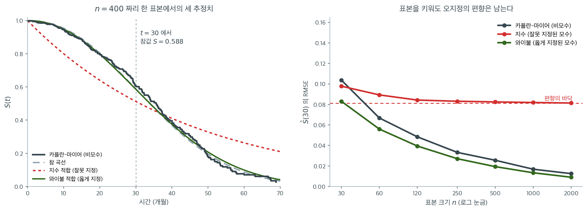

# 비모수 대 모수 대 준모수

이 장은 생존 모형의 세 갈래를 소개했다. 비모수적 방법(카플란–마이어, 넬슨–알렌, 로그순위 검정),
완전 모수 모형(지수, 와이불, 로그정규, 로그로지스틱), 그리고 준모수적인 콕스 모형이다. 각
갈래는 서로 다른 가정을 하고, 서로 다른 출력을 주며, 서로 다른 분석 목표에 적합하다.

이 절에서는 세 패러다임을 비교하여 주어진 문제에 적절한 접근을 고르도록 돕는다.

---

## 1. 세 가지 패러다임

### 비모수적 방법

비모수적 방법은 생존시간에 대해 **어떤 분포 가정도 하지 않는다.** 카플란–마이어 추정량은
생존곡선의 계단함수 추정치를 만들고, 로그순위 검정은 집단 간 곡선을 비교한다.

**강점:**

- 분포 오지정의 위험이 없다.
- 계산과 해석이 쉽다.
- 카플란–마이어 곡선이 모형에 의존하지 않는 생존 시각화를 제공한다.

**한계:**

- 연속형 공변량을 넣을 수 없다(집단별 층화만 가능하다).
- 추정치가 계단함수다. 매끄러운 생존곡선이나 위험곡선을 주지 않는다.
- 옳게 지정된 모수 모형보다 효율이 낮다.

### 완전 모수 모형

모수 모형은 유한차원 모수벡터(예: 지수의 $\lambda$, 와이불의 $(k, \lambda)$)를 통해 사건시간의
분포를 완전히 지정한다.

**강점:**

- 매끄럽고 해석 가능한 생존함수와 위험함수를 준다.
- 분포 가정이 옳으면 비모수 방법보다 효율이 높다(표준오차가 작다).
- 관측된 시간 범위 밖으로의 외삽이 (조심스럽게) 가능하다.
- 가능도 틀이 AIC, BIC, 가능도비 검정을 통한 모형 비교를 지원한다.

**한계:**

- 분포 가정이 틀리면 추정이 편향된다.
- 고른 분포족이 만들 수 있는 위험 모양으로 제한된다(예: 와이불은 비단조 위험을 포착하지
  못한다).

### 준모수(콕스) 모형

콕스 모형은 기저위험의 모수적 형태를 가정하지 않고 공변량이 위험에 미치는 효과를 지정한다.

**강점:**

- 기저위험의 오지정에 강건하다.
- 연속형 변수를 포함한 여러 공변량을 자연스럽게 수용한다.
- 위험비가 직접적이고 해석 가능한 의미를 갖는다.
- 부분가능도 추정이 $h_0(t)$를 추정할 필요를 없앤다.

**한계:**

- 기저위험을 직접 추정하지 못한다(적합 후 브레슬로 추정량으로만 가능하다).
- 비례위험 가정이 성립해야 한다. 위배되면 표준적 해석이 무효가 된다.
- 옳게 지정된 모수 모형보다 효율이 낮다.

---

## 2. 비교표

| 특징 | 비모수 | 모수 | 콕스(준모수) |
|:--------|:--------------:|:----------:|:---------------------:|
| 분포 가정 | 없음 | 완전 | 기저에 대해서는 없음 |
| 공변량 보정 | 불가(집단만) | 가능 | 가능 |
| 매끄러운 위험/생존 | 아니오 | 예 | 브레슬로를 통해서만 |
| 효율(옳게 지정 시) | 가장 낮음 | 가장 높음 | 중간 |
| 강건성 | 가장 높음 | 가장 낮음 | 높음 |
| 외삽 | 불가 | 가능(조심스럽게) | 불가 |
| 비례위험 가정 | 불필요 | 모형에 따라 다름 | 필요 |
| AIC로 모형 비교 | 해당 없음 | 가능 | 직접적으로는 불가 |



표 안의 "효율(옳게 지정 시)"과 "강건성" 두 줄이 서로 반대 방향을 가리키는데, 그 둘이 어떻게 맞붙는지를 그림으로 보자. 참 분포는 와이불($k = 2.2$, 척도 40)이고 관심 대상은 $S(30) = 0.588$이다.

왼쪽은 $n = 400$짜리 한 표본에서 세 추정치를 겹친 것이다. 절단율은 $38.0\%$다. 초록색 와이불 적합($\hat k = 2.11$, $\hat\lambda = 40.36$)은 회색 참 곡선 위에 거의 포개지고, 검은 카플란–마이어 계단도 그 주위를 따라간다. 반면 붉은 지수 적합은 **체계적으로 어긋난다.** 초반에는 생존을 과소추정하고 40개월을 넘어서면 과대추정한다. 상수 위험이라는 가정이 증가 위험 자료를 억지로 직선으로 펴 놓은 결과다.

오른쪽이 이 절의 핵심 주장이다. 표본 크기를 30에서 2000까지 늘려 가며 $\hat S(30)$의 RMSE를 재면, 카플란–마이어와 와이불은 $0.104 \to 0.013$, $0.083 \to 0.009$로 **0을 향해 내려간다.** 그런데 지수 모형은 $0.098$에서 출발해 $0.081$에서 멈춘 뒤 더 내려가지 않는다. 붉은 점선으로 그은 그 바닥이 바로 편향이다. 자료를 아무리 많이 모아도 $\hat S(30)$은 참값에서 $0.081$만큼 떨어진 자리로 수렴한다.

$n = 30$에서는 지수 모형($0.098$)이 카플란–마이어($0.104$)보다 오히려 조금 낫다는 점도 눈여겨보라. 표본이 아주 작으면 잘못된 가정이라도 분산을 줄여 주는 값이 편향이 주는 손해보다 클 수 있다. **그러나 $n = 60$을 넘어서면 순서가 영영 뒤집힌다.** 연습문제 2의 표 ("모수(틀림): 편향 줄지 않음, 분산 작음")가 이 교차점에서 그대로 확인된다.

그래서 세 갈래를 고르는 일은 취향의 문제가 아니라 **"내 분포 가정이 옳을 확률"과 "내 표본이 얼마나 큰가"를 저울질하는 문제**다. 콕스 모형이 널리 쓰이는 이유도 여기 있다. 가장 틀리기 쉬운 기저위험의 모양에 대해서만 가정을 포기하고, 공변량 효과에 대해서는 모수적 구조를 유지해 효율을 챙기기 때문이다.

---

## 3. 선택 지침

세 패러다임 중 무엇을 고를지는 분석 목표와 가용한 정보에 달려 있다.

### 비모수적 방법을 쓸 때

- 목적이 **탐색적**일 때. 모형을 정하기 전에 생존 양상을 시각화하고 집단을 비교한다.
- 보정할 **공변량이 없거나**, 모형에 의존하지 않는 기준선이 필요할 때.
- 표본이 작고 분포 가정이 의심스러울 때.

### 모수 모형을 쓸 때

- (배경지식이나 그림 점검으로) 그럴듯한 분포족이 있을 때.
- 위험함수나 생존함수의 **매끄러운 추정치**가 필요할 때.
- 목적이 관측 시간 범위를 넘어선 **예측이나 외삽**일 때.
- AIC나 가능도비 검정으로 모형을 비교하고 싶을 때.

### 콕스 모형을 쓸 때

- **여러 공변량**이 위험에 영향을 주고 그 효과를 동시에 추정하고 싶을 때.
- 기저위험의 모양을 모르거나 중요하지 않을 때.
- 비례위험 가정이 합당할 때(쇤펠트 잔차로 확인).
- 위험비가 주된 추론 대상일 때.

!!! tip "실무적 작업 흐름"

    1. 카플란–마이어 추정량으로 자료를 시각화하고 로그순위 검정으로 예비 집단 비교를 한다.
    2. 넬슨–알렌 누적위험 그림으로 위험의 모양(일정, 단조, 비단조)을 평가한다.
    3. 공변량이 중요하면 콕스 모형을 적합하고 비례위험 가정을 점검한다.
    4. 자료가 모수적 형태를 시사하면 모수 모형들을 적합하고 AIC로 비교한다.
    5. 투명성을 위해 카플란–마이어 곡선을 모형 기반 결과와 함께 보고한다.

---

## 4. 접근을 결합하기

세 패러다임은 서로 배타적이지 않다. 철저한 생존분석은 셋을 모두 쓰는 경우가 많다.

- 카플란–마이어 곡선이 비모수적 기준선을 제공한다.
- 모수 모형이 위험의 모양을 정량화하고 예측을 가능하게 한다.
- 콕스 모형이 분포 가정 없이 공변량 효과를 추정한다.

카플란–마이어 곡선을 모수 모형과 콕스 기반 생존곡선과 비교하는 것이 비형식적 적합도 점검이
된다. 비모수 곡선과 모형 기반 곡선이 크게 어긋나면 모형 오지정 가능성을 가리킨다.

!!! note "단 하나의 최선의 방법은 없다"

    최선의 접근은 자료, 연구 질문, 그리고 옹호할 수 있는 가정에 달려 있다. 판단이 서지 않으면
    콕스 모형이 합당한 기본 선택이다. 분포 가정을 피하면서 공변량을 수용하기 때문이다. 다만
    언제나 카플란–마이어 분석으로 보완해야 하고, 가능하다면 모수 분석도 함께 해야 한다.

---

<div class="aibox" markdown>

**AI로 보는 통계학 1.** 창 밖에서는 둘이 침묵하고 하나가 말한다

위 절은 세 접근을 함께 쓰면 서로가 서로의 점검이 된다고 했다. 그 점검을 수로 해 보면,
**어디까지 셋이 같고 어디서부터 갈라지는지**가 분명해진다. 그리고 갈라지는 자리가
시스템에서 가장 조용히 틀리는 자리다.

같은 자료에 셋을 모두 적합했다. 참 분포는 와이불이고 관측 창은 $24$ 개월이다.

```python
import numpy as np
from scipy.optimize import minimize

rng = np.random.default_rng(37)
N, HOR = 5000, 24.0                       # 24 개월만 관측한다
K_TRUE, LAM = 1.6, 18.0                   # 참 분포는 와이불
x = rng.normal(size=N)
T = LAM * rng.weibull(K_TRUE, N) * np.exp(-0.5 * x / K_TRUE)
C = rng.uniform(0, HOR, N)
t, d = np.minimum(T, C), (T <= C).astype(float)

o = np.argsort(t); ts, ds = t[o], d[o]                     # (가) 카플란-마이어
S_km = np.cumprod(1 - ds / np.arange(N, 0, -1))
n_times = int(ds.sum())                                    # 곡선을 적는 데 드는 점의 수

def nll(p):                                                # (나) 와이불
    k, lam, b = np.exp(p[0]), np.exp(p[1]), p[2]
    z = t / (lam * np.exp(-b * x / k))
    return -float((d * (np.log(k / (lam * np.exp(-b * x / k))) + (k - 1) * np.log(z))
                   - z ** k).sum())
pw = minimize(nll, [0.0, np.log(20), 0.0], method="BFGS").x
k_hat, lam_hat = np.exp(pw[0]), np.exp(pw[1])

def coxnll(b):                                             # (다) 콕스 + 브레슬로
    e = x[o] * b
    m = e.max()
    return -float((ds * (e - m - np.log(np.cumsum(np.exp(e - m)[::-1])[::-1]))).sum())
bc = minimize(coxnll, [0.0], method="BFGS").x[0]
e = np.exp(x[o] * bc)
H0 = np.cumsum(np.where(ds == 1, 1 / np.cumsum(e[::-1])[::-1], 0.0))

print(f"사건 {n_times:,} 건 / {N:,} 명,  마지막 사건 {ts[ds==1].max():.1f} 개월")
print(f"와이불 추정 k {k_hat:.3f} (참 {K_TRUE}),  lambda {lam_hat:.2f} (참 {LAM})\n")
print("   시점(개월)   카플란-마이어   콕스+브레슬로   와이불    참값")
for q in (6, 12, 24, 36, 60):
    i = np.searchsorted(ts, q, side="right") - 1
    km = S_km[i] if q <= ts[-1] else S_km[-1]
    cox = np.exp(-H0[min(i, len(H0) - 1)])
    print(f"{q:>11}{km:>15.4f}{cox:>15.4f}"
          f"{np.exp(-(q / lam_hat) ** k_hat):>10.4f}{np.exp(-(q / LAM) ** K_TRUE):>9.4f}")
print(f"\n곡선을 적는 데 드는 수:  카플란-마이어 {n_times:,} 쌍,  "
      f"콕스 계수 1 + 기저 {n_times:,},  와이불 모수 2 + 계수 1")
```

출력:

```
사건 2,029 건 / 5,000 명,  마지막 사건 23.4 개월
와이불 추정 k 1.698 (참 1.6),  lambda 17.40 (참 18.0)

   시점(개월)   카플란-마이어   콕스+브레슬로   와이불    참값
          6         0.8386         0.8527    0.8487   0.8416
         12         0.5778         0.5914    0.5874   0.5929
         24         0.2310         0.2042    0.1780   0.2050
         36         0.2310         0.2042    0.0322   0.0482
         60         0.2310         0.2042    0.0003   0.0010

곡선을 적는 데 드는 수:  카플란-마이어 2,029 쌍,  콕스 계수 1 + 기저 2,029,  와이불 모수 2 + 계수 1
```

**창 안에서는 셋이 같은 말을 한다.** $6$, $12$, $24$ 개월에서 세 값이 참값 주위에 모여
있다. 그러니 위 절이 말한 점검은 **통과**다 — 비모수 곡선과 모형 기반 곡선이 어긋나지
않으므로 분포 가정을 의심할 까닭이 없다.

**창 밖에서 갈라진다.** $36$ 개월과 $60$ 개월에서 카플란–마이어는 $0.2310$ 을, 콕스는
$0.2042$ 를 그대로 되풀이한다. 두 추정량은 **마지막 사건 이후를 정의하지 않으므로 곡선이
거기서 멈추는데**, 시스템은 그 마지막 값을 꺼내 돌려준다. 오류가 나지 않는다는 것이
문제다 — 「$5$ 년 생존확률 $0.23$」이라는 **그럴듯한 수**가 조용히 나간다. 참값은
$0.0010$ 이다.

**와이불은 말을 하지만 정확하지는 않다.** $36$ 개월에서 $0.0322$ 대 참값 $0.0482$,
$60$ 개월에서 $0.0003$ 대 $0.0010$ 이다. 방향은 맞고 자릿수도 맞지만 **창 밖의 값은
자료가 아니라 가정이 만든 것**이다. 이 보기에서는 참 분포가 정말 와이불이었는데도 그렇다.

마지막 줄이 실무의 차이를 더한다. 배포할 때 카플란–마이어는 사건 시각마다 한 쌍씩
$2{,}029$ 쌍을, 콕스는 계수 하나에 **기저 곡선 $2{,}029$ 개**를 함께 들고 다녀야 한다.
와이불은 수 셋이면 끝난다. **자료가 늘어 갱신할 때 다시 적어야 하는 것도 그 단위**다.

**그러니 세 접근의 선택은 어느 쪽이 더 정확한가의 문제가 아니다.** 관측 창 안을 묻는
일이면 셋이 같고, 창 밖을 묻는 일이면 **둘은 답할 수 없는데 답하는 것처럼 보인다.**
창 밖이 필요하면 모수 모형을 고르되 그 값이 가정의 산물임을 함께 적고, 필요 없다면
비모수 쪽이 가정을 덜 진다.

</div>

## 5. 무엇으로 고를 것인가

**정보기준.** 같은 자료에 적합한 모수 모형들은 AIC $= -2\hat\ell + 2p$ 와
BIC $= -2\hat\ell + p\ln n$ 으로 견준다. 둘의 차이와 어느 쪽이 무엇에 맞는지는
다음 절 [AIC와 일치도 지수](model_selection.md)가 다룬다.

**가능도비 검정.** 내포된 모형이면 $\Lambda = 2[\hat\ell_{\text{full}} -
\hat\ell_{\text{reduced}}] \to \chi^2_q$ 를 쓴다. 21.3절
[절단자료의 최대가능도](../parametric/mle_censored.md) 절 $7$ 에 지수 대 와이불의
보기가 있다.

---

### 그림 진단

형식적 기준은 언제나 시각적 점검으로 보완해야 한다.

1. **KM 겹쳐 그리기**: 카플란–마이어 곡선을 적합된 각 모수적 생존곡선과 함께 그린다. 체계적인
   어긋남은 오지정을 가리킨다.
2. **로그 누적위험 그림**: 와이불 모형이라면 $\ln \hat{H}(t)$ 대 $\ln t$가 직선이어야 한다.
3. **콕스–스넬 잔차**: 모형이 옳으면 콕스–스넬 잔차가 지수(1) 분포를 따른다. 잔차의 위험에 대한
   넬슨–알렌 추정치를 잔차 자체에 대해 그리면 45도 직선에 가까워야 한다.

---

## 6. 실무적 작업 흐름

생존 모형 선택의 체계적인 접근은 다음과 같다.

1. **탐색**: 집단마다 카플란–마이어 추정량과 넬슨–알렌 누적위험을 계산하고 자료를 시각화한다.
2. **위험 모양 평가**: 넬슨–알렌 그림을 살핀다. 위험이 일정한가($\hat{H}(t)$가 직선인가)?
   단조인가? 비단조인가?
3. **후보 적합**: 위험 모양에 근거해 적절한 모수 모형(지수, 와이불, 로그정규, 로그로지스틱)과
   콕스 모형을 적합한다.
4. **비교**: 비내포 모수 모형에는 AIC/BIC를, 내포 모형에는 가능도비 검정을 쓰고, 카플란–마이어
   곡선과 겹쳐 그린다.
5. **진단**: 콕스 모형은 비례위험 가정(쇤펠트 잔차)을, 모수 모형은 적합도(콕스–스넬 잔차)를
   점검한다.
6. **보고**: 최종 모형 결과와 함께 카플란–마이어 곡선을 비모수적 기준선으로 제시한다.

!!! tip "기본 권장안"

    판단이 서지 않으면 콕스 모형이 합당한 기본 선택이다. 분포 가정을 피하면서 공변량을
    수용한다. 다만 언제나 카플란–마이어 분석으로 보완해야 하고, 가능하면 모수 분석도 함께
    해야 한다.

---

## 7. 단 하나의 최선은 없다

- **단 하나의 최선의 방법은 없다.** 선택은 연구 질문, 위험의 모양, 그리고 옹호할 수 있는 가정에
  달려 있다.
- **비모수적 방법**은 탐색에 언제나 적절하며 모형에 의존하지 않는 기준선을 제공한다.
- **모수 모형**은 매끄러운 추정치나 외삽이 필요하고 분포 가정이 자료로 뒷받침될 때 선호된다.
- **콕스 모형**은 공변량 효과가 주된 관심사이고 기저위험의 모양이 중요하지 않을 때 선호된다.
- 세 패러다임은 **상보적**이다. 철저한 생존분석은 대개 셋을 모두 쓴다.

---

## 연습문제

<div class="drillbox" markdown>

**연습문제 1.** <span class="diff med" title="중간"></span>
다음 각 상황에서 비모수, 모수, 콕스 중 무엇을 고를지 정하고 이유를 밝혀라.

**(a)** 임상시험에서 신약과 위약의 생존곡선이 다른지 검정하려 한다. 무작위 배정되었으므로
보정할 공변량이 없다.

**(b)** 대출 포트폴리오의 10년 누적 부도율을 예측하려 한다. 관측 자료는 3년치뿐이다.

**(c)** 환자 12명의 나이, 성별, 병기, 치료법이 생존에 미치는 효과를 각각 추정하려 한다.

**(d)** 부품의 위험함수가 마모형(증가)인지 초기고장형(감소)인지 판정하려 한다.

</div>

??? success "풀이"

    | 상황 | 선택 | 이유 |
    |---|---|---|
    | (a) | **비모수** | 무작위 배정으로 공변량 보정이 불필요하고, 카플란–마이어 곡선과 로그순위 검정이 가장 적은 가정으로 답한다 |
    | (b) | **모수** | 3년 자료로 10년을 말하려면 외삽이 필요하고, 외삽은 모수 모형만 가능하다 |
    | (c) | **주의: 어느 쪽도 어렵다** | 아래 참조 |
    | (d) | **모수(와이불)** | 형상모수 $k$가 곧 답이다. 넬슨–알렌 그림으로 먼저 확인한다 |

    **(b)의 단서.** 외삽은 "가능하다"는 것이지 "믿을 만하다"는 것이 아니다. 3년 자료로 10년을
    예측하면 결과가 전적으로 분포 가정에 달려 있다. 21.3절에서 보았듯 로그정규와 로그로지스틱은
    관측 구간에서 거의 같은 적합을 주면서도 꼬리에서 크게 갈린다. **여러 모수족의 예측을
    나란히 보고하여 가정 의존성을 드러내는 것**이 정직한 대응이다.

    **(c)의 문제.** 환자가 12명이면 사건은 그보다 적다. 공변량 4개를 콕스 모형에 넣으면
    사건당 변수가 3개 미만이 되어 추정이 심하게 불안정하다. 흔히 쓰는 경험칙은 **변수당 사건
    10건**이며, 12명으로는 변수 하나도 감당하기 어렵다.

    현실적인 대안은 (i) 자료를 더 모으거나, (ii) 배경지식으로 가장 중요한 공변량 하나만
    고르거나, (iii) 벌점 콕스 회귀(능형 또는 라쏘)를 쓰는 것이다. "표본이 작으니 비모수를
    쓰자"는 답은 여기서 통하지 않는다. 비모수 방법은 애초에 공변량 효과를 추정하지 못하기
    때문이다. $\square$

<div class="drillbox" markdown>

**연습문제 2.** <span class="diff med" title="중간"></span>
비교표에서 "효율: 모수가 가장 높고 비모수가 가장 낮다"고 했다. 이 서술에 붙은 단서
"옳게 지정 시"가 왜 결정적인지 설명하라.

</div>

??? success "풀이"

    **옳게 지정되었을 때.** 모수 모형은 자료의 모든 관측치를 소수의 모수 추정에 동원한다.
    지수 모형이라면 사건 수 $d$개 전부가 $\lambda$ 하나를 추정하는 데 쓰이므로 표준오차가
    $\hat\lambda/\sqrt{d}$로 작다. 반면 카플란–마이어는 각 시점의 조건부확률을 그 시점의
    위험집합만으로 추정하므로 정보가 흩어진다. 이것이 효율 차이의 원천이다.

    **잘못 지정되었을 때.** 모수 모형의 추정치는 **일치성조차 잃는다.** 표본을 아무리 키워도
    참값으로 수렴하지 않는다. 예컨대 위험이 증가하는 자료에 지수 모형을 적합하면
    $\hat\lambda$가 어떤 "평균적인" 위험으로 수렴하는데, 그 값은 어느 시점의 참 위험과도
    같지 않다. 표준오차는 작게 나오지만 **작은 표준오차가 틀린 값을 감싸고 있을 뿐**이다.

    이것이 편향–분산 절충의 극단적인 형태다.

    | | 편향 | 분산 |
    |---|---|---|
    | 비모수 | 0 | 큼 |
    | 모수(옳음) | 0 | 작음 |
    | 모수(틀림) | **줄지 않음** | 작음 |

    표본이 커지면 비모수의 분산은 0으로 가지만 잘못 지정된 모수 모형의 편향은 그대로다.
    따라서 **$n$이 크면 비모수가 이기고, $n$이 작고 가정이 옳으면 모수가 이긴다.**

    콕스 모형이 좋은 절충인 이유가 여기 있다. 가장 틀리기 쉬운 부분(기저위험의 모양)에 대해
    아무 가정도 하지 않으면서, 공변량 효과에 대해서는 모수적 구조를 써서 효율을 얻는다.
    $\square$

<div class="drillbox" markdown>

**연습문제 3.** <span class="diff med" title="중간"></span>
비교표에서 콕스 모형의 "AIC로 모형 비교: 직접적으로는 불가"라고 한 이유를 설명하라.
그렇다면 콕스 모형들끼리는 어떻게 비교하는가?

</div>

??? success "풀이"

    **직접 비교가 안 되는 이유.** 콕스 모형이 최대화하는 것은 완전한 로그가능도가 아니라
    **부분** 로그가능도다. AIC $= -2\ell + 2p$의 정당화는 완전한 가능도와 쿨백–라이블러
    발산 사이의 관계에서 나오는데, 부분가능도에는 그 논증이 그대로 적용되지 않는다. 특히
    부분가능도의 값은 사건 수에만 의존하고 기저위험을 전혀 반영하지 않으므로, 서로 다른
    **자료**에 적합한 콕스 모형들 사이에서는 값 자체를 비교할 수 없다.

    **같은 자료의 콕스 모형끼리는 비교할 수 있다.** 실무에서는 다음을 쓴다.

    1. **가능도비 검정(내포 모형).** 공변량을 추가한 모형과 뺀 모형의 부분 로그가능도 차이의
       두 배가 근사적으로 $\chi^2_q$를 따른다. 이론적으로 잘 정립되어 있고 널리 쓰인다.
    2. **부분가능도 기반 AIC.** $-2\ell_P + 2p$를 계산해 쓰는 관행이 있다. 엄밀한 정당화는
       약하지만 **같은 자료, 같은 사건 집합**이라는 조건에서 실무적으로 유용하며 대부분의
       소프트웨어가 보고한다.
    3. **일치도 지수(C-지수).** 다음 절에서 다룬다. 가능도와 무관하게 예측의 순위 성능을
       재므로 비모수·모수·콕스 모형을 **한 척도에서** 비교할 수 있다. 이것이 C-지수의 가장 큰
       장점이다.
    4. **교차검증.** 자료를 나누어 검정 부분의 부분 로그가능도나 C-지수를 평가한다. 가장
       가정이 적지만 계산이 비싸다.

    **핵심:** 모수 모형끼리는 AIC, 콕스 모형끼리는 가능도비 검정, 서로 다른 갈래를 가로질러
    비교하려면 C-지수나 교차검증을 쓴다. $\square$

---

<div class="drillbox" markdown>

**연습문제 4.** <span class="diff easy" title="쉬움"></span>
AIC 비교

관측치 150개에 모수 모형 세 개를 적합했다.

| 모형 | 모수 ($p$) | 최대 로그가능도 ($\hat{\ell}$) |
|:------|:----------------:|:---------------------------------:|
| 지수 | 1 | $-420.3$ |
| 와이불 | 2 | $-405.8$ |
| 로그로지스틱 | 2 | $-407.2$ |

**(a)** 각 모형의 AIC와 BIC를 계산하라.

**(b)** AIC는 어느 모형을 선호하는가? BIC는?

**(c)** 지수 대 와이불의 가능도비 검정을 수행하라.

</div>

??? success "풀이"

    **(a)** AIC $= -2\hat{\ell} + 2p$이고 BIC $= -2\hat{\ell} + p\ln n$이다
    ($\ln 150 = 5.011$).

    | 모형 | AIC | BIC |
    |:------|:---:|:---:|
    | 지수 | $2(420.3) + 2 = 842.6$ | $2(420.3) + 5.011 = 845.6$ |
    | 와이불 | $2(405.8) + 4 = 815.6$ | $2(405.8) + 10.022 = 821.6$ |
    | 로그로지스틱 | $2(407.2) + 4 = 818.4$ | $2(407.2) + 10.022 = 824.4$ |

    **(b)** AIC(815.6)와 BIC(821.6) 모두 와이불 모형을 선호한다. 와이불과 로그로지스틱의
    차이는 AIC와 BIC 모두에서 $2.8$로 같다. 두 모형의 모수 개수가 같아 벌점이 소거되기
    때문이며, 이 경우 AIC와 BIC의 순위는 반드시 일치한다.

    **(c)** 가능도비 검정(지수 대 와이불)은

    $$
    \Lambda = 2[-405.8 - (-420.3)] = 2 \times 14.5 = 29.0
    $$

    이다. $H_0: k = 1$ 아래에서 $\Lambda \sim \chi^2_1$이고 $\alpha = 0.05$의 임계값은
    3.84다. $29.0 \gg 3.84$이므로 지수 모형을 기각한다. 상수 위험 가정은 지지되지 않는다.

---

<div class="drillbox" markdown>

**연습문제 5.** <span class="diff med" title="중간"></span>
패러다임 선택

각 상황에서 어느 모형화 패러다임(비모수, 모수, 준모수)이 가장 적절한지 밝히고 이유를 설명하라.

**(a)** 환자 30명, 공변량 없는 탐색적 연구.

**(b)** 나이와 병기를 보정하면서 처리가 생존에 미치는 효과를 추정하는 것이 주된 목표인
임상시험.

**(c)** 관측 기간을 넘어선 고장시간을 예측하는 것이 목표인 신뢰성 연구.

</div>

??? success "풀이"

    **(a)** **비모수**(카플란–마이어). 표본이 작고 공변량이 없으므로 분포 가정이 위험하다.
    카플란–마이어 추정량이 모형에 의존하지 않는 생존곡선을 주고, 필요하면 로그순위 검정으로
    집단을 비교할 수 있다.

    **(b)** **준모수**(콕스 모형). 목표가 공변량(처리, 나이, 병기)이 위험에 미치는 효과를
    추정하는 것이다. 콕스 모형은 기저위험 분포를 지정하지 않고 여러 공변량을 다룬다.

    **(c)** **모수** 모형(예: 와이불). 관측 시간 범위를 넘어선 외삽에는 완전히 지정된 분포가
    필요하다. 비모수 모형과 콕스 모형은 외삽할 수 없다.

    !!! warning "(c)에서 \"할 수 있다\"와 \"믿을 만하다\"는 다르다"
        모수 모형만이 외삽할 수 있다는 것은 맞지만, 그렇게 얻은 예측이 신뢰할 만하다는 뜻은
        아니다. 외삽값은 전적으로 분포 가정에 달려 있고, 그 가정은 관측 구간 밖에서 검증할
        길이 없다. 21.5절에서 보았듯 로그정규와 로그로지스틱은 관측 구간에서 거의 같은 적합을
        주면서 꼬리에서 크게 갈린다.

        정직한 실무는 여러 분포족의 예측을 나란히 제시하여 가정 의존성의 크기를 드러내는
        것이다. 예측 하나만 보고하면 실제로는 없는 확실성을 만들어 내는 셈이다.

---

<div class="drillbox" markdown>

**연습문제 6.** <span class="diff med" title="중간"></span>
콕스–스넬 잔차

콕스–스넬 잔차가 어떻게 정의되고 전체 모형 적합도를 평가하는 데 어떻게 쓰이는지 설명하라.

</div>

??? success "풀이"

    추정된 생존함수가 $\hat{S}(t_i)$인 적합된 모수 모형에서 대상 $i$의 콕스–스넬 잔차는

    $$
    r_i = -\ln \hat{S}(t_i) = \hat{H}(t_i)
    $$

    로, 관측 시점에서의 추정 누적위험이다. 절단된 관측치에서는 $r_i$도 절단된다.

    **핵심 성질**: 모형이 옳게 지정되어 있으면 바탕 생존분포와 무관하게 콕스–스넬 잔차가
    $\text{Exp}(1)$ 분포를 따른다. $T \sim F$이면 $-\ln S(T) \sim \text{Exp}(1)$이기
    때문이다.

    이는 확률적분변환의 한 형태다. $U = F(T) \sim \text{Uniform}(0,1)$이므로
    $S(T) = 1 - U$ 역시 균등분포이고, $-\ln(\text{Uniform}(0,1)) \sim \text{Exp}(1)$이다.

    **진단**: 잔차의 누적위험에 대한 넬슨–알렌 추정치를 계산하고 잔차 자체에 대해 그린다.
    모형이 잘 맞으면 점들이 45도 직선 $H(r) = r$을 따라야 한다. 벗어나면 오지정을 가리킨다.

    다만 이 진단에는 알려진 한계가 있다. 모수를 자료에서 추정했으므로 잔차가 정확히
    $\text{Exp}(1)$을 따르지 않으며, 특히 꼬리에서 어긋난다. 큰 잔차 몇 개가 45도 직선에서
    벗어나는 것은 흔한 일이므로 그것만으로 모형을 기각하지 말라.

---

<div class="drillbox" markdown>

**연습문제 7.** <span class="diff med" title="중간"></span>
효율 비교

**(a)** 생존 모형 비교의 맥락에서 "통계적 효율"이 무엇을 뜻하는지 설명하라.

**(b)** 옳게 지정된 모수 모형이 카플란–마이어 추정량보다 효율적인 이유는?

**(c)** 이 효율의 이점이 단점이 되는 조건은 무엇인가?

</div>

??? success "풀이"

    **(a)** 통계적 효율은 추정의 정밀도를 뜻한다. 같은 표본 크기에서 분산이 작을수록(신뢰구간이
    좁을수록) 효율적인 추정량이다.

    **(b)** 옳게 지정된 모수 모형은 알려진 분포 형태를 이용해 모든 관측치에 걸쳐 "힘을 빌린다."
    카플란–마이어 추정량은 분포 구조를 활용하지 않고 각 사건시간을 독립적으로 다룬다. 모수
    모형의 작은 분산은 옳은 구조 가정에서 나오며, 이 가정이 추정해야 할 양의 실질적인 개수를
    줄인다.

    구체적으로, 사건이 100건인 자료에서 카플란–마이어는 100개의 조건부확률을 추정하지만
    지수 모형은 모수 하나만 추정한다. 100개의 정보가 하나로 모이므로 표준오차가
    $1/\sqrt{100}$ 수준으로 작아진다.

    **(c)** 모수 가정이 **틀리면** 효율의 이점이 단점이 된다. 잘못 지정된 모형은 비효율적일
    뿐 아니라 **편향된다.** 틀린 생존함수로 수렴한다. 카플란–마이어 추정량은 참 분포와 무관하게
    언제나 일치성을 갖는다. 즉 모수 모형의 효율 이득은 강건성을 대가로 얻는 것이다.

    더 위험한 점은 **표준오차가 이 편향을 전혀 알려 주지 않는다**는 것이다. 잘못 지정된
    모형도 좁은 신뢰구간을 보고하며, 그 구간이 참값을 포함하지 않을 뿐이다. 그림 진단이
    필수적인 이유가 여기 있다.

---

<div class="drillbox" markdown>

**연습문제 8.** <span class="diff med" title="중간"></span>
패러다임 결합하기

어떤 임상시험이 신약이 전체 생존에 미치는 효과를 조사한다. 세 패러다임을 모두 쓰는 완전한 분석
전략을 서술하고 각각이 무엇을 기여하는지 설명하라.

</div>

??? success "풀이"

    **1단계 --- 비모수적 탐색.** 처리군과 대조군의 카플란–마이어 생존곡선을 계산하고 95%
    신뢰띠와 함께 시각화한다. 로그순위 검정으로 예비 비교를 한다. 넬슨–알렌 누적위험 그림을
    살펴 위험의 모양(일정, 단조, 비단조)을 평가한다.

    **2단계 --- 공변량 보정을 위한 콕스 모형.** 처리 지시자, 나이, 성별, 병기를 공변량으로
    갖는 콕스 비례위험 모형을 적합한다. 위험비와 신뢰구간을 추정한다. 쇤펠트 잔차로 비례위험
    가정을 점검한다.

    **3단계 --- 예측을 위한 모수 모형.** 1단계에서 파악한 위험 모양에 근거해 후보 모수 모형을
    적합한다(예: 위험이 단조면 와이불). AIC로 비교한다. 가장 좋은 모수 모형으로 중앙 생존시간을
    외삽하고 매끄러운 생존곡선 추정치를 만든다.

    **4단계 --- 통합과 보고.** 모수적 생존곡선과 콕스 기반 브레슬로 생존 추정치를 카플란–마이어
    곡선 위에 겹쳐 그린다. 세 방법이 일치하면 결론에 대한 신뢰가 커진다. 어긋나면 오지정
    가능성을 알리는 신호다. 콕스 모형의 처리 위험비를 주된 결과로, 카플란–마이어 곡선을 모형에
    의존하지 않는 기준선으로, 모수 모형을 매끄러운 추정과 예측용으로 보고한다.

    !!! warning "분석 계획은 자료를 보기 전에 확정해야 한다"
        위 흐름에는 함정이 하나 숨어 있다. 3단계에서 "1단계의 위험 모양에 근거해" 모형을
        고른다고 했는데, 이는 같은 자료를 두 번 쓰는 것이다. 자료를 보고 모형을 고른 뒤
        그 모형의 p-값과 신뢰구간을 보고하면 선택 과정의 불확실성이 반영되지 않는다.

        임상시험처럼 확증적 분석이 필요한 상황에서는 **주된 분석(예: 로그순위 검정과 콕스
        모형의 처리 위험비)을 자료를 보기 전에 프로토콜에 명시**해야 한다. 위험 모양에 따라
        모형을 고르는 탐색적 단계는 부차적 분석으로 명확히 구분해 보고한다. 1장에서 다룬
        설계와 분석의 구분이 여기에서도 그대로 적용된다.
---

## 정리하며

생존 모형의 **세 갈래**를 정리한다.

| | 가정 | 출력 | 쓰는 곳 |
|---|---|---|---|
| 비모수 | 거의 없음 | 곡선, 집단 비교 | 탐색, 기술 |
| 준모수(콕스) | 비례위험 | **위험비** | 공변량 효과 |
| 모수 | 분포 지정 | 매끄러운 곡선, **외삽** | 예측, 수명 추정 |

- **가정이 강해질수록 얻는 것이 많아진다.** 비모수는 안전하지만 공변량을 못 다루고, 모수는 외삽까지 되지만 분포가 틀리면 편향된다.
- **콕스가 중간에서 가장 널리 쓰인다.** 분포를 지정하지 않으면서 공변량 효과를 주기 때문이며, 의학 연구의 표준이다.
- **목적이 선택을 정한다.** 두 집단을 비교만 하면 카플란–마이어 + 로그순위, 효과를 조정해 보려면 콕스, 미래 시점을 예측하려면 모수 모형이다.
- **세 갈래를 함께 보고하는 것도 좋다.** 결론이 일치하면 신뢰가 높아진다.

다음 절 **[AIC와 일치도 지수](model_selection.md)**로 넘어간다. 어느 모형을 고를지 적합도와 예측력의 두 잣대로 가린다.
